
<a href="{{ '/subjects/CCNA/' | relative_url }}">← 返回 CCNA 目录</a>

第一卷 · 网络入门

<nav class="ccna-chapter-nav" aria-label="章节导航"><a href="v1-02.html">下一章 →</a></nav>



<section data-epub-type="chapter">
<h2 class="h2" id="ch01">第 1 章</h2>
<h2 class="h2a">TCP/IP 网络入门</h2>

本章涵盖以下考试主题：

1.0 网络基础

1.3 比较物理接口和布线类型

1.3.a 单模光纤、多模光纤、铜缆

1.3.b 连接方式（以太网共享介质和点对点连接）

欢迎开始 CCNA 学习的第一章！本章是<a href="#part01">第一部分</a>的开篇，这一部分重点介绍网络基础知识。

网络能够正常运行，是因为各种设备和软件都遵循规则。这些规则以标准和协议的形式存在，是对网络某个部分应如何工作的约定。然而，标准和协议数量繁多，普通网络工程师可能因此难以理解和处理网络问题，所以网络领域在不同历史时期采用过多种网络模型。网络模型为标准和协议规定了结构，并将其划分为不同类别（层）。随着新的标准和协议不断出现，网络从业者可以在已有模型的框架中理解这些新细节。

你可以把网络模型想象成建造房屋所用的一套建筑图纸。建造房屋需要许多不同工种的人员参与，例如木结构工、电工、泥瓦工和油漆工等。图纸有助于确保房屋的各个部分能够协调配合，构成一个整体。同样，网络产品的制造者，以及使用这些产品构建计算机网络的人，也会遵循特定的网络模型。该模型规定网络各部分应如何工作，以及各部分应如何相互配合，从而使整个网络正常运行。

如今，TCP/IP 是应用最广泛的网络模型。从手机到大型主机，几乎所有现存的计算机操作系统（OS）都支持 TCP/IP。如今使用 Cisco 产品构建的每一个网络也都支持 TCP/IP。因此，CCNA 考试非常重视 TCP/IP，这并不奇怪。本章介绍 TCP/IP 的一个主要目的，就是借助 TCP/IP 模型中不同层的职责和功能，说明各种网络概念。

请注意，本书大多数章节都围绕某个具体的 CCNA 考试主题展开，但本章并非如此。本章介绍 TCP/IP 模型的背景知识，以及你需要了解的基本概念，以便更好地理解 CCNA 涉及的详细内容。

<section>
<h3 class="h3" id="ch01lev1sec1">自测</h3>

如果你希望根据得分决定在本章投入多少时间，可以完成这组自测题（在此作答，或使用 PTP 软件）。各题答案的选项字母列在自测题之后的页面底部。书末和配套网站上的<a href="#ref-appc">附录 C</a>都包含答案及解析。你也可以在 PTP 测试软件中找到答案及解析。

<figure class="table" id="ch01tab01">
<figcaption>

<strong>表 1-1</strong> 自测：基础知识小节与题目对应关系

</figcaption>
<table class="all">
<thead>
<tr>
<th class="th">
基础知识小节
</th>
<th class="th">
题目
</th>
</tr>
</thead>
<tbody>
<tr>
<td class="border">
从不同视角认识网络
</td>
<td class="border">
无
</td>
</tr>
<tr>
<td class="border">
TCP/IP 网络模型
</td>
<td class="border">
1–4
</td>
</tr>
<tr>
<td class="border">
数据封装术语
</td>
<td class="border">
5–6
</td>
</tr>
</tbody>
</table>
</figure>

<strong><a id="quess1_1" href="#ques1_1a">1</a>.</strong> 以下哪些协议属于 TCP/IP 传输层协议？（选择两个答案。）

<ol class="lower-alpha">
<li>
以太网
</li>
<li>
HTTP
</li>
<li>
IP
</li>
<li>
UDP
</li>
<li>
SMTP
</li>
<li>
TCP
</li>
</ol>

<strong><a id="quess1_2" href="#ques1_2a">2</a>.</strong> 以下哪些协议属于 TCP/IP 数据链路层协议？（选择两个答案。）

<ol class="lower-alpha">
<li>
以太网
</li>
<li>
HTTP
</li>
<li>
IP
</li>
<li>
UDP
</li>
<li>
SMTP
</li>
<li>
TCP
</li>
<li>
802.11
</li>
</ol>

<strong><a id="quess1_3" href="#ques1_3a">3</a>.</strong> HTTP 请求 TCP 发送一些数据，并确保这些数据被正确接收，这一过程属于什么？

<ol class="lower-alpha">
<li>
同层交互
</li>
<li>
相邻层交互
</li>
<li>
TCP/IP 模型
</li>
<li>
以上答案都正确。
</li>
</ol>

<strong><a id="quess1_4" href="#ques1_4a">4</a>.</strong> 一台计算机上的 TCP 将某个 TCP 报文段标记为报文段 1，接收端计算机随后确认收到了 TCP 报文段 1，这一过程属于什么？

<ol class="lower-alpha">
<li>
数据封装
</li>
<li>
同层交互
</li>
<li>
相邻层交互
</li>
<li>
TCP/IP 模型
</li>
<li>
以上答案都正确。
</li>
</ol>

<strong><a id="quess1_5" href="#ques1_5a">5</a>.</strong> Web 服务器在网页内容前添加 TCP 首部，随后添加 IP 首部，再添加数据链路层首部和尾部，这一过程属于什么？

<ol class="lower-alpha">
<li>
数据封装
</li>
<li>
同层交互
</li>
<li>
TCP/IP 模型
</li>
<li>
以上答案都正确。
</li>
</ol>

<strong><a id="quess1_6" href="#ques1_6a">6</a>.</strong> 将数据封装在数据链路层首部和尾部之间后，所形成的实体专门用以下哪个术语表示？

<ol class="lower-alpha">
<li>
数据（Data）
</li>
<li>
数据块（Chunk）
</li>
<li>
报文段（Segment）
</li>
<li>
帧（Frame）
</li>
<li>
分组（Packet）
</li>
</ol>

自测答案：

<strong><a id="ques1_1a" href="#ref-ques1_1">1</a></strong> D 和 F

<strong><a id="ques1_2a" href="#ref-ques1_2">2</a></strong> A 和 G

<strong><a id="ques1_3a" href="#ref-ques1_3">3</a></strong> B

<strong><a id="ques1_4a" href="#ref-ques1_4">4</a></strong> B

<strong><a id="ques1_5a" href="#ref-ques1_5">5</a></strong> A

<strong><a id="ques1_6a" href="#ref-ques1_6">6</a></strong> D

</section>
<section>
<h3 class="h3box" id="ch01lev1sec2">基础知识</h3>
</section>
<section>
<h3 class="h3" id="ch01lev1sec3">从不同视角认识网络</h3>

假设你刚开始接触网络。和许多人一样，你对网络的认识可能来自网络使用者的视角，而不是构建网络的网络工程师的视角。对一些人来说，他们对网络的理解可能源于在家中通过光纤以太网或有线电视等高速互联网连接上网的经历，如<a href="#ch01fig01">图 1-1</a> 所示。

<figure class="image-c" id="ch01fig01">
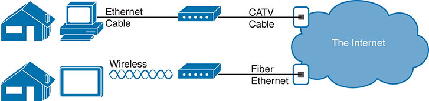
<figcaption>

<strong>图 1-1</strong> <em>终端用户眼中的高速互联网连接</em>

<aside class="hidden" id="a01fig01">

示意图左侧有两所房屋，表示使用不同设备的终端用户，它们分别连接到以云形表示的互联网。第一台设备通过以太网电缆连接路由器，路由器再通过 CATV 电缆连接互联网。第二台设备利用无线技术连接路由器，图中以无线电波表示这条连接；路由器通过光纤以太网连接互联网。

</aside>
</figcaption>
</figure>

图的上半部分展示了一位典型的高速有线电视互联网用户。PC 通过以太网电缆连接电缆调制解调器，电缆调制解调器再通过圆形同轴电缆连接墙上的有线电视（CATV）插座。这种电缆与连接电视机和墙上 CATV 插座的电缆相同。由于有线电视互联网服务持续提供连接，用户只需坐到 PC 前，就可以发送电子邮件、浏览网站、拨打网络电话，以及使用其他工具和应用程序。

图的下半部分在家庭与服务提供商之间使用以太网。首先，平板电脑使用一种称为<em>无线局域</em><em>网（wireless LAN）</em>的无线技术。在这个示例中，路由器使用另一种技术——以太网，通过光纤电缆与互联网通信。

家庭网络和公司使用的网络采用相似的网络技术。在信息技术（IT）领域，由某家公司或企业创建、用于员工之间通信的网络称为<em>企业网络</em>。规模较小的家庭网络用于商业用途时，通常称为小型办公室／家庭办公室（SOHO）网络。

企业网络用户对所在公司或学校的企业网络通常有一定认识。他们知道自己完成许多任务都需要使用网络。PC 用户可能知道，自己的 PC 通过以太网电缆连接到墙上的相应插座，如<a href="#ch01fig02">图 1-2</a> 的上半部分所示。这些用户带着笔记本电脑到会议室开会时，也可能会使用无线局域网。<a href="#ch01fig02">图 1-2</a> 展示了终端用户眼中的这两种企业网络连接方式。

<figure class="image-c" id="ch01fig02">
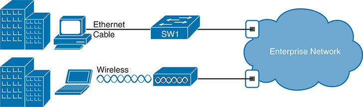
<figcaption>

<strong>图 1-2</strong> <em>企业网络的示意表示</em>

<aside class="hidden" id="a01fig02">

示意图中有两台设备：上方设备通过以太网电缆连接标为“SW1”的交换机，下方设备通过无线方式连接。交换机再连接到企业网络。

</aside>
</figcaption>
</figure>

注意

在网络图中，云形表示网络中的某个部分，而该部分的细节对这幅图要说明的问题并不重要。在这里，<a href="#ch01fig02">图 1-2</a> 省略了如何构建企业网络的细节。

有些用户甚至可能根本没有网络的概念。他们只是享受网络提供的功能，例如在社交媒体网站上发帖、打电话、在互联网上搜索信息、听音乐，以及向手机中下载无数应用，而不关心网络如何工作，也不关心自己喜欢的设备如何连接到网络。

无论你已经了解多少网络工作原理，本书及相关认证都会帮助你学习网络如何完成其任务。这个任务很简单：把数据从一台设备传送到另一台设备。本章其余内容，以及本书第一部分的其余章节，将介绍构建企业网络的基础知识，使网络能够在两台设备之间传送数据。

</section>
<section>
<h3 class="h3" id="ch01lev1sec4">TCP/IP 网络模型</h3>

<a id="key_005" href="#ref-gloss_281">网络模型</a>有时也称为<em>网络体系结构</em>或<em>网络蓝图</em>，它指的是一整套文档。每份文档分别描述网络所需的一项小功能；这些文档合在一起，就定义了计算机网络正常工作所需发生的一切。有些文档定义<em>协议</em>，即设备为了通信而必须遵循的一组逻辑规则。另一些文档则规定网络的某些物理要求。例如，一份文档可能规定，在某种特定电缆上传输数据时使用的电压和电流水平。

你可以把网络模型想象成建造房屋的建筑图纸。当然，没有图纸也可以建房子，但图纸可以确保房屋具有正确的地基和结构，使其不会倒塌，并留出合适的隐蔽空间来容纳给排水、电气、燃气等设施。此外，按照图纸建造房屋的不同工种人员，例如木结构工、电工、泥瓦工和油漆工等，都知道只要遵循图纸，自己负责的工作就不应给其他工人造成问题。

同样，你也可以自己编写软件、制作网卡等，从头构建自己的网络。但直接购买和使用已经符合某种知名网络模型或蓝图的产品，要容易得多。由于网络产品厂商在设计产品时遵循某种网络模型，这些产品应当能够良好地协同工作。

<section>
<h4 class="h4" id="ch01lev2sec1">TCP/IP 的发展历程</h4>

如今，计算机网络领域使用的是 TCP/IP 这一网络模型。但情况并非一直如此简单。曾经，包括 TCP/IP 在内的网络协议都还不存在。最早的网络协议由厂商创建，而且只支持该厂商自己的计算机。

例如，在 20 世纪 70 年代和 80 年代，IBM 在许多计算机市场中占据最大的市场份额。该公司于 1974 年发布了系统网络体系结构（Systems Network Architecture，SNA）网络模型。其他厂商也创建了各自专有的网络模型。因此，如果你的公司购买了三家厂商的计算机，网络工程师往往就需要根据各家厂商的网络模型构建三个不同的网络，再设法将它们连接起来，使组合后的网络复杂得多。<a href="#ch01fig03">图 1-3</a> 左侧大致展示了 20 世纪 80 年代、TCP/IP 尚未在企业互联网络中普及之前，一家公司的企业网络可能是什么样子。

<figure class="image-c" id="ch01fig03">
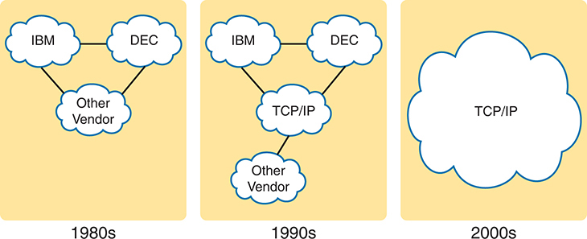
<figcaption>

<strong>图 1-3</strong> <em>历史演进：从专有模型到开放的 TCP/IP 模型</em>

<aside class="hidden" id="a01fig03">

在表示 20 世纪 80 年代的部分中，分别标有“IBM”“DEC”和“其他厂商”的云形代表各自专有的网络模型。20 世纪 90 年代的部分展示了过渡阶段：这些专有模型连接到一个标有“TCP/IP”的更大云形，表示开放网络标准的兴起。到了 21 世纪初，示意图中只剩下一个标有“TCP/IP”的大云形，表示网络全面转向开放标准。

</aside>
</figcaption>
</figure>

虽然厂商定义的专有网络模型通常运行良好，但开放且与厂商无关的网络模型有助于促进竞争，并降低复杂性。国际标准化组织（ISO）承担了创建这种模型的任务。早在 20 世纪 70 年代末，ISO 就开始了后来被称为开放系统互连（Open Systems Interconnection，OSI）网络模型的开发工作。ISO 为 OSI 模型设定了一个宏大的目标：将数据网络协议标准化，使全世界的所有计算机都能够相互通信。ISO 朝着这个雄心勃勃且意义重大的目标努力，世界上大多数技术发达国家都有人员参与其中。

另一项旨在创建开放、与厂商无关且公开的网络模型的工作，源于美国国防部（DoD）的一份合同；这项工作的组织方式相对不那么正式。来自多所大学的研究人员自愿参与，协助进一步开发最初国防部工作所涉及的协议。这些努力最终形成了另一个与 OSI 竞争的开放网络模型，称为 TCP/IP。

20 世纪 90 年代，企业开始在自己的企业网络中加入 OSI、TCP/IP，或者同时加入两者。但到了 90 年代末，TCP/IP 已成为普遍选择，而 OSI 逐渐退出。<a href="#ch01fig03">图 1-3</a> 中间部分展示了那个十年中企业网络的大致情况：网络仍然基于多种网络模型构建，但其中已经包含 TCP/IP。

进入 21 世纪后，TCP/IP 占据了主导地位。某些专有网络模型仍然存在，但多数已被弃用，取而代之的是 TCP/IP。OSI 模型的开发在一定程度上受到“先制定标准、后编写代码”方式的影响，始终没有在市场上取得成功。而 TCP/IP 最初几乎完全由一群志愿者创建，采用“先编写代码、后制定标准”的方式，最终成为有史以来应用最广泛的网络模型，如<a href="#ch01fig03">图 1-3</a> 右侧所示。

本章将介绍 TCP/IP 的一些基础知识。虽然你会了解到一些关于 TCP/IP 的有趣事实，但本章真正的目标，是帮助你理解网络模型或网络体系结构究竟是什么，以及它如何工作。

本章还会介绍一些与 OSI 有关的术语。你今后会在使用完整 OSI 协议而非 TCP/IP 的计算机上工作吗？大概不会。不过，你会经常使用与 OSI 有关的术语。

</section>
<section>
<h4 class="h4" id="ch01lev2sec2">TCP/IP 网络模型概述</h4>

TCP/IP 模型定义并引用了大量使计算机能够相互通信的协议。TCP/IP 使用称为<em>请求评论（Requests For Comments，RFC）</em>的文档来定义协议。（你可以通过任何在线搜索引擎找到这些 RFC。）每一层从总体上定义了一组功能，共同构成一个能够工作的通信系统；每份 RFC 则详细说明了在模型某一层实现一项或多项功能的一种具体方案。

TCP/IP 模型还会直接引用其他标准组织或厂商联盟制定的标准或协议，从而避免重复已有工作。例如，电气与电子工程师协会（IEEE）定义了以太网局域网；TCP/IP 模型并不通过 RFC 来定义以太网，而是将 IEEE 以太网作为一种可选方案加以引用。

为了便于理解，各种网络模型都会把功能划分成少数几个类别，称为<em>层</em>。每一层都包含与该类功能有关的协议和标准，如<a href="#ch01fig04">图 1-4</a> 所示。

<figure class="image-c" id="ch01fig04">
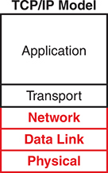
<figcaption>

<strong>图 1-4</strong> <em>TCP/IP 网络模型</em>

</figcaption>
</figure>

注意

<a href="#ch01fig04">图 1-4</a> 中位于 TCP/IP 模型中间的网络层，也可以称为<em>网际层（Internet layer）</em>，这一名称来自该层的主要协议——网际协议（Internet Protocol，IP）。

在一台计算机上，不同组件负责实现不同层的各种协议和标准。假设你购买了一台新计算机，并通过电缆或无线方式将它连接到家庭网络或工作场所的网络。你会期待无需太多额外操作，就能打开浏览器并访问网站。要让这一切正常工作，计算机中的网络硬件——集成的网络接口卡（NIC）——需要实现某些物理层标准，以支持物理通信。该网卡还支持相关的数据链路层标准。计算机的操作系统实现网络层和传输层的协议。最后，Web 浏览器实现某些应用层协议，例如 HTTP 或 HTTPS。

更一般地说，<a href="#ch01fig04">图 1-4</a> 中的 TCP/IP 模型展示了人们如今讨论 TCP/IP 时较常使用的术语和层次。物理层关注如何在每条链路上传输比特。数据链路层关注控制物理链路使用的规则，就像道路、汽车和交通信号需要相应标准一样。网络层关注如何沿着完整路径，将数据从最初的发送端计算机传送到最终的目的计算机，就像国家邮政系统需要安排唯一的邮政地址，并建立将邮件投递到这些地址的体系一样。最上面的两层更多地关注需要发送和接收数据的应用，例如如何标识数据、如何请求发送数据，以及如何恢复传输过程中丢失的数据。

你们中的许多人可能已经听说过若干 TCP/IP 协议，例如<a href="#ch01tab02">表 1-2</a> 中列出的协议。随着本书学习的深入，你将更详细地了解表中的大多数协议和标准。在表格之后，本节将进一步介绍 TCP/IP 模型的各层。

<figure class="table" id="ch01tab02">
<figcaption>

<strong>表 1-2</strong> TCP/IP 体系结构模型及协议示例

</figcaption>
<table class="all">
<thead>
<tr>
<th class="th">
TCP/IP 体系结构层次
</th>
<th class="th">
协议示例
</th>
</tr>
</thead>
<tbody>
<tr>
<td class="border">
应用层
</td>
<td class="border">
HTTPS、POP3、SMTP
</td>
</tr>
<tr>
<td class="border">
传输层
</td>
<td class="border">
TCP、UDP
</td>
</tr>
<tr>
<td class="border">
网络层
</td>
<td class="border">
IP、ICMP
</td>
</tr>
<tr>
<td class="border">
数据链路层与物理层
</td>
<td class="border">
以太网、802.11（Wi-Fi）
</td>
</tr>
</tbody>
</table>
</figure>
</section>
<section>
<h4 class="h4" id="ch01lev2sec3">TCP/IP 应用层</h4>

TCP/IP 应用层协议为计算机上运行的应用软件提供服务。应用层并不定义应用程序本身，而是定义应用程序所需的服务。例如，应用层协议 HTTP 定义了 Web 浏览器如何从 Web 服务器获取网页内容。简而言之，应用层在计算机上运行的软件与网络本身之间提供接口。

可以说，如今最普及的 TCP/IP 应用就是 Web 浏览器。许多主要软件厂商已经修改、或正在修改其应用软件，以支持通过 Web 浏览器访问。所幸，使用 Web 浏览器很简单：在计算机上启动浏览器，输入网站名称来选择网站，网页便会显示出来。

<section>
<h5 class="h5" id="ch01lev3sec1">HTTP 概述</h5>

究竟发生了什么，才使网页能够显示在你的 Web 浏览器中？

假设 Bob 打开了浏览器。浏览器已配置为自动请求 Web 服务器 Larry 的默认网页，也就是<em>主页</em>。其大致逻辑如<a href="#ch01fig05">图 1-5</a> 所示。

<figure class="image-c" id="ch01fig05">

<figcaption>

<strong>图 1-5</strong> <em>获取网页的基本应用逻辑</em>

<aside class="hidden" id="a01fig05">

示意图包含两个主要元素：左侧是名为 Larry 的 Web 服务器，以服务器机架图标表示；右侧是名为 Bob 的 Web 浏览器，以计算机图标表示。两条箭头展示它们之间的交互：第一条箭头标有“把你的网页给我”，从 Bob 指向 Larry，表示请求网页；第二条箭头标有“这是 home.htm 文件”，从 Larry 指向 Bob，表示发送所请求的网页。

</aside>
</figcaption>
</figure>

那么，实际发生了什么？Bob 最初发出的请求，实际上是在请 Larry 把主页发送给 Bob。Larry 的 Web 服务器软件已经配置好，知道默认网页保存在一个名为 home.htm 的文件中。Bob 收到 Larry 发来的文件后，就在自己的 Web 浏览器窗口中显示文件内容。

</section>
<section>
<h5 class="h5" id="ch01lev3sec2">HTTP 协议机制</h5>

进一步观察，这个示例说明了两个端点计算机上的应用程序——具体来说，就是 Web 浏览器应用和 Web 服务器应用——如何使用 TCP/IP 应用层协议。为了请求网页并返回网页内容，这些应用使用超文本传输协议（Hypertext Transfer Protocol，HTTP）。

直到 20 世纪 90 年代初 Tim Berners-Lee 创建了第一个 Web 浏览器和 Web 服务器，HTTP 才随之诞生。Berners-Lee 赋予 HTTP 请求网页内容的功能，具体做法是让 Web 浏览器能够向服务器请求文件，并让服务器能够返回这些文件的内容。总体逻辑与<a href="#ch01fig05">图 1-5</a> 相同；<a href="#ch01fig06">图 1-6</a> 展示了相同的思路，但加入了 HTTP 特有的细节。

<figure class="image-c" id="ch01fig06">
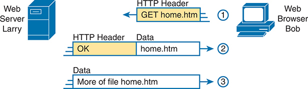
<figcaption>

<strong>图 1-6</strong> <em>HTTP GET 请求、HTTP 响应及一条仅含数据的消息</em>

<aside class="hidden" id="a01fig06">

示意图中的 HTTP GET 请求与响应过程分为三步：步骤 1，Web 浏览器 Bob 向 Web 服务器 Larry 发送 HTTP GET 请求，请求 home.htm 页面。步骤 2，Larry 返回标有“OK”的 HTTP 首部，表示请求成功，并开始向 Bob 传输 home.htm 的数据。步骤 3，Larry 继续将 home.htm 文件中的其余数据发送给 Bob，完成网页传输。

</aside>
</figcaption>
</figure>

注意

大多数 Web 地址——也称为统一资源定位符（URL）或统一资源标识符（URI）——的完整形式都以字母 <em>http</em> 开头，表示使用 HTTP 传输网页。

为了从 Larry 获取网页，在步骤 1 中，Bob 发送一条带有 HTTP 首部的消息。通常，协议利用首部存放该协议所需的信息。这个 HTTP 首部包含“获取”某个文件的请求。请求通常包含文件名（本例中为 home.htm）；如果没有指定文件名，Web 服务器就假定 Bob 想要默认网页。

<a href="#ch01fig06">图 1-6</a> 的步骤 2 展示了 Web 服务器 Larry 的响应。消息以 HTTP 首部开头，首部中包含返回码 200，其含义可以简单理解为“OK”。HTTP 还定义了其他返回码，让服务器能够告诉浏览器请求是否成功。（再举一个例子：如果你访问某个网页时，收到 HTTP 404“未找到”错误，那就意味着你收到了值为 404 的 HTTP 返回码。）第二条消息还包含所请求文件的第一部分内容。

<a href="#ch01fig06">图 1-6</a> 的步骤 3 展示了 Web 服务器 Larry 向 Web 浏览器 Bob 发送的另一条消息，但这次没有 HTTP 首部。HTTP 通过发送多条消息来传输数据，每条消息携带文件的一部分。为了避免反复发送包含相同信息的 HTTP 首部而浪费空间，这些后续消息直接省略首部。

<em>《CCNA 200-301 官方认证指南，第 2 卷》</em>的<a data-original-href="vol1_ch05.xhtml#ch05" data-unavailable="true" title="未提取此章节；请参阅原始 EPUB：vol1_ch05.xhtml#ch05">第 5 章</a>会再次讨论 HTTP，更深入地介绍 HTTP、安全 HTTP 以及 HTTP 的不同版本。

</section>
</section>
<section>
<h4 class="h4" id="ch01lev2sec4">TCP/IP 传输层</h4>

TCP/IP 应用层协议有很多，而 TCP/IP 传输层包含的协议相对较少。最常使用的两种传输层协议是传输控制协议（Transmission Control Protocol，TCP）和用户数据报协议（User Datagram Protocol，UDP）。

传输层协议为 TCP/IP 模型中位于其上一层的应用层协议提供服务。传输层协议如何为更高层协议提供服务？本节以 TCP 提供的一项服务——差错恢复——为重点，介绍这一基本概念。<em>《CCNA 200-301 官方认证指南》</em><em>第 2 卷</em>第二版中的“<a href="#ch01">TCP/IP 传输层与应用入门</a>”一章会更详细地介绍传输层。

<section>
<h5 class="h5" id="ch01lev3sec3">TCP 差错恢复基础</h5>

要理解传输层协议的作用，就必须考虑传输层的上一层，也就是应用层。为什么？因为每一层都为其上一层提供服务，例如 TCP 为应用层协议提供差错恢复服务。

例如，在<a href="#ch01fig05">图 1-5</a> 中，Bob 和 Larry 使用 HTTP 将主页从 Web 服务器 Larry 传送到 Bob 的 Web 浏览器。但是，如果 Bob 的 HTTP GET 请求在穿过 TCP/IP 网络的途中丢失，会发生什么？或者，如果 Larry 包含主页内容的响应丢失了，又会发生什么？正如你可能想到的，无论哪种情况，Bob 的浏览器中都不会显示该页面。

TCP/IP 需要一种机制，确保数据能够跨网络送达。由于许多应用层协议都可能需要这种保障，TCP 的创建者加入了差错恢复功能。为了从差错中恢复，TCP 使用确认机制。<a href="#ch01fig07">图 1-7</a> 概述了 TCP 如何发现数据丢失，并请求发送方再次发送。

<figure class="image-c" id="ch01fig07">
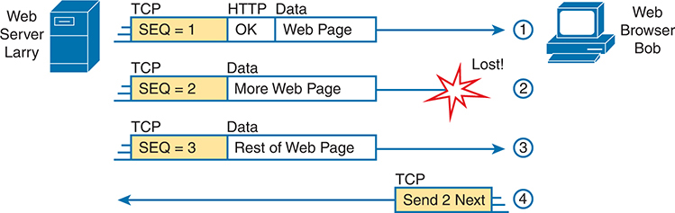
<figcaption>

<strong>图 1-7</strong> <em>TCP 为 HTTP 提供的差错恢复服务</em>

<aside class="hidden" id="a01fig07">

示意图中的 HTTP GET 请求与响应过程分为三步：步骤 1，Web 浏览器 Bob 向 Web 服务器 Larry 发送 HTTP GET 请求，请求 home.htm 页面。步骤 2，Larry 返回标有“OK”的 HTTP 首部，表示请求成功，并开始向 Bob 传输 home.htm 的数据。步骤 3，Larry 继续将 home.htm 文件中的其他数据发送给 Bob，以完成网页传输；图中在“SEQ = 3”上方标有“TCP”，在“网页剩余部分”上方标有“数据”。

</aside>
</figcaption>
</figure>

<a href="#ch01fig07">图 1-7</a> 展示了 Web 服务器 Larry 使用三条独立消息向 Web 浏览器 Bob 发送网页。请注意，图中的 HTTP 首部与<a href="#ch01fig06">图 1-6</a> 相同，但还显示了 TCP 首部。每条消息的 TCP 首部中都有一个序号（SEQ）。在这个示例中，网络出现问题，未能交付序号为 2 的 TCP 消息（称为<a id="key_008" href="#ref-gloss_361">报文段</a>）。Bob 收到序号为 1 和 3 的消息，却没有收到序号为 2 的消息，因此意识到消息 2 丢失了。Bob 的 TCP 逻辑发现这一情况后，就向 Larry 发回一个 TCP 报文段，请求 Larry 重新发送消息 2。

</section>
<section>
<h5 class="h5" id="ch01lev3sec4">同层交互与相邻层交互</h5>

<a href="#ch01fig07">图 1-7</a> 还展示了一种称为<a id="key_001" href="#ref-gloss_017">相邻层交互</a>的功能，描述同一台计算机上网络模型中相邻层如何协同工作。在这个示例中，较高层的协议 HTTP 需要差错恢复，因此使用紧邻的下一层协议 TCP 来执行差错恢复服务；也就是说，下层为其上层提供服务。

<a href="#ch01fig07">图 1-7</a> 还展示了一种类似功能的示例，称为<a id="key_007" href="#ref-gloss_358">同层交互</a><em>。</em>当一台计算机上的某一层需要与另一台计算机上的同一层通信时，两台计算机会使用首部来存放要交流的信息。例如，在<a href="#ch01fig07">图 1-7</a> 中，Larry 将序号设置为 1、2、3，以便 Bob 能够发现部分数据未到达的情况。Larry 的 TCP 进程创建了带有序号的 TCP 首部；Bob 的 TCP 进程接收 TCP 报文段并作出相应处理。

<a href="#ch01tab03">表 1-3</a> 总结了两个方面的要点：同一台计算机上的相邻层如何协同工作，以及一台计算机上的某一层如何与另一台计算机上的同一网络层次协同工作。

<figure class="table" id="ch01tab03">
<figcaption>

<strong>表 1-3</strong> 同层交互与相邻层交互总结

</figcaption>
<table class="all">
<thead>
<tr>
<th class="th">
概念
</th>
<th class="th">
说明
</th>
</tr>
</thead>
<tbody>
<tr>
<td class="border">
不同计算机上的同层交互
</td>
<td class="border">
两台计算机使用协议，与另一台计算机的同一层通信。协议定义了首部，用于传达各台计算机希望执行的操作。
</td>
</tr>
<tr>
<td class="border">
同一台计算机上的相邻层交互
</td>
<td class="border">
在同一台计算机上，某个较低层为紧邻的上一层提供服务。实现较高层的软件或硬件，请求紧邻的下一层执行所需功能。
</td>
</tr>
</tbody>
</table>
</figure>
</section>
</section>
<section>
<h4 class="h4" id="ch01lev2sec5">TCP/IP 网络层</h4>

应用层包含许多协议。传输层包含的协议较少，其中最主要的是 TCP 和 UDP。TCP/IP 网络层只包含少量协议，而主要协议只有一个：网际协议（Internet Protocol，IP）。实际上，TCP/IP 这个名称只是把两种最常见协议的名称 TCP 和 IP 用斜线“/”连接起来。

IP 提供多项功能，其中最重要的是编址和路由。本节首先把 IP 的编址和路由与另一个众所周知、同样使用地址和路径选择的系统——邮政服务——进行比较，然后介绍 IP 编址和路由。（更多细节见<a data-original-href="vol1_ch03.xhtml#ch03" data-unavailable="true" title="未提取此章节；请参阅原始 EPUB：vol1_ch03.xhtml#ch03">第 3 章</a>“<a data-original-href="vol1_ch03.xhtml#ch03" data-unavailable="true" title="未提取此章节；请参阅原始 EPUB：vol1_ch03.xhtml#ch03">广域网与 IP 路由基础</a>”。）

<section>
<h5 class="h5" id="ch01lev3sec5">网际协议与邮政服务</h5>

假设你刚写好了两封信：一封寄给国家另一端的朋友，另一封寄给城市另一端的朋友。你已经在信封上写好地址、贴好邮票，两封信都可以交给邮政部门了。你对这两封信的处理方式有很大不同吗？并没有。通常，你只需把它们投入同一个邮箱，并期待邮政部门将两封信都送达。

但邮政部门必须分别处理每一封信，决定将它下一步送到哪里，才能最终送达。对于寄往同城另一处的信，当地邮局的工作人员可能只需把它装上另一辆邮车。

对于需要跨越全国的信，邮政部门会将它送到另一家邮局，再送往下一家邮局，如此继续，直到信件被送达全国另一端。每到一家邮局，邮政部门都必须处理这封信，并决定下一步把它送往哪里。

为了让整个流程运转，邮政部门为小型货车、大型货车、飞机和船舶等安排固定线路，以便在各个邮政站点之间运送信件。邮政系统必须能够接收和转发信件，并正确决定每封信下一步的去向，如<a href="#ch01fig08">图 1-8</a> 所示。

<figure class="image-c" id="ch01fig08">
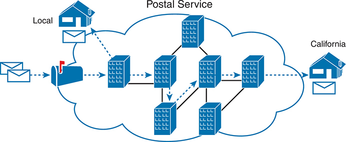
<figcaption>

<strong>图 1-8</strong> <em>邮政系统转发信件（选择路由）</em>

</figcaption>
</figure>

继续以邮政服务为例，想一想寄信人与邮政部门所做工作的区别。寄信人期望邮政部门在大多数情况下都能把信送达，但不需要了解信件究竟沿哪条路径运输。相反，邮政部门并不撰写信件，而是从客户手中接收信件。随后，它必须了解地址，以及将地址划分为更大组别的邮政编码等细节，并具备投递信件的能力。

TCP/IP 应用层和传输层就像通过邮政系统寄信的人。无论两端的主机位于同一个局域网，还是相隔整个互联网，这些上层的工作方式都相同。发送消息时，上层会请求下面的网络层将消息送达。

TCP/IP 模型的下层则更像邮政部门，负责将这些消息送到正确的目的地。为此，下层必须了解底层物理网络，因为它们必须选择将数据从一台主机传送到另一台主机的最佳方式。

那么，这一切与网络有什么关系？TCP/IP 网络模型中的网络层主要由网际协议 IP 定义，其工作方式与邮政服务十分相似。IP 规定每台主机应拥有不同的 IP 地址，就像邮政系统规定编址方式，让每栋房屋、每套公寓和每家企业都能拥有唯一地址一样。类似地，IP 定义了路由过程，使称为路由器的设备能够像邮局一样，转发数据<a id="key_006" href="#ref-gloss_296">分组</a>，使其送达正确目的地。正如邮政系统为投递信件而建立了必要的基础设施，包括邮局、分拣机、货车、飞机和人员，网络层也详细规定了如何构建网络基础设施，使网络能够向其中的所有计算机传送数据。

</section>
<section>
<h5 class="h5" id="ch01lev3sec6">网际协议编址基础</h5>

IP 定义地址有几个重要原因。首先，每台使用 TCP/IP 的设备，也就是每台 TCP/IP <em>主机</em>，都需要一个唯一地址，以便在网络中被识别。IP 还定义了如何把地址分组，就像邮政系统根据邮政编码（例如美国的 ZIP Code）将地址分组一样。

要理解这些基础概念，请看<a href="#ch01fig09">图 1-9</a>。图中仍是熟悉的 Web 服务器 Larry 和 Web 浏览器 Bob；但这次没有忽略两台计算机之间的网络，而是画出了部分网络基础设施。

<figure class="image-c" id="ch01fig09">
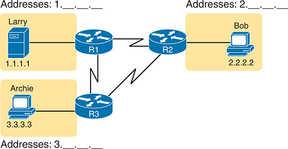
<figcaption>

<strong>图 1-9</strong> <em>简单的 TCP/IP 网络：三台路由器及分组的 IP 地址</em>

<aside class="hidden" id="a01fig09">

示意图中，Larry 的计算机使用 IP 地址 1.1.1.1，连接到路由器 R1。Bob 的计算机分配到 IP 地址 2.2.2.2，连接到路由器 R2。Archie 的计算机使用 IP 地址 3.3.3.3，连接到路由器 R3。路由器之间相互连接：R1 直接连接 R2，R1 和 R2 又分别连接 R3。各用户旁边标出了相应的地址组：以 1 开头的地址、以 2 开头的地址，以及以 3 开头的地址。

</aside>
</figcaption>
</figure>

首先请注意，<a href="#ch01fig09">图 1-9</a> 展示了一些 IP 地址示例。每个 IP 地址由四个数字组成，以句点分隔。在这里，Larry 使用 IP 地址 1.1.1.1，Bob 使用 2.2.2.2。这种数字表示方式称为点分十进制表示法（dotted-decimal notation，DDN）。

<a href="#ch01fig09">图 1-9</a> 还展示了三个地址组。在这个示例中，所有以 1 开头的 IP 地址都必须位于左上方，图中简写为“1. . . .”；所有以 2 开头的地址都必须位于右侧，简写为“2. . . .”；最后，所有以 3 开头的 IP 地址都必须位于图的下方。

此外，<a href="#ch01fig09">图 1-9</a> 还引入了表示 IP 路由器的图标。路由器是一种网络设备，将 TCP/IP 网络的各个部分连接起来，以便把 IP 分组路由（转发）到正确目的地。路由器所做的工作相当于各邮局的工作：在不同物理接口上接收 IP 分组，根据分组中包含的 IP 地址作出决定，然后通过另一个网络接口把分组实际转发出去。

</section>
<section>
<h5 class="h5" id="ch01lev3sec7">IP 路由基础</h5>

TCP/IP 网络层使用 IP 协议，提供将 IP 分组从一台设备转发到另一台设备的服务。任何拥有 IP 地址的设备都可以连接到 TCP/IP 网络并发送分组。本节通过一个基本的 IP 路由示例，帮助你形成直观认识。

注意

<em>IP 主机</em>指任何拥有 IP 地址并连接到某个 TCP/IP 网络的设备，无论其体积大小或性能强弱。

<a href="#ch01fig10">图 1-10</a> 再次使用熟悉的场景：Web 服务器 Larry 想向 Bob 发送网页的一部分，但这次加入了与 IP 有关的细节。请注意左下方，服务器 Larry 已准备好发送我们熟悉的应用数据、HTTP 首部和 TCP 首部。此外，消息现在还包含 IP 首部。IP 首部中的源 IP 地址是 Larry 的 IP 地址 1.1.1.1，目的 IP 地址则是 Bob 的 IP 地址 2.2.2.2。

<figure class="image-c" id="ch01fig10">
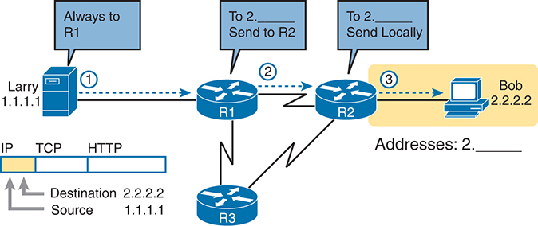
<figcaption>

<strong>图 1-10</strong> <em>基本路由示例</em>

<aside class="hidden" id="a01fig10">

示意图中的两个计算机图标分别表示 IP 地址为 1.1.1.1 的 Larry 和 IP 地址为 2.2.2.2 的 Bob。Larry 通过 IP、TCP 和 HTTP 协议连接到路由器 R1。图中以“始终发送到 R1”“发往 2 开头的地址：发送到 R2”和“发往 2 开头的地址：在本地发送”等说明展示路由过程。路由器 R1 连接到路由器 R2 和 R3。发往 IP 地址为 2.2.2.2 的 Bob 的消息，经由 R3 路由。

</aside>
</figcaption>
</figure>

<a href="#ch01fig10">图 1-10</a> 左侧的步骤 1 从 Larry 准备发送 IP 分组开始。Larry 的 IP 进程选择将分组发送给某台路由器，也就是同一局域网上附近的一台路由器，并期望该路由器知道如何继续转发分组。（这一逻辑很像我们把所有信件投入附近邮箱来寄信。）Larry 无需进一步了解网络拓扑或其他路由器。

在步骤 2 中，路由器 R1 收到 IP 分组，R1 的 IP 进程需要作出决定。R1 查看目的地址 2.2.2.2，将该地址与已知的 IP 路由进行比较，并选择把分组转发给路由器 R2。这种转发 IP 分组的过程称为 <em>IP 路由</em>，也可以简称为<em>路由</em>。

在步骤 3 中，路由器 R2 重复路由器 R1 所采用的同类逻辑。R2 的 IP 进程会将分组的目的 IP 地址 2.2.2.2 与 R2 已知的 IP 路由进行比较，并决定将分组向右转发给 Bob。

备考 CCNA 时，你对 IP 的学习会比任何其他协议都更深入。本书超过一半的章节会讨论与编址、IP 路由以及路由器如何执行路由有关的某项功能。

</section>
</section>
<section>
<h4 class="h4" id="ch01lev2sec6">TCP/IP 数据链路层与物理层</h4>

TCP/IP 模型的数据链路层和物理层定义了通过某种物理网络传送数据所需的协议与硬件。两者配合得非常紧密；实际上，有些标准同时定义数据链路层和物理层的功能。物理层定义布线，以及在电缆上传播的能量形式，例如电信号。不过，在电缆上发送数据时，还需要遵循一些规则和约定；这些规则属于 TCP/IP 模型的数据链路层。

先把注意力放在数据链路层上。与任何网络模型中的其他层一样，TCP/IP 数据链路层为模型中位于其上方的网络层提供服务。当主机或路由器的 IP 进程决定将 IP 分组发送给另一台路由器或主机时，该主机或路由器就会利用链路层的具体机制，把分组发送给下一台主机或路由器。

由于每一层都为其上一层提供服务，请再想一想<a href="#ch01fig10">图 1-10</a> 中的 IP 逻辑。在该示例中，主机 Larry 的 IP 逻辑选择将 IP 分组发送给附近的路由器 R1。虽然<a href="#ch01fig10">图 1-10</a> 在 Larry 与路由器 R1 之间只画了一条简单的线，但这表示两者之间存在某个以太网局域网。<a href="#ch01fig11">图 1-11</a> 展示了链路层发生的四个步骤，使 Larry 能够将 IP 分组发送给 R1。

<figure class="image-c" id="ch01fig11">
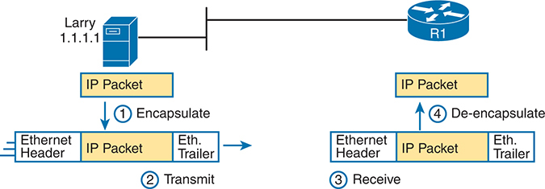
<figcaption>

<strong>图 1-11</strong> <em>Larry 使用以太网向路由器 R1 转发 IP 分组</em>

<aside class="hidden" id="a01fig11">

示意图左侧是一台标为“Larry”、IP 地址为 1.1.1.1 的计算机。步骤 1，Larry 的“IP 分组”加上“以太网首部”和“以太网尾部”进行封装，形成“以太网 IP 分组”。步骤 2，将其传输到右侧以圆形图标表示的路由器 R1。步骤 3，R1 接收该分组。步骤 4，R1 进行解封装，移除“以太网首部”和“以太网尾部”，露出原始的“IP 分组”。

</aside>
</figcaption>
</figure>

注意

<a href="#ch01fig11">图 1-11</a> 用一组线条表示以太网。当讨论不需要涉及实际局域网布线和局域网设备时，网络图通常会采用这种画法，本例就是如此。实际局域网中会有电缆和局域网交换机等设备，只是本图没有画出。

<a href="#ch01fig11">图 1-11</a> 展示了四个步骤。前两个发生在 Larry 上，后两个发生在路由器 R1 上，具体如下：

步骤 1. Larry 将 IP 分组封装在以太网首部和以太网尾部之间，形成一个以太网<a id="key_004" href="#ref-gloss_152">帧</a>。

步骤 2. Larry 利用以太网电缆中的电信号，将这个以太网帧的比特实际发送出去。

步骤 3. 路由器 R1 从电缆上接收实际电信号，并通过解释电信号的含义，还原出相同的比特。

步骤 4. 路由器 R1 移除并丢弃以太网首部和尾部，从以太网帧中<a id="key_002" href="#ref-gloss_089">解封装</a>出 IP 分组。

到这个过程结束时，Larry 和 R1 就通过协作，将分组从 Larry 送到了路由器 R1。

注意

协议定义首部和尾部的总体目的相同，但首部位于消息开头，尾部位于消息末尾。

数据链路层和物理层包含大量协议与标准。例如，链路层包括本书各处讨论的各种以太网协议和无线局域网协议。

简而言之，TCP/IP 物理层和数据链路层分别包含两类不同的功能：与数据实际物理传输有关的功能，以及控制物理介质使用的协议和规则。

</section>
</section>
<section>
<h3 class="h3" id="ch01lev1sec5">数据封装术语</h3>

从前面对 HTTP、TCP、IP 和以太网工作方式的说明中可以看出，发送数据时，每一层都会在上层提供的数据前添加自己的首部；对于数据链路层协议，还会添加尾部。<a id="key_003" href="#ref-gloss_121">封装</a>指的就是在数据周围添加首部，有时还添加尾部的过程。

本章的许多示例都展示了封装过程。例如，在<a href="#ch01fig06">图 1-6</a> 中，Web 服务器 Larry 在主页内容前添加 HTTP 首部进行封装。在<a href="#ch01fig07">图 1-7</a> 中，TCP 层在 HTTP 首部和数据前添加 TCP 首部进行封装。在<a href="#ch01fig10">图 1-10</a> 中，IP 在 TCP 首部及其数据前添加 IP 首部进行封装。最后，在<a href="#ch01fig11">图 1-11</a> 中，以太网链路层将 IP 分组封装在首部和尾部之间。

TCP/IP 主机发送数据的过程可以看作五个步骤。前四步与四个 TCP/IP 层执行的封装有关，最后一步是主机实际进行数据的物理传输。事实上，如果使用五层 TCP/IP 模型，每一步都对应一层的职责。各步骤概括如下：

步骤 1. <strong>创建应用数据，并添加所需的应用层首部进行封装。</strong>例如，可以在 HTTP 首部中返回 HTTP OK 消息，后面跟随网页内容的一部分。

步骤 2. <strong>在应用层提供的数据前添加传输层首部进行封装。</strong>对于终端用户应用，通常使用 TCP 或 UDP 首部。

步骤 3. <strong>在传输层提供的数据前添加网络层（IP）首部进行封装。</strong>IP 定义了用于唯一标识每台计算机的 IP 地址。

步骤 4. <strong>将网络层提供的数据封装在数据链路层首部和尾部之间。</strong>这一层既使用首部，也使用尾部。

步骤 5. <strong>发送比特。</strong>物理层将信号编码到传输介质上，以传输该帧。

<a href="#ch01fig12">图 1-12</a> 中的编号与上面列出的五个步骤相对应，以图形方式展示了相同的概念。请注意，由于应用层通常不需要添加首部，图中没有显示具体的应用层首部，但应用层有时也会添加首部。

<section>
<h4 class="h4" id="ch01lev2sec7">TCP/IP 消息的名称</h4>

本章花时间详细展示封装步骤，其中一个原因与术语有关。在口头讨论或书面描述网络时，人们使用<em>报文段（segment）</em>、<em>分组（packet）</em>和<em>帧（frame）</em>来指代<a href="#ch01fig13">图 1-13</a> 及相关列表中的消息。每个术语都有特定含义，指某一层定义的首部（也可能包括尾部），以及封装在首部之后的数据。不过，这些术语分别对应不同层次：报文段对应传输层，分组对应网络层，帧对应链路层。<a href="#ch01fig13">图 1-13</a> 展示了各层及其相应术语。

<figure class="image-c" id="ch01fig12">
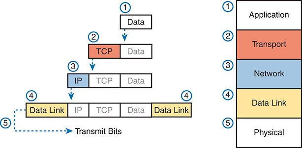
<figcaption>

<strong>图 1-12</strong> <em>TCP/IP 数据封装的五个步骤</em>

<aside class="hidden" id="a01fig12">

示意图展示了 TCP/IP 数据封装的五个步骤。左侧为封装过程，右侧为对应的层次。封装过程用标有“数据”“TCP”“IP”和“数据链路”的矩形表示，向下的箭头说明逐步封装的顺序。右侧各层依次标为应用层、传输层、网络层、数据链路层和物理层。

</aside>
</figcaption>
</figure>
<figure class="image-c" id="ch01fig13">
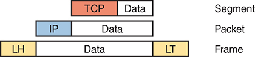
<figcaption>

<strong>图 1-13</strong> <em>从不同层次看封装与“数据”<a id="ffn1a" href="#ffn1">*</a></em>

<aside class="hidden" id="a01fig13">

示意图展示网络中的数据封装概念。三个标为“数据”的块对应不同层次：顶部带有“TCP”的块表示报文段，中间带有“IP”的块表示分组，底部包含 LH 和 LT 两部分的块表示帧。每个块旁边都标有相应术语：TCP 对应“报文段”，IP 对应“分组”，LH／LT 对应“帧”。

</aside>
</figcaption>
</figure>

<a id="ffn1" href="#ffn1a">*</a> 字母 <em>LH</em> 和 <em>LT</em> 分别代表链路首部（link header）和链路尾部（link trailer），指数据链路层的首部和尾部。

<a href="#ch01fig13">图 1-13</a> 还将封装后的数据直接标为“数据”。当你关注某一层的工作时，被封装的数据通常并不重要。例如，一个 IP 分组确实可能在 IP 首部后面包含 TCP 首部，在 TCP 首部后面包含 HTTP 首部，再在 HTTP 首部后面包含网页数据。但是，在讨论 IP 时，你可能只关心 IP 首部，所以 IP 首部之后的所有内容都统称为数据。因此，绘制 IP 分组时，通常把 IP 首部之后的全部内容简单表示为数据。

注意

你还会看到通用术语<em>协议数据单元</em>，即 <em>PDU</em>，用来指代由某个协议定义的任意消息。例如，TCP 报文段、IP 分组和以太网帧都属于 PDU。

</section>
<section>
<h4 class="h4" id="ch01lev2sec8">OSI 网络模型与术语</h4>

在 OSI 模型发展历史的某个阶段，许多人认为 OSI 会在前面提到的网络模型竞争中获胜。如果真是如此，那么全世界的计算机上运行的将是 OSI，而不是 TCP/IP。

然而，OSI 并没有获胜。实际上，OSI 已不再是一种可以代替 TCP/IP 使用的网络模型，尽管 OSI 模型最初引用的某些协议仍然存在。

那么，本书为什么还要介绍 OSI？原因在于术语。在许多人认为 OSI 模型会在网络领域普及的那些年里，主要是20 世纪 80 年代末和 90 年代初，许多厂商和协议文档开始使用 OSI 模型的术语。这些术语一直沿用至今。因此，虽然你永远不需要使用运行 OSI 的计算机，但要理解现代网络术语，仍需了解一些 OSI 知识。

<section>
<h5 class="h5" id="ch01lev3sec8">比较 OSI 与 TCP/IP 的层名称和层编号</h5>

从基本概念来看，OSI 模型与 TCP/IP 模型有许多相似之处。OSI 同样采用分层结构，每一层定义一组典型的网络功能。与 TCP/IP 一样，OSI 的各层都引用多种协议和标准来实现该层规定的功能。也与 TCP/IP 一样，OSI 委员会在某些情况下并未创建新的协议或标准，而是引用已经定义好的协议。例如，IEEE 已经定义了以太网标准，因此 OSI 委员会没有浪费时间去规定一种新的以太网，而是直接引用 IEEE 以太网标准。

如今，OSI 模型可以作为比较其他网络模型的参照标准。<a href="#ch01fig14">图 1-14</a> 将七层 OSI 模型与常用的五层 TCP/IP 模型，以及早期最初的四层 TCP/IP 模型进行比较。

<figure class="image-c" id="ch01fig14">
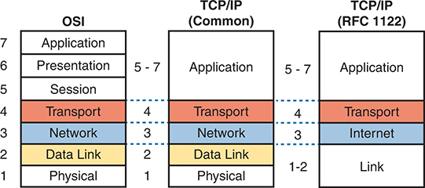
<figcaption>

<strong>图 1-14</strong> <em>OSI 模型与两种 TCP/IP 模型的比较</em>

<aside class="hidden" id="a01fig14">

左侧详细展示了 OSI 模型的七层：应用层、表示层、会话层、传输层、网络层、数据链路层和物理层，自上而下编号为 7 到 1。中间的常用 TCP/IP 模型将其归并为四层：应用层（合并应用层、表示层和会话层）、传输层、网络层、数据链路层和物理层。右侧是另一种 TCP/IP 模型（RFC 1122），它具有五层：应用层（合并应用层、表示层和会话层）、传输层、网际层（对应 OSI 的网络层）和链路层（合并 OSI 的数据链路层与物理层）。（译注：原书这段无障碍说明将“四层”和“五层”写反；按照图示及正文，中间模型为五层，右侧模型为四层。）

</aside>
</figcaption>
</figure>

注意

CCNA 考试主题已不再提及 OSI 或 TCP/IP 模型；不过，在日常网络工程讨论中，你仍应了解这两种模型及其相关术语。如今，行业中以及本书使用的都是五层模型，而图中还列出了 RFC 1122 最初的四层模型，供你对照理解。

请注意，图中间的当今 TCP/IP 模型，在较低层使用的层名称与 OSI 完全相同，其功能总体上也一致。因此，为了便于讨论网络和阅读网络文档，可以把两者的下面四层视为在名称、编号和含义上都相对应。

尽管如今实际使用的是 TCP/IP，而不是 OSI，我们仍习惯使用 OSI 的层编号。例如，提到 TCP/IP 网络中的应用层协议时，人们依然会将其称为“第 7 层协议”。另外，TCP/IP 在应用层中包含的功能更多，而 OSI 将这些功能划分为会话层、表示层和应用层。多数情况下，人们并不特别在意这种差别，因此你会看到“第 5–7 层协议”这样的说法，同样使用的是 OSI 编号。

学习本书时，你需要掌握<a href="#ch01fig14">图 1-14</a> 所示的五层 TCP/IP 模型与七层 OSI 模型之间的对应关系，并且知道提到“第 7 层”时，实际上也对应 TCP/IP 的应用层。

</section>
</section>
</section>
</section>

<section class="ccna-source ccna-appendix" aria-label="答案解析与术语表">
<section data-epub-type="chapter">
<h2 class="h2" id="ref-appc">附录 C</h2>
<h2 class="h2a">自测答案</h2>
<section>
<h3 class="h3" id="ref-appclev1sec1">第 1 章</h3>

<strong><a id="ref-ques1_1" href="#quess1_1">1</a>.</strong> D 和 F。在其余选项中，以太网同时定义物理层和数据链路层协议，PPP 是数据链路层协议，IP 是网络层协议，而 SMTP 和 HTTP 是应用层协议。

<strong><a id="ref-ques1_2" href="#quess1_2">2</a>.</strong> A 和 G。在其余选项中，IP 是网络层协议，TCP 和 UDP 是传输层协议，而 SMTP 和 HTTP 是应用层协议。

<strong><a id="ref-ques1_3" href="#quess1_3">3</a>.</strong> B。相邻层交互发生在同一台计算机上，涉及模型中两个相邻的层。较高层向紧邻的下一层请求服务，较低层则为紧邻的上一层提供服务。

<strong><a id="ref-ques1_4" href="#quess1_4">4</a>.</strong> B。同层交互发生在多台计算机之间。某一层定义的功能通常需要由多台计算机共同完成，例如，发送方为报文段设置序号，接收方确认收到该报文段。这一过程由单个层次定义，但需要在多台设备上实现该层，才能完成相应功能。

<strong><a id="ref-ques1_5" href="#quess1_5">5</a>.</strong> A。封装是指在较高层提供的数据前添加首部的过程，有时还会添加尾部。

<strong><a id="ref-ques1_6" href="#quess1_6">6</a>.</strong> D。按照惯例，<em>帧</em>指网络消息中包含数据链路层首部和尾部，以及封装在其中的数据的部分。<em>分组</em>不包含数据链路层首部和尾部，只保留网络层首部及其封装的数据。<em>报文段</em>进一步不包含网络层首部，只保留传输层首部及其封装的数据。

</section>
</section>

<section id="ref-glossary"><h2 class="h2a">术语表</h2>
<strong>相邻层交互（adjacent-layer interaction）</strong> 指同一台计算机上，网络体系结构模型中的两个相邻层如何协同工作的总体概念，其中较低层为较高层提供服务。

<strong>解封装（de-encapsulation）</strong> 在通过网络接收数据的计算机上，设备解释较低层首部，并在处理完每个首部后将其移除，从而露出紧邻上一层 PDU 的过程。

<strong>封装（encapsulation）</strong> 将来自较高层协议的数据放到紧邻下一层协议首部之后的过程；在某些情况下，是放在该层的首部和尾部之间。例如，通过以太网发送 IP 分组之前，可以将它封装在以太网首部和尾部之间。

<strong>帧（frame）</strong> 指数据链路层首部和尾部，以及封装在首部与尾部之间的数据。

<strong>网络模型（networking model）</strong> 一个通用术语，指将一组协议和标准组织成完整体系；网络中的设备遵循该体系后，就能彼此通信。TCP/IP 和 OSI 都是网络模型的例子。

<strong>分组（packet）</strong> 由字节构成的一个逻辑整体，包含网络层首部及其封装的数据，但明确不包含网络层以下各层的任何首部和尾部。

<strong>同层交互（same-layer interaction）</strong> 两台网络设备为了实现网络模型中某一层定义的功能而进行的通信，这种通信借助该层定义的首部来完成。两台设备设置首部中的值，发送首部及其封装的数据，接收设备则解释首部，以决定采取什么操作。

<strong>报文段／分段／网段（segment）</strong> 在 TCP 中，segment 用于描述 TCP 首部及其封装的数据，也称为 L4PDU，即报文段。在 TCP 中，该词还可指从应用层接收一大块数据，并将其拆分成适合装入 TCP 报文段的较小块的过程，即分段。在以太网中，segment 则指一条以太网电缆，或一个冲突域，不论其中使用了多少条电缆，即网段。

</section>

</section>


<nav class="ccna-chapter-nav" aria-label="章节导航"><a href="v1-02.html">下一章 →</a></nav>
