
<a href="{{ '/subjects/CCNA/' | relative_url }}">← 返回 CCNA 目录</a>

第一卷 · 网络入门

<nav class="ccna-chapter-nav" aria-label="章节导航"><a href="v1-01.html">← 上一章</a><a href="v1-03.html">下一章 →</a></nav>



<section data-epub-type="chapter">
<h2 class="h2" id="ch02">第 2 章</h2>
<h2 class="h2a">以太网局域网基础</h2>

本章涵盖以下考试主题：

1.0 网络基础

1.1 解释网络组件的角色和功能

1.1.b 二层交换机和三层交换机

1.2 描述网络拓扑架构的特征

1.2.e 小型办公室／家庭办公室（SOHO）

1.3 比较物理接口和布线类型

1.3.a 单模光纤、多模光纤、铜缆

1.3.b 连接方式（以太网共享介质和点对点连接）

大多数企业计算机网络所采用的技术可以分为两大类：局域网（LAN）和广域网（WAN）。局域网通常连接距离较近的设备，例如同一房间、同一建筑物或同一园区内的设备。相比之下，广域网连接的设备通常相距较远。局域网与广域网共同构成完整的企业计算机网络，协同完成计算机网络的任务：将数据从一台设备传送到另一台设备。

多年来曾出现过许多种局域网，但如今的网络主要采用两类局域网：以太网局域网和无线局域网。以太网局域网使用电缆连接节点，而许多类型的电缆使用铜导线，因此以太网局域网通常也称为<a id="key_036" href="#ref-gloss_445">有线局域网</a>。以太网局域网也使用光纤布线，其中包含玻璃纤芯，设备利用光来发送数据。与以太网相比，<a id="key_037" href="#ref-gloss_446">无线局域网</a>不使用导线或电缆，而使用无线电波连接节点；<em>《CCNA 200-301 官方认证指南，第 2 卷》</em>第二版的<a href="#part01">第一部分</a>详细介绍了无线局域网。

本章介绍以太网局域网，本书的<a data-original-href="vol1_part02.xhtml#part02" data-unavailable="true" title="未提取此章节；请参阅原始 EPUB：vol1_part02.xhtml#part02">第二部分</a>和<a data-original-href="vol1_part03.xhtml#part03" data-unavailable="true" title="未提取此章节；请参阅原始 EPUB：vol1_part03.xhtml#part03">第三部分</a>将作更详细的讨论。

<section>
<h3 class="h3" id="ch02lev1sec1">自测</h3>

如果你希望根据得分决定在本章投入多少时间，可以完成这组自测题（在此作答，或使用 PTP 软件）。各题答案的选项字母列在自测题之后的页面底部。书末和配套网站上的<a href="#ref-appc">附录 C</a>都包含答案及解析。你也可以在 PTP 测试软件中找到答案及解析。

<figure class="table" id="ch02tab01">
<figcaption>

<strong>表 2-1</strong> 自测：基础知识小节与题目对应关系

</figcaption>
<table class="all">
<thead>
<tr>
<th class="th">
基础知识小节
</th>
<th class="th">
题目
</th>
</tr>
</thead>
<tbody>
<tr>
<td class="border">
局域网概述
</td>
<td class="border">
1–2
</td>
</tr>
<tr>
<td class="border">
使用 UTP 构建物理以太网局域网
</td>
<td class="border">
3–4
</td>
</tr>
<tr>
<td class="border">
使用光纤构建物理以太网局域网
</td>
<td class="border">
5
</td>
</tr>
<tr>
<td class="border">
在以太网网络中发送数据
</td>
<td class="border">
6–9
</td>
</tr>
</tbody>
</table>
</figure>

<strong><a id="quess2_1" href="#ques2_1a">1</a>.</strong> 一些终端用户设备通过电缆连接局域网，另一些则使用无线连接。下列哪个选项最准确地描述了哪些设备使用以太网连接局域网？

<ol class="lower-alpha">
<li>
只有使用电缆的终端用户设备在使用以太网。
</li>
<li>
只有使用无线连接的终端用户设备在使用以太网。
</li>
<li>
使用电缆和使用无线连接的终端用户设备都在使用以太网。
</li>
<li>
使用电缆和使用无线连接的终端用户设备都没有使用以太网。
</li>
</ol>

<strong><a id="quess2_2" href="#ques2_2a">2</a>.</strong> 以下哪种以太网标准定义了基于 UTP 布线的千兆以太网？

<ol class="lower-alpha">
<li>
10GBASE-T
</li>
<li>
100BASE-T
</li>
<li>
1000BASE-T
</li>
<li>
其他答案都不正确。
</li>
</ol>

<strong><a id="quess2_3" href="#ques2_3a">3</a>.</strong> 关于快速以太网使用的以太网交叉线，以下哪项说法正确？

<ol class="lower-alpha">
<li>
电缆另一端的引脚 1 和 2 对调。
</li>
<li>
电缆一端的引脚 1 和 2 连接到另一端的引脚 3 和 6。
</li>
<li>
电缆一端的引脚 1 和 2 连接到另一端的引脚 3 和 4。
</li>
<li>
电缆最长可达 1000 米，以便跨越建筑物之间的距离。
</li>
<li>
其他答案都不正确。
</li>
</ol>

<strong><a id="quess2_4" href="#ques2_4a">4</a>.</strong> 每个选项列出了 100BASE-T 网络中使用的两类设备。如果用 UTP 以太网电缆连接这些设备，哪些设备组合需要使用直通线？（选择三个答案。）

<ol class="lower-alpha">
<li>
PC 和路由器
</li>
<li>
PC 和交换机
</li>
<li>
集线器和交换机
</li>
<li>
路由器和集线器
</li>
<li>
无线接入点（以太网端口）和交换机
</li>
</ol>

<strong><a id="quess2_5" href="#ques2_5a">5</a>.</strong> 以太网链路使用多模光纤而非 UTP 或单模光纤时，具有以下哪些优势？（选择两个答案。）

<ol class="lower-alpha">
<li>
使该条链路达到可能的最长距离。
</li>
<li>
将链路延伸到 100 米以上，同时尽可能降低初始成本。
</li>
<li>
利用现有库存中基于激光器的 SFP／SFP+ 模块。
</li>
<li>
利用现有库存中基于 LED 的 SFP／SFP+ 模块。
</li>
</ol>

<strong><a id="quess2_6" href="#ques2_6a">6</a>.</strong> 关于 CSMA/CD 算法，以下哪项说法正确？

<ol class="lower-alpha">
<li>
该算法绝不允许发生冲突。
</li>
<li>
冲突可能发生，但该算法定义了计算机应如何发现冲突以及如何恢复。
</li>
<li>
该算法只能用于同一以太网上恰有两台设备的情况。
</li>
<li>
其他答案都不正确。
</li>
</ol>

<strong><a id="quess2_7" href="#ques2_7a">7</a>.</strong> 关于以太网 FCS 字段，以下哪项说法正确？

<ol class="lower-alpha">
<li>
以太网使用 FCS 进行差错恢复。
</li>
<li>
其长度为 2 字节。
</li>
<li>
它位于以太网尾部，而不是以太网首部。
</li>
<li>
它用于加密。
</li>
</ol>

<strong><a id="quess2_8" href="#ques2_8a">8</a>.</strong> 关于以太网地址的格式，以下哪些说法正确？（选择三个答案。）

<ol class="lower-alpha">
<li>
每家制造商都在地址的前 2 个字节中放入唯一的 OUI 代码。
</li>
<li>
每家制造商都在地址的前 3 个字节中放入唯一的 OUI 代码。
</li>
<li>
每家制造商都在地址的前半部分放入唯一的 OUI 代码。
</li>
<li>
地址中保存制造商代码的部分称为 MAC。
</li>
<li>
地址中保存制造商代码的部分称为 OUI。
</li>
<li>
地址中保存制造商代码的部分没有特定名称。
</li>
</ol>

<strong><a id="quess2_9" href="#ques2_9a">9</a>.</strong> 以下哪些术语描述的以太网地址，可用于发送一个帧并将其交付给局域网中的多台设备？（选择两个答案。）

<ol class="lower-alpha">
<li>
烧录地址
</li>
<li>
单播地址
</li>
<li>
广播地址
</li>
<li>
组播地址
</li>
</ol>

自测答案：

<strong><a id="ques2_1a" href="#ref-ques2_1">1</a></strong> A

<strong><a id="ques2_2a" href="#ref-ques2_2">2</a></strong> C

<strong><a id="ques2_3a" href="#ref-ques2_3">3</a></strong> B

<strong><a id="ques2_4a" href="#ref-ques2_4">4</a></strong> B、D 和 E

<strong><a id="ques2_5a" href="#ref-ques2_5">5</a></strong> B 和 D

<strong><a id="ques2_6a" href="#ref-ques2_6">6</a></strong> B

<strong><a id="ques2_7a" href="#ref-ques2_7">7</a></strong> C

<strong><a id="ques2_8a" href="#ref-ques2_8">8</a></strong> B、C 和 E

<strong><a id="ques2_9a" href="#ref-ques2_9">9</a></strong> C 和 D

</section>
<section>
<h3 class="h3box" id="ch02lev1sec2">基础知识</h3>
</section>
<section>
<h3 class="h3" id="ch02lev1sec3">局域网概述</h3>

<a id="key_018" href="#ref-gloss_131">以太网</a>指一系列局域网标准，这些标准共同定义了世界上最流行的有线局域网技术的物理层和数据链路层。这些标准由电气与电子工程师协会（<a id="key_027" href="#ref-gloss_182">IEEE</a>）制定，规定了布线、电缆两端的连接器、协议规则，以及构建以太网局域网所需的其他一切内容。

<section>
<h4 class="h4" id="ch02lev2sec1">典型的 SOHO 局域网</h4>

首先，想一想如今的小型办公室／家庭办公室（SOHO）局域网，具体来说，是仅使用以太网局域网技术的网络。这个局域网首先需要一种称为以太网<em>局域网交换机</em>的设备，它提供许多可以连接电缆的物理端口。以太网使用<em>以太网电缆</em>，这是对符合某一种以太网标准的电缆的统称。局域网利用以太网电缆，将不同的以太网设备或节点连接到交换机的某个以太网端口。

<a href="#ch02fig01">图 2-1</a> 展示了一个 SOHO 以太网局域网。图中有一台局域网交换机、五条电缆，以及另外五个以太网节点：三台 PC、一台打印机和一台称为<em>路由器</em>的网络设备。（路由器将局域网连接到广域网，本例中就是互联网。）

<figure class="image-c" id="ch02fig01">
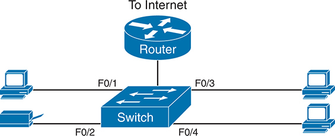
<figcaption>

<strong>图 2-1</strong> <em>典型的仅使用以太网的小型 SOHO 局域网</em>

<aside class="hidden" id="a02fig01">

示意图展示了一个包含路由器和交换机的网络布局。路由器连接互联网，其下方的交换机连接路由器。四台设备通过标有 F0/1、F0/2、F0/3 和 F0/4 的线连接交换机，这些标记表示它们所连接的交换机端口。

</aside>
</figcaption>
</figure>

虽然<a href="#ch02fig01">图 2-1</a> 将交换机和路由器画成两台独立设备，但如今许多 SOHO 以太网局域网都将路由器与交换机集成在同一台设备中。厂商销售的消费级集成网络设备既能充当路由器和以太网交换机，又能执行其他功能。这类设备的包装上通常写着“路由器”，但许多型号还在设备内部集成了四口或八口以太网局域网交换机。

如今典型的 SOHO 局域网还支持无线局域网连接。你可以构建一个同时包含以太网局域网技术和无线局域网技术的 SOHO 局域网，后者同样由 IEEE 定义。IEEE 使用以 802.11 开头的标准定义无线局域网，无线局域网利用无线电波将比特从一个节点发送到下一个节点。

大多数无线局域网还依赖另一种网络设备：无线局域网接入点（AP）。AP 的作用与以太网交换机有些相似，因为所有无线局域网节点都与无线 AP 通信。如果网络使用的 AP 是一台独立的物理设备，那么它还需要一条以太网链路来连接以太网局域网，如<a href="#ch02fig02">图 2-2</a> 所示。

请注意，<a href="#ch02fig02">图 2-2</a> 将路由器、以太网交换机和无线局域网接入点画为三台独立设备，以便你更好地理解各自的职责。不过，如今多数 SOHO 网络会使用一台通常标为“无线路由器”的设备，完成所有这些功能。

<figure class="image-c" id="ch02fig02">
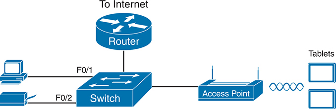
<figcaption>

<strong>图 2-2</strong> <em>典型的小型有线与无线 SOHO 局域网</em>

<aside class="hidden" id="a02fig02">

示意图中，路由器连接互联网，并连接下方的交换机。交换机通过标有 F0/1 和 F0/2 的线连接左侧的两台设备，同时连接右侧的一个接入点。右侧还画有两台带无线信号的平板电脑，表示它们以无线方式连接到接入点。

</aside>
</figcaption>
</figure>
</section>
<section>
<h4 class="h4" id="ch02lev2sec2">典型的企业局域网</h4>

企业网络与 SOHO 网络有相似的需求，但规模要大得多。例如，企业以太网局域网通常先在建筑物每层楼的配线间内安装局域网交换机，配线间的门会上锁。电工从该配线间向工位和会议室铺设以太网电缆，以供这些位置的设备连接局域网。与此同时，大多数企业还在同一区域提供无线局域网，使员工在走动时仍可继续工作，并支持越来越多不具备以太网局域网接口的设备。

<a href="#ch02fig03">图 2-3</a> 展示了一栋三层建筑中典型企业局域网的概念图。每层楼都有一台以太网局域网交换机和一个无线局域网 AP。为了实现楼层间通信，各楼层的交换机都连接到一台集中部署的汇聚交换机。例如，PC3 可以向 PC2 发送数据，但数据首先会通过交换机 SW3 到达一楼的汇聚交换机 SWD，然后再向上经过二楼的交换机 SW2。

<figure class="image-c" id="ch02fig03">
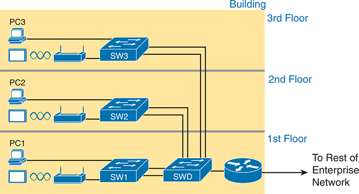
<figcaption>

<strong>图 2-3</strong> <em>单栋建筑中的企业有线与无线局域网</em>

<aside class="hidden" id="a02fig03">

示意图包含不同的网络组件：交换机 SW1、SW2、SW3 和一台无线设备 SWD，分别与各楼层的 PC1、PC2、PC3 相连。线条表示这些组件之间的连接，以及它们如何接入更大的企业网络。一条箭头从一楼指向外部，标为“通往企业网络的其他部分”。所有交换机通过表示有线连接的线条相互连接。

</aside>
</figcaption>
</figure>

图中还展示了使用路由器将局域网连接到广域网的典型方式。局域网交换机和无线接入点用于构建局域网本身，路由器则同时连接局域网和广域网。要连接局域网，路由器只需使用以太网局域网接口和一条以太网电缆，如<a href="#ch02fig03">图 2-3</a> 右下方所示。

本章其余内容将专门讨论以太网。

</section>
<section>
<h4 class="h4" id="ch02lev2sec3">多种以太网物理层标准</h4>

<em>以太网</em>指的是一个完整的标准家族。其中一些标准详细规定如何以特定速率，通过特定类型的布线发送数据；另一些标准则定义以太网节点要成为以太网局域网一部分所必须遵循的协议或规则。所有这些以太网标准都来自 IEEE，并且标准名称都以数字 802.3 开头。

经过大约 40 年的长期发展，以太网为物理以太网链路提供了多种选择。如今，以太网包含针对不同光纤和铜缆的众多标准，速率从每秒 10 兆比特（Mbps）到每秒 400 吉比特（Gbps）不等。这些标准在电缆类型和允许长度方面也有所不同。

最基本的布线选择与电缆内部用于实际传输比特的材料有关：铜导线或玻璃光纤。使用非屏蔽双绞线（UTP）的设备，通过电缆内部铜导线构成的电路传输数据。光纤布线成本较高，允许以太网节点通过电缆中心的玻璃光纤发送光。虽然更昂贵，光缆通常允许节点之间有更长的布线距离。

为了给新的以太网局域网选择要购买的产品，网络工程师必须了解以太网产品所支持的不同以太网标准的名称和特性。IEEE 使用两套命名约定来定义以太网物理层标准。正式名称以 802.3 开头，后面跟随若干后缀字母。IEEE 还使用更有意义的简称，指出速率，并提示布线采用 UTP（后缀中含有 <em>T</em>）还是光纤（后缀中含有 <em>X</em>）。<a href="#ch02tab02">表 2-2</a> 列出了几种以太网物理层标准。表中首先列出足够多的名称，让你对 IEEE 的命名约定形成认识。

<figure class="table" id="ch02tab02" tabindex="0">
<figcaption>

<strong>表 2-2</strong> 以太网类型示例

</figcaption>
<table class="all">
<thead>
<tr>
<th class="th">
速率
</th>
<th class="th">
常用名称
</th>
<th class="th">
IEEE 标准非正式名称
</th>
<th class="th">
IEEE 标准正式名称
</th>
<th class="th">
电缆类型、最大长度
</th>
</tr>
</thead>
<tbody>
<tr>
<td class="border">
10 Mbps
</td>
<td class="border">
以太网
</td>
<td class="border">
10BASE-T
</td>
<td class="border">
802.3
</td>
<td class="border">
铜缆，100 米
</td>
</tr>
<tr>
<td class="border">
100 Mbps
</td>
<td class="border">
快速以太网
</td>
<td class="border">
100BASE-T
</td>
<td class="border">
802.3u
</td>
<td class="border">
铜缆，100 米
</td>
</tr>
<tr>
<td class="border">
1000 Mbps
</td>
<td class="border">
千兆以太网
</td>
<td class="border">
1000BASE-LX
</td>
<td class="border">
802.3z
</td>
<td class="border">
光纤，5000 米
</td>
</tr>
<tr>
<td class="border">
1000 Mbps
</td>
<td class="border">
千兆以太网
</td>
<td class="border">
1000BASE-T
</td>
<td class="border">
802.3ab
</td>
<td class="border">
铜缆，100 米
</td>
</tr>
<tr>
<td class="border">
10 Gbps
</td>
<td class="border">
万兆以太网
</td>
<td class="border">
10GBASE-T
</td>
<td class="border">
802.3an
</td>
<td class="border">
铜缆，100 米
</td>
</tr>
</tbody>
</table>
</figure>

注意

光纤电缆中包含细长的玻璃光纤。相连的以太网节点通过电缆中的玻璃光纤发送光，将比特编码为光的变化。

注意

你可能会认为，一项由 IEEE 在 40 多年前发起的标准应该已经稳定、不再变化，但事实恰好相反。IEEE 与积极参与的行业伙伴持续开发新的以太网标准，以支持更长距离、不同布线选择和更高速率。可以访问以太网联盟网站（<a href="http://www.EthernetAlliance.org">www.EthernetAlliance.org</a>），查找其发展路线图，其中有介绍以太网最新进展的精彩图表。

</section>
<section>
<h4 class="h4" id="ch02lev2sec4">以太网数据链路层使所有链路保持一致的行为</h4>

虽然以太网包含许多物理层标准，但它在所有类型的以太网物理链路上都使用同一种数据链路层标准，因此表现为一种统一的局域网技术。该标准定义了通用的以太网首部和尾部。（提醒一下，首部和尾部是额外开销数据的字节，以太网利用它们完成在局域网上发送数据的任务。）无论数据通过 UTP 电缆还是任何类型的光纤电缆传输，也无论速率如何，数据链路层首部和尾部都使用相同格式。

物理层标准关注如何在电缆上传送比特，而以太网数据链路层协议关注如何将<a id="key_020" href="#ref-gloss_133">以太网帧</a>从源以太网节点发送到目的以太网节点。从数据链路层的角度来看，节点构建并转发帧。如<a href="v1-01.html#ch01">第 1 章</a>“<a href="v1-01.html#ch01">TCP/IP 网络入门</a>”中最初定义的那样，<em>帧</em>特指数据链路层协议的首部和尾部，以及封装在首部与尾部之间的数据。各个以太网节点只需经由所有必要的链路转发帧，就能将帧送达正确目的地。

<a href="#ch02fig04">图 2-4</a> 展示了这一过程的示例。PC1 向 PC3 发送一个以太网帧。帧先经 UTP 链路到达以太网交换机 SW1，然后经光纤链路到达以太网交换机 SW2 和 SW3，最后通过另一条 UTP 链路到达 PC3。请注意，在这个示例中，比特实际依次以四种不同速率传输：10 Mbps、1 Gbps、10 Gbps 和 100 Mbps。

<figure class="image-c" id="ch02fig04">
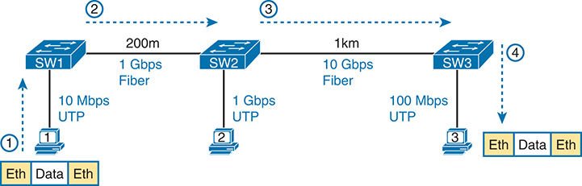
<figcaption>

<strong>图 2-4</strong> <em>以太网局域网通过多种类型的链路转发数据链路层帧</em>

<aside class="hidden" id="a02fig04">

示意图包含依次连接的三台交换机 SW1、SW2 和 SW3。第一台交换机 SW1 通过一条 10 Mbps 的 UTP 连接，连接到标有“Eth”和“Data”的两个以太网区段。SW1 通过一条长 200 米、速率为 1 Gbps 的光纤链路连接第二台交换机 SW2。SW2 还具有一条 1 Gbps 的 UTP 连接，并通过一条长 1 千米、速率为 10 Gbps 的光纤链路连接第三台交换机 SW3。SW3 具有一条 100 Mbps 的 UTP 连接，并连接到标有“Eth”“Data”和“Eth”的三个以太网区段。

</aside>
</figcaption>
</figure>

那么，什么是以太网局域网？它是由用户设备、局域网交换机以及不同类型的电缆组成的网络。每条链路可以使用不同类型的电缆，以不同速率运行，但它们共同协作，将以太网帧从局域网中的一台设备传送到另一台设备。

本章其余内容将进一步深入这些概念。下一节讨论如何使用 UTP 布线构建物理以太网网络，随后以类似方式介绍如何使用光纤布线构建以太网局域网。最后，本章将讨论在以太网局域网中转发帧的规则。

</section>
</section>
<section>
<h3 class="h3" id="ch02lev1sec4">使用 UTP 构建物理以太网局域网</h3>

本章接下来讨论任意两个以太网节点之间的单条物理链路，特别是使用非屏蔽双绞线（UTP）的链路。在整个以太网网络能够在用户设备之间发送以太网帧之前，每个节点都必须做好准备，并能够在单条物理链路上传送数据。

本节重点介绍三种最常用的以太网标准：<a id="key_009" href="#ref-gloss_003">10BASE-T</a>（以太网）、<a id="key_010" href="#ref-gloss_004">100BASE-T</a>（<a id="key_023" href="#ref-gloss_141">快速以太网</a>，简称 FE）和 <a id="key_011" href="#ref-gloss_005">1000BASE-T</a>（<a id="key_026" href="#ref-gloss_159">千兆以太网</a>，简称 GE）。具体来说，本节先介绍如何通过 UTP 电缆在两个方向上传送数据，再讨论 10 Mbps、100 Mbps 和 1000 Mbps 以太网所用 UTP 电缆的具体接线方式。

<section>
<h4 class="h4" id="ch02lev2sec5">使用双绞线对传输数据</h4>

以太网确实通过 UTP 电缆发送数据，但实际物理传输依靠的是 UTP 电缆内部导线中的电流。要更好地理解以太网如何利用电来发送数据，可以将其分为两个方面：首先如何构成电路，然后如何利用电信号传达 1 和 0。

首先，为了构成一个电路，以太网规定了如何使用一对双绞线中的两根导线，如<a href="#ch02fig05">图 2-5</a> 所示。图中没有画出两个节点之间的整条 UTP 电缆，而是画出了 UTP 电缆内部的两根独立导线。电路需要完整的回路，因此两个节点利用各自以太网端口上的电路，将一对导线连接成完整回路，使电流能够流动。

<figure class="image-c" id="ch02fig05">
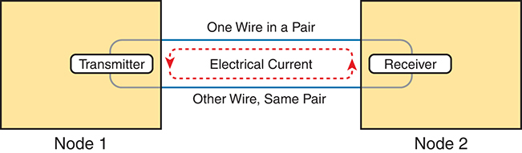
<figcaption>

<strong>图 2-5</strong> <em>用一对导线构成电路，在一个方向上传输数据</em>

<aside class="hidden" id="a02fig05">

示意图展示两个节点之间的电流传输过程。第一个节点“节点 1”是发送器，通过标为“线对中的一根导线”的导线，将电流送往作为接收器的第二个节点“节点 2”。同一线对中的另一根导线标为“另一根导线，同一线对”，与第一根导线平行。两根导线都连接节点 1 和节点 2，构成完整电路。图中用逆时针方向的箭头表示电流从发送器流向接收器的方向。

</aside>
</figcaption>
</figure>

发送数据时，两台设备遵循一组称为<em>编码方案</em>的规则。这很像两个人使用同一种语言交谈：说话者用某种语言说出词语，听者因为也懂这种语言，就能理解这些话。使用编码方案时，发送节点让电信号随时间变化，而另一节点——接收器——使用相同规则，将这些变化解释为 0 或 1。（例如，10BASE-T 的编码方案把二进制 0 编码为：在一个长度为一千万分之一秒的时间间隔中间，电压从较高电平跳变到较低电平。）

请注意，在实际 UTP 电缆中，导线是相互绞合的，而不是像<a href="#ch02fig05">图 2-5</a> 那样平行放置。绞合有助于解决一些重要的物理传输问题。电流流过任何导线时，都会产生<a id="key_017" href="#ref-gloss_119">电磁干扰（EMI）</a>，影响附近导线中的电信号，包括同一电缆中的其他导线。（同一电缆内不同线对之间的 EMI 称为<em>串扰</em>。）将线对绞合有助于抵消大部分 EMI，因此大多数使用铜导线的网络物理链路都采用双绞线。

</section>
<section>
<h4 class="h4" id="ch02lev2sec6">分解 UTP 以太网链路</h4>

<a id="key_021" href="#ref-gloss_135">以太网链路</a>指两个以太网节点之间的任意物理电缆。要理解 UTP 以太网链路如何工作，可以将物理链路拆分为几个基本组成部分，如<a href="#ch02fig06">图 2-6</a> 所示：电缆本身、电缆两端的连接器，以及设备上与连接器匹配、用于插入连接器的端口。

<figure class="image-c" id="ch02fig06">
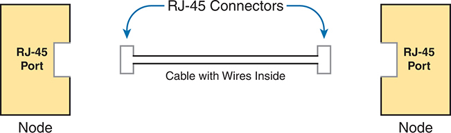
<figcaption>

<strong>图 2-6</strong> <em>以太网链路的基本组成部分</em>

<aside class="hidden" id="a02fig06">

示意图中有两个节点，每个节点都配有一个 RJ-45 端口。两个节点由一条标为“内部包含导线的电缆”的电缆相连。电缆两端各有一个 RJ-45 连接器，分别插入两个节点的 RJ-45 端口。

</aside>
</figcaption>
</figure>

首先考虑 UTP 电缆本身。电缆中包含一些铜导线，按双绞线对分组。10BASE-T 和 100BASE-T 标准需要两对导线，而 1000BASE-T 标准需要四对导线。每根导线都有带颜色编码的塑料绝缘层，同一线对的导线采用相关的配色。例如，蓝色线对中，一根导线的绝缘层为纯蓝色，另一根则为蓝白相间的条纹。

许多以太网 UTP 电缆的两端都使用 RJ-45 连接器。<a id="key_031" href="#ref-gloss_336">RJ-45</a> 连接器具有八个物理位置，可插入电缆中的八根导线，这些位置称为<em>引脚位置</em>，简称<em>引脚</em>。通过这些引脚，铜导线的末端可以接触物理链路两端节点内部的电子电路，使电流能够流动。

注意

如果方便，请找一条身边的以太网 UTP 电缆，仔细观察其连接器，找出连接器中的引脚位置和导线颜色。

为了构成完整物理链路，每个节点都需要一个与电缆上的 RJ-45 连接器匹配的 RJ-45 <a id="key_022" href="#ref-gloss_137">以太网端口</a>，使电缆两端的连接器能够分别连接两个节点。PC 的 RJ-45 以太网端口通常是<a id="key_030" href="#ref-gloss_276">网络接口卡（NIC）</a>的一部分；网卡可以是 PC 的扩展卡，也可以集成在系统内部。交换机通常具有许多 RJ-45 端口，因为它们需要为用户设备提供连接以太网局域网的位置。<a href="#ch02fig07">图 2-7</a> 展示了电缆、连接器和端口的照片。

<figure class="image-c" id="ch02fig07">
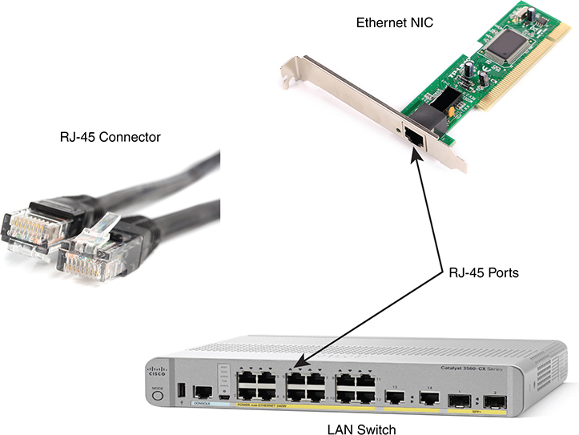
<figcaption>

<strong>图 2-7</strong> <em>RJ-45 连接器和端口</em>

</figcaption>
</figure>

图中左侧为连接器，右侧为端口。左图显示 RJ-45 连接器端部的八个引脚位置。右上图是一块尚未安装到计算机中的以太网网卡。右下图展示一台 Cisco 交换机的一侧，带有多个 RJ-45 端口，便于多台设备连接以太网网络。

最后，虽然 RJ-45 连接器配合 UTP 布线很常见，但 Cisco 局域网交换机通常还支持其他类型的连接器。购买众多 Cisco 交换机型号中的某一款时，需要考虑希望交换机具备哪些类型的物理端口，以及每种类型需要多少个。

为了使客户在购买交换机之后，仍能灵活选择以太网链路类型，Cisco 交换机提供了一些可在购买后更换端口硬件的物理端口；这种端口硬件称为<a id="key_034" href="#ref-gloss_411">收发器</a>。

例如，<a href="#ch02fig08">图 2-8</a> 展示了一台 Cisco 交换机和一个可更换收发器的照片。图中是一只速率为 10 Gbps 的增强型小型可插拔收发器（SFP+），放在 Cisco 3560CX 交换机两个 SFP+ 插槽的外侧。SFP+ 本体是交换机下方的银色部件，上面连接了一条黑色电缆。

<figure class="image-c" id="ch02fig08">
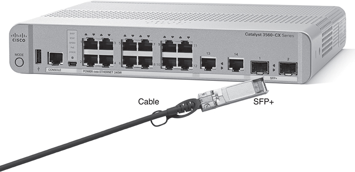
<figcaption>

<strong>图 2-8</strong> <em>连接电缆的 10 Gbps SFP+，放置于 Catalyst 3560CX 交换机插槽外侧</em>

</figcaption>
</figure>

<strong>千兆以太网接口转换器（GBIC）：</strong>千兆接口可拆卸收发器最初采用的外形规格，体积大于 SFP。

<strong>小型可插拔收发器（SFP）：</strong>GBIC 的替代品，用于千兆接口，体积更小，在网卡或交换机侧面占用的空间更少。

<strong>增强型小型可插拔收发器（SFP+）：</strong>尺寸与 SFP 相同，但用于 10 Gbps 接口。（“Plus”表示相对于 SFP 提升了速率。）

</section>
<section>
<h4 class="h4" id="ch02lev2sec7">10BASE-T 和 100BASE-T 的 UTP 布线引脚排列</h4>

到目前为止，本节介绍的知识就好比教你在一座 1000 英亩的牧场上开卡车：你可以把卡车开到牧场内任何想去的地方，警察也不会干涉。然而，一旦驶上公共道路，警察就要求你规范驾驶、遵守规则。同样，本章到目前为止讨论了发送数据的一般原理，但还没有详细介绍以太网布线的一些重要规则。这些规则就像交通规则，确保所有设备都使用电缆内正确的导线发送数据。

接下来介绍其中一些规则，具体针对速率为 10 Mbps 的 10BASE-T 和速率为 100 Mbps 的 100BASE-T。两者使用 UTP 布线的方式相似，包括都只使用两对导线。随后会简要比较使用四对导线的 1000BASE-T（千兆以太网）的接线方式。

<section>
<h5 class="h5" id="ch02lev3sec1">直通线的引脚排列</h5>

10BASE-T 和 100BASE-T 使用 UTP 电缆中的两对导线，每个方向各用一对，如<a href="#ch02fig09">图 2-9</a> 所示。图中画出的四根导线都位于同一条连接 PC 与局域网交换机的 UTP 电缆中。在这个示例中，左侧 PC 使用上方线对发送，右侧交换机使用下方线对发送。

<figure class="image-c" id="ch02fig09">
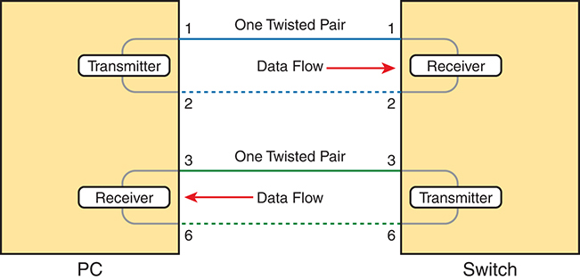
<figcaption>

<strong>图 2-9</strong> <em>10 Mbps 和 100 Mbps 以太网的每个传输方向各使用一对导线</em>

<aside class="hidden" id="a02fig09">

示意图有两个方框，分别表示“PC”和“交换机”。PC 内部上方是“发送器”，下方是“接收器”；交换机内部则相反，上方是“接收器”，下方是“发送器”。PC 的发送器通过标为“一对双绞线”的导线向交换机接收器发送电流。同一线对中的另一根导线以虚线表示，与第一根导线平行，连接发送器和接收器，构成完整电路。电路中间标为“数据流”的箭头指向右侧。PC 的接收器通过另一组标为“一对双绞线”的导线与交换机发送器连接，其中另一根导线同样以平行虚线表示，构成完整电路。这个电路中间标为“数据流”的箭头指向左侧。

</aside>
</figcaption>
</figure>

要在链路上正确传输，UTP 电缆中的导线必须连接到 RJ-45 连接器上正确的引脚位置。例如，在<a href="#ch02fig09">图 2-9</a> 中，左侧 PC 的发送器必须知道用于发送的两根导线分别位于哪些引脚。这两根导线还必须连接到交换机 RJ-45 连接器上的正确引脚，使交换机的接收逻辑能够使用正确的导线。

要理解电缆的接线方式，也就是电缆两端的各根导线应该位于哪些引脚位置，首先需要了解网卡和交换机如何工作。通常，以太网网卡的发送器使用连接到引脚 1 和 2 的线对，接收器使用引脚 3 和 6 上的线对。局域网交换机了解网卡的这种安排，因此采用相反方式：接收器使用引脚 1 和 2 上的线对，发送器使用引脚 3 和 6 上的线对。交换机实际上将终端设备的发送与接收逻辑反转了。

为了使上述逻辑正常工作，UTP 电缆必须采用<a id="key_033" href="#ref-gloss_380">直通线</a><em>引脚排列</em>约定。<em>引脚排列（pinout）</em>指 RJ-45 连接器中八个编号引脚位置分别放置哪种颜色导线的接线方式。以太网直通线将电缆一端引脚 1 上的导线连接到另一端的引脚 1，引脚 2 上的导线连接到另一端的引脚 2，一端的引脚 3 连接到另一端的引脚 3，依此类推。<a href="#ch02fig10">图 2-10</a> 展示了两对导线的直通引脚排列：一对位于引脚 1、2，另一对位于引脚 3、6，这正是 10BASE-T 和 100BASE-T 使用的方式。

<figure class="image-c" id="ch02fig10">
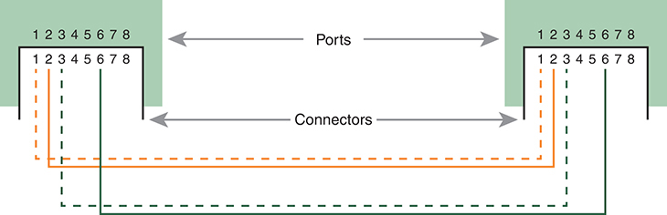
<figcaption>

<strong>图 2-10</strong> <em>10BASE-T 和 100BASE-T 直通线的引脚排列</em>

<aside class="hidden" id="a02fig10">

示意图展示两组端口和连接器，每组都从 1 编号到 8，表示电缆两端的引脚。外部标为“端口”，内部标为“连接器”。实线和虚线连接两组连接器中相对应的编号，用于说明引脚排列。

</aside>
</figcaption>
</figure>

它们实际上将发送与接收功能反转或交叉，因此在交换机与终端设备之间的链路上，电缆可以采用<a href="#ch02fig09">图 2-9</a> 所示的直通引脚排列。

当两个节点使用不同线对发送数据时，直通线就能正常工作，如<a href="#ch02fig09">图 2-9</a> 所示。但是，如果要连接的两台设备使用相同引脚发送数据，就需要另一种称为<a id="key_016" href="#ref-gloss_082">交叉线</a>的引脚排列。交叉线将每台设备发送引脚上的线对，交叉连接到对端设备的接收引脚。

上面的描述虽然正确，但结合<a href="#ch02fig11">图 2-11</a> 这样的图示会更容易理解。图中展示两台交换机之间的链路。两台交换机都使用引脚 3 和 6 上的线对发送，使用引脚 1 和 2 上的线对接收。因此，电缆必须将每一端引脚 3 和 6 上的线对连接到另一端的引脚 1 和 2，从而连接对方节点的接收逻辑。

<figure class="image-c" id="ch02fig11">
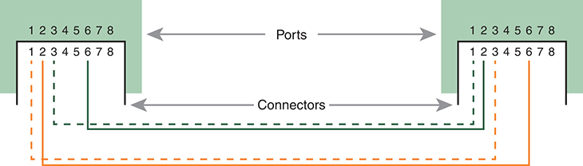
<figcaption>

<strong>图 2-11</strong> <em>以太网交叉线的引脚排列</em>

<aside class="hidden" id="a02fig11">

示意图展示两组端口和连接器，每组都从 1 编号到 8，表示电缆两端的引脚。外部标为“端口”，内部标为“连接器”。实线和虚线连接两组连接器的相应编号，用于说明引脚排列。

</aside>
</figcaption>
</figure>
</section>
<section>
<h5 class="h5" id="ch02lev3sec2">选择正确的电缆引脚排列</h5>

为应对考试，你应熟练判断网络各部分需要哪种电缆：直通线还是交叉线。关键是知道某台设备是像 PC 网卡一样使用引脚 1 和 2 发送，还是像交换机一样使用引脚 3 和 6 发送。然后，只需应用以下规则：

<strong>交叉线：</strong>两端设备使用相同引脚对发送时使用。

<strong>直通线：</strong>两端设备使用不同引脚对发送时使用。

<a href="#ch02tab03">表 2-3</a> 列出了各种设备及其使用的引脚对，假定这些设备使用 10BASE-T 和 100BASE-T。

<figure class="table" id="ch02tab03">
<figcaption>

<strong>表 2-3</strong> 10BASE-T 和 100BASE-T 使用的引脚对

</figcaption>
<table class="all">
<thead>
<tr>
<th class="th">
使用引脚 1、2 发送
</th>
<th class="th">
使用引脚 3、6 发送
</th>
</tr>
</thead>
<tbody>
<tr>
<td class="border">
PC 网卡
</td>
<td class="border">
集线器
</td>
</tr>
<tr>
<td class="border">
路由器
</td>
<td class="border">
交换机
</td>
</tr>
<tr>
<td class="border">
无线接入点（以太网接口）
</td>
<td class="border">
—
</td>
</tr>
</tbody>
</table>
</figure>

例如，<a href="#ch02fig12">图 2-12</a> 展示了一栋建筑物内的园区局域网。其中使用多条直通线将 PC 连接到交换机，而交换机之间的连接则需要使用<em>交叉线</em>。

<figure class="image-c" id="ch02fig12">
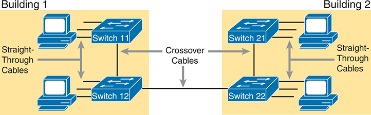
<figcaption>

<strong>图 2-12</strong> <em>以太网直通线和交叉线的典型用途</em>

<aside class="hidden" id="a02fig12">

示意图展示建筑物 1 和建筑物 2 之间的网络布局，每栋建筑物都配有两台交换机。在建筑物 1 内，交换机 11 和交换机 12 使用以太网直通线互连；在建筑物 2 内，交换机 21 和交换机 22 同样通过以太网直通线连接。一条以太网交叉线连接建筑物 1 的交换机 11 与建筑物 2 的交换机 21，另有以太网电缆连接交换机 12 和交换机 22。

</aside>
</figcaption>
</figure>
</section>
<section>
<h5 class="h5" id="ch02lev3sec3">使用 Auto-MDIX 自动调整接线</h5>

UTP 电缆使用错误的引脚排列，是较常见的部署错误之一。1998 年，随着千兆以太网的推出，IEEE 为以太网加入了一项新功能，规定设备如何利用电脉冲感知电缆引脚排列是否错误。例如，链路需要交叉线，但安装人员接上了直通线时，这项功能能够检测到错误的引脚排列，并将电信号重新引导到正确线对上进行补偿，使链路正常工作。以太网标准将其称为<em>自动介质相关接口交叉</em>（<a id="key_012" href="#ref-gloss_033">auto-MDIX</a>）。

Auto-MDIX 允许站点的所有电缆都采用直通引脚排列。例如，整个布线系统都可以使用直通线。对于需要交叉排列的链路，交换机端口的 auto-MDIX 会检测到所用电缆为直通线，然后在内部交换收发器使用的线对，使链路正常工作。（此外，大多数安装场景会使用支持千兆以太网的四对 UTP 电缆，使所有链路都能支持 10 Mbps、100 Mbps 或 1000 Mbps 以太网。）

</section>
</section>
<section>
<h4 class="h4" id="ch02lev2sec8">1000BASE-T 的 UTP 布线引脚排列</h4>

<em>1000BASE-T</em>（<em>千兆以太网</em>）在布线和引脚排列方面不同于 10BASE-T 与 100BASE-T。首先，1000BASE-T 需要四对导线。其次，它使用更先进的电子电路，允许两端在每个线对上同时发送和接收。不过，1000BASE-T 的接线排列与早期标准几乎相同，只是增加了另外两对导线的具体要求。

1000BASE-T 的直通线使用四对导线构成四个电路，但两端的引脚必须对应。其中两对导线采用与 10BASE-T 和 100BASE-T 标准相同的引脚排列，另外在引脚 4 和 5 上增加一对，在引脚 7 和 8 上再增加一对，如<a href="#ch02fig13">图 2-13</a> 所示。

<figure class="image-c" id="ch02fig13">
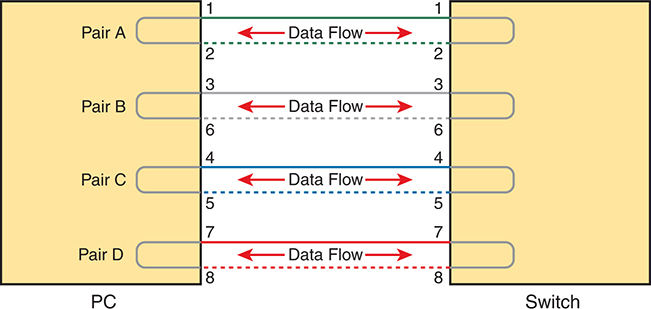
<figcaption>

<strong>图 2-13</strong> <em>用于 1000BASE-T 的四对直通线</em>

<aside class="hidden" id="a02fig13">

示意图展示一条连接 PC 与交换机的四对直通线中的数据流。四个线对标为 A 至 D，每对包含两根导线，引脚编号为 1 至 8。箭头表示 PC 端和交换机端对应引脚之间的数据传输方向。在这条四对直通线中，每个线对 A 至 D 都连接 PC 与交换机两端的对应引脚，数据流方向由箭头标明。

</aside>
</figcaption>
</figure>

与 10BASE-T 和 100BASE-T 一样，1000BASE-T（千兆以太网）在某些链路上使用直通线引脚排列，在其他情况下则使用交叉线。千兆以太网交叉线会将图中的 A、B 两个线对交叉连接，即引脚 1、2 与引脚 3、6 上的线对；同时也会将 C、D 两个线对交叉连接，即引脚 4、5 与引脚 7、8 上的线对。需要采用交叉线的情况与前面<a href="#ch02tab03">表 2-3</a> 所列相同，例如连接两台交换机时。

</section>
</section>
<section>
<h3 class="h3" id="ch02lev1sec5">使用光纤构建物理以太网局域网</h3>

许多基于 UTP 的以太网标准支持最长 100 米的电缆，这意味着企业中的大多数以太网布线都使用 UTP 电缆。在一栋建筑物的某层楼中，从以太网交换机到各个终端的距离通常都小于 100 米。但在某些情况下，工程师可能更愿意在以太网局域网的某些链路上使用光纤，首要原因是需要更长的距离，此外也可能有其他原因。下一节先讨论通过光纤布线传输数据的基本原理，再介绍几项取舍因素。

<section>
<h4 class="h4" id="ch02lev2sec9">光纤布线的传输概念</h4>

<em>光纤布线</em>使用玻璃作为光通过的介质，并让光随时间变化来编码 0 和 1。使用玻璃听起来可能有些奇怪，因为我们大多数人想到的是窗户上的玻璃。窗玻璃坚硬、不易弯曲，而且受到足够强的撞击或弯折时很可能碎裂，这些都不是理想布线材料应有的特性。

光纤电缆使用的是玻璃纤维，制造商可以将柔性的玻璃拉成细长的丝，也就是光纤。<a id="key_024" href="#ref-gloss_142">光纤电缆</a>将光纤置于电缆中央，使光能够穿过玻璃；对于发送数据而言，这是一项非常重要的特性。

虽然通过玻璃光纤发送数据效果很好，但单独一根玻璃光纤仍需要辅助保护。玻璃可能断裂，因此光纤需要保护和加固。<a href="#ch02fig14">图 2-14</a> 通过剖面图展示光纤电缆的组成部分，便于理解。

<figure class="image-c" id="ch02fig14">
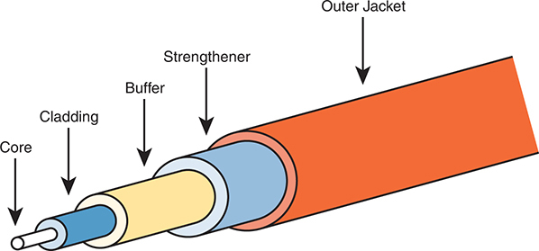
<figcaption>

<strong>图 2-14</strong> <em>光纤电缆的组成部分</em>

</figcaption>
</figure>

电缆外部的三层结构保护其内部，并使电缆更易于安装和管理；内层的<a id="key_014" href="#ref-gloss_063">包层</a>和<a id="key_015" href="#ref-gloss_081">纤芯</a>则共同为光在电缆中传输创造条件。称为<em>光发送器</em>的光源将光射入纤芯。光可以在纤芯中传播，但遇到包层时会被反射回纤芯。<a href="#ch02fig15">图 2-15</a> 展示了使用发光二极管（LED）发送器的示例，可以看到光在纤芯中传播时，包层如何将光反射回纤芯。

<figure class="image-c" id="ch02fig15">
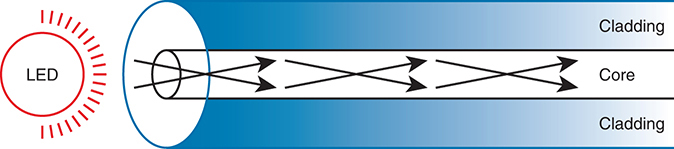
<figcaption>

<strong>图 2-15</strong> <em>利用内部反射在多模光纤中传输</em>

<aside class="hidden" id="a02fig15">

示意图中，LED 将光线射入光纤电缆。电缆由内部纤芯和外部包层组成。光线在纤芯中传播，多个箭头展示了因内部反射而形成的不同路径。包层环绕纤芯，将光限制在其中。箭头表示光从 LED 经纤芯传播的方向。

</aside>
</figcaption>
</figure>

该图展示了<a id="key_029" href="#ref-gloss_262">多模光纤</a>的正常工作方式，其特点是允许光波以多个角度，也就是多种模式，进入纤芯。

相比之下，<a id="key_032" href="#ref-gloss_365">单模光纤</a>采用直径更小的纤芯，约为常见多模光纤纤芯直径的五分之一（见<a href="#ch02fig16">图 2-16</a>）。为了将光送入小得多的纤芯，基于激光器的发送器以单一角度发光，因此称为<em>单模</em>。

<figure class="image-c" id="ch02fig16">
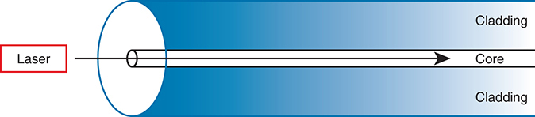
<figcaption>

<strong>图 2-16</strong> <em>使用激光发送器在单模光纤中传输</em>

<aside class="hidden" id="a02fig16">

示意图左侧是激光器，它将光射向一个表示光纤电缆的长圆柱体。电缆中心标为“纤芯”，外面环绕另一层称为“包层”的结构。箭头表示激光器发出的光进入并沿着电缆纤芯传播。

</aside>
</figcaption>
</figure>

多模与单模光纤在以太网中都很重要，分别满足不同需求。与 UTP 相比，多模光纤可支持更长的最大距离；与单模光纤相比，它使用的发送器成本更低。不同标准有所差异，例如万兆光纤以太网的一些标准允许最长 400 米的距离，通常能够连接同一办公园区不同建筑物中的设备。单模光纤则允许数十千米的距离，但 SFP／SFP+ 硬件略贵。

要在两台设备之间传输，需要两条光纤电缆，每个方向各一条，如<a href="#ch02fig17">图 2-17</a> 所示。这个概念与早期 UTP 以太网标准使用两个电路十分相似。请注意，一台设备的发送端口通过一条电缆连接另一台设备的接收端口，另一条电缆则反向连接。

<figure class="image-c" id="ch02fig17">
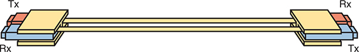
<figcaption>

<strong>图 2-17</strong> <em>两条光纤电缆，每条均将 Tx 连接到 Rx</em>

</figcaption>
</figure>
</section>
<section>
<h4 class="h4" id="ch02lev2sec10">在以太网中使用光纤</h4>

要在以太网交换机上使用光纤，需要选用内置端口支持某种光以太网标准的交换机，或者具有模块化端口、允许改变端口所用以太网标准的交换机。回顾<a href="#ch02fig08">图 2-8</a>，图中的交换机有两个 SFP+ 端口，可以插入任何受支持的 SFP+ 模块。这些 SFP+ 端口支持多种 10 Gbps 标准，例如<a href="#ch02tab04">表 2-4</a> 列出的标准。

<figure class="table" id="ch02tab04">
<figcaption>

<strong>表 2-4</strong> 部分 IEEE 802.3 万兆光纤标准

</figcaption>
<table class="all">
<thead>
<tr>
<th class="th">
标准
</th>
<th class="th">
电缆类型
</th>
<th class="th">
最大距离<a id="tfn2_4" href="#tfn2_4a">*</a>
</th>
</tr>
</thead>
<tbody>
<tr>
<td class="border">
10GBASE-S
</td>
<td class="border">
多模（MM）
</td>
<td class="border">
400 米
</td>
</tr>
<tr>
<td class="border">
10GBASE-LX4
</td>
<td class="border">
多模（MM）
</td>
<td class="border">
300 米
</td>
</tr>
<tr>
<td class="border">
10GBASE-LR
</td>
<td class="border">
单模（SM）
</td>
<td class="border">
10 千米
</td>
</tr>
<tr>
<td class="border">
10GBASE-E
</td>
<td class="border">
单模（SM）
</td>
<td class="border">
30 千米
</td>
</tr>
</tbody>
</table>

<a id="tfn2_4a" href="#tfn2_4">*</a> 最大距离基于不使用中继器时的 IEEE 标准。

</figure>

例如，要在办公园区中构建以太网局域网，可能需要使用一些多模和单模光纤链路。实际上，许多办公园区可能已经提前铺设了光纤布线，以供建筑物中的租户将来使用。如果每栋建筑物与至少另一栋建筑物之间的距离都在几百米以内，就可以在建筑物之间使用多模光纤，并连接交换机来构建局域网。

注意

除了备考 CCNA 之外，如果还需要更深入地了解光纤以太网和 SFP／SFP+，可以访问 <a href="http://tmgmatrix.cisco.com">tmgmatrix.cisco.com</a>，搜索并了解兼容的 Cisco SFP／SFP+ 硬件。

考虑使用 UTP 还是光纤布线时，距离可能是首要标准，但也存在其他取舍。UTP 在成本方面同样占优，因为从 UTP 到多模，再到单模，SFP、SFP+ 等发送器的额外成本会使总成本逐步上升。不过，UTP 也有一些不足。首先，在工厂等电气噪声较大的环境中，UTP 的工作效果可能不佳，因为它会受到电磁干扰（EMI）的影响。另外，UTP 电缆会向电缆外辐射微弱信号，因此安全要求很高的网络可能选择不会产生类似辐射的光纤，以提高网络安全性。<a href="#ch02tab05">表 2-5</a> 总结了这些取舍。

<figure class="table" id="ch02tab05">
<figcaption>

<strong>表 2-5</strong> UTP、多模和单模以太网布线的比较

</figcaption>
<table class="all">
<thead>
<tr>
<th class="th">
比较指标
</th>
<th class="th">
UTP
</th>
<th class="th">
多模
</th>
<th class="th">
单模
</th>
</tr>
</thead>
<tbody>
<tr>
<td class="border">
布线的相对成本
</td>
<td class="border">
低
</td>
<td class="border">
中
</td>
<td class="border">
中
</td>
</tr>
<tr>
<td class="border">
交换机端口的相对成本
</td>
<td class="border">
低
</td>
<td class="border">
中
</td>
<td class="border">
高
</td>
</tr>
<tr>
<td class="border">
大致最大距离
</td>
<td class="border">
100 米
</td>
<td class="border">
500 米
</td>
<td class="border">
40 千米
</td>
</tr>
<tr>
<td class="border">
受到干扰的相对可能性
</td>
<td class="border">
有一定影响
</td>
<td class="border">
无
</td>
<td class="border">
无
</td>
</tr>
<tr>
<td class="border">
通过电缆辐射复制数据的相对风险
</td>
<td class="border">
有一定风险
</td>
<td class="border">
无
</td>
<td class="border">
无
</td>
</tr>
</tbody>
</table>
</figure>
</section>
</section>
<section>
<h3 class="h3" id="ch02lev1sec6">在以太网网络中发送数据</h3>

虽然物理层标准差别很大，但无论物理以太网链路采用何种类型，以太网标准的其他部分都以相同方式工作。接下来，本章最后一个主要部分将介绍以太网在各种链路类型下通用的若干协议和规则。具体来说，本节讨论以太网数据链路层协议的细节，以及以太网节点、交换机和集线器如何在以太网局域网中转发以太网帧。

<section>
<h4 class="h4" id="ch02lev2sec11">以太网数据链路层协议</h4>

以太网协议家族的一项重要优势，是这些协议使用同一个数据链路层标准。事实上，数据链路层标准的核心部分可以追溯到最初的以太网标准。

以太网数据链路层协议定义了以太网帧：前面是以太网首部，中间是封装的数据，最后是以太网尾部。以太网实际上定义了几种不同的首部格式，而<a href="#ch02fig18">图 2-18</a> 所示的帧格式是如今常用的一种。

<figure class="image-c" id="ch02fig18">
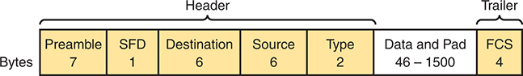
<figcaption>

<strong>图 2-18</strong> <em>常用的以太网帧格式</em>

<aside class="hidden" id="a02fig18">

帧包含首部和尾部两个主要部分。首部由前导码、SFD、目的地址、源地址和类型等字段组成。帧中还包含长度为 46 至 1500 字节的数据与填充，后面是 4 字节的 FCS，属于尾部。

</aside>
</figcaption>
</figure>

帧中的所有字段都很重要，但其中某些字段与本书讨论的主题关系更密切。<a href="#ch02tab06">表 2-6</a> 列出了首部和尾部中的字段，并附简要说明供参考；接下来的内容会更详细地介绍其中几个字段。

<figure class="table" id="ch02tab06">
<figcaption>

<strong>表 2-6</strong> IEEE 802.3 以太网首部和尾部字段

</figcaption>
<table class="all">
<thead>
<tr>
<th class="th">
字段
</th>
<th class="th">
字节数
</th>
<th class="th">
说明
</th>
</tr>
</thead>
<tbody>
<tr>
<td class="border">
<strong>前导码（Preamble）</strong>
</td>
<td class="border">
7
</td>
<td class="border">
用于同步。
</td>
</tr>
<tr>
<td class="border">
<strong>帧起始定界符（SFD）</strong>
</td>
<td class="border">
1
</td>
<td class="border">
表示下一个字节是目的 MAC 地址字段的开始。
</td>
</tr>
<tr>
<td class="border">
<strong>目的 MAC 地址</strong>
</td>
<td class="border">
6
</td>
<td class="border">
标识本帧的预期接收者。
</td>
</tr>
<tr>
<td class="border">
<strong>源 MAC 地址</strong>
</td>
<td class="border">
6
</td>
<td class="border">
标识本帧的发送者。
</td>
</tr>
<tr>
<td class="border">
<strong>类型（Type）</strong>
</td>
<td class="border">
2
</td>
<td class="border">
定义帧内部承载的协议类型；如今通常标识 IP 第 4 版（IPv4）或 IP 第 6 版（IPv6）。
</td>
</tr>
<tr>
<td class="border">
<strong>数据与填充（Data and Pad）</strong><em><a id="tfn2_6" href="#tfn2_6a">*</a></em>
</td>
<td class="border">
46–1500
</td>
<td class="border">
承载来自较高层的数据，通常是三层协议数据单元 L3PDU，一般为 IPv4 或 IPv6 分组。发送方添加填充，以满足该字段最小长度为 46 字节的要求。
</td>
</tr>
<tr>
<td class="border">
<strong>帧检验序列（FCS）</strong>
</td>
<td class="border">
4
</td>
<td class="border">
为接收网卡提供一种方法，用于判断帧在传输过程中是否出现差错。
</td>
</tr>
</tbody>
</table>

<a id="tfn2_6a" href="#tfn2_6">*</a> IEEE 802.3 规范规定，802.3 帧的数据部分最小为 46 字节，最大为 1500 字节。<em>最大传输单元</em>（MTU）定义了可通过某种介质发送的最大三层分组长度。由于三层分组位于以太网帧的数据部分中，以太网上允许的最大 IP MTU 为 1500 字节。

</figure>
<section>
<h5 class="h5" id="ch02lev3sec4">以太网编址</h5>

源和目的以太网地址字段对以太网局域网的工作起着重要作用。其基本思路相对简单：发送节点将自己的地址放入源地址字段，将预期以太网目的设备的地址放入目的地址字段。发送方发出帧，并期望整个以太网局域网将该帧送达正确目的地。

<a id="key_019" href="#ref-gloss_132">以太网地址</a>也称为<em>介质访问控制（MAC）地址</em>，是长度为 6 字节，即 48 比特的二进制数。为了方便，大多数计算机将 MAC 地址显示为 12 位十六进制数。Cisco 设备通常还会在数字中插入句点以提高可读性；例如，Cisco 交换机可能将 MAC 地址显示为 0000.0C12.3456。

多数 MAC 地址代表一块网卡或另一个以太网端口，因此这些地址通常称为<em>单播</em>以太网地址。<em>单播</em>只是用正式术语说明：该地址代表连接以太网局域网的一个接口。（这一术语还与另外两种以太网地址——<em>广播</em>和<em>组播</em>——形成对照，本节稍后会定义后两者。）

向目的单播 MAC 地址发送数据的思路很好，但前提是所有单播 MAC 地址必须唯一。如果两块网卡尝试使用相同 MAC 地址，就可能造成混乱。（这就像你我都使用同一个邮寄地址时，邮政部门会感到困惑：应该把信送到你家，还是我家？）如果同一以太网上的两台 PC 尝试使用同一个 MAC 地址，那么发往该 MAC 地址的帧应交给哪台 PC？

以太网通过一种管理流程解决这个问题，在制造时就为所有以太网设备分配全球唯一的 MAC 地址。制造商在生产以太网产品之前，必须向 IEEE 申请一个全球唯一的 3 字节代码，称为组织唯一标识符（OUI）。制造商同意，为其所有网卡及其他以太网产品分配的 MAC 地址，都以获得的 3 字节 OUI 开头。制造商还为最后 3 个字节分配唯一值，即该制造商从未与这个 OUI 搭配使用过的数字。因此，全世界每台设备的 MAC 地址都是唯一的。

注意

IEEE 也将这些通用 MAC 地址称为<em>全局 MAC 地址</em>。

<a href="#ch02fig19">图 2-19</a> 展示了包含 OUI 的单播 MAC 地址结构。

<figure class="image-c" id="ch02fig19">
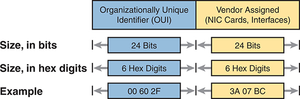
<figcaption>

<strong>图 2-19</strong> <em>单播以太网地址的结构</em>

<aside class="hidden" id="a02fig19">

示意图分为两个主要部分：“组织唯一标识符（OUI）”和“厂商分配部分（网卡、接口）”。每部分的长度都为 24 比特，等于 6 位十六进制数。图中给出了示例值：OUI 为“00 60 2F”，厂商分配部分为“3A 07 BC”。

</aside>
</figcaption>
</figure>

以太网地址有许多名称：局域网地址、以太网地址、硬件地址、烧录地址、物理地址、通用地址或 MAC 地址。例如，烧录地址（BIA）这一名称表示永久 MAC 地址已经被编码，也就是烧录到网卡的 ROM 芯片中。再如，IEEE 使用<em>通用地址</em>这一术语，是为了强调制造商分配给网卡的地址，应当在全世界所有 MAC 地址中保持唯一。

除单播地址外，以太网还使用组地址。<em>组地址</em>标识多块局域网接口卡。发送到组地址的帧，可能被交付给局域网中的一小组设备，甚至所有设备。实际上，IEEE 为以太网定义了两大类组地址：

<strong>广播地址：</strong>发送到该地址的帧应被交付给以太网局域网中的所有设备，其值为 FFFF.FFFF.FFFF。

<strong>组播地址：</strong>发送到某个以太网组播地址的帧，会被复制并转发给局域网中主动选择接收发往该特定组播地址的帧的一部分设备。

<a href="#ch02tab07">表 2-7</a> 总结了 MAC 地址的大部分细节。

<figure class="table" id="ch02tab07">
<figcaption>

<strong>表 2-7</strong> 局域网 MAC 地址术语和特性

</figcaption>
<table class="all">
<thead>
<tr>
<th class="th">
局域网编址术语或特性
</th>
<th class="th">
说明
</th>
</tr>
</thead>
<tbody>
<tr>
<td class="border">
<a id="key_028" href="#ref-gloss_251">MAC 地址</a>
</td>
<td class="border">
介质访问控制。802.3（以太网）定义了 IEEE 以太网的 MAC 子层。
</td>
</tr>
<tr>
<td class="border">
以太网地址、网卡地址、局域网地址
</td>
<td class="border">
经常用来代替 MAC 地址的其他名称。这些术语描述局域网接口卡的 6 字节地址。
</td>
</tr>
<tr>
<td class="border">
烧录地址
</td>
<td class="border">
由制造该网卡的厂商分配的 6 字节地址。
</td>
</tr>
<tr>
<td class="border">
<a id="key_035" href="#ref-gloss_420">单播地址</a>
</td>
<td class="border">
表示单个局域网接口的 MAC 地址的术语。
</td>
</tr>
<tr>
<td class="border">
<a id="key_013" href="#ref-gloss_051">广播地址</a>
</td>
<td class="border">
表示“当前位于这个局域网中的所有设备”的地址。
</td>
</tr>
<tr>
<td class="border">
组播地址
</td>
<td class="border">
在以太网中，组播地址表示当前以太网局域网中所有设备的某个子集。
</td>
</tr>
</tbody>
</table>
</figure>
</section>
<section>
<h5 class="h5" id="ch02lev3sec5">使用以太网类型字段识别网络层协议</h5>

以太网首部的地址字段在以太网局域网中发挥着重要且直观的作用，相比之下，以太网类型字段的作用就不那么明显。以太网类型字段又称 EtherType，位于以太网数据链路层首部中，但其目的却是直接帮助路由器和主机进行网络处理。简单来说，类型字段标识以太网帧内部所包含的网络层，也就是第 3 层分组的类型。

首先，想一想前面<a href="#ch02fig19">图 2-19</a> 所示以太网帧的数据部分中包含什么。通常，它包含网络中某台设备上的网络层协议所创建的网络层分组。多年来，这些协议曾包括 IBM 的系统网络体系结构（SNA）、Novell NetWare、Digital Equipment Corporation 的 DECnet，以及 Apple Computer 的 AppleTalk。如今，最常见的网络层协议都来自 TCP/IP：IP 第 4 版（IPv4）和 IP 第 6 版（IPv6）。

最初的发送主机可以在一个位置填入数值，即一个十六进制数，用来标识以太网帧内封装的分组类型。但是，发送方应在首部中填入哪个数值来表示 IPv4 分组？表示 IPv6 分组又该用哪个值？IEEE 维护着一份 EtherType 值列表，使每个需要唯一 EtherType 值的网络层协议都能获得一个编号。发送方只需知道这份列表即可。（任何人都可以查看：访问 <a href="http://www.ieee.org">www.ieee.org</a>，搜索 <em>EtherType</em>。）

例如，主机可以在一个以太网帧中发送 IPv4 分组，再在下一个以太网帧中发送 IPv6 分组。两个帧会使用 IEEE 保留的不同以太网类型字段值，如<a href="#ch02fig20">图 2-20</a> 所示。

<figure class="image-c" id="ch02fig20">
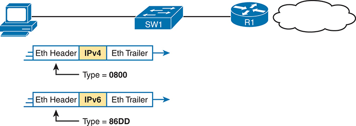
<figcaption>

<strong>图 2-20</strong> <em>以太网类型字段的用途</em>

<aside class="hidden" id="a02fig20">

示意图中，一台计算机连接交换机 SW1，SW1 再连接路由器 R1，最后连接表示互联网的云形。下方有两条横条，每条分成三段，从左到右分别标为“以太网首部”“IP 第 4 版”或“IP 第 6 版”，以及“以太网尾部”。每条横条上方都有向下的箭头，标明所使用的 IP 协议类型。IPv4 对应的类型值是“0800”，IPv6 对应的类型值是“86DD”。

</aside>
</figcaption>
</figure>
</section>
<section>
<h5 class="h5" id="ch02lev3sec6">使用 FCS 检测差错</h5>

以太网还定义了一种方法，让节点能够判断帧中的比特在经过以太网链路时是否发生变化。（通常，比特可能因为某种电气干扰或故障网卡而改变。）与大多数数据链路层协议一样，以太网使用数据链路层尾部中的一个字段进行差错检测。

以太网尾部中的<a id="key_025" href="#ref-gloss_153">帧检验序列</a><em>（FCS）</em>字段，是以太网尾部唯一的字段。它为接收节点提供一种方法，通过比较自己与发送方的计算结果，判断帧是否出现差错。发送方在发送帧之前，使用复杂数学公式对帧进行计算，并将结果存入 FCS 字段。接收方对收到的帧应用相同公式，再将自己的计算结果与发送方的结果进行比较。如果两者相同，就认为帧没有变化；否则说明出现差错，接收方会丢弃该帧。

请注意，<em>差错检测</em>并不意味着<em>差错恢复</em>。以太网规定，应丢弃有差错的帧，但不会尝试恢复这个丢失的帧。其他协议，尤其是 TCP，会发现数据丢失并重新发送，从而恢复丢失的数据。

</section>
</section>
<section>
<h4 class="h4" id="ch02lev2sec12">使用交换机和集线器发送以太网帧</h4>

以太网局域网的行为会有所不同，取决于它主要使用现代设备，特别是局域网交换机，还是某些称为局域网集线器的旧式设备。基本上，较新的交换机允许使用全双工逻辑，它比使用集线器时所需的半双工逻辑更快，也更简单。本章最后一个主题将介绍这些基本差异。

<section>
<h5 class="h5" id="ch02lev3sec7">在现代以太网局域网中使用全双工发送</h5>

现代以太网局域网采用多种以太网物理层标准，但标准以太网帧可以经过其中任何一种物理链路。各条链路可以以不同速率运行，但每条链路都允许相连节点将帧中的比特发送到下一个节点。它们必须协同工作，将数据从发送以太网节点送达目的节点。

这一过程被有意设计得相对简单，使每台设备每秒能够发送大量帧。<a href="#ch02fig21">图 2-21</a> 展示了 PC1 向 PC2 发送以太网帧的示例。

<figure class="image-c" id="ch02fig21">
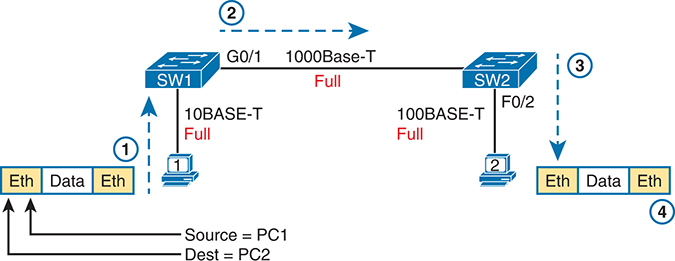
<figcaption>

<strong>图 2-21</strong> <em>在现代以太网局域网中发送数据的示例</em>

<aside class="hidden" id="a02fig21">

在这一设计中，核心交换机 Core1、Core2 和汇聚交换机 D11、D12、D21、D22，利用路由接口和点对点接入执行三层交换。标为 A11、A12、A13、A14、A21、A22、A23、A24 的接入交换机仅使用 SVI 执行二层交换。（译注：原书这段隐藏的无障碍说明与本图不符；本图实际展示 PC1 经 SW1、SW2 向 PC2 发送帧，各条链路均为全双工。）

</aside>
</figcaption>
</figure>

按照图中的步骤：

<ol class="number">
<li>
PC1 构建并发送最初的以太网帧，使用自己的 MAC 地址作为源地址，使用 PC2 的 MAC 地址作为目的地址。
</li>
<li>
交换机 SW1 收到以太网帧后，通过 G0/1 接口将其转发给 SW2；G0/1 是千兆接口 0/1 的简称。
</li>
<li>
交换机 SW2 收到以太网帧后，通过 F0/2 接口将其转发给 PC2；F0/2 是快速以太网接口 0/2 的简称。
</li>
<li>
PC2 收到帧后，识别出目的 MAC 地址是自己的地址，并处理该帧。
</li>
</ol>

<a href="#ch02fig21">图 2-21</a> 中的以太网在每条链路上都使用全双工，但从图中可能不容易直接看出这个概念。

全双工意味着网卡或交换机端口不受半双工限制。因此，要理解全双工，首先需要理解半双工，具体如下：

<strong>半双工：</strong>如果设备正在接收帧，就必须等待之后才能发送；也就是说，不能同时发送和接收。

<strong>全双工：</strong>设备发送之前无需等待，可以同时发送和接收。

因此，当网络中只有 PC 和局域网交换机、没有局域网集线器时，所有节点都可以使用全双工。所有节点都能在同一时刻通过自己的端口发送和接收。例如，在<a href="#ch02fig21">图 2-21</a> 中，PC1 和 PC2 可以同时向对方发送帧，在两个方向上同时传输，而不受任何半双工限制。

</section>
<section>
<h5 class="h5" id="ch02lev3sec8">在局域网集线器环境中使用半双工</h5>

要理解某些情况下为什么需要半双工逻辑，必须先了解一种较旧的网络设备——局域网集线器。IEEE 在 1990 年首次推出 10BASE-T 时，以太网交换机还不存在，网络使用的是局域网集线器。与交换机一样，集线器提供若干 RJ-45 端口，供连接 PC 的链路接入；不过，集线器采用不同的数据转发规则。

局域网集线器根据物理层标准，而非数据链路层标准来转发数据，因此被视为第 1 层设备。电信号从集线器的某个端口进入时，集线器会从所有其他端口，即除入端口之外的端口，重复发送该电信号。这样，数据就会到达连接集线器的其余所有节点，从而有望到达正确目的地。集线器不理解以太网帧、地址或根据地址作出转发决定等概念。

局域网集线器的缺点是，如果两台或更多设备在同一时刻发送信号，电信号就会相互冲突并发生混乱。集线器会重复发送收到的所有电信号，即使同时收到多个信号也是如此。例如，<a href="#ch02fig22">图 2-22</a> 展示了这种情况：PC Archie 和 Bob 在同一时刻发送电信号，即步骤 1A 和 1B，而集线器在步骤 2 中把两个电信号都重复发送给左侧的 Larry。

<figure class="image-c" id="ch02fig22">
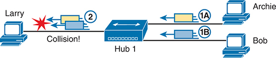
<figcaption>

<strong>图 2-22</strong> <em>由局域网集线器的工作方式导致的冲突</em>

<aside class="hidden" id="a02fig22">

在这一设计中，核心交换机 Core1、Core2 和汇聚交换机 D11、D12、D21、D22，利用路由接口和点对点接入执行三层交换。每台汇聚交换机与核心交换机之间的两条链路十分显眼。标为 A11、A12、A13、A14、A21、A22、A23、A24 的接入交换机仅使用 SVI 执行二层交换。（译注：原书这段隐藏的无障碍说明与本图不符；本图实际展示 Archie 和 Bob 同时向 Hub 1 发送信号，集线器将两路信号转发给 Larry，导致冲突。）

</aside>
</figcaption>
</figure>

注意

为完整说明，请注意集线器会将每个帧泛洪到除入端口之外的所有其他端口。因此，Archie 的帧会到达 Larry 和 Bob，而 Bob 的帧会到达 Larry 和 Archie。

如果把<a href="#ch02fig22">图 2-22</a> 中的集线器替换为局域网交换机，交换机就会防止左侧发生冲突。交换机作为第 2 层设备工作，意味着它会查看数据链路层首部和尾部。交换机会检查 MAC 地址，即使它需要将两个帧都转发给左侧的 Larry，也会先发送一个帧，并将另一个帧排入队列，直到第一个帧发送完毕。

现在回到集线器工作逻辑引发的问题：冲突。为了防止这些冲突，以太网节点必须使用半双工逻辑，而不是全双工逻辑。只有两台或更多设备同时发送时才会出现问题；半双工逻辑要求节点在别人正在发送时，先等待再发送。

例如，回到<a href="#ch02fig22">图 2-22</a>，假设 Archie 开始发送帧的时间足够早，使 Bob 在尝试发送自己的帧之前，已经收到 Archie 帧的最初几个比特。这样，Bob 在步骤 1B 会发现自己正在接收别人的帧，并根据半双工逻辑，等待之后再发送步骤 1B 中的帧。

使用半双工逻辑的节点实际上采用一种较为知名的算法，称为带冲突检测的载波侦听多路访问（CSMA/CD）。该算法既处理显而易见的情况，也处理时机不巧所导致的情况。例如，两个节点可能在完全相同的时刻检查是否有帧正在传入，都发现没有其他节点发送，于是又在完全相同的时刻发送各自的帧，造成冲突。CSMA/CD 也涵盖这些情况，具体如下：

步骤 1. 有帧需要发送的设备持续侦听，直到以太网不再忙碌。

步骤 2. 以太网空闲时，发送方开始发送该帧。

步骤 3. 发送方在发送的同时侦听，以判断是否发生冲突；冲突可能由多种原因引起，包括时机不巧。如果发生冲突，所有当前正在发送的节点都会执行以下操作：

<ol class="step-lower-alpha">
<li>
发送一个干扰信号，告知所有节点发生了冲突。
</li>
<li>
各自独立选择一个随机等待时间，然后再次尝试，以避免再次同时发送。
</li>
<li>
下一次尝试从步骤 1 重新开始。
</li>
</ol>

虽然大多数现代局域网不再经常使用集线器，因此不需要半双工，但企业网络中仍存在足够多的旧式集线器，所以你仍需理解双工问题。每块网卡和每个交换机端口都有双工设置。PC 与交换机之间、或交换机之间的所有链路，都应使用全双工。然而，对于任何连接局域网集线器的链路，相连的交换机端口和网卡端口都应使用半双工。请注意，集线器本身并不使用半双工逻辑，而只是把传入信号重复发送到其余每个端口。

<a href="#ch02fig23">图 2-23</a> 展示了一个示例：左侧为全双工链路，右侧有一个局域网集线器。集线器要求 SW2 的 F0/2 接口，以及连接到集线器的 PC，都使用半双工逻辑。

<figure class="image-c" id="ch02fig23">
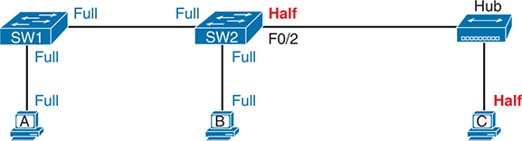
<figcaption>

<strong>图 2-23</strong> <em>以太网局域网中的全双工和半双工</em>

<aside class="hidden" id="a02fig23">

示意图展示两台三层交换机 SW1 和 SW2，通过端口通道接口 Po12 相连。每台交换机都有特定 IP 地址，子网掩码为 255.255.255.0，且未配置为交换端口（no switchport）。左侧 SW1 的 IP 地址为 10.1.12.1，通过 G1/0/1 和 G1/0/2 接口连接到子网为 10.1.2.0/24 的 VLAN 2。右侧 SW2 的 IP 地址为 10.1.12.2，通过 G1/0/3 和 G1/0/4 接口连接到子网为 10.1.3.0/24 的 VLAN 3。SW1 与 SW2 之间通过各自的 Po12 接口连接。（译注：原书这段隐藏的无障碍说明与本图不符；本图实际展示 SW1、SW2 及其所连 PC 使用全双工，而 SW2 的 F0/2 与集线器、以及集线器与 PC C 之间的连接使用半双工。）

</aside>
</figcaption>
</figure>

在结束本章之前，请注意，全双工与半双工的讨论对应 CCNA 考试主题 1.3.b 中的两个具体术语，只是这种联系可能不太明显。首先，考试主题中的<em>以太网共享介质</em>指采用集线器、需要 CSMA/CD、因而共享带宽的设计。这个术语的依据是：连接到集线器的设备必须使用 CSMA/CD，因此共享网络；CSMA/CD 的规则保证在任意时刻，只有一台设备能够成功发送帧。

相比之下，同一考试主题中的<em>以太网点对点</em>强调，在由交换机构建的网络中，每条点对点链路都独立于其他链路工作。由于采用了本节讨论的全双工逻辑，以太网中的每条点对点链路都可以在同一时刻发送帧。

</section>
</section>
</section>
</section>

<section class="ccna-source ccna-appendix" aria-label="答案解析与术语表">
<section data-epub-type="chapter">
<h2 class="h2" id="ref-appc">附录 C</h2>
<h2 class="h2a">自测答案</h2>
<section>
<h3 class="h3" id="ref-appclev1sec2">第 2 章</h3>

<strong><a id="ref-ques2_1" href="#quess2_1">1</a>.</strong> A。IEEE 定义了以太网局域网标准，其标准名称以 802.3 开头，并且都使用布线。IEEE 也定义了无线局域网标准，其名称以 802.11 开头，它们与以太网标准相互独立。

<strong><a id="ref-ques2_2" href="#quess2_2">2</a>.</strong> C。<em>BASE</em> 之前的数字表示速率，单位为每秒兆比特（Mbps）：1000 Mbps 等于每秒 1 吉比特（1 Gbps）。后缀中的 <em>T</em> 表示双绞线或 UTP 布线，因此 1000BASE-T 是基于 UTP 的千兆以太网标准名称。

<strong><a id="ref-ques2_3" href="#quess2_3">3</a>.</strong> B。交叉线把一端节点发送引脚对上的导线，交叉连接到另一端设备用于接收的不同引脚。对于 10 Mbps 和 100 Mbps 以太网，具体接线方式是将电缆每一端引脚 1、2 上的线对，分别连接到另一端的引脚 3、6。

<strong><a id="ref-ques2_4" href="#quess2_4">4</a>.</strong> B、D 和 E。路由器、无线接入点的以太网端口以及 PC 网卡都使用引脚 1 和 2 发送，而集线器和局域网交换机使用引脚 3 和 6 发送。直通线用于连接采用不同引脚对发送的设备，因为此时电缆无需将线对交叉连接。

<strong><a id="ref-ques2_5" href="#quess2_5">5</a>.</strong> B 和 D。多模光纤使用基于 LED 的发送器，而不是基于激光器的发送器。两个选项提到了发送器类型，其中一个正确，另一个错误。

另有两个选项涉及距离。提到达到可能最长距离的选项是错误的，因为提供最长距离的是单模光纤，而不是多模光纤。另一个正确选项体现了一种取舍：多模光纤适用于略超过 UTP 的 100 米限制的距离，同时所用硬件的成本低于单模光纤。

<strong><a id="ref-ques2_6" href="#quess2_6">6</a>.</strong> B。网卡和交换机端口使用带冲突检测的载波侦听多路访问（CSMA/CD）算法来实现半双工逻辑。CSMA/CD 尝试避免冲突，也会在冲突确实发生时检测到它，并规定以太网节点应如何停止发送、等待以及稍后重试。

<strong><a id="ref-ques2_7" href="#quess2_7">7</a>.</strong> C。位于以太网尾部的 4 字节 FCS 字段，让接收节点能够查看发送节点用数学公式计算出的结果；该公式是差错检测过程的关键部分。请注意，以太网定义了发现差错的过程，即差错检测，但没有定义差错恢复。

<strong><a id="ref-ques2_8" href="#quess2_8">8</a>.</strong> B、C 和 E。以太网端口在制造时获得的预先分配的通用 MAC 地址，由两个各为 3 字节的部分组成。前半部分称为组织唯一标识符（OUI），由 IEEE 分配给制造产品的公司，是仅供该公司使用的唯一十六进制数。

<strong><a id="ref-ques2_9" href="#quess2_9">9</a>.</strong> C 和 D。以太网支持标识单个以太网节点的单播地址，也支持可用于向多个以太网节点发送同一个帧的组地址。组地址的两种类型是<em>广播地址</em>和<em>组播地址</em>。

</section>
</section>

<section id="ref-glossary"><h2 class="h2a">术语表</h2>
<strong>10BASE-T</strong> 一种速率为 10 Mbps 的基带以太网规范，使用两对双绞线（3 类、4 类或 5 类）：一对发送数据，另一对接收数据。10BASE-T 是 IEEE 802.3 规范的一部分，每个网段的距离限制约为 100 米（328 英尺）。

<strong>100BASE-T</strong> 一种 IEEE 快速以太网标准的名称，使用两对铜缆，速率为 100 Mbps，最大电缆长度为 100 米。

<strong>1000BASE-T</strong> 一种 IEEE 千兆以太网标准的名称，使用四对铜缆，速率为 1000 Mbps（1 Gbps），最大电缆长度为 100 米。

<strong>auto-MDIX</strong> 以太网标准的一项功能，与千兆以太网一起于 1998 年引入。它可检测链路使用的 UTP 电缆引脚排列是否正确，即应该使用直通还是交叉排列；如果所用排列错误，会在内部自动交换信号，使链路正常工作。

<strong>广播地址（broadcast address）</strong> 泛指表示所有设备、可用于向所有设备发送一条消息的地址。在以太网中，它是所有二进制位均为 1 的 MAC 地址，十六进制写法为 FFFF.FFFF.FFFF。有关 IPv4，<em>参见</em><a href="#ref-gloss_384">子网广播地址</a>。

<strong>包层（cladding）</strong> 光纤电缆中的第二层结构，环绕纤芯，具有将光反射回纤芯的特性。

<strong>纤芯（core）</strong> 光纤电缆中央的圆柱形部分，由玻璃纤维构成，光在其中传播。

<strong>交叉线（crossover cable）</strong> 一种以太网电缆，将一台设备用于发送的线对交换连接到电缆另一端设备用于接收的线对。在 10BASE-T 和 100BASE-TX 网络中，这种电缆将引脚 1、2 上的线对连接到另一端的引脚 3、6，同时也将引脚 3、6 上的线对连接到另一端的引脚 1、2。

<strong>电磁干扰（EMI）</strong> 指这样一种效应：电流正常流过一条电缆时，在导体外部感生磁场；如果该磁场穿过另一导体，例如附近的电缆，就会在第二条电缆中感生新的电流，干扰第二条电缆利用电信号传输数据。

<strong>以太网（Ethernet）</strong> 由 IEEE 定义的一系列局域网标准，最初由 Xerox 公司发明，随后由 Xerox、Intel 和 Digital Equipment Corporation 共同开发。

<strong>以太网地址（Ethernet address）</strong> 一个 48 比特，即 6 字节的二进制数，通常写为 12 位十六进制数，用来标识以太网网络中的节点。以太网帧首部包含目的地址和源地址字段，以太网设备利用它们将帧送达正确目的地。

<strong>以太网帧（Ethernet frame）</strong> 指以太网数据链路层首部和尾部，以及封装在首部与尾部之间的数据。

<strong>以太网链路（Ethernet link）</strong> 两个以太网节点之间任意物理链路的通用名称，与所用布线类型无关。

<strong>以太网端口（Ethernet port）</strong> 以太网节点侧面用于连接以太网电缆的插口的通用名称，通常位于以太网网卡或局域网交换机上。

<strong>快速以太网（Fast Ethernet）</strong> 所有以每秒 100 兆比特速率发送数据的 IEEE 标准的通用名称。

<strong>光纤电缆（fiber-optic cable）</strong> 一种使用玻璃光纤作为光传输介质的电缆。

<strong>帧检验序列（Frame Check Sequence）</strong> 许多数据链路层尾部中的一个字段，用作差错检测过程的一部分。

<strong>千兆以太网（Gigabit Ethernet）</strong> 所有以每秒 1 吉比特速率发送数据的 IEEE 标准的通用名称。

<strong>IEEE</strong> 电气与电子工程师协会，是一个开展通信和网络标准制定等工作的专业组织。

<strong>MAC 地址（MAC address）</strong> 一种标准化的数据链路层地址，连接局域网的每台设备都需要具备。以太网 MAC 地址长 6 字节，由 IEEE 管理，也称为硬件地址、MAC 层地址和物理地址。

<strong>多模光纤（multimode fiber）</strong> 一种适合与 LED 等发送器配合使用的光纤电缆，这些发送器以多个角度将光射入纤芯。为适应多个入射角，多模光纤的纤芯比单模光纤更大。

<strong>网络接口卡（NIC）</strong> 一种计算机卡件，有时是扩展卡，有时集成在计算机主板上，提供连接计算机网络所需的电子电路及其他功能。如今大多数网卡专指以太网网卡，其中多数具有 RJ-45 端口，这是最常见的以太网端口类型。

<strong>RJ-45</strong> 一种广泛用于以太网布线的连接器，类似于美国家庭电话布线中使用的 RJ-11 连接器。RJ-45 允许连接八根导线。

<strong>单模光纤（single-mode fiber）</strong> 一种适合与激光器等发送器配合使用的光纤电缆，这些发送器以单一角度将光射入纤芯，因此其纤芯可以比多模光纤更小。

<strong>直通线（straight-through cable）</strong> 在以太网中，指将电缆一端引脚 1 上的导线连接到另一端的引脚 1、一端的引脚 2 连接到另一端的引脚 2，依此类推的电缆。

<strong>子网广播地址（subnet broadcast address）</strong> 每个 IPv4 子网中的一个特殊地址，具体是该子网中数值最大的地址。发往这个地址的分组，应被交付给该子网中的所有主机。

<strong>收发器（transceiver）</strong> 由<em>发送器（transmitter）</em>和<em>接收器（receiver）</em>两个词组合而成。它是一种硬件，既能通过某种通信介质，例如电缆中的导线，发送能量，也能处理接收到的能量信号，将其解释为一串 1 和 0。

<strong>单播地址（unicast address）</strong> 泛指网络中代表单台设备或单个接口的地址，而不是像组播地址或广播地址那样代表一组地址。

<strong>有线局域网（wired LAN）</strong> 通过电缆，通常是电缆中的导线，实际传输比特的局域网。这个名称用于强调：该局域网通过电缆中的导线，而不是无线电波来传输数据。<em>另请参见</em><a href="#ref-gloss_446">无线局域网</a>。

<strong>无线局域网（wireless LAN）</strong> 通过无线电波实际传输比特的局域网。“无线”这一名称是相对于更传统的“有线”局域网而言，后者使用电缆，而电缆内部通常包含铜导线。

</section>

</section>


<nav class="ccna-chapter-nav" aria-label="章节导航"><a href="v1-01.html">← 上一章</a><a href="v1-03.html">下一章 →</a></nav>
