
<a href="{{ '/subjects/CCNA/' | relative_url }}">← 返回 CCNA 目录</a>

第一卷 · 网络入门

<nav class="ccna-chapter-nav" aria-label="章节导航"><a href="v1-02.html">← 上一章</a><a href="v1-04.html">下一章 →</a></nav>



<section data-epub-type="chapter">
<h2 class="h2" id="ch03">第 3 章</h2>
<h2 class="h2a">广域网与 IP 路由基础</h2>

本章涵盖以下考试主题：

1.0 网络基础

1.1 解释网络组件的角色和功能

1.1.a 路由器

1.2 描述网络拓扑架构的特征

1.2.d 广域网（WAN）

本章介绍广域网以及 TCP/IP 网络层的各项功能。

首先谈到广域网时，需要注意，当前 CCNA 考试大纲并不将广域网本身作为详细考查的目标。但是，要理解 IP 路由，就需要掌握本章第一个主要部分介绍的两类广域网链路的基础知识：串行链路和以太网广域网链路。这些链路最基本的形式，是连接位于相距几英里到数百英里的不同站点中的路由器，从而实现远程站点之间的通信。

本章其余内容转向 TCP/IP 网络层，并以 IP 为讨论中心。第二部分介绍 IP 的主要功能：路由、编址和路由协议。最后一部分介绍 IP 之外的几个协议，它们同样帮助 TCP/IP 网络层构建网络，实现端点之间的端到端通信。

<section>
<h3 class="h3" id="ch03lev1sec1">自测</h3>

如果你希望根据得分决定在本章投入多少时间，可以完成这组自测题（在此作答，或使用 PTP 软件）。各题答案的选项字母列在自测题之后的页面底部。书末和配套网站上的<a href="#ref-appc">附录 C</a>都包含答案及解析。你也可以在 PTP 测试软件中找到答案及解析。

<figure class="table" id="ch03tab01">
<figcaption>

<strong>表 3-1</strong> 自测：基础知识小节与题目对应关系

</figcaption>
<table class="all">
<thead>
<tr>
<th class="th">
基础知识小节
</th>
<th class="th">
题目
</th>
</tr>
</thead>
<tbody>
<tr>
<td class="border">
广域网
</td>
<td class="border">
1、2
</td>
</tr>
<tr>
<td class="border">
IP 路由
</td>
<td class="border">
3–6
</td>
</tr>
<tr>
<td class="border">
网络层的其他功能
</td>
<td class="border">
7
</td>
</tr>
</tbody>
</table>
</figure>

<strong><a id="quess3_1" href="#ques3_1a">1</a>.</strong> 以下哪个术语通常不用来描述串行链路？

<ol class="lower-alpha">
<li>
专用线路（Private line）
</li>
<li>
点对点链路（Point-to-point link）
</li>
<li>
租用电路（Leased circuit）
</li>
<li>
E-line
</li>
</ol>

<strong><a id="quess3_2" href="#ques3_2a">2</a>.</strong> 两台路由器 R1 和 R2 通过以太网广域网服务连接。该服务仅在这两台路由器之间提供点对点服务，属于二层以太网服务。关于这个广域网，以下哪些说法最可能正确？（选择两个答案。）

<ol class="lower-alpha">
<li>
R1 连接到一条物理以太网链路，电缆另一端连接 R2。
</li>
<li>
R1 连接到一条物理以太网链路，电缆另一端连接广域网服务提供商接入点中的设备。
</li>
<li>
R1 使用 HDLC 首部和尾部向 R2 转发数据链路层帧。
</li>
<li>
R1 使用以太网首部和尾部向 R2 转发数据链路层帧。
</li>
</ol>

<strong><a id="quess3_3" href="#ques3_3a">3</a>.</strong> 假设某个网络中，PC1 与 Router1 连接到同一个以太网局域网，PC2 与 Router2 连接到另一个局域网，两台路由器通过 PPP 串行链路互连。当 PC1 向 PC2 发送数据，且 Router1 移除以太网首部和尾部后，以下哪项说法正确？

<ol class="lower-alpha">
<li>
Router1 不会再次使用已移除的以太网首部和尾部。
</li>
<li>
Router1 将分组重新封装到 PPP 帧中，并使用已移除首部中的以太网地址。
</li>
<li>
Router1 在向 Router2 转发数据之前，还会移除 IP 首部。
</li>
<li>
Router1 在向 Router2 转发分组之前，将分组重新封装到一个新的以太网帧中。
</li>
</ol>

<strong><a id="quess3_4" href="#ques3_4a">4</a>.</strong> 路由器决定如何路由 TCP/IP 分组时，通常使用以下哪项信息？

<ol class="lower-alpha">
<li>
目的 MAC 地址
</li>
<li>
源 MAC 地址
</li>
<li>
目的 IP 地址
</li>
<li>
源 IP 地址
</li>
<li>
目的 MAC 地址和目的 IP 地址
</li>
</ol>

<strong><a id="quess3_5" href="#ques3_5a">5</a>.</strong> 关于连接局域网的 TCP/IP 主机及其 IP 路由（转发）选择，以下哪项说法正确？

<ol class="lower-alpha">
<li>
主机始终将分组发送给默认网关。
</li>
<li>
主机从不将分组发送给默认网关。
</li>
<li>
如果目的 IP 地址与主机处于不同子网，主机就将分组发送给默认网关。
</li>
<li>
如果目的 IP 地址与主机处于相同子网，主机就将分组发送给默认网关。
</li>
</ol>

<strong><a id="quess3_6" href="#ques3_6a">6</a>.</strong> 以下哪些是路由协议的功能？（选择两个答案。）

<ol class="lower-alpha">
<li>
向相邻路由器通告已知路由
</li>
<li>
学习直连子网的路由
</li>
<li>
学习相邻路由器通告给本路由器的路由
</li>
<li>
根据分组的目的 IP 地址转发 IP 分组
</li>
</ol>

<strong><a id="quess3_7" href="#ques3_7a">7</a>.</strong> 某公司部署了 TCP/IP 网络，PC1 位于一个以太网局域网上。以下哪种协议或功能需要 PC1 从其他服务器设备获取信息？

<ol class="lower-alpha">
<li>
ARP
</li>
<li>
ping
</li>
<li>
DNS
</li>
<li>
以上答案都不正确。
</li>
</ol>

自测答案：

<strong><a id="ques3_1a" href="#ref-ques3_1">1</a></strong> D

<strong><a id="ques3_2a" href="#ref-ques3_2">2</a></strong> B、D

<strong><a id="ques3_3a" href="#ref-ques3_3">3</a></strong> A

<strong><a id="ques3_4a" href="#ref-ques3_4">4</a></strong> C

<strong><a id="ques3_5a" href="#ref-ques3_5">5</a></strong> C

<strong><a id="ques3_6a" href="#ref-ques3_6">6</a></strong> A、C

<strong><a id="ques3_7a" href="#ref-ques3_7">7</a></strong> C

</section>
<section>
<h3 class="h3box" id="ch03lev1sec2">基础知识</h3>
</section>
<section>
<h3 class="h3" id="ch03lev1sec3">广域网</h3>

想象一家企业分支机构中平常的一天。用户坐在某台终端设备前，例如 PC、平板电脑或手机。设备通过以太网电缆或无线局域网连接到局域网。但是，用户此时正在查看某个网站上的信息，而 Web 服务器位于公司总部。为了完成访问，数据需要经过一条或多条<a id="key_056" href="#ref-gloss_442">广域网（WAN）</a>链路。

广域网技术定义了用于远距离通信的物理层（第 1 层）标准和数据链路层（第 2 层）协议。第一节介绍两种广域网技术：租用线路广域网和以太网广域网。自 20 世纪 60 年代起，租用线路广域网就已成为一种选择，但如今很少使用。不过，由于租用线路广域网存在多年，而且从 CCNA 诞生以来就一直是考试内容的一部分，因此备考当前 CCNA 仍需要了解其基础知识。

相较于租用线路，如今企业更常使用<em>以太网广域网</em>链路。这些链路使用与上一章讨论的相同的以太网数据链路层协议，但采用能够覆盖广域网所需更长距离的以太网物理层标准。接下来的内容先介绍租用线路广域网，再介绍以太网广域网。

<section>
<h4 class="h4" id="ch03lev2sec1">租用线路广域网</h4>

为了通过广域网连接多个局域网，互联网络在各个局域网上连接路由器，并在路由器之间使用广域网链路。对于广域网链路，企业的网络工程师必须先进行规划，再向广域网服务提供商订购某种链路。提供商会在两台路由器之间安装广域网链路，如<a href="#ch03fig01">图 3-1</a> 所示。请注意，租用线路广域网链路通常以曲折的闪电形线条表示，暗示这条广域网链路是一条租用线路。

<figure class="image-c" id="ch03fig01">
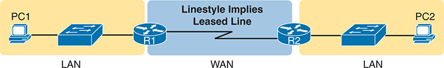
<figcaption>

<strong>图 3-1</strong> <em>使用一条租用线路的小型企业网络</em>

<aside class="hidden" id="a03fig01">

网络由三台路由器 R5、R2 和 R3 组成。R5 同时连接 R2 和 R3，其中通过 IP 地址 10.1.12.1 和 G0/1 接口连接 R2，通过 IP 地址 10.1.13.1 和 G0/2 接口连接 R3。相连的两台路由器各有唯一的路由器 ID（RID）：R2 的 RID 为 2.2.2，R3 的 RID 为 3.3.3.3。 译注：原书这段隐藏说明与实际图 3-1 不符。图中是 PC1 和 PC2 所在的两个以太网局域网，通过 R1、R2 及一条租用线路广域网相连，没有 OSPF 或 R5。

</aside>
</figcaption>
</figure>

本节先介绍租用线路的物理细节，再讨论租用线路常用的两种数据链路层协议：HDLC 和 PPP。

<section>
<h5 class="h5" id="ch03lev3sec1">租用线路的物理细节</h5>

<a id="key_049" href="#ref-gloss_230">租用线路</a>是一种物理层服务，使用全双工逻辑，以预先确定的速率在两个方向上传送比特。实际上，从概念上看，它就像在两台路由器之间连接了一条全双工以太网交叉链路，如<a href="#ch03fig02">图 3-2</a> 所示。租用线路使用两对导线，每个发送方向各一对，因此能够实现全双工工作。

<figure class="image-c" id="ch03fig02">
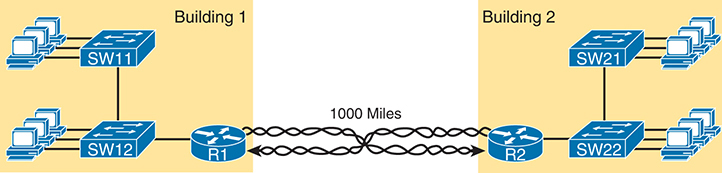
<figcaption>

<strong>图 3-2</strong> <em>租用线路服务的概念图</em>

<aside class="hidden" id="a03fig02">

网络设计包含四台路由器 R1、R2、R3 和 R4。R1 和 R3 具有唯一的路由器 ID（RID）：R1 的 RID 为 1.1.1.1，R3 的 RID 为 1.1.1.1（应为 3.3.3.3）。路由器通过接口互连。R1 的 G0/1 接口连接子网 10.1.11.1/24，G0/0 接口连接子网 10.1.1.1/24。R2 的 G0/1 接口连接子网 10.1.22.2/24，G0/0 接口连接子网 10.1.1.2/24，标注为“错误配置：区域 1；预期设计：仅区域 0”。R3 的 G0/0 接口连接子网 10.1.1.3/24，G0/1 接口连接子网 10.1.33.3/24。R4 的 G0/0 接口连接子网 10.1.1.4/24，并标有 Hello／Dead 为 5／20，G0/1 接口连接子网 10.1.44.4/24。 译注：原书这段隐藏说明与实际图 3-2 不符。图中是两栋建筑内的 R1、R2 及各自的局域网，以两个方向的双绞线电路示意跨越 1000 英里的租用线路，没有 OSPF 邻居配置。

</aside>
</figcaption>
</figure>

要建立租用线路，链路两端的路由器之间必须存在某条物理路径。物理布线必须从各路由器所在的客户建筑物延伸出去；但是，<a id="key_055" href="#ref-gloss_404">电信公司（telco）</a>并不是简单地在两栋建筑物之间安装一根电缆，而是利用通常规模庞大且复杂的网络，营造出两台路由器之间仿佛存在一根电缆的效果。

<a href="#ch03fig03">图 3-3</a> 展示了电信公司网络中一小部分的概念图。电信公司将设备放置在称为中心局（CO）的建筑物中，并从中心局向城市中的几乎所有其他建筑物铺设电缆，期望将来向这些建筑物中的用户出售服务。随后，电信公司配置其交换设备，利用各条电缆的一部分容量双向发送数据，从而在两台路由器之间形成等效于交叉电缆的连接。

<figure class="image-c" id="ch03fig03">
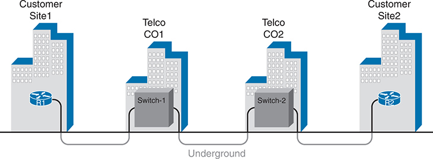
<figcaption>

<strong>图 3-3</strong> <em>短距离租用线路在电信公司内部可能采用的布线</em>

<aside class="hidden" id="a03fig03">

示意图中有四栋建筑物，分别标为“客户站点 1”“电信中心局 1”“电信中心局 2”和“客户站点 2”。客户站点 1 和客户站点 2 中的路由器分别标为 R1 和 R2；两个电信中心局中的交换设备分别标为 Switch-1 和 Switch-2。路由器与交换设备之间用线条表示电缆连接。

</aside>
</figcaption>
</figure>

由于租用线路历史悠久，行业中使用多种术语来指代同一类广域网链路。例如，<em>租用线路</em>强调电信公司把线路的使用权出租给客户，而客户并不永久拥有该线路。<a href="#ch03tab02">表 3-2</a> 列出了一些租用线路的名称及其含义，主要帮助你在网络工作中理解不同人使用的术语。

<figure class="table" id="ch03tab02">
<figcaption>

<strong>表 3-2</strong> 租用线路的不同名称

</figcaption>
<table class="all">
<thead>
<tr>
<th class="th">
名称
</th>
<th class="th">
含义或所指内容
</th>
</tr>
</thead>
<tbody>
<tr>
<td class="border">
租用电路、电路
</td>
<td class="border">
在电信术语中，<em>线路</em>和<em>电路</em>经常互为同义词；<em>电路</em>指两个端点之间的电气回路。
</td>
</tr>
<tr>
<td class="border">
串行链路、串行线路
</td>
<td class="border">
<em>链路</em>和<em>线路</em>这两个词也经常互为同义词。这里的<em>串行</em>表示比特按串行方式流动，而且路由器使用<a id="key_053" data-original-href="vol1_ch03.xhtml#key_053a" data-unavailable="true" title="原始链接指向已按要求移除的章末复习内容；保留术语文字。">串行接口</a>。
</td>
</tr>
<tr>
<td class="border">
点对点链路、点对点线路
</td>
<td class="border">
这些术语表示拓扑只在两个点之间延伸，而且仅有这两个点。（某些早期租用线路允许连接两台以上设备。）
</td>
</tr>
<tr>
<td class="border">
T1
</td>
<td class="border">
这种特定类型的租用线路以每秒 1.544 兆比特（1.544 Mbps）的速率传输数据。
</td>
</tr>
<tr>
<td class="border">
广域网链路、链路
</td>
<td class="border">
这两个术语都非常笼统，不指代任何具体技术。
</td>
</tr>
<tr>
<td class="border">
专用线路
</td>
<td class="border">
这一术语表示，通过线路发送的数据不能被电信公司的其他客户复制，因此数据是私有的。
</td>
</tr>
</tbody>
</table>
</figure>
</section>
<section>
<h5 class="h5" id="ch03lev3sec2">租用线路的数据链路层细节</h5>

租用线路提供第 1 层服务。换句话说，它承诺在连接到租用线路的设备之间传送比特，但租用线路本身并不定义在线路上使用哪种数据链路层协议。因此，为了使用租用线路，线路两端的路由器会采用以下两种数据链路层协议之一：高级数据链路控制（<a id="key_043" href="#ref-gloss_163">HDLC</a>）或点对点协议（PPP）。

所有数据链路层协议都承担类似职责：控制数据通过某种特定类型的物理链路被正确交付。例如，以太网数据链路层协议使用目的地址字段标识应接收数据的正确设备，并通过 FCS 字段让接收设备判断数据是否正确到达。广域网数据链路层协议 HDLC 和 PPP 提供类似功能。

由于租用线路采用简单的点对点拓扑，HDLC 和 PPP 需要完成的工作甚至比以太网更少。以 HDLC 为例，当一台路由器通过租用线路发送 HDLC 帧时，帧只能到达一个目的设备，也就是链路另一端的路由器。因此，虽然 HDLC 有地址字段，但目的设备已经隐含确定，实际地址值并不重要。这有点像我和朋友 Gary 两个人一起吃午饭：我不必每句话都以“嘿，Gary”开头，他知道我是在对他说话。

<a href="#ch03fig04">图 3-4</a> 以 HDLC 为例展示了帧格式，随后<a href="#ch03tab03">表 3-3</a> 描述各个字段。不过，请注意，HDLC 与 PPP 的帧格式相似，但较新的 PPP 定义于 20 世纪 90 年代，比定义于 70 年代的 HDLC 具有更多特性和功能，并且还包含额外的可选首部。

<figure class="image-c" id="ch03fig04">
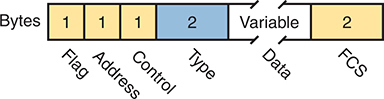
<figcaption>

<strong>图 3-4</strong> <em>HDLC 成帧格式</em>

<aside class="hidden" id="a03fig04">

该结构分为六个部分，分别代表帧的不同组成部分。自左向右依次为：标志 1 字节、地址 1 字节、控制 1 字节、类型 2 字节、数据可变长度，以及 FCS 2 字节。各部分所需的字节数标在相应区域上方。

</aside>
</figcaption>
</figure>
<figure class="table" id="ch03tab03">
<figcaption>

<strong>表 3-3</strong> HDLC 和 PPP 首部字段与以太网的比较

</figcaption>
<table class="all">
<thead>
<tr>
<th class="th">
HDLC 与 PPP 字段
</th>
<th class="th">
以太网中的对应字段
</th>
<th class="th">
说明
</th>
</tr>
</thead>
<tbody>
<tr>
<td class="border">
标志
</td>
<td class="border">
前导码、SFD
</td>
<td class="border">
包含可识别的比特模式，使接收节点知道一个新帧正在到达。
</td>
</tr>
<tr>
<td class="border">
地址
</td>
<td class="border">
目的地址
</td>
<td class="border">
标识目的设备，但对租用线路的点对点拓扑而言并不重要。
</td>
</tr>
<tr>
<td class="border">
控制
</td>
<td class="border">
不适用
</td>
<td class="border">
如今在路由器之间的链路上已不再使用。
</td>
</tr>
<tr>
<td class="border">
类型
</td>
<td class="border">
类型
</td>
<td class="border">
标识封装在帧的数据部分中的三层分组类型。
</td>
</tr>
<tr>
<td class="border">
FCS
</td>
<td class="border">
FCS
</td>
<td class="border">
标识用于差错检测过程的字段。（它是此表中唯一的尾部字段。）
</td>
</tr>
</tbody>
</table>
</figure>
</section>
<section>
<h5 class="h5" id="ch03lev3sec3">路由器如何使用广域网数据链路</h5>

租用线路连接路由器，而路由器专注于将分组送达目的主机。但是，路由器在物理上同时连接局域网和广域网，这些网络都要求将数据放在数据链路层帧中发送。因此，了解 HDLC 和 PPP 的一些知识之后，再思考路由器发送数据时如何使用这些数据链路层协议，会很有帮助。

首先，TCP/IP 网络层关注的是将 <a id="key_047" href="#ref-gloss_207">IP 分组</a>从发送主机转发到目的主机。底层的局域网和广域网只是把分组传送到下一台路由器或终端用户设备的手段。<a href="#ch03fig05">图 3-5</a> 展示了这种网络层视角。

<figure class="image-c" id="ch03fig05">
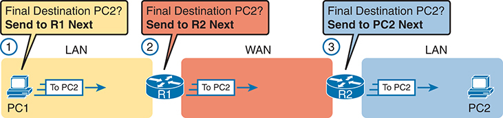
<figcaption>

<strong>图 3-5</strong> <em>跨越局域网和广域网的 IP 路由逻辑</em>

<aside class="hidden" id="a03fig05">

PC1 的网络层逻辑引导它将分组发送给最近的路由器 R1。R1 利用网络层逻辑确定最佳路径，通过租用线路将分组转发给 R2。接着，R2 的网络层逻辑判断局域网链路是到达 PC2 的合适路径。这一过程的每一步都体现了 IP 路由的基本原理。

</aside>
</figcaption>
</figure>

按照图中的步骤，对于 PC1 发往 PC2 的 IP 地址的分组：

<ol class="number">
<li>
PC1 的网络层（IP）逻辑要求它将分组发送给附近的路由器 R1。
</li>
<li>
路由器 R1 的网络层逻辑要求它下一步通过租用线路，将分组转发（路由）给路由器 R2。
</li>
<li>
路由器 R2 的网络层逻辑要求它下一步通过局域网链路，将分组转发（路由）给 PC2。
</li>
</ol>

虽然<a href="#ch03fig05">图 3-5</a> 展示了网络层逻辑，但 PC 和路由器必须依赖图中的局域网和广域网，才能实际传送分组中的比特。<a href="#ch03fig06">图 3-6</a> 使用相同的网络和分组，但这次展示了主机与路由器使用的部分数据链路层逻辑。基本上，分组在互联网络中经过三跳时，分别经历三个独立的数据链路层封装步骤：从 PC1 到 R1、从 R1 到 R2，以及从 R2 到 PC2；每一步都将分组封装在数据链路层帧中。

<figure class="image-c" id="ch03fig06">
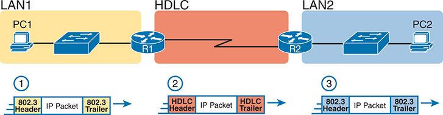
<figcaption>

<strong>图 3-6</strong> <em>路由器对 IP 分组解封装和重新封装的基本概念</em>

<aside class="hidden" id="a03fig06">

PC1 将 IP 分组封装到发往路由器 R1 的以太网帧中。R1 收到后，从以太网帧中解封装出 IP 分组，再将其重新封装到 HDLC 帧中，转发给路由器 R2。随后，R2 从 HDLC 帧中解封装出分组，并重新封装到以 PC2 为目的地的以太网帧中。

</aside>
</figcaption>
</figure>

仍以 PC1 发往 PC2 的 IP 地址的分组为例，按照图中的步骤：

<ol class="number">
<li>
为了将 IP 分组下一步发送给路由器 R1，PC1 把该分组封装到一个目的 MAC 地址为 R1 的以太网帧中。
</li>
<li>
路由器 R1 从以太网帧中解封装（取出）IP 分组，再使用 HDLC 首部和尾部，将分组封装（放入）HDLC 帧中，并将 HDLC 帧转发给下一台路由器 R2。
</li>
<li>
路由器 R2 从 HDLC 帧中解封装（取出）IP 分组，再将分组封装（放入）目的 MAC 地址为 PC2 的以太网帧中，最后将以太网帧转发给 PC2。
</li>
</ol>

总的来说，使用 HDLC 的租用线路在两台路由器之间构成广域网链路，使路由器能够为所连接局域网中的设备转发分组。租用线路本身提供在两个方向上传送比特的物理手段；HDLC 帧则提供正确封装网络层分组的方式，使其能够穿过路由器之间的链路。同样，如果路由器使用 PPP 而非 HDLC，就会将分组封装在 PPP 帧而非 HDLC 帧中。

租用线路具有多项优点，因此在广域网市场中长期存在。对客户来说，这些线路使用简单、可获得性高、质量好，而且是私有的。但与较新的广域网技术相比，它们也有一些不足，例如成本较高，服务安装通常需要更长的交付周期。此外，以今天的标准来看，租用线路广域网链路速度较慢，最快的租用线路速率也只有每秒数十兆比特。更新、更快的广域网技术已推动市场逐渐离开租用线路；在 21 世纪 20 年代，以太网广域网已经十分常见。

</section>
</section>
<section>
<h4 class="h4" id="ch03lev2sec2">以太网作为广域网技术</h4>

在以太网问世后的最初几十年里，它只适用于局域网。受电缆长度和设备的限制，局域网或许能够延伸一两千米，用于园区局域网，但这已是其极限。

随着时间推移，IEEE 改进了以太网标准，使以太网逐渐成为一种适用的广域网技术。例如，1000BASE-LX 标准使用单模光纤布线，支持 5 km 的电缆长度；1000BASE-ZX 标准则支持更长的 70 km 电缆长度。随着 IEEE 不断提高光纤以太网链路的布线距离，以太网成为了广域网技术的一种可行选择。

如今，许多广域网服务提供商（SP）都提供基于以太网的广域网服务。这些服务种类繁多，名称各异，但都采用相似的模式：在客户站点与 SP 的网络之间使用以太网，如<a href="#ch03fig07">图 3-7</a> 所示。

<figure class="image-c" id="ch03fig07">
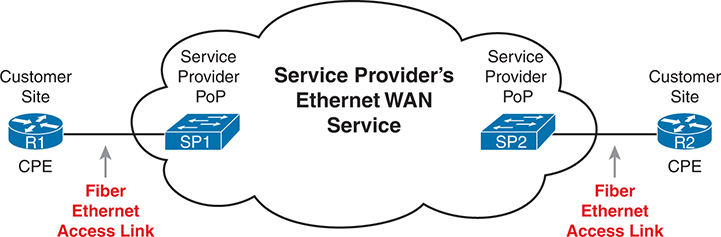
<figcaption>

<strong>图 3-7</strong> <em>连接 CPE 路由器与服务提供商广域网的光纤以太网链路</em>

<aside class="hidden" id="a03fig07">

示意图展示了 R1 所在站点的客户驻地设备（CPE）路由器，通过光纤以太网链路连接服务提供商广域网的方式。连接从 R1 的 CPE 路由器出发，经光纤以太网接入链路到达服务提供商接入点（PoP）SP1，表示服务提供商的以太网广域网服务。类似地，另一条连接从服务提供商接入点 SP2 延伸至另一个客户站点的 R2 CPE 路由器，同样使用光纤以太网接入链路。

</aside>
</figcaption>
</figure>

<a href="#ch03fig07">图 3-7</a> 中的模式与前面<a href="#ch03fig03">图 3-3</a> 中电信运营商建立租用线路的方式有许多相同之处，只是这里使用以太网链路和设备。客户通过路由器接口连接以太网链路。（光纤）以太网链路离开客户所在建筑，连接到附近称为接入点（PoP）的 SP 场所。SP 使用以太网交换机，取代<a href="#ch03fig03">图 3-3</a> 中的电信交换机。在 SP 网络内部，SP 可以使用其选择的任何技术来实现具体的以太网广域网服务。

<section>
<h5 class="h5" id="ch03lev3sec4">提供第 2 层服务的以太网广域网</h5>

以太网广域网服务包含多种具体服务，它们之间的差异会影响路由器使用服务的方式。不过，就 CCNA 而言，你只需理解最基本的以太网广域网服务。这种服务的工作方式很像一根以太网交叉线，只是跨越了广域网。换言之：

<ul class="sq">
<li>
从逻辑上看，其行为类似于两台路由器之间的点到点连接。
</li>
<li>
从物理上看，其行为就像两台路由器之间存在一条实际的光纤以太网链路。
</li>
</ul>

本书使用以下几个常见名称来称呼这种以太网广域网服务：

<a id="key_042" href="#ref-gloss_440">以太网广域网</a><strong>：</strong>一个通用名称，用于将其与以太网局域网区分开来。

<strong>以太网点到点链路：</strong>这个术语强调典型以太网广域网链路的拓扑结构：它恰好有两个端点，即链路两端的路由器。

<a id="key_041" href="#ref-gloss_134">以太网线路服务（E-Line）</a><strong>：</strong>城域以太网论坛（MEF）使用的术语，表示本书中所展示的这种点到点以太网广域网服务。

<strong>基于 MPLS 的以太网（EoMPLS）：</strong>这个术语涉及多协议标签交换（MPLS），这种技术可用于为客户提供以太网服务。

因此，只要你能想象两台路由器之间存在一条以太网链路，就能理解这种以太网广域网服务的作用，如<a href="#ch03fig08">图 3-8</a> 所示。在这个例子中，两台路由器 R1 和 R2 通过以太网广域网服务连接，而不是通过串行链路连接。路由器使用以太网接口，可以同时在两个方向上发送数据。从物理上看，每台路由器实际上都连接到某个 SP 接入点，如前面的<a href="#ch03fig07">图 3-7</a> 所示；但从逻辑上看，两台路由器可以通过该链路互相发送以太网帧。

<figure class="image-c" id="ch03fig08">
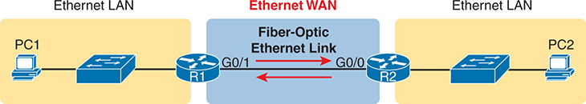
<figcaption>

<strong>图 3-8</strong> <em>以太网广域网的作用如同两台路由器之间的一条简单以太网链路</em>

<aside class="hidden" id="a03fig08">

PC1 通过以太网局域网连接 R1，R1 则通过接口 G0/1 上的光纤以太网链路连接 R2。R2 通过另一个以太网局域网连接 PC2。

</aside>
</figcaption>
</figure>
</section>
<section>
<h5 class="h5" id="ch03lev3sec5">路由器如何使用以太网广域网链路路由 IP 分组</h5>

广域网的本质作用，是让 IP 路由器能够将 IP 分组从一个站点的局域网，经广域网转发到另一个站点的局域网。无论广域网链路是串行链路还是以太网广域网链路，路由逻辑都相同，只是封装细节略有区别。以太网广域网链路使用以太网实现第 1 层和第 2 层功能，因此路由器使用熟悉的以太网首部和尾部进行封装，如<a href="#ch03fig09">图 3-9</a> 中部所示。另请注意，图中在以太网链路上画了一朵小云，用来表示这是一条以太网广域网链路，而非以太网局域网链路。

<figure class="image-c" id="ch03fig09">
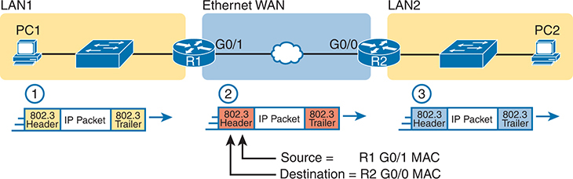
<figcaption>

<strong>图 3-9</strong> <em>通过以太网广域网链路进行路由</em>

<aside class="hidden" id="a03fig09">

PC1 将 IP 分组封装在以太网帧内，添加 802.3 首部和尾部。源 MAC 地址设置为 R1 的 G0/1 MAC 地址，目的 MAC 地址为 R2 的 G0/0 MAC 地址。R1 收到帧后，将分组重新封装，以 R2 的 MAC 地址为目的地址、自己的 MAC 地址为源地址，并添加新的 802.3 首部和尾部。随后，R1 通过以太网广域网服务将修改后的帧转发给 R2。R2 收到后解封装出 IP 分组，再将其封装到另一个以太网帧中，以 PC2 的 MAC 地址为目的地址，从而完成路由过程。 译注：原书这段隐藏说明把广域网帧的 MAC 地址归到了 PC1 发送的帧上。实际图 3-9 将源地址 R1 G0/1 MAC、目的地址 R2 G0/0 MAC 标注在第 2 步，即 R1 发往 R2 的帧；PC1 发往 R1 的是第 1 步。

</aside>
</figcaption>
</figure>

注意

图中每个阶段的 802.3 首部和尾部都不相同！请务必注意接下来逐步说明中给出的原因。

图中展示的三个路由步骤，与前面<a href="#ch03fig06">图 3-6</a> 中使用串行链路时的三个步骤相同。在本例中，三个路由步骤都使用相同的以太网（802.3）协议。不过请注意，每个帧的数据链路首部和尾部都不同。每台路由器都会丢弃旧的数据链路首部和尾部，并添加一组新的首部和尾部，具体过程如下。请主要关注第 2 步，因为与<a href="#ch03fig06">图 3-6</a> 中的类似示例相比，第 1 步和第 3 步没有变化：

<ol class="number">
<li>
为了将 IP 分组发送给下一站路由器 R1，PC1 将 IP 分组封装（插入）到一个以 R1 的 MAC 地址为目的地址的以太网帧中。
</li>
<li>
路由器 R1 从以太网帧中解封装（取出）IP 分组，再将分组封装（插入）到一个新的以太网帧中，添加新的以太网首部和尾部。目的 MAC 地址是 R2 的 G0/0 MAC 地址，源 MAC 地址是 R1 的 G0/1 MAC 地址。随后，R1 通过以太网广域网服务将此帧转发给 R2。
</li>
<li>
路由器 R2 从以太网帧中解封装（取出）IP 分组，将分组封装（插入）到以 PC2 的 MAC 地址为目的地址的以太网帧中，并将该以太网帧转发给 PC2。
</li>
</ol>

在本书中，广域网链路（串行链路和以太网链路）都将像这里所示那样连接路由器，而重点放在局域网和 IP 路由上。本章余下内容将更深入地介绍 IP 路由。

</section>
</section>
</section>
<section>
<h3 class="h3" id="ch03lev1sec4">IP 路由</h3>

多年来出现过许多协议模型，但如今占主导地位的是 TCP/IP 模型。在 TCP/IP 的网络层，作为其他所有网络层功能核心的主要协议有两个选择：IP 版本 4（IPv4）和 IP 版本 6（IPv6）。IPv4 和 IPv6 定义的网络层功能类型相同，但具体细节不同。本章介绍 IPv4 的这些网络层功能，IPv6 的细节则留到本书<a data-original-href="vol1_part07.xhtml#part07" data-unavailable="true" title="未提取此章节；请参阅原始 EPUB：vol1_part07.xhtml#part07">第 VII 部分</a>再介绍。

注意

本章所有提到 IP 的地方，均指历史更久、应用更成熟的 IPv4；所有<a id="key_045" href="#ref-gloss_203">IP 地址</a>一词，均指 IPv4 地址。

网际协议（IP）专注于将数据以 IP 分组的形式，从源主机路由到目的主机。IP 不关注数据的物理传输，而是依赖较低的 TCP/IP 层来完成这些功能。IP 关注的是交付数据时的逻辑细节，而非物理细节。具体来说，网络层规定了分组如何在 TCP/IP 网络中从一端传送到另一端，即使分组会跨越多种不同类型的局域网和广域网链路。

本章接下来的主要部分将更深入地探讨 IP 路由。首先，IP 定义了如何利用沿途连续使用的数据链路协议，将一个 IP 分组从发送主机路由到目的主机。随后，本节讨论 IP 编址规则如何通过把地址划分为子网，使 IP 路由更加高效。最后，本节介绍 IP <a id="key_051" href="#ref-gloss_197">路由协议</a>的作用：它们让路由器能够学习互联网络中所有 IP 子网的路由。

<section>
<h4 class="h4" id="ch03lev2sec3">网络层路由（转发）逻辑</h4>

路由器与终端用户计算机（在 TCP/IP 网络中称为<em>主机</em>）协同完成 IP 路由。主机操作系统（OS）包含 TCP/IP 软件，其中也包括实现网络层的软件。主机使用这些软件来选择 IP 分组的发送目标，通常是附近的一台路由器。这些路由器再决定接下来把 IP 分组发送到哪里。主机和路由器共同将 IP 分组交付到正确的目的地，如<a href="#ch03fig10">图 3-10</a> 中的示例所示。

<figure class="image-c" id="ch03fig10">
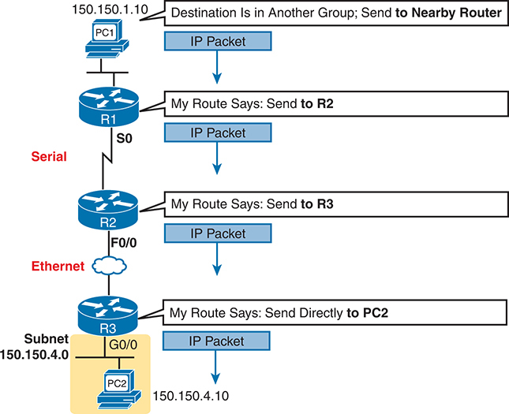
<figcaption>

<strong>图 3-10</strong> <em>路由逻辑：PC1 向 PC2 发送 IP 分组</em>

<aside class="hidden" id="a03fig10">

过程从 PC1 开始，它打算向位于另一个地址组的 PC2 发送 IP 分组。PC1 将分组发送到附近的路由器，标识为 150.150.1.10。随后，IP 分组经过一系列路由器转发。路由器 R1 收到分组，确定应将其发送给路由器 R2。路由器 R2 在 Serial 0 接口收到分组，确定应将其发送给路由器 R3。路由器 R3 在以太网接口（F0/0）收到分组，决定将其直接发送给 PC2；PC2 位于子网 150.150.4.0，IP 地址为 150.150.4.10。PC2 收到 IP 分组，路由过程完成。 译注：原书这段隐藏说明中的地址和接口归属有误。实际图 3-10 的 150.150.1.10 标在 PC1 旁，S0 标在 R1 一侧，F0/0 标在 R2 一侧；R3 发往 PC2 的接口标为 G0/0。

</aside>
</figcaption>
</figure>

由 PC1 创建的 IP 分组，从图的顶部一路传送到图底部的 PC2。接下来的几页将讨论路径上各设备使用的网络层路由逻辑。

注意

<em>路径选择</em>一词有时用于指代<a href="#ch03fig10">图 3-10</a> 中展示的路由过程；在其他情况下，它指的是路由协议，具体来说，是路由协议如何从通往同一目的地的多条候选路由中选择最佳路由。

<section>
<h5 class="h5" id="ch03lev3sec6">主机的转发逻辑：将分组发送给默认路由器</h5>

在这个例子中，PC1 进行一些基本分析，然后选择将 IP 分组发送给路由器，以便由路由器转发。PC1 分析目的地址，发现 PC2 的地址（150.150.4.10）与 PC1 不在同一个局域网。因此，PC1 的逻辑会让它将分组发送给一个负责知道如何路由数据的设备：同一局域网上附近的一台路由器，称为 PC1 的<a id="key_039" href="#ref-gloss_090">默认路由器</a>。

为了将 IP 分组发送给默认路由器，发送方通过介质向附近的路由器发送一个数据链路帧；分组位于该帧的数据部分。此帧在数据链路首部中使用数据链路层（第 2 层）地址，以确保附近的路由器收到该帧。

注意

<em>默认路由器</em>也称为<em>默认网关</em>。

</section>
<section>
<h5 class="h5" id="ch03lev3sec7">R1 和 R2 的逻辑：在网络中路由数据</h5>

所有路由器都使用相同的一般过程来路由分组。每台路由器都维护一张 <em>IP</em> <a id="key_052" href="#ref-gloss_208">路由表</a>。该表列出 IP 地址的<em>分组</em>，称为 <a id="key_046" href="#ref-gloss_206">IP 网络</a>和 <a id="key_048" href="#ref-gloss_209">IP 子网</a>。路由器收到分组时，会将分组的目的 IP 地址与路由表中的条目进行比较并找到匹配项。匹配的条目还包含转发指示，告诉路由器接下来应将分组转发到哪里。

在<a href="#ch03fig10">图 3-10</a> 中，R1 会将目的地址（150.150.4.10）与某个路由表条目匹配，而该条目告诉 R1，接下来将分组发送给 R2。同样，R2 会匹配到一个路由表条目，告诉它接下来通过以太网广域网链路将分组发送给 R3。

路由的概念有点像在高速公路上行驶，即将到达一处大型互通立交。你抬头看到附近城镇的指示牌，上面告诉你前往各个城镇应从哪个出口驶出。类似地，路由器查看 IP 路由表（相当于路标），引导每个分组经过正确的下一条局域网或广域网链路（相当于道路）。

</section>
<section>
<h5 class="h5" id="ch03lev3sec8">R3 的逻辑：将数据交付到最终目的地</h5>

路径中的最后一台路由器 R3，使用的逻辑与 R1 和 R2 几乎相同，但有一个小区别：R3 需要将分组直接转发给 PC2，而不是其他路由器。表面看来，这个区别似乎无关紧要。在下一节介绍网络层如何使用局域网和广域网时，这一区别的重要性就会变得清楚。

</section>
</section>
<section>
<h4 class="h4" id="ch03lev2sec4">网络层路由如何使用局域网和广域网</h4>

虽然网络层路由逻辑不考虑物理传输细节，但比特仍然必须被传输。为完成这项工作，主机或路由器中的网络层逻辑必须将分组交给数据链路层协议，后者再请求物理层实际发送数据。数据链路层在分组上添加适当的首部和尾部，形成帧，然后通过各个物理网络发送这些帧。

路由过程将网络层分组从网络的一端转发到另一端，而每个数据链路帧只完成整个行程中的一小段。沿途的每个数据链路层帧，都把分组送到下一个需要执行网络层逻辑的设备。简而言之，网络层从整体上考虑目标，例如“将此分组发送给指定的下一台路由器或主机……”，而数据链路层关注具体细节，例如“将分组封装到数据链路帧中并发送”。以下列表概述了路由器内部针对每个分组执行网络层路由的主要步骤，从帧到达路由器接口开始：

第 1 步。使用数据链路的帧校验序列（FCS）字段，确认帧中没有错误；如果发生错误，则丢弃该帧。

第 2 步。假设第 1 步没有丢弃该帧，则丢弃旧的数据链路首部和尾部，留下 IP 分组。

第 3 步。将 IP 分组的目的 IP 地址与路由表进行比较，找到与目的地址最匹配的路由。该路由指出路由器的出接口，还可能指出下一跳路由器的 IP 地址。

第 4 步。将 IP 分组封装在适合出接口的、新的数据链路首部和尾部之内，然后转发该帧。

<a href="#ch03fig11">图 3-11</a> 再次展示 PC1 向 PC2 发送分组的示例，随后详细分析各设备的路由逻辑。每段说明都包含 PC1 和三台路由器如何构建适当的新数据链路首部的细节。

<figure class="image-c" id="ch03fig11">
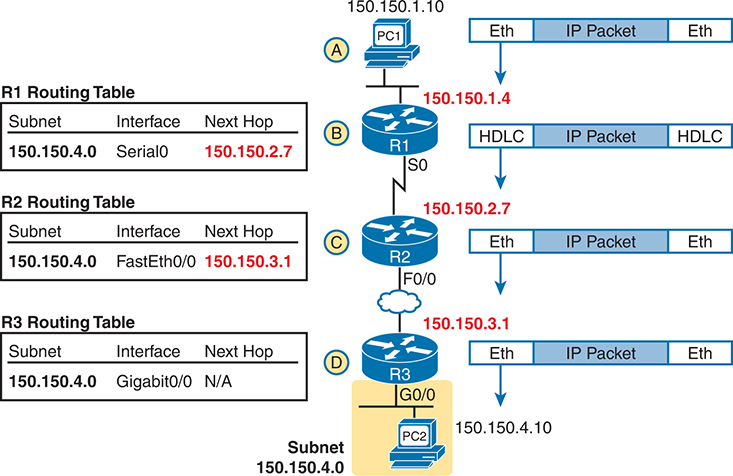
<figcaption>

<strong>图 3-11</strong> <em>网络层与数据链路层封装</em>

<aside class="hidden" id="a03fig11">

步骤 A：IP 地址为 150.150.1.10 的 PC1 将 IP 分组封装在以太网帧中。步骤 B：路由器 R1 收到以太网帧，将其封装在 HDLC 中，并查询路由表，确定分组应经 Serial 0 接口发送到下一跳 150.150.2.7。步骤 C：路由器 R2 收到 HDLC 帧，将其重新封装成以太网帧，并根据路由表，经 Fast Ethernet 0/0 接口将其转发到 150.150.3.1。步骤 D：路由器 R3 收到以太网帧，进行转发，并经 Gigabit Ethernet 0/0 接口将分组路由到 PC2。这一步包括检查子网 150.150.4.0 的路由表条目，该条目没有下一跳。PC2 位于同一子网中，该子网标识为 150.150.4.0。 译注：原书这段隐藏说明将帧与分组的重新封装混为一谈。实际图 3-11 展示的是各路由器移除旧的数据链路首部和尾部，再为同一个 IP 分组添加新的首部和尾部，并不把整个收到的帧封装进下一种帧。

</aside>
</figcaption>
</figure>

以下列表说明各台路由器的转发逻辑，重点介绍路由与数据链路如何配合。

步骤 A。<strong>PC1 将分组发送给默认路由器。</strong>PC1 的网络层逻辑构建 IP 分组，将目的地址设为 PC2 的 IP 地址（150.150.4.10）。网络层还进行分析，确定 150.150.4.10 不在本地 IP 子网内，因此 PC1 需要将分组发送给 R1（PC1 的默认路由器）。PC1 将 IP 分组放入以太网数据链路帧中，以 R1 的以太网地址作为目的以太网地址。PC1 将帧发送到以太网上。

步骤 B。<strong>R1 处理收到的帧，并将分组转发给 R2。</strong>由于收到的以太网帧以 R1 的以太网 MAC 地址为目的 MAC 地址，R1 决定处理该帧。R1 检查帧的 FCS，判断是否有错误；如果没有错误，R1 就丢弃以太网首部和尾部。接下来，R1 将分组的目的地址（150.150.4.10）与路由表比较，找到子网 150.150.4.0 的条目。由于目的地址 150.150.4.10 属于该子网，R1 便通过匹配路由中列出的接口（Serial0），将分组转发给下一跳路由器 R2（150.150.2.7）。R1 必须先将 IP 分组封装到 HDLC 帧中。

步骤 C。<strong>R2 处理收到的帧，并将分组转发给 R3。</strong>R2 收到 HDLC 帧后，重复与 R1 相同的一般过程。R2 检查 FCS 字段，确定没有发生错误，然后丢弃 HDLC 首部和尾部。接下来，R2 将分组的目的地址（150.150.4.10）与路由表比较，找到子网 150.150.4.0 的条目；该路由指示 R2 经 Fast Ethernet 0/0 接口，将分组发送给下一跳路由器 150.150.3.1（R3）。但在此之前，R2 必须为分组封装以太网首部。该首部使用以太网广域网链路上 R2 和 R3 的 MAC 地址，分别作为源 MAC 地址和目的 MAC 地址。

步骤 D。<strong>R3 处理收到的帧，并将分组转发给 PC2。</strong>与 R1 和 R2 一样，R3 检查 FCS，丢弃旧的数据链路首部和尾部，并匹配自己的子网 150.150.4.0 路由。R3 路由表中 150.150.4.0 的条目表明，出接口为 R3 的以太网接口，但没有下一跳路由器，因为 R3 直接连接子网 150.150.4.0。R3 只需将分组封装在新的以太网首部和尾部之内，并以 PC2 的 MAC 地址作为目的以太网地址。

由于路由器会构建新的数据链路首部和尾部，而新首部中包含数据链路地址，因此 PC 和路由器必须能够确定应使用哪些数据链路地址。IP 地址解析协议（ARP）就是路由器确定应使用哪个数据链路地址的一种机制。<em>ARP 动态学习连接到局域网的 IP 主机的数据链路地址</em>。例如，在<a href="#ch03fig11">图 3-11</a> 底部的最后一步，路由器 R3 在向 PC2 发送任何分组之前，会使用一次 ARP 来学习 PC2 的 MAC 地址。

</section>
<section>
<h4 class="h4" id="ch03lev2sec5">IP 编址如何帮助 IP 路由</h4>

IP 定义了网络层地址，用于标识连接到 TCP/IP 网络的任何主机或路由器接口。这个概念基本上类似于邮政地址：任何希望接收 IP 分组的接口都需要一个 IP 地址，就像你必须有邮政地址，才能接收邮政部门投递的邮件一样。接下来这个简短主题将介绍 IP 网络和子网的概念，它们是 IP 定义的地址组。

注意

IP 将<em>网络</em>一词定义为一个非常具体的概念。为避免在介绍 IP 编址时产生混淆，本书（以及其他书籍）通常避免在其他含义上使用<em>网络</em>这个术语。具体来说，本书使用<em>互联网络</em>一词，泛指由路由器、交换机、电缆和其他设备组成的网络。

<section>
<h5 class="h5" id="ch03lev3sec9">IP 地址分组（网络和子网）的规则</h5>

TCP/IP 对 IP 地址进行分组，使同一物理网络上使用的 IP 地址属于同一个组。IP 将这些地址组称为 <em>IP 网络</em>或 <em>IP 子网</em>。继续使用邮政服务的类比，每个 IP 网络和 IP 子网都类似于一个邮政编码（在美国称为 ZIP code）。所有邻近的邮政地址都属于同一个邮政编码区域，而所有邻近的 IP 地址都必须属于同一个 IP 网络或 IP 子网。

IP 定义了具体规则，规定哪些 IP 地址应属于同一个 IP 网络或 IP 子网。从数值上看，同组地址的前一部分具有相同的值。例如，<a href="#ch03fig10">图 3-10</a> 和<a href="#ch03fig11">图 3-11</a> 可以采用以下约定：

<ul class="sq">
<li>
顶部以太网上的主机：地址以 150.150.1 开头。
</li>
<li>
R1–R2 串行链路上的主机：地址以 150.150.2 开头。
</li>
<li>
R2–R3 以太网广域网链路上的主机：地址以 150.150.3 开头。
</li>
<li>
底部以太网上的主机：地址以 150.150.4 开头。
</li>
</ul>

从 IP 路由的角度看，对 IP 地址分组意味着路由表可以小得多。路由器可以为每个 IP 网络或子网列出一个路由表条目，用来代表一组地址，而不必为每个单独的 IP 地址列出一个条目。

上述列表只展示了 IP 地址分组的一种示例；要掌握使用子网进行地址分组的规则，还需要花些功夫理解相关概念和数学计算。本书<a data-original-href="vol1_part04.xhtml#part04" data-unavailable="true" title="未提取此章节；请参阅原始 EPUB：vol1_part04.xhtml#part04">第 IV 部分</a>详细介绍 IP 编址和子网划分，并配有其他子网划分视频和练习题。不过，<a id="key_054" href="#ref-gloss_394">子网划分</a>的两条基本规则可以简要概括如下：

<ul class="sq">
<li>
两个彼此之间没有路由器隔开的 IP 地址，必须位于同一组（子网）。
</li>
<li>
两个彼此之间至少隔着一台路由器的 IP 地址，必须位于不同的组（子网）。
</li>
</ul>

这类似于美国邮政署（USPS）的 ZIP 邮编系统，以及它要求地方政府为新建建筑分配地址的方式。让两栋紧挨着的房屋具有不同的邮政编码，显然不合理。同样，让居住在国家两端的人使用相同邮政编码的地址，也是不合理的。

</section>
<section>
<h5 class="h5" id="ch03lev3sec10">IP 首部</h5>

路由过程还会使用 IPv4 首部，如<a href="#ch03fig12">图 3-12</a> 所示。首部中包含一个 32 位源 IP 地址和一个 32 位目的 IP 地址。当然，首部还有其他字段，其中一些与本书的其他讨论有关。本书会在需要时引用此图；目前只需知道 IP 首部为 20 字节，并且包含源 IP 地址和目的 IP 地址字段。请注意，在本章迄今为止的示例中，虽然路由器每次路由分组时都会移除并添加数据链路首部，但 IP 首部始终保留，IP 地址不会因 IP 路由过程而改变。

<figure class="image-c" id="ch03fig12">
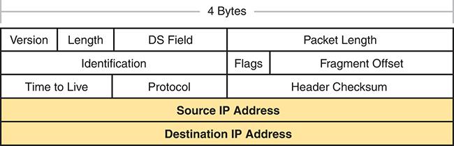
<figcaption>

<strong>图 3-12</strong> <em>IPv4 首部，按每行 4 字节排列，总计 20 字节</em>

<aside class="hidden" id="a03fig12">

IPv4 首部的第 1 层包含版本、长度、DS 字段和分组长度，按 4 字节排列。IPv4 首部的第 22 层包含标识、标志和片偏移，按 4 字节排列。IPv4 首部的第 3 层包含生存时间、协议首部和校验和，按 4 字节排列。第 4 层和第 5 层包含源 IP 地址和目的 IP 地址，均按 4 字节排列。 译注：原书这段隐藏说明将图中的“行”称为“层”，并将第 2 行写成了“第 22 层”。实际图 3-12 共 5 行，每行 4 字节；第 3 行字段为生存时间（Time to Live）、协议（Protocol）和首部校验和（Header Checksum）。

</aside>
</figcaption>
</figure>
</section>
</section>
<section>
<h4 class="h4" id="ch03lev2sec6">IP 路由协议如何帮助 IP 路由</h4>

为了让主机和路由器上的路由逻辑正常工作，每台主机和路由器都需要了解 TCP/IP 互联网络的某些信息。主机需要知道默认路由器的 IP 地址，以便向远程目的地发送分组。路由器则需要知道路由，才能将分组转发到每个可达的 IP 网络和 IP 子网。

让路由器获知所有有用路由的最佳方法，是配置它们使用相同的 IP 路由协议。如果在 TCP/IP 互联网络中的所有路由器上启用相同的路由协议，并正确配置相关设置，路由器就会互相发送路由协议消息。这样，所有路由器都会学习到该 TCP/IP 互联网络中所有 IP 网络和子网的路由。

IP 支持少数几种不同的 IP 路由协议。它们都使用一些相似的思想和过程来学习 IP 路由，但不同路由协议的内部实现确实有所区别。所有路由协议都使用以下一般步骤来学习路由：

第 1 步。每台路由器都会为每个直接连接到该路由器的子网，在路由表中添加一条路由；这一过程与路由协议无关。

第 2 步。每台路由器的路由协议会将路由表中的路由告知邻居，包括直连路由和从其他路由器学习到的路由。

第 3 步。每台路由器的路由协议会侦听邻居路由器发送的消息并学习路由；该路由的下一跳路由器，通常就是向本机提供这条路由的邻居。

还要注意，在最后一步中，路由器可能需要从通往同一个子网的多条路由中进行选择。此时，路由器会把当前到达该子网的最佳可用路由放入路由表，选择依据是一种称为度量值的衡量指标。

<a href="#ch03fig13">图 3-13</a> 使用与<a href="#ch03fig10">图 3-10</a> 和<a href="#ch03fig11">图 3-11</a> 相同的示意图，展示路由协议的工作方式。在本例中，IP 子网 150.150.4.0 位于图底部的以太网上，由所有以 150.150.4.0 开头的地址组成。图中展示了子网 150.150.4.0 的路由从下向上传播通告的过程，图后将进行详细说明。

<figure class="image-c" id="ch03fig13">
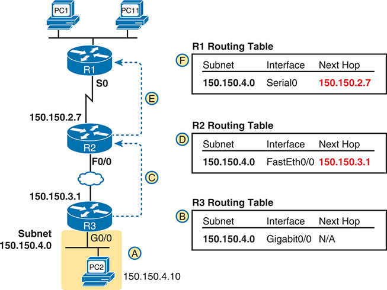
<figcaption>

<strong>图 3-13</strong> <em>路由协议如何通告网络和子网的示例</em>

<aside class="hidden" id="a03fig13">

图底部显示，子网 150.150.4.0 连接到路由器 R3。R3 独立地在自己的 IP 路由表中添加一条通往 150.150.4.0 的直连路由。随后，R3 发出一条路由协议消息，即路由更新，向路由器 R2 告知子网 150.150.4.0。R2 收到后相应地更新路由表。随后，R2 向路由器 R1 转发类似的路由更新，使 R1 获知子网 150.150.4.0。最后，R1 在路由表中添加一条通往子网 150.150.4.0 的路由，指出自己的 Serial 0 接口为出接口，并指定 R2 的 IP 地址（150.150.2.7）为下一跳路由器。

</aside>
</figcaption>
</figure>

按照图中 A 到 F 的项目，观察每台路由器如何学习到达 150.150.4.0 的路由。

步骤 A。子网 150.150.4.0 位于图的底部，连接到路由器 R3。

步骤 B。R3 将 150.150.4.0 的直连路由添加到自己的 IP 路由表中；这一步不需要路由协议的帮助。

步骤 C。R3 向 R2 发送一条称为<em>路由更新</em>的路由协议消息，使 R2 获知子网 150.150.4.0。

步骤 D。R2 将子网 150.150.4.0 的路由添加到自己的路由表中。

步骤 E。R2 向 R1 发送类似的路由更新，使 R1 获知子网 150.150.4.0。

步骤 F。R1 将子网 150.150.4.0 的路由添加到自己的路由表中。该路由列出 R1 自身的 Serial0 为出接口，R2 的 IP 地址（150.150.2.7）为下一跳路由器 IP 地址。

</section>
</section>
<section>
<h3 class="h3" id="ch03lev1sec5">其他网络层功能</h3>

TCP/IP 网络层定义了许多 IP 之外的功能。IP 当然在当今网络中发挥着巨大作用，定义了 IP 编址和 IP 路由。不过，其他请求评论文档（RFC）中定义的协议和标准，也对网络层功能起着重要作用。例如，开放最短路径优先（OSPF）等路由协议是独立的协议，定义在独立的 RFC 中。

本章最后这个简短部分，将介绍另外三项网络层功能，它们应当有助于你阅读本书余下的内容。这三个主题补充了一些知识空白，帮助你建立整体认识，也有助于理解后续讨论。三个主题分别是：

<ul class="sq">
<li>
域名系统（DNS）
</li>
<li>
地址解析协议（ARP）
</li>
<li>
Ping
</li>
</ul>
<section>
<h4 class="h4" id="ch03lev2sec7">使用名称与域名系统</h4>

你能想象这样一个世界吗：每次使用应用程序时，都必须通过 IP 地址来指代它？你无法使用 <a href="http://google.com">google.com</a> 或 <a href="http://cisco.com">cisco.com</a> 这样的易记名称，而必须记住并输入 64.233.177.100 这样的 IP 地址。（本书付印时，64.233.177.100 是 Google 使用的一个地址，你可以在浏览器中输入这个地址来访问 Google 网站。）显然，要求用户记忆 IP 地址很不友好，甚至可能让一些人完全放弃使用计算机。

幸运的是，TCP/IP 定义了一种通过<a id="key_044" href="#ref-gloss_175">主机名</a>来标识其他计算机的方法。用户要么根本不需要考虑对方计算机，要么通过名称来指代它。随后，协议会动态发现基于该名称进行通信所需的全部信息。

例如，当你打开 Web 浏览器并输入主机名 <strong><a href="http://www.google.com">www.google.com</a></strong> 时，计算机并不会发送一个以 <a href="http://www.google.com">www.google.com</a> 为目的 IP 地址的 IP 分组；它发送的 IP 分组以 Google Web 服务器使用的某个 IP 地址为目的地址。TCP/IP 需要一种方法，让计算机能够查出给定主机名所使用的 IP 地址，这种方法使用域名系统（<a id="key_040" href="#ref-gloss_108">DNS</a>）。

企业使用 DNS 过程，将名称解析为匹配的 IP 地址，如<a href="#ch03fig14">图 3-14</a> 的示例所示。在本例中，左侧的 PC11 需要连接一台名为 Server1 的服务器。在某个时刻，用户输入了名称 Server1，或者 PC11 上的某个应用程序通过名称引用该服务器。在第 1 步，PC11 向 DNS 服务器发送一条 DNS 消息，即 DNS 查询。在第 2 步，DNS 服务器返回 DNS 应答，其中列出 Server1 的 IP 地址。在第 3 步，PC11 便可以向目的地址 10.1.2.3 发送 IP 分组，该地址正是 Server1 使用的地址。

请注意，<a href="#ch03fig14">图 3-14</a> 使用一朵云表示 TCP/IP 网络，因为包括路由器在内的网络细节与名称解析过程无关。路由器对待 DNS 消息的方式与其他任何 IP 分组相同，都是根据目的 IP 地址进行路由。例如，在图中的第 1 步，DNS 查询以 DNS 服务器的 IP 地址作为目的地址，沿途路由器将使用该地址转发分组。

<figure class="image-c" id="ch03fig14">
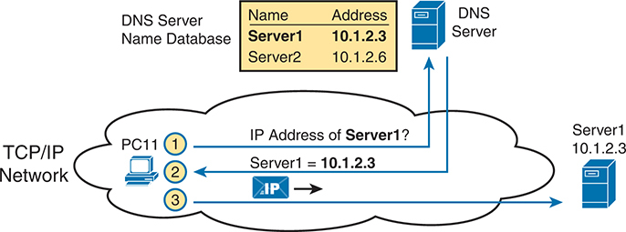
<figcaption>

<strong>图 3-14</strong> <em>基本的 DNS 名称解析请求</em>

<aside class="hidden" id="a03fig14">

在 TCP/IP 网络中的一次基本域名系统（DNS）名称解析请求中，PC11 首先查询 Server1 的 IP 地址。DNS 服务器负责维护域名与 IP 地址对应关系的数据库，并接收该请求。它查询数据库，找到 Server1 对应的条目，其关联 IP 地址为 10.1.2.3。它查询的数据库中包含 Server1 和 Server2 的条目，分别映射到 IP 地址 10.1.2.3 和 10.1.2.6。解析完成后，DNS 服务器向 PC11 作出应答，提供所请求的 IP 地址。

</aside>
</figcaption>
</figure>

最后，DNS 定义的内容远不止几种消息。DNS 定义了协议、全世界使用的文本名称的标准，以及由分布式 DNS 服务器组成的全球体系。人们每天浏览网页时使用的域名，例如 <a href="http://www.example.com">www.example.com</a>，都遵循 DNS 命名标准。此外，没有任何一台 DNS 服务器知道所有名称及其匹配的 IP 地址，这些信息分散存储在许多 DNS 服务器中。因此，世界各地的 DNS 服务器协同工作，彼此转发查询，直到知道答案的服务器提供所需的 IP 地址信息。

</section>
<section>
<h4 class="h4" id="ch03lev2sec8">地址解析协议</h4>

正如本章多处深入讨论的那样，IP 路由逻辑要求主机和路由器将 IP 分组封装在数据链路层帧中。对于以太网接口，路由器如何知道应使用哪个 MAC 地址作为目的地址？它使用 <a id="key_038" href="#ref-gloss_025">ARP</a>。

在以太网局域网上，每当主机或路由器需要将 IP 分组封装在新的以太网帧中时，除了目的 MAC 地址，它都已知道构建该首部所需的所有重要信息。主机知道下一台设备的 IP 地址，它可能是另一台主机的 IP 地址，也可能是默认路由器的 IP 地址。路由器知道用于转发 IP 分组的 IP 路由，其中列出下一台路由器的 IP 地址。不过，主机和路由器事先并不知道这些邻近设备的 MAC 地址。

TCP/IP 定义地址解析协议（ARP），使局域网中的任何主机或路由器，都能够动态学习同一局域网中另一台 IP 主机或路由器的 MAC 地址。ARP 定义的协议包含 <em>ARP 请求</em>，这条消息提出一个简单请求：“如果这是你的 IP 地址，请用你的 MAC 地址回复。”ARP 还定义了 <em>ARP 应答</em>消息，其中确实同时列出原来的 IP 地址和匹配的 MAC 地址。

<a href="#ch03fig15">图 3-15</a> 使用前面<a href="#ch03fig13">图 3-13</a> 底部相同的路由器和主机，展示了一个示例。图的左侧显示路由器 R3 以局域网广播方式发送 ARP 请求。局域网中的所有设备随后都会处理收到的帧。在右侧的第 2 步，主机 PC2 发回 ARP 应答，告知 PC2 的 MAC 地址。每条消息旁边的文字展示了 ARP 消息本身的内容，这些内容使 PC2 能够学习 R3 的 IP 地址及其匹配的 MAC 地址，也使 R3 能够学习 PC2 的 IP 地址及其匹配的 MAC 地址。

<figure class="image-c" id="ch03fig15">
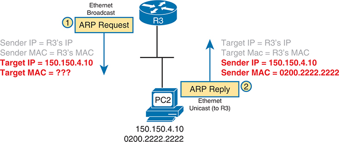
<figcaption>

<strong>图 3-15</strong> <em>ARP 过程示例</em>

<aside class="hidden" id="a03fig15">

过程如下：首先，路由器 3（R3）在以太网上广播 ARP 请求。发送方 IP 地址和 MAC 地址分别设置为 R3 相应的地址，而目标 IP 地址指定为 150.150.4.10，目标 MAC 地址尚未确定。随后，针对该 ARP 请求，一个 ARP 应答以单播方式发回 R3。目标 IP 地址和 MAC 地址现在被设为 R3 的地址，发送方 IP 地址为 150.150.4.10，发送方 MAC 地址则为 0200.2222.2222。

</aside>
</figcaption>
</figure>

请注意，主机和路由器会记住 ARP 的结果，将这些信息保存在 <em>ARP 缓存</em>或 <em>ARP 表</em>中。主机或路由器只需偶尔使用 ARP，以便首次建立 ARP 缓存。每次主机或路由器需要发送封装在以太网帧中的分组时，它都会先检查 ARP 缓存，查找正确的 IP 地址及其匹配的 MAC 地址。主机和路由器会让 ARP 缓存条目超时失效，以清理表项，因此仍会偶尔看到 ARP 请求。

注意

在大多数 PC 操作系统中，可以在命令提示符下使用 <strong>arp -a</strong> 命令，查看 ARP 缓存的内容。

</section>
<section>
<h4 class="h4" id="ch03lev2sec9">ICMP 回显与 ping 命令</h4>

实现 TCP/IP 互联网络之后，你需要一种方法来测试基本的 IP 连通性，而且不依赖任何应用程序正常工作。用于测试基本网络连通性的主要工具是 <strong>ping</strong> 命令。

<a id="key_050" href="#ref-gloss_304">Ping</a> 使用网际控制报文协议（ICMP），向另一个 IP 地址发送一条称为 <em>ICMP 回显请求</em>的消息。使用该 IP 地址的计算机应以 <em>ICMP 回显应答</em>进行回复。如果这一过程成功，你就成功测试了 IP 网络。换言之，你知道网络能够将分组从一台主机交付给另一台主机，并将分组送回。ICMP 不依赖任何应用程序，因此它实际上只测试基本的 IP 连通性，也就是 OSI 模型的第 1、2、3 层。<a href="#ch03fig16">图 3-16</a> 概述了基本过程。

<figure class="image-c" id="ch03fig16">
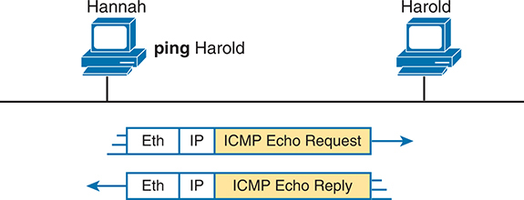
<figcaption>

<strong>图 3-16</strong> <em>网络示例，<strong>ping</strong> 命令</em>

<aside class="hidden" id="a03fig16">

Hannah 发起一条指向 Harold 的 ping 命令。在此过程中，Hannah 生成一个以太网帧，帧中封装了一个网际协议（IP）分组，该分组包含一条网际控制报文协议（ICMP）回显请求。此请求通过以太网传输到 Harold。Harold 收到 ICMP 回显请求后，以 ICMP 回显应答进行回复，该应答封装在 IP 分组和以太网帧中。

</aside>
</figcaption>
</figure>

请注意，虽然 <strong>ping</strong> 命令使用 ICMP，但 ICMP 的作用远不止于此。ICMP 定义了许多消息，设备可以使用这些消息来帮助管理和控制 IP 网络。

</section>
</section>
</section>

<section class="ccna-source ccna-appendix" aria-label="答案解析与术语表">
<section data-epub-type="chapter">
<h2 class="h2" id="ref-appc">附录 C</h2>
<h2 class="h2a">自测题答案</h2>
<section>
<h3 class="h3" id="ref-appclev1sec3">第 3 章</h3>

<strong><a id="ref-ques3_1" href="#quess3_1">1</a>。</strong>D。正确答案列出了两个站点之间以太网广域网链路的一种称呼：E-line，即 Ethernet line（以太网线路）的简称。其他答案列出的都是串行链路的常见同义词。

<strong><a id="ref-ques3_2" href="#quess3_2">2</a>。</strong>B 和 D。物理安装采用这样一种模式：每台路由器都通过一条物理以太网链路，连接到 SP 设施中的某台 SP 设备，该设施称为接入点（PoP）。以太网链路并不直接从一台客户设备延伸到另一台客户设备。从数据链路角度看，两台路由器使用的都是与局域网相同的标准以太网首部和尾部；HDLC 与这些以太网广域网链路无关。

<strong><a id="ref-ques3_3" href="#quess3_3">3</a>。</strong>A。PC1 会向 Router1 发送一个以太网帧，以 PC1 的 MAC 地址为源地址，以 Router1 的 MAC 地址为目的地址。Router1 将从该以太网帧中取出封装的 IP 分组，丢弃帧首部和尾部，并且不再使用它们。Router1 会先将 IP 分组封装到 PPP 帧内，再转发该分组。Router1 不会把原来的以太网帧封装到 PPP 帧中，而是封装 IP 分组。PPP 首部使用的地址与以太网不同，因此不会使用原始帧中的以太网地址。

<strong><a id="ref-ques3_4" href="#quess3_4">4</a>。</strong>C。路由器将分组的目的 IP 地址与自己的 IP 路由表进行比较，找到匹配项，并使用匹配路由中的转发指示来转发 IP 分组。

<strong><a id="ref-ques3_5" href="#quess3_5">5</a>。</strong>C。IPv4 主机通常使用基本的双分支逻辑。要将 IP 分组发送给同一局域网内、同一 IP 网络或子网上的另一台主机时，发送方会将 IP 分组直接发送给该主机。否则，发送方会将分组发送给自己的默认路由器（也称为默认网关）。

<strong><a id="ref-ques3_6" href="#quess3_6">6</a>。</strong>A 和 C。路由器会执行答案中列出的所有操作。不过，路由协议负责的是两个正确答案所列的功能。路由器学习直接连接到其接口的 IP 子网和 IP 网络的路由，这一过程与路由协议无关。路由器还会转发（路由）IP 分组，但这一过程称为 IP 路由或 IP 转发，相对于路由协议的工作而言，它是一个独立过程。

<strong><a id="ref-ques3_7" href="#quess3_7">7</a>。</strong>C。地址解析协议（ARP）确实能够让 PC1 学习信息，但这些信息并非存储在服务器上。<strong>ping</strong> 命令确实能够让 PC1 的用户知道分组能否在网络中传送，但它同样不使用服务器。在域名系统（DNS）中，PC1 充当 DNS 客户端，依赖 DNS 服务器应答，提供与给定主机名匹配的 IP 地址信息。

</section>
</section>

<section id="ref-glossary"><h2 class="h2a">术语表</h2>
<strong>ARP</strong> 地址解析协议。用于将 IP 地址映射为 MAC 地址的互联网协议，定义于 RFC 826。

<strong>分类 IP 网络（classful IP network）</strong> IPv4 的 A 类、B 类或 C 类网络；之所以称为分类网络，是因为这些网络按照 IPv4 编址的类别规则定义。

<strong>默认网关／默认路由器（default gateway/default router）</strong> 在 IP 主机上，指某台路由器的 IP 地址；当分组的目的地址位于本地子网之外的子网时，主机会将分组发送给该路由器。

<strong>DNS</strong> 域名系统。广泛用于互联网的应用层协议，用于将主机名转换为相应的 IP 地址。

<strong>以太网线路服务（Ethernet Line Service，E-Line）</strong> MEF（MEF.net）定义的一种特定的运营商／城域以太网服务，在两台客户设备之间提供点到点拓扑，其效果非常类似于使用以太网交叉线连接这两台设备。

<strong>HDLC</strong> 高级数据链路控制。由国际标准化组织（ISO）开发的一种面向比特的同步数据链路层协议。

<strong>主机名（hostname）</strong> IP 主机的字母数字名称。

<strong>内部网关协议（interior gateway protocol，IGP）</strong> 设计用于在单个自治系统内部交换路由信息的路由协议。

<strong>内部路由协议（interior routing protocol）</strong> 内部网关协议的同义词。<em>参见</em><a href="#ref-gloss_196">内部网关协议</a>。

<strong>IP</strong> 网际协议。TCP/IP 协议栈中的网络层协议，提供路由和逻辑编址的标准与服务。

<strong>IP 网络（IP network）</strong> <em>参见</em><a href="#ref-gloss_065">分类 IP 网络</a>。

<strong>IP 分组（IP packet）</strong> 由 IP 首部以及封装在 IP 首部之后的数据组成，明确不包含网络层以下各层的任何首部和尾部。

<strong>IP 路由表（IP routing table）</strong> <em>参见</em><a href="#ref-gloss_354">路由表</a>。

<strong>IP 子网（IP subnet）</strong> 由网络管理员配置，对 A 类、B 类或 C 类网络进行细分后得到的部分。子网使一个 A 类、B 类或 C 类网络能够代替多个网络使用，同时仍能提供高效 IP 路由所需的大量 IP 地址组。

<strong>租用线路（leased line）</strong> 由某个服务提供商（通常是电话公司，即 telco）提供的两点之间的串行通信电路。由于电话公司并不出售两个端点之间的物理电缆，而是按月收取费用，让客户能够在两个站点之间发送比特，因此这种服务被视为租用服务。

<strong>ping</strong> 网际控制报文协议（ICMP）的回显消息及其应答；ping 常用于 IP 网络，以测试网络设备的可达性。

<strong>路由表（routing table）</strong> 路由器中的路由列表；每条路由列出目的子网和掩码、转发去往该子网的分组所使用的路由器出接口，以及在需要时列出的下一跳路由器 IP 地址。

<strong>子网划分（subnetting）</strong> 将 A 类、B 类或 C 类网络划分为更小的组（称为子网）的过程。

<strong>telco</strong> <em>电话公司（telephone company）</em>的常见缩写。

<strong>WAN</strong> <em>参见</em><a href="#ref-gloss_442">广域网</a>。

<strong>广域网（wide-area network，WAN）</strong> 较大网络中的一部分，主要实现 OSI 第 1 层和第 2 层技术，连接通常相距较远的站点，并采用这样一种商业模式：使用者（个人或企业）必须向服务提供商（通常是电话公司）租用广域网。

</section>

</section>


<nav class="ccna-chapter-nav" aria-label="章节导航"><a href="v1-02.html">← 上一章</a><a href="v1-04.html">下一章 →</a></nav>
