
<a href="{{ '/subjects/CCNA/' | relative_url }}">← 返回 CCNA 目录</a>

第一卷 · 实现以太网局域网

<nav class="ccna-chapter-nav" aria-label="章节导航"><a href="v1-03.html">← 上一章</a><a href="v1-05.html">下一章 →</a></nav>



<section data-epub-type="chapter">

<h2 class="h2" id="ch04">第 4 章</h2>

<h2 class="h2a">使用命令行界面</h2>

本章涵盖以下考试主题：

2.0 网络接入

2.8 描述网络设备的管理访问方式（Telnet、SSH、HTTP、HTTPS、控制台、TACACS+/RADIUS 和云管理）

CCNA 考试侧重于理解局域网如何工作、配置交换机的不同功能、验证这些功能是否正常，以及在功能异常时查找问题根因等技能。在开展这些更重要的工作之前，你必须先学会访问和使用交换机的用户界面，也就是<a id="key_057" href="#ref-gloss_074">命令行界面（CLI）</a>。

本章从访问交换机 CLI 的基本方法开始介绍这些技能，包括如何访问 CLI，以及如何发出验证命令来检查局域网状态。本章还介绍配置交换机和保存配置的过程。

请注意，本章重点介绍的操作过程，为包含<em>识别</em>、<em>配置</em>或<em>验证</em>这些动词的考试主题打下基础。本书<a href="#part02">第 II 部分</a>和<a data-original-href="vol1_part03.xhtml#part03" data-unavailable="true" title="此内容不在当前提取范围内；请参阅原始 EPUB：vol1_part03.xhtml#part03">第 III 部分</a>的其余大多数章节，随后将详细介绍验证和配置各种交换机功能的具体命令。

<section>

<h3 class="h3" id="ch04lev1sec1">“这些知识我已经掌握了吗？”自测</h3>

如果你希望根据得分决定在本章投入多少时间，可以完成这组自测题（在此作答，或使用 PTP 软件）。各题答案的选项字母列在自测题之后的页面底部。书末和配套网站上的<a href="#ref-appc">附录 C</a>都包含答案及解析。你也可以在 PTP 测试软件中找到答案及解析。

<figure class="table" id="ch04tab01" tabindex="0">

<figcaption>

<strong>表 4-1</strong> “这些知识我已经掌握了吗？”自测：基础知识小节与题目对应关系

</figcaption>

<table class="all">

<thead>

<tr>

<th class="th">
基础知识小节
</th>

<th class="th">
题目
</th>

</tr>

</thead>

<tbody>

<tr>

<td class="border">
访问 Cisco Catalyst 交换机的 CLI
</td>

<td class="border">
1–3
</td>

</tr>

<tr>

<td class="border">
配置 Cisco IOS 软件
</td>

<td class="border">
4–6
</td>

</tr>

</tbody>

</table>

</figure>

<strong><a id="quess4_1" href="#ques4_1a">1</a>。</strong>在哪些模式下输入 <strong>show mac address-table</strong> 命令，能够得到包含 MAC 地址表条目的响应？（选择两个答案。）

<ol class="lower-alpha">

<li>
用户模式
</li>

<li>
特权模式
</li>

<li>
全局配置模式
</li>

<li>
接口配置模式
</li>

</ol>

<strong><a id="quess4_2" href="#ques4_2a">2</a>。</strong>在以下哪种 CLI 模式下输入 <strong>reload</strong> 命令，能够使交换机重新启动？

<ol class="lower-alpha">

<li>
用户模式
</li>

<li>
特权模式
</li>

<li>
全局配置模式
</li>

<li>
接口配置模式
</li>

</ol>

<strong><a id="quess4_3" href="#ques4_3a">3</a>。</strong>以下哪项描述了 Cisco 交换机所支持的 Telnet 与 SSH 之间的区别？

<ol class="lower-alpha">

<li>
SSH 加密登录时使用的密码，但不加密其他流量；Telnet 不加密任何内容。
</li>

<li>
SSH 加密所有交换的数据，包括登录密码；Telnet 不加密任何内容。
</li>

<li>
Telnet 用于 Microsoft 操作系统，而 SSH 用于 UNIX 和 Linux 操作系统。
</li>

<li>
Telnet 只加密密码交换；SSH 加密所有数据交换。
</li>

</ol>

<strong><a id="quess4_4" href="#ques4_4a">4</a>。</strong>交换机启动并运行时使用的配置，存储在哪种交换机存储器中？

<ol class="lower-alpha">

<li>
RAM
</li>

<li>
ROM
</li>

<li>
闪存
</li>

<li>
NVRAM
</li>

<li>
磁泡存储器
</li>

</ol>

<strong><a id="quess4_5" href="#ques4_5a">5</a>。</strong>哪个命令将配置从 RAM 复制到 NVRAM？

<ol class="lower-alpha">

<li>
<strong>copy running-config tftp</strong>
</li>

<li>
<strong>copy tftp running-config</strong>
</li>

<li>
<strong>copy running-config start-up-config</strong>
</li>

<li>
<strong>copy start-up-config running-config</strong>
</li>

<li>
<strong>copy startup-config running-config</strong>
</li>

<li>
<strong>copy running-config startup-config</strong>
</li>

</ol>

<strong><a id="quess4_6" href="#ques4_6a">6</a>。</strong>某交换机用户当前处于控制台线路配置模式。以下哪些操作会使用户进入特权模式？（选择两个答案。）

<ol class="lower-alpha">

<li>
使用一次 <strong>exit</strong> 命令
</li>

<li>
使用一次 <strong>end</strong> 命令
</li>

<li>
按一次 Ctrl+Z 组合键
</li>

<li>
使用 <strong>quit</strong> 命令
</li>

</ol>

“这些知识我已经掌握了吗？”自测答案：

<strong><a id="ques4_1a" href="#ref-ques4_1">1</a></strong> A、B

<strong><a id="ques4_2a" href="#ref-ques4_2">2</a></strong> B

<strong><a id="ques4_3a" href="#ref-ques4_3">3</a></strong> B

<strong><a id="ques4_4a" href="#ref-ques4_4">4</a></strong> A

<strong><a id="ques4_5a" href="#ref-ques4_5">5</a></strong> F

<strong><a id="ques4_6a" href="#ref-ques4_6">6</a></strong> B、C

</section>

<section>

<h3 class="h3box" id="ch04lev1sec2">基础知识</h3>

</section>

<section>

<h3 class="h3" id="ch04lev1sec3">访问 Cisco Catalyst 交换机的 CLI</h3>

Cisco 在路由器和局域网交换机产品中采用命令行界面（CLI）。CLI 是一种基于文本的界面，用户（通常是网络工程师）输入文本命令并按 Enter 键。按下 Enter 会将命令发送给交换机，指示设备执行某项操作。交换机按照命令执行，有时还会返回一些消息，说明命令的执行结果。

Cisco Catalyst 交换机还支持其他监控和配置方式。例如，交换机可以提供 Web 界面，使工程师能够打开 Web 浏览器，连接到交换机上运行的 Web 服务器。还可以通过网络管理软件控制和操作交换机。

本书只讨论 Cisco Catalyst 企业级交换机，具体而言，是如何使用 Cisco CLI 监控和控制这些交换机。本章第一个主要部分先更详细地介绍 Catalyst 交换机，然后说明网络工程师如何访问 CLI 并发出命令。

<section>

<h4 class="h4" id="ch04lev2sec1">Cisco Catalyst 交换机</h4>

在我更新本章、准备于 2023 年出版时，Cisco 局域网交换机分为三个产品家族：

<ul class="sq">

<li>
<strong>Cisco Catalyst 交换机</strong>，作为典型的企业交换机，用于企业各处。
</li>

<li>
<strong>Cisco Nexus 交换机</strong>，由 Cisco 为数据中心设计。与 Catalyst 交换机相比，Nexus 交换机在单台设备上支持更高速的端口和更多高速端口，还提供针对数据中心优化的其他功能。
</li>

<li>
<strong>Cisco Meraki 交换机</strong>，面向企业，满足这样一种需求：局域网交换机及其他网络设备通过简单的云管理门户进行管理，使新设备能够轻松接入。
</li>

</ul>

在 CCNA 考试的整个历史中，提到<em>交换机</em>时，指的都是 Cisco Catalyst 交换机，而不是 Nexus 或 Meraki 交换机。

在 Cisco Catalyst 局域网交换机品牌下，Cisco 生产种类繁多的交换机系列或家族。每个系列都包括多种具体型号，它们的功能、价格与性能取舍，以及内部组件都比较相似。

例如，在我编写本章最新版本时，Cisco 将 Catalyst 9000 交换机家族作为其主要企业交换机家族。该家族包括以 9200、9300、9400 等数字命名的系列，每个系列下又有具体型号。例如，Cisco 将 9200 和 9300 系列定位为面向企业、功能完备的接入层交换机。

<a href="#ch04fig01">图 4-1</a> 展示了两种 9200 交换机型号。图中下方的交换机有 48 个固定的 RJ-45 非屏蔽双绞线（UTP）10/100/1000 端口，这意味着端口可以自动协商使用 10BASE-T（10 Mbps）、100BASE-T（100 Mbps）或 1000BASE-T（1 Gbps）以太网。上方的交换机有 24 个这样的端口。

<figure class="image-c" id="ch04fig01">

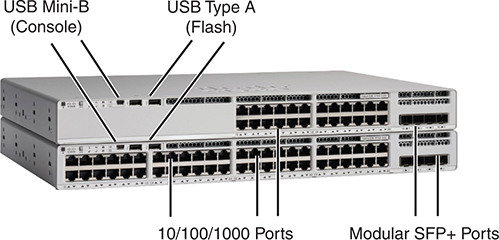

<figcaption>

<strong>图 4-1</strong> <em>Cisco Catalyst 9200L 交换机型号的前视图</em>

<aside class="hidden" id="a04fig01">

模型描述了设备的外观和主要功能，包括前面板上用于控制台连接的 USB Mini-B 端口，以及用于闪存存储的 USB Type-A 端口。图像突出显示了 10/100/1000 以太网端口和模块化增强型小型可插拔（SFP+）端口。

</aside>

</figcaption>

</figure>

Cisco 将交换机上的物理连接器称为<em>接口</em>或<em>端口</em>，并使用接口类型和接口编号加以标识。交换机使用 Ethernet、FastEthernet、GigabitEthernet、TenGigabit 等接口类型，以及用于更高速率的其他类型。对于支持多种速率的以太网接口，交换机采用其所支持的最高速率来命名接口类型。例如，无论当前实际使用哪种速率，交换机都把 10/100/1000 接口（即能以 10 Mbps、100 Mbps 或 1000 Mbps 运行的接口）称为 GigabitEthernet 端口。

局域网交换机还使用数字形式的接口标识符（接口 ID）来标识具体端口。接口 ID 可由一段、两段或三段数字组成，各段以斜杠分隔，具体形式由 Cisco 在设计交换机时决定。例如，Cisco Catalyst 9000 交换机通常使用 GigabitEthernet 1/0/1 和 GigabitEthernet 1/0/2 这样的三段标识符。<a href="#ch04tab02">表 4-2</a> 根据接口支持的速率，列出一些接口标识符及其缩写的示例。

<figure class="table" id="ch04tab02" tabindex="0">

<figcaption>

<strong>表 4-2</strong> 局域网交换机接口 ID 及其缩写示例

</figcaption>

<table class="all">

<thead>

<tr>

<th class="th">
支持的速率
</th>

<th class="th">
常用名称
</th>

<th class="th">
交换机接口 ID 示例
</th>

<th class="th">
有效缩写
</th>

</tr>

</thead>

<tbody>

<tr>

<td class="border">
10 Mbps
</td>

<td class="border">
以太网
</td>

<td class="border">
Ethernet0/0
</td>

<td class="border">
E0/0、Et0/0、Eth0/0
</td>

</tr>

<tr>

<td class="border">
10/100 Mbps
</td>

<td class="border">
10/100
</td>

<td class="border">
FastEthernet 0/1
</td>

<td class="border">
F0/1、Fa0/1
</td>

</tr>

<tr>

<td class="border">
10/100/1000 Mbps
</td>

<td class="border">
10/100/1000
</td>

<td class="border">
GigabitEthernet 1/0/1
</td>

<td class="border">
G1/0/1、Gi1/0/1
</td>

</tr>

<tr>

<td class="border">
1G/2.5G/5G/10G
</td>

<td class="border">
多千兆（Multigig）
</td>

<td class="border">
TenGigabit 1/0/2
</td>

<td class="border">
T1/0/2、Te1/0/2
</td>

</tr>

</tbody>

</table>

</figure>

</section>

<section>

<h4 class="h4" id="ch04lev2sec2">访问 Cisco IOS XE CLI</h4>

Catalyst 交换机的操作系统（OS）提供了面向人的界面，你可以在其中输入命令，并看到以文本行形式返回的响应。下一个主题将介绍这个称为命令行界面（CLI）的界面，但首先介绍操作系统本身的一些背景知识。

<section>

<h5 class="h5" id="ch04lev3sec1">Cisco Catalyst 交换机中的操作系统</h5>

在早期，Cisco 交换机使用称为 CatOS 的操作系统，即 Catalyst OS 的简称。Cisco 的第一个交换机家族并非自行开发，而是通过在 1993 年收购 Crescendo Communications 公司获得的；该公司已将其交换机家族命名为 Catalyst，操作系统称为 CatOS。

Cisco 刚进入局域网交换机业务时，其路由器使用的是自行编写的操作系统，称为互联网络操作系统（<a id="key_060" href="#ref-gloss_201">IOS</a>）；不是 IOS XE，而就是 IOS。毫不意外，Cisco 路由器的 IOS CLI 与被收购厂商生产的交换机 CatOS CLI 的工作方式有所不同。后来，Cisco 创建了基于 IOS 的交换机操作系统。因此，主要在 20 世纪 90 年代和 21 世纪头十年，Cisco 发布新交换机产品家族时，会在 Catalyst 交换机上采用 IOS 来取代 CatOS。随着交换机转向 IOS，最终所有 Cisco 企业级路由器和交换机都采用了相同的 IOS CLI，使网络人员更容易管理它们。<a href="#ch04fig02">图 4-2</a> 概括了这一迁移过程的时间线。

<figure class="image-c" id="ch04fig02">

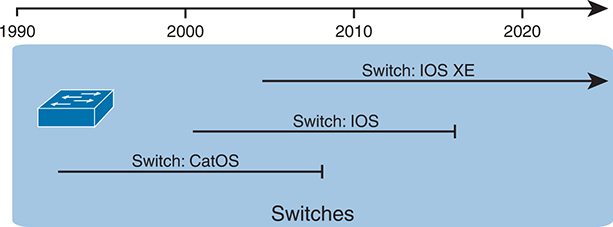

<figcaption>

<strong>图 4-2</strong> <em>Cisco Catalyst 操作系统的长期迁移过程</em>

</figcaption>

</figure>

Cisco 又一次为 Catalyst 交换机迁移操作系统，这次改用 <a id="key_061" href="#ref-gloss_202">IOS XE</a>。为了创建 IOS XE，Cisco 以 IOS 为基础，对内部软件架构进行了现代化改造。IOS XE 通常简称 XE，具有提高正常运行时间、无需重新启动（重新加载）设备即可维护设备的功能。但它仍保留熟悉的 CLI；事实上，如果你是在运行 IOS 的设备上学习 CLI，之后使用运行 IOS XE 的设备时，甚至可能察觉不到差别。

就 CCNA 而言，你看到的命令和 CLI 内容，几乎都同时适用于较早的 IOS 交换机，以及采用 IOS XE 的较新交换机。不过，如果存在差异，正文会明确指出。

注意

除非需要区分二者，本书均使用 <em>IOS</em> 这一通用名称来指代 IOS 和 IOS XE。

</section>

<section>

<h5 class="h5" id="ch04lev3sec2">访问 IOS XE CLI</h5>

Catalyst 交换机的 Cisco IOS 软件实现并控制交换机执行的逻辑和功能。除了控制交换机的性能和行为，Cisco IOS 还定义了一个面向人的界面，即 CLI。Cisco IOS CLI 允许用户使用终端仿真程序，该程序接收用户输入的文本。用户按下 Enter 后，终端仿真器将文本发送给交换机。交换机将这些文本作为命令处理，执行命令要求的操作，再将文本返回给终端仿真器。

访问交换机 CLI 的三种常用方式是控制台、<a id="key_066" href="#ref-gloss_405">Telnet</a> 和<a id="key_064" href="#ref-gloss_360">安全外壳协议（SSH）</a>。其中 Telnet 和 SSH 通过交换机所在的 IP 网络访问交换机。控制台则是专门为访问 CLI 而设置的物理端口。<a href="#ch04fig03">图 4-3</a> 展示了这些选择。

<figure class="image-c" id="ch04fig03">

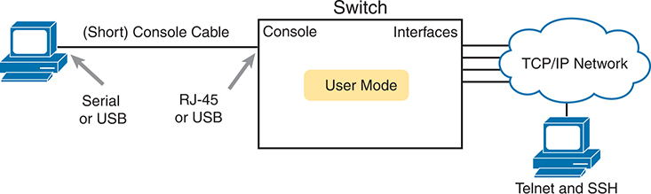

<figcaption>

<strong>图 4-3</strong> <em>CLI 访问方式</em>

<aside class="hidden" id="a04fig03">

用户通过控制台电缆，使用 PC 的串行或 USB 连接访问设备；控制台电缆通常使用 RJ-45 连接器。另一种方式是通过 TCP/IP 网络连接，使用 Telnet 和 SSH 等协议，访问交换机控制台用户模式界面。

</aside>

</figcaption>

</figure>

控制台访问既需要 PC（或其他用户设备）与交换机控制台端口之间的物理连接，也需要 PC 上的软件。Telnet 和 SSH 需要用户设备上的软件，但依靠现有 TCP/IP 网络传输数据。接下来的几页将详细介绍如何连接控制台，并为每种 CLI 访问方式设置软件。

</section>

<section>

<h5 class="h5" id="ch04lev3sec3">连接控制台电缆</h5>

无论新式还是旧式，物理控制台连接都使用三个主要组件：交换机上的物理控制台端口、PC 上的物理串行端口，以及适用于控制台和串行端口的电缆。不过，物理布线的细节随着时间逐渐变化，主要原因是 PC 硬件上的串行接口不断进步和变化。接下来讨论三种情况：PC 和交换机两端都采用较新连接器；两端都采用较旧连接器；以及 PC 采用较新 USB 连接器、交换机采用较旧连接器。

如今，大多数 PC 使用熟悉的标准 USB 连接器进行控制台连接。Cisco 在新路由器和交换机型号中提供 USB 控制台端口，已有十多年。你只需查看交换机，确认 USB 连接器样式与其 USB 控制台端口匹配（通常是 USB mini-B 连接器）。最简单的方式，是用 USB 电缆将 PC 上的任意 USB 端口连接到交换机或路由器的 USB 控制台端口，如<a href="#ch04fig04">图 4-4</a> 最右侧所示。

<figure class="image-c" id="ch04fig04">

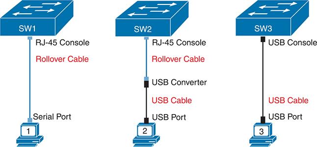

<figcaption>

<strong>图 4-4</strong> <em>连接交换机控制台</em>

<aside class="hidden" id="a04fig04">

SW1 使用 RJ-45 控制台端口，经反转线缆连接到 PC1 的串行端口 1。SW2 使用 RJ-45 控制台端口，经反转线缆、USB 转换器和 USB 电缆，连接到 PC2 的 USB 端口。SW3 则使用 USB 控制台端口，经 USB 电缆连接到 PC3 的 USB 端口。

</aside>

</figcaption>

</figure>

图中最左侧展示的是较旧的控制台连接，这是十多年前连接交换机的典型方式。在 PC 使用 USB 端口之前，它们使用串行端口进行串行通信。PC 串行端口采用九针 D 形连接器（大致呈矩形，通常称为 DB-9）。控制台端口的外观类似于普通以太网 RJ-45 端口，但通常为蓝色，而且交换机上端口旁边标有 <em>console</em> 字样。旧式布线使用标准 RJ-45 转 DB-9 转换插头，以及两端均为 RJ-45 连接器的 UTP <a id="key_062" href="#ref-gloss_338">反转线缆</a>。反转线序使用八根线，将引脚 1 接到引脚 8，引脚 2 接到引脚 7，引脚 3 接到引脚 6，依此类推。

图中间的情况结合了左右两侧的布线方式，你可能偶尔会用到：使用 PC 上的 USB 端口，但使用交换机上的 RJ-45 控制台端口。事实上，一些非常老的交换机型号只有 RJ-45 控制台端口，没有 USB 控制台端口，必须采用这种布线。在这种情况下，需要一个 USB 转换插头，将较旧的带 RJ-45 连接器的反转控制台电缆转换为 USB 连接器，如<a href="#ch04fig04">图 4-4</a> 中间所示。

注意

使用 USB 方式时，通常还需要安装软件驱动程序，让 PC 操作系统知道 USB 连接另一端的设备是 Cisco 设备的控制台。此外，在网上搜索“cisco console cable”“cisco usb console cable”或“console cable converter”，很容易找到这些电缆和组件的照片。

<a href="#ch04fig05">图 4-5</a> 展示 Cisco 9200L 交换机的后视图，可以看到 RJ-45 控制台连接器。9200L 将 USB 控制台端口（mini-B USB 端口）置于前面板，前面的<a href="#ch04fig01">图 4-1</a> 已展示。

<figure class="image-c" id="ch04fig05">

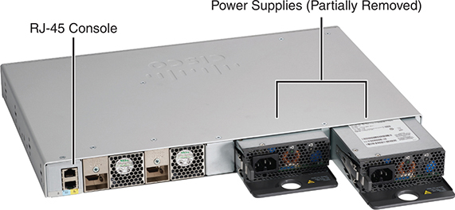

<figcaption>

<strong>图 4-5</strong> <em>Cisco Catalyst 9200L 交换机后视图</em>

</figcaption>

</figure>

</section>

<section>

<h5 class="h5" id="ch04lev3sec4">配置终端仿真器</h5>

PC 与控制台端口建立物理连接后，必须在 PC 上安装并配置终端仿真软件。终端仿真软件把所有数据都当作文本。它接收用户输入的文本，并通过控制台连接发送给交换机。同样，经控制台连接进入 PC 的任何比特，都会以文本形式显示，供用户阅读。

必须配置仿真器，使 PC 串行端口的设置与交换机控制台端口匹配。交换机控制台端口的默认设置如下。请注意，最后三个参数统称为 8N1：

<ul class="sq">

<li>
9600 比特／秒
</li>

<li>
无硬件流量控制
</li>

<li>
8 位 ASCII
</li>

<li>
无奇偶校验位
</li>

<li>
1 个停止位
</li>

</ul>

<a href="#ch04fig06">图 4-6</a> 展示了一个终端仿真器。背景是仿真软件创建的窗口，显示了一些 <strong>show</strong> 命令输出。右上方的前景是设置窗口，列出了本段之前所述的默认控制台设置。

<figure class="image-c" id="ch04fig06">

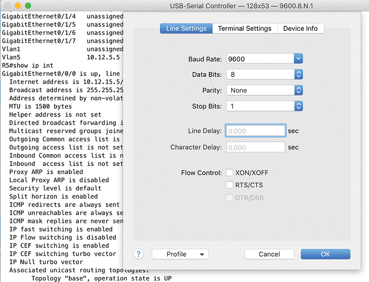

<figcaption>

<strong>图 4-6</strong> <em>控制台访问的终端设置</em>

<aside class="hidden" id="a04fig06">

在“Line Settings”（线路设置）选项卡中，波特率设为 9600，数据位设为 8，奇偶校验设为无，停止位设为 1。行延迟和字符延迟均为 0 秒，流量控制未指定。Cancel（取消）和 OK（确定）按钮位于屏幕右下角。

</aside>

</figcaption>

</figure>

</section>

<section>

<h5 class="h5" id="ch04lev3sec5">通过 Telnet 和 SSH 访问 CLI</h5>

多年来，终端仿真应用程序的功能远不止通过 USB（或串行）端口与本地设备（如交换机控制台）通信。终端仿真器还支持多种 TCP/IP 应用，包括 Telnet 和 SSH。Telnet 和 SSH 都允许用户连接另一台设备的 CLI，但不是通过控制台电缆连接控制台端口，而是让流量经过这些网络设备所参与构建的同一个 IP 网络。

Telnet 使用 Telnet 客户端（终端应用程序）和 Telnet 服务器（本例中为交换机）的概念。<em>Telnet 客户端</em>是用户面前的设备，接收键盘输入，并将命令发送给 <em>Telnet 服务器</em>。Telnet 服务器接收文本，将其解释为命令，并返回响应。

Cisco Catalyst 交换机默认启用 Telnet 服务器，但还需要一些配置，才能成功通过 Telnet 连接交换机。<a href="v1-06.html#ch06">第 6 章</a>《<a href="v1-06.html#ch06">配置交换机基本管理功能</a>》详细介绍支持 Telnet 和 SSH 的交换机配置。

如今，在实验环境中使用 Telnet 是合理的，但在生产网络中，Telnet 会带来显著的安全风险。Telnet 将所有数据（包括登录交换机的用户名和密码）以明文形式发送。SSH 提供了更好的选择。

可以把 SSH 看作 Telnet 的一个安全得多的近亲。从表面看，无论使用 Telnet 还是 SSH，你都是打开终端仿真器，连接交换机的 IP 地址，然后看到交换机 CLI。差异发生在幕后：SSH 加密所有消息的内容，包括密码，从而避免他人在网络中捕获分组并窃取网络设备密码。

</section>

<section>

<h5 class="h5" id="ch04lev3sec6">用户模式和特权（Enable）模式</h5>

目前介绍的三种 CLI 访问方式（控制台、Telnet 和 SSH），都会让用户进入 CLI 中称为<em>用户 EXEC 模式</em>的区域。用户 EXEC 模式有时也称为<a id="key_067" href="#ref-gloss_427">用户模式</a>，允许用户查看各种信息，但不会破坏任何东西。名称中的“EXEC 模式”表示：在此模式下输入命令时，交换机会执行命令，然后显示描述执行结果的消息。

注意

如果你以前没有使用过 CLI，可以尝试 Sim Lite 产品中的 CLI。正如引言所述，你可以在配套网站上找到这一资源。

Cisco IOS 支持一种功能更强的 EXEC 模式，称为<em>特权</em>模式，也称 <a id="key_059" href="#ref-gloss_120">enable 模式</a>。正式名称<em>特权模式</em>，指的是 IOS 允许在该模式下使用强大的（或具有特权的）命令。工程师通常把它称为 <em>enable 模式</em>，因为 <strong>enable</strong> EXEC 命令可以将用户从用户模式切换到特权模式，如<a href="#ch04fig07">图 4-7</a> 所示。例如，只有在特权模式下，才能使用 <strong>reload</strong> 命令，指示交换机重新初始化或重新启动 Cisco IOS。

<figure class="image-c" id="ch04fig07">

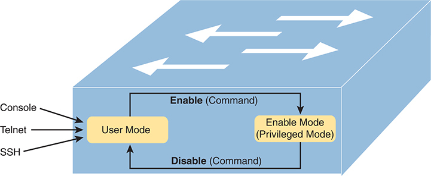

<figcaption>

<strong>图 4-7</strong> <em>用户模式和特权模式</em>

<aside class="hidden" id="a04fig07">

用户可以通过控制台、Telnet 或 SSH 等方式访问设备，最初处于用户模式。为了访问更高级的命令和配置，用户输入 enable 命令，切换到 enable 模式，也称特权模式。在特权模式中，用户具有更高权限，可以执行用于系统配置和管理的特权命令。相反，disable 命令会使设备返回用户模式，从而限制可用的命令和配置。

</aside>

</figcaption>

</figure>

注意

如果命令提示符以 &gt; 结尾，用户处于用户模式；如果以 # 结尾，用户处于特权模式。

<a href="#exa4_1">例 4-1</a> 展示了用户模式和特权模式的区别。该示例显示了在终端仿真器窗口中可能看到的输出，例如从控制台连接时。在本例中，用户位于用户模式提示符（“Certskills1&gt;”），并尝试执行 <strong>reload</strong> 命令。<strong>reload</strong> 命令指示交换机重新初始化或重新启动 Cisco IOS，因此 IOS 只允许在特权模式下使用这个强大的命令。IOS 拒绝用户模式下的 <strong>reload</strong> 命令。随后，用户使用 <strong>enable</strong> EXEC 命令进入特权（enable）模式。此时，用户已处于特权模式，因此 IOS 接受 <strong>reload</strong> 命令。

<strong>例 4-1</strong> <em>用户模式拒绝执行特权模式命令的示例</em>

<a href="#code-f0097-01" id="f0097-01a">点击此处查看代码原图</a>

<pre class="pre-ex" tabindex="0"><code>Press RETURN to get started.

User Access Verification

Password:

Certskills1&gt;

Certskills1&gt; <strong>reload</strong>

Translating “reload”

% Unknown command or computer name, or unable to find computer address

Certskills1&gt; <strong>enable</strong>

Password:

Certskills1#

Certskills1# <strong>reload</strong>

Proceed with reload? [confirm] <strong>y</strong>

00:08:42: %SYS-5-RELOAD: Reload requested by console. Reload Reason: Reload Command.</code></pre>

注意

能够在用户（EXEC）模式或特权（EXEC）模式下使用的命令，称为 EXEC 命令。

这是本书首次展示 CLI 输出，因此需要说明几项约定。粗体文本表示用户输入的内容，非粗体文本表示交换机返回给终端仿真器的内容。此外，出于安全考虑，输入的密码不会显示在屏幕上。

</section>

<section>

<h5 class="h5" id="ch04lev3sec7">通过控制台访问 CLI 的密码安全</h5>

采用默认设置的 Cisco 交换机，如果锁在配线间内，就相对安全，因为交换机默认只允许控制台访问。默认情况下，控制台完全不要求密码；从控制台连接的用户进入特权模式时，也不要求密码。原因在于：如果你能够接触交换机的物理控制台端口，实际上已经几乎完全控制了交换机。你甚至可以拿出螺丝刀，把交换机从机架上拆下并带走；也可以拔掉电源；还可以按照公开的密码恢复流程进入 CLI，然后随意配置。

不过，许多人仍会为控制台用户设置简单的密码保护。在控制台登录过程中，可以在两个位置配置简单密码：用户从控制台连接时，以及任何用户进入特权模式时（使用 <strong>enable</strong> EXEC 命令）。你可能已经注意到，在前面的<a href="#exa4_1">例 4-1</a> 中，用户在这两个位置都看到了密码提示。

<a href="#exa4_2">例 4-2</a> 展示了采集<a href="#exa4_1">例 4-1</a> 输出之前已经配置的额外命令。输出摘自 <strong>show running-config</strong> EXEC 命令，该命令列出交换机的当前配置。

<strong>例 4-2</strong> <em>非默认的基本配置</em>

<a href="#code-f0098-01" id="f0098-01a">点击此处查看代码原图</a>

<pre class="pre-ex" tabindex="0"><code>Certskills1# <strong>show running-config</strong>

! Output has been formatted to show only the parts relevant to this discussion

hostname Certskills1

!

enable secret love

!

line console 0

 login

password faith

! The rest of the output has been omitted

Certskills1#</code></pre>

从上往下看，<strong>show running-config</strong> 命令列出的第一条配置命令，将交换机主机名设为 Certskills1。交换机使用主机名作为命令提示符的开头。

接下来请注意，无论在本书文字中，还是在实际交换机 CLI 中，带有 ! 的行都是注释行。

<strong>enable secret love</strong> 配置命令定义了所有用户进入特权模式时必须使用的密码。因此，无论用户通过控制台、Telnet 还是 SSH 连接，输入 <strong>enable</strong> EXEC 命令后，遇到密码提示时都要使用密码 love。

最后三行配置控制台密码。第一行（<strong>line console 0</strong>）用于标识控制台，基本含义是“接下来的命令只适用于控制台”。<strong>login</strong> 命令告诉 IOS 在控制台进行简单密码检查。请记住，默认情况下，交换机不会要求控制台用户输入密码。最后，<strong>password faith</strong> 命令定义了控制台用户遇到提示时必须输入的密码。

这个示例只是浅显地介绍了你可能在交换机上配置的安全功能，但已足以让你开始配置实验室中的交换机；这也是我把这些细节放在<a href="#part02">第 II 部分</a>第一章中的原因。请注意，<a href="v1-06.html#ch06">第 6 章</a>将展示添加 Telnet 和 SSH 支持（包括密码安全）的配置步骤；《<em>CCNA 200-301 官方认证指南</em>》<em>第 2 卷</em>第二版的<a data-original-href="vol1_ch09.xhtml#ch09" data-unavailable="true" title="此内容不在当前提取范围内；请参阅原始 EPUB：vol1_ch09.xhtml#ch09">第 9 章</a>“保护网络设备”还会介绍其他安全配置。

</section>

<section>

<h5 class="h5" id="ch04lev3sec8">通过 WebUI 访问 CLI</h5>

工程师通常通过 SSH 访问网络设备 CLI，这是日常工作的一部分。Cisco 还提供图形界面，用于管理单台 Cisco 交换机和路由器，称为设备的 HTTP 服务器，近年来也称 WebUI（Web 用户界面）。配置完成后，工程师可以使用任意 Web 浏览器连接交换机或路由器的 IP 地址，提供正确的登录信息，然后看到用于管理这台设备的网页。这个 Web 界面还提供了访问 CLI 的方式。

首先，<a href="#ch04fig08">图 4-8</a> 和<a href="#ch04fig09">图 4-9</a> 展示了图形界面的两个页面示例。<a href="#ch04fig08">图 4-8</a> 是 Web 服务器仪表板中 Switch View（交换机视图）的截图。此页以图像表示交换机的一侧，显示全部交换机端口，并用彩色指示灯表示实际交换机上相同颜色所代表的状态。

<figure class="image-c" id="ch04fig08">

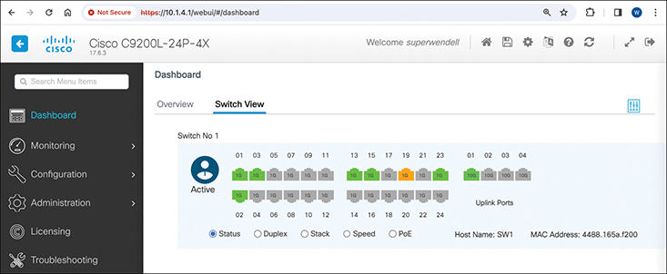

<figcaption>

<strong>图 4-8</strong> <em>Cisco 交换机 Web 界面仪表板：交换机视图</em>

<aside class="hidden" id="a04fig08">

交换机视图详细展示了仪表板的布局和功能，包括导航菜单、状态指示、配置选项和监控工具。用户可以通过直观的图形界面访问端口配置、VLAN 管理、设备诊断和系统监控等功能与设置。Switch 1 标出了活动交换机。

</aside>

</figcaption>

</figure>

注意

本节示例来自运行 IOS XE 17.6.3 版本的 Cisco Catalyst 9200L 交换机，版本信息可见于<a href="#ch04fig08">图 4-8</a> 截图左上角。不过，用户界面的具体细节和左侧菜单中的可用选项，会因设备类型、型号和 IOS 版本而异。因此，本节图片仅用于帮助你大致了解该工具的功能。

WebUI 支持不需要 CLI 知识的直接配置和验证功能。例如，<a href="#ch04fig09">图 4-9</a> 显示用户将鼠标悬停在左侧菜单的 Configuration（配置）上，页面因此展开各种配置选项。此前，用户已经选择 STP 选项，因此截图背景显示了生成树协议（STP）配置页面的一部分。这样，你可以通过图形界面中的指向和点击操作，配置 CCNA 涵盖的部分选项。

<figure class="image-c" id="ch04fig09">

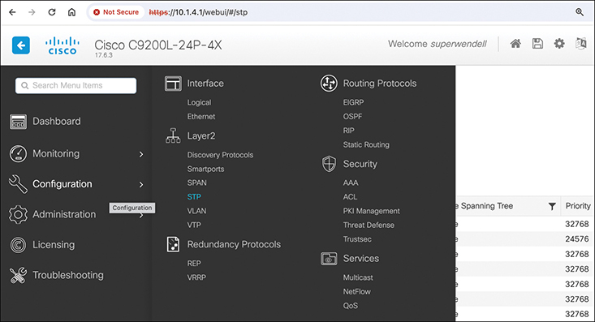

<figcaption>

<strong>图 4-9</strong> <em>交换机 Web 服务器配置菜单中的配置选项</em>

<aside class="hidden" id="a04fig09">

Configuration Options（配置选项）菜单显示多个子菜单，包括 Interface（接口）、Layer 2（第 2 层）、Redundancy Protocols（冗余协议）、Routing Protocols（路由协议）、Security（安全）和 Service（服务）。其中 Layer 2 子菜单被突出显示，且已选择生成树协议（STP）。

</aside>

</figcaption>

</figure>

如果你有可用的 Cisco 交换机或路由器，应花些时间使用 WebUI，浏览其中的配置和验证选项。再次提醒，你的设备可能显示与这些截图不同的布局和选项。

较新版本的 WebUI 无需在用户设备上安装 SSH 或 Telnet 客户端，即可访问 CLI，如<a href="#ch04fig10">图 4-10</a> 所示。导航到正确的页面（<strong>Administration &gt; Command Line Interface</strong>，即“管理 &gt; 命令行界面”）后，在上方输入框中输入 CLI 命令，点击按钮发送到设备，响应消息就会出现在下方输入框中。图中显示的是 <strong>show interfaces status</strong> 命令的输出。

当你没有随身携带自己的设备时，WebUI 可能非常有用。如果安装 SSH 客户端的设备留在办公桌上，而你需要登录几台网络设备，可以借用任意带 Web 浏览器的设备，连接路由器和交换机。虽然 WebUI 很有用，但大多数工程师在 CLI 中工作时，仍偏好使用 SSH 客户端，因为客户端更易用。例如，请注意<a href="#ch04fig10">图 4-10</a> 中命令输出的列对齐较差。SSH 客户端通常不会出现这种对齐问题；这类问题会使输出更难阅读。

<figure class="image-c" id="ch04fig10">

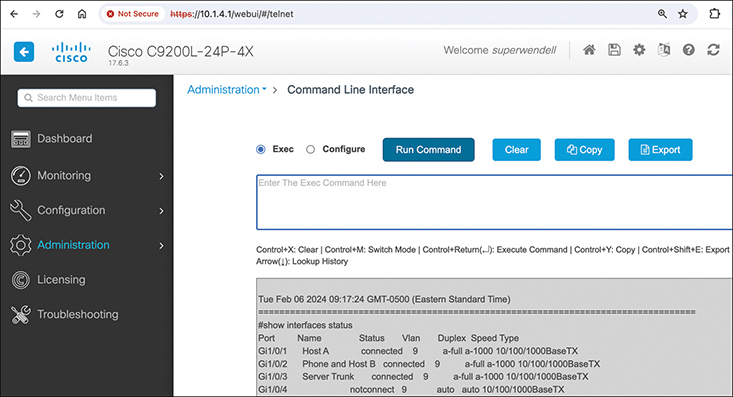

<figcaption>

<strong>图 4-10</strong> <em>通过交换机 Web 服务器界面访问 CLI</em>

<aside class="hidden" id="a04fig10">

Administration Options（管理选项）菜单中显示了 Command Line Interface（CLI）部分。Exec 单选按钮已选中，表示当前选择。页面提供运行命令、清空界面、复制内容和导出数据等按钮。此外，菜单底部显示了通过交换机 Web 服务器界面直接访问 CLI 的代码行。

</aside>

</figcaption>

</figure>

注意

与此相关，Cisco 等厂商还出售功能完善的独立网络管理应用。这些应用通常具有图形界面，全面管理所有可用功能，并通过一个用户界面支持所有设备。相比之下，WebUI 按设备提供基本功能。在《<em>CCNA 200-301 官方认证指南，第 2 卷</em>》第二版的<a data-original-href="vol1_ch22.xhtml#ch22" data-unavailable="true" title="此内容不在当前提取范围内；请参阅原始 EPUB：vol1_ch22.xhtml#ch22">第 22 章</a>《<a data-original-href="vol1_ch22.xhtml#ch22" data-unavailable="true" title="此内容不在当前提取范围内；请参阅原始 EPUB：vol1_ch22.xhtml#ch22">Cisco 软件定义接入（Cisco SD-Access）</a>》中，你将进一步了解其中一种应用：Cisco Catalyst Center。

</section>

</section>

<section>

<h4 class="h4" id="ch04lev2sec3">CLI 帮助功能</h4>

如果把 Cisco IOS 命令参考文档打印出来，纸张堆起来会有数英尺高。没有人应当被要求记住全部命令，也没有人能做到。你可以使用几种简单方便的工具来帮助记忆命令，并节省输入时间。随着 Cisco 认证学习的深入，考试涵盖的命令会越来越多。不过，你应当掌握获取命令帮助的方法。

<a href="#ch04tab03">表 4-3</a> 总结了 CLI 中帮助回忆命令的选项。请注意，第一列中的 <em>command</em> 代表任意命令；同样，<em>parm</em> 代表命令参数。例如，第三行列出 <em>command</em> <strong>?</strong>，意味着 <strong>show ?</strong> 和 <strong>copy ?</strong> 这样的命令，分别会列出 <strong>show</strong> 和 <strong>copy</strong> 命令的帮助。

<figure class="table" id="ch04tab03" tabindex="0">

<figcaption>

<strong>表 4-3</strong> Cisco IOS 软件命令帮助

</figcaption>

<table class="all">

<thead>

<tr>

<th class="th">
输入的内容
</th>

<th class="th">
获得的帮助
</th>

</tr>

</thead>

<tbody>

<tr>

<td class="border">
<strong>?</strong>
</td>

<td class="border">
此选项提供当前模式下所有可用命令的帮助。
</td>

</tr>

<tr>

<td class="border">
<em>command</em> <strong>?</strong>
</td>

<td class="border">
命令与 ? 之间有空格时，交换机列出文本，描述该命令第一个参数的所有选项。
</td>

</tr>

<tr>

<td class="border">
<em>com</em><strong>?</strong>
</td>

<td class="border">
此选项列出以 <strong>com</strong> 开头的命令。
</td>

</tr>

<tr>

<td class="border">
<em>command parm</em><strong>?</strong>
</td>

<td class="border">
此选项列出所有以<strong>目前已输入的参数字符</strong>开头的参数。（请注意，<em>parm</em> 与 <strong>?</strong> 之间没有空格。）
</td>

</tr>

<tr>

<td class="border">
<em>command parm</em>&lt;Tab&gt;
</td>

<td class="border">
按 Tab 键后，IOS 会补全该单词的其余部分，前提是已输入足够多的字符，使得只有一个选项以这串字符开头。
</td>

</tr>

<tr>

<td class="border">
<em>command parm1</em> <strong>?</strong>
</td>

<td class="border">
如果在问号之前插入一个空格，CLI 会列出所有可能的下一个参数，并简要解释各参数。
</td>

</tr>

</tbody>

</table>

</figure>

输入 <strong>?</strong> 时，Cisco IOS CLI 会立即响应，也就是说，不需要按 Enter 或任何其他键。运行 Cisco IOS 的设备还会重新显示你在 <strong>?</strong> 之前输入的内容，以减少按键次数。如果在 <strong>?</strong> 之后立即按 Enter，Cisco IOS 会尝试只使用你目前输入的参数来执行命令。

帮助提供的信息取决于 CLI 模式。例如，在用户模式下输入 <strong>?</strong>，会显示用户模式允许的命令，但不会显示只能在特权模式而不能在用户模式下使用的命令。此外，<a id="key_058" href="#ref-gloss_075">配置模式</a>中也有帮助功能，该模式用于配置交换机。事实上，配置模式包含许多不同的子配置模式，本章稍后的“<a href="#ch04lev2sec5">配置子模式与上下文</a>”一节将进行说明。因此，你也可以获取每种配置子模式中可用命令的帮助。（此时也适合使用配套网站上的免费 Sim Lite 产品：打开任意实验，使用问号，并尝试一些命令。）

Cisco IOS 将输入的命令存储在历史缓冲区中，默认保存十条命令。CLI 允许你在历史命令列表中前后移动，然后在重新执行前编辑命令。这些按键组合可以帮助你在考试中更快地使用 CLI。<a href="#ch04tab04">表 4-4</a> 列出操作先前输入命令的按键。

<figure class="table" id="ch04tab04" tabindex="0">

<figcaption>

<strong>表 4-4</strong> 编辑与调出命令的按键组合

</figcaption>

<table class="all">

<thead>

<tr>

<th class="th">
键盘命令
</th>

<th class="th">
执行效果
</th>

</tr>

</thead>

<tbody>

<tr>

<td class="border">
上箭头或 Ctrl+P
</td>

<td class="border">
显示最近使用的命令。再次按下时，显示次近使用的命令，直到遍历完历史缓冲区。（<em>P</em> 代表 previous，即“前一个”。）
</td>

</tr>

<tr>

<td class="border">
下箭头或 Ctrl+N
</td>

<td class="border">
如果在历史缓冲区中向前回溯过远，这些按键会让你向后移动到较近输入的命令。（<em>N</em> 代表 next，即“下一个”。）
</td>

</tr>

<tr>

<td class="border">
左箭头或 Ctrl+B
</td>

<td class="border">
在当前显示的命令中向后移动光标，但不删除字符。（<em>B</em> 代表 back，即“后退”。）
</td>

</tr>

<tr>

<td class="border">
右箭头或 Ctrl+F
</td>

<td class="border">
在当前显示的命令中向前移动光标，但不删除字符。（<em>F</em> 代表 forward，即“前进”。）
</td>

</tr>

<tr>

<td class="border">
退格键（Backspace）
</td>

<td class="border">
在当前显示的命令中向后移动光标，并删除字符。
</td>

</tr>

</tbody>

</table>

</figure>

</section>

<section>

<h4 class="h4" id="ch04lev2sec4">debug 和 show 命令</h4>

迄今为止，最常用的单个 Cisco IOS 命令是 <strong>show</strong> 命令。<strong>show</strong> 命令有许多选项，通过这些选项，可以查看 Cisco IOS 几乎所有功能的状态。本质上，<strong>show</strong> 命令列出了当前已知的交换机运行状态信息。

例如，看看<a href="#exa4_3">例 4-3</a> 中 <strong>show mac address-table dynamic</strong> 命令的输出。这个从用户模式发出的 <strong>show</strong> 命令，列出交换机用来进行转发决策的表。交换机的 MAC 地址表基本上列出了交换机完成其主要工作所需的数据。

<strong>例 4-3</strong> <em>MAC 地址表示例</em>

<a href="#code-f0103-01" id="f0103-01a">点击此处查看代码原图</a>

<pre class="pre-ex" tabindex="0"><code>Certskills1&gt; <strong>show mac address-table dynamic</strong>

 Mac Address Table

-------------------------------------------

Vlan    Mac Address       Type        Ports

----    -----------       --------    -----

  31    0200.1111.1111    DYNAMIC     Gi0/1

  31    0200.3333.3333    DYNAMIC     Fa0/3

  31    1833.9d7b.0e9a    DYNAMIC     Gi0/1

  10    1833.9d7b.0e9a    DYNAMIC     Gi0/1

  10    30f7.0d29.8561    DYNAMIC     Gi0/1

   1    1833.9d7b.0e9a    DYNAMIC     Gi0/1

  12    1833.9d7b.0e9a    DYNAMIC     Gi0/1

Total Mac Addresses for this criterion: 7

Certskills1&gt;</code></pre>

<strong>debug</strong> 命令也向用户提供交换机运行的详细信息。不过，<strong>show</strong> 命令列出某一时刻的状态信息，更像一张照片；而 <strong>debug</strong> 命令则更像实时视频画面。一旦发出 <strong>debug</strong> 命令，IOS 就会记住，并随着事件不断发生而持续发出消息。任何交换机用户都可以选择接收这些消息，交换机默认将它们发送到控制台。本书用于验证交换机和路由器运行情况的大多数命令，都是 <strong>show</strong> 命令。

</section>

</section>

<section>

<h3 class="h3" id="ch04lev1sec4">配置 Cisco IOS 软件</h3>

即使交换机采用默认配置也能转发流量，你仍然会希望配置企业网络中的每一台交换机。本节介绍基本的配置过程，包括配置文件的概念及其存储位置。虽然本节重点是配置过程，而不是配置命令本身，但除了配置过程，你也应当为考试掌握本章涉及的所有命令。

配置模式接受<em>配置命令</em>，这些命令详细告诉交换机要做什么以及如何执行。用户模式和特权模式接受 EXEC 命令，它们返回输出，或可能执行重新加载交换机等操作，但这些模式中的命令不会改变任何配置设置。<a href="#ch04fig11">图 4-11</a> 展示了配置模式、用户 EXEC 模式和特权 EXEC 模式之间的切换。

在配置模式下输入的命令会更新活动配置文件。<em>每当你在一条命令末尾按下 Enter，配置修改就会立即发生。</em>输入配置命令时务必小心！

<figure class="image-c" id="ch04fig11">

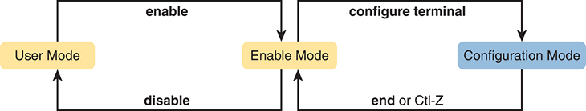

<figcaption>

<strong>图 4-11</strong> <em>CLI 配置模式与 EXEC 模式</em>

<aside class="hidden" id="a04fig11">

用户首先在用户模式中操作。执行 enable 命令后，用户进入 enable 模式，也称特权模式，从而可以使用更高级的配置命令。在特权模式下，用户可以通过 configure terminal 命令进入配置模式，直接配置设备设置。输入 end 或按 Ctrl+Z 可以退出配置模式，返回特权模式。

</aside>

</figcaption>

</figure>

<section>

<h4 class="h4" id="ch04lev2sec5">配置子模式与上下文</h4>

配置模式支持大量命令。为了帮助组织配置，IOS 将某些类别的配置命令归为一组。为此，在使用配置模式时，需要从最初的全局配置模式，进入各个子命令模式。<em>上下文设置命令</em>使你从一个配置子命令模式（或上下文）切换到另一个。这些命令告诉交换机，接下来输入的几条配置命令针对什么主题。更重要的是，上下文告诉交换机你当前关注什么，因此使用 <strong>?</strong> 获取帮助时，交换机只会提供该主题的帮助。

注意

<em>上下文设置</em>并不是 Cisco 的术语，只是这里用来帮助理解配置模式的一种描述。

学习配置子模式的最佳方式是实际使用，但首先请看看接下来的示例。例如，<strong>interface</strong> 命令是最常用的上下文设置配置命令之一。CLI 用户可以输入 <strong>interface FastEthernet 0/1</strong> 配置命令，进入接口配置模式。在接口配置模式下请求帮助，只会显示配置以太网接口时有用的命令。在此上下文中使用的命令称为<em>子命令</em>，在这个具体例子中称为<em>接口子命令</em>。当你开始使用实际设备练习 CLI 时，模式切换会逐渐变得自然。现在先看看<a href="#exa4_4">例 4-4</a>，它展示了以下内容：

<ul class="sq">

<li>
使用 <strong>configure terminal</strong> EXEC 命令，从特权模式进入全局配置模式。
</li>

<li>
使用 <strong>hostname Fred</strong> 全局配置命令，配置交换机名称。在全局配置模式下使用全局命令后，仍停留在全局配置模式。
</li>

<li>
使用 <strong>line console 0</strong> 命令，从全局配置模式进入控制台线路配置模式。<strong>line</strong> 命令也是少数几个将你带到另一子模式的上下文设置命令之一。
</li>

<li>
使用 <strong>password hope</strong> 线路子命令，将控制台的简单密码设为 <strong>hope</strong>。在某个子模式中使用子命令后，命令提示符仍停留在该子模式。
</li>

<li>
使用 <strong>interface</strong> <em>type number</em> 命令，从控制台配置模式进入接口配置模式。<strong>interface</strong> 命令也是少数几个将你带到另一子模式的上下文设置命令之一。
</li>

<li>
使用 <strong>speed 100</strong> 接口子命令，将 Fa0/1 接口速率设为 100 Mbps。
</li>

<li>
使用 <strong>exit</strong> 命令，从接口配置模式返回全局配置模式。
</li>

</ul>

<strong>例 4-4</strong> <em>在不同配置模式之间切换</em>

<a href="#code-f0105-01" id="f0105-01a">点击此处查看代码原图</a>

<pre class="pre-ex" tabindex="0"><code>Switch# <strong>configure terminal</strong>

Switch(config)# <strong>hostname Fred</strong>

Fred(config)# <strong>line console 0</strong>

Fred(config-line)# <strong>password hope</strong>

Fred(config-line)# <strong>interface FastEthernet 0/1</strong>

Fred(config-if)# <strong>speed 100</strong>

Fred(config-if)# <strong>exit</strong>

Fred(config)#</code></pre>

命令提示符括号中的文本标识当前配置模式。例如，进入配置模式后的第一个提示符显示 (config)，表示全局配置模式。执行 <strong>line console 0</strong> 命令后，文本变为 (config-line)，表示线路配置模式。在配置模式内，每当命令提示符改变，就说明你进入了另一种配置模式。

<a href="#ch04tab05">表 4-5</a> 展示了最常见的配置模式提示符、模式名称，以及进入这些模式的上下文设置命令。

<figure class="table" id="ch04tab05" tabindex="0">

<figcaption>

<strong>表 4-5</strong> 常见的交换机配置模式

</figcaption>

<table class="all">

<thead>

<tr>

<th class="th">
提示符
</th>

<th class="th">
模式名称
</th>

<th class="th">
进入该模式的上下文设置命令
</th>

</tr>

</thead>

<tbody>

<tr>

<td class="border">
hostname(config)#
</td>

<td class="border">
全局
</td>

<td class="border">
无；执行 <strong>configure terminal</strong> 后首先进入的模式
</td>

</tr>

<tr>

<td class="border">
hostname(config-line)#
</td>

<td class="border">
线路
</td>

<td class="border">
<strong>line console 0</strong>

<strong>line vty 0 15</strong>
</td>

</tr>

<tr>

<td class="border">
hostname(config-if)#
</td>

<td class="border">
接口
</td>

<td class="border">
<strong>interface</strong> <em>type number</em>
</td>

</tr>

<tr>

<td class="border">
hostname(config-vlan)#
</td>

<td class="border">
VLAN
</td>

<td class="border">
<strong>vlan</strong> <em>number</em>
</td>

</tr>

</tbody>

</table>

</figure>

你应当通过练习，熟练地在不同配置模式之间切换，返回特权模式，再进入配置模式。不过，在完成本书后续章节主题的实验时，也可以学会这些技能。目前，<a href="#ch04fig12">图 4-12</a> 展示了全局配置模式与<a href="#ch04tab05">表 4-5</a> 所列四种配置子模式之间的大部分切换关系。

<figure class="image-c" id="ch04fig12">

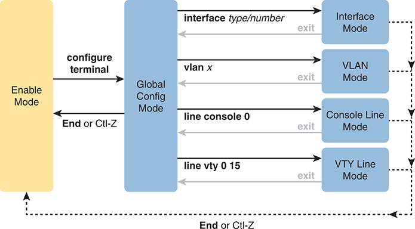

<figcaption>

<strong>图 4-12</strong> <em>进入和退出交换机配置模式</em>

<aside class="hidden" id="a04fig12">

用户进入特权模式后，可以使用更高级的配置命令。从特权模式中，通过 configure terminal 命令可以进入全局配置模式，进行设备的全局配置。输入 end 或按 Ctrl+Z 可以退出全局配置模式，返回特权模式。此外，还可以从全局配置模式使用对应命令，进入具体的接口、VLAN、控制台线路或 VTY 线路模式，在相应层级进行配置。退出这些模式时，会返回全局配置模式。

</aside>

</figcaption>

</figure>

你确实应当停下来，试着在这些配置模式之间切换。如果还没有确定实验方案，可以安装配套网站上的 Pearson Sim Lite 软件，其中包含模拟器和几个实验练习。启动任意实验，暂不理会实验说明，直接进入配置模式，在<a href="#ch04fig12">图 4-12</a> 所示的配置模式之间切换。

没有固定规则规定哪些命令是全局命令、哪些是子命令。相反，你需要在学习新命令时，了解它是否是全局命令；如果是子命令，还要了解所需的模式。不过，一般而言，Cisco 用全局命令设置适用于整个交换机的选项，而用子命令设置适用于某个组件或功能的选项。例如：

全局命令 <strong>hostname</strong> 为整台交换机设置唯一的主机名。

接口子命令 <strong>speed</strong> 配置某个具体接口的设置，因此只能在接口配置子模式中使用。

</section>

<section>

<h4 class="h4" id="ch04lev2sec6">存储交换机配置文件</h4>

配置交换机后，交换机需要使用这些配置。它还必须能够在断电时保留配置。Cisco 交换机包含随机存取存储器（RAM），用于存储 Cisco IOS 正在使用的数据，但交换机断电或重新加载时，RAM 中的内容会丢失。为了保存断电或重新加载后仍须保留的信息，Cisco 交换机使用几种更持久的存储器，这些存储器都没有活动部件。通过避免使用带活动部件的组件（例如传统磁盘驱动器），交换机能够维持更长的正常运行时间和更高的可用性。

下面列出 Cisco 交换机中的四种主要存储器，以及每种存储器最常见的用途：

<ul class="sq">

<li>
<strong>RAM：</strong>有时称为 DRAM，即动态随机存取存储器。交换机使用 RAM 的方式与其他计算机一样，将其作为工作存储器。运行（活动）配置文件存储在这里。
</li>

<li>
<strong>闪存：</strong>可以是交换机内部的芯片，也可以是可移除存储卡。闪存存储功能完整的 Cisco IOS 映像，是交换机启动时获取 Cisco IOS 的默认位置。闪存也可用于保存其他文件，包括配置文件的备份。
</li>

<li>
<strong>ROM：</strong>只读存储器（ROM）存储引导程序（或引导辅助程序），交换机刚通电时会加载该程序。引导程序随后查找完整的 Cisco IOS 映像，并管理将 Cisco IOS 加载到 RAM 的过程；之后，Cisco IOS 接管交换机的运行。
</li>

<li>
<strong>NVRAM：</strong>非易失性 RAM（NVRAM）存储初始或启动配置文件，交换机首次通电或重新加载时使用该文件。
</li>

</ul>

<a href="#ch04fig13">图 4-13</a> 以更简洁、更便于记忆和学习的形式，总结了相同的信息。

<figure class="image-c" id="ch04fig13">

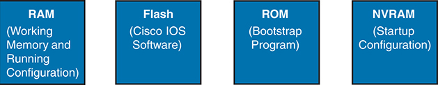

<figcaption>

<strong>图 4-13</strong> <em>Cisco 交换机存储器类型</em>

<aside class="hidden" id="a04fig13">

RAM 即随机存取存储器，作为工作存储器，在设备运行期间保存运行配置。闪存存储 Cisco IOS 软件，即交换机操作系统。ROM 即只读存储器，包含启动交换机所必需的引导程序。NVRAM 即非易失性 RAM，保存启动配置，确保重新启动后配置设置仍然保留。

</aside>

</figcaption>

</figure>

Cisco IOS 将配置命令的集合存储在<em>配置文件</em>中。事实上，交换机使用多个配置文件：一个保存通电时使用的初始配置，另一个保存当前正在使用、存储在 RAM 中的活动运行配置。<a href="#ch04tab06">表 4-6</a> 列出了这两个文件的名称、用途和存储位置。

<figure class="table" id="ch04tab06" tabindex="0">

<figcaption>

<strong>表 4-6</strong> 两个主要 Cisco IOS 配置文件的名称与用途

</figcaption>

<table class="all">

<thead>

<tr>

<th class="th">
配置文件名
</th>

<th class="th">
用途
</th>

<th class="th">
存储位置
</th>

</tr>

</thead>

<tbody>

<tr>

<td class="border">
startup-config
</td>

<td class="border">
保存交换机每次重新加载 Cisco IOS 时所使用的初始配置。
</td>

<td class="border">
NVRAM
</td>

</tr>

<tr>

<td class="border">
running-config
</td>

<td class="border">
保存当前使用的配置命令。当有人在配置模式中输入命令时，该文件会动态变化。
</td>

<td class="border">
RAM
</td>

</tr>

</tbody>

</table>

</figure>

本质上，使用配置模式时，你只会修改<a id="key_063" href="#ref-gloss_357">运行配置文件（running-config）</a>。这意味着本章前面的配置示例（<a href="#exa4_4">例 4-4</a>）只更新了 running-config 文件。不过，如果交换机在该示例之后立即断电，所有这些配置都会丢失。如果希望保留这些配置，必须将 running-config 文件复制到 NVRAM，覆盖旧的<a id="key_065" href="#ref-gloss_373">启动配置文件（startup-config）</a>。

<a href="#exa4_5">例 4-5</a> 展示了配置模式中的命令只会修改 RAM 中的运行配置。该示例包含以下概念和步骤：

第 1 步。示例开始时，运行配置和启动配置使用相同的主机名，均由 <strong>hostname hannah</strong> 命令指定。

第 2 步。在配置模式中使用 <strong>hostname harold</strong> 命令修改主机名。

第 3 步。<strong>show running-config</strong> 和 <strong>show startup-config</strong> 命令显示，两个配置中的主机名现在不同，<strong>hostname harold</strong> 命令只存在于 running-config 中。

<strong>例 4-5</strong> <em>配置模式命令如何修改 Running-Config 文件，而不修改 Startup-Config 文件</em>

<a href="#code-f0108-01" id="f0108-01a">点击此处查看代码原图</a>

<pre class="pre-ex" tabindex="0"><code>! Step 1 next (two commands)

!

hannah# <strong>show running-config</strong>

! (lines omitted)

hostname hannah

! (rest of lines omitted)

hannah# <strong>show startup-config</strong>

! (lines omitted)

hostname hannah

! (rest of lines omitted)

! Step 2 next. Notice that the command prompt changes immediately after

! the <strong>hostname</strong> command.

hannah# <strong>configure terminal</strong>

hannah(config)# <strong>hostname harold</strong>

harold(config)# <strong>exit</strong>

! Step 3 next (two commands)

!

harold# <strong>show running-config</strong>

! (lines omitted) - just showing the part with the <strong>hostname</strong> command

hostname harold

!

harold# <strong>show startup-config</strong>

! (lines omitted) - just showing the part with the <strong>hostname</strong> command

hostname hannah</code></pre>

</section>

<section>

<h4 class="h4" id="ch04lev2sec7">复制与擦除配置文件</h4>

配置过程更新 running-config 文件，而路由器断电或重新加载时，该文件会丢失。显然，IOS 需要提供一种方法来复制运行配置，使其不会丢失，并能在交换机下次重新加载或通电时使用。例如，<a href="#exa4_5">例 4-5</a> 结束时，运行配置包含 <strong>hostname harold</strong> 命令，与启动配置不同。

简而言之，<strong>copy running-config startup-config</strong> EXEC 命令将 running-config 备份到 startup-config 文件。该命令用当前 running-config 文件中的内容，覆盖现有 startup-config 文件。

此外，在实验中，你可能希望删除所有现有配置，从空白配置重新开始。为此，可以使用三种不同的命令来擦除 startup-config 文件：

<pre class="pre" tabindex="0"><code><strong>write erase</strong>

<strong>erase startup-config</strong>

<strong>erase nvram:</strong></code></pre>

擦除 startup-config 文件后，可以重新加载交换机，或关闭再接通电源；交换机将使用现在为空的启动配置进行启动。

请注意，Cisco IOS 没有直接擦除 running-config 文件内容的命令。要清空 running-config 文件，只需先擦除 startup-config 文件，再 <strong>reload</strong>（重新加载）交换机；过程结束时，running-config 就为空了。

注意

Cisco 使用 <em>reload</em> 一词，指代大多数 PC 操作系统中称为重新引导或重新启动的操作。两者都是重新初始化软件。<strong>reload</strong> EXEC 命令会使交换机重新加载。

</section>

</section>

</section>

<section class="ccna-source ccna-appendix" aria-label="答案解析与术语表">
<section data-epub-type="chapter">

<h2 class="h2" id="ref-appc">附录 C</h2>

<h2 class="h2a">“这些知识我已经掌握了吗？”自测题答案</h2>

<section>

<h3 class="h3" id="ref-appclev1sec4">第 4 章</h3>

<strong><a id="ref-ques4_1" href="#quess4_1">1</a>。</strong>A 和 B。题目中的命令是一条 EXEC 命令，只要求用户模式访问权限，因此在用户模式和特权模式下都可以使用。由于它是 EXEC 命令，不能在配置模式中按题目所示的形式使用。请注意，在配置模式中，可以在 EXEC 命令前加上 <strong>do</strong>（例如 <strong>do show mac address-table</strong>），从任意配置模式内部执行该命令。

<strong><a id="ref-ques4_2" href="#quess4_2">2</a>。</strong>B。题目中的 <strong>reload</strong> 命令是一条要求特权模式（也称 enable 模式）的 EXEC 命令。它在用户模式下不可用。请注意，在配置模式中，可以在 EXEC 命令前加上 <strong>do</strong>（例如 <strong>do reload</strong>），从任意配置模式内部执行该命令。

<strong><a id="ref-ques4_3" href="#quess4_3">3</a>。</strong>B。SSH 提供安全的远程登录方式，加密所有数据流，包括密码交换。Telnet 则以明文发送所有数据，包括密码。

<strong><a id="ref-ques4_4" href="#quess4_4">4</a>。</strong>A。交换机和路由器将当前使用的配置保存在 RAM 中，并使用 NVRAM 保存下次加载 IOS 时要加载的配置文件。

<strong><a id="ref-ques4_5" href="#quess4_5">5</a>。</strong>F。startup-config 文件位于 NVRAM 中，running-config 文件位于 RAM 中。

<strong><a id="ref-ques4_6" href="#quess4_6">6</a>。</strong>B 和 C。<strong>exit</strong> 命令使用户向全局配置模式方向返回一级；如果已经处于全局配置模式，则返回特权模式。从控制台模式执行时，它会返回全局配置模式。无论当前处于哪种配置子模式，<strong>end</strong> 命令和 Ctrl+Z 组合键都会使用户返回特权模式。

</section>

</section>

<section id="ref-glossary"><h2 class="h2a">术语表</h2>
<strong>CLI</strong> 命令行界面。允许用户通过输入命令及可选参数，与操作系统交互的界面。

<strong>命令行界面（command-line interface）</strong> <em>参见</em><a href="#ref-gloss_072">CLI</a>。

<strong>配置模式（configuration mode）</strong> Cisco IOS 软件 CLI 的一部分，用户可以在其中输入配置命令，这些命令随后被添加到设备当前使用的配置文件（running-config）中。

<strong>特权模式（enable mode）</strong> Cisco IOS CLI 的一部分，用户可以在其中使用路由器或交换机上功能最强、也可能造成中断的命令，包括进入配置模式并重新配置路由器。

<strong>互联网络操作系统（Internetwork Operating System）</strong> Cisco 路由器和交换机的操作系统，提供路由器或交换机的大部分功能，其余功能由硬件提供。

<strong>IOS</strong> <em>参见</em><a href="#ref-gloss_200">互联网络操作系统</a>。

<strong>IOS XE</strong> 一种 Cisco 操作系统，采用基于 Linux 的现代多任务软件架构，用作许多企业级局域网交换机和路由器产品的操作系统。

<strong>反转线缆（rollover cable）</strong> 连接 Cisco 设备的 RJ-45 控制台端口而非 USB 控制台端口时，用于用户 PC 与控制台端口之间的电缆类型。UTP 反转线缆采用八针反转线序，将引脚 1 接到引脚 8，引脚 2 接到引脚 7，依此类推。

<strong>运行配置文件（running-config file）</strong> Cisco IOS 交换机和路由器中位于 RAM 的文件名称，保存设备当前使用的配置。

<strong>安全外壳协议（Secure Shell，SSH）</strong> TCP/IP 应用层协议，支持客户端与服务器之间的终端仿真，使用动态密钥交换和加密来保障通信私密性。

<strong>启动配置文件（startup-config file）</strong> Cisco IOS 交换机和路由器中位于 NVRAM 的文件名称，保存设备下次重新加载或通电时，要加载到 RAM 并作为运行配置文件使用的配置。

<strong>Telnet</strong> TCP/IP 协议栈中的标准终端仿真应用层协议。Telnet 用于远程终端连接，使用户能够登录远程系统并使用其资源，就像连接到本地系统一样。Telnet 定义于 RFC 854。

<strong>用户模式（user mode）</strong> 路由器或交换机用户界面的一种模式，用户只能输入不会造成中断的 EXEC 命令，通常只能查看当前状态，不能修改运行设置。

</section>
</section>

<section class="ccna-source ccna-appendix" aria-label="代码原图">
<section data-epub-type="chapter">

<h2 id="code-ch04_images">代码片段</h2>

许多书籍包含程序代码或配置示例。为了优化这些内容的显示，请使用单栏横向模式阅读电子书，并将字号调至最小。除了以可重排文本格式呈现代码和配置，我们还提供了仿照纸质书排版的代码图片。因此，当可重排格式可能影响代码列表的呈现时，你会看到“点击此处查看代码原图”链接。点击链接，即可查看保持纸质书排版的代码图片。要返回之前浏览的页面，请点击设备或应用程序的返回按钮。

<a href="#f0097-01a" id="code-f0097-01">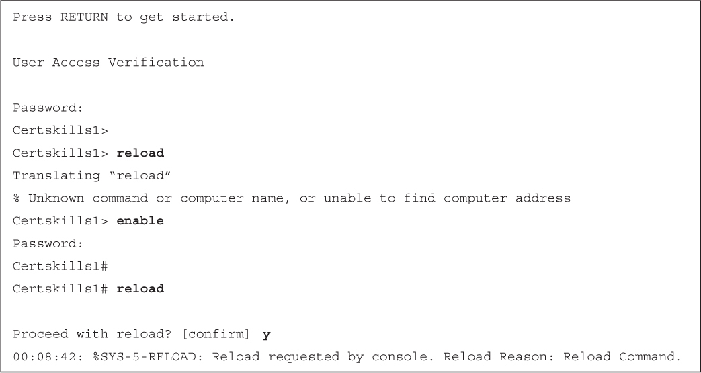</a>

<a href="#f0098-01a" id="code-f0098-01">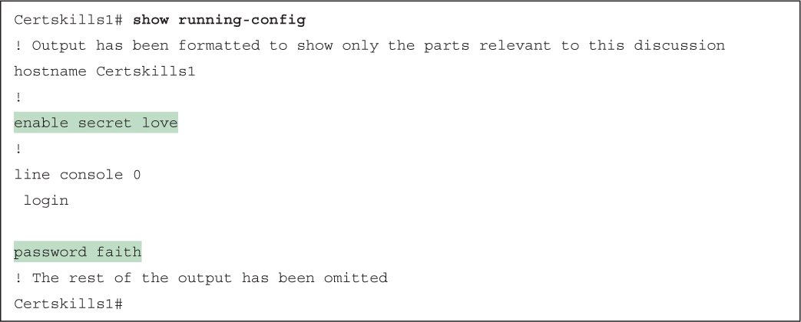</a>

<a href="#f0103-01a" id="code-f0103-01">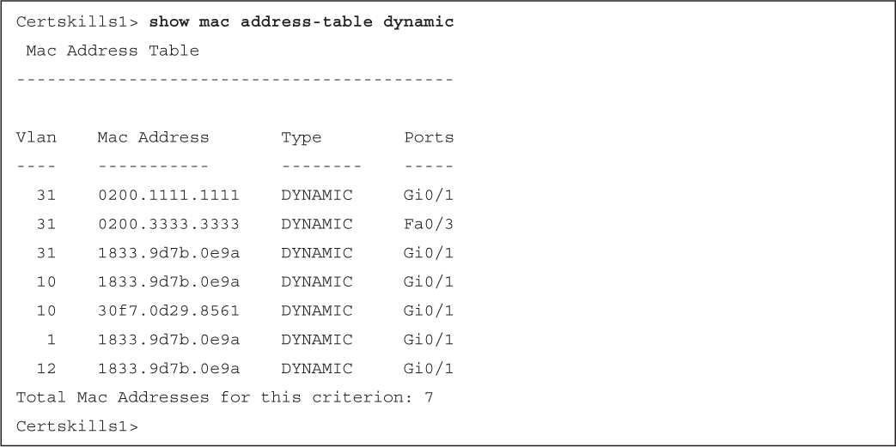</a>

<a href="#f0105-01a" id="code-f0105-01">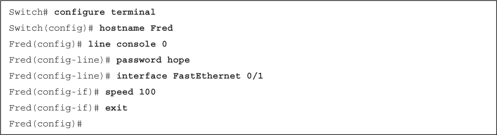</a>

<a href="#f0108-01a" id="code-f0108-01">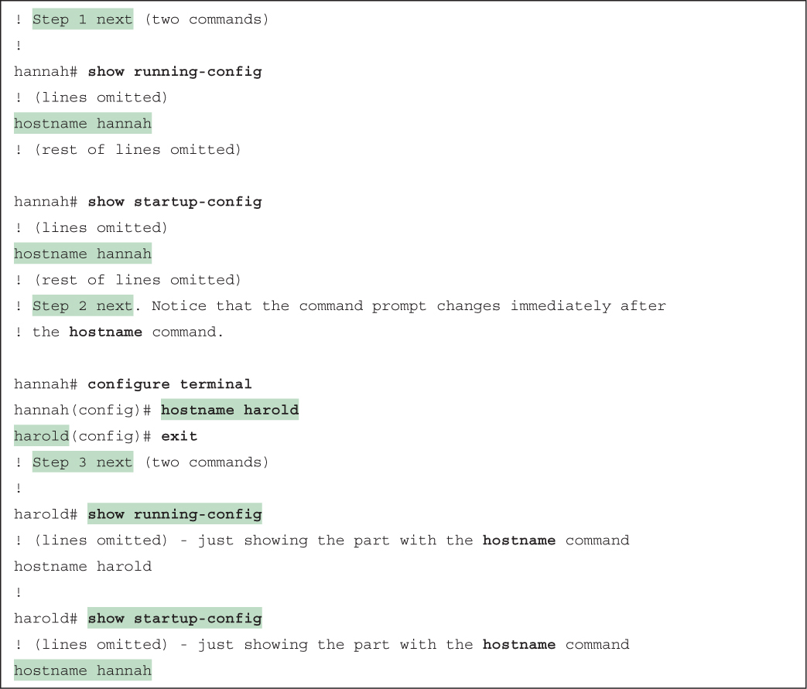</a>

</section>

</section>


<nav class="ccna-chapter-nav" aria-label="章节导航"><a href="v1-03.html">← 上一章</a><a href="v1-05.html">下一章 →</a></nav>
