
<a href="{{ '/subjects/CCNA/' | relative_url }}">← 返回 CCNA 目录</a>

第一卷 · 实现以太网局域网

<nav class="ccna-chapter-nav" aria-label="章节导航"><a href="v1-04.html">← 上一章</a><a href="v1-06.html">下一章 →</a></nav>



<section data-epub-type="chapter">

<h2 class="h2" id="ch05">第 5 章</h2>

<h2 class="h2a">分析以太网局域网交换</h2>

本章涵盖以下考试主题：

1.0 网络基础

1.1 解释网络组件的角色和功能

1.1.b 二层交换机和三层交换机

1.13 描述交换概念

1.13.a MAC 地址学习与老化

1.13.b 帧交换

1.13.c 帧泛洪

1.13.d MAC 地址表

2.0 网络接入

2.5 解释生成树协议的基本操作

购买 Cisco Catalyst 以太网交换机后，交换机就已经可以工作。你只需将它从包装箱中取出，用电源线连接交换机和电源插座使其通电，再使用正确的非屏蔽双绞线（UTP）将主机连接到交换机。不需要配置其他任何内容，也不需要连接控制台并登录，甚至无需进行任何操作：交换机会直接开始转发以太网帧。

在本书<a href="#part02">第 II 部分</a>中，你将学习如何构建、配置和验证以太网局域网的运行。在<a href="v1-04.html#ch04">第 4 章</a>《<a href="v1-04.html#ch04">使用命令行界面</a>》中，你已学习如何在 CLI 中切换、发出命令和配置交换机。本章通过解释交换机转发以太网帧时使用的逻辑，在这个学习过程中迈出简短但重要的一步。

本章分为两个主要部分。第一部分回顾并进一步展开局域网交换背后的概念，这些概念已在<a href="v1-02.html#ch02">第 2 章</a>《<a href="v1-02.html#ch02">以太网局域网基础</a>》中初步介绍。第二部分使用 IOS <strong>show</strong> 命令，验证 Cisco 交换机是否确实学习了 MAC 地址、建立了 MAC 地址表并转发了帧。

<section>

<h3 class="h3" id="ch05lev1sec1">自测</h3>

如果你希望根据得分决定在本章投入多少时间，可以完成这组自测题（在此作答，或使用 PTP 软件）。各题答案的选项字母列在自测题之后的页面底部。书末和配套网站上的<a href="#ref-appc">附录 C</a>都包含答案及解析。你也可以在 PTP 测试软件中找到答案及解析。

<figure class="table" id="ch05tab01" tabindex="0">

<figcaption>

<strong>表 5-1</strong> 自测：基础知识小节与题目对应关系

</figcaption>

<table class="all">

<thead>

<tr>

<th class="th">
基础知识小节
</th>

<th class="th">
题目
</th>

</tr>

</thead>

<tbody>

<tr>

<td class="border">
局域网交换概念
</td>

<td class="border">
1–4
</td>

</tr>

<tr>

<td class="border">
验证与分析以太网交换
</td>

<td class="border">
5–6
</td>

</tr>

</tbody>

</table>

</figure>

<strong><a id="quess5_1" href="#ques5_1a">1</a>。</strong>以下哪项描述了交换机决定如何转发一个发往已知单播 MAC 地址的帧时，所执行的部分过程？

<ol class="lower-alpha">

<li>
将单播目的地址与桥接表（即 MAC 地址表）比较。
</li>

<li>
将单播源地址与桥接表（即 MAC 地址表）比较。
</li>

<li>
从同一 VLAN 中除入接口以外的所有接口转发该帧。
</li>

<li>
将目的 IP 地址与目的 MAC 地址比较。
</li>

<li>
将帧的入接口与 MAC 地址表中的源 MAC 地址条目比较。
</li>

</ol>

<strong><a id="quess5_2" href="#ques5_2a">2</a>。</strong>某局域网交换机按照默认设置，将所有接口分配给 VLAN 1。对于收到的目的 MAC 地址为 FFFF.FFFF.FFFF 的帧，以下哪项最准确地描述了它的转发逻辑？

<ol class="lower-alpha">

<li>
从交换机的所有端口转发该帧。
</li>

<li>
从交换机除接收端口以外的所有端口转发该帧。
</li>

<li>
从此前已注册并请求接收广播的所有端口转发该帧。
</li>

<li>
丢弃该帧。
</li>

</ol>

<strong><a id="quess5_3" href="#ques5_3a">3</a>。</strong>对于发往未知单播地址的帧，以下哪项最准确地描述了交换机的处理方式？

<ol class="lower-alpha">

<li>
从同一 VLAN 中除入接口以外的所有接口转发。
</li>

<li>
从 MAC 地址表中匹配条目所标识的唯一接口转发该帧。
</li>

<li>
将目的 IP 地址与目的 MAC 地址比较。
</li>

<li>
将帧的入接口与 MAC 地址表中的源 MAC 地址条目比较。
</li>

</ol>

<strong><a id="quess5_4" href="#ques5_4a">4</a>。</strong>交换机决定是否将新的 MAC 地址添加到 MAC 地址表时，会执行以下哪种比较？

<ol class="lower-alpha">

<li>
将单播目的地址与桥接表（即 MAC 地址表）比较。
</li>

<li>
将单播源地址与桥接表（即 MAC 地址表）比较。
</li>

<li>
将 VLAN ID 与桥接表（即 MAC 地址表）比较。
</li>

<li>
将目的 IP 地址的 ARP 缓存条目与桥接表（即 MAC 地址表）比较。
</li>

</ol>

<strong><a id="quess5_5" href="#ques5_5a">5</a>。</strong>一台 Cisco Catalyst 交换机有 24 个 10/100 端口，编号从 0/1 到 0/24。十台 PC 连接到编号最小的十个端口，这些 PC 正常工作并通过网络发送数据。其他端口未连接任何设备。以下哪个答案列出了 <strong>show interfaces status</strong> 命令显示的事实？

<ol class="lower-alpha">

<li>
Ethernet 0/1 端口处于 connected 状态。
</li>

<li>
Fast Ethernet 0/11 端口处于 connected 状态。
</li>

<li>
Fast Ethernet 0/5 端口处于 connected 状态。
</li>

<li>
Ethernet 0/15 端口处于 notconnected 状态。
</li>

</ol>

<strong><a id="quess5_6" href="#ques5_6a">6</a>。</strong>请看以下 Cisco Catalyst 交换机输出：

<a href="#code-f0114-01" id="f0114-01a">点击此处查看代码原图</a>

<pre class="pre-q" tabindex="0"><code class="highlight">SW1# <strong>show mac address-table dynamic</strong>
          Mac Address Table
-------------------------------------------

Vlan    Mac Address       Type        Ports
----    -----------       --------    -----
   1    02AA.AAAA.AAAA    DYNAMIC     Gi0/1
   1    02BB.BBBB.BBBB    DYNAMIC     Gi0/2
   1    02CC.CCCC.CCCC    DYNAMIC     Gi0/3
Total Mac Addresses for this criterion: 3</code></pre>

以下关于该交换机的哪个答案正确？

<ol class="lower-alpha">

<li>
输出证明 Gi0/2 端口直接连接到使用地址 02BB.BBBB.BBBB 的设备。
</li>

<li>
交换机自通电以来总共学习了三个 MAC 地址。
</li>

<li>
列出的三个 MAC 地址，是根据交换机所转发帧中的目的 MAC 地址学习到的。
</li>

<li>
地址 02CC.CCCC.CCCC 是从进入 Gi0/3 端口的某个帧的源 MAC 地址学习到的。
</li>

</ol>

自测答案：

<strong><a id="ques5_1a" href="#ref-ques5_1">1</a></strong> A

<strong><a id="ques5_2a" href="#ref-ques5_2">2</a></strong> B

<strong><a id="ques5_3a" href="#ref-ques5_3">3</a></strong> A

<strong><a id="ques5_4a" href="#ref-ques5_4">4</a></strong> B

<strong><a id="ques5_5a" href="#ref-ques5_5">5</a></strong> C

<strong><a id="ques5_6a" href="#ref-ques5_6">6</a></strong> D

</section>

<section>

<h3 class="h3box" id="ch05lev1sec2">基础知识</h3>

</section>

<section>

<h3 class="h3" id="ch05lev1sec3">局域网交换概念</h3>

现代以太网局域网将用户设备和服务器连接到一些交换机，再将交换机互连，有时采用<a href="#ch05fig01">图 5-1</a> 这样的设计。局域网中称为园区局域网的部分，为终端用户群体提供支持，如图左侧所示。终端用户设备连接到局域网交换机，后者再连接其他交换机，从而形成通往网络其他部分的路径。园区局域网交换机位于靠近终端用户的配线间内。右侧，为用户提供信息的服务器也连接到局域网。这些服务器和交换机通常位于称为<em>数据中心</em>的封闭房间内，并与园区局域网连接，承载往返用户的流量。

<figure class="image-c" id="ch05fig01">

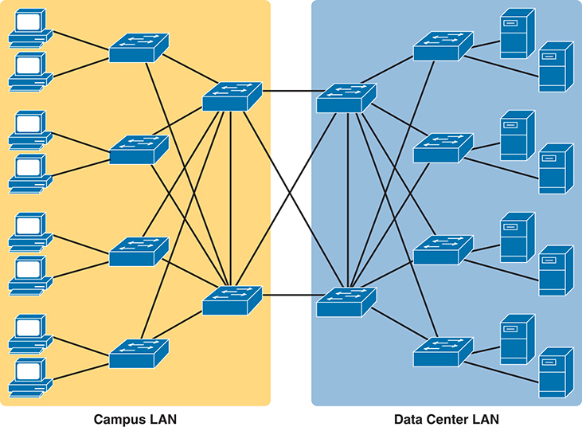

<figcaption>

<strong>图 5-1</strong> <em>园区局域网与数据中心局域网的概念图</em>

<aside class="hidden" id="a05fig01">

园区局域网包含大学、企业园区或类似环境中的网络基础设施，为计算机和打印机等设备之间的通信提供支持。数据中心局域网侧重于集中式数据中心设施内的网络基础设施，支持数据和应用的存储、处理与分发。

</aside>

</figcaption>

</figure>

为了将流量从用户设备转发到服务器再返回，每台交换机都独立执行相同类型的逻辑。本章前半部分将讨论这些逻辑，包括交换机如何选择转发以太网帧、何时选择不转发帧等。

<section>

<h4 class="h4" id="ch05lev2sec1">交换逻辑概述</h4>

归根结底，局域网交换机的作用是转发以太网帧。局域网由用户设备、服务器和其他连接到交换机的设备组成，而交换机之间又互相连接。局域网交换机有一个主要任务：将帧转发到正确的目的 MAC 地址。为实现这一目标，交换机使用基于每个帧的以太网首部中源 MAC 地址和目的 MAC 地址的逻辑。

局域网交换机收到以太网帧后，会作出交换决策：从某些其他端口转发该帧，或忽略该帧。为完成这一主要任务，交换机执行三项操作：

<ol class="number">

<li>
根据目的 MAC 地址，决定何时转发帧，何时过滤（不转发）帧。
</li>

<li>
通过学习收到的每个帧的源 MAC 地址，为转发后续帧做好准备。
</li>

<li>
使用生成树协议（STP），与所有交换机协作，防止帧无限循环。
</li>

</ol>

第一项操作是交换机的主要工作，后两项则是辅助功能。

注意

本书在讨论局域网交换机时，<em>交换机端口</em>和<em>交换机接口</em>是同义词。

接下来关于以太网交换的大多数讨论和示意图，都关注首部中始终存在的目的 MAC 地址和源 MAC 地址字段。两个字段的长度均为 6 字节（本书以 12 个十六进制数字表示），是本节所讨论交换逻辑的关键部分。有关首部的详细讨论以及以太网帧其他部分的更多信息，请回顾<a href="v1-02.html#ch02">第 2 章</a>的“<a href="v1-02.html#ch02lev2sec11">以太网数据链路协议</a>”一节。<a href="#ch05fig02">图 5-2</a> 在此再次展示帧格式，供参考。

<figure class="image-c" id="ch05fig02">

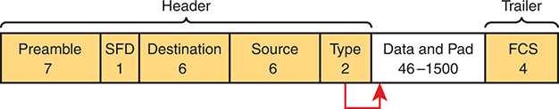

<figcaption>

<strong>图 5-2</strong> <em>IEEE 802.3 以太网帧的一种形式</em>

<aside class="hidden" id="a05fig02">

帧的首部部分包含目的地址（6 字节）、类型（2 字节）、帧起始定界符（SFD，1 字节）和源地址（6 字节），其前面是用于同步的前导码（7 字节）。首部之后是数据与填充部分，长度为 46 至 1500 字节，用于容纳有效载荷数据。最后，帧以帧校验序列（FCS，4 字节）和尾部结束，以确保传输过程中数据的完整性。

</aside>

</figcaption>

</figure>

现在开始详细介绍以太网交换的工作方式！

</section>

<section>

<h4 class="h4" id="ch05lev2sec2">转发已知单播帧</h4>

为了决定是否转发帧，交换机使用一张动态建立的表，其中列出 MAC 地址和出接口。交换机将帧的目的 MAC 地址与此表比较，决定应转发该帧，还是直接忽略它。例如，看看<a href="#ch05fig03">图 5-3</a> 中的简单网络，其中 Fred 向 Barney 发送一个帧。

<figure class="image-c" id="ch05fig03">

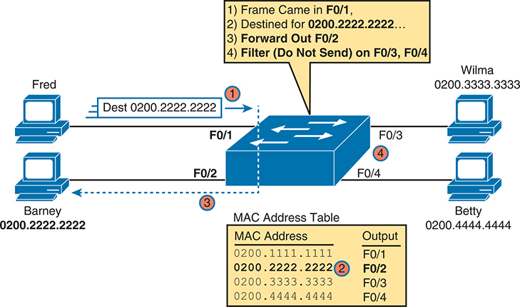

<figcaption>

<strong>图 5-3</strong> <em>交换机转发与过滤决策示例</em>

<aside class="hidden" id="a05fig03">

Fred 发出的帧以 0200.2222.2222 为目的 MAC 地址，到达 F0/1 端口后，从 F0/2 端口转发，而过滤操作阻止其从 F0/3 和 F0/4 发送。Wilma 和 Barney 的 MAC 地址分别为 0200.3333.3333 和 0200.2222.2222，对应的转发端口分别是 F0/4 和 F0/2。Betty 的 MAC 地址为 0200.4444.4444，对应 F0/3 出端口。图中详细列出 MAC 地址与对应出端口，展示交换机在帧转发和过滤方面的决策过程，这对高效管理网络流量至关重要。

</aside>

</figcaption>

</figure>

在图中，Fred 发送一个目的地址为 0200.2222.2222（Barney 的 MAC 地址）的帧。交换机将目的 MAC 地址（0200.2222.2222）与 MAC 地址表比较，匹配到加粗的表项。该匹配条目告诉交换机，只从 F0/2 端口转发此帧，不从其他端口转发。

注意

交换机的<a id="key_072" href="#ref-gloss_252">MAC 地址表</a>也称<em>交换表</em>、<em>桥接表</em>，甚至称为<em>内容可寻址存储器（CAM）表</em>；最后一种名称指的是存储该表所使用的物理存储器类型。

交换机的 MAC 地址表列出每个 MAC 地址相对于该交换机的位置。在由多台交换机组成的局域网中，每台交换机根据自己的 MAC 地址表独立作出转发决策。它们共同转发帧，使帧最终到达目的地。

例如，<a href="#ch05fig04">图 5-4</a> 展示 Fred 向 Wilma 发送帧时的第一次交换决策，目的 MAC 地址为 0200.3333.3333。与前一幅图相比，拓扑发生了变化：这次有两台交换机，Fred 和 Wilma 连接到不同的交换机。<a href="#ch05fig04">图 5-4</a> 展示第一台交换机收到 Fred 原始帧后的处理逻辑。基本过程是：交换机从 F0/1 端口收到帧，在 MAC 地址表中找到目的 MAC 地址 0200.3333.3333，看到出端口为 G0/1，于是 SW1 从 G0/1 端口转发该帧。

<figure class="image-c" id="ch05fig04">

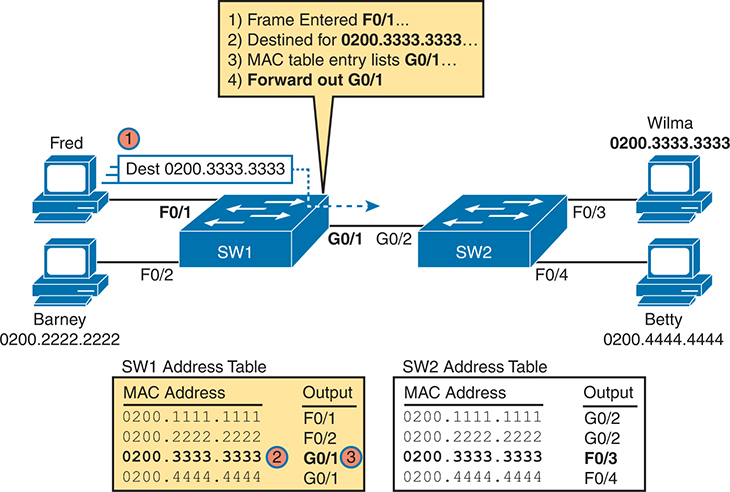

<figcaption>

<strong>图 5-4</strong> <em>两台交换机的转发决策：第一台交换机</em>

<aside class="hidden" id="a05fig04">

Fred 发出的帧以 0200.3333.3333 为目的 MAC 地址，进入 F0/1 端口，再从交换机 1 的 G0/1 端口转发。类似地，MAC 地址为 0200.2222.2222 的 Barney 进入 F0/2 端口，再从交换机 1 的 G0/2 端口转发。Wilma 和 Betty 的 MAC 地址分别为 0200.3333.3333 和 0200.4444.4444，分别从交换机 2 的 F0/3 和 F0/4 端口转发。两台交换机的地址表展示 MAC 地址及对应出端口，说明各交换机如何作出转发决策，以保证网络内高效传输数据。

</aside>

</figcaption>

</figure>

同一个帧经 SW1 转发后，到达交换机 SW2，并进入 SW2 的 G0/2 接口。如<a href="#ch05fig05">图 5-5</a> 所示，SW2 执行相同的逻辑步骤，但使用自己的表。MAC 地址表只列出该交换机自身的转发指示。在本例中，SW2 根据自己的 MAC 地址表，从 F0/3 端口转发该帧。

<figure class="image-c" id="ch05fig05">

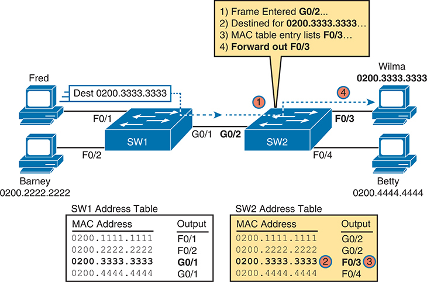

<figcaption>

<strong>图 5-5</strong> <em>两台交换机的转发决策：第二台交换机</em>

<aside class="hidden" id="a05fig05">

Fred 发出的帧以 0200.3333.3333 为目的 MAC 地址，进入 F0/1 端口，再从交换机 2 的 F0/3 端口转发。类似地，MAC 地址为 0200.2222.2222 的 Barney 进入 F0/2 端口，再从交换机 2 的 F0/4 端口转发。Wilma 和 Betty 的 MAC 地址分别为 0200.3333.3333 和 0200.4444.4444，分别从交换机 2 的 F0/3 和 F0/4 端口转发。两台交换机的地址表展示 MAC 地址及对应出端口，说明各交换机如何作出转发决策，以保证网络内高效传输数据。

</aside>

</figcaption>

</figure>

注意

<em>转发与过滤决策</em>一词强调：交换机选择从某些端口转发帧，同时不从其他端口转发（即过滤）该帧。

目前为止的示例中，交换机恰好拥有包含全部 MAC 地址的 MAC 地址表。因此，帧中的目的 MAC 地址对交换机而言是已知的。这些帧称为<a id="key_071" href="#ref-gloss_222">已知单播帧</a>，或简称已知单播，因为目的地址是单播地址，而且该目的地已知。正如这些示例所示，交换机只从一个端口转发已知单播帧，即该 MAC 地址所对应 MAC 表条目中列出的端口。

</section>

<section>

<h4 class="h4" id="ch05lev2sec3">学习 MAC 地址</h4>

幸运的是，网络工作人员不必手动输入所有 MAC 地址表条目。交换机会执行其第二项主要功能：学习 MAC 地址及接口，并将其放入地址表。有了完整的 MAC 地址表，交换机就能如前面所述，作出准确的转发和过滤决策。

交换机通过侦听收到的帧，并检查帧中的<em>源 MAC 地址</em>来建立地址表。如果某帧进入交换机，而其源 MAC 地址尚不在 MAC 地址表中，交换机就会创建一个表项。该条目列出帧进入的接口。交换机的学习逻辑就是这么简单。

<a href="#ch05fig06">图 5-6</a> 使用与<a href="#ch05fig03">图 5-3</a> 相同的单交换机拓扑，但此时交换机还没有建立任何地址表条目。图中展示此网络发送的前两个帧：先是 Fred 发给 Barney 的帧，然后是 Barney 发给 Fred 的响应。

<figure class="image-c" id="ch05fig06">

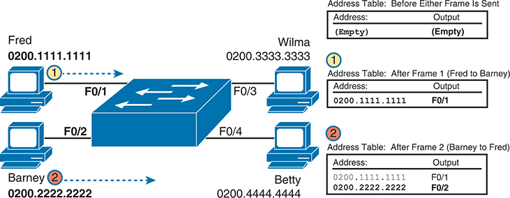

<figcaption>

<strong>图 5-6</strong> <em>交换机学习：从空表开始添加两个条目</em>

<aside class="hidden" id="a05fig06">

图中包含交换机上的两个初始条目：MAC 地址为 0200.1111.1111 的 Fred 连接 F0/1 端口，MAC 地址为 0200.2222.2222 的 Barney 连接 F0/2 端口。随后，MAC 地址为 0200.3333.3333 的 Wilma 加入 F0/3，MAC 地址为 0200.4444.4444 的 Betty 加入 F0/4。最初为空的地址表随着帧的发送逐步填充。在发送任何帧之前，地址表保持为空。帧 1（Fred 发给 Barney）之后，地址表记录 Fred 的 MAC 地址，并将其对应到 F0/1 端口。帧 2（Barney 发给 Fred）之后，表中同时包含 Fred 和 Barney 的 MAC 地址，分别对应各自的端口 F0/1 和 F0/2。

</aside>

</figcaption>

</figure>

图中没有用线条展示帧的流向，而是重点展示帧进入交换机的过程。

请关注学习过程，以及图右侧每一步中 MAC 地址表如何增长。交换机以空 MAC 表开始，如图右上方所示。随后，Fred 向 Barney 发送第一个帧（标为“1”），交换机便添加一条记录，将 Fred 的 MAC 地址 0200.1111.1111 与接口 F0/1 关联。为什么是 F0/1？因为 Fred 发送的帧进入了交换机的 F0/1 端口。SW1 的逻辑大致如下：“源 MAC 地址是 0200.1111.1111，帧从 F0/1 进入，所以从我的角度看，0200.1111.1111 一定可以通过我的 F0/1 端口到达。”

继续这个示例，当 Barney 在第 2 步回复时，交换机添加第二个条目，将 Barney 的 MAC 地址 0200.2222.2222 与接口 F0/2 关联。为什么是 F0/2？因为 Barney 发送的帧进入了交换机的 F0/2 接口。学习始终通过查看帧中的源 MAC 地址进行，并将入接口添加为关联端口。

</section>

<section>

<h4 class="h4" id="ch05lev2sec4">泛洪未知单播帧和广播帧</h4>

现在再次把注意力转向转发过程，使用<a href="#ch05fig05">图 5-5</a> 中的拓扑。你认为，当 MAC 地址表中没有任何条目时，交换机会如何处理 Fred 的第一个帧？实际上，当表中没有匹配条目时，交换机会通过称为<em>泛洪</em>的过程，从除入接口之外的所有接口<a id="key_070" href="#ref-gloss_148">转发</a>该帧。目的地址对交换机而言未知的帧，称为<a id="key_074" href="#ref-gloss_424">未知单播帧</a>，或简称<em>未知单播</em>。

交换机会<a id="key_069" href="#ref-gloss_147">泛洪</a>未知单播帧。泛洪意味着交换机从收到帧的端口以外的所有端口，转发该帧的副本。其思想很简单：如果不知道应发送到哪里，就发送到所有地方，以交付这个帧。顺便说一句，目的设备随后很可能发送回复；这样，交换机就能学习该设备的 MAC 地址，之后便可把帧作为已知单播帧，仅从一个端口转发。

交换机还会泛洪局域网<a id="key_068" href="#ref-gloss_053">广播帧</a>，即发往以太网广播地址 FFFF.FFFF.FFFF 的帧，因为这个过程有助于将帧的副本交付给局域网中的所有设备。

<a href="#ch05fig07">图 5-7</a> 展示与<a href="#ch05fig06">图 5-6</a> 相同的场景：交换机 MAC 表为空时，Fred 发送第一个帧；不过，这次重点是交换机的转发。在第 1 步，Fred 发送帧。在第 2 步，交换机从其他三个接口分别泛洪一个帧副本。

<figure class="image-c" id="ch05fig07">

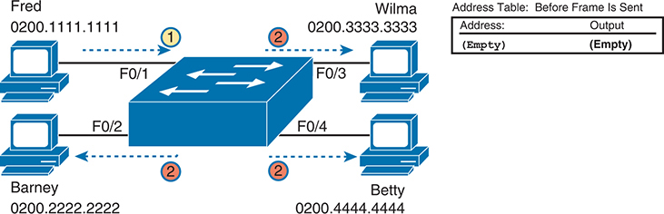

<figcaption>

<strong>图 5-7</strong> <em>交换机泛洪：未知单播帧到达后，从其他端口泛洪</em>

<aside class="hidden" id="a05fig07">

图中展示交换机上的初始条目：MAC 地址为 0200.1111.1111 的 Fred 连接 F0/1 端口，MAC 地址为 0200.2222.2222 的 Barney 连接 F0/2 端口。随后，MAC 地址为 0200.3333.3333 的 Wilma 加入 F0/3，MAC 地址为 0200.4444.4444 的 Betty 加入 F0/4。最初为空的地址表仍然没有条目。

</aside>

</figcaption>

</figure>

</section>

<section>

<h4 class="h4" id="ch05lev2sec5">使用生成树协议避免环路</h4>

局域网交换机的第三项主要功能是环路防护，由<a id="key_073" href="#ref-gloss_369">生成树协议（STP）</a>实现。如果没有 STP，在具有物理冗余链路的以太网中，任何被泛洪的帧都会无限期循环。为防止帧循环，STP 阻止某些端口转发帧，使任意两个局域网网段之间只存在一条活动路径。

一个简单示例可以更清楚地说明为什么需要 STP。请记住，交换机会泛洪未知单播帧和广播帧。<a href="#ch05fig08">图 5-8</a> 展示 Larry 发给 Bob 的一个未知单播帧；由于网络有冗余而没有 STP，该帧会永远循环。请注意，为了减少图中的杂乱，图只展示一个方向的循环；实际上，另一个帧副本也会沿反方向循环。

<figure class="image-c" id="ch05fig08">

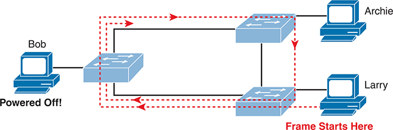

<figcaption>

<strong>图 5-8</strong> <em>具有冗余链路但没有 STP 的网络：帧永远循环</em>

</figcaption>

</figure>

泛洪会使这个帧绕着三台交换机循环；由于各交换机的地址表中都没有 Bob 的 MAC 地址，因此每台交换机都会泛洪该帧。虽然泛洪是转发未知单播和广播的有效机制，但图中这种持续泛洪流量帧的情况，会使局域网完全拥塞，直至无法使用。

像<a href="#ch05fig08">图 5-8</a> 这样具有冗余链路的拓扑是有益的，但需要避免循环帧带来的负面影响。为避免第 2 层环路，所有交换机都需要使用 STP。STP 使交换机的每个接口最终处于阻塞状态或转发状态。<em>阻塞</em>表示接口不能转发或接收数据帧；<em>转发</em>则表示接口可以发送和接收数据帧。如果恰当地阻塞一部分接口，每对局域网之间就只存在一条当前活动的逻辑路径。

本书<a data-original-href="vol1_ch09.xhtml#ch09" data-unavailable="true" title="此内容不在当前提取范围内；请参阅原始 EPUB：vol1_ch09.xhtml#ch09">第 9 章</a>《<a data-original-href="vol1_ch09.xhtml#ch09" data-unavailable="true" title="此内容不在当前提取范围内；请参阅原始 EPUB：vol1_ch09.xhtml#ch09">生成树协议概念</a>》将深入讨论 STP，包括它如何防止环路。

</section>

<section>

<h4 class="h4" id="ch05lev2sec6">局域网交换小结</h4>

交换机使用第 2 层逻辑，检查以太网数据链路首部，以决定如何处理帧。具体来说，交换机进行帧转发和过滤决策、学习 MAC 地址，并使用 STP 避免环路，过程如下：

第 1 步。交换机根据目的 MAC 地址转发帧：

<ol class="step-lower-alpha">

<li>
如果目的 MAC 地址是广播、组播或未知目的单播地址（未列在 MAC 表中的单播地址），交换机会泛洪该帧。
</li>

<li>
如果目的 MAC 地址是已知单播地址（MAC 表中存在的单播地址）：

<ol class="step-lower-roman">

<li>
如果 MAC 地址表中列出的出接口与接收该帧的接口不同，交换机从该出接口转发此帧。
</li>

<li>
如果出接口与接收该帧的接口相同，交换机会过滤此帧，也就是直接忽略它，不进行转发。
</li>

</ol></li>

</ol>

第 2 步。交换机根据源 MAC 地址学习 MAC 地址表条目：

<ol class="step-lower-alpha">

<li>
对于收到的每个帧，记录源 MAC 地址和入接口 ID。
</li>

<li>
如果该地址尚不在 MAC 地址表中，则添加一个列出该 MAC 地址和入接口的条目。
</li>

</ol>

第 3 步。交换机使用 STP，通过使某些接口阻塞来防止环路；阻塞意味着这些接口不发送或接收帧。

</section>

</section>

<section>

<h3 class="h3" id="ch05lev1sec4">验证与分析以太网交换</h3>

Cisco Catalyst 交换机出厂时就已准备好交换帧。你只需连接电源线，插入以太网电缆，交换机就会开始交换收到的帧。将多台交换机连接在一起，它们也已准备好在交换机之间转发帧。这种默认行为的主要原因，是交换机的默认设置。

Cisco Catalyst 交换机之所以能够立即开始交换帧，是因为具有以下默认设置：

<ul class="sq">

<li>
接口默认启用，连接电缆后即可开始工作。
</li>

<li>
所有接口都分配给 VLAN 1。
</li>

<li>
10/100 和 10/100/1000 接口默认使用自动协商。
</li>

<li>
MAC 地址学习、转发和泛洪逻辑默认全部生效。
</li>

<li>
STP 默认启用。
</li>

</ul>

本章第二部分将考察交换机在这些默认设置下的工作方式，并展示如何验证以太网的学习和转发过程。

<section>

<h4 class="h4" id="ch05lev2sec7">演示 MAC 地址学习</h4>

要查看交换机的 MAC 地址表，使用 <strong>show mac address-table</strong> 命令。不添加其他参数时，该命令列出 MAC 表中的所有已知 MAC 地址，包括一些可以忽略的、用于辅助功能的静态 MAC 地址。如果只想查看动态学习到的 MAC 地址，则使用 <strong>show mac address-table dynamic</strong> 命令，如<a href="#exa5_1">例 5-1</a> 所示。

<strong>例 5-1</strong> <em><a href="#ch05fig09">图 5-9</a> 对应的 <strong>show mac address-table dynamic</strong> 输出</em>

<a href="#code-f0122-01" id="f0122-01a">点击此处查看代码原图</a>

<pre class="pre-ex" tabindex="0"><code class="highlight">SW1# <strong>show mac address-table dynamic</strong>
          Mac Address Table
-------------------------------------------

Vlan    Mac Address       Type        Ports
----    -----------       --------    -----
   1    0200.1111.1111    DYNAMIC     Fa0/1
   1    0200.2222.2222    DYNAMIC     Fa0/2
   1    0200.3333.3333    DYNAMIC     Fa0/3
   1    0200.4444.4444    DYNAMIC     Fa0/4
Total Mac Addresses for this criterion: 4
SW1#</code></pre>

首先关注表中的两列：MAC Address（MAC 地址）和 Ports（端口）。这些值应当很熟悉，因为它们与前面的单交换机示例一致，这里再次以<a href="#ch05fig09">图 5-9</a> 展示。请注意列出的四个 MAC 地址及其匹配端口，与图中所示相同。

<figure class="image-c" id="ch05fig09">

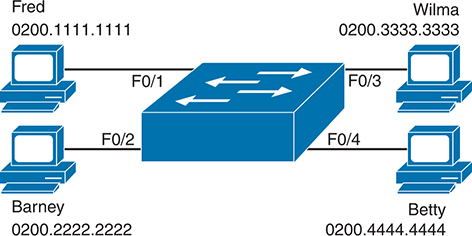

<figcaption>

<strong>图 5-9</strong> <em>验证部分使用的单交换机拓扑</em>

<aside class="hidden" id="a05fig09">

图中条目显示，MAC 地址为 0200.1111.1111 的 Fred 连接到 F0/1，MAC 地址为 0200.2222.2222 的 Barney 连接到 F0/2。此外，MAC 地址为 0200.3333.3333 的 Wilma 连接到 F0/3，MAC 地址为 0200.4444.4444 的 Betty 连接到 F0/4。

</aside>

</figcaption>

</figure>

接下来，看看输出表头中的 Type（类型）字段。该列告诉我们交换机如何学习 MAC 地址，正如本章前面所述。在本例中，交换机动态学习了所有 MAC 地址。你也可以通过包括端口安全在内的几种功能，静态预定义 MAC 表条目；这些条目在 Type 列中会显示为 Static。

最后，输出中的 VLAN 列让我们有机会简要讨论虚拟局域网（VLAN）如何影响交换逻辑。局域网交换机在 VLAN 内部转发以太网帧。这意味着，如果一个帧从 VLAN 1 中的端口进入，交换机只会从 VLAN 1 中的其他端口转发或泛洪该帧，而不会从分配给其他 VLAN 的端口发出。<a data-original-href="vol1_ch08.xhtml#ch08" data-unavailable="true" title="此内容不在当前提取范围内；请参阅原始 EPUB：vol1_ch08.xhtml#ch08">第 8 章</a>《<a data-original-href="vol1_ch08.xhtml#ch08" data-unavailable="true" title="此内容不在当前提取范围内；请参阅原始 EPUB：vol1_ch08.xhtml#ch08">实现以太网虚拟局域网</a>》将详细介绍交换机使用 VLAN 时如何转发帧。

</section>

<section>

<h4 class="h4" id="ch05lev2sec8">交换机接口</h4>

第一个示例假设交换机和电缆已正确安装，且交换机接口正常工作。使用 <strong>show interfaces status</strong> 命令，可以轻松检查这些接口的状态，如<a href="#exa5_2">例 5-2</a> 所示。

<strong>例 5-2</strong> <em>交换机 SW1 上的 <strong>show interfaces status</strong> 输出</em>

<a href="#code-f0123-01" id="f0123-01a">点击此处查看代码原图</a>

<pre class="pre-ex" tabindex="0"><code class="highlight">SW1# <strong>show interfaces status</strong>

Port      Name               Status      Vlan       Duplex  Speed  Type
Fa0/1                        connected   1          a-full  a-100 10/100BaseTX
Fa0/2                        connected   1          a-full  a-100 10/100BaseTX
Fa0/3                        connected   1          a-full  a-100 10/100BaseTX
Fa0/4                        connected   1          a-full  a-100 10/100BaseTX
Fa0/5                        notconnect  1          auto     auto 10/100BaseTX
Fa0/6                        notconnect  1          auto     auto 10/100BaseTX
Fa0/7                        notconnect  1          auto     auto 10/100BaseTX
Fa0/8                        notconnect  1          auto     auto 10/100BaseTX
Fa0/9                        notconnect  1          auto     auto 10/100BaseTX
Fa0/10                       notconnect  1          auto     auto 10/100BaseTX
Fa0/11                       notconnect  1          auto     auto 10/100BaseTX
Fa0/12                       notconnect  1          auto     auto 10/100BaseTX
Fa0/13                       notconnect  1          auto     auto 10/100BaseTX
Fa0/14                       notconnect  1          auto     auto 10/100BaseTX
Fa0/15                       notconnect  1          auto     auto 10/100BaseTX
Fa0/16                       notconnect  1          auto     auto 10/100BaseTX
Fa0/17                       notconnect  1          auto     auto 10/100BaseTX
Fa0/18                       notconnect  1          auto     auto 10/100BaseTX
Fa0/19                       notconnect  1          auto     auto 10/100BaseTX
Fa0/20                       notconnect  1          auto     auto 10/100BaseTX
Fa0/21                       notconnect  1          auto     auto 10/100BaseTX
Fa0/22                       notconnect  1          auto     auto 10/100BaseTX
Fa0/23                       notconnect  1          auto     auto 10/100BaseTX
Fa0/24                       notconnect  1          auto     auto 10/100BaseTX
Gi0/1                        notconnect  1          auto     auto 10/100/1000BaseTX
Gi0/2                        notconnect  1          auto     auto 10/100/1000BaseTX</code></pre>

先关注 Port（端口）列。请记住，Cisco Catalyst 交换机根据端口所支持的最高速率标准来命名端口，因此本例交换机有 24 个名为 FastEthernet 的接口，以及 2 个名为 GigabitEthernet 的接口。许多命令会缩写这些名称，本例用 Fa 表示 FastEthernet，用 Gi 表示 GigabitEthernet。（该示例恰好来自一台具有 24 个 10/100 端口和 2 个 10/100/1000 端口的 Cisco Catalyst 交换机。）

Status（状态）列当然用于说明端口状态。本例中，实验交换机只有 F0/1–F0/4 端口连接了电缆和设备，其他端口未连接电缆。因此，前四个端口处于 connected 状态，表示端口连接了电缆并正常工作。notconnect 状态表示端口尚未正常运行，可能没有连接电缆，也可能存在其他问题。（<a href="v1-07.html#ch07">第 7 章</a>《<a href="v1-07.html#ch07">配置与验证交换机接口</a>》中的“<a href="v1-07.html#ch07lev1sec5">分析交换机接口状态与统计信息</a>”一节，将详细讨论导致交换机接口故障的原因。）

注意

可以通过几种方式查看单个接口的状态。例如，对于 F0/1，<strong>show interfaces f0/1 status</strong> 命令会像<a href="#exa5_2">例 5-2</a> 一样，以单行输出列出状态。<strong>show interfaces f0/1</strong> 命令不带 <strong>status</strong> 关键字时，则会显示有关该接口的一组详细消息。

<strong>show interfaces</strong> 命令有大量选项。其中 <strong>counters</strong> 选项列出接口接收和发送帧的统计信息，具体包括单播、组播和广播帧在入站和出站两个方向上的数量，以及这些帧的总字节数。<a href="#exa5_3">例 5-3</a> 再次以 F0/1 接口为例展示输出。

<strong>例 5-3</strong> <em>交换机 SW1 上的 <strong>show interfaces f0/1 counters</strong> 输出</em>

<a href="#code-f0124-01" id="f0124-01a">点击此处查看代码原图</a>

<pre class="pre-ex" tabindex="0"><code class="highlight">SW1# <strong>show interfaces f0/1 counters</strong>

Port            InOctets    InUcastPkts      InMcastPkts      InBcastPkts
Fa0/1            1223303          10264              107               18

Port           OutOctets    OutUcastPkts    OutMcastPkts     OutBcastPkts
Fa0/1            3235055           13886           22940              437</code></pre>

</section>

<section>

<h4 class="h4" id="ch05lev2sec9">查找 MAC 地址表条目</h4>

只有一台交换机、四台主机连接到它时，你可以直接阅读 MAC 地址表，找到想看的信息。不过，在大量主机和交换机互联的实际网络中，仅靠阅读输出来寻找一个 MAC 地址可能很困难。表中可能有数百条记录，输出占据一页又一页，而每个 MAC 地址看起来都像一串随机的十六进制字符。（本书使用容易识别的 MAC 地址，以方便学习。）

幸运的是，Cisco IOS 为 <strong>show mac address-table</strong> 命令提供了更多选项，使查找单个条目更容易。首先，如果知道 MAC 地址，就可以搜索它：只需在命令末尾输入该 MAC 地址，如<a href="#exa5_4">例 5-4</a> 所示。你只需加上 <strong>address</strong> 关键字，后跟实际 MAC 地址。如果该地址存在，输出就会列出它。请注意，输出的信息和格式完全相同，只是仅列出匹配 MAC 地址的那一行。

<strong>例 5-4</strong> <em>带 <strong>address</strong> 关键字的 <strong>show mac address-table dynamic</strong> 命令</em>

<a href="#code-f0125-01" id="f0125-01a">点击此处查看代码原图</a>

<pre class="pre-ex" tabindex="0"><code class="highlight">SW1# <strong>show mac address-table dynamic</strong> <strong>address 0200.1111.1111</strong>
          Mac Address Table
-------------------------------------------

Vlan    Mac Address       Type        Ports
----    -----------       --------    -----
   1    0200.1111.1111    DYNAMIC     Fa0/1
Total Mac Addresses for this criterion: 1</code></pre>

虽然这些信息很有用，但排障工程师往往不知道网络所连接设备的 MAC 地址。相反，你可能正看着网络拓扑图排障，希望查看从某个端口学习到的全部 MAC 地址。IOS 通过 <strong>show mac address-table dynamic interface</strong> 命令提供这一功能。<a href="#exa5_5">例 5-5</a> 以交换机 SW1 的 F0/1 接口为例进行展示。

<strong>例 5-5</strong> <em>带 <strong>interface</strong> 关键字的 <strong>show mac address-table dynamic</strong> 命令</em>

<a href="#code-f0125-02" id="f0125-02a">点击此处查看代码原图</a>

<pre class="pre-ex" tabindex="0"><code class="highlight">SW1# <strong>show mac address-table dynamic</strong> <strong>interface fastEthernet 0/1</strong>
          Mac Address Table
-------------------------------------------

Vlan    Mac Address       Type        Ports
----    -----------       --------    -----
   1    0200.1111.1111    DYNAMIC     Fa0/1
Total   Mac Addresses for this criterion: 1</code></pre>

最后，你可能还想查找某个 VLAN 的 MAC 地址表条目。你猜对了：可以添加 <strong>vlan</strong> 参数，后跟 VLAN 编号。<a href="#exa5_6">例 5-6</a> 展示<a href="#ch05fig09">图 5-9</a> 中同一台交换机 SW1 的两个例子：一个查询四台设备所在的 VLAN 1，另一个查询不存在的 VLAN 2。

<strong>例 5-6</strong> <em><strong>show mac address-table vlan</strong> 命令</em>

<a href="#code-f0125-03" id="f0125-03a">点击此处查看代码原图</a>

<pre class="pre-ex" tabindex="0"><code class="highlight">SW1# <strong>show mac address-table dynamic</strong> <strong>vlan 1</strong>
          Mac Address Table
-------------------------------------------

Vlan    Mac Address       Type        Ports
----    -----------       --------    -----
   1    0200.1111.1111    DYNAMIC     Fa0/1

   1    0200.2222.2222    DYNAMIC     Fa0/2
   1    0200.3333.3333    DYNAMIC     Fa0/3
   1    0200.4444.4444    DYNAMIC     Fa0/4
Total Mac Addresses for this criterion: 4
SW1#
SW1# <strong>show mac address-table dynamic vlan 2</strong>
          Mac Address Table
-------------------------------------------

Vlan    Mac Address       Type        Ports
----    -----------       --------    -----
SW1#</code></pre>

</section>

<section>

<h4 class="h4" id="ch05lev2sec10">管理 MAC 地址表：老化与清除</h4>

本章最后将介绍交换机管理 MAC 地址表的几个要点。MAC 地址不会无限期保留在表中。交换机会因为条目老化或表已满而移除条目，你也可以使用命令手动移除。

首先，对于 MAC 表条目的老化，交换机会移除在指定秒数内未被使用的条目，默认是 300 秒。为此，交换机为每个 MAC 表条目维护一个随时间增加的计时器。不过，当交换机再次收到具有相同源 MAC 地址的帧时，会将计时器重置为 0。没有被重置的计时器持续增长，一旦达到老化时间设置，交换机就会移除相应 MAC 表条目。

<a href="#exa5_7">例 5-7</a> 展示整台交换机的老化计时器设置。可以使用全局配置命令 <strong>mac address-table aging-time</strong> <em>time-in-seconds</em> <strong>[vlan</strong> <em>vlan-number</em><strong>]</strong>，在全局或单个 VLAN 范围内，将老化时间配置为其他值。该示例全部采用默认设置，全局老化时间为 300 秒，没有为单独 VLAN 设置覆盖值。

<strong>例 5-7</strong> <em>显示 MAC 地址默认老化计时器</em>

<a href="#code-f0126-01" id="f0126-01a">点击此处查看代码原图</a>

<pre class="pre-ex" tabindex="0"><code class="highlight">SW1# <strong>show mac address-table</strong> <strong>aging-time</strong>
Global Aging Time:  300
Vlan    Aging Time
----    ----------
SW1#

SW1# <strong>show mac address-table count</strong>

Mac Entries for Vlan 1:
---------------------------
Dynamic Address Count  : 4
Static  Address Count  : 0
Total Mac Addresses    : 4

Total Mac Address Space Available: 7299</code></pre>

如果地址表已满，各交换机也会移除最旧的条目，即使它们尚未达到老化时间。MAC 地址表使用内容可寻址存储器（CAM），这是一种具有出色表查询能力的物理存储器。不过，表的大小取决于具体交换机型号中 CAM 的容量，以及交换机上的一些可配置设置。当交换机尝试添加新的 MAC 表条目却发现表已满时，会移除最旧条目以腾出空间。作为参考，<a href="#exa5_7">例 5-7</a> 末尾列出一台 Cisco Catalyst 交换机的 MAC 表容量，约为 8000 条：已有的仍是前面示例中的四条，还能容纳 7299 条。

最后，可以使用 <strong>clear mac address-table dynamic</strong> 命令，移除 MAC 地址表中的动态条目。请注意，本章中的 <strong>show</strong> 命令可以在用户模式和特权模式执行，而 <strong>clear</strong> 命令则是特权模式命令。该命令也允许通过参数限制要清除的条目类型，具体如下：

<ul class="sq">

<li>
<strong>按 VLAN：clear mac address-table dynamic vlan</strong> <em>vlan-number</em>
</li>

<li>
<strong>按接口：clear mac address-table dynamic interface</strong> <em>interface-id</em>
</li>

<li>
<strong>按 MAC 地址：clear mac address-table dynamic address</strong> <em>mac-address</em>
</li>

</ul>

</section>

<section>

<h4 class="h4" id="ch05lev2sec11">多台交换机中的 MAC 地址表</h4>

最后，为使讨论完整，再思考一个多交换机示例，有助于强调 MAC 地址学习、转发和泛洪如何在每台局域网交换机上独立发生。

请看<a href="#ch05fig10">图 5-10</a> 中的拓扑，并特别注意端口编号。这里有意选择端口，使两台交换机在本例中使用的端口编号互不相同。也就是说，SW2 确实有 F0/1 和 F0/2 端口，但制作此示例时，我没有把设备接到这些端口。另请注意，所有端口都属于 VLAN 1；与本章其他示例一样，除了交换机主机名之外，其余全部使用默认配置。

<figure class="image-c" id="ch05fig10">

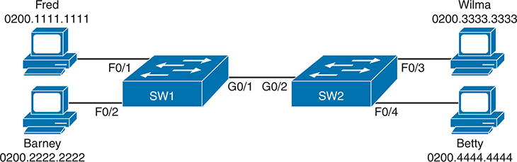

<figcaption>

<strong>图 5-10</strong> <em>双交换机拓扑示例</em>

<aside class="hidden" id="a05fig10">

图中条目显示，MAC 地址为 0200.1111.1111 的 Fred 连接到 SW1 的 F0/1，MAC 地址为 0200.2222.2222 的 Barney 连接到 SW1 的 F0/2。交换机 SW1 和 SW2 通过 G0/1 与 G0/2 端口互连。MAC 地址为 0200.3333.3333 的 Wilma 连接到 SW1 的 F0/3，MAC 地址为 0200.4444.4444 的 Betty 连接到 SW2 的 F0/4。

</aside>

</figcaption>

</figure>

设想两台交换机都学习到了全部四个 MAC 地址。例如，当左侧主机与右侧主机通信时，就会发生这种情况。SW1 的 MAC 地址表会列出自己的端口编号 F0/1、F0/2 和 G0/1，因为 SW1 用这些信息决定自己应从哪里转发帧。同样，SW2 的 MAC 表会列出自己的端口编号，在本例中为 F0/3、F0/4 和 G0/2。<a href="#exa5_8">例 5-8</a> 展示了此情形下两台交换机的 MAC 地址表。

<strong>例 5-8</strong> <em>两台交换机上的 MAC 地址表</em>

<a href="#code-f0128-01" id="f0128-01a">点击此处查看代码原图</a>

<pre class="pre-ex" tabindex="0"><code class="highlight">SW1# <strong>show mac address-table dynamic</strong>
          Mac Address Table
-------------------------------------------

Vlan    Mac Address       Type        Ports
----    -----------       --------    -----
   1    0200.1111.1111    DYNAMIC     Fa0/1
   1    0200.2222.2222    DYNAMIC     Fa0/2
   1    0200.3333.3333    DYNAMIC     Gi0/1
   1    0200.4444.4444    DYNAMIC     Gi0/1
Total Mac Addresses for this criterion: 4</code></pre>

<pre class="pre-ex" tabindex="0"><code class="highlight">! The next output is from switch SW2
SW2# <strong>show mac address-table dynamic</strong>
   1    0200.1111.1111    DYNAMIC     Gi0/2
   1    0200.2222.2222    DYNAMIC     Gi0/2
   1    0200.3333.3333    DYNAMIC     Fa0/3
   1    0200.4444.4444    DYNAMIC     Fa0/4
Total Mac Addresses for this criterion: 4</code></pre>

</section>

</section>

</section>

<section class="ccna-source ccna-appendix" aria-label="答案解析与术语表">
<section data-epub-type="chapter">

<h2 class="h2" id="ref-appc">附录 C</h2>

<h2 class="h2a">自测题答案</h2>

<section>

<h3 class="h3" id="ref-appclev1sec5">第 5 章</h3>

<strong><a id="ref-ques5_1" href="#quess5_1">1</a>。</strong>A。交换机将目的 MAC 地址与 MAC 地址表比较。如果找到匹配条目，就从相应接口转发该帧；如果找不到匹配条目，则泛洪该帧。

<strong><a id="ref-ques5_2" href="#quess5_2">2</a>。</strong>B。交换机会泛洪广播帧、组播帧（未启用组播优化时）以及未知单播目的帧，即目的 MAC 地址不在 MAC 地址表中的帧。FFFF.FFFF.FFFF 是以太网广播地址，因此交换机会泛洪该帧，也就是从接收端口以外的所有其他端口转发帧副本。

<strong><a id="ref-ques5_3" href="#quess5_3">3</a>。</strong>A。交换机会泛洪广播帧、组播帧（未启用组播优化时）以及未知单播目的帧，即目的 MAC 地址不在 MAC 地址表中的帧。在给定答案中，正确答案定义了交换机泛洪帧的方式。

错误答案中，一个描述了交换机通过查找 MAC 地址表中的匹配条目来转发已知单播帧。另一个描述了 MAC 地址学习，即交换机学习收到帧的源 MAC 地址。还有一个错误答案提到将目的 IP 地址与目的 MAC 地址比较，而交换机并不执行这种操作。

<strong><a id="ref-ques5_4" href="#quess5_4">4</a>。</strong>B。交换机需要学习局域网中每个 MAC 地址相对于本机的位置。交换机收到帧时，源 MAC 地址标识发送方；帧进入的接口，则标识在局域网拓扑中本机距离该节点最近的接口。

<strong><a id="ref-ques5_5" href="#quess5_5">5</a>。</strong>C。<strong>show interfaces status</strong> 命令为每个接口输出一行。Cisco Catalyst 交换机根据接口的最高速率命名接口类型，因此 10/100 接口称为 Fast Ethernet。如果连接正常，FastEthernet 0/1 到 0/10 会列为 connected 状态，其余端口则列为 notconnected 状态。

<strong><a id="ref-ques5_6" href="#quess5_6">6</a>。</strong>D。对于正确答案，每个条目都列出学习到的 MAC 地址。按定义，动态 MAC 地址是通过查看收到帧的源 MAC 地址学习到的，这也排除了一个错误答案。

<strong>show mac address-table dynamic</strong> 命令列出当前 MAC 表条目；采集该命令输出时，表中有三个已知条目。输出最后一行的计数器表示当前条目数，而不是自上次重启以来学习到的 MAC 地址总数。例如，交换机可能还曾学习到其他 MAC 地址，但相应条目已因超时从 MAC 地址表中删除。

最后，声称 Gi0/2 端口直接连接某个特定 MAC 地址设备的答案，可能正确，也可能不正确。该端口可能连接另一台交换机，再连接另一台，依此类推，而其中某台交换机才连接使用所列 MAC 地址的设备。

</section>

</section>

<section id="ref-glossary"><h2 class="h2a">术语表</h2>
<strong>广播帧（broadcast frame）</strong> 发往目的地址 FFFF.FFFF.FFFF 的以太网帧，表示该帧应交付给此局域网上的所有主机。

<strong>泛洪（flood/flooding）</strong> 局域网交换机对广播帧和未知单播帧执行转发处理的结果。交换机从帧进入的接口以外的所有接口转发这些帧。交换机默认也泛洪组播帧，不过这一行为可以改变。

<strong>转发（forward）</strong> 将从一个接口收到的帧，经另一个接口发出，使其朝最终目的地前进。

<strong>已知单播帧（known unicast frame）</strong> 目的 MAC 地址列在交换机 MAC 地址表中的以太网帧，因此交换机会从 MAC 地址表中该条目关联的唯一端口转发此帧。

<strong>MAC 地址表（MAC address table）</strong> 第 2 层交换机保存的转发信息表，通过侦听收到的帧动态建立。交换机将帧与此表匹配，以决定应从哪里转发帧。

<strong>生成树协议（Spanning Tree Protocol，STP）</strong> IEEE 802.ID 标准定义的协议。它允许交换机和网桥构建冗余局域网，通过动态使某些端口阻塞流量，避免网桥／交换机的转发逻辑导致帧在局域网中无限循环。

<strong>未知单播帧（unknown unicast frame）</strong> 目的 MAC 地址未列在交换机 MAC 地址表中的以太网帧，因此交换机必须泛洪该帧。

</section>
</section>

<section class="ccna-source ccna-appendix" aria-label="代码原图">
<section data-epub-type="chapter">

<a href="#f0114-01a" id="code-f0114-01">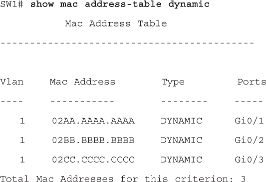</a>

<a href="#f0122-01a" id="code-f0122-01">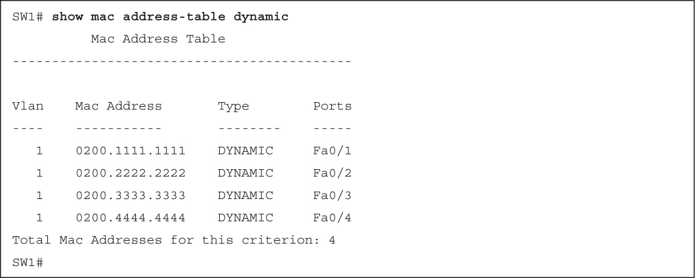</a>

<a href="#f0123-01a" id="code-f0123-01">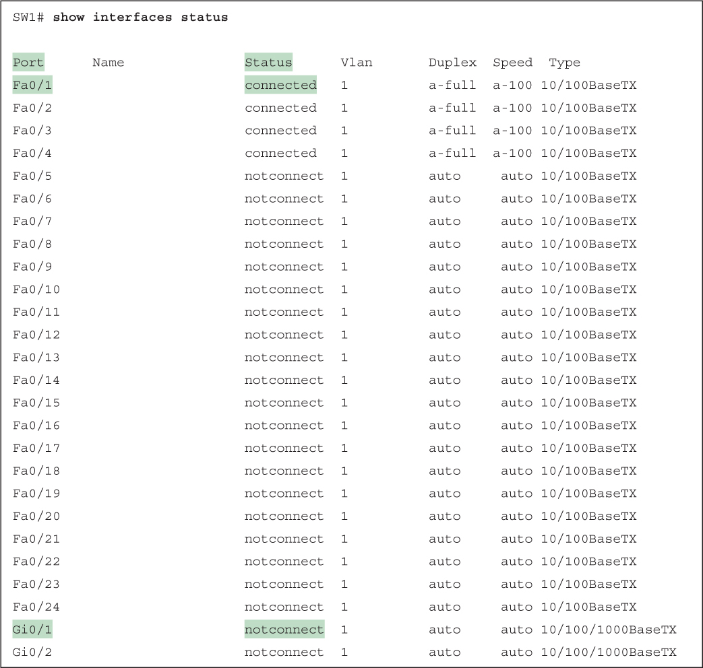</a>

<a href="#f0124-01a" id="code-f0124-01">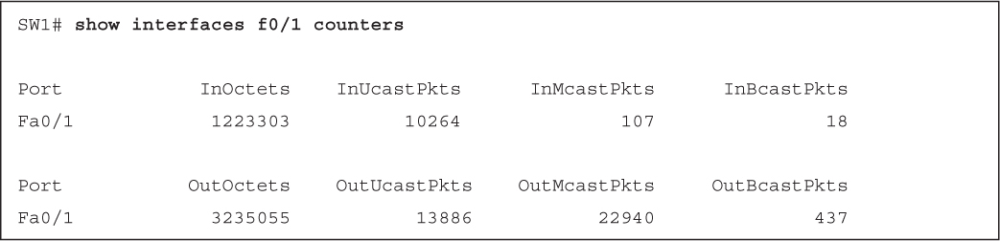</a>

<a href="#f0125-01a" id="code-f0125-01">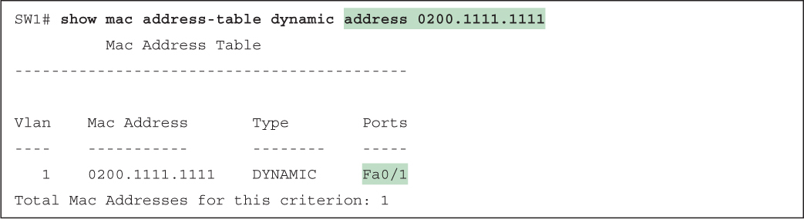</a>

<a href="#f0125-02a" id="code-f0125-02">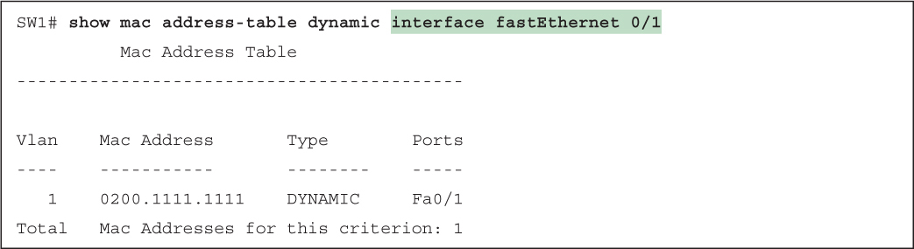</a>

<a href="#f0125-03a" id="code-f0125-03">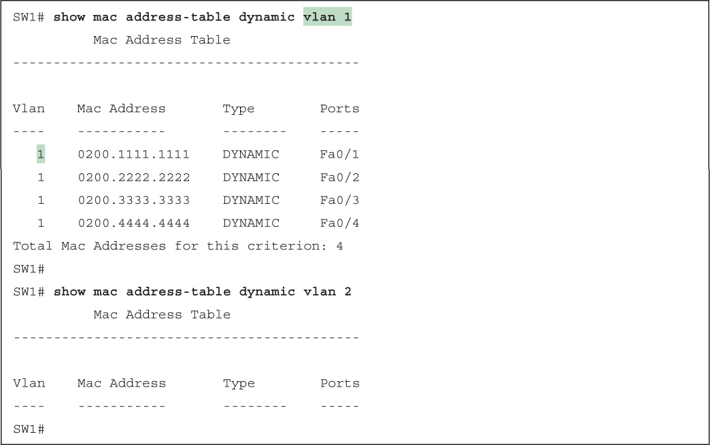</a>

<a href="#f0126-01a" id="code-f0126-01">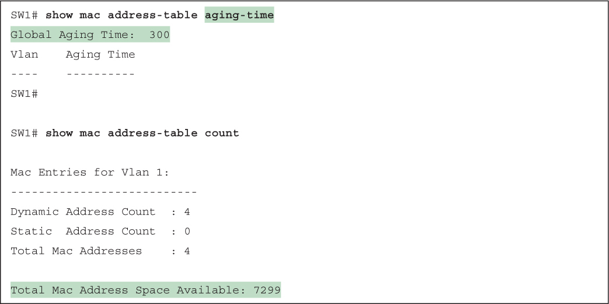</a>

<a href="#f0128-01a" id="code-f0128-01">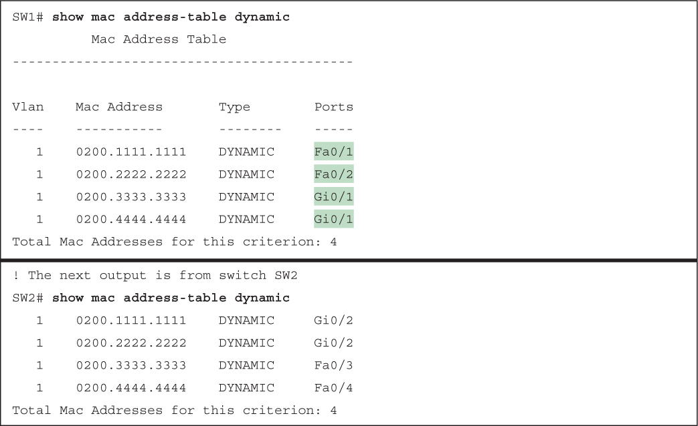</a>

</section>

</section>


<nav class="ccna-chapter-nav" aria-label="章节导航"><a href="v1-04.html">← 上一章</a><a href="v1-06.html">下一章 →</a></nav>
