
<a href="{{ '/subjects/CCNA/' | relative_url }}">← 返回 CCNA 目录</a>

第一卷 · 实现以太网局域网

<nav class="ccna-chapter-nav" aria-label="章节导航"><a href="v1-05.html">← 上一章</a><a href="v1-07.html">下一章 →</a></nav>



<section data-epub-type="chapter">

<h2 class="h2" id="ch06">第 6 章</h2>

<h2 class="h2a">配置交换机基本管理功能</h2>

本章涵盖以下考试主题：

1.0 网络基础

1.6 配置与验证 IPv4 编址和子网划分

2.0 网络接入

2.8 描述网络设备的管理访问方式（Telnet、SSH、HTTP、HTTPS、控制台、RADIUS/TACACS+）

4.0 IP 服务

4.6 配置与验证 DHCP 客户端和中继

4.8 配置网络设备，以使用 SSH 进行远程访问

5.0 安全基础

5.3 使用本地密码配置设备访问控制

交换机的任务可分成少数几类，称为平面。数据平面包括转发交换机收到帧的过程。控制平面指控制和改变交换机数据平面的过程，包括启用或禁用接口、控制各接口所用速率的配置，以及生成树为防止环路而阻塞某些端口的动态过程等。第三种平面是管理平面，指设备管理功能，包括用于连接 CLI 的 Telnet 和 SSH，以及其他管理功能。

本章讨论 Cisco 交换机中最基本的管理平面功能。第一部分介绍如何为控制台、Telnet 和 SSH 用户配置不同类型的登录安全。第二部分展示如何配置交换机的 IPv4 设置，以实现远程管理。最后一部分介绍几个实用事项，让实验操作更方便。

<section>

<h3 class="h3" id="ch06lev1sec1">“这些知识我已经掌握了吗？”自测</h3>

如果你希望根据得分决定在本章投入多少时间，可以完成这组自测题（在此作答，或使用 PTP 软件）。各题答案的选项字母列在自测题之后的页面底部。书末和配套网站上的<a href="#ref-appc">附录 C</a>都包含答案及解析。你也可以在 PTP 测试软件中找到答案及解析。

<figure class="table" id="ch06tab01" tabindex="0">

<figcaption>

<strong>表 6-1</strong> “这些知识我已经掌握了吗？”自测：基础知识小节与题目对应关系

</figcaption>

<table class="all">

<thead>

<tr>

<th class="th">
基础知识小节
</th>

<th class="th">
题目
</th>

</tr>

</thead>

<tbody>

<tr>

<td class="border">
保护交换机 CLI
</td>

<td class="border">
1–3
</td>

</tr>

<tr>

<td class="border">
启用 IPv4 以支持远程访问
</td>

<td class="border">
4–5
</td>

</tr>

<tr>

<td class="border">
实验中有用的其他设置
</td>

<td class="border">
6
</td>

</tr>

</tbody>

</table>

</figure>

<strong><a id="quess6_1" href="#ques6_1a">1</a>。</strong>假设你先从控制台配置 <strong>enable secret</strong> 命令，然后配置 <strong>enable password</strong> 命令。退出交换机后，再从控制台重新登录。进入特权模式时必须输入的密码，由哪个命令定义？

<ol class="lower-alpha">

<li>
<strong>enable password</strong>
</li>

<li>
<strong>enable secret</strong>
</li>

<li>
两者都不是
</li>

<li>
如果配置了 <strong>password</strong> 命令，则由它定义
</li>

</ol>

<strong><a id="quess6_2" href="#ques6_2a">2</a>。</strong>一名工程师希望为实验室中的一些交换机设置不使用用户名的简单密码保护，防止好奇的同事从桌面 PC 登录这些交换机。以下哪个命令适合作为该配置的一部分？

<ol class="lower-alpha">

<li>
VTY 模式子命令 <strong>login</strong>
</li>

<li>
控制台子命令 <strong>password</strong> <em>password</em>
</li>

<li>
VTY 子命令 <strong>login local</strong>
</li>

<li>
VTY 子命令 <strong>transport input ssh</strong>
</li>

</ol>

<strong><a id="quess6_3" href="#ques6_3a">3</a>。</strong>一名工程师此前已将 Cisco 2960 交换机配置为允许 Telnet 访问，交换机要求 Telnet 用户输入密码 <strong>mypassword</strong>。随后，工程师修改配置以支持安全外壳协议。以下哪些命令可能属于新配置？（选择两个答案。）

<ol class="lower-alpha">

<li>
VTY 模式子命令 <strong>username</strong> <em>name</em> <strong>secret</strong> <em>password</em>
</li>

<li>
全局配置命令 <strong>username</strong> <em>name</em> <strong>secret</strong> <em>password</em>
</li>

<li>
VTY 模式子命令 <strong>login local</strong>
</li>

<li>
全局配置命令 <strong>transport input ssh</strong>
</li>

</ol>

<strong><a id="quess6_4" href="#ques6_4a">4</a>。</strong>工程师的桌面 PC 连接到总部站点的一台交换机。总部路由器通过串行链路连接各分支机构，每个分支都有一台小型路由器和一台交换机。为了让工程师通过 Telnet 登录分支交换机，并且只需提供密码，需要在分支交换机所列的配置模式下配置哪些命令？（选择三个答案。）

<ol class="lower-alpha">

<li>
接口配置模式中的 <strong>ip address</strong> 命令
</li>

<li>
全局配置模式中的 <strong>ip address</strong> 命令
</li>

<li>
VLAN 配置模式中的 <strong>ip default-gateway</strong> 命令
</li>

<li>
全局配置模式中的 <strong>ip default-gateway</strong> 命令
</li>

<li>
控制台线路配置模式中的 <strong>password</strong> 命令
</li>

<li>
VTY 线路配置模式中的 <strong>password</strong> 命令
</li>

</ol>

<strong><a id="quess6_5" href="#ques6_5a">5</a>。</strong>某第 2 层交换机将所有物理端口配置到 VLAN 2。相连路由器使用地址／掩码 172.16.2.254/24。IP 地址规划要求交换机使用 172.16.2.250/24，并将该路由器作为默认网关。交换机需要支持从网络中任意子网发起的 SSH 连接。以下哪些命令属于所需配置？（选择两个答案。）

<ol class="lower-alpha">

<li>
interface vlan 1 配置模式中的 <strong>ip address 172.16.2.250 255.255.255.0</strong> 命令。
</li>

<li>
interface vlan 2 配置模式中的 <strong>ip address 172.16.2.250 255.255.255.0</strong> 命令。
</li>

<li>
全局配置模式中的 <strong>ip default-gateway 172.16.2.254</strong> 命令。
</li>

<li>
交换机无法支持 SSH，因为所有端口都连接 VLAN 2，而 IP 地址必须配置在 VLAN 1 接口上。
</li>

</ol>

<strong><a id="quess6_6" href="#ques6_6a">6</a>。</strong>以下哪个线路子命令告诉交换机，在屏幕显示日志消息之前，等待 show 命令完成输出？

<ol class="lower-alpha">

<li>
<strong>logging synchronous</strong>
</li>

<li>
<strong>no ip domain-lookup</strong>
</li>

<li>
<strong>exec-timeout 0 0</strong>
</li>

<li>
<strong>history size 15</strong>
</li>

</ol>

“这些知识我已经掌握了吗？”自测答案：

<strong><a id="ques6_1a" href="#ref-ques6_1">1</a></strong> B

<strong><a id="ques6_2a" href="#ref-ques6_2">2</a></strong> A

<strong><a id="ques6_3a" href="#ref-ques6_3">3</a></strong> B、C

<strong><a id="ques6_4a" href="#ref-ques6_4">4</a></strong> A、D、F

<strong><a id="ques6_5a" href="#ref-ques6_5">5</a></strong> B、C

<strong><a id="ques6_6a" href="#ref-ques6_6">6</a></strong> A

</section>

<section>

<h3 class="h3box" id="ch06lev1sec2">基础知识</h3>

</section>

<section>

<h3 class="h3" id="ch06lev1sec3">保护交换机 CLI</h3>

默认情况下，用户可以连接控制台并进入<a id="key_079" href="#ref-gloss_120">特权模式</a>，无需安全检查或密码。相比之下，默认设置禁止所有 <a id="key_085" href="#ref-gloss_405">Telnet</a> 和<a id="key_084" href="#ref-gloss_360">安全外壳协议（SSH）</a>用户，甚至连登录提示都不会显示。这些默认值是合理的，因为如果能够接触交换机控制台端口，就已经在物理上控制了交换机。不过，显然保护控制台很有必要，为合适的用户开放 SSH 和 Telnet 访问也同样有意义。

本章第一个主题讨论如何为 Cisco Catalyst 交换机配置登录安全。保护 CLI 包括保护特权模式的访问，因为攻击者可以从特权模式重新加载交换机或修改配置。保护用户模式也很重要，因为攻击者能够查看交换机状态、了解网络，并找到攻击网络的新方法。

具体而言，本节涵盖以下登录安全主题：

<ul class="sq">

<li>
使用简单密码保护用户模式和特权模式
</li>

<li>
使用本地用户名保护用户模式访问
</li>

<li>
使用外部认证服务器保护用户模式访问
</li>

<li>
使用安全外壳协议（SSH）保护远程访问
</li>

</ul>

请注意，所有远程管理协议，例如 Telnet 和 SSH，都要求交换机具有 IP 配置；这将在本章第二个主要部分“<a href="#ch06lev1sec4">启用 IPv4 以支持远程访问</a>”中介绍。

<section>

<h4 class="h4" id="ch06lev2sec1">使用简单密码保护用户模式和特权模式</h4>

默认设置很适合全新交换机，但在生产环境中，你会希望保护控制台访问，同时启用 Telnet 和／或 SSH 远程登录，以便坐在办公桌前就能登录局域网中的所有交换机。不过请记住，不应让任何人都能登录交换机并修改配置，因此应采用某种安全登录方式。

大多数人通过一个简单的共享密码访问实验设备。这种方法只使用密码，不使用用户名；控制台用户使用一个密码，Telnet 用户使用另一个密码。控制台用户必须提供在线路配置模式中设置的<em>控制台密码</em>。Telnet 用户必须提供 <em>Telnet 密码</em>，也称 VTY 密码，之所以这样命名，是因为相关配置位于 VTY 线路配置模式中。<a href="#ch06fig01">图 6-1</a> 从登录交换机的用户角度，总结了共享密码的这些选项。

<figure class="image-c" id="ch06fig01">

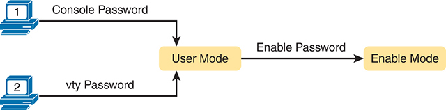

<figcaption>

<strong>图 6-1</strong> <em>简单密码安全的概念</em>

</figcaption>

</figure>

注意

本节将几种密码称为<em>共享</em>密码。所谓共享，是指所有用户都必须知道并使用同一个密码。换言之，每位用户并没有自己唯一的用户名和密码，而是所有相关工作人员都知道并使用相同密码。

此外，Cisco 交换机使用另一个称为 <em>enable 密码</em>的共享密码，保护特权模式。从连接交换机 CLI 的网络工程师角度看，进入用户模式后，需要输入 <strong>enable</strong> EXEC 命令。该命令会提示输入 enable 密码；如果密码正确，IOS 就会让用户进入特权模式。

<a href="#exa6_1">例 6-1</a> 展示同时设置共享控制台密码和共享 enable 密码时，用户从控制台登录交换机的过程。请注意，在此示例开始之前，用户已经启动终端仿真器，用控制台电缆实际连接笔记本电脑，然后按 Enter，使交换机作出示例顶部所示的响应。

<strong>例 6-1</strong> <em>控制台登录并进入特权模式</em>

<a href="#code-f0136-01" id="f0136-01a">点击此处查看代码原图</a>

<pre class="pre-ex" tabindex="0"><code>(User now presses enter to start the process. This line of text does not appear.)

User Access Verification

Password: <strong>faith</strong>

Switch&gt; <strong>enable</strong>

Password: <strong>love</strong>

Switch#</code></pre>

请注意，示例把密码文本 faith 和 love 显示为已输入的内容，同时显示了使用户从用户模式进入特权模式的 <strong>enable</strong> 命令。实际上，交换机会隐藏输入的密码，防止旁人越过你的肩膀看到密码。

为了配置控制台、Telnet 和特权模式的共享密码，需要配置几条命令。不过，这些命令的参数相当直观。<a href="#ch06fig02">图 6-2</a> 展示了这三种密码的配置。

<figure class="image-c" id="ch06fig02">

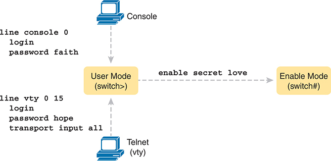

<figcaption>

<strong>图 6-2</strong> <em>简单密码安全配置</em>

<aside class="hidden" id="a06fig02">

在控制台中，命令“console 0 login password faith”将控制台线路 0 的登录密码设为 faith。在 Telnet（VTY）配置中，命令“vty 0 15 login password hope transport input all”为 Telnet 线路 0 到 15 设置登录密码 hope，并允许所有输入传输方式。在用户模式（提示符为 switch&gt;）中，命令“enable secret love”将进入特权模式的秘密密码设为 love；特权模式提示符为 switch#。

</aside>

</figcaption>

</figure>

配置这三种密码并不需要太多工作。首先，控制台和 VTY 密码根据上下文进行设置：控制台密码在控制台模式中设置（<strong>line con 0</strong>），Telnet 密码在 VTY 线路配置模式中设置（<strong>line vty 0 15</strong>）。随后，在控制台模式和 VTY 模式中，各自使用以下两条命令：

<strong>password</strong> <em>password-value</em><strong>：</strong>定义控制台或 VTY 实际使用的密码。

<strong>login：</strong>告诉 IOS 在该线路（控制台或 VTY）上启用不带用户名的简单共享密码，使交换机要求用户输入密码。

图右侧配置的 enable 密码适用于所有用户，无论他们通过控制台、Telnet 还是其他方式连接到用户模式。配置 enable 密码的命令是一条全局配置命令：<strong>enable secret</strong> <em>password-value</em>。

注意

较早的 IOS 版本使用 <strong>enable password</strong> <em>password-value</em> 命令设置 enable 密码，该命令至今仍存在于 IOS 中。不过，<strong>enable secret</strong> 命令安全得多，在实际网络中应使用 <strong>enable secret</strong>。《<em>CCNA 200-301 官方认证指南</em>》<em>第 2 卷</em>第二版的<a data-original-href="vol1_ch10.xhtml#ch10" data-unavailable="true" title="此内容不在当前提取范围内；请参阅原始 EPUB：vol1_ch10.xhtml#ch10">第 10 章</a>《<a data-original-href="vol1_ch10.xhtml#ch10" data-unavailable="true" title="此内容不在当前提取范围内；请参阅原始 EPUB：vol1_ch10.xhtml#ch10">保护网络设备</a>》，将进一步解释各种密码机制的安全级别，包括比较 <strong>enable secret</strong> 和 <strong>enable password</strong> 命令。

为了便于跟随操作过程，并方便日后学习，请使用示例前的配置检查表。配置检查表汇总本书所述功能的必需和可选配置步骤。为控制台、Telnet 和特权模式设置共享密码的检查表如下：

<figure class="figure1">

</figure>

第 1 步。使用 <strong>enable secret</strong> <em>password-value</em> 命令配置 enable 密码。

第 2 步。配置控制台密码：

<ol class="step-lower-alpha">

<li>
使用 <strong>line con 0</strong> 命令进入控制台配置模式。
</li>

<li>
使用 <strong>password</strong> <em>password-value</em> 子命令设置控制台密码的值。
</li>

<li>
使用 <strong>login</strong> 子命令，启用基于简单密码的控制台密码安全。
</li>

</ol>

第 3 步。配置 Telnet（VTY）密码：

<ol class="step-lower-alpha">

<li>
使用 <strong>line vty 0 15</strong> 命令，为全部 16 条 VTY 线路（编号 0 至 15）进入 VTY 配置模式。
</li>

<li>
使用 <strong>password</strong> <em>password-value</em> 子命令设置 VTY 密码的值。
</li>

<li>
使用 <strong>login</strong> 子命令，启用基于简单密码的控制台密码安全。
</li>

<li>
使用 <strong>transport input all</strong> 子命令或类似命令，将 Telnet 启用为 VTY 线路的输入协议。
</li>

</ol>

注意

本章稍后的“<a href="#ch06lev2sec4">使用安全外壳协议保护远程访问</a>”一节，将更详细地介绍 <strong>transport input</strong> 子命令。

<a href="#exa6_2">例 6-2</a> 展示配置检查表中的配置过程，以及 enable secret 密码的设置。请注意，以 ! 开头的行是注释，用于引导你完成配置。

<a href="#exa6_3">例 6-3</a> 通过 <strong>show running-config</strong> 命令，展示交换机最终得到的配置。灰色行突出显示新增配置。请注意，为集中展示密码配置，输出中删除了许多无关行。

<strong>例 6-2</strong> <em>配置基本密码</em>

<a href="#code-f0138-01" id="f0138-01a">点击此处查看代码原图</a>

<pre class="pre-ex" tabindex="0"><code>! Enter global configuration mode and set the enable password.

!

Switch# <strong>configure terminal</strong>

Switch(config)# <strong>enable secret love</strong>

!

! At Step 2 in the checklist, enter console configuration mode, set the

! password value to “faith” and enable simple passwords for the console.

! The exit command moves the user back to global config mode.

!

Switch#(config)# <strong>line console 0</strong>

Switch#(config-line)# <strong>password faith</strong>

Switch#(config-line)# <strong>login</strong>

Switch#(config-line)# <strong>exit</strong>

!

! The next few lines do basically the same configuration, except it is

! for the vty lines. Telnet users will use "hope" to login.

!

Switch#(config)# <strong>line vty 0 15</strong>

Switch#(config-line)# <strong>password hope</strong>

Switch#(config-line)# <strong>login</strong>

Switch#(config-line)# <strong>transport input all</strong>

Switch#(config-line)# <strong>end</strong>

Switch#</code></pre>

<strong>例 6-3</strong> <em>按照<a href="#exa6_2">例 6-2</a> 配置后得到的 Running-Config 文件片段</em>

<a href="#code-f0138-02" id="f0138-02a">点击此处查看代码原图</a>

<pre class="pre-ex" tabindex="0"><code>Switch# <strong>show running-config</strong>

!

Building configuration...

Current configuration: 1333 bytes

!

version 12.2

!

enable secret 5 $1$OwtI$A58c2XgqWyDNeDnv51mNR.

!

interface FastEthernet0/1

!

interface FastEthernet0/2

!

! Several lines have been omitted here - in particular, lines for

! FastEthernet interfaces 0/3 through 0/23.

!

interface FastEthernet0/24

!

interface GigabitEthernet0/1

!

interface GigabitEthernet0/2

!

line con 0

 password faith

login

!

line vty 0 4

 password hope

 login

 transport input all

!

line vty 5 15

 password hope

 login

 transport input all</code></pre>

注意

由于历史原因，<a href="#exa6_3">例 6-3</a> 最后六行中的 <strong>show running-config</strong> 输出，将前五条 VTY 线路（0 至 4）与其余线路（5 至 15）分开列出。

</section>

<section>

<h4 class="h4" id="ch06lev2sec2">使用本地用户名和密码保护用户模式访问</h4>

Cisco 交换机还支持两种登录安全方法，都使用每位用户自己的用户名／密码组合，而不是不带用户名的共享密码。一种方法称为<a id="key_081" href="#ref-gloss_244">本地用户名</a>和密码，将用户名／密码组合配置在本地，也就是交换机配置中。交换机支持为控制台、Telnet，甚至 SSH 使用本地用户名／密码，但它们不会取代进入特权模式所使用的 enable 密码。

从简单共享密码迁移到本地用户名／密码，只需要少量配置修改，如<a href="#ch06fig03">图 6-3</a> 所示。

<figure class="image-c" id="ch06fig03">

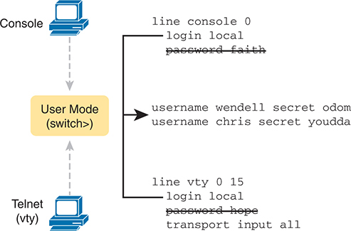

<figcaption>

<strong>图 6-3</strong> <em>配置交换机使用本地用户名进行登录认证</em>

<aside class="hidden" id="a06fig03">

在控制台中，命令“console 0 login password faith”将控制台线路 0 的登录密码设为 faith，随后移除该密码。在 Telnet（VTY）配置中，命令“vty 0 15 login password hope transport input all”为 Telnet 线路 0 至 15 设置登录密码 hope，随后移除该密码。这将进入用户模式。在用户模式（提示符为 switch&gt;）中，用户名被设置为 Wendell secret Odom 和 Chris secret youdda。

</aside>

</figcaption>

</figure>

按照图中的配置过程，交换机首先需要知道用户名／密码组合列表。为创建这些组合，可重复使用全局配置命令 <strong>username</strong> <em>name</em> <strong>secret</strong> <em>password</em>。随后，通过 <strong>login local</strong> 这一行，启用这种不同的控制台或 Telnet 登录安全方式。该命令的基本含义是“使用本地用户名列表登录”。你还可以使用 <strong>no password</strong> 命令，甚至不必输入密码本身，清理控制台或 VTY 模式中残留的 password 子命令，因为使用本地用户名和密码时已不再需要这些命令。

下面的检查表详细列出配置本地用户名登录的命令，主要用于方便学习和复习：

<figure class="figure1">

</figure>

第 1 步。使用全局配置命令 <strong>username</strong> <em>name</em> <strong>secret</strong> <em>password</em>，在本地交换机上添加一个或多个用户名／密码组合。

第 2 步。配置控制台，使其使用本地配置的用户名／密码组合：

<ol class="step-lower-alpha">

<li>
使用 <strong>line con 0</strong> 命令进入控制台配置模式。
</li>

<li>
使用 <strong>login local</strong> 子命令，使控制台提示输入用户名和密码，并对照本地用户名／密码列表进行检查。
</li>

<li>
可选：使用 <strong>no password</strong> 子命令移除现有的简单共享密码，以保持配置文件整洁。
</li>

</ol>

第 3 步。配置 Telnet（VTY），使其使用本地配置的用户名／密码组合。

<ol class="step-lower-alpha">

<li>
使用 <strong>line vty 0 15</strong> 命令，为全部 16 条 VTY 线路（编号 0 至 15）进入 VTY 配置模式。
</li>

<li>
使用 <strong>login local</strong> 子命令，使交换机要求所有入站 Telnet 用户输入用户名和密码，并对照本地用户名／密码列表进行检查。
</li>

<li>
可选：使用 <strong>no password</strong> 子命令移除现有的简单共享密码，以保持配置文件整洁。
</li>

<li>
使用 <strong>transport input all</strong> 子命令或类似命令，将 Telnet 启用为 VTY 线路的输入协议。
</li>

</ol>

当 Telnet 用户连接到按<a href="#ch06fig03">图 6-3</a> 配置的交换机时，会先被要求输入用户名，再输入密码，如<a href="#exa6_4">例 6-4</a> 所示。用户名／密码组合必须来自本地用户名列表，否则登录会被拒绝。

<strong>例 6-4</strong> <em>应用<a href="#ch06fig03">图 6-3</a> 配置后的 Telnet 登录过程</em>

<a href="#code-f0140-01" id="f0140-01a">点击此处查看代码原图</a>

<pre class="pre-ex" tabindex="0"><code>SW2# telnet 10.9.9.19

Trying 10.9.9.19 ... Open

User Access Verification

Username: wendell

Password:

SW1&gt; enable

Password:

SW1# <strong>configure terminal</strong>

Enter configuration commands, one per line. End with CNTL/Z.

SW1(config)#<strong>^Z</strong>

SW1#

*Mar 1 02:00:56.229: %SYS-5-CONFIG_I: Configured from console by wendell on vty0 

(10.9.9.19)</code></pre>

注意

由于历史原因，<a href="#exa6_3">例 6-3</a> 最后六行中的 <strong>show running-config</strong> 输出，将前五条 VTY 线路（0 至 4）与其余线路（5 至 15）分开列出。

</section>

<section>

<h4 class="h4" id="ch06lev2sec3">使用外部认证服务器保护用户模式访问</h4>

<a href="#exa6_4">例 6-4</a> 末尾展示了要求每位用户使用自己用户名登录带来的众多安全改进之一。示例末尾，用户进入配置模式（<strong>configure terminal</strong>），然后立即退出（<strong>end</strong>）。请注意，用户退出配置模式时，交换机会生成一条<a id="key_082" href="#ref-gloss_255">日志消息</a>。如果用户使用用户名登录，日志消息会标识该用户名；请注意消息中的 wendell。

不过，把用户名和密码直接配置在交换机上，会带来一些管理麻烦。例如，每台交换机和路由器都需要为所有可能登录设备的用户进行配置。随后，每当需要修改信息，例如按照良好的安全习惯定期修改密码时，就必须修改所有设备的配置。

更好的选择，是使用与许多其他 IT 登录功能类似的工具。这些工具提供集中位置，安全存储所有用户名／密码组合，同时提供要求用户定期修改密码、在用户离职时撤销访问权限等功能。

Cisco 交换机通过一种称为认证、授权和计费（<a id="key_075" href="#ref-gloss_008">AAA</a>）服务器的外部服务器，提供了这种选择。这些服务器保存用户名和密码，通常允许用户自助维护密码，也能够强制进行密码维护。如今，许多生产网络为交换机和路由器使用 AAA 服务器。

底层登录过程要求交换机在每次用户登录时执行额外工作，但一旦设置完成，用户名和密码的管理工作会大幅减少。使用 <a id="key_076" href="#ref-gloss_009">AAA 服务器</a>进行认证时，交换机或路由器只需向服务器发送消息，询问该用户名和密码是否被允许，AAA 服务器再作出响应。<a href="#ch06fig04">图 6-4</a> 展示了一个示例：用户先提供用户名和密码，交换机询问 AAA 服务器，服务器向交换机回复，说明用户名和密码有效。

<figure class="image-c" id="ch06fig04">

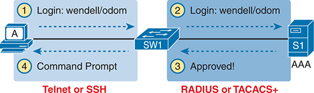

<figcaption>

<strong>图 6-4</strong> <em>使用外部 AAA 服务器的基本认证过程</em>

<aside class="hidden" id="a06fig04">

第 1 步通过 Telnet 或安全外壳协议（SSH），使用用户名 Wendell 和密码 Odom 登录设备 SW1。第 2 步在设备 S1 与 AAA 之间重复登录信息。第 3 步表示 AAA 服务器批准。第 4 步显示命令提示符。第 1、4 步使用 Telnet 或 SSH 协议，第 2、3 步使用远程认证拨号用户服务（RADIUS）或终端访问控制器访问控制系统增强版（TACACS+）。

</aside>

</figcaption>

</figure>

虽然图中展示的是总体思路，但请注意，信息通过几种不同协议流动。左侧用户与交换机或路由器之间使用 Telnet 或 SSH；右侧交换机与 AAA 服务器之间通常使用 RADIUS 或 TACACS+ 协议，这两种协议都会加密在网络上传输的密码。

</section>

<section>

<h4 class="h4" id="ch06lev2sec4">使用安全外壳协议保护远程访问</h4>

到目前为止，本章主要讨论控制台和 Telnet，基本没有涉及 SSH。Telnet 有一个严重缺点：会话中的所有数据都以明文传输，包括密码交换。因此，任何能捕获用户与交换机之间消息的人，都能看到密码，这称为中间人攻击。SSH 加密客户端与服务器之间传输的所有数据，从而保护数据和密码。

SSH 可以使用与 Telnet 相同的本地登录认证方法，即本地配置的用户名和密码。（SSH 不能依赖不包含用户名的认证方法，例如共享密码。）因此，前面<a href="#ch06fig03">图 6-3</a> 中支持 Telnet 本地用户名的配置，也为入站 SSH 连接启用了本地用户名认证。

<a href="#ch06fig05">图 6-5</a> 展示了支持 SSH 所需的一种配置示例。图中重复了前面<a href="#ch06fig03">图 6-3</a> 中供 Telnet 使用的本地用户名配置。<a href="#ch06fig05">图 6-5</a> 还展示了完成交换机 SSH 配置所需的三条额外命令。

<figure class="image-c" id="ch06fig05">

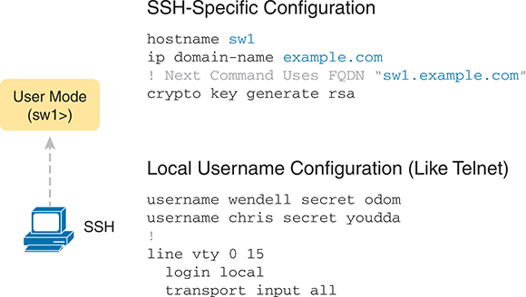

<figcaption>

<strong>图 6-5</strong> <em>在本地用户名配置上添加 SSH 配置</em>

<aside class="hidden" id="a06fig05">

SSH 部分提供与 Telnet 类似的本地用户名配置：用户名 Wendell 的秘密密码为 Odom，用户名 Chris 的秘密密码为 youda。随后，将 VTY 线路 0 至 15 配置为使用本地认证，并允许所有输入传输方式。在用户模式（sw1）中，SSH 专用配置包括将主机名设为 sw1，将域名设为 example.com，以及使用完全限定域名（FQDN）sw1.example.com 生成 RSA 加密密钥。

</aside>

</figcaption>

</figure>

IOS 使用图中的三条 SSH 专用配置命令，创建 SSH 加密密钥。SSH 服务器使用交换机的完全限定域名（FQDN）作为生成密钥的输入。交换机通过主机名和域名构成 FQDN。<a href="#ch06fig05">图 6-5</a> 先设置这两个值，以防之前尚未配置。随后，第三条命令 <strong>crypto key generate rsa</strong> 生成 SSH 加密密钥。

逐步观察配置模式中的配置过程，对于 SSH 配置尤其有帮助。特别注意，本例中的 <strong>crypto key</strong> 命令会提示用户输入密钥模数；也可以在 <strong>crypto key</strong> 命令末尾添加 <strong>modulus</strong> <em>modulus-value</em> 参数，直接在命令中给出该设置。<a href="#exa6_5">例 6-5</a> 展示<a href="#ch06fig05">图 6-5</a> 中各命令的配置过程，最后一步是生成加密密钥。

<strong>例 6-5</strong> <em>与<a href="#ch06fig05">图 6-5</a> 对应的 SSH 配置过程</em>

<a href="#code-f0143-01" id="f0143-01a">点击此处查看代码原图</a>

<pre class="pre-ex" tabindex="0"><code>SW1# <strong>configure terminal</strong>

Enter configuration commands, one per line. End with CNTL/Z.

!

! Step 1 next. The hostname is already set, but it is repeated just

! to be obvious about the steps.

!

SW1(config)# <strong>hostname SW1</strong>

SW1(config)# <strong>ip domain name example.com</strong>

SW1(config)# <strong>crypto key generate rsa</strong>

The name for the keys will be: SW1.example.com

Choose the size of the key modulus in the range of 512 to 2048 for your

  General Purpose Keys. Choosing a key modulus greater than 512 may take 

  a few minutes.

How many bits in the modulus [1024]: <strong>1024</strong>

% Generating 1024 bit RSA keys, keys will be non-exportable...

[OK] (elapsed time was 4 seconds)

SW1(config)#

!

! Optionally, set the SSH version to version 2 (only) - preferred

!

SW1(config)# <strong>ip ssh version 2</strong>

!

! Next, configure the vty lines for local username support, just like

! with Telnet

!

SW1(config)# <strong>line vty 0 15</strong>

SW1(config-line)# <strong>login local</strong>

SW1(config-line)# <strong>transport input all</strong>

SW1(config-line)# <strong>exit</strong>

!

! Define the local usernames, just like with Telnet

!

SW1(config)# <strong>username wendell secret odom</strong>

SW1(config)# <strong>username chris secret youdaman</strong>

SW1(config)# <strong>^Z</strong>

SW1#</code></pre>

注意

较早的 IOS 版本使用 <strong>ip domain-name</strong> <em>domain-name</em> 语法，而较新的语法是 <strong>ip domain name</strong> <em>domain-name</em>，使用空格代替连字符。

本章迄今为止的 Telnet 和 SSH 示例，都在 VTY 配置模式中列出 <strong>transport input all</strong> 子命令。<strong>transport input</strong> 命令指定 VTY 端口允许的协议，其中 <strong>all</strong> 关键字包括 SSH 和 Telnet。初学时，使用 <strong>transport input all</strong> 可以支持所有方式；但在生产设备中，你可能希望采用其他选项，例如因 Telnet 安全性差而完全不支持它。常用选项包括：

<strong>transport input all</strong> 或 <strong>transport input telnet ssh：</strong>同时支持 Telnet 和 SSH。

<strong>transport input none：</strong>两者都不支持。

<strong>transport input telnet：</strong>只支持 Telnet。

<strong>transport input ssh：</strong>只支持 SSH。

多年来，该命令的默认设置会因设备类型、操作系统和版本而略有差异。因此，对于生产设备，合理的做法是选择所需设置并明确配置，而不是依赖对某种设备和软件版本默认值的记忆。例如，许多公司希望使用 <strong>transport input ssh</strong>，完全禁用 Telnet 访问，同时允许 SSH。

备考时，要留意 <strong>transport input</strong> 设置，确认它是否根据场景支持 SSH、Telnet 或两者。作为考试策略，查看任何 Telnet 或 SSH 配置时，都应查找该命令来确认设置。也要了解传统默认值：许多旧交换机默认使用 <strong>transport input all</strong>，旧路由器默认使用 <strong>transport input none</strong>，而较新的 Cisco 交换机和路由器如今默认采用更安全的 <strong>transport input ssh</strong>。

本节最后的配置检查表，详细列出使用本地用户名为 Cisco 交换机配置 SSH 的一种方法。（IOS 中配置 SSH 支持的方法有多种，此处展示一种简单方式。）这里的过程最后指出，应在线路 VTY 上配置本地用户名支持，相关内容已在前面的“<a href="#ch06lev2sec2">使用本地用户名和密码保护用户模式访问</a>”一节讨论。

<figure class="figure1">

</figure>

第 1 步。配置交换机，生成用于加密的配对公钥和私钥：

<ol class="step-lower-alpha">

<li>
如果尚未配置，在全局配置模式下使用 <strong>hostname</strong> <em>name</em>，为交换机配置主机名。
</li>

<li>
如果尚未配置，在全局配置模式下使用 <strong>ip domain name</strong> <em>name</em>，为交换机配置域名，从而组成完整的 FQDN。
</li>

<li>
在全局配置模式下使用 <strong>crypto key generate rsa</strong> 命令生成密钥；也可以使用 <strong>crypto key generate rsa modulus</strong> <em>modulus-value</em> 命令，避免系统提示输入密钥模数。（使用至少 768 位密钥，以支持 SSH 版本 2。）
</li>

</ol>

第 2 步。可选：在全局配置模式下使用 <strong>ip ssh version 2</strong> 命令，覆盖默认同时支持版本 1 和 2 的设置，使其只允许 SSHv2 连接。

第 3 步。可选：如果尚未配置所需设置，配置 VTY 线路以接受 SSH，并决定是否同时允许 Telnet：

<ol class="step-lower-alpha">

<li>
在 VTY 线路配置模式下使用 <strong>transport input ssh</strong> 命令，仅允许 SSH。
</li>

<li>
在 VTY 线路配置模式下使用 <strong>transport input all</strong> 或 <strong>transport input telnet ssh</strong> 命令，同时允许 SSH 和 Telnet。
</li>

</ol>

第 4 步。按照本章前面的说明，在 VTY 线路配置模式下使用相关命令，配置本地用户名登录认证。

两个关键命令提供交换机 SSH 状态的信息。首先，<strong>show ip ssh</strong> 命令列出 SSH 服务器本身的状态；<strong>show ssh</strong> 命令则列出当前连接交换机的各个 SSH 客户端信息。<a href="#exa6_6">例 6-6</a> 展示二者的输出示例，此时用户 wendell 正连接到交换机。

<strong>例 6-6</strong> <em>显示 SSH 状态</em>

<a href="#code-f0145-01" id="f0145-01a">点击此处查看代码原图</a>

<pre class="pre-ex" tabindex="0"><code>SW1# <strong>show ip ssh</strong>

SSH Enabled - version 2.0

Authentication timeout: 120 secs; Authentication retries: 3

SW1# <strong>show ssh</strong>

Connection Version Mode  Encryption    Hmac             State               Username

0          2.0     IN    aes126-cbc    hmac-sha1        Session started     wendell

0          2.0     OUT   aes126-cbc    hmac-sha1        Session started     wendell

%No SSHv1 server connections running.</code></pre>

</section>

<section>

<h4 class="h4" id="ch06lev2sec5">启用与保护 WebUI</h4>

<a href="v1-04.html#ch04">第 4 章</a>的“<a href="v1-04.html#ch04lev3sec5">通过 WebUI 访问 CLI</a>”一节展示了 WebUI 用户界面的示例，但没有讨论配置。接下来，你将学习如何配置支持该功能的常用设置，并通过 <strong>username</strong> 命令保护它，不过这次有一个新的细节。

HTTP 服务器，也就是 WebUI，长期以来一直是交换机和路由器中的集成 IOS 功能。随着时间推移，Cisco 修改了用户界面和部分配置命令。因此，与其关注琐碎细节，不如关注下面这些如今在交换机或路由器上比较合理的配置步骤：

<ul class="sq">

<li>
使用全局命令 <strong>no ip http server</strong>，禁用 HTTP 服务器（端口 80，传统上默认启用）。
</li>

<li>
使用全局命令 <strong>ip http secure-server</strong>，启用 HTTPS 服务器（端口 443，使用 TLS，传统上默认启用）。
</li>

<li>
使用全局命令 <strong>ip http authentication local</strong>，将认证方法设为使用本地定义的用户名；传统默认方法是使用 enable 密码。
</li>

<li>
使用全局命令 <strong>username</strong> <em>name</em> <strong>priority 15 password</strong> <em>pass-value</em>，定义一个或多个特权级别为 15 的用户名。
</li>

</ul>

逐项解释上述列表：长期以来，IOS 默认同时启用 HTTP 和 HTTPS 服务器。两者都启用时，用户可以在浏览器中输入以 http:// 开头的 URL 连接，此时流量不加密；也可以输入以 https:// 开头的 URL 连接，此时流量会加密。为了提高安全性，Cisco 建议禁用 HTTP 服务器。

长期以来，HTTP 服务器允许通过以下三种方式从 Web 浏览器登录设备：

<ul class="sq">

<li>
使用 enable 密码。
</li>

<li>
使用本地用户名和密码。
</li>

<li>
使用设备上的 AAA 设置。
</li>

</ul>

较新的 IOS 版本逐渐不再采用 <strong>enable</strong> 选项。此外，从安全角度看，同时使用用户名和密码更加合理。

使用本地用户名认证时，要访问 HTTP 服务器（WebUI）的所有功能，必须将该用户的特权级别配置为 15。IOS 在内部定义用户特权级别，默认创建 0 和 15 两个级别。IOS 将用户模式分配给级别 0，将特权模式分配给级别 15。CLI 用户从用户模式进入特权模式时，其优先级别从 0 提升到 15。

对于 WebUI，如果使用带有 <strong>privilege 15</strong> 选项的用户名登录，就能访问所有 WebUI 功能，包括使用 CLI 配置模式、安装新软件、擦除配置以及重新加载路由器。因此，全局命令 <strong>username</strong> <em>name</em> <strong>priority 15 password</strong> <em>pass-value</em> 创建了一种立即进入特权模式的方式。（如果省略 <strong>priority 15</strong> 选项，并用该用户名登录 WebUI，仍可以登录，但不能使用高级功能，包括通过 CLI 配置或验证某个功能。）

</section>

</section>

<section>

<h3 class="h3" id="ch06lev1sec4">启用 IPv4 以支持远程访问</h3>

为了允许通过 Telnet、SSH 或 WebUI 访问交换机，并使其他基于 IP 的管理协议（例如简单网络管理协议 SNMP）正常工作，交换机需要 IP 地址及一些相关设置。这个 IP 地址与交换机转发以太网帧的方式无关，它仅用于支持辅助管理流量，即控制平面流量。

接下来的主题先解释交换机所需的 IPv4 设置，再介绍配置。请注意，虽然也可以使用与本章类似的命令为交换机配置 IPv6 地址，但本章只讨论 IPv4。本章中所有 IP 均指 IPv4。

<section>

<h4 class="h4" id="ch06lev2sec6">主机与交换机的 IP 设置</h4>

交换机需要的 IP 设置类型，与只有一个以太网接口的 PC 相同。作为参照，PC 有一个 CPU，操作系统在其上运行；它还具有以太网网络接口卡（NIC）。操作系统配置包含一个与该网卡关联的 IP 地址，可以手动配置，也可以通过动态主机配置协议（DHCP）动态学习。

交换机使用相同的思路，只是需要在内部使用一块虚拟网卡。与 PC 一样，交换机有实际的 CPU，运行名为 IOS 的操作系统。交换机显然具有许多以太网端口，但它不会把管理 IP 地址分配给任何一个物理端口，而是使用一种类似网卡的概念，称为交换机虚拟接口（SVI），更常称为 <a id="key_086" href="#ref-gloss_434">VLAN 接口</a>，充当交换机自己的网卡。随后，交换机的设置看起来就像主机：在配置中为 VLAN 接口分配 IP 地址等 IP 设置，如<a href="#ch06fig06">图 6-6</a> 所示。

<figure class="image-c" id="ch06fig06">

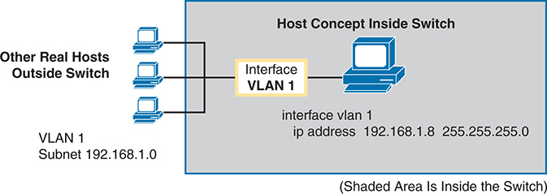

<figcaption>

<strong>图 6-6</strong> <em>交换机内部的交换机虚拟接口（SVI）概念</em>

<aside class="hidden" id="a06fig06">

图中交换机外部有三台实际主机，连接到虚拟局域网（VLAN）1 接口。VLAN 1 配置使用子网 192.168.1.0。交换机的 VLAN 1 SVI 被分配 IP 地址 192.168.1.8，子网掩码为 255.255.255.0。这些主机通过 VLAN 1 接口连接到概念上的主机。

</aside>

</figcaption>

</figure>

在 VLAN 1 接口上配置 IP 后，交换机就能通过 VLAN 1 中的任意端口发送和接收帧。Cisco 交换机默认将所有端口分配给 VLAN 1。

在大多数网络中，交换机配置了多个 VLAN，因此网络工程师可以选择在哪个 VLAN 上配置 IP 地址。也就是说，管理 IP 地址不一定要配置在 VLAN 1 接口上；<a href="#ch06fig06">图 6-6</a> 中看到的 <strong>interface vlan 1</strong> 命令只是其中一种配置。

第 2 层 Cisco 局域网交换机只需要一个用于管理的 IP 地址。不过，可以选择交换机所连接的任意 VLAN。配置中随后会包含该 VLAN 编号对应的 VLAN 接口，以及一个合适的 IP 地址。

例如，<a href="#ch06fig07">图 6-7</a> 展示一台第 2 层交换机，其部分物理端口位于两个不同 VLAN，即 VLAN 1 和 VLAN 2。图中还标出了各 VLAN 使用的子网。网络工程师可以选择以下任一种方式：

<ul class="sq">

<li>
VLAN 1 接口，使用子网 192.168.1.0 中的 IP 地址。
</li>

<li>
VLAN 2 接口，使用子网 192.168.2.0 中的 IP 地址。
</li>

</ul>

<figure class="image-c" id="ch06fig07">

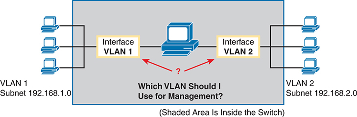

<figcaption>

<strong>图 6-7</strong> <em>选择一个 VLAN 来配置交换机 IP 地址</em>

<aside class="hidden" id="a06fig07">

图中交换机外部有三台实际主机，连接到虚拟局域网（VLAN）1 接口，VLAN 1 使用子网 192.168.1.0。另外三台实际主机连接到 VLAN 2 接口，VLAN 2 使用子网 192.168.2.0。交换机 SVI 提出了这样一个问题：“我应该使用哪个 VLAN 进行管理？”

</aside>

</figcaption>

</figure>

请注意，不应使用一个没有任何物理端口分配到相同 VLAN 的 VLAN 接口。如果这样做，VLAN 接口无法进入 up/up 状态，交换机也就不具备与外部通信的物理条件。

注意

某些 Cisco 交换机可以配置为第 2 层交换机或第 3 层交换机。作为第 2 层交换机时，它按照<a href="v1-05.html#ch05">第 5 章</a>《<a href="v1-05.html#ch05">分析以太网局域网交换</a>》中详细讨论的方式转发以太网帧。另一种方式是充当<em>多层交换机</em>或<em>第 3 层交换机</em>，这意味着交换机既执行第 2 层交换，也使用路由器通常采用的第 3 层逻辑，对 IP 分组进行第 3 层 IP 路由。本章假设所有交换机都是第 2 层交换机。<a data-original-href="vol1_ch18.xhtml#ch18" data-unavailable="true" title="此内容不在当前提取范围内；请参阅原始 EPUB：vol1_ch18.xhtml#ch18">第 18 章</a>《<a data-original-href="vol1_ch18.xhtml#ch18" data-unavailable="true" title="此内容不在当前提取范围内；请参阅原始 EPUB：vol1_ch18.xhtml#ch18">局域网中的 IP 路由</a>》将深入讨论第 3 层交换，以及同时使用多个 VLAN 接口的情况。

在某个 VLAN 接口上配置 IP 地址和掩码后，交换机可以与该 VLAN 所在子网中的其他主机发送和接收 IP 分组；但如果没有另一个称为<a id="key_077" href="#ref-gloss_090">默认网关</a>的配置，交换机就无法与本地子网之外通信。交换机需要默认网关的原因，与主机相同，取决于主机发送 IP 分组时的处理方式。具体来说：

<ul class="sq">

<li>
向同一子网中的主机发送 IP 分组时，直接发送给该主机。
</li>

<li>
向不同子网中的主机发送 IP 分组时，先发送给本地路由器，即默认网关。
</li>

</ul>

<a href="#ch06fig08">图 6-8</a> 展示了这些概念。在本例中，右侧交换机使用 VLAN 1 接口上配置的 IP 地址 192.168.1.200。不过，要与图最左侧的主机 A 通信，交换机必须使用路由器 R1（默认网关）将 IP 分组转发给主机 A。为实现这一点，交换机需要配置默认网关，指向 R1 的 IP 地址，本例为 192.168.1.1。请注意，交换机和路由器使用相同掩码 255.255.255.0，使这些地址位于同一子网。

<figure class="image-c" id="ch06fig08">

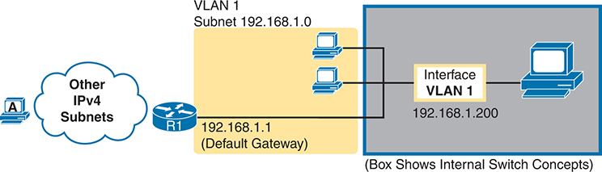

<figcaption>

<strong>图 6-8</strong> <em>为什么需要默认网关</em>

<aside class="hidden" id="a06fig08">

用户 A 和其他 IPv4 子网连接到路由器 R1，其默认网关 IP 地址为 192.168.1.1。路由器连接虚拟局域网 1。VLAN 1 中有两个用户，使用子网 192.168.1.0。VLAN 1 接口被分配 IP 地址 192.168.1.200。VLAN 1 位于表示交换机内部组件的方框中。

</aside>

</figcaption>

</figure>

</section>

<section>

<h4 class="h4" id="ch06lev2sec7">在交换机上配置 IPv4</h4>

交换机在这种特殊的、类似网卡的 <em>VLAN 接口</em>上配置 IPv4 地址和掩码。以下步骤列出交换机 IPv4 配置命令，假设 IP 地址配置在 VLAN 1 中；随后<a href="#exa6_7">例 6-7</a> 展示具体配置示例。

<figure class="figure1">

</figure>

第 1 步。在全局配置模式下使用 <strong>interface vlan 1</strong> 命令，进入 VLAN 1 接口配置模式。

第 2 步。在接口配置模式下使用 <strong>ip address</strong> <em>ip-address mask</em> 命令，分配 IP 地址和掩码。

第 3 步。如果 VLAN 1 接口尚未启用，在接口配置模式下使用 <strong>no shutdown</strong> 命令启用它。

第 4 步。在全局配置模式下添加 <strong>ip default-gateway</strong> <em>ip-address</em> 命令，配置默认网关。

第 5 步。可选：在全局配置模式下添加 <strong>ip name-server</strong> <em>ip-address1 ip-address2 …</em> 命令，使交换机使用域名系统（<a id="key_078" href="#ref-gloss_108">DNS</a>）将名称解析为对应 IP 地址。

<strong>例 6-7</strong> <em>交换机静态 IP 地址配置</em>

<a href="#code-f0149-01" id="f0149-01a">点击此处查看代码原图</a>

<pre class="pre-ex" tabindex="0"><code>Emma# <strong>configure terminal</strong>

Emma(config)# <strong>interface vlan 1</strong>

Emma(config-if)# <strong>ip address 192.168.1.200 255.255.255.0</strong>

Emma(config-if)# <strong>no shutdown</strong>

00:25:07: %LINK-3-UPDOWN: Interface Vlan1, changed state to up

00:25:08: %LINEPROTO-5-UPDOWN: Line protocol on Interface Vlan1, changed

 state to up

Emma(config-if)# <strong>exit</strong>

Emma(config)# <strong>ip default-gateway 192.168.1.1</strong></code></pre>

顺便说一下，本例展示了一条特别重要且常用的命令：[<strong>no</strong>] <strong>shutdown</strong>。要在管理上启用交换机接口，使用 <strong>no shutdown</strong> 接口子命令；要禁用接口，使用 <strong>shutdown</strong> 接口子命令。除了本例展示的 VLAN 接口，该命令也可用于交换机交换以太网消息所使用的物理以太网接口。

也请停下来看看<a href="#exa6_7">例 6-7</a> 中 <strong>no shutdown</strong> 命令下方出现的消息。这些是交换机生成的 syslog 消息，说明交换机确实启用了该接口。交换机和路由器会针对各种事件生成 syslog 消息，默认显示在控制台上。《<em>CCNA 200-301 官方认证指南，第 2 卷</em>》第二版的<a data-original-href="vol1_ch13.xhtml#ch13" data-unavailable="true" title="此内容不在当前提取范围内；请参阅原始 EPUB：vol1_ch13.xhtml#ch13">第 13 章</a>《<a data-original-href="vol1_ch13.xhtml#ch13" data-unavailable="true" title="此内容不在当前提取范围内；请参阅原始 EPUB：vol1_ch13.xhtml#ch13">设备管理协议</a>》将更详细地讨论 syslog 消息。

</section>

<section>

<h4 class="h4" id="ch06lev2sec8">配置交换机通过 DHCP 学习 IP 地址</h4>

交换机也可以使用动态主机配置协议（DHCP），动态学习 IPv4 设置。（工程师通常不这样做，而是静态配置交换机 IP 地址；但为了完整涵盖考试主题，本节仍介绍这一概念。）基本上，只需告诉交换机在该接口上使用 DHCP，并启用接口。假设网络中的 DHCP 正常工作，交换机就会学习到所有设置。下面详细列出步骤，仍假设使用 VLAN 1 接口，随后<a href="#exa6_8">例 6-8</a> 展示示例：

<figure class="figure1">

</figure>

第 1 步。使用全局配置命令 <strong>interface vlan 1</strong> 进入 VLAN 1 配置模式，并根据需要使用 <strong>no shutdown</strong> 命令启用接口。

第 2 步。使用 <strong>ip address dhcp</strong> 接口子命令分配 IP 地址和掩码。

<strong>例 6-8</strong> <em>通过 DHCP 动态配置交换机 IP 地址</em>

<a href="#code-f0150-01" id="f0150-01a">点击此处查看代码原图</a>

<pre class="pre-ex" tabindex="0"><code>Emma# <strong>configure terminal</strong>

Enter configuration commands, one per line. End with CNTL/Z.

Emma(config)# <strong>interface vlan 1</strong>

Emma(config-if)# <strong>ip address dhcp</strong>

Emma(config-if)# <strong>no shutdown</strong>

Emma(config-if)# <strong>^Z</strong>

Emma#

00:38:20: %LINK-3-UPDOWN: Interface Vlan1, changed state to up

00:38:21: %LINEPROTO-5-UPDOWN: Line protocol on Interface Vlan1, changed state to up</code></pre>

</section>

<section>

<h4 class="h4" id="ch06lev2sec9">验证交换机上的 IPv4</h4>

可以从多个位置检查交换机的 IPv4 配置。首先，随时可以使用 <strong>show running-config</strong> 命令查看当前配置。其次，可以使用 <strong>show interfaces vlan</strong> <em>x</em> 命令查看 IP 地址和掩码，它显示 VLAN <em>x</em> 接口的详细状态。最后，如果使用 DHCP，可通过 <strong>show dhcp lease</strong> 命令查看临时租用的 IP 地址和其他参数。（请注意，交换机不会把通过 DHCP 学习到的 IP 配置保存在 running-config 文件中。）<a href="#exa6_9">例 6-9</a> 展示这些命令的输出，对应<a href="#exa6_8">例 6-8</a> 的配置。

<strong>例 6-9</strong> <em>验证交换机通过 DHCP 学习的信息</em>

<a href="#code-f0151-01" id="f0151-01a">点击此处查看代码原图</a>

<pre class="pre-ex" tabindex="0"><code>Emma# <strong>show dhcp lease</strong>

Temp IP addr: 192.168.1.101   for peer on Interface: Vlan1

Temp sub net mask: 255.255.255.0

   DHCP Lease server: 192.168.1.1, state: 3 Bound

   DHCP transaction id: 1966

   Lease: 86400 secs,  Renewal: 43200 secs,  Rebind: 75600 secs

Temp default-gateway addr: 192.168.1.1

   Next timer fires after: 11:59:45

   Retry count: 0   Client-ID: cisco-0019.e86a.6fc0-Vl1

   Hostname: Emma

Emma# <strong>show interfaces vlan 1</strong>

Vlan1 is up, line protocol is up

  Hardware is EtherSVI, address is 0019.e86a.6fc0 (bia 0019.e86a.6fc0)

  Internet address is 192.168.1.101/24

  MTU 1500 bytes, BW 1000000 Kbit, DLY 10 usec,

     reliability 255/255, txload 1/255, rxload 1/255

! lines omitted for brevity

Emma# <strong>show ip default-gateway</strong>

192.168.1.1</code></pre>

<strong>show interfaces vlan 1</strong> 命令输出列出与交换机 IP 编址相关的两个重要细节。首先，这条 <strong>show</strong> 命令列出 VLAN 1 接口状态，本例为 up and up。如果 VLAN 1 接口未处于 up 状态，交换机就不能用其 IP 地址发送和接收管理流量。尤其要注意，如果忘记执行 <strong>no shutdown</strong> 命令，VLAN 1 接口会保持默认关闭状态，在 <strong>show</strong> 命令输出中显示为 administratively down（管理性关闭）。

其次，请注意输出第三行列出了接口 IP 地址。如果像<a href="#exa6_7">例 6-7</a> 一样静态配置 IP 地址，它就始终会列出；但如果使用 DHCP 而 DHCP 失败，<strong>show interfaces vlan</strong> <em>x</em> 命令在这里就不会列出 IP 地址。DHCP 正常时，可以通过 <strong>show interfaces vlan 1</strong> 命令看到 IP 地址，但输出并不提醒你该地址是静态配置还是 DHCP 租用。因此，需要稍作额外检查，才能确定 VLAN 接口地址是静态配置还是通过 DHCP 学习的。

</section>

</section>

<section>

<h3 class="h3" id="ch06lev1sec5">实验中有用的其他设置</h3>

本章最后这个简短部分介绍几个命令，帮助你在实验练习中提高效率。

<section>

<h4 class="h4" id="ch06lev2sec10">历史缓冲区命令</h4>

通过 CLI 输入命令时，交换机会把最近几条命令保存在<a id="key_080" href="#ref-gloss_169">历史缓冲区</a>中。随后，正如<a href="v1-04.html#ch04">第 4 章</a>《<a href="v1-04.html#ch04">使用命令行界面</a>》所述，你可以按上箭头或 Ctrl+P，在历史缓冲区中向前回溯，调出之前输入的某条命令。这个功能使反复使用一组命令变得简单快捷。<a href="#ch06tab02">表 6-2</a> 列出了与历史缓冲区相关的一些关键命令。

<figure class="table" id="ch06tab02" tabindex="0">

<figcaption>

<strong>表 6-2</strong> 与历史缓冲区相关的命令

</figcaption>

<table class="all">

<thead>

<tr>

<th class="th">
命令
</th>

<th class="th">
说明
</th>

</tr>

</thead>

<tbody>

<tr>

<td class="border">
<strong>show history</strong>
</td>

<td class="border">
EXEC 命令，列出历史缓冲区中当前保存的命令。
</td>

</tr>

<tr>

<td class="border">
<strong>terminal history size</strong> <em>x</em>
</td>

<td class="border">
在 EXEC 模式下，该命令允许单个用户设置其历史缓冲区大小，仅对当前登录会话生效。
</td>

</tr>

<tr>

<td class="border">
<strong>history size</strong> <em>x</em>
</td>

<td class="border">
配置命令，在控制台或 VTY 线路配置模式下，分别设置对应线路用户的历史缓冲区默认保存的命令数量。
</td>

</tr>

</tbody>

</table>

</figure>

</section>

<section>

<h4 class="h4" id="ch06lev2sec11">logging synchronous、exec-timeout 和 no ip domain-lookup 命令</h4>

接下来的三条配置命令彼此没有太多共同点，只是都能在使用交换机或路由器控制台时，减少令人烦恼的情况。

控制台会自动收到交换机所有主动生成的 syslog 消息副本。其用意是：如果交换机需要告诉网络管理员某些重要、甚至紧急的信息，管理员可能正在控制台旁，并能够注意到消息。

不幸的是，IOS 默认会随时把这些 syslog 消息显示在控制台屏幕上，包括你正在输入命令时，或 <strong>show</strong> 命令输出到一半时。突然冒出一大段文本，可能有些令人烦恼。

你可以直接禁用向控制台发送这些消息的功能，随后再启用，分别使用全局配置命令 <strong>no logging console</strong> 和 <strong>logging console</strong>。例如，在控制台工作时，如果暂时不想被日志消息打扰，可以使用 <strong>no logging console</strong> 禁止显示，工作结束后再启用。

不过，IOS 提供了一个合理的折中方式：让交换机只在更合适的时机显示 syslog 消息，例如 <strong>show</strong> 命令输出结束时。为此，只需配置控制台线路子命令 <strong>logging synchronous</strong>，基本含义是让 IOS 将 syslog 消息的显示，与使用 <strong>show</strong> 命令请求的消息保持同步。

另一种改善控制台使用体验的方法，是控制控制台、Telnet 或 SSH 登录会话的超时。默认情况下，交换机会在用户空闲 5 分钟后，自动断开控制台和 VTY（Telnet、SSH）用户。线路子命令 <strong>exec-timeout</strong> <em>minutes seconds</em> 允许设置这一空闲计时器的长度。在实验环境中而非生产环境中，你可能希望使用 0 分 0 秒这个特殊值，表示“永不超时”。

最后，IOS 中有一组有趣的功能，可能让你在命令输入错误后等待大约一分钟。首先，IOS 会尝试使用 DNS <a id="key_083" href="#ref-gloss_263">名称解析</a>来处理 IP 主机名，这通常是有用的功能。但如果输错命令，IOS 会以为你想通过 Telnet 连接以该名称命名的主机。交换机采用全部默认设置时，会尝试解析主机名，却找不到 DNS 服务器，约一分钟后才超时，并重新把 CLI 控制权交还给你。

要避免这个问题，配置全局命令 <strong>no ip domain-lookup</strong>，禁止 IOS 尝试将主机名解析为 IP 地址。

<a href="#exa6_10">例 6-10</a> 将这些命令汇总在一个示例中，作为实验交换机中一些有用设置的模板，帮助提高操作效率。

<strong>例 6-10</strong> <em>实验中常用于提高效率的命令</em>

<pre class="pre-ex" tabindex="0"><code>no ip domain-lookup

!

line console 0

 exec-timeout 0 0

 logging synchronous

 history size 20

!

line vty 0 15

 exec-timeout 0 0

 logging synchronous

 history size 20</code></pre>

</section>

</section>

</section>

<section class="ccna-source ccna-appendix" aria-label="答案解析与术语表">
<section data-epub-type="chapter">

<h2 class="h2" id="ref-appc">附录 C</h2>

<h2 class="h2a">“这些知识我已经掌握了吗？”自测题答案</h2>

<section>

<h3 class="h3" id="ref-appclev1sec6">第 6 章</h3>

<strong><a id="ref-ques6_1" href="#quess6_1">1</a>。</strong>B。如果同时配置这两条命令，IOS 只接受 <strong>enable secret</strong> 命令所配置的密码。

<strong><a id="ref-ques6_2" href="#quess6_2">2</a>。</strong>A。回答此题时，最好先想出完整配置，再查找与之匹配的答案。在 VTY 线路配置模式下，应使用 <strong>password</strong> <em>password</em> 和 <strong>login</strong> 命令。只有一个答案列出的 VTY 子命令属于这两条命令之一。

错误答案中需要注意以下几点：

有一个答案提到控制台子命令。控制台并不定义远程用户登录时的行为，这些细节由 VTY 线路配置决定。

有一个答案提到 <strong>login local</strong> 命令，它表示交换机应使用本地配置的用户名／密码列表。题目说明工程师只想使用密码，不使用用户名。

有一个答案提到 <strong>transport input ssh</strong> 命令；由于省略了 <strong>telnet</strong> 关键字，它会禁用 Telnet。虽然该命令可能有用，但 SSH 无法在只使用密码时工作，它需要用户名和密码。因此，禁用 Telnet 并只允许 SSH，会导致任何人都无法远程登录交换机。

<strong><a id="ref-ques6_3" href="#quess6_3">3</a>。</strong>B 和 C。SSH 除了密码之外，还要求使用用户名。使用 <strong>username</strong> 全局命令，是定义用户名及对应密码以支持 SSH 的一种方式。VTY 线路也需要配置为要求使用用户名，<strong>login local</strong> VTY 子命令就是其中一种选择。

<strong>transport input ssh</strong> 命令可以作为有效配置的一部分，但它并不是某个错误答案所说的全局配置命令。同样，另一个答案把 <strong>username</strong> 命令说成 VTY 配置模式命令，其模式也不正确。

<strong><a id="ref-ques6_4" href="#quess6_4">4</a>。</strong>A、D 和 F。要允许 Telnet 访问，交换机必须启用密码安全，至少使用 VTY 线路配置子命令 <strong>password</strong>。此外，交换机需要一个配置在某个 VLAN 接口下的 IP 地址；如果要与其他子网中的主机通信，还需要默认网关。

<strong><a id="ref-ques6_5" href="#quess6_5">5</a>。</strong>B 和 C。要允许 SSH 或 Telnet 访问，交换机必须有正确的 IP 配置，包括在 VLAN 接口上配置正确的 IP 地址和掩码。该 VLAN 接口还必须能够通过分配到此 VLAN 的端口，形成离开交换机的路径。本例所有端口都分配到 VLAN 2，因此交换机必须使用 VLAN 2 接口，即使用 <strong>interface vlan 2</strong> 配置命令。

为了满足允许本地子网之外主机登录的要求，交换机必须配置正确的默认网关，本例使用全局命令 <strong>ip default-gateway 172.16.2.254</strong>。

<strong><a id="ref-ques6_6" href="#quess6_6">6</a>。</strong>A。<strong>logging synchronous</strong> 线路子命令使日志显示与其他命令输出同步，避免日志消息中断 <strong>show</strong> 命令的输出。<strong>no ip domain-lookup</strong> 不是线路子命令。另两个错误答案虽然是线路子命令，但并不配置题目所述功能。

</section>

</section>

<section id="ref-glossary"><h2 class="h2a">术语表</h2>
<strong>AAA</strong> 认证、授权和计费。认证确认用户或设备的身份；授权确定用户或设备允许执行什么操作；计费记录访问尝试的信息，包括不恰当的请求。

<strong>AAA 服务器（AAA server）</strong> 保存安全信息，并提供用户登录相关服务的服务器，尤其包括认证（用户是否确实是其声称的身份）、授权（认证后允许用户执行什么操作）以及计费（跟踪用户活动）。

<strong>默认网关／默认路由器（default gateway/default router）</strong> 在 IP 主机上，指某台路由器的 IP 地址；当分组的目的地址位于本地子网之外的子网时，主机会将分组发送给该路由器。

<strong>DNS</strong> 域名系统。广泛用于互联网的应用层协议，用于将主机名转换为相应的 IP 地址。

<strong>特权模式（enable mode）</strong> Cisco IOS CLI 的一部分，用户可以在其中使用路由器或交换机上功能最强、也可能造成中断的命令，包括进入配置模式并重新配置路由器。

<strong>历史缓冲区（history buffer）</strong> Cisco 路由器或交换机中的一种功能，IOS 通过它保存用户在本次登录会话中使用的 EXEC 模式和配置模式命令列表。随后，用户可以调出这些命令，方便重复执行，或稍作编辑后执行类似命令。

<strong>本地用户名（local username）</strong> 配置在路由器或交换机上的用户名及对应密码。之所以称为本地，是因为它存在于路由器或交换机上，而不是远程服务器上。

<strong>每日消息（message of the day）</strong> 可在 Cisco 路由器或交换机上定义的一种登录横幅。

<strong>名称解析（name resolution）</strong> IP 主机发现与某个主机名关联的 IP 地址的过程，通常涉及向 DNS 服务器发送 DNS 请求，由服务器提供所列主机名对应主机所使用的 IP 地址。

<strong>安全外壳协议（Secure Shell，SSH）</strong> TCP/IP 应用层协议，支持客户端与服务器之间的终端仿真，使用动态密钥交换和加密来保障通信私密性。

<strong>Telnet</strong> TCP/IP 协议栈中的标准终端仿真应用层协议。Telnet 用于远程终端连接，使用户能够登录远程系统并使用其资源，就像连接到本地系统一样。Telnet 定义于 RFC 854。

<strong>VLAN 接口（VLAN interface）</strong> Cisco 交换机内部的一种配置概念，作为交换机上运行的 IOS 与交换机内部支持的某个 VLAN 之间的接口，使交换机可以分配 IP 地址，并向该 VLAN 发送 IP 分组。

</section>
</section>

<section class="ccna-source ccna-appendix" aria-label="代码原图">
<section data-epub-type="chapter">

<a href="#f0136-01a" id="code-f0136-01">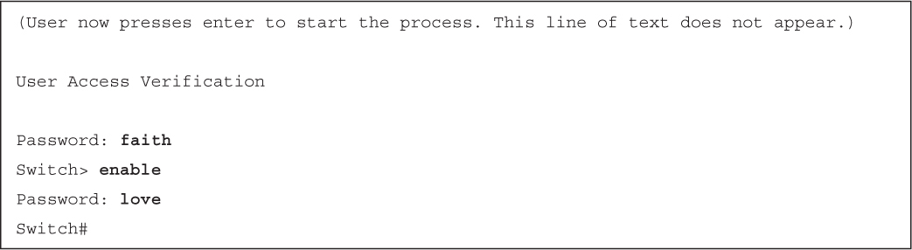</a>

<a href="#f0138-01a" id="code-f0138-01">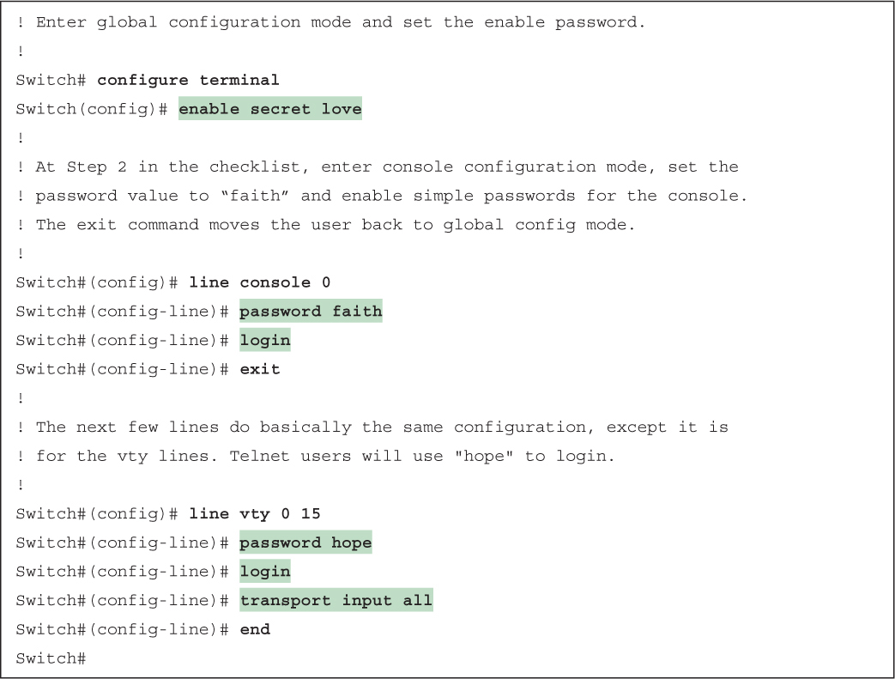</a>

<a href="#f0138-02a" id="code-f0138-02">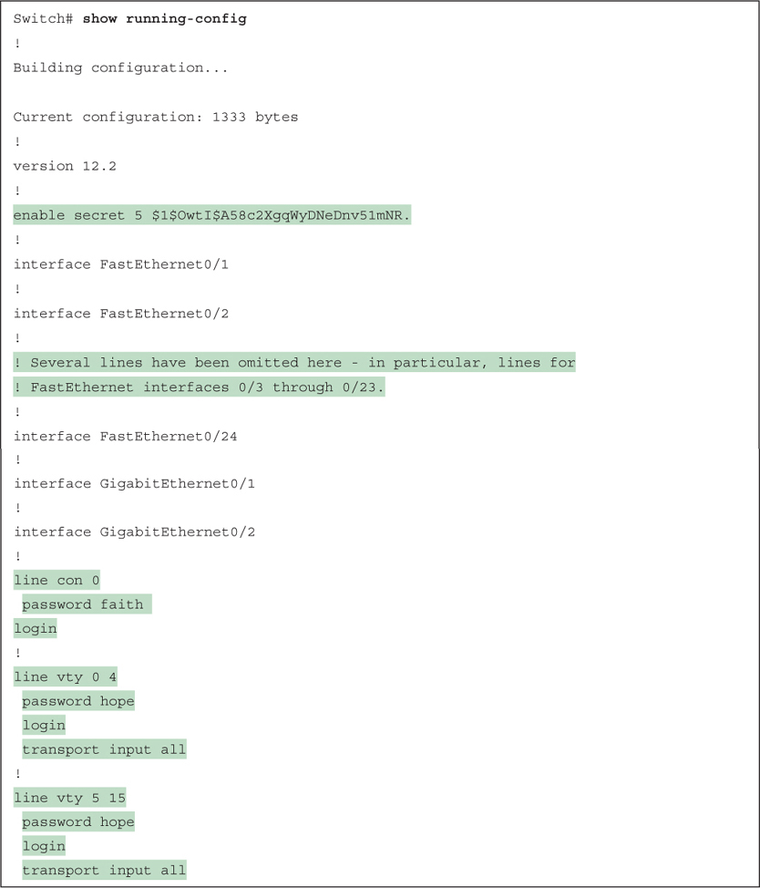</a>

<a href="#f0140-01a" id="code-f0140-01">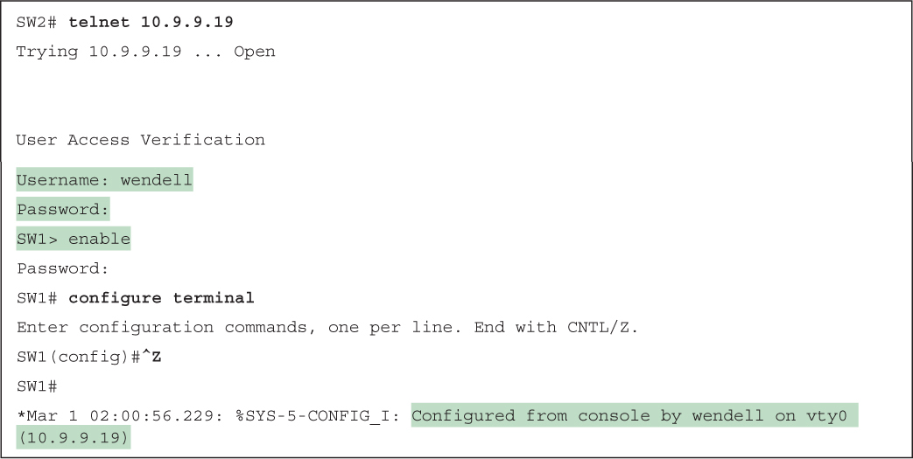</a>

<a href="#f0143-01a" id="code-f0143-01">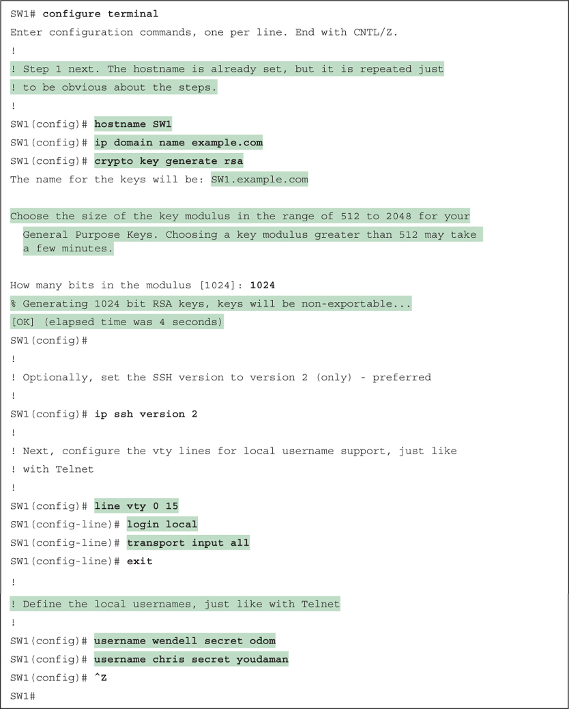</a>

<a href="#f0145-01a" id="code-f0145-01">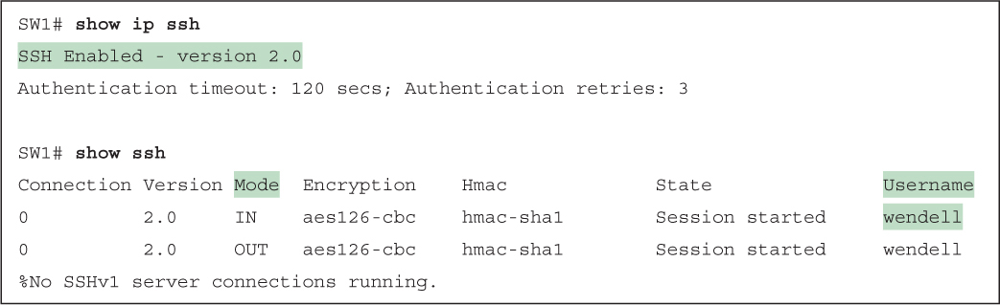</a>

<a href="#f0149-01a" id="code-f0149-01">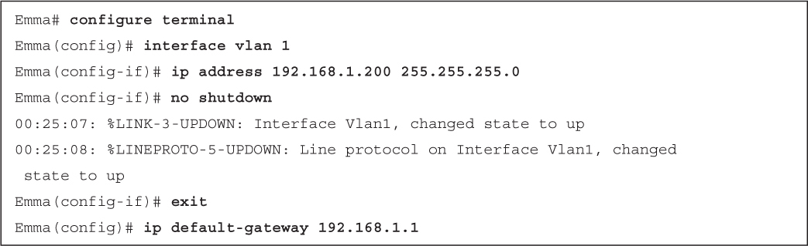</a>

<a href="#f0150-01a" id="code-f0150-01">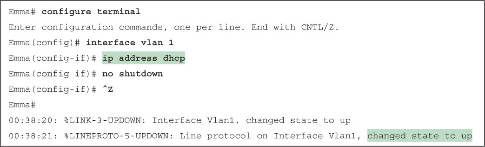</a>

<a href="#f0151-01a" id="code-f0151-01">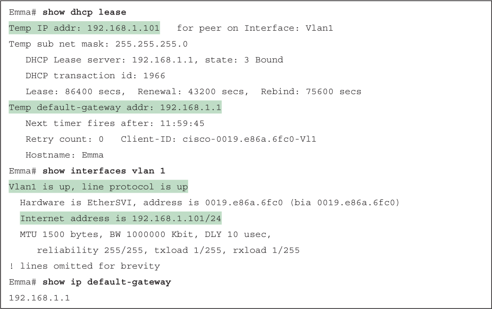</a>

</section>

</section>


<nav class="ccna-chapter-nav" aria-label="章节导航"><a href="v1-05.html">← 上一章</a><a href="v1-07.html">下一章 →</a></nav>
