
<a href="{{ '/subjects/CCNA/' | relative_url }}">← 返回 CCNA 目录</a>

第一卷 · 实现以太网局域网

<nav class="ccna-chapter-nav" aria-label="章节导航"><a href="v1-06.html">← 上一章</a><a href="v1-08.html">下一章 →</a></nav>



<section data-epub-type="chapter">

<h2 class="h2" id="ch07">第 7 章</h2>

<h2 class="h2a">配置与验证交换机接口</h2>

本章涵盖以下考试主题：

1.0 网络基础

1.1 解释网络组件的角色和功能

1.1.b 二层交换机和三层交换机

1.3 比较物理接口和布线类型

1.3.b 连接方式（以太网共享介质和点对点连接）

1.4 识别接口和电缆问题：冲突、错误、双工不匹配和／或速率问题

本书<a href="#part02">第 II 部分</a>的各章在交换机管理和核心交换功能之间交替展开。在<a href="v1-04.html#ch04">第 4 章</a>《<a href="v1-04.html#ch04">使用命令行界面</a>》中，你学习了 CLI 基础，以及如何使用命令配置和验证交换机功能。在<a href="v1-05.html#ch05">第 5 章</a>《<a href="v1-05.html#ch05">分析以太网局域网交换</a>》中，你了解了交换机的主要用途——转发以太网帧，以及如何通过查看 MAC 地址表观察这一过程。<a href="v1-06.html#ch06">第 6 章</a>《<a href="v1-06.html#ch06">配置交换机基本管理功能</a>》随后回到管理任务，介绍一些管理平面功能，例如通过配置 IP 地址和登录安全，使交换机支持 Telnet 和安全外壳协议（SSH）。

本章重点介绍更多核心交换功能，具体是如何配置交换机接口，使其正常工作。第一部分展示如何主要通过 IEEE 自动协商，让交换机接口使用正确的速率和双工方式。第二部分讨论交换机上的一些管理设置，包括禁用和重新启用接口。最后一部分重点介绍如何使用交换机的 <strong>show</strong> 命令，验证接口状态，并解释输出，从中发现一些常见接口问题。

<section>

<h3 class="h3" id="ch07lev1sec1">自测</h3>

如果你希望根据得分决定在本章投入多少时间，可以完成这组自测题（在此作答，或使用 PTP 软件）。各题答案的选项字母列在自测题之后的页面底部。书末和配套网站上的<a href="#ref-appc">附录 C</a>都包含答案及解析。你也可以在 PTP 测试软件中找到答案及解析。

<figure class="table" id="ch07tab01" tabindex="0">

<figcaption>

<strong>表 7-1</strong> 自测：基础知识小节与题目对应关系

</figcaption>

<table class="all">

<thead>

<tr>

<th class="th">
基础知识小节
</th>

<th class="th">
题目
</th>

</tr>

</thead>

<tbody>

<tr>

<td class="border">
配置交换机接口速率与双工方式
</td>

<td class="border">
1–3
</td>

</tr>

<tr>

<td class="border">
管理交换机接口配置
</td>

<td class="border">
4–5
</td>

</tr>

<tr>

<td class="border">
分析交换机接口状态与统计信息
</td>

<td class="border">
6–8
</td>

</tr>

</tbody>

</table>

</figure>

<strong><a id="quess7_1" href="#ques7_1a">1</a>。</strong>交换机 SW1 通过 G1/0/1 端口连接 PC1。两端都使用 IEEE 自动协商，且都具有 10/100/1000 端口。哪些答案描述了交换机选择 G1/0/1 速率和双工设置的方式？（选择两个答案。）

<ol class="lower-alpha">

<li>
根据收到的自动协商消息比较能力，以选择速率。
</li>

<li>
通过分析 PC1 发来的以太网帧的电信号，选择速率。
</li>

<li>
根据收到的自动协商消息比较能力，以选择双工方式。
</li>

<li>
通过分析 PC1 发来的以太网帧的电信号，选择双工方式。
</li>

<li>
根据所选速率对应的默认值，选择双工方式。
</li>

</ol>

<strong><a id="quess7_2" href="#ques7_2a">2</a>。</strong>在哪种 CLI 模式下，可以配置 Fast Ethernet 0/5 接口的双工设置？

<ol class="lower-alpha">

<li>
用户模式
</li>

<li>
特权模式
</li>

<li>
全局配置模式
</li>

<li>
VLAN 模式
</li>

<li>
接口配置模式
</li>

</ol>

<strong><a id="quess7_3" href="#ques7_3a">3</a>。</strong>交换机 SW1 通过 G1/0/1 端口连接 PC1，两端都是 10/100/1000 端口。交换机端口使用 IEEE 自动协商，而 PC1 禁用了自动协商。哪个答案描述了交换机选择 G1/0/1 速率和双工设置的方式？

<ol class="lower-alpha">

<li>
根据收到的自动协商消息比较能力，以选择速率。
</li>

<li>
通过分析 PC1 发来的以太网帧的电信号，选择速率。
</li>

<li>
根据收到的自动协商消息比较能力，以选择双工方式。
</li>

<li>
通过分析 PC1 发来的以太网帧的电信号，选择双工方式。
</li>

<li>
根据所选速率对应的默认值，选择双工方式。
</li>

</ol>

<strong><a id="quess7_4" href="#ques7_4a">4</a>。</strong>交换机 G1/0/5 接口已正确连接电缆，为周末工作做好准备。不过，工程师需要阻止该接口被使用，直到她在本周末的变更窗口中远程启用它。哪项操作有助于实现这一目标？

<ol class="lower-alpha">

<li>
拔掉电缆。
</li>

<li>
执行全局配置命令 <strong>shutdown g1/0/5</strong>。
</li>

<li>
在接口 <strong>g1/0/5</strong> 下执行 <strong>shutdown</strong> 接口子命令。
</li>

<li>
执行全局配置命令 <strong>disable g1/0/5</strong>。
</li>

<li>
在接口 <strong>g1/0/5</strong> 下执行 <strong>enable</strong> 接口子命令。
</li>

</ol>

<strong><a id="quess7_5" href="#ques7_5a">5</a>。</strong>工程师在 Cisco 交换机 SW1 上先配置 <strong>interface range G1/0/10-20</strong>，再配置 <strong>description connected to endpoint device</strong>。随后退出配置模式并执行 <strong>show running-config</strong>。哪些答案最准确地描述相关输出？（选择两个答案。）

<ol class="lower-alpha">

<li>
输出包含 <strong>interface range</strong> 命令。
</li>

<li>
输出不包含 <strong>interface range</strong> 命令。
</li>

<li>
输出列出一条 <strong>description connected to endpoint device</strong> 接口子命令。
</li>

<li>
输出列出 11 条 <strong>description connected to endpoint device</strong> 接口子命令。
</li>

</ol>

<strong><a id="quess7_6" href="#ques7_6a">6</a>。</strong>交换机 <strong>show interfaces status</strong> 命令输出显示 Fa0/1 接口处于 disabled 状态。以下哪些关于 Fa0/1 的说法正确？（选择三个答案。）

<ol class="lower-alpha">

<li>
该接口配置了 <strong>shutdown</strong> 命令。
</li>

<li>
<strong>show interfaces fa0/1</strong> 命令会列出两个状态码：administratively down 和 line protocol down。
</li>

<li>
<strong>show interfaces fa0/1</strong> 命令会列出两个状态码：up 和 down。
</li>

<li>
该接口当前不能用于转发帧。
</li>

<li>
该接口当前可以用于转发帧。
</li>

</ol>

<strong><a id="quess7_7" href="#ques7_7a">7</a>。</strong>交换机 SW1 的 Gigabit 1/0/1 连接到 SW2 的 Gigabit 1/0/2，两端均为 10/100/1000 端口。SW2 的配置包含 <strong>speed</strong> 和 <strong>duplex</strong> 命令，两者的组合恰好禁用了该端口的自动协商。SW2 的 <strong>speed</strong> 与 <strong>duplex</strong> 命令采用哪些设置组合，会导致 SW1 与 SW2 之间双工不匹配？（选择两个答案。）

<ol class="lower-alpha">

<li>
<strong>speed 100</strong> 和 <strong>duplex full</strong>
</li>

<li>
<strong>speed 100</strong> 和 <strong>duplex half</strong>
</li>

<li>
<strong>speed 10</strong> 和 <strong>duplex full</strong>
</li>

<li>
<strong>speed 10</strong> 和 <strong>duplex half</strong>
</li>

</ol>

<strong><a id="quess7_8" href="#ques7_8a">8</a>。</strong>交换机 SW1 通过电缆连接到 SW2 的 G1/0/1 端口。以下哪种情况最可能导致 SW1 的迟发冲突计数器持续增加？

<ol class="lower-alpha">

<li>
SW2 的 G1/0/1 配置了 <strong>shutdown</strong> 接口子命令。
</li>

<li>
两台交换机的 <strong>speed</strong> 接口子命令配置了不同的值。
</li>

<li>
存在双工不匹配，且 SW1 被设为全双工。
</li>

<li>
存在双工不匹配，且 SW1 被设为半双工。
</li>

</ol>

自测答案：

<strong><a id="ques7_1a" href="#ref-ques7_1">1</a></strong> A、C

<strong><a id="ques7_2a" href="#ref-ques7_2">2</a></strong> E

<strong><a id="ques7_3a" href="#ref-ques7_3">3</a></strong> B、E

<strong><a id="ques7_4a" href="#ref-ques7_4">4</a></strong> C

<strong><a id="ques7_5a" href="#ref-ques7_5">5</a></strong> B、D

<strong><a id="ques7_6a" href="#ref-ques7_6">6</a></strong> A、B、D

<strong><a id="ques7_7a" href="#ref-ques7_7">7</a></strong> A、C

<strong><a id="ques7_8a" href="#ref-ques7_8">8</a></strong> D

</section>

<section>

<h3 class="h3box" id="ch07lev1sec2">基础知识</h3>

</section>

<section>

<h3 class="h3" id="ch07lev1sec3">配置交换机接口速率与双工方式</h3>

实际构建以太网局域网时，必须考虑与数十种以太网物理层标准匹配的电缆和连接器，以满足局域网的物理要求。选定并安装后，连接光纤的接口不需要额外配置；不过，UTP 电缆可能具有不同线序，而且支持不同速率和双工设置。因此，安装完成后，使用 UTP 电缆的接口可能还需要额外配置。

本章第一个主要部分讨论接口速率和双工设置，以及 IEEE 自动协商过程，还介绍处理线序问题的 auto-MDIX 功能。最后，本章继续帮助你进一步学习 CLI 中的模式切换和各种约定。

<section>

<h4 class="h4" id="ch07lev2sec1">IEEE 自动协商概念</h4>

以太网网卡和交换机端口通常支持多种标准，因此支持多种速率。例如，你会看到以下标识：

<a id="key_087" href="#ref-gloss_001">10/100</a><strong>：</strong>支持 10 Mbps 和 100 Mbps 以太网的端口。

<a id="key_088" href="#ref-gloss_002">10/100/1000</a><strong>：</strong>支持 10、100 和 1000 Mbps 以太网的端口。

采用支持多种标准和速率的硬件，可以让后续扩展和迁移更容易，主要因为设备能通过 IEEE 自动协商功能自动选择最高速率。例如，如今许多交换机具有大量 10/100/1000 端口，许多较新的终端用户设备也配有 10/100/1000 以太网网卡，因此 PC 和交换机能自动协商到 1000 Mbps，即 1 Gbps。较旧设备，以及一些不需要更高速率的专用设备，可能只支持 10 Mbps 或 100 Mbps。<a id="key_090" href="#ref-gloss_034">自动协商</a>让各链路两端的设备能够就最佳速率达成一致，无需手动配置每个交换机端口的速率。

IEEE 自动协商定义了一个过程，使每条链路两端的设备都向邻近设备告知自己的能力。两端了解对方能力后，便采用速率最高的标准。自动协商还规定，如果两台设备都支持，则优先选择<a id="key_092" href="#ref-gloss_154">全双工</a>，而不是<a id="key_093" href="#ref-gloss_162">半双工</a>。

<section>

<h5 class="h5" id="ch07lev3sec1">正常条件下的自动协商</h5>

采用 IEEE 自动协商时，设备通过发送一系列快速链路脉冲（FLP）来声明自己的能力。FLP 消息中的数据包含一些比特，用于标识设备支持的以太网标准和双工能力，实际上就是声明设备支持的速率和双工设置。

甚至在端点选择物理层标准之前，FLP 就能工作。FLP 使用带外电信号，独立于各种用于传输以太网帧的物理层标准。任何支持自动协商的设备，都支持这些带外 FLP 消息。FLP 解决了这样一个问题：在链路尚未建立、不能正常传输数据之前，设备如何互相发送信息。

<a href="#ch07fig01">图 7-1</a> 展示自动协商按预期工作的三个示例。首先，公司安装了支持 10BASE-T、100BASE-T 和 1000BASE-T 的电缆，即具有四对导线且质量适当的电缆。三个示例中，PC 和交换机都使用自动协商，电缆采用正确的直通线序并正常工作。本例交换机的所有端口都支持 10/100/1000，而各 PC 网卡支持的选项不同，分别是仅 10 Mbps、10/100 和 10/100/1000，如图所示。

<figure class="image-c" id="ch07fig01">

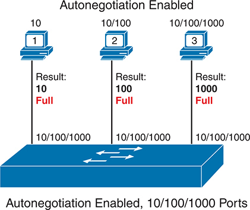

<figcaption>

<strong>图 7-1</strong> <em>两个节点均正常工作时的 IEEE 自动协商结果</em>

<aside class="hidden" id="a07fig01">

所有用户均启用了自动协商。用户 1 的连接结果为 10 Mbps 全双工，支持 10/100/1000 Mbps，并连接到已启用自动协商、具有 10/100/1000 端口的交换机。用户 2 的连接结果为 100 Mbps 全双工，支持 10/100/1000 Mbps，同样连接到已启用自动协商、具有 10/100/1000 端口的交换机。用户 3 的连接结果为 1000 Mbps 全双工，支持 10/100/1000 Mbps，也连接到已启用自动协商、具有 10/100/1000 端口的交换机。

</aside>

</figcaption>

</figure>

下面分别分析各台 PC 的逻辑：

<ul class="sq">

<li>
<strong>PC1：</strong>PC1 发送自动协商 FLP，声明只支持 10 Mbps，不支持 100 或 1000 Mbps，同时支持全双工和半双工。交换机声明支持 10、100、1000 Mbps 及两种双工方式。因此，PC 和交换机都选择双方共同支持的最高速率 10 Mbps 和最佳双工方式——全双工。
</li>

<li>
<strong>PC2：</strong>PC2 声明支持 10、100 Mbps，以及全双工和半双工。交换机同样声明支持 10、100、1000 Mbps 及两种双工方式。两台设备采用共同支持的最佳速率和双工方式，即 100 Mbps 和全双工。
</li>

<li>
<strong>PC3：</strong>PC3 使用 10/100/1000 网卡，支持全部三种速率，因此网卡和交换机端口都选择 1000 Mbps 和全双工。
</li>

</ul>

总结起来，两端都使用自动协商时，规则如下：

<ul class="sq">

<li>
两端使用快速链路脉冲（FLP）发送消息；相对于任何具体的数据传输标准，这些消息均为带外消息。
</li>

<li>
消息声明所有支持的速率与双工组合。
</li>

<li>
收到链路对端的消息后，每台设备都选择双方共同支持的最高速率和最佳双工方式，全双工优于半双工。
</li>

</ul>

</section>

<section>

<h5 class="h5" id="ch07lev3sec2">只有一个节点使用自动协商时的结果</h5>

两台设备都使用自动协商时，结果很明确：双方采用共同支持的最高速率和最佳双工方式。

Cisco 一再建议，在所有支持自动协商的以太网链路两端启用自动协商；但如果必须禁用，一定要在链路两端同时配置速率和双工方式。例如，某些部署倾向于预先定义两台交换机之间链路的速率和双工方式。为此，可以使用 <strong>speed 1000</strong>（表示 1000 Mbps，即 1 Gbps）和 <strong>duplex full</strong> 等命令。如果两端都配置相同值，链路就会因匹配的 1000BASE-T 全双工设置而正常工作。

不过，许多设备都可以禁用自动协商，这意味着工程师可能作出不妥的选择：只在链路一端禁用，另一端仍启用。实际网络中不要这样做，因为它可能导致<em>双工不匹配</em>和<em>迟发冲突</em>等问题。

为了理解会发生什么，先看禁用了自动协商的设备。它必须使用某个物理层标准，通常由静态配置指定，因此会开始发送符合该标准的以太网帧，但不会发送 FLP。另一台使用自动协商的设备会发送 FLP，却收不到 FLP。当尝试自动协商的设备意识到没有收到 FLP 后，可以检查收到的以太网帧电信号，识别其中 10BASE-T、100BASE-T 等不同标准的信号差异。知道所用标准后，它会采用相同标准，从而解决速率选择问题。

双工方式则需要使用默认值。如果速率为 10 或 100 Mbps，尝试自动协商的设备使用半双工；否则选择全双工。

IEEE 将对端禁用自动协商时采用的这种逻辑称为<a id="key_095" href="#ref-gloss_298">并行检测</a>，概括如下：

<ul class="sq">

<li>
<strong>速率：</strong>分析邻居传来的帧，检测其物理层标准，并使用对应速率。
</li>

<li>
<strong>双工：</strong>根据速率选择默认值：10 或 100 Mbps 使用半双工，更高速率使用全双工。
</li>

</ul>

注意

速率高于 1 Gbps 的以太网接口始终使用全双工。

<a href="#ch07fig02">图 7-2</a> 展示自动协商并行检测逻辑的三个示例。每种情况下，PC 都配置为禁用自动协商，而所有端口均为 10/100/1000 的交换机继续使用自动协商。图顶部显示各 PC 网卡的配置，交换机作出的选择列在各交换机端口旁边。

<figure class="image-c" id="ch07fig02">

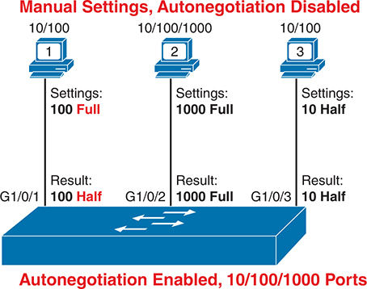

<figcaption>

<strong>图 7-2</strong> <em>使用并行检测逻辑时的 IEEE 自动协商结果</em>

<aside class="hidden" id="a07fig02">

所有用户均手动禁用自动协商。用户 1 的连接为 10/100 Mbps 全双工，支持 10/100/1000 Mbps，连接到已启用自动协商、具有 10/100/1000 端口的交换机，连接接口为 G1/0/1。输入设置为 100 Mbps 全双工，结果为 100 Mbps 半双工。用户 2 的连接为 10/100/1000 Mbps 全双工，支持 10/100/1000 Mbps，连接到同样启用自动协商的交换机，接口为 G1/0/2。输入设置为 1000 Mbps 全双工，结果为 1000 Mbps 全双工。用户 3 的连接为 10/100 Mbps 全双工，支持 10/100/1000 Mbps，连接到同样启用自动协商的交换机，接口为 G1/0/3。输入设置为 10 Mbps 半双工，结果为 10 Mbps 半双工。

</aside>

</figcaption>

</figure>

从左到右查看各条链路：

<ul class="sq">

<li>
<strong>PC1：</strong>PC 使用 100 Mbps 全双工设置。交换机 G1/0/1 端口没有收到自动协商 FLP 消息，而是检测到 PC1 正以 100 Mbps 发送帧。随后交换机根据默认规则选择半双工，即速率为 10 或 100 Mbps 时使用半双工。
</li>

<li>
<strong>PC2：</strong>交换机采用与连接 PC1 时相同的步骤和逻辑。G1/0/2 端口检测到 1000BASE-T 信号，速率为 1 Gbps，再根据速率对应的默认值选择全双工。
</li>

<li>
<strong>PC3：</strong>PC 使用最差的组合，即较慢的 10 Mbps 和较差的半双工。交换机端口没有收到 FLP，因此根据收到的帧检测出 10BASE-T，采用 10 Mbps，并按基于速率的默认值选择半双工。
</li>

</ul>

仔细看看 PC1 示例，它展示了一种称为<a id="key_091" href="#ref-gloss_115">双工不匹配</a>的不良结果。PC1 与 SW1 的 G1/0/1 都使用 100 Mbps，因此可以发送数据。不过，PC1 使用全双工，不会尝试使用带冲突检测的载波侦听多路访问（CSMA/CD）逻辑，可以随时发送帧。交换机 G1/0/1 使用半双工，会执行 CSMA/CD。因此，如果 G1/0/1 正在发送帧时 PC1 也发送帧，交换机端口就会认为链路发生冲突。此时，交换机端口停止发送、退避、重传帧等。结果是链路虽然已建立，但性能很差。稍后的“<a href="#ch07lev2sec8">双工不匹配问题</a>”一节将进一步讨论，重点介绍如何识别其症状。

注意

再次强调，在实际网络中应使用自动协商。如果有明确理由不使用，应确保配置链路两端设备，并采用相同设置。

</section>

<section>

<h5 class="h5" id="ch07lev3sec3">自动协商与局域网集线器</h5>

局域网集线器也会影响自动协商。集线器不参与自动协商，不生成 FLP 消息，也不转发相连设备发送的自动协商 FLP 消息。因此，连接集线器的设备收不到 FLP，只能使用 IEEE 自动协商的并行检测规则。这可以工作，但通常会使设备使用 10 Mbps 半双工。

<a href="#ch07fig03">图 7-3</a> 展示一个使用旧式 10BASE-T 集线器的小型以太网局域网。右侧 PC3 和 PC4 根据收到的信号检测出 10 Mbps，然后选择该速率对应的默认双工方式——半双工。这里使用 10 Mbps 半双工可以正常工作：右侧 PC 必须使用半双工，因为集线器要求所有相连设备使用半双工来避免冲突。

<figure class="image-c" id="ch07fig03">

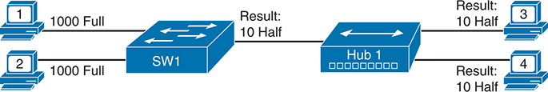

<figcaption>

<strong>图 7-3</strong> <em>连接局域网集线器时的 IEEE 自动协商</em>

<aside class="hidden" id="a07fig03">

用户 1 和用户 2 达到 1000 Mbps 全双工连接速率。它们连接交换机 SW1，交换机再连接集线器，协商结果为 10 Mbps 半双工。集线器 Hub1 连接用户 3 和用户 4，两者都以 10 Mbps 半双工运行。

</aside>

</figcaption>

</figure>

</section>

</section>

<section>

<h4 class="h4" id="ch07lev2sec2">配置自动协商、速率和双工方式</h4>

以太网链路要正常工作，需要正常的电缆，且两端必须使用相同的物理层标准和双工设置。Cisco 交换机默认使用自动协商，应能选择正确的速率和双工方式，使链路正常工作。接下来的几页将展示如何验证自动协商过程，查看交换机为接口选择了什么设置，以及如何手动设置速率和双工方式，并介绍一些相关命令。

<section>

<h5 class="h5" id="ch07lev3sec4">在 Cisco 交换机上使用自动协商</h5>

<a href="#ch07fig04">图 7-4</a> 展示接下来几个示例所使用的小型网络。图中有一条正常链路，已安装电缆，设备 PC1 已通电，两端都使用 IEEE 自动协商。另两条链路不工作：一条没有连接电缆，另一条虽然安装了电缆，但设备未通电。

<figure class="image-c" id="ch07fig04">

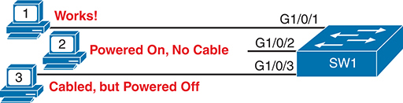

<figcaption>

<strong>图 7-4</strong> <em>与<a href="#exa7_1">例 7-1</a> 至<a href="#exa7_4">例 7-4</a> 对应的网络拓扑</em>

<aside class="hidden" id="a07fig04">

用户 1 正常运行，连接到 SW1 的 GigabitEthernet 1/0/1。用户 2 已通电但没有电缆连接，对应 SW1 的 GigabitEthernet 1/0/2。用户 3 已接线但未通电，连接 SW1 的 GigabitEthernet 1/0/3。

</aside>

</figcaption>

</figure>

前几个示例中，SW1 使用默认自动协商设置。若要明确配置这些设置，应使用接口子命令 <strong>speed auto</strong> 和 <strong>duplex auto</strong>。不过，由于 <strong>show running-config</strong> 和 <strong>show startup-config</strong> 通常不显示默认配置命令，因此<a href="#exa7_1">例 7-1</a> 中没有 <strong>speed</strong> 和 <strong>duplex</strong> 命令，就确认了接口使用自动协商。

<strong>例 7-1</strong> <em>确认<a href="#ch07fig01">图 7-1</a> 中交换机接口采用全部默认设置</em>

<a href="#code-f0166-01" id="f0166-01a">点击此处查看代码原图</a>

<pre class="pre-ex" tabindex="0"><code class="highlight">SW1# <strong>show running-config</strong>
! Lines omitted for brevity
interface GigabitEthernet1/0/1
!
interface GigabitEthernet1/0/2
!
interface GigabitEthernet1/0/3
!
! Lines omitted for brevity
SW1#</code></pre>

<a href="#exa7_2">例 7-2</a> 展示如何消除这样的疑问：没有出现 <strong>speed auto</strong> 和 <strong>duplex auto</strong> 接口子命令，是否就能确认这些设置？示例先在接口上配置这些命令，即使配置完成，<strong>show running-config</strong> 仍不显示它们，从而确认它们是默认设置。顺便说一句，任何配置命令都可以用这个过程检查。

<strong>例 7-2</strong> <em>确认自动协商是默认设置</em>

<a href="#code-f0166-02" id="f0166-02a">点击此处查看代码原图</a>

<pre class="pre-ex" tabindex="0"><code class="highlight">SW1# <strong>configure terminal</strong>
SW1(config)# <strong>interface gigabitEthernet 1/0/1</strong>
SW1(config-if)# <strong>speed auto</strong>
SW1(config-if)# <strong>duplex auto</strong>
SW1(config-if)# <strong>^Z</strong>
SW1# <strong>show running-config interface gigabitEthernet 1/0/1</strong>
Building configuration...

Current configuration : 38 bytes
!
interface GigabitEthernet1/0/1
end
SW1#</code></pre>

此外，作为快速检查接口配置的方法，请注意示例末尾的 <strong>show running-config interface GigabitEthernet1/0/1</strong> 命令。这是一条受支持的命令，只显示所列接口的配置。

确认交换机接口上自动协商运行情况的更好方法，是使用 <strong>show interfaces status</strong> 命令。<a href="#exa7_3">例 7-3</a> 展示基于<a href="#ch07fig04">图 7-4</a> 状态的输出。特别注意 Duplex 和 Speed 列，其含义如下：

<strong>a-full：</strong>全双工；前缀 a- 表示交换机通过自动协商学习到该值。

<strong>a-1000：</strong>1000 Mbps，即 1 Gbps；前缀 a- 表示交换机通过自动协商学习到该设置。

<strong>auto：</strong>物理链路正常时，该接口会使用自动协商。

<strong>例 7-3</strong> <em>解读自动协商完成前后的线索</em>

<a href="#code-f0167-01" id="f0167-01a">点击此处查看代码原图</a>

<pre class="pre-ex" tabindex="0"><code class="highlight">SW1# <strong>show interfaces status</strong>
Port       Name           Status       Vlan       Duplex  Speed Type
Gi1/0/1                   connected    1          a-full a-1000 10/100/1000BaseTX
Gi1/0/2                   notconnect   1          auto     auto 10/100/1000BaseTX
Gi1/0/3                   notconnect   1          auto     auto 10/100/1000BaseTX
Gi1/0/4                   notconnect   1          auto     auto 10/100/1000BaseTX
Gi1/0/5                   notconnect   1          auto     auto 10/100/1000BaseTX
Gi1/0/6                   notconnect   1          auto     auto 10/100/1000BaseTX
Gi1/0/7                   notconnect   1          auto     auto 10/100/1000BaseTX
Gi1/0/8                   notconnect   1          auto     auto 10/100/1000BaseTX
Gi1/0/9                   notconnect   1          auto     auto 10/100/1000BaseTX
Gi1/0/10                  notconnect   1          auto     auto 10/100/1000BaseTX
Gi1/0/11                  notconnect   1          auto     auto 10/100/1000BaseTX
Gi1/0/12                  notconnect   1          auto     auto 10/100/1000BaseTX
Gi1/0/13                  notconnect   1          auto     auto 10/100/1000BaseTX
Gi1/0/14                  notconnect   1          auto     auto 10/100/1000BaseTX
Gi1/0/15                  notconnect   1          auto     auto 10/100/1000BaseTX
Gi1/0/16                  notconnect   1          auto     auto 10/100/1000BaseTX
Gi1/0/17                  notconnect   1          auto     auto 10/100/1000BaseTX
Gi1/0/18                  notconnect   1          auto     auto 10/100/1000BaseTX
Gi1/0/19                  notconnect   1          auto     auto 10/100/1000BaseTX
Gi1/0/20                  notconnect   1          auto     auto 10/100/1000BaseTX
Gi1/0/21                  notconnect   1          auto     auto 10/100/1000BaseTX
Gi1/0/22                  notconnect   1          auto     auto 10/100/1000BaseTX
Gi1/0/23                  notconnect   1          auto     auto 10/100/1000BaseTX
Gi1/0/24                  notconnect   1          auto     auto 10/100/1000BaseTX
Te1/1/1                   connected    1          full      10G SFP-10GBase-SR
Te1/1/2                   notconnect   1          auto     auto unknown
Te1/1/3                   notconnect   1          auto     auto unknown
Te1/1/4                   notconnect   1          auto     auto unknown</code></pre>

<a href="#exa7_3">例 7-3</a> 的前几行输出确认 G1/0/1 端口通过自动协商正常工作。根据 Duplex 和 Speed 列中突出显示的值，可以看出它使用 1000BASE-T 和全双工，并且这些设置由自动协商学习得到，由 a- 前缀表示。

G1/0/2 和 G1/0/3 的输出展示未工作端口的正常状态。Status 列中的 notconnect 表示链路不可用：PC2 是因为没有电缆，PC3 是因为未通电。只有物理链路正常，自动协商才能工作。

除了 <strong>show interfaces status</strong>，<strong>show interfaces</strong> 命令也提供一些自动协商数据。<a href="#exa7_4">例 7-4</a> 展示<a href="#ch07fig04">图 7-4</a> 中正常工作的 G1/0/1 接口输出。请注意大约第七行的高亮文本，它显示链路使用的速率和双工方式；不过，该命令对正常工作的 G1/0/1 并未说明是否使用了自动协商。

<strong>例 7-4</strong> <em><strong>show interfaces</strong> 命令中的自动协商线索</em>

<a href="#code-f0168-01" id="f0168-01a">点击此处查看代码原图</a>

<pre class="pre-ex" tabindex="0"><code class="highlight">SW1# <strong>show interfaces gigabitEthernet 1/0/1</strong>
GigabitEthernet1/0/1 is up, line protocol is up (connected)
  Hardware is Gigabit Ethernet, address is 4488.165a.f201 (bia 4488.165a.f201)
  MTU 1500 bytes, BW 1000000 Kbit/sec, DLY 10 usec,
     reliability 255/255, txload 1/255, rxload 1/255
  Encapsulation ARPA, loopback not set
  Keepalive set (10 sec)
  Full-duplex, 1000Mb/s, media type is 10/100/1000BaseTX
  input flow-control is on, output flow-control is unsupported
  ARP type: ARPA, ARP Timeout 04:00:00
  Last input 00:00:01, output 00:00:00, output hang never
  Last clearing of "show interface" counters never
  Input queue: 0/2000/0/0 (size/max/drops/flushes); Total output drops: 0
  Queueing strategy: fifo
  Output queue: 0/40 (size/max)
  5 minute input rate 0 bits/sec, 0 packets/sec
  5 minute output rate 0 bits/sec, 0 packets/sec
     14228 packets input, 1870879 bytes, 0 no buffer
     Received 14223 broadcasts (14222 multicasts)
     0 runts, 0 giants, 0 throttles
     0 input errors, 0 CRC, 0 frame, 0 overrun, 0 ignored
     0 watchdog, 14222 multicast, 0 pause input
     0 input packets with dribble condition detected
     56865 packets output, 7901974 bytes, 0 underruns
     Output 17109 broadcasts (0 multicasts)
     0 output errors, 0 collisions, 2 interface resets
     0 unknown protocol drops
     0 babbles, 0 late collision, 0 deferred
     0 lost carrier, 0 no carrier, 0 pause output
     0 output buffer failures, 0 output buffers swapped out

SW1# <strong>show interfaces g1/0/2</strong>
GigabitEthernet1/0/2 is down, line protocol is down (notconnect)
  Hardware is Gigabit Ethernet, address is 4488.165a.f202 (bia 4488.165a.f202)
  MTU 1500 bytes, BW 1000000 Kbit/sec, DLY 10 usec,
     reliability 255/255, txload 1/255, rxload 1/255
  Encapsulation ARPA, loopback not set
  Keepalive set (10 sec)
  Auto-duplex, Auto-speed, media type is 10/100/1000BaseTX
! Lines omitted for brevity</code></pre>

不过，对于 G1/0/2 这样的未工作接口，<strong>show interfaces</strong> 命令确实提供了一些自动协商线索，如<a href="#exa7_4">例 7-4</a> 末尾所示。接口采用默认 <strong>speed auto</strong> 和 <strong>duplex auto</strong> 设置时，输出通过auto-duplex 和 auto-speed 文本暗示这些设置。如果配置了具体速率或双工方式，输出则会显示那些具体设置。

</section>

<section>

<h5 class="h5" id="ch07lev3sec5">手动设置速率和双工方式</h5>

交换机的 <strong>speed</strong> 和 <strong>duplex</strong> 接口子命令，可以设置接口的具体速率和双工方式。即使听起来重复，也要再次强调：在生产网络中，请使用并信任自动协商。不过，为备考而涵盖所有组合，如果你希望手动配置，Cisco 建议配置链路两端的设备，当然要使用相同值。

<a href="#ch07fig05">图 7-5</a> 和<a href="#exa7_5">例 7-5</a> 展示手动配置两台交换机之间链路的速率和双工方式。按照建议，工程师为两台设备配置相同设置，链路正常工作。

<figure class="image-c" id="ch07fig05">

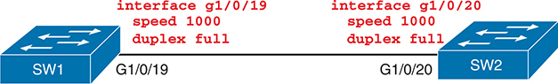

<figcaption>

<strong>图 7-5</strong> <em>配置交换机之间链路的速率和双工方式</em>

<aside class="hidden" id="a07fig05">

两台交换机互连。SW1 将 GigabitEthernet 1/0/19（G1/0/19）接口速率设为 1000 Mbps，双工方式设为全双工。该接口连接 SW2 的 GigabitEthernet 1/0/20（G1/0/20），后者同样配置为 1000 Mbps 全双工。

</aside>

</figcaption>

</figure>

<strong>例 7-5</strong> <em>在链路两端配置速率和双工方式</em>

<a href="#code-f0169-01" id="f0169-01a">点击此处查看代码原图</a>

<pre class="pre-ex" tabindex="0"><code class="highlight">SW1# <strong>show running-config interface g1/0/19</strong>
Building configuration...

Current configuration : 63 bytes
!
interface GigabitEthernet1/0/19
 speed 1000
 duplex full
end</code></pre>

<pre class="pre-ex" tabindex="0"><code class="highlight">! Now, on switch SW2
SW2# <strong>show running-config interface g1/0/20</strong>
Building configuration...

Current configuration : 64 bytes
!
interface GigabitEthernet1/0/20
 speed 1000
 duplex full
end
SW1#</code></pre>

在<a href="#exa7_5">例 7-5</a> 的场景中，两台交换机都设置了速率和双工方式，因此不需要使用自动协商。它们直接开始使用 1000BASE-T 全双工标准，链路正常工作。

<a href="#exa7_6">例 7-6</a> 展示 <strong>show interfaces status</strong> 输出中一个容易忽略的细节，它说明本例交换机没有使用自动协商。首先注意，SW1 的G1/0/19 接口达到 connected 状态，表示链路正常。Duplex 和 Speed 列显示 full 和 1000，没有 a- 前缀。缺少 a- 表示接口没有通过自动协商选择设置，而是使用配置值。（前面<a href="#exa7_3">例 7-3</a> 展示了 a-full 和 a-1000 的情况。）

<strong>例 7-6</strong> <em>未使用自动协商时的 <strong>show interfaces status</strong> 输出</em>

<a href="#code-f0170-01" id="f0170-01a">点击此处查看代码原图</a>

<pre class="pre-ex" tabindex="0"><code class="highlight">SW1# <strong>show interfaces g1/0/20 status</strong>

Port         Name             Status       Vlan       Duplex  Speed Type
Gi1/0/19                      connected    1            full   1000
10/100/1000BaseTX

SW1# <strong>show interfaces g1/0/19</strong>
GigabitEthernet1/0/19 is up, line protocol is up (connected)
  Hardware is Gigabit Ethernet, address is 4488.165a.f213 (bia 4488.165a.f213)
  MTU 1500 bytes, BW 1000000 Kbit/sec, DLY 10 usec,
     reliability 255/255, txload 1/255, rxload 1/255
  Encapsulation ARPA, loopback not set
  Keepalive set (10 sec)
  Full-duplex, 1000Mb/s, media type is 10/100/1000BaseTX
! Lines omitted for brevity</code></pre>

注意

在某些 Cisco Catalyst 交换机端口上，同时配置速率和双工方式会禁用自动协商；在另一些端口上则不会。在实际网络中，如果确实需要把速率和双工方式设为具体值，应特别仔细地确认链路两端的设置匹配。

</section>

</section>

<section>

<h4 class="h4" id="ch07lev2sec3">在 Cisco 交换机上使用 Auto-MDIX</h4>

交换机接口要正常工作并达到 connected 状态，工程师应在交换机端口与相连设备之间安装正确的电缆。UTP 电缆通常使用 RJ-45 连接器，且必须采用直通或交叉线序，相关内容已在<a href="v1-02.html#ch02">第 2 章</a>《<a href="v1-02.html#ch02">以太网局域网基础</a>》的“<a href="v1-02.html#ch02lev1sec4">使用 UTP 构建物理以太网局域网</a>”一节介绍。

<a href="v1-02.html#ch02">第 2 章</a>还介绍了相关概念 <a id="key_089" href="#ref-gloss_033">auto-MDIX</a>，即自动介质相关接口交叉。启用后，以太网接口可以检测相连电缆是否采用了错误线序，并克服这一问题。例如，两台交换机之间本应使用交叉线序。如果电缆是直通线序，auto-MDIX 可以发现问题，并在接口电子电路中交换线对，达到与交叉电缆相同的效果。

<a href="#ch07fig06">图 7-6</a>、<a href="#exa7_7">例 7-7</a> 和<a href="#exa7_8">例 7-8</a> 演示 auto-MDIX。图中两台交换机通过直通电缆连接。Cisco Catalyst 交换机默认使用 auto-MDIX，对应默认接口子命令 <strong>mdix auto</strong>。与本章前面的 <strong>speed</strong> 和 <strong>duplex</strong> 命令一样，默认 <strong>mdix auto</strong> 子命令不会显示在配置中。<a href="#exa7_7">例 7-7</a> 确认配置中没有 <strong>mdix auto</strong>，但链路仍达到 connected 状态。

<figure class="image-c" id="ch07fig06">

<figcaption>

<strong>图 7-6</strong> <em>需要交叉电缆却使用直通电缆的交换机间链路</em>

<aside class="hidden" id="a07fig06">

两台交换机互连。SW1 的 GigabitEthernet 1/0/19（G1/0/19）接口处于完全启用状态，通过直通线序连接到 SW2 同样启用的 GigabitEthernet 1/0/20（G1/0/20）。

</aside>

</figcaption>

</figure>

<strong>例 7-7</strong> <em>全部采用默认设置时，交换机间链路正常工作</em>

<a href="#code-f0171-01" id="f0171-01a">点击此处查看代码原图</a>

<pre class="pre-ex" tabindex="0"><code class="highlight">SW1# <strong>running-config interface GigabitEthernet 1/0/19</strong>
Building configuration...

Current configuration : 39 bytes
!
interface GigabitEthernet1/0/19
end

SW1# <strong>show interfaces 1/0/19 status</strong>

Port        Name            Status       Vlan       Duplex  Speed Type
Gi1/0/19                    connected    1          a-full a-1000 10/100/1000BaseTX</code></pre>

只要链路任意一端或两端启用 auto-MDIX，它就能工作。在<a href="#exa7_7">例 7-7</a> 中，两台交换机都默认启用，但只需一端交换线对。如果只在一端禁用，另一端会交换线对。若要阻止 auto-MDIX 发挥作用，必须在链路两端都使用 <strong>no mdix auto</strong> 接口子命令禁用它。

<a href="#exa7_8">例 7-8</a> 正是这种情况。示例开始前，工程师已在 SW2 上配置 <strong>no mdix auto</strong> 接口子命令。示例显示在 SW1 上禁用的过程。结果是两台交换机都不再使用 auto-MDIX，接口故障并进入 notconnect 状态。

<strong>例 7-8</strong> <em>两端均禁用 Auto-MDIX 时，交换机间链路失效</em>

<a href="#code-f0171-02" id="f0171-02a">点击此处查看代码原图</a>

<pre class="pre-ex" tabindex="0"><code class="highlight">SW1# <strong>running-config interface GigabitEthernet 1/0/19</strong>
SW1# <strong>config t</strong>
Enter configuration commands, one per line.  End with CNTL/Z.
SW1(config)# <strong>int g1/0/19</strong>
SW1(config-if)# <strong>no mdix auto</strong>
SW1(config-if)#
*Oct  5 12:50:22.177: %LINEPROTO-5-UPDOWN: Line protocol on Interface
GigabitEthernet1/0/19, changed state to down
*Oct  5 12:50:23.175: %LINK-3-UPDOWN: Interface GigabitEthernet1/0/19, changed state
to down
SW1(config-if)# <strong>^Z</strong>
SW1#
SW1# <strong>show interfaces g1/0/19 status</strong>

Port        Name            Status       Vlan       Duplex  Speed Type
Gi1/0/19                    notconnect   1            auto   auto 10/100/1000BaseTX</code></pre>

顺便说一下，IOS 支持全局配置命令 <strong>interface GigabitEthernet 1/0/19</strong> 的多种有效缩写，包括示例中的 <strong>int g1/0/19</strong>。

</section>

</section>

<section>

<h3 class="h3" id="ch07lev1sec4">管理交换机接口配置</h3>

本章接下来介绍少量额外接口子命令，具体是 <strong>description</strong> 和 <strong>shutdown</strong>。前者允许记录每个接口的相关信息，后者提供在管理上禁用和启用接口的方法。

本节还进一步解释与接口有关的 IOS CLI 机制，讨论并举例说明如何使用 <strong>no</strong> 命令移除接口配置。

<section>

<h4 class="h4" id="ch07lev2sec4">Description 与 Interface Range 命令</h4>

<strong>description</strong> <em>text</em> 接口子命令允许为接口添加文本描述。描述可使用包括空格在内的键盘字符，Cisco 交换机通常支持约 200 个字符。例如，如果希望在交换机中保存接口及其所连接设备的信息，就可以使用 <strong>description</strong> 接口子命令记录这些细节。

<a href="#exa7_9">例 7-9</a> 为<a href="#ch07fig04">图 7-4</a> 中的 G1/0/1 添加简单描述，演示这一过程。示例展示配置，以及再次显示该信息的一些 <strong>show</strong> 命令输出。请注意，<strong>show interfaces status</strong> 不会为完整的 <strong>description</strong> 文本预留足够空间，而 <strong>show interface</strong> 命令会。

<strong>例 7-9</strong> <em>在交换机 SW1 上配置和验证 <strong>description</strong> 命令</em>

<a href="#code-f0172-01" id="f0172-01a">点击此处查看代码原图</a>

<pre class="pre-ex" tabindex="0"><code class="highlight">SW1# <strong>configure terminal</strong>
Enter configuration commands, one per line. End with CNTL/Z.
SW1(config)# <strong>interface GigabitEthernet 1/0/1</strong>
SW1(config-if)# <strong>description Link to PC1, using autonegotiation</strong>
SW1(config-if)# <strong>^Z</strong>
SW1# <strong>show interfaces g1/0/1 status</strong>

Port         Name               Status       Vlan     Duplex  Speed Type
Gi1/0/1      Link to PC1, using connected    1        a-full a-1000 10/100/1000BaseTX
SW1# <strong>show interfaces g1/0/1</strong>
GigabitEthernet1/0/1 is up, line protocol is up (connected)
  Hardware is Gigabit Ethernet, address is 4488.165a.f201 (bia 4488.165a.f201)
  Description: Link to PC1, using autonegotiation
! Lines omitted for brevity
SW1#</code></pre>

<a href="#exa7_10">例 7-10</a> 展示如何同时在多个接口上配置相同子命令，以节省操作。示例再次使用 <strong>description</strong> 命令，但先执行 <strong>interface range GigabitEthernet 1/0/2 - 10</strong>。<strong>interface range</strong> 命令告诉 IOS 将后续子命令应用于多个接口，本例为 Gi1/0/2 至 Gi1/0/10。

<strong>例 7-10</strong> <em>使用 <strong>interface range</strong> 命令配置多个接口</em>

<a href="#code-f0173-01" id="f0173-01a">点击此处查看代码原图</a>

<pre class="pre-ex" tabindex="0"><code class="highlight">SW1# <strong>configure terminal</strong>
SW1(config)# <strong>interface range g1/0/2 - 10</strong>
SW1(config-if-range)# <strong>description Interface not in use</strong>
SW1(config-if-range)# <strong>^Z</strong>
SW1#</code></pre>

IOS 不会将 <strong>interface range</strong> 命令写入配置。相反，它的效果就像你在指定范围内每个接口下分别输入了这些子命令。<a href="#exa7_11">例 7-11</a> 摘录 <strong>show running-config</strong> 输出，列出<a href="#exa7_10">例 7-10</a> 配置中 G1/0/2–3 的配置。示例显示两个接口都具有相同的 <strong>description</strong> 命令；为了节省篇幅，没有展示 G1/0/2 到 G1/0/10 的全部接口。

<strong>例 7-11</strong> <em>IOS 如何展开 <strong>interface range</strong> 之后输入的子命令</em>

<a href="#code-f0173-02" id="f0173-02a">点击此处查看代码原图</a>

<pre class="pre-ex" tabindex="0"><code class="highlight">SW1# <strong>show running-config</strong>
! Lines omitted for brevity
interface GigabitEthernet1/0/2
 description Interface not in use
!
interface GigabitEthernet1/0/3
 description Interface not in use
! Lines omitted for brevity
SW1# <strong>show interfaces description</strong>
Interface                  Status         Protocol Description
Vl1                        up             up
Gi0/0                      admin down     down
Gi1/0/1                    up             up       Link to PC1, using
autonegotiation
Gi1/0/2                    down           down     Interface not in use
Gi1/0/3                    down           down     Interface not in use
! Lines omitted for brevity</code></pre>

</section>

<section>

<h4 class="h4" id="ch07lev2sec5">使用 shutdown 在管理上控制接口状态</h4>

不难想象，网络工程师需要通过命令启用和禁用接口。Cisco 的命名有点特别：用 <strong>shutdown</strong> 禁用接口，用 <strong>no shutdown</strong> 启用接口。起初，用 <strong>no shutdown</strong> 启用接口可能显得奇怪，但你会在实验中频繁使用，逐渐习以为常。（大多数人使用缩写 <strong>shut</strong> 和 <strong>no shut</strong>。）

<a href="#exa7_12">例 7-12</a> 展示使用 <strong>shutdown</strong> 子命令禁用接口。本例中，SW1 的 G1/0/1 原本正常工作，用户连接交换机控制台并禁用该接口。每当接口失效或恢复，IOS 都会生成日志消息，并显示在控制台上，如示例所示。

<strong>例 7-12</strong> <em>使用 <strong>shutdown</strong> 在管理上禁用接口</em>

<a href="#code-f0174-01" id="f0174-01a">点击此处查看代码原图</a>

<pre class="pre-ex" tabindex="0"><code class="highlight">SW1# <strong>configure terminal</strong>
Enter configuration commands, one per line. End with CNTL/Z.
SW1(config)# <strong>interface GigabitEthernet 1/0/1</strong>
SW1(config-if)# <strong>shutdown</strong>
*Oct  6 16:33:14.911: %LINK-5-CHANGED: Interface GigabitEthernet1/0/1, changed state
to administratively down
*Oct  6 16:33:15.911: %LINEPROTO-5-UPDOWN: Line protocol on Interface
GigabitEthernet1/0/1, changed state to down
SW1(config-if)#</code></pre>

要重新启用接口，必须执行相同过程，但改用 <strong>no shutdown</strong> 命令。

在结束这两个简单但命名特别的 <strong>shutdown</strong>／<strong>no shutdown</strong> 命令之前，请看看<a href="#exa7_13">例 7-13</a> 输出中的新状态码。<strong>show interfaces status</strong> 为每个接口输出一行，被关闭的接口显示为 disabled，这对大多数人来说很直观。<strong>show interfaces</strong> 不带 <strong>status</strong> 关键字时，为每个接口输出许多行，更详细地展示接口状态和统计信息。该命令将接口状态分成两部分，其中一部分使用 administratively down，和<a href="#exa7_12">例 7-12</a> 中高亮的日志消息一致。

<strong>例 7-13</strong> <em>配置 <strong>shutdown</strong> 命令后的接口状态</em>

<a href="#code-f0174-02" id="f0174-02a">点击此处查看代码原图</a>

<pre class="pre-ex" tabindex="0"><code class="highlight">SW1# <strong>show interfaces g1/0/1 status</strong>

Port         Name               Status       Vlan     Duplex  Speed Type
Gi1/0/1      Link to PC1, using disabled     1          auto   auto 10/100/1000BaseTX

SW1# <strong>show interfaces g1/0/1</strong>
GigabitEthernet1/0/1 is administratively down, line protocol is down (disabled)
  Hardware is Gigabit Ethernet, address is 4488.165a.f201 (bia 4488.165a.f201)
  Description: Link to PC1, using autonegotiation
! Lines omitted for brevity</code></pre>

</section>

<section>

<h4 class="h4" id="ch07lev2sec6">使用 no 命令移除配置</h4>

本书<a href="#part02">第 II 部分</a>有两个总体目标：帮助你学习局域网交换机的具体主题，同时学习如何使用交换机 CLI。有些示例更多是为了学习 CLI，接下来的示例就是如此。

对于任何可能配置的 IOS 命令，你还需要考虑：如何移除该配置？对于一些 IOS 配置命令，但并非全部，可以通过执行其 <strong>no</strong> 形式来恢复默认设置。这是什么意思？下面给出几个例子：

<ul class="sq">

<li>
如果在某接口上配置了 <strong>speed 1000</strong>，在同一接口上执行 <strong>no speed</strong>，就会恢复默认速率设置，恰好是 <strong>speed auto</strong>。
</li>

<li>
同样，如果之前配置了 <strong>duplex half</strong> 或 <strong>duplex full</strong>，在同一接口配置模式下执行 <strong>no duplex</strong>，就会恢复默认的 <strong>duplex auto</strong>。
</li>

<li>
如果使用 <strong>description</strong> 配置了文本，想恢复到该接口没有 <strong>description</strong> 命令的默认状态，可以在同一接口配置模式下使用 <strong>no description</strong>。
</li>

</ul>

<a href="#exa7_14">例 7-14</a> 展示包含四条接口子命令的接口配置。<a href="#exa7_15">例 7-15</a> 则演示如何使用各种 <strong>no</strong> 命令移除这些配置。

<strong>例 7-14</strong> <em>交换机 SW1 的 G1/0/21 接口现有配置</em>

<a href="#code-f0175-01" id="f0175-01a">点击此处查看代码原图</a>

<pre class="pre-ex" tabindex="0"><code class="highlight">SW1# <strong>show running-config interface</strong> <strong>g1/0/21</strong>
Building configuration...

Current configuration : 96 bytes
!
interface GigabitEthernet1/0/21
 description link to switch SW2
 speed 1000
 duplex full
 shutdown
end</code></pre>

<strong>例 7-15</strong> <em>使用 <strong>no</strong> 命令移除各种配置设置</em>

<a href="#code-f0175-02" id="f0175-02a">点击此处查看代码原图</a>

<pre class="pre-ex" tabindex="0"><code class="highlight">SW1# <strong>configure terminal</strong>
Enter configuration commands, one per line. End with CNTL/Z.
SW1(config)# <strong>interface gigabitethernet 1/0/21</strong>
SW1(config-if)# <strong>no speed</strong>
SW1(config-if)# <strong>no duplex</strong>
SW1(config-if)# <strong>no description</strong>
SW1(config-if)# <strong>no shutdown</strong>
SW1(config-if)# <strong>^Z</strong>
SW1#
SW1# <strong>show running-config interface g1/0/21</strong>
Building configuration...

Current configuration : 39 bytes
!
interface GigabitEthernet1/0/21
end
SW1#</code></pre>

特别注意，<a href="#exa7_15">例 7-15</a> 末尾的 g1/0/21 接口下没有任何接口子命令。

注意

<strong>show running-config</strong> 和 <strong>show startup-config</strong> 通常不显示默认配置。因此，接口下没有子命令，就意味着所有可能的子命令都采用默认值。可以使用 <strong>show running-config all</strong> 查看已配置设置和默认设置。（请注意，<strong>show running-config all</strong> 会列出大量命令，输出量约为 <strong>show running-config</strong> 的十倍。）

另一种方式是：如果目标是将全部接口子命令恢复默认值，较新的 IOS 提供单条全局配置命令 <strong>default interface</strong> <em>interface-id</em>。例如，如果 SW1 再次具有<a href="#exa7_14">例 7-14</a> 中的配置，执行全局命令 <strong>default interface g1/0/21</strong>，就能达到<a href="#exa7_15">例 7-15</a> 中一系列 <strong>no</strong> 命令的相同效果，使接口全部恢复默认配置。

</section>

</section>

<section>

<h3 class="h3" id="ch07lev1sec5">分析交换机接口状态与统计信息</h3>

本章最后一个主要部分介绍如何验证接口是否正常工作，还讨论一些较少见的情况：接口虽然工作，但工作得不好，这可以通过不同的接口状态码和统计信息发现。

<section>

<h4 class="h4" id="ch07lev2sec7">接口状态码</h4>

Cisco 交换机使用两套不同的接口状态码。<strong>show interfaces</strong> 和 <strong>show interfaces description</strong> 命令列出双状态码，分别称为<em>线路状态</em>和<em>协议状态</em>。两个值共同标识接口状态。一般而言，线路状态指第 1 层标准是否正常工作，协议状态则指第 2 层是否正常工作。

注意

本书以两个状态码之间加斜杠的简写方式表示它们，例如 <em>up/up</em> 或 <em>down/down</em>。

其他命令，例如 <strong>show interfaces status</strong>，使用单状态码。单词形式的状态与双状态码的不同组合相对应，如<a href="#ch07tab02">表 7-2</a> 所示。例如，<strong>show interfaces status</strong> 将正常接口列为 <em>connected</em>，而 <strong>show interfaces</strong> 和 <strong>show interfaces description</strong> 则列为 <em>up/up</em>。

<figure class="table" id="ch07tab02" tabindex="0">

<figcaption>

<strong>表 7-2</strong> 局域网交换机接口状态码

</figcaption>

<table class="all">

<thead>

<tr>

<th class="th">
线路状态
</th>

<th class="th">
协议状态
</th>

<th class="th">
接口状态
</th>

<th class="th">
典型根因
</th>

</tr>

</thead>

<tbody>

<tr>

<td class="border">
administratively down
</td>

<td class="border">
down
</td>

<td class="border">
disabled
</td>

<td class="border">
接口配置了 <strong>shutdown</strong> 命令。
</td>

</tr>

<tr>

<td class="border">
down
</td>

<td class="border">
down
</td>

<td class="border">
notconnect
</td>

<td class="border">
没有电缆；电缆损坏；MDIX 禁用时线序错误；速率不匹配；邻居设备处于以下状态之一：已断电、<strong>shutdown</strong>，或因错误而禁用。
</td>

</tr>

<tr>

<td class="border">
up
</td>

<td class="border">
down
</td>

<td class="border">
notconnect
</td>

<td class="border">
局域网交换机物理接口上不应出现的状态。
</td>

</tr>

<tr>

<td class="border">
down
</td>

<td class="border">
down (err-disabled)
</td>

<td class="border">
err-disabled
</td>

<td class="border">
端口安全或其他功能禁用了本地接口。
</td>

</tr>

<tr>

<td class="border">
up
</td>

<td class="border">
up
</td>

<td class="border">
connected
</td>

<td class="border">
接口正常工作。
</td>

</tr>

</tbody>

</table>

</figure>

进一步看看 notconnect 状态，它可能由许多原因造成，包括缺少电缆或电缆损坏等明显情况。导致 notconnect 的一些布线问题根因包括：

<ul class="sq">

<li>
安装任何用电设备，甚至非 IT 设备，都可能干扰电缆上的传输，导致链路失效。
</li>

<li>
电缆可能受损，例如铺设在地毯下时，如果用户的椅子挤压电缆，电信号最终可能劣化。
</li>

<li>
虽然光缆不受电磁干扰（EMI）影响，但有人可能出于好意将光缆移到一旁，却使它过度弯曲。弯曲半径过小会妨碍比特传输，这称为<em>宏弯</em>。
</li>

</ul>

</section>

<section>

<h4 class="h4" id="ch07lev2sec8">双工不匹配问题</h4>

你可能以为 up/up（connected）就表示一切正常。确实，我们希望交换机接口处于这个状态，但正常运行的接口仍可能出现各种问题，其中之一就是接下来讨论的<em>双工不匹配</em>。

如果链路两端设备使用相同物理层标准，且电缆正常，接口就会达到 up/up（connected）。不过，两端也可能使用相反的双工设置，一端全双工，另一端半双工，即双工不匹配。接口仍然保持 up/up，数据仍能流动，但使用半双工的设备会出现不必要的错误和重传。

现在你应该已经记住建议：每条链路两端都使用自动协商，以避免双工不匹配等问题。不过，由于 CCNA 考试主题在其大部分历史中都提到双工不匹配，因此还需要更仔细地了解它如何发生。

<a href="#ch07fig07">图 7-7</a> 展示某些 Cisco 交换机端口上导致双工不匹配的典型情况。某些端口在同时配置具体速率和双工方式时，会禁用自动协商。仍使用自动协商的设备，通过并行检测规则发现速率，然后采用该速率对应的默认双工方式，但这个默认值可能与对端不一致。

<figure class="image-c" id="ch07fig07">

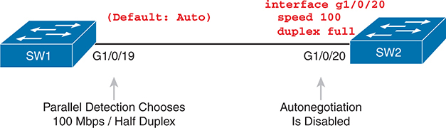

<figcaption>

<strong>图 7-7</strong> <em>交换机之间双工不匹配的典型情况</em>

<aside class="hidden" id="a07fig07">

两台交换机互连。SW1 使用默认设置或 auto，启用 GigabitEthernet 1/0/19（G1/0/19），并行检测选择 100 Mbps 半双工。该接口连接 SW2 的 GigabitEthernet 1/0/20（G1/0/20），后者将速率配置为 100 Mbps，双工配置为全双工。SW2 禁用了自动协商。

</aside>

</figcaption>

</figure>

<a href="#ch07fig07">图 7-7</a> 展示这一场景：SW2 的 G1/0/20 接口配置了 <strong>speed 100</strong> 和 <strong>duplex full</strong>，从而禁用自动协商。逻辑如下：

<ol class="number">

<li>
SW2 设置 speed 100 和 duplex full。
</li>

<li>
SW2 禁用自动协商 FLP 消息。
</li>

<li>
因为没有收到 FLP，SW1 转而使用自动协商的并行检测逻辑：

<ol class="lower-alpha-n">

<li>
SW1 检测到 SW2 使用 100 Mbps。
</li>

<li>
SW1 根据默认规则选择半双工：速率为 10 或 100 Mbps 时采用半双工，否则采用全双工。
</li>

</ol></li>

</ol>

发现双工不匹配可能比发现速率不匹配困难得多，因为速率不匹配会使链路失效，而双工不匹配不会。对于<a href="#ch07fig07">图 7-7</a> 所示情况，<em>即使以太网网段两端的双工设置不一致，交换机接口仍会处于 connected 状态。</em>

为了识别双工不匹配，需要检查链路两端的双工设置，查看是否一致。也可以观察冲突和迟发冲突计数器是否持续增加，下一节将对此解释。

注意

某些 Cisco 交换机端口在同时配置 <strong>speed</strong> 和 <strong>duplex</strong> 时，并不会像<a href="#ch07fig07">图 7-7</a> 那样禁用自动协商。看起来，支持以太网供电（PoE）的端口不会禁用，而不支持 PoE 的端口会像图中那样禁用。不过，这些结论仅来自我的实验，并未在 Cisco 文档中找到，因此如果决定同时配置速率和双工方式，应谨慎并进行测试。另外，有些端口会禁用自动协商、有些不会，这也进一步说明，直接在链路两端使用自动协商更加合适。

如果端口在配置 speed 和 duplex 后仍继续自动协商，就不应出现双工不匹配，因为自动协商仍正常工作。再次分析<a href="#ch07fig07">图 7-7</a>，但假设端口不禁用自动协商，过程如下：

<ol class="number">

<li>
SW2 设置 speed 100 和 duplex full。
</li>

<li>
SW2 继续发送自动协商 FLP，声明自己只支持 100 Mbps 全双工。
</li>

<li>
SW1 使用自动协商，收到 SW2 的 FLP 后，同意采用 100 Mbps 全双工，从而避免双工不匹配。
</li>

</ol>

</section>

<section>

<h4 class="h4" id="ch07lev2sec9">正常工作接口上的常见第 1 层问题</h4>

接口达到 connected（up/up）后，交换机就认为它正常工作，并尝试使用它，同时维护各种接口计数器。即使接口处于 connected，这些计数器也能帮助识别问题，例如刚刚讨论的双工不匹配相关问题。本节解释一些相关概念和最常见的问题。

物理传输出现问题时，接收设备可能收到比特值已发生变化的帧。这些帧无法通过以太网尾部 FCS 字段实现的错误检测逻辑，相关内容已在<a href="v1-02.html#ch02">第 2 章</a>介绍。接收设备会丢弃该帧，并将其计为<em>输入错误</em>。Cisco 交换机把这种错误列为 CRC 错误，如<a href="#exa7_16">例 7-16</a> 中高亮所示。（循环冗余校验 CRC 是与帧校验序列 FCS 如何通过数学计算检测错误相关的术语。）

<strong>例 7-16</strong> <em>用于第 1 层问题的接口计数器</em>

<a href="#code-f0179-01" id="f0179-01a">点击此处查看代码原图</a>

<pre class="pre-ex" tabindex="0"><code class="highlight">SW1# <strong>show interfaces gi1/0/1</strong>
! lines omitted for brevity
     Received 3943 broadcasts (3941 multicasts)
     0 runts, 0 giants, 0 throttles
     0 input errors, 0 CRC, 0 frame, 0 overrun, 0 ignored
     0 watchdog, 3941 multicast, 0 pause input
     0 input packets with dribble condition detected
     18843 packets output, 1726956 bytes, 0 underruns
     Output 10 broadcasts (16378 multicasts)
     0 output errors, 0 collisions, 3 interface resets
     0 unknown protocol drops
     0 babbles, 0 late collision, 0 deferred
     0 lost carrier, 0 no carrier, 0 pause output
     0 output buffer failures, 0 output buffers swapped out</code></pre>

输入错误和 CRC 错误数，只是 <strong>show interfaces</strong> 输出中的少数计数器。难点在于判断应关注哪些计数器、哪些说明正在发生问题，以及哪些只是正常情况，无需担心。

示例突出显示了几个计数器，帮助你开始理解哪些指向问题，哪些只是统计并非问题的日常事件。下面按示例中的顺序，简要解释各个高亮计数器：

<strong>Runts：</strong>未达到最小帧长要求的帧，即少于 64 字节，其中包括总计 18 字节的目的 MAC、源 MAC、类型和 FCS 字段。冲突可能导致这种情况。

<strong>Giants：</strong>超过最大帧长要求的帧，默认上限为 1518 字节，其中包括总计 18 字节的目的 MAC、源 MAC、类型和 FCS 字段。

<strong>Input Errors：</strong>多个计数器的总和，包括 runts、giants、no buffer、CRC、frame、overrun 和 ignored。

<strong>CRC：</strong>收到但未通过 FCS 计算校验的帧；冲突可能导致这种情况。

<strong>Frame：</strong>收到但格式不合法的帧，例如以不完整字节结束；冲突可能导致这种情况。

<strong>Packets Output：</strong>从该接口转发出去的分组（帧）总数。

<strong>Output Errors：</strong>交换机端口尝试发送、但发生某种问题的分组（帧）总数。

<strong>Collisions：</strong>接口发送帧时发生的全部冲突计数。

<strong>Late Collisions：</strong>所有冲突中，在帧的第 64 字节发送之后才发生的那部分冲突。（正常工作的以太网局域网中，冲突应在前 64 字节内发生；如今<a id="key_094" href="#ref-gloss_073">迟发冲突</a>通常指向双工不匹配。）

请注意，在通过 CSMA/CD 实现半双工且正常工作的接口上，许多这些计数器也会增加。因此，冲突计数不断增加的交换机接口未必有问题。不过，称为迟发冲突的问题，指向典型的双工不匹配。

如果局域网设计遵循布线规范，所有冲突都应在任意帧的第 64 字节结束之前发生。当半双工交换机接口已经发出一个帧的 64 字节，却又在同一接口收到帧时，交换机会检测到冲突。这是迟发冲突，交换机除了执行常规 CSMA/CD 操作，即发送阻塞信号、随机等待并重试，还会增加迟发冲突计数器。

存在双工不匹配时，例如<a href="#ch07fig07">图 7-7</a> 中 SW1 和 SW2 的情况，半双工接口很可能会看到 late collisions 计数器增加。为什么？因为半双工接口 SW1 发送帧时，全双工邻居 SW2 可以随时发送，甚至在半双工交换机已经发送第 64 字节之后。因此，反复执行 <strong>show interfaces</strong>，如果看到半双工接口的迟发冲突计数持续增加，就可能存在双工不匹配。

正常工作的 up/up 接口，也可能遇到物理布线问题。这些问题可能尚不足以使链路完全失效，但传输故障会导致部分帧无法成功通过电缆。例如，电缆受到过强干扰时，各种输入错误计数器可能持续增加，尤其是 CRC。具体而言，如果 CRC 错误增加，而冲突计数不增加，问题可能只是电缆受到干扰。

</section>

</section>

</section>

<section class="ccna-source ccna-appendix" aria-label="答案解析与术语表">
<section data-epub-type="chapter">

<h2 class="h2" id="ref-appc">附录 C</h2>

<h2 class="h2a">自测题答案</h2>

<section>

<h3 class="h3" id="ref-appclev1sec7">第 7 章</h3>

<strong><a id="ref-ques7_1" href="#quess7_1">1</a>。</strong>A 和 C。因为两台设备都使用 IEEE 自动协商，它们通过快速链路脉冲（FLP<em>）</em>发送带外消息，向对方声明自己的速率和双工能力。随后双方选择共同支持的最高速率，也选择共同支持的最佳双工方式，其中全双工优于半双工。

<strong><a id="ref-ques7_2" href="#quess7_2">2</a>。</strong>E。Cisco 交换机支持在接口配置模式下，分别为每个接口设置速率（使用 <strong>speed</strong>）和双工方式（使用 <strong>duplex</strong>）。

<strong><a id="ref-ques7_3" href="#quess7_3">3</a>。</strong>B 和 E。PC 禁用了自动协商，因此不发送自动协商 FLP。不过，它会按照 PC 上配置的物理层标准开始发送以太网帧。交换机端口收不到自动协商 FLP 后，会分析收到的信号，确定 PC 发送以太网帧所使用的标准。分析得到 PC 的速率后，交换机也选择相同速率。随后，交换机根据默认表选择双工方式：1 Gbps 及以上使用全双工，低于 1 Gbps 使用半双工。

<strong><a id="ref-ques7_4" href="#quess7_4">4</a>。</strong>C。<strong>shutdown</strong> 接口子命令在管理上禁用接口；工程师可以在周末远程登录，并配置 <strong>no shutdown</strong> 来重新启用。请注意，拔掉电缆虽能阻止使用接口，却无法让工程师在周末变更窗口远程启用。几个答案中所示的 <strong>disable</strong> 和 <strong>enable</strong> 命令并不存在。

<strong><a id="ref-ques7_5" href="#quess7_5">5</a>。</strong>B 和 D。全局配置命令 <strong>interface range</strong> 指定一组接口，并使用户进入接口配置模式。之后，交换机会把任何接口子命令应用于该范围内的所有接口。不过，交换机不会在配置中保留 <strong>interface range</strong> 命令。例如，本例中会在该范围内每个接口下列出 <strong>description</strong>，即 GigabitEthernet1/0/10 至 GigabitEthernet 1/0/20，总共 11 个接口。

<strong><a id="ref-ques7_6" href="#quess7_6">6</a>。</strong>A、B 和 D。<strong>show interfaces status</strong> 中的 disabled，与 <strong>show interfaces</strong> 中的 administratively down and down 表示相同状态。交换机能够从接口发送帧之前，接口必须达到 <strong>show interfaces status</strong> 所显示的 connected 状态。

<strong><a id="ref-ques7_7" href="#quess7_7">7</a>。</strong>A 和 C。首先请注意，正如题目所述，某些 Cisco 交换机端口同时配置 <strong>speed</strong> 和 <strong>duplex</strong> 时，会禁用自动协商。如果所配置的速率和双工组合，使链路对端使用自动协商的设备选择了不同双工方式，就会产生称为双工不匹配的问题。

总结本例场景：SW1 使用自动协商，但收不到 SW2 的自动协商消息，因此开始使用不依赖自动协商消息的另一种逻辑，称为并行检测。SW2 不使用自动协商，但已设置速率，因此会按照该速率在链路上发送以太网帧。SW1 检测这些信号的速率并采用相同速率，因此不会出现速率不匹配。不过，SW1 随后必须根据默认表选择双工方式：10 或 100 Mbps 选半双工，1 Gbps 及以上选全双工。

如果 SW2 采用 <strong>speed 100</strong> 和 <strong>duplex full</strong>，SW1 会检测到 100 Mbps，并默认采用半双工，从而产生双工不匹配。<strong>speed 10</strong> 和 <strong>duplex full</strong> 的情况适用相同逻辑。

<strong><a id="ref-ques7_8" href="#quess7_8">8</a>。</strong>D。对于两个涉及双工不匹配的答案，这种情况确实会导致冲突，尤其是迟发冲突。不过，只有使用 CSMA/CD 逻辑的一侧，即半双工侧，才有冲突这一概念。因此，如果 SW1 使用半双工、SW2 使用全双工，SW1 很可能看到迟发冲突，其计数器随时间增加。

如果 SW2 关闭了接口，SW1 的接口会处于 down/down，所有计数器都不会增加。同样，如果两个交换机端口采用不同速率，它们会处于 down/down，接口计数器也都不会增加。

</section>

</section>

<section id="ref-glossary"><h2 class="h2a">术语表</h2>
<strong>10/100</strong> 以太网网卡或交换机端口支持 10 Mbps 和 100 Mbps 速率的简称。

<strong>10/100/1000</strong> 以太网网卡或交换机端口支持 10、100 和 1000 Mbps（即 1 Gbps）速率的简称。

<strong>auto-MDIX</strong> 以太网标准的一项功能，与千兆以太网一起于 1998 年引入。它可检测链路使用的 UTP 电缆引脚排列是否正确，即应该使用直通还是交叉排列；如果所用排列错误，会在内部自动交换信号，使链路正常工作。

<strong>自动协商（autonegotiation）</strong> IEEE 标准机制（802.3u），使两个节点能够交换消息，以选择在链路两端使用相同以太网标准，保证链路能够正常且良好地工作。

<strong>冲突域（collision domain）</strong> 一组网卡，其中任意一个网卡发送的帧，都可能与同一冲突域中任何其他网卡发送的帧发生冲突。

<strong>双工不匹配（duplex mismatch）</strong> 以太网链路两端，一台设备使用全双工逻辑、另一台使用半双工逻辑的情况，导致链路上出现不必要的帧丢弃和重传。

<strong>全双工（full duplex）</strong> 泛指两个通信设备可以同时发送和接收数据的通信方式。在以太网局域网中，表示两端都禁用 CSMA/CD 逻辑，从而允许同时发送和接收。

<strong>半双工（half duplex）</strong> 泛指同一时刻只能有一台设备发送数据的通信方式。在以太网局域网中，它是 CSMA/CD 算法实施“任何时刻只应有一台设备发送”规则的正常结果。

<strong>并行检测（parallel detection）</strong> IEEE 自动协商步骤中的一个分支，适用于本端使用自动协商，而链路另一端不使用自动协商的情况。

</section>
</section>

<section class="ccna-source ccna-appendix" aria-label="代码原图">
<section data-epub-type="chapter">

<a href="#f0166-01a" id="code-f0166-01">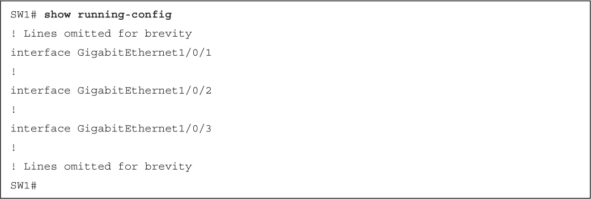</a>

<a href="#f0166-02a" id="code-f0166-02">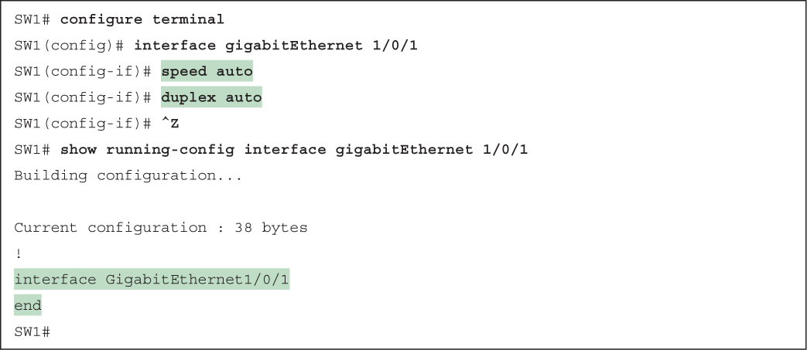</a>

<a href="#f0167-01a" id="code-f0167-01">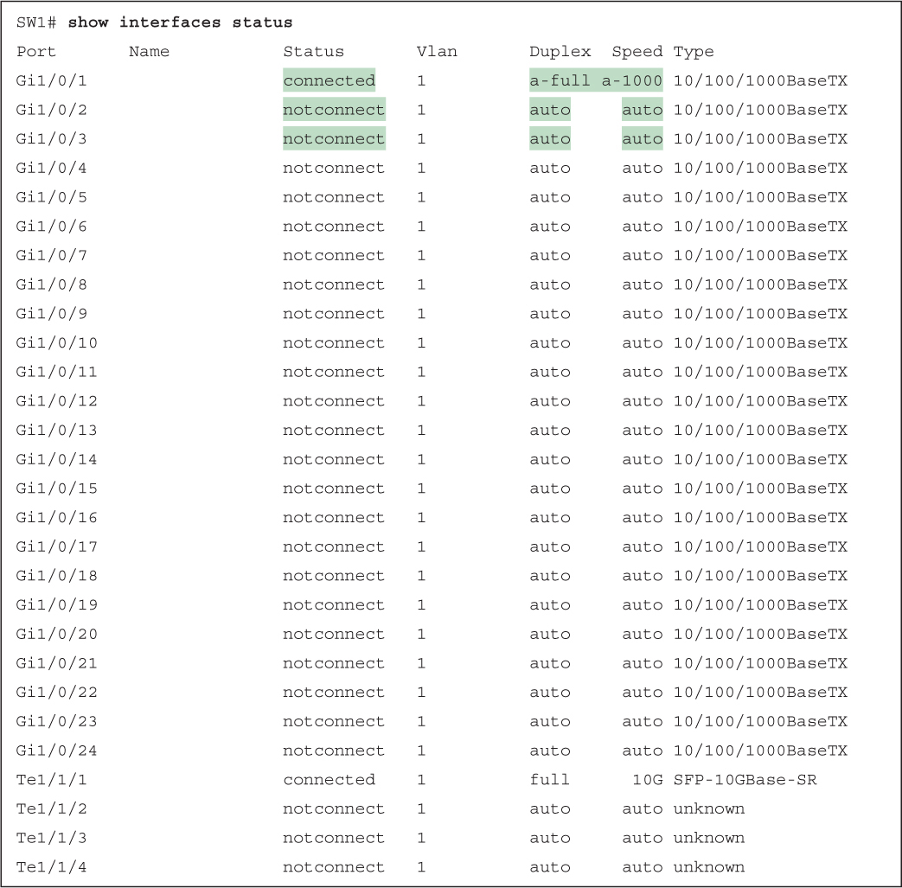</a>

<a href="#f0168-01a" id="code-f0168-01">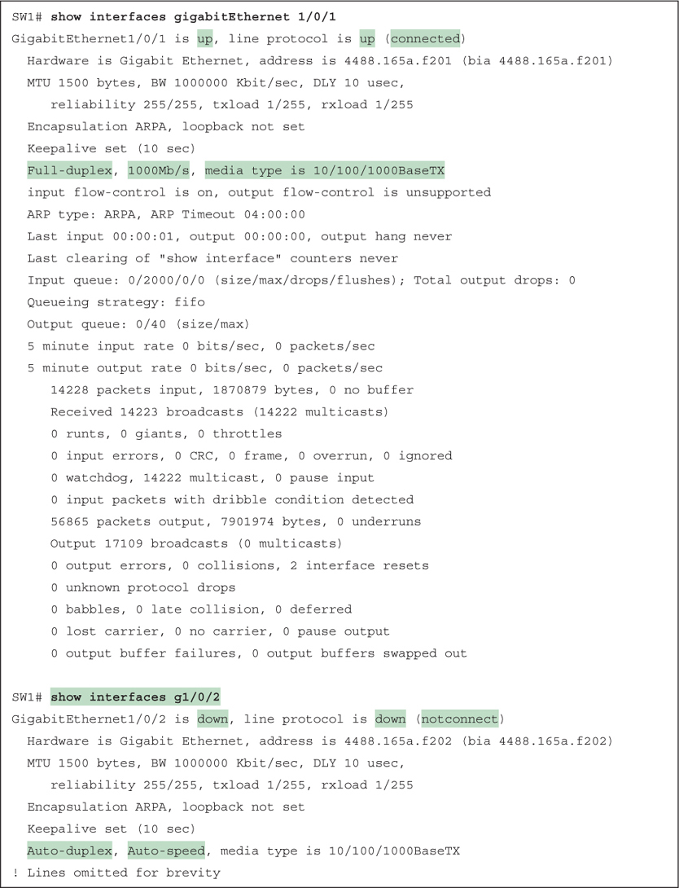</a>

<a href="#f0169-01a" id="code-f0169-01">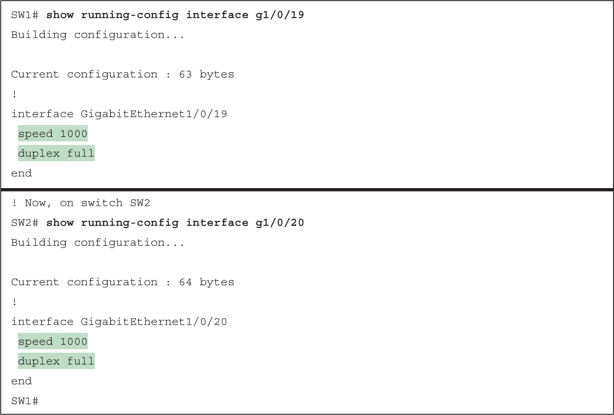</a>

<a href="#f0170-01a" id="code-f0170-01">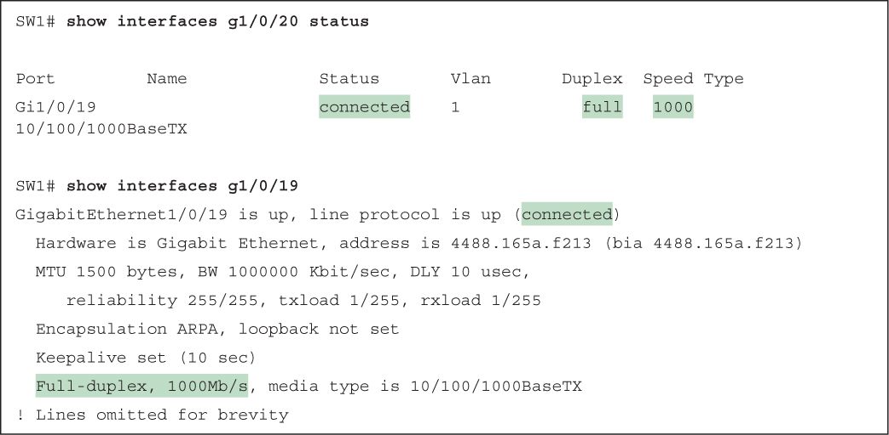</a>

<a href="#f0171-01a" id="code-f0171-01">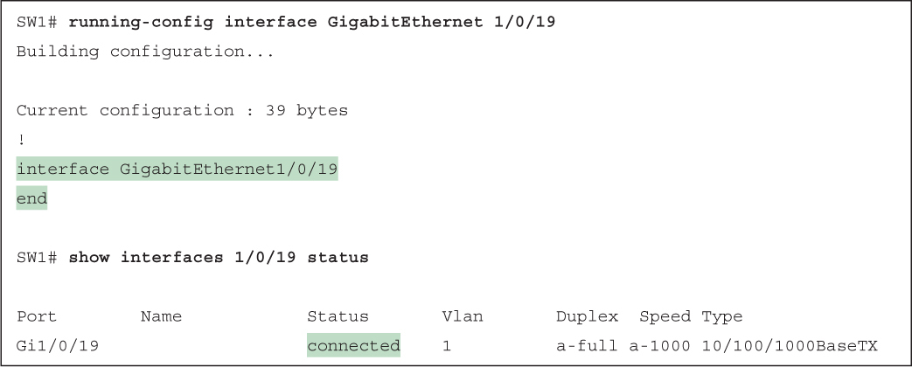</a>

<a href="#f0171-02a" id="code-f0171-02">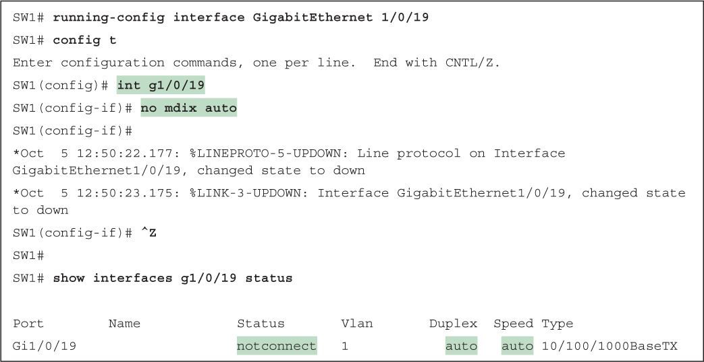</a>

<a href="#f0172-01a" id="code-f0172-01">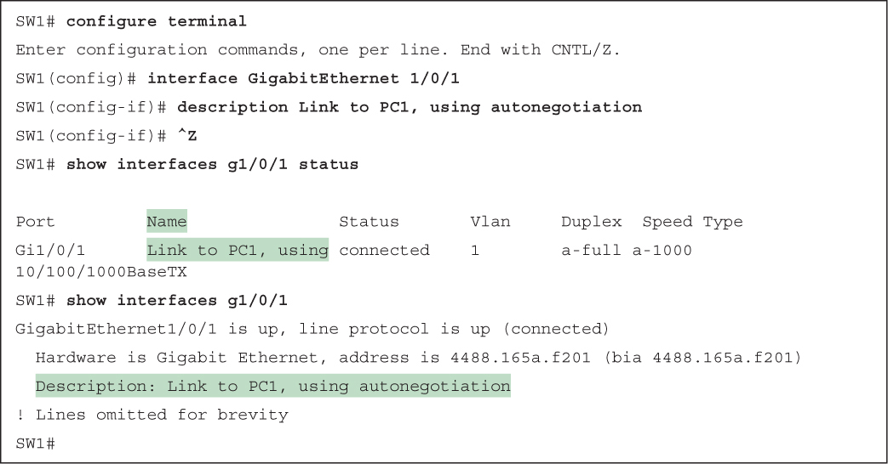</a>

<a href="#f0173-01a" id="code-f0173-01">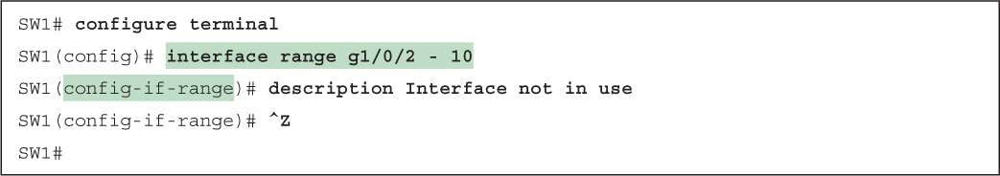</a>

<a href="#f0173-02a" id="code-f0173-02">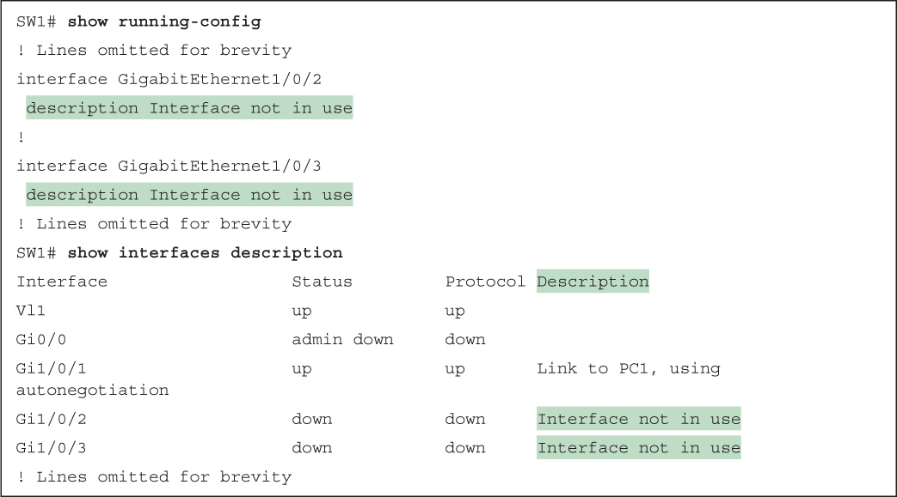</a>

<a href="#f0174-01a" id="code-f0174-01">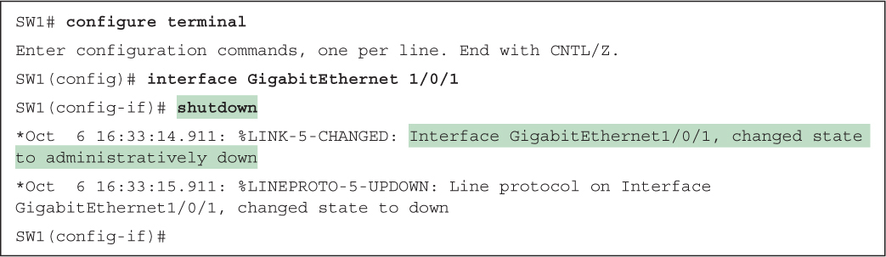</a>

<a href="#f0174-02a" id="code-f0174-02">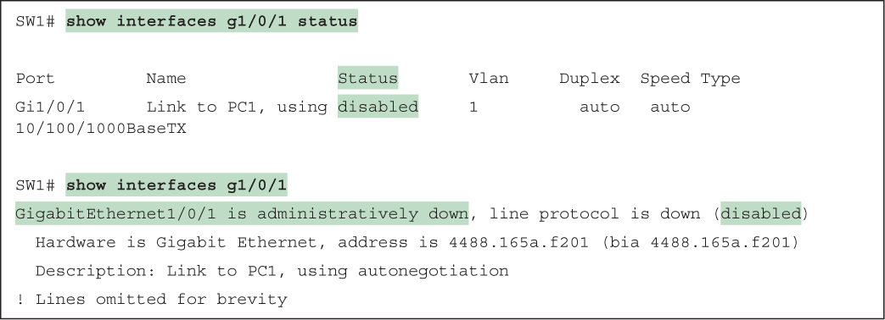</a>

<a href="#f0175-01a" id="code-f0175-01">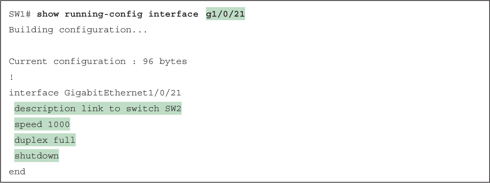</a>

<a href="#f0175-02a" id="code-f0175-02">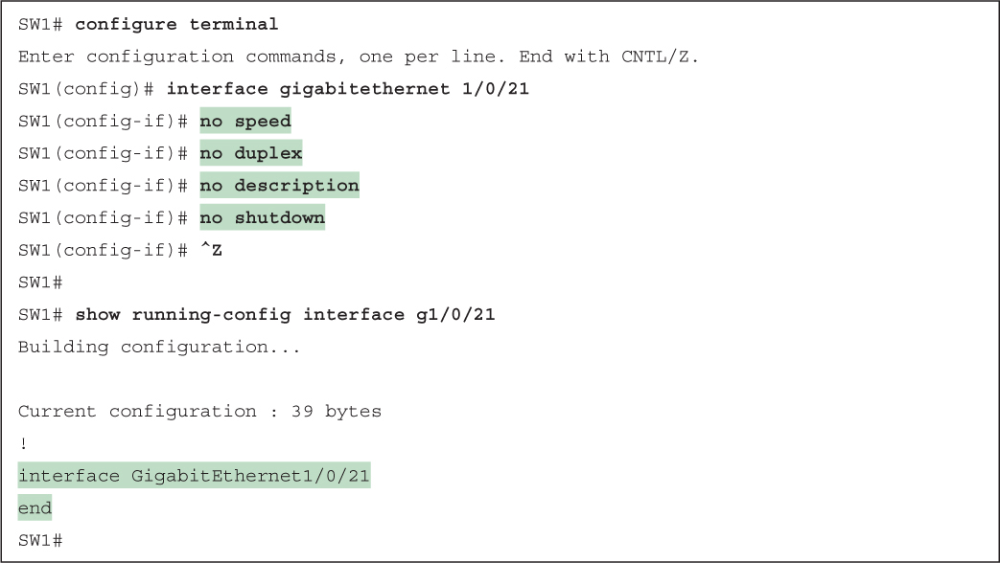</a>

<a href="#f0179-01a" id="code-f0179-01">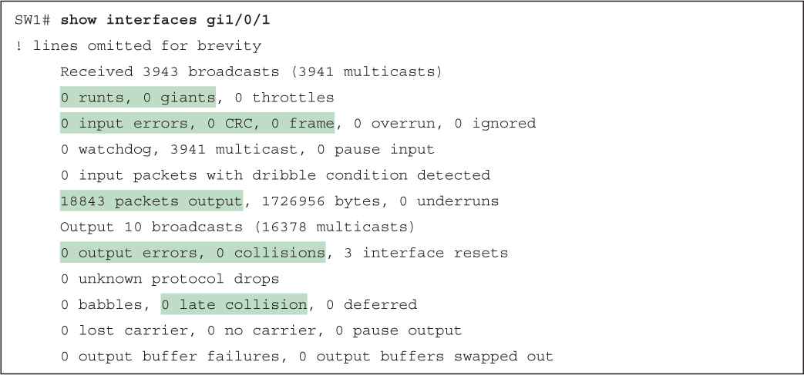</a>

</section>

</section>


<nav class="ccna-chapter-nav" aria-label="章节导航"><a href="v1-06.html">← 上一章</a><a href="v1-08.html">下一章 →</a></nav>
