
<a href="{{ '/subjects/CCNA/' | relative_url }}">← 返回 CCNA 目录</a>

第一卷 · 实现 VLAN 与 STP

<nav class="ccna-chapter-nav" aria-label="章节导航"><a href="v1-07.html">← 上一章</a><a href="v1-09.html">下一章 →</a></nav>



<section data-epub-type="chapter">

<h2 class="h2" id="ch08">第 8 章</h2>

<h2 class="h2a">实现以太网虚拟局域网</h2>

本章涵盖以下考试主题：

1.0 网络基础

1.13 描述交换概念

1.13.a MAC 地址学习与老化

1.13.b 帧交换

1.13.c 帧泛洪

1.13.d MAC 地址表

2.0 网络接入

2.1 配置与验证跨越多台交换机的 VLAN（普通范围）

2.1.a 接入端口（数据和语音）

2.1.b 默认 VLAN

2.1.c VLAN 间连接

2.2 配置与验证交换机间连接

2.2.a 中继端口

2.2.b 802.1Q

2.2.c 本征 VLAN

到目前为止，你已经了解到，以太网交换机会接收以太网帧、作出决定，然后转发（交换）这些以太网帧。这套核心逻辑围绕 MAC 地址、帧的入接口，以及交换机用于转发该帧的出接口展开。

这些描述虽然正确，却没有考虑虚拟局域网（VLAN）。VLAN 会影响每个帧的交换逻辑，因为每个 VLAN 都相当于以太网 LAN 中交换机端口的一个子集。交换机认为，每个以太网帧都是在某个可识别的 VLAN 中接收的，根据该 VLAN 的 MAC 地址表条目进行转发，并从该 VLAN 的端口发出。本章将探讨这些概念以及其他与 VLAN 有关的内容。

本章的组织如下：第一个主要部分解释核心概念，包括 VLAN 如何在单台交换机上工作、如何利用 VLAN 中继创建跨越多台交换机的 VLAN，以及如何使用路由器在 VLAN 之间转发流量。第二个主要部分展示 VLAN 和 VLAN 中继的配置，即如何将接口静态分配给 VLAN。最后一个主要部分讨论使用 VLAN 和中继时可能出现的一些问题，以及如何避免这些问题。

另外，本章篇幅比通常的章节更长。如果你希望分两次阅读，可以在读到“<a href="#ch08lev2sec6">实现连接电话的接口</a>”这一标题时结束第一次学习。

<section>

<h3 class="h3" id="ch08lev1sec1">“这些知识我已经掌握了吗？”自测</h3>

如果你希望根据得分决定在本章投入多少时间，可以完成这组自测题（在此作答，或使用 PTP 软件）。各题答案的选项字母列在自测题之后的页面底部。书末和配套网站上的<a href="#ref-appc">附录 C</a>都包含答案及解析。你也可以在 PTP 测试软件中找到答案及解析。

<figure class="table" id="ch08tab01" tabindex="0">

<figcaption>

<strong>表 8-1</strong> “这些知识我已经掌握了吗？”核心主题小节与题目对应关系

</figcaption>

<table class="all">

<thead>

<tr>

<th class="th">
基础知识小节
</th>

<th class="th">
题目
</th>

</tr>

</thead>

<tbody>

<tr>

<td class="border">
虚拟局域网概念
</td>

<td class="border">
1–3
</td>

</tr>

<tr>

<td class="border">
VLAN 与 VLAN 中继的配置和验证
</td>

<td class="border">
4–6
</td>

</tr>

<tr>

<td class="border">
VLAN 与 VLAN 中继故障排查
</td>

<td class="border">
7–8
</td>

</tr>

</tbody>

</table>

</figure>

<strong><a id="quess8_1" href="#ques8_1a">1</a>.</strong> 在 LAN 中，下列哪个术语与 <em>VLAN</em> 的含义最接近？

<ol class="lower-alpha">

<li>
冲突域
</li>

<li>
广播域
</li>

<li>
子网
</li>

<li>
单台交换机
</li>

<li>
中继
</li>

</ol>

<strong><a id="quess8_2" href="#ques8_2a">2</a>.</strong> 假设一个小型实验网络只有一台 LAN 交换机，其端口被配置到三个不同的 VLAN 中。如果所有 VLAN 中的全部主机都要使用 TCP/IP，那么连接到这些交换机端口的主机需要多少个 IP 子网？

<ol class="lower-alpha">

<li>
0
</li>

<li>
1
</li>

<li>
2
</li>

<li>
3
</li>

<li>
无法根据所提供的信息判断。
</li>

</ol>

<strong><a id="quess8_3" href="#ques8_3a">3</a>.</strong> 交换机 SW1 使用 802.1Q 中继向交换机 SW2 发送一个帧。以下哪个选项描述了 SW1 在将该帧转发给 SW2 之前，如何修改以太网帧或向其中添加内容？

<ol class="lower-alpha">

<li>
插入一个 4 字节的首部，并修改 MAC 地址。
</li>

<li>
插入一个 4 字节的首部，但不修改 MAC 地址。
</li>

<li>
在原始帧之前添加一个全新的以太网首部进行封装。
</li>

<li>
其他答案都不正确。
</li>

</ol>

<strong><a id="quess8_4" href="#ques8_4a">4</a>.</strong> 已知交换机 1 在连接交换机 2 的 Fa0/5 接口上配置了 <strong>switchport mode dynamic auto</strong> 命令。交换机 2 的 <strong>switchport mode</strong> 命令采用下列哪些设置，可以使中继正常工作？（选择两个答案。）

<ol class="lower-alpha">

<li>
<strong>trunk</strong>
</li>

<li>
<strong>dynamic auto</strong>
</li>

<li>
<strong>dynamic desirable</strong>
</li>

<li>
<strong>access</strong>
</li>

<li>
其他答案都不正确。
</li>

</ol>

<strong><a id="quess8_5" href="#ques8_5a">5</a>.</strong> 一台刚从 Cisco 收到的交换机从未配置过任何 VLAN，但 VTP 已被禁用。工程师配置了 <strong>vlan 22</strong> 和 <strong>name Hannahs-VLAN</strong> 命令，然后退出配置模式。以下哪些说法正确？（选择两个答案。）

<ol class="lower-alpha">

<li>
<strong>show vlan brief</strong> 命令的输出会列出 VLAN 22。
</li>

<li>
<strong>show running-config</strong> 命令的输出会列出 VLAN 22。
</li>

<li>
这一过程不会创建 VLAN 22。
</li>

<li>
只有至少一个接口被分配到 VLAN 22 后，该 VLAN 才会存在于这台交换机中。
</li>

</ol>

<strong><a id="quess8_6" href="#ques8_6a">6</a>.</strong> 下列哪些命令可以识别出作为中继接口的交换机接口，即当前作为 VLAN 中继运行的接口？（选择两个答案。）

<ol class="lower-alpha">

<li>
<strong>show interfaces</strong>
</li>

<li>
<strong>show interfaces switchport</strong>
</li>

<li>
<strong>show interfaces trunk</strong>
</li>

<li>
<strong>show trunks</strong>
</li>

</ol>

<strong><a id="quess8_7" href="#ques8_7a">7</a>.</strong> 在一台禁用了 VTP 的交换机上，工程师配置了 <strong>vlan 30</strong> 和 <strong>shutdown vlan 30</strong> 命令。关于这台交换机，哪些选项应当成立？（选择两个答案。）

<ol class="lower-alpha">

<li>
<strong>show vlan brief</strong> 命令应当列出 VLAN 30。
</li>

<li>
<strong>show running-config</strong> 命令应当列出 VLAN 30。
</li>

<li>
交换机应当转发从 VLAN 30 接入端口收到的帧。
</li>

<li>
交换机应当转发从中继端口收到、带有 VLAN 30 标签的帧。
</li>

</ol>

<strong><a id="quess8_8" href="#ques8_8a">8</a>.</strong> <strong>show interfaces g0/1 trunk</strong> 命令会提供三个 VLAN ID 列表。以下哪些项会限制三个列表中的第一个列表所包含的 VLAN？

<ol class="lower-alpha">

<li>
全局命令 <strong>shutdown vlan 30</strong>
</li>

<li>
接口子命令 <strong>switchport trunk allowed vlan</strong>
</li>

<li>
STP 决定在 G0/1 上阻塞
</li>

<li>
全局命令 <strong>no vlan 30</strong>
</li>

</ol>

“这些知识我已经掌握了吗？”自测答案：

<strong><a id="ques8_1a" href="#ref-ques8_1">1</a></strong> B

<strong><a id="ques8_2a" href="#ref-ques8_2">2</a></strong> D

<strong><a id="ques8_3a" href="#ref-ques8_3">3</a></strong> B

<strong><a id="ques8_4a" href="#ref-ques8_4">4</a></strong> A, C

<strong><a id="ques8_5a" href="#ref-ques8_5">5</a></strong> A, B

<strong><a id="ques8_6a" href="#ref-ques8_6">6</a></strong> B、C

<strong><a id="ques8_7a" href="#ref-ques8_7">7</a></strong> A, B

<strong><a id="ques8_8a" href="#ref-ques8_8">8</a></strong> B

</section>

<section>

<h3 class="h3box" id="ch08lev1sec2">基础知识</h3>

</section>

<section>

<h3 class="h3" id="ch08lev1sec3">虚拟局域网概念</h3>

在理解 <a id="key_107" href="#ref-gloss_431">VLAN</a> 之前，必须先明确 LAN 的定义。例如，从一个角度看，LAN 包含同一地点的所有用户设备、服务器、交换机、路由器、线缆和无线接入点。不过，另一个范围更窄的 LAN 定义有助于理解虚拟局域网这一概念：

LAN 包含同一广播域中的所有设备。

广播域包含一组连接到 LAN 的设备，其中任何设备发送广播帧时，其他所有设备都会收到该帧的副本。因此，从某种角度看，可以认为 LAN 与广播域基本上是一回事。

仅使用默认设置时，交换机会认为其所有接口都处于同一广播域。也就是说，对于一台交换机，当广播帧进入某个交换机端口时，交换机会从其他所有端口转发该广播帧。按照这种逻辑，要创建两个不同的 LAN 广播域，就必须购买两台不同的以太网 LAN 交换机，如<a href="#ch08fig01">图 8-1</a> 所示。

<figure class="image-c" id="ch08fig01">

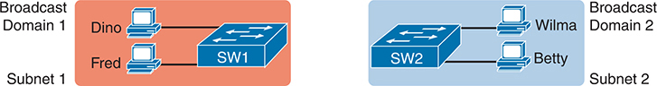

<figcaption>

<strong>图 8-1</strong> <em>使用两台物理交换机、不使用 VLAN 来创建两个广播域</em>

<aside class="hidden" id="a08fig01">

在第 1 部分，属于广播域 1 的 Dino 和位于子网 1 的 Fred 都连接到交换机 SW1。在第 2 部分，广播域 2 的成员 Wilma 和属于子网 2 的 Betty 连接到交换机 SW2。这种设置无需配置 VLAN，就能将网络流量有效地隔离到两个不同的广播域中。

</aside>

</figcaption>

</figure>

使用两个 VLAN，一台交换机就能实现<a href="#ch08fig01">图 8-1</a> 所示设计的目标：创建两个广播域。利用 VLAN，可以将交换机的一部分接口配置到一个广播域，另一部分接口配置到另一个广播域，从而创建多个广播域。交换机创建的这些独立广播域称为<em>虚拟局域网（VLAN）</em>。

例如，在<a href="#ch08fig02">图 8-2</a> 中，一台交换机创建了两个 VLAN，并将每个 VLAN 的端口视为完全独立的端口组。交换机绝不会将 Dino（位于 VLAN 1）发送的帧转发给 Wilma 或 Betty（位于 VLAN 2）。

<figure class="image-c" id="ch08fig02">

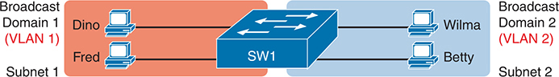

<figcaption>

<strong>图 8-2</strong> <em>使用一台交换机和 VLAN 创建两个广播域</em>

<aside class="hidden" id="a08fig02">

在第 1 部分，分配到 VLAN 1（广播域 1）的 Dino 和位于子网 1 的 Fred 都连接到交换机 SW1。在第 2 部分，分配到 VLAN 2（广播域 2）的 Wilma 和属于子网 2 的 Betty 也连接到交换机 SW1。利用 VLAN，网络流量可以在同一台物理交换机内部有效地划分为两个独立广播域。

</aside>

</figcaption>

</figure>

设计园区 LAN 时，使用更多 VLAN、并使每个 VLAN 中的设备数量更少，往往能从多个方面改善 LAN。例如，VLAN 中某台主机发送的广播会被同一 VLAN 中的其他所有主机接收和处理，但不会被其他 VLAN 的主机接收。限制接收单个广播帧的主机数量，可以减少因处理无用广播而浪费资源的主机数量。这也能降低安全风险，因为能够看到任意一台主机所发帧的主机更少了。这些只是将主机划分到不同 VLAN 的部分理由。下列列表总结了创建较小广播域（VLAN）的最常见原因：

<ul class="sq">

<li>
减少接收每个广播帧的设备数量，从而降低各设备的 CPU 开销，提高主机性能。
</li>

<li>
减少接收交换机泛洪帧（广播、多播和未知单播）副本的主机数量，从而降低安全风险。
</li>

<li>
为各 VLAN 应用不同的安全策略，从而提高主机安全性。
</li>

<li>
根据部门或共同工作的群体来组织用户，而不是根据物理位置，从而实现更灵活的设计。
</li>

<li>
更快地解决问题，因为许多问题的故障域所包含的设备，正是同一广播域中的那组设备。
</li>

<li>
将一个 VLAN 限制在单台接入交换机上，从而减少生成树协议（STP）的工作量。
</li>

</ul>

本章其余部分将详细研究 VLAN 如何在多台 Cisco 交换机之间工作，包括所需的配置。为此，下一节讨论 VLAN 中继：当一个 VLAN 存在于多台 LAN 交换机上时，就需要这项功能。

<section>

<h4 class="h4" id="ch08lev2sec1">使用中继创建跨交换机 VLAN</h4>

在单台交换机上配置 VLAN 只需少量工作：只要为每个端口配置它所属的 VLAN 编号即可。使用多台交换机时，还必须考虑交换机之间如何转发流量的其他概念。

在由多台互联交换机组成的网络中使用 VLAN 时，交换机之间的链路需要使用 <em>VLAN 中继</em>。VLAN 中继使交换机采用称为 <em>VLAN 标记</em> 的过程：发送方交换机在通过<a id="key_103" href="#ref-gloss_412">中继</a>发送帧之前，为该帧添加另一个首部。这个额外的中继首部包含 <em>VLAN 标识符</em>（VLAN ID）字段，使发送方交换机能够将帧关联到特定 VLAN ID，而接收方交换机也就能知道每个帧属于哪个 VLAN。

<a href="#ch08fig03">图 8-3</a> 展示了 VLAN 存在于多台交换机上的一个示例，但没有使用中继。首先，该设计使用两个 VLAN：VLAN 10 和 VLAN 20。每台交换机都有两个端口分配给各个 VLAN，因此这两个 VLAN 都存在于两台交换机上。为了在两台交换机之间转发 VLAN 10 的流量，设计中包含一条完全属于 VLAN 10 的交换机间链路。同样，为了支持交换机间的 VLAN 20 流量，又使用了第二条交换机间链路，该链路属于 VLAN 20。

<a href="#ch08fig03">图 8-3</a> 中的设计完全可以正常工作。例如，PC11（位于 VLAN 10）可以向 PC14 发送帧。帧进入 SW1，经过上方链路（属于 VLAN 10 的链路），到达 SW2。

<figure class="image-c" id="ch08fig03">

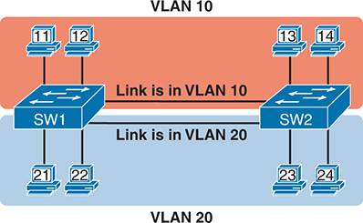

<figcaption>

<strong>图 8-3</strong> <em>不使用 VLAN 中继的跨交换机 VLAN</em>

<aside class="hidden" id="a08fig03">

交换机 SW1 和 SW2 被划分为 VLAN 10 和 VLAN 20。在 VLAN 10 中，PC11 和 PC12 连接到 SW1，PC13 和 PC14 连接到 SW2。SW1 与 SW2 之间的交换机间链路运行于 VLAN 10。在 VLAN 20 中，PC21 和 PC22 连接到 SW1，PC23 和 PC24 连接到 SW2。交换机之间的链路建立于 VLAN 20。这种配置无需使用 VLAN 中继，就能对交换机之间的网络流量进行分段。

</aside>

</figcaption>

</figure>

<a href="#ch08fig03">图 8-3</a> 所示的设计能够工作，但扩展性并不好。每支持一个 VLAN，都需要在交换机之间增加一条物理链路。如果设计需要 10 个或 20 个 VLAN，就需要 10 条或 20 条交换机间链路，并且每台交换机都要使用 10 个或 20 个端口来连接这些链路。

<section>

<h5 class="h5" id="ch08lev3sec1">VLAN 标记概念</h5>

VLAN 中继在交换机之间建立一条链路，用于支持所需的任意多个 VLAN。作为 VLAN 中继，交换机会将这条链路视为所有 VLAN 的组成部分。同时，中继会保持各 VLAN 的流量相互隔离，因此 VLAN 10 中的帧不会到达 VLAN 20 的设备，反之亦然，因为每个帧跨越中继时都会由 VLAN 编号标识。<a href="#ch08fig04">图 8-4</a> 展示了这一思路，两台交换机之间只有一条物理链路。

<figure class="image-c" id="ch08fig04">

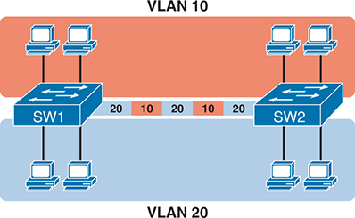

<figcaption>

<strong>图 8-4</strong> <em>使用中继的跨交换机 VLAN</em>

<aside class="hidden" id="a08fig04">

交换机 SW1 和 SW2 被划分为 VLAN 10 和 VLAN 20。在 VLAN 10 中，两名用户连接到 SW1，另外两名用户连接到 SW2。同样，在 VLAN 20 中，两名用户连接到 SW1，另外两名用户连接到 SW2。交换机之间的链路作为中继运行，同时承载这两个 VLAN 的流量。中继被配置为按顺序允许 VLAN 20 和 VLAN 10 的流量通过，在保持 VLAN 隔离的同时，确保交换机之间正常通信。

</aside>

</figcaption>

</figure>

中继通过向以太网帧添加一个小首部，使交换机能够经由单条物理连接转发多个 VLAN 的帧。例如，<a href="#ch08fig05">图 8-5</a> 的步骤 1 显示 PC11 在接口 Fa0/1 上发送广播帧。为了泛洪该帧，交换机 SW1 需要将广播帧转发给交换机 SW2。但是，SW1 需要让 SW2 知道这个帧属于 VLAN 10，以便 SW2 收到帧后只将其泛洪到 VLAN 10，而不会泛洪到 VLAN 20。因此，如步骤 2 所示，SW1 在发送帧之前，会向原始以太网帧添加 VLAN 首部；在本例中，该首部记录的 VLAN ID 为 10。

<figure class="image-c" id="ch08fig05">

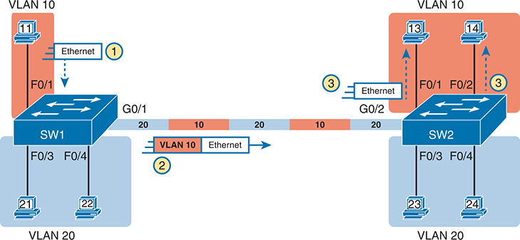

<figcaption>

<strong>图 8-5</strong> <em>两台交换机之间的 VLAN 中继</em>

<aside class="hidden" id="a08fig05">

交换机 SW1 和 SW2 被划分为 VLAN 10 和 VLAN 20。在 VLAN 10 中，PC11、PC21 和 PC22 分别通过接口 Fa0/1、Fa0/3 和 Fa0/4 连接到 SW1。PC11 通过以太网在接口 Fa0/1 上发送广播帧。传输之前，SW1 为该帧封装一个标明 VLAN ID 为 10 的 VLAN 首部。SW1 通过接口 G0/1 和 G0/22 连接到 SW2，该中继配置用于 VLAN 20 和 VLAN 10。在 VLAN 10 中，PC13 和 PC14 分别通过接口 Fa0/1 和 Fa0/2 连接到 SW2，PC23 和 PC24 则通过接口 Fa0/3 和 Fa0/4 连接到 SW2。交换机间链路运行于 VLAN 10。在 VLAN 20 中，PC21 和 PC22 连接到 SW1。PC13 通过以太网在接口 Fa0/1 上发送广播帧。

</aside>

</figcaption>

</figure>

SW2 收到该帧时，知道它属于 VLAN 10。随后 SW2 移除 VLAN 首部，将原始帧从其属于 VLAN 10 的接口转发出去（步骤 3）。

再举一个例子，考虑 PC21（位于 VLAN 20）发送广播的情况。SW1 会从端口 Fa0/4（因为该端口属于 VLAN 20）以及 Gi0/1（因为它是支持多个不同 VLAN 的中继）发出广播。SW1 为该帧添加中继首部，其中的 VLAN ID 为 20。SW2 确定该帧属于 VLAN 20 后，会去掉中继首部，因此它知道只应从属于 VLAN 20 的 Fa0/3 和 Fa0/4 端口转发该帧，而不应从属于 VLAN 10 的 Fa0/1 和 Fa0/2 端口转发。

</section>

<section>

<h5 class="h5" id="ch08lev3sec2">802.1Q 与 ISL VLAN 中继协议</h5>

多年来，Cisco 支持过两种不同的中继协议：交换机间链路（Inter-Switch Link，ISL）和 IEEE <a id="key_096" href="#ref-gloss_007">802.1Q</a>。Cisco 比 802.1Q 早数年创建了 ISL，部分原因是当时 IEEE 尚未定义 VLAN 中继标准。如今，802.1Q 已成为更流行的中继协议，Cisco 现在甚至不再在许多交换机型号上支持 ISL。

虽然 ISL 和 802.1Q 都会用 VLAN ID 标记每个帧，但具体方式不同。802.1Q 在原始帧的以太网首部中插入一个额外的 4 字节 802.1Q VLAN 首部，如<a href="#ch08fig06">图 8-6</a> 上半部分所示。对于本书讨论的主题，802.1Q 首部中只有 12 位 VLAN ID 字段需要关注。这个 12 位字段理论上最多支持 2¹²（4096）个 VLAN，实际上最多支持 4094 个。（802.1Q 和 ISL 都使用 12 位来标记 VLAN ID，其中两个值 [0 和 4095] 被保留。）

<figure class="image-c" id="ch08fig06">

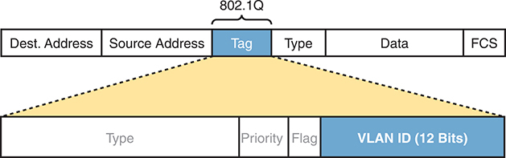

<figcaption>

<strong>图 8-6</strong> <em>802.1Q 中继</em>

<aside class="hidden" id="a08fig06">

在以太网帧结构中，802.1Q 在源地址和类型字段之间插入一个标签。该标签由四个部分组成：类型、优先级、标志和 VLAN ID（12 位）。类型字段将该帧标识为带有 802.1Q 标签的帧。优先级用于对帧进行优先级排序，标志字段则保留供将来使用。12 位的 VLAN ID 指明该帧所属的 VLAN，从而允许多个 VLAN 在同一条物理链路上传输。

</aside>

</figcaption>

</figure>

Cisco 交换机将 VLAN ID 范围（1–4094）划分为普通范围和扩展范围。所有交换机都可以使用编号为 1 到 1005 的普通范围 VLAN。只有部分交换机可以使用 VLAN ID 为 1006 到 4094 的扩展范围 VLAN。交换机能否使用扩展范围 VLAN，取决于 VLAN 中继协议（<a id="key_109" href="#ref-gloss_435">VTP</a>）的配置，本章后面的“<a href="#ch08lev2sec5">VLAN 中继配置</a>”一节将对此作简要介绍。

802.1Q 还会在每条中继上定义一个特殊的 VLAN ID，称为<a id="key_101" href="#ref-gloss_265">本征 VLAN</a>（默认使用 VLAN 1）。在正常工作的 802.1Q 中继中，两端都使用中继，并且使用相同的本征 VLAN。任意一端发送属于本征 VLAN 的帧时，都不会添加 802.1Q 首部。两台交换机都知道未标记帧代表该帧属于本征 VLAN，因此会把未标记帧视为本征 VLAN 的帧。

IEEE 引入本征 VLAN 概念，是为了处理一端设备作为中继运行、另一端却没有使用中继的情况。另一端可能暂时或永久不使用中继（通常因为配置错误或不支持 802.1Q）。在这种情况下，未使用中继的设备无法识别收到的带有中继首部的帧，会将其丢弃。但是，中继一端发送属于本征 VLAN 的未标记帧时，未使用中继的一端能够理解该帧，并将其视为分配给该接口的接入 VLAN 的帧。因此，本征 VLAN 为工程师提供了一种手段，使得即使存在某些中继问题，也可以让一个 VLAN 在这条链路上工作。

</section>

</section>

<section>

<h4 class="h4" id="ch08lev2sec2">在 VLAN 之间转发数据</h4>

如果创建的园区 LAN 包含多个 VLAN，通常仍然需要让所有设备都能向其他所有设备发送数据。接下来讨论如何在这些 VLAN 之间路由数据的一些概念。

<section>

<h5 class="h5" id="ch08lev3sec3">VLAN 间路由的必要性</h5>

按照本书到目前为止讨论的二层逻辑转发数据的 LAN 交换机，通常称为<em>二层交换机</em>。例如，<a href="v1-05.html#ch05">第 5 章</a>“<a href="v1-05.html#ch05">分析以太网局域网交换</a>”讨论了 LAN 交换机如何接收以太网帧（二层概念）、查看目的以太网 MAC 地址（二层地址），并将以太网帧从其他接口转发出去。这些概念全部由二层协议定义，因此称为二层交换机。

二层交换机按 VLAN 执行其逻辑。例如，在<a href="#ch08fig07">图 8-7</a> 中，左侧两台 PC 位于 VLAN 10、子网 10 中。右侧两台 PC 位于另一个 VLAN（20）和另一个子网（20）中。注意，这张图重复了前面的<a href="#ch08fig02">图 8-2</a>，但将交换机分成两半，以强调二层交换机不会在两个 VLAN 之间转发数据。

<figure class="image-c" id="ch08fig07">

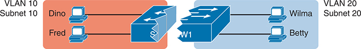

<figcaption>

<strong>图 8-7</strong> <em>二层交换机不在 VLAN 之间执行路由</em>

<aside class="hidden" id="a08fig07">

交换机 SW1 被分成两半。第一半连接用户 Dino 和 Fred，他们被分配到 VLAN 10、子网 10。第二半连接用户 Wilma 和 Betty，他们被分配到 VLAN 20、子网 20。两半都连接到被拆分的交换机。作为二层设备，SW1 在数据链路层工作，不执行 VLAN 间路由，因此不同 VLAN 中的用户之间无法通信，除非由三层设备进行路由。

</aside>

</figcaption>

</figure>

如图所示，当部分端口配置到 VLAN 10、其他端口配置到 VLAN 20 时，交换机在转发流量时就像两台独立的交换机。实际上，VLAN 的一个目标就是将不同 VLAN 的流量隔离，防止某个 VLAN 的帧泄漏到其他 VLAN。例如，当 Dino（位于 VLAN 10）发送任意以太网帧时，如果 SW1 是二层交换机，它就不会将该帧转发给右侧 VLAN 20 中的 PC。

</section>

<section>

<h5 class="h5" id="ch08lev3sec4">使用路由器在 VLAN 之间路由分组</h5>

当园区 LAN 设计中包含 VLAN 时，同一 VLAN 中的设备必须位于同一子网。按照同样的设计逻辑，不同 VLAN 中的设备必须位于不同子网。

要在 VLAN 之间转发分组，网络必须使用能够充当路由器的设备。可以使用实际的路由器，也可以使用能够执行部分路由器功能的交换机。这些同时执行三层路由功能的交换机称为<em>多层交换机</em>或<a id="key_100" href="#ref-gloss_227">三层交换机</a>。本节先讨论使用二层交换机时如何在 VLAN 之间转发数据，最后简要讨论如何使用三层交换机。

例如，<a href="#ch08fig08">图 8-8</a> 展示了一台可以在子网 10 与子网 20 之间路由分组的路由器。图中的二层交换机与<a href="#ch08fig07">图 8-7</a> 相同，仍将交换机按两个不同 VLAN 分成两部分，同样的 PC 也仍位于相同的 VLAN 和子网中。现在，路由器 R1 的一个 LAN 物理接口连接到交换机并被分配到 VLAN 10，第二个物理接口连接到交换机并被分配到 VLAN 20。每个子网都连接一个路由器接口后，二层交换机可以继续完成其工作——在 VLAN 内转发帧；路由器则可以完成自己的工作——在子网之间路由 IP 分组。

<figure class="image-c" id="ch08fig08">

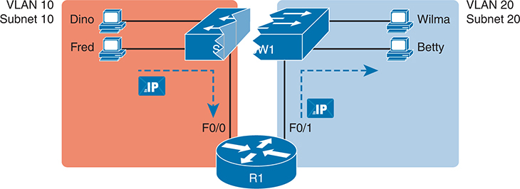

<figcaption>

<strong>图 8-8</strong> <em>通过两个物理接口在两个 VLAN 之间执行路由</em>

<aside class="hidden" id="a08fig08">

交换机 SW1 被分成两半。第一半连接用户 Dino 和 Fred，他们被分配到 VLAN 10、子网 10。第二半连接用户 Wilma 和 Betty，他们属于 VLAN 20、子网 20。SW1 的两半都连接到路由器 R1。第一半通过 Fast Ethernet 0/0 接口连接 R1，第二半通过 Fast Ethernet 0/1 接口连接 R1。这种设置利用路由器 R1 在 VLAN 之间执行路由，使 VLAN 10 与 VLAN 20 中的用户能够通信。

</aside>

</figcaption>

</figure>

图中显示一个 IP 分组从位于一个 VLAN／子网中的 Fred 路由到位于另一个 VLAN／子网中的 Betty。二层交换机转发两个不同的二层以太网帧：一个在 VLAN 10 中，从 Fred 发往 R1 的 F0/0 接口；另一个在 VLAN 20 中，从 R1 的 F0/1 接口发往 Betty。从三层角度看，Fred 将 IP 分组发送给默认路由器（R1），R1 再将该分组从另一个接口（F0/1）路由到 Betty 所在的另一子网。

<a href="#ch08fig08">图 8-8</a> 中的设计可以工作，但在 VLAN 之间路由分组还有多种解决方案。本章展示了使用独立物理路由器、每个 VLAN 各用一条链路的方式，因为这种方式可能最容易理解和形成直观认识。<a data-original-href="vol1_ch18.xhtml#ch18" data-unavailable="true" title="此内容不在当前提取范围内；请参阅原始 EPUB：vol1_ch18.xhtml#ch18">第 18 章</a>“<a data-original-href="vol1_ch18.xhtml#ch18" data-unavailable="true" title="此内容不在当前提取范围内；请参阅原始 EPUB：vol1_ch18.xhtml#ch18">LAN 中的 IP 路由</a>”将详细介绍其他用于在 VLAN 间路由分组的功能。

</section>

</section>

</section>

<section>

<h3 class="h3" id="ch08lev1sec4">VLAN 与 VLAN 中继的配置和验证</h3>

Cisco 交换机无需任何配置就能工作。购买 Cisco 交换机、用正确的线缆安装设备并打开交换机电源后，它们就能工作。即使互联多台交换机，只要不需要多个 VLAN，也完全不必配置交换机，它就能正常运行。但如果要使用 VLAN——大多数企业网络都会使用——就需要增加一些配置。

本章将 VLAN 配置细节分为两个主要部分。第一部分介绍如何配置<em>静态接入接口</em>，即配置为只属于一个 VLAN、因而不使用 VLAN 中继的交换机接口。第二部分介绍如何配置使用 VLAN 中继的接口。

<section>

<h4 class="h4" id="ch08lev2sec3">创建 VLAN 并为接口分配接入 VLAN</h4>

本节介绍如何创建 VLAN、为 VLAN 命名，以及将接口分配给 VLAN。为了专注于这些基础细节，本节示例只使用一台交换机，因此不需要 VLAN 中继。

要使 Cisco 交换机转发某个 VLAN 中的帧，必须通过配置让交换机认为该 VLAN 存在。此外，交换机还必须具有分配到该 VLAN 的非中继接口（称为<a id="key_097" href="#ref-gloss_011">接入接口</a>或<a id="key_102" href="#ref-gloss_377">静态接入接口</a>），以及／或者支持该 VLAN 的中继。接入接口的配置步骤如下：

<figure class="figure1">

</figure>

步骤 1. 要配置新的 VLAN，请执行以下步骤：

<ol class="step-lower-alpha">

<li>
在全局配置模式下使用 <strong>vlan</strong> <em>vlan-id</em> 命令，创建 VLAN 并进入 VLAN 配置模式。
</li>

<li>
（可选）在 VLAN 配置模式下使用 <strong>name</strong> <em>name</em> 命令，为 VLAN 指定名称。如果未配置名称，则 VLAN 名称为 VLAN<em>ZZZZ</em>，其中 <em>ZZZZ</em> 是四位十进制 VLAN ID。
</li>

</ol>

步骤 2. 对每个接入接口执行以下步骤：

<ol class="step-lower-alpha">

<li>
在全局配置模式下使用 <strong>interface</strong> <em>type number</em> 命令，进入每个目标接口的接口配置模式。
</li>

<li>
在接口配置模式下使用 <strong>switchport access vlan</strong> <em>id-number</em> 命令，指定与该接口关联的 VLAN 编号。
</li>

<li>
（可选）在接口配置模式下使用 <strong>switchport mode access</strong> 命令，使该端口始终以接入模式运行（即不使用中继）。
</li>

</ol>

这个列表看起来可能有些复杂，但在单台交换机上的操作实际上很简单。例如，要将交换机端口划分到三个 VLAN——11、12 和 13——先添加三条 <strong>vlan</strong> 命令：<strong>vlan 11</strong>、<strong>vlan 12</strong> 和 <strong>vlan 13</strong>。然后，为每个接口添加一条 <strong>switchport access vlan 11</strong>（或 <strong>12</strong>、<strong>13</strong>）命令，将该接口分配给正确的 VLAN。

注意

术语<a id="key_099" href="#ref-gloss_093">默认 VLAN</a>（见考试主题）指 <strong>switchport access vlan</strong> <em>vlan-id</em> 命令的默认设置，即 VLAN ID 1。换句话说，默认情况下，每个端口都分配到接入 VLAN 1。

<section>

<h5 class="h5" id="ch08lev3sec5">VLAN 配置示例 1：完整的 VLAN 配置</h5>

<a href="#exa8_1">示例 8-1</a>、<a href="#exa8_2">8-2</a> 和 <a href="#exa8_3">8-3</a> 围绕同一个场景演示 VLAN 的配置与验证。首先，<a href="#exa8_1">示例 8-1</a> 显示了<a href="#ch08fig09">图 8-9</a> 中交换机 SW1 的 VLAN，其所有与 VLAN 相关的设置均为默认值。

<figure class="image-c" id="ch08fig09">

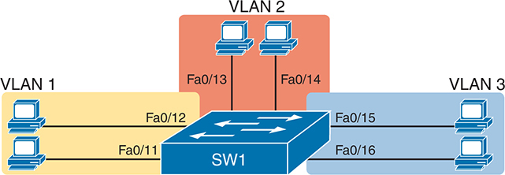

<figcaption>

<strong>图 8-9</strong> <em>包含一台交换机和三个 VLAN 的网络</em>

<aside class="hidden" id="a08fig09">

在 VLAN 1 中，两台 PC 通过 Fast Ethernet 0/12 和 Fast Ethernet 0/11 接口连接到交换机 SW1。在 VLAN 2 中，两台 PC 通过 Fast Ethernet 0/13 和 Fast Ethernet 0/14 接口连接到 SW1。同样，在 VLAN 3 中，两台 PC 通过 Fast Ethernet 0/15 和 Fast Ethernet 0/16 接口连接到 SW1。这种设置将网络流量有效地隔离到三个不同的 VLAN 中，为各 VLAN 内的设备提供独立的通信路径。

</aside>

</figcaption>

</figure>

<strong>示例 8-1</strong> <em>配置 VLAN 并将 VLAN 分配给接口</em>

<a href="#code-f0198-01" id="f0198-01a">点击此处查看代码原图</a>

<pre class="pre-ex" tabindex="0"><code>SW1# <strong>show vlan brief</strong>

VLAN Name                             Status     Ports

---- -------------------------------- --------- -------------------------------

1    default                           active    Fa0/1, Fa0/2, Fa0/3, Fa0/4

                                                 Fa0/5, Fa0/6, Fa0/7, Fa0/8

                                                 Fa0/9, Fa0/10, Fa0/11, Fa0/12

                                                 Fa0/13, Fa0/14, Fa0/15, Fa0/16

                                                 Fa0/17, Fa0/18, Fa0/19, Fa0/20

                                                 Fa0/21, Fa0/22, Fa0/23, Fa0/24

                                                 Gi0/1, Gi0/2

1002 fddi-default                      act/unsup

1003 token-ring-default                act/unsup

1004 fddinet-default                   act/unsup

1005 trnet-default                     act/unsup</code></pre>

示例首先使用 <strong>show vlan brief</strong> 命令，确认默认存在五个不可删除的 VLAN，并且所有接口都分配给 VLAN 1。VLAN 1 不可删除，但可以使用。VLAN 1002–1005 不可删除，如今也不能用作接入 VLAN。特别注意，该交换机有 24 个 Fast Ethernet 端口（Fa0/1–Fa0/24）和两个 Gigabit Ethernet 端口（Gi0/1 和 Gi0/2），在第一条命令的输出中，它们全部列在 VLAN 1 中，证实 Cisco 交换机默认将所有端口分配给 VLAN 1。

接下来，<a href="#exa8_2">示例 8-2</a> 展示了与 VLAN 配置清单对应的步骤，即配置 VLAN 2，并将 VLAN 2 作为接入 VLAN 分配给两个端口：Fa0/13 和 Fa0/14。

<strong>示例 8-2</strong> <em>配置 VLAN 并将 VLAN 分配给接口</em>

<a href="#code-f0199-01" id="f0199-01a">点击此处查看代码原图</a>

<pre class="pre-ex" tabindex="0"><code>SW1# <strong>configure terminal</strong>

Enter configuration commands, one per line. End with CNTL/Z.

SW1(config)# <strong>vlan 2</strong>

SW1(config-vlan)# <strong>name Freds-vlan</strong>

SW1(config-vlan)# <strong>exit</strong>

SW1(config)# <strong>interface range fastethernet 0/13 - 14</strong>

SW1(config-if)# <strong>switchport access vlan 2</strong>

SW1(config-if)# <strong>switchport mode access</strong>

SW1(config-if)# <strong>end</strong>

SW1# <strong>show vlan brief</strong>

VLAN Name                             Status    Ports

---- -------------------------------- --------- -------------------------------

1    default                          active    Fa0/1, Fa0/2, Fa0/3, Fa0/4

                                                Fa0/5, Fa0/6, Fa0/7, Fa0/8

                                                Fa0/9, Fa0/10, Fa0/11, Fa0/12

                                                Fa0/15, Fa0/16, Fa0/17, Fa0/18

                                                Fa0/19, Fa0/20, Fa0/21, Fa0/22

                                                Fa0/23, Fa0/24, Gi0/1, Gi0/2

2    Freds-vlan                       active    Fa0/13, Fa0/14

1002 fddi-default                  act/unsup

1003 token-ring-default            act/unsup

1004 fddinet-default               act/unsup

1005 trnet-default                 act/unsup</code></pre>

花一点时间，将<strong> show vlan brief</strong> 命令在<a href="#exa8_2">示例 8-2</a>（添加配置后）中的输出与<a href="#exa8_1">示例 8-1</a> 中的输出进行比较。<a href="#exa8_2">示例 8-2</a> 显示了 VLAN 2 的新信息，端口 Fa0/13 和 Fa0/14 不再列在 VLAN 1 下，而是列为已分配给 VLAN 2。

作为这一场景的最后部分，<a href="#exa8_3">示例 8-3</a> 展示了关于 VLAN 本身的更多细节。首先，<strong>show running-config</strong> 命令列出了在<a href="#exa8_2">示例 8-2</a> 中配置的 <strong>vlan 2</strong> 和 <strong>switchport access vlan 2</strong> 命令。此外，注意前面的<a href="#exa8_2">示例 8-2</a> 使用 <strong>interface range</strong> 命令，并只输入了一次 <strong>switchport access vlan 2</strong> 接口子命令。但是，<a href="#exa8_3">示例 8-3</a> 显示交换机实际上将该命令同时应用到了 Fa0/13 和 Fa0/14。<a href="#exa8_3">示例 8-3</a> 最后使用 <strong>show vlan id 2</strong> 命令，确认端口 Fa0/13 和 Fa0/14 的运行状态是已分配给 VLAN 2。

<strong>示例 8-3</strong> <em>配置 VLAN 并将 VLAN 分配给接口</em>

<a href="#code-f0200-01" id="f0200-01a">点击此处查看代码原图</a>

<pre class="pre-ex" tabindex="0"><code>SW1# <strong>show running-config</strong>

! Many lines omitted for brevity

! Early in the output:

vlan 2

 name Freds-vlan

!

! more lines omitted for brevity

interface FastEthernet0/13

 switchport access vlan 2

 switchport mode access

!

interface FastEthernet0/14

 switchport access vlan 2

 switchport mode access

!

SW1# <strong>show vlan id 2</strong>

VLAN Name                             Status     Ports

---- -------------------------------- --------- -------------------------------

2    Freds-vlan                       active     Fa0/13, Fa0/14

VLAN Type  SAID       MTU   Parent RingNo BridgeNo Stp  BrdgMode Trans1 Trans2

---- ----- ---------- ----- ------ ------ -------- ---- -------- ------ ------

2    enet  100010     1500  -      -       -       -    -        0      0

Remote SPAN VLAN

----------------

Disabled

Primary Secondary Type              Ports

------- --------- ----------------- ------------------------------------------</code></pre>

围绕<a href="#ch08fig09">图 8-9</a> 的示例使用了六个交换机端口，全部都需要作为接入端口运行。也就是说，每个端口都不应使用中继，而应通过 <strong>switchport access vlan</strong> <em>vlan-id</em> 命令分配给单个 VLAN。对于应当始终作为接入端口的端口，可以添加可选的接口子命令 <strong>switchport mode access</strong>。该命令让交换机始终将该接口作为接入接口，并禁用与链路另一端设备协商中继的协议（动态中继协议 [DTP]）。（接下来的“<a href="#ch08lev2sec5">VLAN 中继配置</a>”一节将详细讨论允许端口协商是否使用中继的命令。）

注意

本书配套网站包含一个视频，演示了另一个 VLAN 配置示例。

</section>

<section>

<h5 class="h5" id="ch08lev3sec6">VLAN 配置示例 2：更简短的 VLAN 配置</h5>

<a href="#exa8_2">示例 8-2</a> 展示了如何配置 VLAN，并向该 VLAN 添加两个接入端口。<a href="#exa8_4">示例 8-4</a> 完成同样的操作，但使用 VLAN 3，并采用一种简短得多的配置方式。通过将两个端口加入 VLAN 3，该配置完成了<a href="#ch08fig09">图 8-9</a> 所示设计的配置工作。

<strong>示例 8-4</strong> <em>更简短的 VLAN 配置示例（VLAN 3）</em>

<a href="#code-f0201-01" id="f0201-01a">点击此处查看代码原图</a>

<pre class="pre-ex" tabindex="0"><code>SW1# <strong>configure terminal</strong>

Enter configuration commands, one per line. End with CNTL/Z.

SW1(config)# <strong>interface range Fastethernet 0/15 - 16</strong>

SW1(config-if-range)# <strong>switchport access vlan 3</strong>

% Access VLAN does not exist. Creating vlan 3

SW1(config-if-range)# <strong>^Z</strong>

SW1# <strong>show vlan brief</strong>

VLAN Name                             Status     Ports

---- -------------------------------- --------- -------------------------------

1 default                          active      Fa0/1, Fa0/2, Fa0/3, Fa0/4

                                               Fa0/5, Fa0/6, Fa0/7, Fa0/8

                                               Fa0/9, Fa0/10, Fa0/11, Fa0/12

                                               Fa0/17, Fa0/18, Fa0/19, Fa0/20

                                               Fa0/21, Fa0/22, Fa0/23, Fa0/24

                                               Gi0/1, Gi0/2

2 Freds-vlan                      active      Fa0/13, Fa0/14

3 VLAN0003                        active      Fa0/15, Fa0/16

1002 fddi-default                 act/unsup

1003 token-ring-default           act/unsup

1004 fddinet-default              act/unsup

1005 trnet-default                act/unsup</code></pre>

<a href="#exa8_4">示例 8-4</a> 展示了当 <strong>switchport access vlan</strong> 接口子命令引用尚未配置的 VLAN 时，交换机如何动态创建 VLAN，其效果等同于 <strong>vlan</strong> <em>vlan-id</em> 全局配置命令。示例开始时，SW1 尚不知道 VLAN 3。添加 <strong>switchport access vlan 3</strong> 接口子命令后，交换机发现 VLAN 3 不存在，便如示例阴影消息所示，使用默认名称（VLAN0003）创建了 VLAN 3。工程师不必输入 <strong>vlan 3</strong> 全局命令来创建 VLAN 3，交换机会自动完成。创建 VLAN 不再需要其他步骤。过程结束时，VLAN 3 已存在于交换机中，接口 Fa0/15 和 Fa0/16 也已属于 VLAN 3，如 <strong>show vlan brief</strong> 命令输出的阴影部分所示。

</section>

</section>

<section>

<h4 class="h4" id="ch08lev2sec4">VLAN 中继协议</h4>

在展示更多配置示例之前，还需要了解一项称为 VLAN 中继协议（VTP）的 Cisco 协议和工具。VTP 是 Cisco 交换机上的专有工具，会通告一台交换机中配置的各个 VLAN（通过 <strong>vlan</strong> <em>number</em> 命令配置），使园区中的其他所有交换机都能学习到这些 VLAN。

本书不将 VTP 作为独立主题展开讨论，原因有几个。首先，当前的 CCNA 200-301 考试大纲不涉及 VTP，CCNP Enterprise Core 和 CCNP Enterprise Advanced Routing 考试大纲也一样。此外，许多企业选择禁用 VTP。

而且，可以轻松禁用 VTP，使它不会影响实验中的交换机；我在构建本书所有示例时正是这样做的。

不过，即使不使用 VTP，它仍然会对每台 Cisco Catalyst 交换机的工作方式产生一些影响。本节简要介绍足够的 VTP 细节，帮助你理解它对 Cisco Catalyst 交换机的影响。

首先，本书（以及第 2 卷）的所有示例，都以某种方式禁用了交换机上的 VTP。有趣的是，在 VTP 存在的数十年中的大部分时间里，多数交换机确实支持完全禁用 VTP 的选项。作为替代，为了有效禁用 VTP，工程师会将交换机设置为 <a id="key_110" href="#ref-gloss_439">VTP 透明模式</a>（使用 <strong>vtp mode transparent</strong> 全局命令）。如今，许多较新的交换机提供了通过 <strong>vtp mode off</strong> 全局命令彻底禁用 VTP 的选项。对于本书而言，将交换机配置为 transparent 模式或 off 模式，都算禁用了 VTP。

注意，transparent 和 off 模式都会阻止 VTP 学习和通告 VLAN 配置。这两种模式允许交换机配置所有 VLAN，包括标准范围和扩展范围 VLAN。此外，使用 transparent 或 off 模式的交换机会在 running-config 文件中列出 <strong>vlan</strong> 配置命令。

相比之下，处于 VTP server 或 client 模式的交换机行为不同。如果你使用真实交换机或模拟器做实验时发现 VLAN 出现异常结果，可以用 <strong>show vtp status</strong> 命令检查 VTP 状态。如果交换机使用 VTP server 或 client 模式，你会发现：

<ul class="sq">

<li>
server 交换机只能配置标准范围（1–1005）的 VLAN。
</li>

<li>
client 交换机不能配置 VLAN。
</li>

<li>
server 和 client 都可能通过 VTP 从其他交换机学习新的 VLAN，也可能因其他交换机的操作而使自身 VLAN 被删除。
</li>

<li>
<strong>show running-config</strong> 命令不会列出任何 <strong>vlan</strong> 命令；必须使用其他 <strong>show</strong> 命令来查看已配置的 VLAN。
</li>

</ul>

如果实验条件允许，在练习交换机配置时应禁用 VTP，直到你决定出于其他目的进一步学习 VTP。

注意

在了解 VTP 的工作方式并与有经验的同事讨论之前，不要更改任何连接到生产网络的交换机的 VTP 设置。这样做可能对 LAN 造成实际损害。例如，如果你配置的交换机连接到其他交换机，而它们又连接到生产 LAN 中的交换机，你可能会意外更改其他交换机的 VLAN 配置，严重影响网络运行。你可能删除 VLAN，造成网络中断。务必小心，除非交换机及与其相连的其他交换机完全没有任何物理链路连接到生产 LAN，否则绝不要在该交换机上试验 VTP 设置。

</section>

<section>

<h4 class="h4" id="ch08lev2sec5">VLAN 中继配置</h4>

如果仅采用静态配置，两台 Cisco 交换机之间的中继配置可以很简单。只需在链路两端的交换机接口上各添加一条接口子命令（<strong>switchport mode trunk</strong>），就能创建一条支持各交换机所有已知 VLAN 的 VLAN 中继。

不过，Cisco 交换机的中继配置还包含很多其他选项，其中包括动态协商各种中继设置的多个选项。可以预先定义不同设置，也可以让交换机协商设置，具体如下：

<ul class="sq">

<li>
<strong>中继类型：</strong>对于同时支持两种中继类型的交换机，可以选择 IEEE 802.1Q、ISL，或协商使用哪一种。
</li>

<li>
<strong>管理模式：</strong>始终使用中继、始终不使用中继，或者协商是否使用中继。
</li>

</ul>

首先考虑中继类型。多年来，Cisco 不再为新的交换机产品系列提供 ISL 支持，而是倾向于 IEEE 802.1Q。在同时支持两者的旧交换机上，可以使用 <strong>switchport trunk encapsulation</strong> {<strong>dot1q</strong> | <strong>isl</strong> | <strong>negotiate</strong>} 接口子命令，配置使用的类型，或者让动态中继协议（DTP）协商类型（如果双方都支持 ISL，则优先选择 ISL）。

DTP 还可以根据本地交换机端口的管理模式，协商链路两端设备是否同意使用中继。<a id="key_105" href="#ref-gloss_415">管理模式</a>指是否应使用中继的配置设置。Cisco 交换机使用 <strong>switchport mode</strong> 接口子命令定义中继管理模式，如<a href="#ch08tab02">表 8-2</a> 所列。交换机接口的<a id="key_106" href="#ref-gloss_416">运行模式</a>则显示接口当前作为中继还是接入端口工作，它取决于两台交换机上的配置以及其他因素。

<figure class="table" id="ch08tab02" tabindex="0">

<figcaption>

<strong>表 8-2</strong> <strong>switchport mode</strong> 命令的中继管理模式选项

</figcaption>

<table class="all">

<thead>

<tr>

<th class="th">
命令选项
</th>

<th class="th">
说明
</th>

</tr>

</thead>

<tbody>

<tr>

<td class="border">
<strong>access</strong>
</td>

<td class="border">
始终作为接入（非中继）端口运行
</td>

</tr>

<tr>

<td class="border">
<strong>trunk</strong>
</td>

<td class="border">
始终作为中继端口运行
</td>

</tr>

<tr>

<td class="border">
<strong>dynamic desirable</strong>
</td>

<td class="border">
主动发送协商消息并响应协商消息，动态选择是否开始使用中继
</td>

</tr>

<tr>

<td class="border">
<strong>dynamic auto</strong>
</td>

<td class="border">
被动等待接收中继协商消息；收到后，交换机会响应并协商是否使用中继
</td>

</tr>

</tbody>

</table>

</figure>

例如，考虑<a href="#ch08fig10">图 8-10</a> 中的两台交换机。该图扩展了前面<a href="#ch08fig09">图 8-9</a> 的设计，增加了一条连接新交换机 SW2 的中继，并将 VLAN 1 和 VLAN 3 的部分设备连接到 SW2 的端口。两台交换机使用一条 Gigabit Ethernet 链路作为中继。在本例中，中继默认不会动态形成，因为两台交换机的管理模式都默认为 <em>dynamic auto</em>，意味着双方都不会发起中继协商。将一台交换机改为会主动发起协商的 <em>dynamic desirable</em> 模式后，双方就会协商使用中继；具体使用 802.1Q，因为这些交换机只支持 802.1Q。

<a href="#exa8_5">示例 8-5</a> 开始时，SW1 的配置与<a href="#exa8_2">示例 8-2</a> 和 <a href="#exa8_4">8-4</a> 相同，即 SW1 各有两个端口分配给 VLAN 1、2 和 3。但是，SW1 和 SW2 当前用于互联的接口都采用默认设置。使用默认的 <strong>switchport mode dynamic auto</strong> 设置时，两台交换机不会使用中继。

<figure class="image-c" id="ch08fig10">

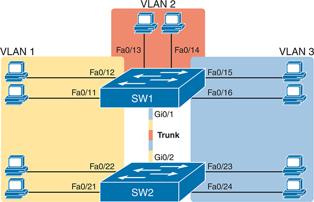

<figcaption>

<strong>图 8-10</strong> <em>包含两台交换机和三个 VLAN 的网络</em>

<aside class="hidden" id="a08fig10">

在 VLAN 1 中，两台 PC 通过 Fast Ethernet 0/12 和 Fast Ethernet 0/11 接口连接到交换机 SW1，另外两台 PC 通过 Fast Ethernet 0/22 和 Fast Ethernet 0/21 接口连接到交换机 SW2。在 VLAN 2 中，两台 PC 通过 Fast Ethernet 0/13 和 Fast Ethernet 0/14 接口连接到 SW1。在 VLAN 3 中，两台 PC 通过 Fast Ethernet 0/15 和 Fast Ethernet 0/16 接口连接到 SW1，另外两台 PC 通过 Fast Ethernet 0/23 和 Fast Ethernet 0/24 接口连接到 SW2。SW1 通过 Gigabit Ethernet 0/1 和 Gigabit Ethernet 0/2 中继接口连接到 SW2，使交换机及 VLAN 之间能够通信。

</aside>

</figcaption>

</figure>

<strong>示例 8-5</strong> <em>初始（默认）状态：SW1 与 SW2 之间不使用中继</em>

<a href="#code-f0204-01" id="f0204-01a">点击此处查看代码原图</a>

<pre class="pre-ex" tabindex="0"><code>SW1# <strong>show interfaces gigabit 0/1 switchport</strong>

Name: Gi0/1

Switchport: Enabled

Administrative Mode: dynamic auto

Operational Mode: static access

Administrative Trunking Encapsulation: dot1q

Operational Trunking Encapsulation: native

Negotiation of Trunking: On

Access Mode VLAN: 1 (default)

Trunking Native Mode VLAN: 1 (default)

Administrative Native VLAN tagging: enabled

Voice VLAN: none

Access Mode VLAN: 1 (default)

Trunking Native Mode VLAN: 1 (default)

Administrative Native VLAN tagging: enabled

Voice VLAN: none

Administrative private-vlan host-association: none

Administrative private-vlan mapping: none

Administrative private-vlan trunk native VLAN: none

Administrative private-vlan trunk Native VLAN tagging: enabled

Administrative private-vlan trunk encapsulation: dot1q

Administrative private-vlan trunk normal VLANs: none

Administrative private-vlan trunk private VLANs: none

Operational private-vlan: none

Trunking VLANs Enabled: ALL

Pruning VLANs Enabled: 2-1001

Capture Mode Disabled

Capture VLANs Allowed: ALL

Protected: false

Unknown unicast blocked: disabled

Unknown multicast blocked: disabled

Appliance trust: none

! Note that the next command results in a single empty line of output.

SW1# <strong>show interfaces trunk</strong>

SW1#</code></pre>

首先，关注<a href="#exa8_5">示例 8-5</a> 开头的 <strong>show interfaces switchport</strong> 命令输出中高亮显示的项目。输出列出了默认的管理模式设置 dynamic auto。由于 SW2 也默认为 dynamic auto，命令将 SW1 的运行状态列为“access”，表示它没有使用中继。（“Dynamic auto”让两台交换机都等待另一台交换机发起协商。）第三条阴影行指出唯一支持的中继类型为 802.1Q。（在同时支持 ISL 和 802.1Q 的交换机上，这个值默认会显示“negotiate”，表示封装类型通过协商确定。）最后，运行中的中继类型列为“native”，这里指的是 802.1Q 本征 VLAN。

示例末尾执行了 <strong>show interfaces trunk</strong> 命令，但没有任何输出。该命令列出所有当前实际运行中继的接口信息，即当前使用 VLAN 中继的接口。由于没有列出任何接口，该命令也证实交换机之间的链路未使用中继。

接下来，考虑<a href="#exa8_6">示例 8-6</a>，其中展示了启用中继的新配置。本例在 SW1 上配置 <strong>switchport mode dynamic desirable</strong> 命令，让交换机参与协商并主动开始协商过程，而不是等待另一端设备。示例显示，命令一发出就出现日志消息，显示接口先 down、随后再次 up；这会发生在接口从接入模式转变为中继模式时。

<strong>示例 8-6</strong> <em>SW1 从 Dynamic Auto 改为 Dynamic Desirable</em>

<a href="#code-f0205-01" id="f0205-01a">点击此处查看代码原图</a>

<pre class="pre-ex" tabindex="0"><code>SW1# <strong>configure terminal</strong>

Enter configuration commands, one per line. End with CNTL/Z.

SW1(config)# <strong>interface gigabit 0/1</strong>

SW1(config-if)# <strong>switchport mode dynamic desirable</strong>

SW1(config-if)# <strong>^Z</strong>

SW1#

%LINEPROTO-5-UPDOWN: Line protocol on Interface GigabitEthernet0/1, changed state to

down

%LINEPROTO-5-UPDOWN: Line protocol on Interface GigabitEthernet0/1, changed state to

up

SW1# <strong>show interfaces gigabit 0/1 switchport</strong>

Name: Gi0/1

Switchport: Enabled

Administrative Mode: dynamic desirable

Operational Mode: trunk

Administrative Trunking Encapsulation: dot1q

Operational Trunking Encapsulation: dot1q

Negotiation of Trunking: On

Access Mode VLAN: 1 (default)

Trunking Native Mode VLAN: 1 (default)

! lines omitted for brevity</code></pre>

<a href="#exa8_6">示例 8-6</a> 再次执行了<a href="#exa8_5">示例 8-5</a> 中的 <strong>show interfaces gi0/1 switchport</strong> 命令，但这次是在配置 VLAN 中继之后，因此输出显示 SW1 的 G0/1 接口现在作为中继运行。注意，命令仍同时列出表示配置值的管理设置，以及表示交换机当前实际行为的运行设置。SW1 现在显示其运行模式为 <em>trunk</em>，运行中的中继封装为 dot1Q。

<a href="#exa8_7">示例 8-7</a> 再次执行了同一条 <strong>show interfaces trunk</strong> 命令，它在<a href="#exa8_5">示例 8-5</a> 中没有任何输出。现在 SW1 在 G0/1 端口上使用中继，因此<a href="#exa8_7">示例 8-7</a> 的输出列出了 G0/1，确认 G0/1 当前正在运行中继。下一节将讨论该命令输出的含义。另外，示例末尾再次使用 <strong>show vlan id 2</strong> 命令；值得注意的是，输出包含中继端口 G0/1，因为该端口可以转发 VLAN 2 的流量。

<strong>示例 8-7</strong> <em>进一步查看 SW1 的 G0/1 中继端口</em>

<a href="#code-f0206-01" id="f0206-01a">点击此处查看代码原图</a>

<pre class="pre-ex" tabindex="0"><code>SW1# <strong>show interfaces trunk</strong>

Port        Mode             Encapsulation  Status        Native vlan

Gi0/1       desirable        802.1q         trunking      1

Port        Vlans allowed on trunk

Gi0/1       1-4094

Port        Vlans allowed and active in management domain

Gi0/1       1-3

Port        Vlans in spanning tree forwarding state and not pruned

Gi0/1       1-3

SW1# <strong>show vlan id 2</strong>

VLAN Name                             Status    Ports

---- -------------------------------- --------- -------------------------------

2    Freds-vlan                       active    Fa0/13, Fa0/14, G0/1

VLAN Type  SAID       MTU   Parent RingNo BridgeNo Stp  BrdgMode Trans1 Trans2

---- ----- ---------- ----- ------ ------ -------- ---- -------- ------ ------

2    enet  100010     1500  -      -      -        -    -        0      0

Remote SPAN VLAN

----------------

Disabled

Primary Secondary Type              Ports

------- --------- ----------------- ------------------------------------------</code></pre>

备考时，应当能够解释 <strong>show interfaces switchport</strong> 命令的输出，理解输出所体现的管理模式，并根据这些设置判断链路是否应当实际运行中继。<a href="#ch08tab03">表 8-3</a> 列出了中继管理模式的组合，以及这些配置预期产生的运行模式（中继或接入）。表格左侧列出链路一端的管理模式，顶部列出链路另一端交换机的管理模式。

<figure class="table" id="ch08tab03" tabindex="0">

<figcaption>

<strong>表 8-3</strong> 根据所配置管理模式推断的预期中继运行模式

</figcaption>

<table class="all">

<thead>

<tr>

<th class="th">
管理模式
</th>

<th class="th">
Access
</th>

<th class="th">
Dynamic Auto
</th>

<th class="th">
Trunk
</th>

<th class="th">
Dynamic Desirable
</th>

</tr>

</thead>

<tbody>

<tr>

<td class="border">
<strong>access</strong>
</td>

<td class="border">
接入
</td>

<td class="border">
接入
</td>

<td class="border">
不要使用<a id="tfn8_3" href="#tfn8_3a">*</a>
</td>

<td class="border">
接入
</td>

</tr>

<tr>

<td class="border">
<strong>dynamic auto</strong>
</td>

<td class="border">
接入
</td>

<td class="border">
接入
</td>

<td class="border">
中继
</td>

<td class="border">
中继
</td>

</tr>

<tr>

<td class="border">
<strong>trunk</strong>
</td>

<td class="border">
不要使用<a href="#tfn8_3a">*</a>
</td>

<td class="border">
中继
</td>

<td class="border">
中继
</td>

<td class="border">
中继
</td>

</tr>

<tr>

<td class="border">
<strong>dynamic desirable</strong>
</td>

<td class="border">
接入
</td>

<td class="border">
中继
</td>

<td class="border">
中继
</td>

<td class="border">
中继
</td>

</tr>

</tbody>

</table>

<a id="tfn8_3a" href="#tfn8_3">*</a> 当两台交换机的一端配置为“access”、另一端配置为“trunk”时，会出现问题。应避免这种组合。

</figure>

最后，在结束中继配置的讨论之前，Cisco 建议在大多数端口上禁用中继协商，以提高安全性。多数交换机的大部分端口用于连接用户，并配置 <strong>switchport mode access</strong> 命令，这也会禁用 DTP。对于没有配置 <strong>switchport mode access</strong> 命令的端口，例如使用 <strong>switchport mode trunk</strong> 命令静态配置为中继的端口，DTP 仍会运行，但可以使用 <strong>switchport nonegotiate</strong> 接口子命令彻底禁用 DTP 协商。

</section>

<section>

<h4 class="h4" id="ch08lev2sec6">实现连接电话的接口</h4>

接下来的主题有些特殊，至少在接入链路和中继链路的语境中是如此。在 IP 电话环境中，电话使用以太网端口连接以太网网络，从而通过 IP 分组发送和接收语音流量。为实现这一点，交换机的以太网端口表现得像接入端口，但同时又在某些方面像中继。本章的这个最后主题将详细介绍这些主要概念。

<section>

<h5 class="h5" id="ch08lev3sec7">数据 VLAN 与语音 VLAN 概念</h5>

在 IP 电话出现之前，PC 和电话可以放在同一张桌子上。电话也使用 UTP 布线，连接到某种语音设备（通常称为<em>语音交换机</em>或<em>专用小交换机 [PBX]</em>）。PC 则当然通过非屏蔽双绞线（UTP）连接到配线间内常见的 LAN 交换机，有时它与语音交换机位于同一个配线间。<a href="#ch08fig11">图 8-11</a> 展示了这一情形。

<figure class="image-c" id="ch08fig11">

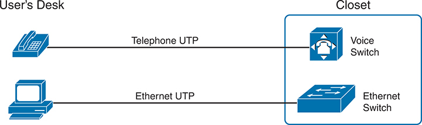

<figcaption>

<strong>图 8-11</strong> <em>IP 电话出现之前：PC 和电话各用一条线缆连接到两个不同设备</em>

<aside class="hidden" id="a08fig11">

用户桌面上的电话通过电话非屏蔽双绞线（UTP）连接到配线间中的语音交换机。用户桌面上的计算机通过以太网 UTP 线缆连接到配线间中的以太网交换机。

</aside>

</figcaption>

</figure>

<em>IP 电话</em>这一术语指网络技术的一个分支：电话利用 IP 分组发送和接收语音，语音以 IP 分组数据部分中的比特表示。与大多数其他终端用户设备一样，这些电话通过以太网或 Wi-Fi 连接网络。新式 IP 电话不再通过线缆直接连接语音交换机，而是使用以太网线缆及电话内置的以太网端口连接 IP 网络。随后，电话通过 IP 网络与软件通信，由软件代替 PBX 完成呼叫建立等功能。（Cisco 当前承担这种 IP 电话控制功能的产品称为 <em>Cisco Unified Communication Manager</em>。）

从使用已有电话布线迁移到需要支持以太网的 UTP 线缆的新式 IP 电话，给一些办公室带来了问题。具体来说：

<ul class="sq">

<li>
较旧的非 IP 电话所使用的 UTP 布线类别，往往不支持 100 Mbps 或 1000 Mbps 以太网。
</li>

<li>
大多数办公室从配线间到每张桌面只有一条 UTP 线缆，但现在 PC 和新式 IP 电话两个设备都需要一条桌面到配线间的线缆。
</li>

<li>
为每张桌面安装新线缆成本很高，而且还需要更多交换机端口。
</li>

</ul>

为了解决这一问题，Cisco 在每部电话中内置了小型三端口交换机。

从最早的 IP 电话产品开始，电话底部就包含一台小型 LAN 交换机。<a href="#ch08fig12">图 8-12</a> 展示了基本布线：来自配线间的线缆连接内置交换机的一个物理端口，PC 通过短跳线连接另一个物理端口，电话内部的 CPU 则连接到一个内部交换机端口。

<figure class="image-c" id="ch08fig12">

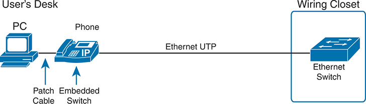

<figcaption>

<strong>图 8-12</strong> <em>使用 IP 电话、单条线缆和集成交换机的布线</em>

<aside class="hidden" id="a08fig12">

PC 通过跳线连接到 IP 电话。电话内置交换机，并通过以太网 UTP 线缆连接到配线间的以太网交换机。

</aside>

</figcaption>

</figure>

使用 IP 电话的场所——如今几乎所有公司都包括在内——现在每个接入端口后面都有两个设备。此外，Cisco 的 IP 电话设计最佳实践建议将电话放入一个 VLAN，将 PC 放入另一个 VLAN。为此，交换机端口对 PC 流量表现得有点像接入链路，对电话流量则有点像中继。配置在该端口上定义两个 VLAN，如下所示：

<strong>数据 VLAN：</strong>概念和配置方式与接入端口上的接入 VLAN 相同，但这里将其定义为链路上用于转发桌面电话所连接设备（通常是用户 PC）流量的 VLAN。

<strong>语音 VLAN：</strong>在链路上定义的、用于转发电话流量的 VLAN。该 VLAN 中的流量通常带有 802.1Q 首部标签。

<a href="#ch08fig13">图 8-13</a> 展示了这种在支持 IP 电话的接入端口上使用两个 VLAN 的设计。

<figure class="image-c" id="ch08fig13">

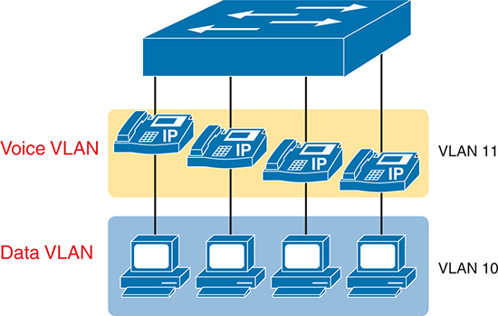

<figcaption>

<strong>图 8-13</strong> <em>一种 LAN 设计：数据位于 VLAN 10，电话位于 VLAN 11</em>

</figcaption>

</figure>

</section>

<section>

<h5 class="h5" id="ch08lev3sec8">数据 VLAN 与语音 VLAN 的配置和验证</h5>

知道规划好的语音 VLAN 和数据 VLAN ID 后，只需几条简单命令，就能配置交换机端口来支持 IP 电话。不过，配置完成后理解 <strong>show</strong> 命令的输出可能有些难度。该端口在许多方面都像接入端口，但在大多数配置选项下，语音帧携带 802.1Q 首部，因而链路能够支持两个 VLAN 的帧。这也会让某些 <strong>show</strong> 命令的输出有所不同。

<a href="#exa8_8">示例 8-8</a> 展示了一个配置示例。本例中，四个交换机端口 F0/1–F0/4 最初都采用默认配置。配置先添加新的数据 VLAN 和<a id="key_108" href="#ref-gloss_436">语音 VLAN</a>，然后将四个端口全部配置为接入端口，并定义接入 VLAN；讨论 IP 电话时，这个 VLAN 也称为<a id="key_098" href="#ref-gloss_084">数据 VLAN</a>。最后，配置包含 <strong>switchport voice vlan 11</strong> 命令，用于定义该端口使用的语音 VLAN。该示例与<a href="#ch08fig13">图 8-13</a> 对应，使用端口 F0/1–F0/4。

<strong>示例 8-8</strong> <em>在连接电话的端口上配置语音 VLAN 和数据 VLAN</em>

<a href="#code-f0210-01" id="f0210-01a">点击此处查看代码原图</a>

<pre class="pre-ex" tabindex="0"><code>SW1# <strong>configure terminal</strong>

Enter configuration commands, one per line. End with CNTL/Z.

SW1(config)# <strong>vlan 10</strong>

SW1(config-vlan)# <strong>vlan 11</strong>

SW1(config-vlan)# <strong>interface range FastEthernet0/1 - 4</strong>

SW1(config-if)# <strong>switchport mode access</strong>

SW1(config-if)# <strong>switchport access vlan 10</strong>

SW1(config-if)# <strong>switchport voice vlan 11</strong>

SW1(config-if)#<strong>^Z</strong>

SW1#</code></pre>

注意

Cisco 电话通过 Cisco 发现协议（CDP）或链路层发现协议（LLDP）与交换机交换配置数据。交换机默认启用 CDP，因此配置中没有显示相关的专门配置命令。《<em>CCNA 200-301 官方认证指南，第 2 卷</em>》第 2 版的<a data-original-href="vol1_ch13.xhtml#ch13" data-unavailable="true" title="此内容不在当前提取范围内；请参阅原始 EPUB：vol1_ch13.xhtml#ch13">第 13 章</a>“<a data-original-href="vol1_ch13.xhtml#ch13" data-unavailable="true" title="此内容不在当前提取范围内；请参阅原始 EPUB：vol1_ch13.xhtml#ch13">设备管理协议</a>”将讨论 CDP 的概念和配置。

下面的列表详细列出配置步骤，便于复习和学习：

<figure class="figure1">

</figure>

步骤 1. 如果交换机上尚不存在数据 VLAN 和语音 VLAN，则在全局配置模式下使用 <strong>vlan</strong> <em>vlan-id</em> 命令创建它们。

步骤 2. 按照通常配置接入 VLAN 的方式配置数据 VLAN：

<ol class="step-lower-alpha">

<li>
在全局配置模式下使用 <strong>interface</strong> <em>type number</em> 命令，进入接口配置模式。
</li>

<li>
在接口配置模式下使用 <strong>switchport access vlan</strong> <em>id-number</em> 命令，定义数据 VLAN。
</li>

<li>
在接口配置模式下使用 <strong>switchport mode access</strong> 命令，使该端口始终以接入模式运行（即不使用中继）。
</li>

</ol>

步骤 3. 在接口配置模式下使用 <strong>switchport voice vlan</strong> <em>id-number</em> 命令，设置语音 VLAN ID。

验证按照<a href="#exa8_8">示例 8-8</a> 配置的交换机端口状态时，输出会与本章前面纯接入端口和纯中继端口配置的输出有所不同。例如，<strong>show interfaces switchport</strong> 命令显示接口运行细节，其中包含许多接入端口的细节。<a href="#exa8_9">示例 8-9</a> 显示了添加<a href="#exa8_8">示例 8-8</a> 中的配置后，端口 F0/4 的这些细节。

<strong>示例 8-9</strong> <em>验证数据 VLAN（接入 VLAN）和语音 VLAN</em>

<a href="#code-f0211-01" id="f0211-01a">点击此处查看代码原图</a>

<pre class="pre-ex" tabindex="0"><code>SW1# <strong>show interfaces FastEthernet 0/4</strong> <strong>switchport</strong>

Name: Fa0/4

Switchport: Enabled

Administrative Mode: static access

Operational Mode: static access

Administrative Trunking Encapsulation: dot1q

Operational Trunking Encapsulation: native

Negotiation of Trunking: Off

Access Mode VLAN: 10 (VLAN0010)

Trunking Native Mode VLAN: 1 (default)

Administrative Native VLAN tagging: enabled

Voice VLAN: 11 (VLAN0011)

! The rest of the output is omitted for brevity</code></pre>

查看输出中前三条高亮行，其中的细节应当与任何接入端口的情况一样熟悉。<strong>switchport mode access</strong> 配置命令将管理模式静态设置为接入端口，因此该端口当然以接入端口方式运行。另外，如第三条高亮行所示，<strong>switchport access vlan 10</strong> 配置命令定义了这里高亮显示的接入模式 VLAN。

第四条高亮行显示唯一一项新的小信息：语音 VLAN ID，本例由 <strong>switchport voice vlan 11</strong> 命令设置。这一小行输出是与本章前面接入端口示例相比唯一不同的信息。

这些端口更像接入端口，而不是中继端口。事实上，<strong>show interfaces</strong> <em>type number</em> <strong>switchport</strong> 命令明确显示“Operational Mode: static access”。不过，另一条 <strong>show</strong> 命令会稍微多透露一些底层工作情况，即语音帧使用 802.1Q 标记。

如前所述，<strong>show interfaces trunk</strong> 命令，即中间不指定具体接口的命令，会列出交换机上实际运行的中继。IP 电话端口也不会出现在中继列表中，这表明这些链路<em>并不</em>被视为中继。<a href="#exa8_10">示例 8-10</a> 展示了这样的情况。

但是，在 <strong>show interfaces trunk</strong> 命令中间指定接口时，如<a href="#exa8_10">示例 8-10</a> 同样展示的那样，会列出一些额外信息。注意，本例的 <strong>show interfaces F0/4 trunk</strong> 命令将状态列为 not-trunking，但中继上允许 VLAN 10 和 VLAN 11。（通常，对接入端口执行该命令时，输出中的“VLANs allowed on the trunk”列表只包含接入 VLAN。）

<strong>示例 8-10</strong> <em>允许的 VLAN 列表与活动 VLAN 列表</em>

<a href="#code-f0212-01" id="f0212-01a">点击此处查看代码原图</a>

<pre class="pre-ex" tabindex="0"><code>SW1# <strong>show interfaces trunk</strong>

SW1# <strong>show interfaces F0/4 trunk</strong>

Port        Mode             Encapsulation  Status        Native vlan

Fa0/4       off              802.1q         not-trunking  1

Port        Vlans allowed on trunk

Fa0/4       10-11

Port        Vlans allowed and active in management domain

Fa0/4       10-11

Port        Vlans in spanning tree forwarding state and not pruned

Fa0/4       10-11</code></pre>

</section>

<section>

<h5 class="h5" id="ch08lev3sec9">小结：交换机上的 IP 电话端口</h5>

这个有关 IP 电话和交换机配置的简短主题，似乎包含许多细微变化和琐碎细节，事实也确实如此。最需要记住的事项如下：

<ul class="sq">

<li>
首先像普通接入端口一样配置这些端口：将其配置为静态接入端口，并为其分配接入 VLAN。
</li>

<li>
再添加一条命令来定义语音 VLAN（<strong>switchport voice vlan</strong> <em>vlan-id</em>）。
</li>

<li>
在 <strong>show interfaces</strong> <em>type number</em> <strong>switchport</strong> 命令输出中查找语音 VLAN ID；除此之外，没有其他新增信息。
</li>

<li>
在 <strong>show interfaces</strong> <em>type number</em> <strong>trunk</strong> 命令输出中查找语音 VLAN ID 和数据（接入）VLAN ID。
</li>

<li>
不要期望在 <strong>show interfaces trunk</strong> 命令列出的实际运行中继列表中看到该端口。
</li>

</ul>

</section>

</section>

</section>

<section>

<h3 class="h3" id="ch08lev1sec5">VLAN 与 VLAN 中继故障排查</h3>

交换机的数据平面转发过程部分取决于 VLAN 和 VLAN 中继。本章最后一节关注与 VLAN 和 VLAN 中继有关、可能妨碍 LAN 交换正常工作的问题，重点介绍本章尚未讨论的几个方面。具体来说，本节考察工程师为避免问题可以采取的以下步骤：

步骤 1. 确认已分配正确的接入 VLAN。

步骤 2. 确认所有 VLAN 都已定义且处于活动状态。

步骤 3. 检查每条中继两端的允许 VLAN 列表，确保包含所有计划使用的 VLAN。

步骤 4. 检查是否存在错误的中继配置，导致一台交换机作为中继运行，而相邻交换机没有作为中继运行。

步骤 5. 检查中继两端的本征 VLAN 设置，确保相互匹配。

<section>

<h4 class="h4" id="ch08lev2sec7">确认分配了正确的接入 VLAN</h4>

要确保每个接入接口都分配给正确的 VLAN，工程师需要确认接口以接入接口方式运行（而不是<a id="key_104" href="#ref-gloss_413">中继接口</a>），确定分配给它的接入 VLAN，并将这些信息与文档进行比较。<a href="#ch08tab04">表 8-4</a> 中列出的 <strong>show</strong> 命令在这一过程中尤其有用。

<figure class="table" id="ch08tab04" tabindex="0">

<figcaption>

<strong>表 8-4</strong> 可用于查找接入端口与 VLAN 的命令

</figcaption>

<table class="all">

<thead>

<tr>

<th class="th">
EXEC 命令
</th>

<th class="th">
说明
</th>

</tr>

</thead>

<tbody>

<tr>

<td class="border">
<strong>show vlan brief</strong>

<strong>show vlan</strong>
</td>

<td class="border">
列出每个 VLAN 及分配给该 VLAN 的所有接口（但不包含实际运行的中继）
</td>

</tr>

<tr>

<td class="border">
<strong>show vlan id</strong> <em>num</em>
</td>

<td class="border">
列出该 VLAN 中的接入端口和中继端口
</td>

</tr>

<tr>

<td class="border">
<strong>show interfaces status</strong>
</td>

<td class="border">
对于作为接入端口运行的端口，列出接入 VLAN；对于作为中继端口运行的端口，列出 <em>trunk</em> 一词。
</td>

</tr>

<tr>

<td class="border">
<strong>show interfaces</strong> <em>type number</em> <strong>switchport</strong>
</td>

<td class="border">
标识接口的接入 VLAN 和语音 VLAN，以及配置模式和运行模式（接入或中继）
</td>

</tr>

<tr>

<td class="border">
<strong>show mac address-table</strong>
</td>

<td class="border">
列出 MAC 地址表条目，包括关联的 VLAN
</td>

</tr>

</tbody>

</table>

</figure>

如果可以，先使用 <strong>show vlan</strong> 和 <strong>show vlan brief</strong> 命令进行这一步检查。两条命令都会列出所有已知 VLAN，以及分配给各 VLAN 的所有接入接口，不论接口是否处于正常工作状态。但要注意，这两条命令不会列出实际运行的中继，因此，如果还想查看支持某个 VLAN 的中继端口，应使用 <strong>show vlan id</strong> <em>number</em> 命令。

确定接入接口及其关联 VLAN 后，如果接口被分配给错误的 VLAN，则使用 <strong>switchport access vlan</strong> <em>vlan-id</em> 接口子命令分配正确的 VLAN ID。

</section>

<section>

<h4 class="h4" id="ch08lev2sec8">接入 VLAN 未定义或被禁用</h4>

对于以下 VLAN，交换机不会转发其帧：（a）因为未配置且未通过 VTP 学习而未知的 VLAN；（b）已知但被禁用（关闭）的 VLAN。接下来的主题总结了确认交换机是否知道某个特定 VLAN 存在的最佳方法，以及在 VLAN 存在时如何确定其关闭状态。

首先，关于 VLAN 是否存在于交换机上的问题，可以通过两种方式为交换机定义 VLAN：使用 <strong>vlan</strong> <em>number</em> 全局配置命令，或者通过 VTP 从其他交换机学习。如本章前面所述，本书示例假定不使用 VTP。如果发现交换机上不存在某个 VLAN，只需按照前面“<a href="#ch08lev2sec3">创建 VLAN 并为接口分配接入 VLAN</a>”一节所述进行配置即可。

除了检查配置，还可以使用 <strong>show vlan</strong> 命令检查 VLAN 状态以及交换机是否知道该 VLAN。无论 VTP 模式是什么，该命令都会列出交换机已知的所有 VLAN，并根据当前状态显示两个 VLAN 状态值之一：<em>active</em> 或 <em>act/lshut</em>。第二种状态表示 VLAN 已关闭。关闭 VLAN 只会在该交换机上禁用此 VLAN，因此<em>该交换机不会转发该 VLAN 中的帧</em>。

交换机 IOS 提供两种相似的配置方法来禁用（<strong>shutdown</strong>）和启用（<strong>no shutdown</strong>）VLAN。<a href="#exa8_11">示例 8-11</a> 展示了这两种方法：先使用全局命令 [<strong>no] shutdown vlan</strong> <em>number</em>，再使用 VLAN 模式子命令 [<strong>no</strong>] <strong>shutdown</strong>。示例使用全局命令分别启用和禁用 VLAN 10 和 VLAN 20，再使用 VLAN 子命令分别启用和禁用 VLAN 30 和 VLAN 40。示例末尾的 <strong>show vlan brief</strong> 命令确认 VLAN 10 和 VLAN 30 处于关闭（act/lshut）状态。

<strong>示例 8-11</strong> <em>在交换机上启用和禁用 VLAN</em>

<a href="#code-f0214-01" id="f0214-01a">点击此处查看代码原图</a>

<pre class="pre-ex" tabindex="0"><code>SW1# <strong>configure terminal</strong>

Enter configuration commands, one per line. End with CNTL/Z.

SW1(config)# <strong>no shutdown vlan 10</strong>

SW1(config)# <strong>shutdown vlan 20</strong>

SW1(config)# <strong>vlan 30</strong>

SW1(config-vlan)# <strong>no shutdown</strong>

SW1(config-vlan)# <strong>vlan 40</strong>

SW1(config-vlan)# <strong>shutdown</strong>

SW2(config-vlan)# <strong>end</strong>

SW1# <strong>show vlan brief</strong>

VLAN Name                             Status    Ports

---- -------------------------------- --------- -------------------------------

1    default                          active    Gi1/0/1, Gi1/0/2, Gi1/0/3

                                                Gi1/0/4, Gi1/0/5, Gi1/0/6

                                                Gi1/0/7, Gi1/0/8, Gi1/0/9

                                                Gi1/0/10, Gi1/0/11, Gi1/0/12

                                                Gi1/0/13, Gi1/0/14, Gi1/0/15

                                                Gi1/0/16, Gi1/0/17, Gi1/0/18

                                                Gi1/0/19, Gi1/0/20, Gi1/0/21

                                                Gi1/0/22, Gi1/0/23, Gi1/0/24

                                                Te1/1/1, Te1/1/2, Te1/1/3

                                                Te1/1/4

10   VLAN0010                         act/lshut

20   VLAN0020                         active

30   VLAN0030                         act/lshut

40   VLAN0040                         active

1002 fddi-default                     act/unsup

1003 token-ring-default               act/unsup

1004 fddinet-default                  act/unsup

1005 trnet-default                    act/unsup</code></pre>

注意

<strong>show vlan brief</strong> 命令的输出还会将保留的 VLAN ID 1002–1005 的状态列为“act/unsup”，其中“unsup”表示“不支持”（unsupported）。

<a href="#exa8_12">示例 8-12</a> 展示了另一种查找各端口接入 VLAN 的方法，即使用 <strong>show interfaces status</strong> 命令。在收集<a href="#exa8_12">示例 8-12</a> 的输出之前，交换机已完成配置。首先，交换机将前三个端口配置为 VLAN 10 中的接入端口，将接下来的三个端口配置为 VLAN 20 中的接入端口。交换机还将两个 TenGigabitEthernet 接口配置为中继；请注意，这些接口在 VLAN 列下显示 <em>trunk</em>。

<strong>示例 8-12</strong> <em>使用 <strong>show interfaces status</strong> 显示接入端口的 VLAN</em>

<a href="#code-f0215-01" id="f0215-01a">点击此处查看代码原图</a>

<pre class="pre-ex" tabindex="0"><code>SW1# <strong>show interfaces status</strong>

Port      Name              Status       Vlan       Duplex  Speed Type

Gi1/0/1                     connected    10         a-full a-1000 10/100/1000BaseTX

Gi1/0/2                     connected    10         a-full a-1000 10/100/1000BaseTX

Gi1/0/3                     connected    10         a-full a-1000 10/100/1000BaseTX

Gi1/0/4                     connected    20         a-full a-1000 10/100/1000BaseTX

Gi1/0/5                     connected    20         a-full a-1000 10/100/1000BaseTX

Gi1/0/6                     connected    20         a-full a-1000 10/100/1000BaseTX

! Lines For G1/0/7 – G1/0/24 omitted for brevity

Te1/1/1                     connected    trunk        full    10G SFP-10Gbase-SR

Te1/1/2                     connected    trunk        full    10G SFP-10Gbase-SR

Te1/1/3                     notconnect   1            auto   auto unknown

Te1/1/4                     notconnect   1            auto   auto unknown</code></pre>

</section>

<section>

<h4 class="h4" id="ch08lev2sec9">中继运行状态不匹配</h4>

正确配置中继可以让两台交换机都使用中继。但中继也可能配置错误，产生两种不同结果：两台交换机都不使用中继，或者一台使用中继而另一台不使用。这两种结果都会造成问题。

最常见的错误配置是在链路两端交换机上都使用 <strong>switchport mode dynamic auto</strong> 命令，结果是两台交换机都不使用中继。<em>auto</em> 这个词容易让人以为链路会自动使用中继，但这条命令既是自动的，也是被动的。因此，两台交换机都会被动等待链路另一端设备开始协商。<a href="#exa8_13">示例 8-13</a> 高亮显示了 <strong>show interfaces switchport</strong> 命令输出中用于确认配置状态和运行状态的部分。注意，输出将运行模式列为“static access”，而不是“trunking”。

<strong>示例 8-13</strong> <em>中继运行状态</em>

<a href="#code-f0216-01" id="f0216-01a">点击此处查看代码原图</a>

<pre class="pre-ex" tabindex="0"><code>SW1# <strong>show interfaces TenGigabitEthernet1/1/1 switchport</strong>

Name: Te1/1/1

Switchport: Enabled

Administrative Mode: dynamic auto

Operational Mode: static access

Administrative Trunking Encapsulation: dot1q

Operational Trunking Encapsulation: native

! lines omitted for brevity</code></pre>

另一种错误的中继配置会产生更糟的结果：一台交换机使用中继，发送带标签的帧，但相邻交换机不使用中继，因此会丢弃所有首部中带有 VLAN 标签的接收帧。出现这种情况时，接口在状态意义上仍然正常工作，两端都会显示 up/up 或 connected。本征 VLAN 中的流量实际上可以成功跨越链路，因为这些帧没有 VLAN 标签（首部）。但是，其他所有 VLAN 的流量都无法跨越这条链路。

<a href="#ch08fig14">图 8-14</a> 显示了这种错误配置，并标明哪一端使用中继、哪一端不使用。使用中继的一端（本例为 SW1）通过 <strong>switchport mode trunk</strong> 命令启用中继，但同时通过 <strong>switchport nonegotiate</strong> 命令禁用动态中继协议（DTP）协商。SW2 的配置也促成了这一问题，因为它使用了两个依赖 DTP 的中继选项之一。由于 SW1 已禁用 DTP，SW2 的 DTP 协商失败，于是 SW2 选择不使用中继。

<figure class="image-c" id="ch08fig14">

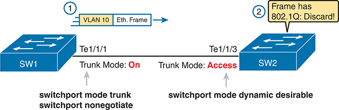

<figcaption>

<strong>图 8-14</strong> <em>中继运行状态不匹配</em>

<aside class="hidden" id="a08fig14">

交换机 1 上的 Te1/1/1 接口启用了中继模式，由“switch port mode trunk”和“switch port nonegotiate”命令表示。该接口用于 VLAN 10 的以太网帧。另一方面，交换机 2 上的 Te1/1/3 接口被配置为中继模式，但出现不匹配：它收到带有 802.1Q 标签的以太网帧，导致帧被丢弃。这由“switch port mode dynamic desirable”命令表示。

</aside>

</figcaption>

</figure>

图中展示了使用这种错误配置时发生的情况。在步骤 1，SW1 可以转发一个 VLAN 10 的帧。不过，由于 SW2 将其 G0/2 端口视为接入端口，任何带有 802.1Q 首部的接收帧都会被 SW2 视为非法。因此，SW2 会丢弃该端口收到的所有 802.1Q 帧。

通过检查配置以及中继两端的运行状态（模式），可以轻松避免这里展示的中继问题。检查中继相关信息最有用的命令是 <strong>show interfaces trunk</strong> 和 <strong>show interfaces switchport</strong>。只需记住，交换机不会阻止你犯下这些配置错误。

</section>

<section>

<h4 class="h4" id="ch08lev2sec10">中继上支持的 VLAN 列表</h4>

Cisco 交换机可以转发所有已定义且处于活动状态的 VLAN 的流量。但是，由于其他各种原因，某条 VLAN 中继可能不会转发某个已定义且活动的 VLAN 的流量。你应当学会识别某个中继端口当前支持哪些 VLAN，以及交换机可能为何不在该中继端口上转发某个 VLAN 的帧。

这一步中的第一类检查可以通过 <strong>show interfaces</strong> <em>interface-id</em> <strong>trunk</strong> 命令轻松完成，该命令只列出当前实际运行的中继信息。使用该命令时，最好从输出的最后一部分看起，那里列出了流量会经由中继转发的 VLAN。任何能出现在命令输出最终 VLAN 列表中的 VLAN，都满足以下条件：

<ul class="sq">

<li>
该 VLAN 没有从中继的<em>允许 VLAN 列表</em>中被移除（该列表由 <strong>switchport trunk allowed vlan</strong> 接口子命令配置）。
</li>

<li>
该 VLAN 在本地交换机上存在且处于活动状态（可通过 <strong>show vlan</strong> 命令查看）。
</li>

<li>
由于交换机已禁用 VTP，该 VLAN 没有从中继上被 VTP 修剪。中继在该 VLAN 中处于 STP 转发状态（也可通过 <strong>show spanning-tree vlan</strong> <em>vlan-id</em> 命令查看）。
</li>

</ul>

<strong>switchport trunk allowed vlan</strong> 接口子命令为网络工程师提供了一种管理方法，限制哪些 VLAN 的流量可以使用中继。如果希望中继支持所有已定义的 VLAN，只需不配置该命令即可。但如果希望中继只支持交换机已知 VLAN 的一个子集，就可以添加一条或多条 <strong>switchport trunk allowed vlan</strong> 接口子命令。

例如，一台交换机只配置了 VLAN 1 到 100，没有其他 VLAN，默认情况下就会允许这 100 个 VLAN 的所有流量。但是，中继接口命令 <strong>switchport trunk allowed vlan 1-60</strong> 会将中继限制为只转发 VLAN 1 到 60 的流量，不转发其余 VLAN 的流量。<a href="#exa8_14">示例 8-14</a> 展示了 <strong>show interfaces trunk</strong> 命令输出的一个样例，确认第一个 VLAN ID 列表现在只列出 VLAN 1–60。如果没有配置 <strong>switchport trunk allowed vlan</strong> 命令，第一个列表将包含 VLAN 1–4094。

<strong>示例 8-14</strong> <em>允许的 VLAN 列表与活动 VLAN 列表</em>

<a href="#code-f0217-01" id="f0217-01a">点击此处查看代码原图</a>

<pre class="pre-ex" tabindex="0"><code>SW1# <strong>show interfaces trunk</strong>

Port        Mode         Encapsulation   Status       Native vlan

Te1/1/1     desirable    802.1q          trunking     1

Port        Vlans allowed on trunk

Te1/1/1     1-60

Port        Vlans allowed and active in management domain

Te1/1/1     1-59

Port        Vlans in spanning tree forwarding state and not pruned

Te1/1/1     1-58</code></pre>

<strong>show interfaces trunk</strong> 命令的输出会生成三个独立的 VLAN 列表，每个列表都有自己的标题。这三个列表逐步呈现 VLAN 未在中继上被转发的原因。<a href="#ch08tab05">表 8-5</a> 总结了各列表的标题，以及交换机选择在每个列表中包含或排除某个 VLAN 的原因。例如，在<a href="#exa8_14">示例 8-14</a> 中，VLAN 60 已关闭，而 VLAN 59 恰好处于 STP 阻塞状态。（<a href="v1-09.html#ch09">第 9 章</a>“<a href="v1-09.html#ch09">生成树协议概念</a>”包含更多 STP 信息。）

<figure class="table" id="ch08tab05" tabindex="0">

<figcaption>

<strong>表 8-5</strong> <strong>show interfaces trunk</strong> 命令中的 VLAN 列表

</figcaption>

<table class="all">

<thead>

<tr>

<th class="th">
列表位置
</th>

<th class="th">
标题
</th>

<th class="th">
原因
</th>

</tr>

</thead>

<tbody>

<tr>

<td class="border">
第一个
</td>

<td class="border">
VLANs allowed（允许的 VLAN）
</td>

<td class="border">
VLAN 1–4094，减去通过 <strong>switchport trunk allowed</strong> 命令移除的 VLAN
</td>

</tr>

<tr>

<td class="border">
第二个
</td>

<td class="border">
VLANs allowed and active…（允许且活动的 VLAN……）
</td>

<td class="border">
第一个列表，减去本地交换机上未定义的 VLAN（即没有相应的 <strong>vlan</strong> 全局配置命令，且交换机未通过 VTP 学习该 VLAN），再减去处于关闭状态的 VLAN
</td>

</tr>

<tr>

<td class="border">
第三个
</td>

<td class="border">
VLANs in spanning tree…（生成树中的 VLAN……）
</td>

<td class="border">
第二个列表，减去该接口上处于 STP 阻塞状态的 VLAN，以及从该中继上被 VTP 修剪的 VLAN
</td>

</tr>

</tbody>

</table>

</figure>

</section>

<section>

<h4 class="h4" id="ch08lev2sec11">中继上的本征 VLAN 不匹配</h4>

遗憾的是，使用 <strong>switchport trunk native vlan</strong> <em>vlan-id</em> 命令，<em>确实可以</em>将中继两端的本征 VLAN ID 设置为不同的 VLAN。如果两台相邻交换机认定的本征 VLAN 不同，交换机就会使本征 VLAN 中发送的帧从一个 VLAN 跳到另一个 VLAN。

例如，如果交换机 SW1 在 802.1Q 中继上使用本征 VLAN 1 发送帧，按照本征 VLAN 的正常规则，SW1 不会添加 VLAN 首部。交换机 SW2 收到帧后，发现没有 802.1Q 首部，就假定该帧属于 SW2 所配置的本征 VLAN。如果 SW2 被配置为将 VLAN 2 视为这条中继的本征 VLAN，就会尝试将收到的帧转发到 VLAN 2。（帧在一个 VLAN 中发送，随后却被认为属于另一个 VLAN 的这种现象称为 <em>VLAN 跳跃</em>。）

</section>

</section>

</section>

<section class="ccna-source ccna-appendix" aria-label="答案解析与术语表">
<section data-epub-type="chapter">

<h2 class="h2" id="ref-appc">附录 C</h2>

<h2 class="h2a">“这些知识我已经掌握了吗？”自测题答案</h2>

<section>

<h3 class="h3" id="ref-appclev1sec8">第 8 章</h3>

<strong><a id="ref-ques8_1" href="#quess8_1">1</a>.</strong> B。VLAN 是同一二层广播域中的一组设备。子网通常包含完全相同的一组设备，但它是三层概念。冲突域也指一组以太网设备，但判断哪些设备属于同一冲突域的规则与 VLAN 的规则不同。

<strong><a id="ref-ques8_2" href="#quess8_2">2</a>.</strong> D。虽然子网与 VLAN 并不是等价概念，但同一 VLAN 中的设备通常处于同一 IP 子网，反之亦然。

<strong><a id="ref-ques8_3" href="#quess8_3">3</a>.</strong> B。802.1Q 中继定义了一个 4 字节首部，插入原始帧的目的 MAC 地址和源 MAC 地址字段之后。插入该首部不会改变原始帧的源地址或目的地址。首部本身包含一个 12 位 VLAN ID 字段，用于标识与该帧关联的 VLAN。

<strong><a id="ref-ques8_4" href="#quess8_4">4</a>.</strong> A 和 C。<strong>dynamic auto</strong> 设置表示交换机能够协商中继，但只能响应协商消息，不能主动发起协商过程。因此，另一台交换机必须配置为使用中继（<strong>switchport mode trunk</strong>），或者主动发起动态协商过程（<strong>switchport mode dynamic desirable</strong>）。

<strong><a id="ref-ques8_5" href="#quess8_5">5</a>.</strong> A 和 B。配置的 VTP 透明模式表示交换机可以配置 VLAN，因此该 VLAN 会被配置。此外，VLAN 配置细节，包括 VLAN 名称，都会作为 running-config 文件的一部分显示。

<strong><a id="ref-ques8_6" href="#quess8_6">6</a>.</strong> B 和 C。<strong>show interfaces switchport</strong> 命令列出每个端口的管理状态和运行状态。当交换机认为某端口正在使用中继时，该命令会将其中继运行状态列为“trunk”。<strong>show interfaces trunk</strong> 命令列出一组接口，即当前作为中继运行的接口。因此，这两条命令都能识别实际运行的中继接口。

<strong><a id="ref-ques8_7" href="#quess8_7">7</a>.</strong> A 和 B。对于通过 off 或 transparent 模式不使用 VTP 的交换机，所有 VLAN 配置都会列在配置文件中，因此其中一个答案正确。另外，<strong>show vlan brief</strong> 命令会列出所有已定义的 VLAN，不受 VTP 模式或关闭状态影响。因此，两个提到命令的答案都是正确的。

另外两个答案不正确，因为 VLAN 30 已关闭，这意味着交换机不会转发该 VLAN 中的帧，无论它们是从接入端口还是中继端口到达。

<strong><a id="ref-ques8_8" href="#quess8_8">8</a>.</strong> B。第一个 VLAN ID 列表包含所有 VLAN（1–4094），但不包括中继接口上的 <strong>switchport trunk allowed vlan</strong> 接口子命令明确移除的 VLAN。如果没有配置此类命令，输出中的第一个列表就会包含 1–4094。两个提到 VLAN 30 的错误答案描述的条件，会改变命令输出中两个 VLAN 列表里的第二个；而 STP 选择阻塞接口会影响第三个列表。

</section>

</section>

<section id="ref-glossary"><h2 class="h2a">术语表</h2>
<strong>802.1Q</strong> 802.1Q 是这种标签的标准协议。对于本次讨论，该标签中最关键的信息是 VLAN ID。

<strong>接入接口（access interface）</strong> LAN 网络设计术语，指连接终端用户设备、并配置为不使用 VLAN 中继的交换机接口。

<strong>数据 VLAN（data VLAN）</strong> 用于连接以太网的典型数据设备（如 PC 和服务器）的 VLAN，与语音 VLAN 相对。

<strong>默认 VLAN（default VLAN）</strong> 指 Cisco 交换机 <em>switchport access vlan vlan-id interface</em> 子命令的默认设置 1（即 VLAN ID 1），表示端口作为接入端口运行时，默认分配给 VLAN 1。

<strong>三层交换机（Layer 3 switch）</strong> <em>参见</em><a href="#ref-gloss_261">多层交换机</a>。

<strong>多层交换机（multilayer switch）</strong> 同时能够执行三层路由功能的 LAN 交换机。这个名称源于该设备会根据多个 OSI 层（二层和三层）的逻辑作出转发决策。

<strong>NAT</strong> 网络地址转换。一种减少对全球唯一 IP 地址需求的机制。NAT 将非全球唯一地址转换为全球可路由地址空间中的公有地址，从而允许使用这些非唯一地址的组织连接互联网。

<strong>静态接入接口（static access interface）</strong> LAN 网络设计术语，与<em>接入接口</em>同义，但强调端口通过静态配置而不是某种动态过程被分配到一个 VLAN。

<strong>中继（trunk）</strong> 在园区 LAN 中，指设备会为帧添加 VLAN 首部、以标识该帧所属 VLAN 的以太网网段。

<strong>中继接口（trunk interface）</strong> 配置为使用 VLAN 中继（802.1Q 或 ISL）运行的交换机接口。

<strong>中继管理模式（trunking administrative mode）</strong> Cisco 交换机接口上通过 switchport mode 命令配置的中继设置。

<strong>中继运行模式（trunking operational mode）</strong> Cisco 交换机接口当前在 VLAN 中继方面的实际行为。

<strong>虚拟局域网（virtual LAN，VLAN）</strong> 连接到一台或多台交换机、并通过交换机配置划分到同一广播域的一组设备。VLAN 让交换机管理员能够将连接到交换机的设备划分到不同 VLAN，而无需使用独立的物理交换机，从而获得隔离流量的设计优势，又不必花费额外的硬件采购成本。

<strong>VLAN 中继协议（VTP）</strong> Cisco 专有的消息协议，用于在 Cisco 交换机之间传递有关 VLAN 存在情况的配置信息，包括 VLAN ID 和 VLAN 名称。

<strong>语音 VLAN（voice VLAN）</strong> 为 IP 电话定义的 VLAN。Cisco 交换机会将语音 VLAN ID 通知电话，使电话能够使用 802.1Q 帧同时支持电话本身和所连接 PC（使用数据 VLAN）的流量。

<strong>VTP 透明模式（VTP transparent mode）</strong> 三种 VTP 运行模式之一。透明模式下的交换机可以配置 VLAN，但不会将更改告知其他交换机，也不会从其他交换机学习 VLAN 更改。

</section>
</section>

<section class="ccna-source ccna-appendix" aria-label="代码原图">
<section data-epub-type="chapter">

<a href="#f0198-01a" id="code-f0198-01">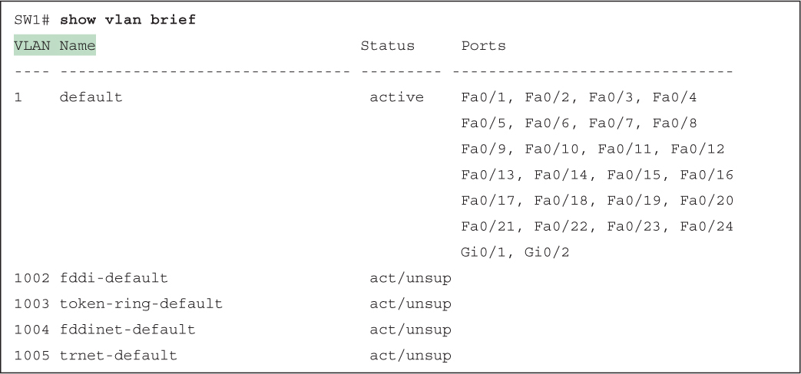</a>

<a href="#f0199-01a" id="code-f0199-01">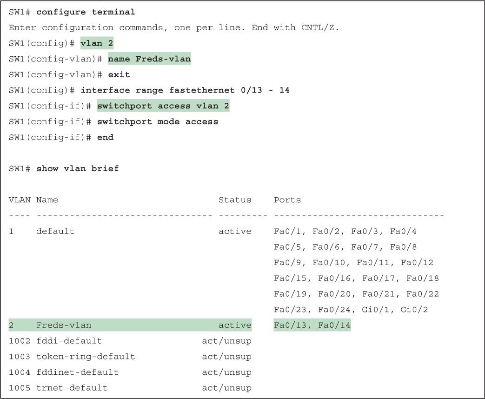</a>

<a href="#f0200-01a" id="code-f0200-01">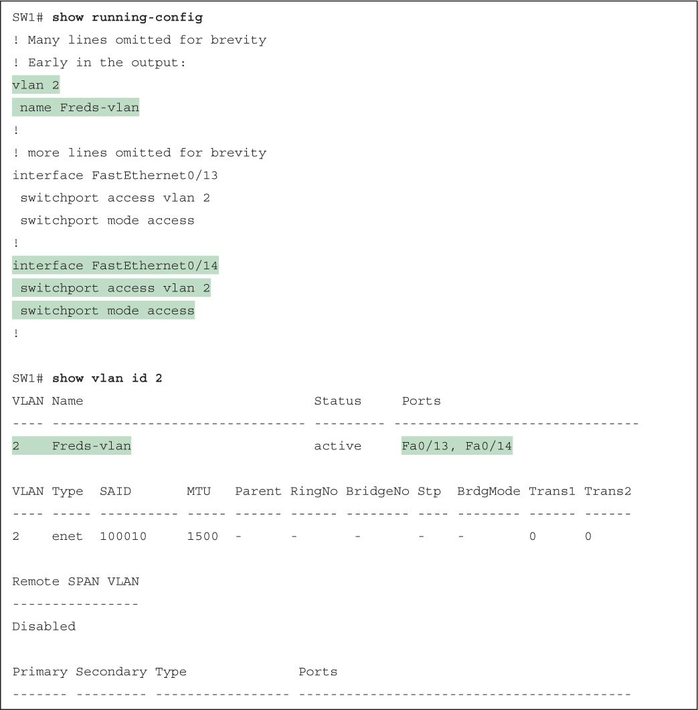</a>

<a href="#f0201-01a" id="code-f0201-01">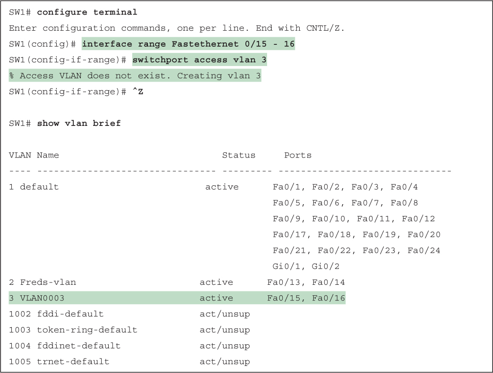</a>

<a href="#f0204-01a" id="code-f0204-01">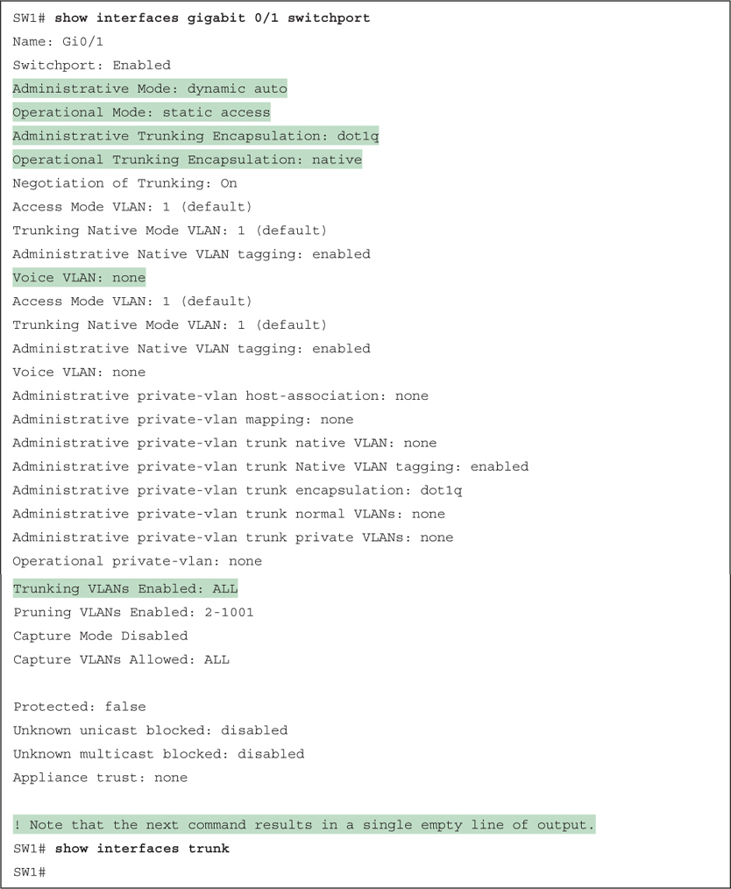</a>

<a href="#f0205-01a" id="code-f0205-01">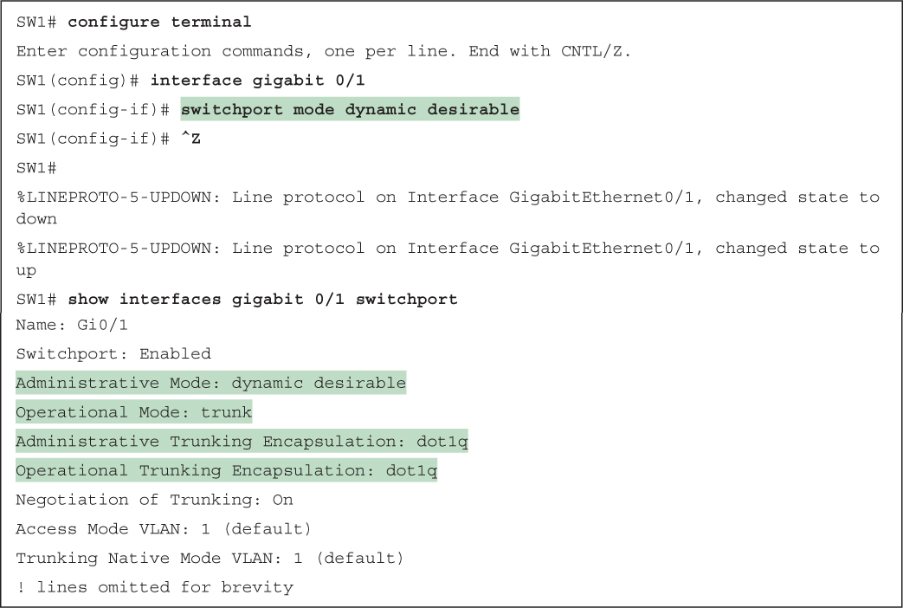</a>

<a href="#f0206-01a" id="code-f0206-01">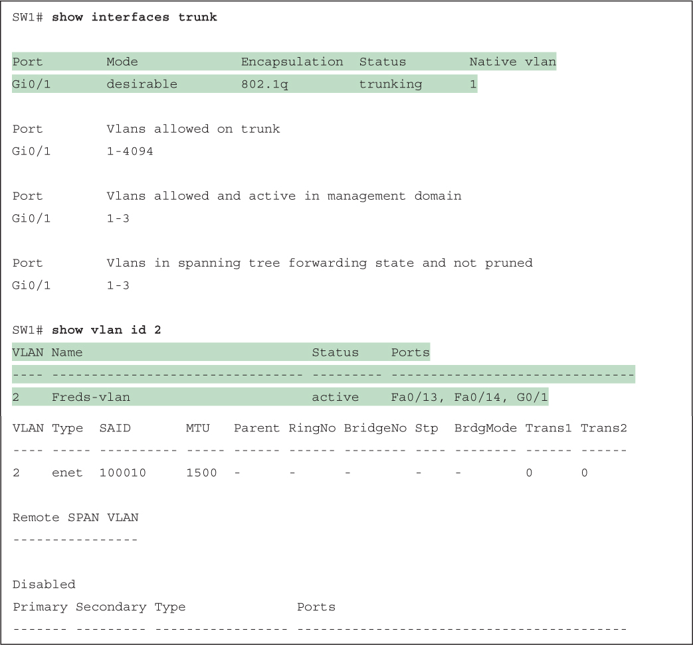</a>

<a href="#f0210-01a" id="code-f0210-01">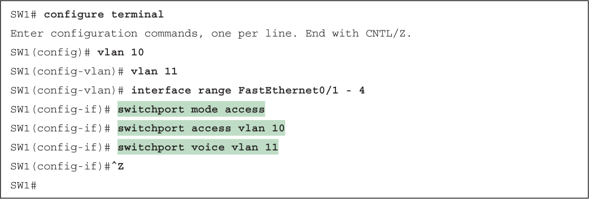</a>

<a href="#f0211-01a" id="code-f0211-01">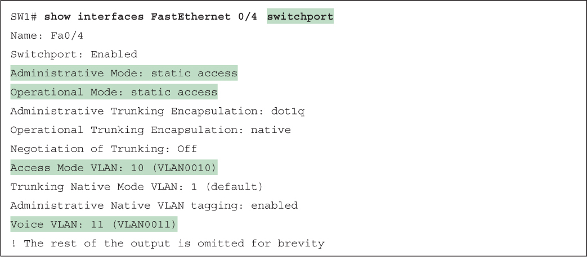</a>

<a href="#f0212-01a" id="code-f0212-01">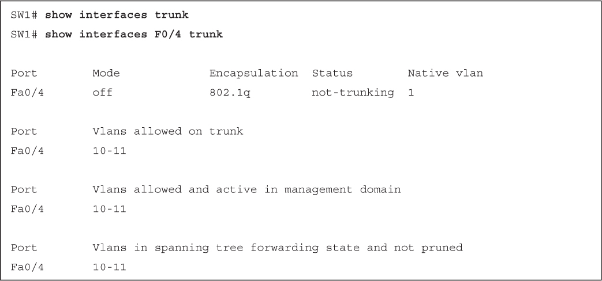</a>

<a href="#f0214-01a" id="code-f0214-01">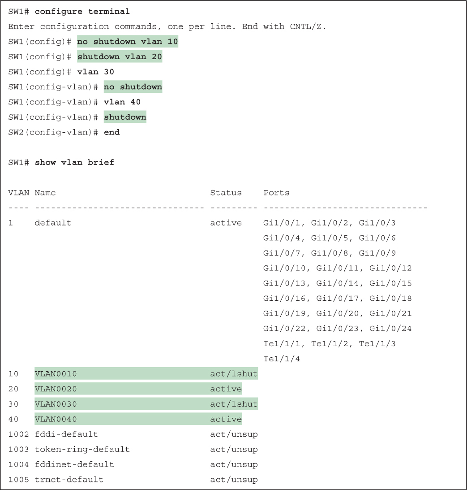</a>

<a href="#f0215-01a" id="code-f0215-01">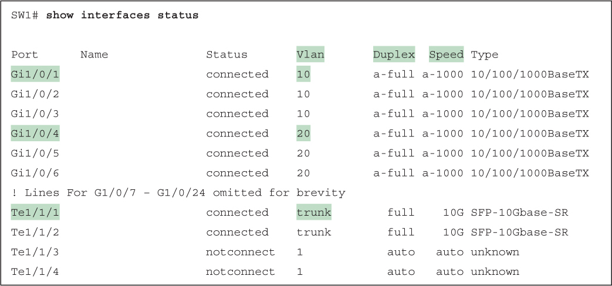</a>

<a href="#f0216-01a" id="code-f0216-01">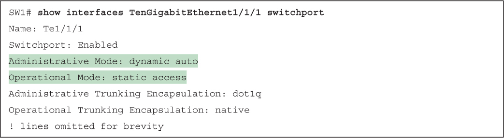</a>

<a href="#f0217-01a" id="code-f0217-01">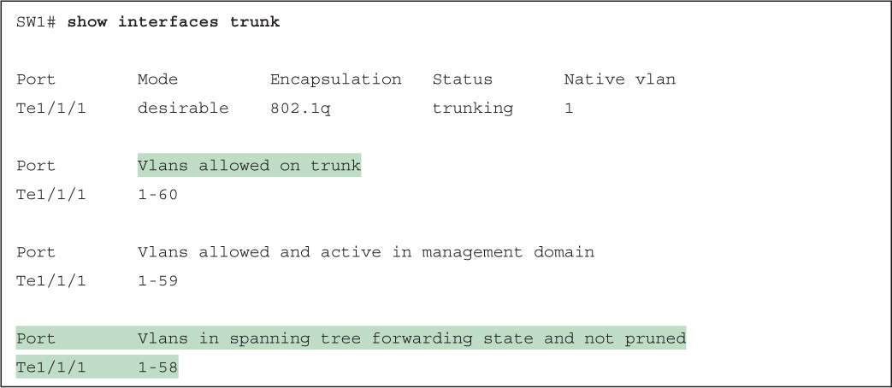</a>

</section>

</section>


<nav class="ccna-chapter-nav" aria-label="章节导航"><a href="v1-07.html">← 上一章</a><a href="v1-09.html">下一章 →</a></nav>
