
<a href="{{ '/subjects/CCNA/' | relative_url }}">← 返回 CCNA 目录</a>

第一卷 · 实现 VLAN 与 STP

<nav class="ccna-chapter-nav" aria-label="章节导航"><a href="v1-08.html">← 上一章</a><a href="v1-10.html">下一章 →</a></nav>



<section data-epub-type="chapter">

<h2 class="h2" id="ch09">第 9 章</h2>

<h2 class="h2a">生成树协议概念</h2>

本章涵盖以下考试主题：

2.0 网络接入

2.4 配置与验证（二层／三层）EtherChannel（LACP）

2.5 解读 Rapid PVST+ 生成树协议的基本操作

2.5.a 根端口、根桥（主要／次要）和其他端口名称

2.5.b 端口状态与角色

2.5.c PortFast

2.5.d Root Guard、Loop Guard、BPDU Filter 和 BPDU Guard

生成树协议（STP）允许以太网 LAN 使用冗余链路，同时克服添加这些额外链路时出现的已知问题。在 LAN 设计中使用冗余链路，即使某些链路失效，甚至整台交换机失效，LAN 仍可继续工作。合理的 LAN 设计应提供足够的冗余，避免任何单点故障导致整个 LAN 瘫痪；STP 使设计能够利用冗余，而不引发其他问题。

从历史上看，IEEE 早在 1990 年就首次将 STP 标准化为 IEEE 802.1D 标准的一部分，在此之前已有标准化之前的版本投入使用。随着时间推移，业界和 IEEE 不断改进 STP，最终用一种改进的协议——快速生成树协议（RSTP）——替代了 STP。IEEE 最初以 802.1w 修订案的形式发布 RSTP，并在 2004 年将其整合到 802.1D 标准中。

如今，大多数网络使用 RSTP 而不是 STP；不过，STP 与 RSTP 共享许多相同机制，通过与 STP 比较，最容易理解 RSTP 的改进。因此，本章会介绍一些仅适用于 STP 的细节，作为帮助理解 RSTP 的学习工具。

本章将内容分为四个部分。第一部分介绍一些核心概念，说明 STP 和 RSTP 如何发现一棵由节点（交换机）与链路组成的树，使网络中不存在环路。第二部分简要介绍 STP 与 RSTP 差异最大的方面：STP 如何响应网络变化。第三部分展示 RSTP 在应对变化时如何明显优于 STP。最后一部分涉及多种小型的可选 STP 与 RSTP 功能。

最后提醒一下，本章以及<a href="v1-10.html#ch10">第 10 章</a>都比预期略长。如果你习惯将每章作为一次学习任务，可能需要考虑把本章拆成两次。第一次学习应在“<a href="#ch09lev1sec5">快速 STP 概念</a>”一节之前停止。第二次学习则包含“<a href="#ch09lev1sec5">快速 STP 概念</a>”和“<a href="#ch09lev1sec6">可选 STP 功能</a>”两节。

<section>

<h3 class="h3" id="ch09lev1sec1">自测</h3>

如果你希望根据得分决定在本章投入多少时间，可以完成这组自测题（在此作答，或使用 PTP 软件）。各题答案的选项字母列在自测题之后的页面底部。书末和配套网站上的<a href="#ref-appc">附录 C</a>都包含答案及解析。你也可以在 PTP 测试软件中找到答案及解析。

<figure class="table" id="ch09tab01" tabindex="0">

<figcaption>

<strong>表 9-1</strong> 核心主题小节与题目对应关系

</figcaption>

<table class="all">

<thead>

<tr>

<th class="th">
基础知识小节
</th>

<th class="th">
题目
</th>

</tr>

</thead>

<tbody>

<tr>

<td class="border">
STP 与 RSTP 基础
</td>

<td class="border">
1–2
</td>

</tr>

<tr>

<td class="border">
STP 特有的细节（不适用于 RSTP）
</td>

<td class="border">
3–4
</td>

</tr>

<tr>

<td class="border">
快速 STP 概念
</td>

<td class="border">
5–6
</td>

</tr>

<tr>

<td class="border">
可选 STP 功能
</td>

<td class="border">
7–8
</td>

</tr>

</tbody>

</table>

</figure>

<strong><a id="quess9_1" href="#ques9_1a">1</a>.</strong> 下列哪些端口状态是 STP 完成收敛后使用的稳定状态？（选择两个答案。）

<ol class="lower-alpha">

<li>
阻塞
</li>

<li>
转发
</li>

<li>
侦听
</li>

<li>
学习
</li>

<li>
丢弃
</li>

</ol>

<strong><a id="quess9_2" href="#ques9_2a">2</a>.</strong> 假设具有下列桥 ID 的交换机位于同一网络，哪个桥 ID 会赢得根桥选举？

<ol class="lower-alpha">

<li>
32769:0200.1111.1111
</li>

<li>
32769:0200.2222.2222
</li>

<li>
4097:0200.1111.1111
</li>

<li>
4097:0200.2222.2222
</li>

<li>
40961:0200.1111.1111
</li>

</ol>

<strong><a id="quess9_3" href="#ques9_3a">3</a>.</strong> 下列哪些端口状态是仅在 STP 收敛过程中使用的过渡状态？（选择两个答案。）

<ol class="lower-alpha">

<li>
阻塞
</li>

<li>
转发
</li>

<li>
侦听
</li>

<li>
学习
</li>

<li>
丢弃
</li>

</ol>

<strong><a id="quess9_4" href="#ques9_4a">4</a>.</strong> 下列哪项决定非根桥或非根交换机发送 STP Hello BPDU 消息的频率？

<ol class="lower-alpha">

<li>
该交换机上配置的 Hello 定时器。
</li>

<li>
根交换机上配置的 Hello 定时器。
</li>

<li>
始终为每 2 秒一次。
</li>

<li>
交换机收到根交换机的 BPDU 后，会在 2 秒后再发送一个 BPDU 作为响应。
</li>

</ol>

<strong><a id="quess9_5" href="#ques9_5a">5</a>.</strong> 下列哪些 RSTP 端口状态与传统 STP 中的某个端口状态名称相同、用途也相同？（选择两个答案。）

<ol class="lower-alpha">

<li>
阻塞
</li>

<li>
转发
</li>

<li>
侦听
</li>

<li>
学习
</li>

<li>
丢弃
</li>

</ol>

<strong><a id="quess9_6" href="#ques9_6a">6</a>.</strong> RSTP 在 STP 基础上增加了功能，使同一交换机上的某个端口失效时，其他端口能够接替其角色。下列哪些说法正确描述了等待接替另一端口角色的端口角色？（选择两个答案。）

<ol class="lower-alpha">

<li>
替代端口等待成为根端口。
</li>

<li>
备份端口等待成为根端口。
</li>

<li>
替代端口等待成为指定端口。
</li>

<li>
备份端口等待成为指定端口。
</li>

</ol>

<strong><a id="quess9_7" href="#ques9_7a">7</a>.</strong> 哪种 STP／RSTP 功能会在接口物理激活后立即将其置于转发状态？

<ol class="lower-alpha">

<li>
STP
</li>

<li>
EtherChannel
</li>

<li>
Root Guard（根保护）
</li>

<li>
PortFast
</li>

</ol>

<strong><a id="quess9_8" href="#ques9_8a">8</a>.</strong> 哪项可选 STP 功能会针对收到的某一类 STP BPDU 禁用端口，但允许并处理其他一些 STP BPDU？

<ol class="lower-alpha">

<li>
Loop Guard（环路保护）
</li>

<li>
BPDU Guard（BPDU 保护）
</li>

<li>
Root Guard（根保护）
</li>

<li>
PortFast
</li>

</ol>

自测答案：

<strong><a id="ques9_1a" href="#ref-ques9_1">1</a></strong> A、B

<strong><a id="ques9_2a" href="#ref-ques9_2">2</a></strong> C

<strong><a id="ques9_3a" href="#ref-ques9_3">3</a></strong> C, D

<strong><a id="ques9_4a" href="#ref-ques9_4">4</a></strong> B

<strong><a id="ques9_5a" href="#ref-ques9_5">5</a></strong> B、D

<strong><a id="ques9_6a" href="#ref-ques9_6">6</a></strong> A, D

<strong><a id="ques9_7a" href="#ref-ques9_7">7</a></strong> D,

<strong><a id="ques9_8a" href="#ref-ques9_8">8</a></strong> C

</section>

<section>

<h3 class="h3box" id="ch09lev1sec2">基础知识</h3>

</section>

<section>

<h3 class="h3" id="ch09lev1sec3">STP 与 RSTP 基础</h3>

如果没有<a id="key_138" href="#ref-gloss_369">生成树协议（STP）</a>或<a id="key_133" href="#ref-gloss_327">快速 STP（RSTP）</a>之类的机制，具有冗余链路的 LAN 就会导致以太网帧无限期地循环。启用 STP 或 RSTP 后，某些交换机会阻塞端口，使这些端口不转发帧。STP 和 RSTP 会智能地选择要阻塞的端口，以实现两个目标：

<ul class="sq">

<li>
VLAN 中的所有设备都能向其他所有设备发送帧。换句话说，STP 或 RSTP 不会阻塞过多端口，导致 LAN 的某些部分与其他部分隔绝。
</li>

<li>
帧的生存时间很短，不会在网络中无限循环。
</li>

</ul>

STP 和 RSTP 在两者之间取得平衡，使帧能够送达每个设备，同时避免帧在网络中反复循环所造成的问题。

注意

本章第一个主要部分同时解释 STP 和 RSTP 的细节，因此使用 <em>STP/RSTP</em> 这一术语统称这两个协议。注意，这只是一种方便的简称。本章后面将指出 STP 与 RSTP 的差异，并开始分别使用 <em>STP</em> 和 <em>RSTP</em>，仅指代对应的协议。

STP/RSTP 通过在交换机使用接口发送或接收用户流量之前，对每个接口增加一项检查来防止帧循环。检查规则是：如果端口在该 VLAN 中处于 STP/RSTP <a id="key_126" href="#ref-gloss_151">转发状态</a>，则正常使用；如果处于 STP/RSTP <a id="key_113" href="#ref-gloss_044">阻塞状态</a>，则阻止所有用户流量，不在该接口的这个 VLAN 中发送或接收用户流量。

注意，这些 STP/RSTP 状态不会改变你已经了解的交换机接口其他信息。接口的 connected／notconnect 状态不会改变，接口作为接入端口或中继端口的运行状态也不会改变。STP/RSTP 只是增加这一额外状态，其中阻塞状态基本上相当于禁用接口。

从许多方面看，前面两段已经概括了 STP/RSTP 的作用。不过，理解其具体工作方式可能需要相当多的学习和练习。本章第一个主要部分先解释为什么需要 STP/RSTP，以及它如何解决帧循环问题的基本思路。随后，这一部分的大多数内容将讨论 STP/RSTP 如何选择要阻塞的交换机端口，以实现其目标。

<section>

<h4 class="h4" id="ch09lev2sec1">生成树的必要性</h4>

STP/RSTP 防止以太网 LAN 中三种常见问题。这三种问题都源于同一个事实：如果没有 STP/RSTP，某些以太网帧会在网络中循环很长时间，可能持续数小时、数天；如果 LAN 设备和链路始终不失效，甚至会永远循环。

仅一个循环帧就能引发所谓的<em>广播风暴</em>。当任何种类的以太网帧——广播帧、多播帧或目的地址未知的单播帧——在 LAN 中无限循环时，就会发生广播风暴。广播风暴会使所有链路被这一个帧的副本占满，挤掉正常帧，并迫使 PC 处理过多广播帧，严重影响终端用户设备的性能。

为了帮助理解这一过程，<a href="#ch09fig01">图 9-1</a> 展示了一个 Bob 发送广播帧的示例网络。虚线显示没有 STP/RSTP 时交换机如何转发该帧。

还记得 LAN 交换机的逻辑吗？该逻辑要求交换机将广播从同一 VLAN 中除入接口之外的所有接口泛洪出去。在<a href="#ch09fig01">图 9-1</a> 中，这意味着 SW3 将 Bob 的帧转发给 SW2，SW2 再转发给 SW1，SW1 将帧发回 SW3，而 SW3 又再次将帧转发给 SW2。

<figure class="image-c" id="ch09fig01">

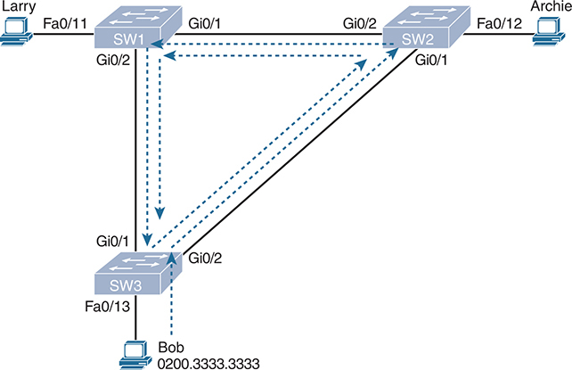

<figcaption>

<strong>图 9-1</strong> <em>广播风暴</em>

<aside class="hidden" id="a09fig01">

PC Larry 通过 Fast Ethernet 0/11 接口连接到交换机 SW1，PC Archie 通过 Fast Ethernet 0/12 接口连接到交换机 SW2。此外，MAC 地址为 0200.3333.3333 的 PC Bob 通过 Fast Ethernet 0/13 接口连接到交换机 SW3。交换机之间的连接如下：SW1 通过 Gigabit Ethernet 0/1 和 Gigabit Ethernet 0/2 接口连接 SW2；SW2 通过 Gigabit Ethernet 0/1 和 Gigabit Ethernet 0/2 接口连接 SW3；SW1 通过 Gigabit Ethernet 0/2 和 Gigabit Ethernet 0/1 接口连接 SW3。这种配置为广播流量创建了多条路径，可能导致广播风暴。

</aside>

</figcaption>

</figure>

广播风暴发生时，像<a href="#ch09fig01">图 9-1</a> 中这样的帧会一直循环，直到某种变化发生，例如有人关闭接口、重新加载交换机，或者采取其他措施打破环路。还要注意，同样的事情也会沿相反方向发生。Bob 发送原始帧时，SW3 还会向 SW1 转发一个副本，SW1 再将其转发给 SW2，依此类推。

广播风暴还会引发一种更加隐蔽的问题，称为 <em>MAC 地址表不稳定</em>。这意味着交换机的 MAC 地址表不断变化，因为具有相同源 MAC 地址的帧从不同端口到达。要理解原因，可以跟随这个示例：在<a href="#ch09fig01">图 9-1</a> 开始时，SW3 有一条指向图中底部 Bob 的 MAC 表条目，与端口 Fa0/13 关联：

0200.3333.3333     Fa0/13     VLAN 1

现在考虑循环帧先到 SW2、再到 SW1、然后从 SW3 的 Gi0/1 接口返回时发生的交换机学习过程。SW3 会想：“源 MAC 地址是 0200.3333.3333，而且从我的 Gi0/1 接口进入。更新 MAC 表！”结果，SW3 上的条目变成如下内容，接口从 Fa0/13 改为 Gi0/1：

0200.3333.3333     Gi0/1     VLAN 1

此时，SW3 自己已无法将帧正确送达 Bob 的 MAC 地址。如果这一刻有另一个发往 Bob 的帧到达 SW3，而不是那个引起问题的循环帧，SW3 就会错误地将其从 Gi0/1 转发给 SW1，造成更多拥塞。

广播风暴中的循环帧还会引发第三个问题：一个帧的多个副本到达目的设备。考虑 Bob 向 Larry 发送帧，但所有交换机都不知道 Larry 的 MAC 地址的情况。交换机会泛洪发往未知目的单播 MAC 地址的帧。Bob 发送目的为 Larry MAC 地址的帧时，SW3 分别向 SW1 和 SW2 发送一个副本。SW1 和 SW2 也会泛洪该帧，使帧副本循环。SW1 还会从 Fa0/11 向 Larry 发出每个帧的一个副本。因此，Larry 会收到同一帧的多个副本，即使没有引发更广泛的网络问题，也可能导致应用程序故障。

<a href="#ch09tab02">表 9-2</a> 总结了具有冗余的 LAN 不使用 STP/RSTP 时出现的三类主要问题。

<figure class="table" id="ch09tab02" tabindex="0">

<figcaption>

<strong>表 9-2</strong> 冗余 LAN 不使用 STP 导致的三类问题

</figcaption>

<table class="all">

<thead>

<tr>

<th class="th">
问题
</th>

<th class="th">
说明
</th>

</tr>

</thead>

<tbody>

<tr>

<td class="border">
广播风暴
</td>

<td class="border">
同一个帧在相同链路上反复转发，占用大量链路容量
</td>

</tr>

<tr>

<td class="border">
MAC 地址表不稳定
</td>

<td class="border">
交换机因循环帧而不断用错误条目更新 MAC 地址表，导致帧被发送到错误位置
</td>

</tr>

<tr>

<td class="border">
帧的多次传输
</td>

<td class="border">
循环帧的一种副作用：同一帧的多个副本被送达目标主机，使主机无法正确处理
</td>

</tr>

</tbody>

</table>

</figure>

</section>

<section>

<h4 class="h4" id="ch09lev2sec2">生成树的作用</h4>

STP/RSTP 将每个交换机端口置于转发状态或阻塞状态，以防止环路。转发状态的接口正常工作，接收和转发帧。阻塞状态的接口则不处理任何帧，STP/RSTP 消息及某些其他控制开销消息除外。阻塞接口不转发用户帧，不学习接收帧的 MAC 地址，也不处理收到的用户帧。

<a href="#ch09fig02">图 9-2</a> 展示了一棵简单的 STP/RSTP 树，通过将 SW3 的一个端口置于阻塞状态，解决了<a href="#ch09fig01">图 9-1</a> 中的问题。

<figure class="image-c" id="ch09fig02">

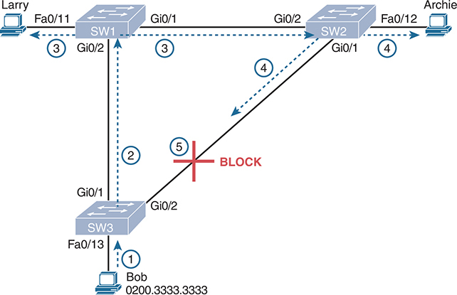

<figcaption>

<strong>图 9-2</strong> <em>STP/RSTP 的作用：阻塞一个端口来打破环路</em>

<aside class="hidden" id="a09fig02">

PC Larry 通过 Fast Ethernet 0/11 接口连接到交换机 SW1，PC Archie 通过 Fast Ethernet 0/12 接口连接到交换机 SW2。此外，MAC 地址为 0200.3333.3333 的 PC Bob 通过 Fast Ethernet 0/13 接口连接到交换机 SW3。交换机互联方式如下：SW1 通过 Gigabit Ethernet 0/1 和 Gigabit Ethernet 0/2 接口连接 SW2；SW2 通过 Gigabit Ethernet 0/1 和 Gigabit Ethernet 0/2 接口连接 SW3；SW1 通过 Gigabit Ethernet 0/2 和 Gigabit Ethernet 0/1 接口连接 SW3。这种配置为广播流量提供多条路径，可能导致广播风暴。为防止网络环路，SW2 与 SW3 之间的连接被阻塞，确保网络稳定并防止广播风暴。

</aside>

</figcaption>

</figure>

现在 Bob 发送广播帧时，帧不会循环。图中步骤如下：

步骤 1. Bob 将帧发送给 SW3。

步骤 2. SW3 只向 SW1 转发该帧，不从 Gi0/2 向 SW2 转发，因为 SW3 的 Gi0/2 接口处于阻塞状态。

步骤 3. SW1 从 Fa0/11 和 Gi0/1 泛洪该帧。

步骤 4. SW2 从 Fa0/12 和 Gi0/1 泛洪该帧。

步骤 5. SW3 在物理上收到该帧，但由于其 Gi0/2 接口处于阻塞状态，会忽略从 SW2 收到的帧。

在<a href="#ch09fig02">图 9-2</a> 的 STP/RSTP 拓扑中，交换机不使用 SW2 与 SW3 之间的链路承载该 VLAN 的流量，这是 STP 的一个小小负面影响。但是，如果其他两条链路中的任意一条失效，STP/RSTP 就会收敛，使 SW3 的 Gi0/2 接口从阻塞改为转发。

注意

<em>STP 收敛</em>指交换机共同意识到 LAN 拓扑发生变化，并确定是否需要更改阻塞端口和转发端口的过程。

至此，我们已说明 STP/RSTP 的作用：将每个端口置于转发状态或阻塞状态。更有意思、也更需要花精力理解的问题是，STP/RSTP 如何作出选择，以及为何作出这些选择。STP/RSTP 如何让交换机在每个接口上阻塞或转发？网络中断时，它又如何收敛，将状态从阻塞改为转发，以利用冗余链路？后面的内容将回答这些问题。

</section>

<section>

<h4 class="h4" id="ch09lev2sec3">生成树的工作方式</h4>

STP/RSTP 算法用转发帧的接口创建一棵生成树。转发接口的树形结构，使每条以太网链路都有唯一的进入和离开路径，就像一棵生长中的树，从树根到每片叶子都能找出一条唯一的路径。

注意

STP 出现于 LAN 交换机之前，当时由称为网桥的设备执行 STP 过程。一些术语和命令输出仍使用较早的<em>网桥</em>一词，因此在学习 STP/RSTP 时，可以将<em>网桥</em>和<em>交换机</em>视为同义词。

STP 使用的过程有时称为<em>生成树算法</em>（STA），它选择应当置于转发状态的接口。对于未被选为转发状态的接口，STP/RSTP 会将其置于阻塞状态。换句话说，STP/RSTP 只需选出应当转发的接口，其余接口便进入阻塞状态。

STP/RSTP 根据三个标准来选择是否将接口置于转发状态：

<ul class="sq">

<li>
STP/RSTP 选举一台<a id="key_137" href="#ref-gloss_345">根交换机</a>。STP 将根交换机上所有正常工作的接口置于转发状态。
</li>

<li>
每台非根交换机根据 STP/RSTP 接口开销，计算自身到根交换机的最低开销路径。该最低开销路径起点处的交换机端口就是其<em>根端口</em>（RP），该路径的开销就是交换机的<a id="key_134" href="#ref-gloss_342">根路径开销</a>。
</li>

<li>
在使用交换机的现代以太网中，每条物理链路只连接两个设备。若一条链路连接两台交换机，根路径开销最低的交换机成为<em>指定交换机</em>，它连接该链路的端口就是这条链路的<a id="key_119" href="#ref-gloss_094">指定端口</a>（DP）。
</li>

</ul>

注意

根交换机将所有接口置于转发状态，因为其每个端口总能赢得指定端口（DP）选举。不过，只需记住根交换机所有正常工作的接口都会转发帧，更容易理解。

所有其他接口都置于阻塞状态。<a href="#ch09tab03">表 9-3</a> 总结了 STP/RSTP 将端口置于转发或阻塞状态的原因。

<figure class="table" id="ch09tab03" tabindex="0">

<figcaption>

<strong>表 9-3</strong> STP/RSTP：转发或阻塞的原因

</figcaption>

<table class="all">

<thead>

<tr>

<th class="th">
端口类别
</th>

<th class="th">
STP 状态
</th>

<th class="th">
说明
</th>

</tr>

</thead>

<tbody>

<tr>

<td class="border">
根交换机的所有端口
</td>

<td class="border">
转发
</td>

<td class="border">
根交换机始终是所有相连网段上的指定交换机。
</td>

</tr>

<tr>

<td class="border">
每台非根交换机的根端口
</td>

<td class="border">
转发
</td>

<td class="border">
交换机通过该端口以最低开销到达根交换机（最低根路径开销）。
</td>

</tr>

<tr>

<td class="border">
每个 LAN 的指定端口
</td>

<td class="border">
转发
</td>

<td class="border">
向该网段转发 Hello 且根路径开销最低的交换机，是该网段的指定交换机。
</td>

</tr>

<tr>

<td class="border">
所有其他正常工作的端口
</td>

<td class="border">
阻塞
</td>

<td class="border">
该端口不用于转发用户帧，这些接口上收到的任何帧也不会被考虑用于转发。
</td>

</tr>

</tbody>

</table>

</figure>

注意

STP/RSTP 不应在实际工作的 STP/RSTP 拓扑中使用故障接口。为排除所有非正常接口，也就是所有未处于 connected（up/up）状态的接口，STP/RSTP 会给这些端口分配<em>禁用端口角色</em>。STP/RSTP 不会将这些端口视为潜在的 RP 或 DP。STP 还会将这些端口置于<a id="key_122" href="#ref-gloss_103">禁用状态</a>（与阻塞类似）。

<section>

<h5 class="h5" id="ch09lev3sec1">STP 桥 ID 与 Hello BPDU</h5>

STA 首先选举一台交换机作为根交换机。为了更好地理解这一选举过程，需要了解交换机之间发送的 STP/RSTP 消息，以及用于唯一标识每台交换机的标识符的概念和格式。

STP/RSTP <a id="key_116" href="#ref-gloss_049">桥 ID</a>（BID）是每台交换机独有的 8 字节值。桥 ID 由 2 字节优先级字段和 6 字节系统 ID 组成，系统 ID 基于每台交换机中一个全局通用的固化 MAC 地址。使用固化 MAC 地址可确保每台交换机的桥 ID 唯一。

STP/RSTP 定义了称为<a id="key_117" href="#ref-gloss_050">桥协议数据单元（BPDU）</a>的消息，也称配置 BPDU，交换机用它们相互交换信息。最常见的 BPDU 称为 <a id="key_127" href="#ref-gloss_166">Hello BPDU</a>，其中列出许多细节，包括发送方交换机的 BID。通过列出各自唯一的 BID，交换机能够分辨每个 Hello BPDU 是由哪台交换机发送的。<a href="#ch09tab04">表 9-4</a> 列出了 Hello BPDU 中的一些关键信息。

<figure class="table" id="ch09tab04" tabindex="0">

<figcaption>

<strong>表 9-4</strong> STP Hello BPDU 中的字段

</figcaption>

<table class="all">

<thead>

<tr>

<th class="th">
字段
</th>

<th class="th">
说明
</th>

</tr>

</thead>

<tbody>

<tr>

<td class="border">
根桥 ID
</td>

<td class="border">
此 Hello 的发送方当前认定的根交换机的桥 ID
</td>

</tr>

<tr>

<td class="border">
发送方桥 ID
</td>

<td class="border">
发送此 Hello BPDU 的交换机的桥 ID
</td>

</tr>

<tr>

<td class="border">
发送方根路径开销
</td>

<td class="border">
这台交换机与当前根交换机之间的 STP/RSTP 开销
</td>

</tr>

<tr>

<td class="border">
根交换机上的定时器值
</td>

<td class="border">
包括 Hello 定时器、MaxAge 定时器和<a id="key_125" href="#ref-gloss_149">转发延迟</a>定时器
</td>

</tr>

</tbody>

</table>

</figure>

接下来的小节将介绍 STP/RSTP 如何通过三个步骤选出进入转发状态的接口，暂时只需记住<a href="#ch09tab04">表 9-4</a> 的前三项。下面考察 STP/RSTP 过程中的三个主要步骤。

</section>

<section>

<h5 class="h5" id="ch09lev3sec2">选举根交换机</h5>

交换机根据 BPDU 中的 BID 选举根交换机。BID 数值最低的交换机成为根交换机。由于由两部分组成的 BID 以优先级值开头，实际上优先级数值最低的交换机会成为根。例如，一台交换机的优先级为 4096，另一台为 8192，则优先级为 4096 的交换机获胜，无论两台交换机使用什么 MAC 地址构成 BID。

如果 BID 的优先级部分相同，则 BID 中 MAC 地址部分最低的交换机成为根。不需要其他决胜条件，因为交换机使用自身某个全局通用的固化 MAC 地址作为 BID 的第二部分。因此，如果优先级相同，一台交换机使用 MAC 地址 0200.0000.0000 作为 BID 的一部分，另一台使用 0811.1111.1111，则第一台交换机（MAC 为 0200.0000.0000）成为根交换机。

STP/RSTP 选举根交换机的方式有点像政治选举。开始时，所有交换机都发送 Hello BPDU，将自身 BID 列为根 BID，宣称自己是根。如果某台交换机听到一个 Hello，其中列出的 BID 更好（更低），它就停止宣称自己是根，转而转发这个更优的 Hello。更优交换机发出的 Hello 将该交换机的 BID 列为根。这就像政治竞选中支持率较低的候选人退选，转而支持更受欢迎的候选人。最终，所有交换机都认同哪台交换机具有最佳（最低）BID，并支持这台当选交换机——到这一步，政治选举的比喻就不再适用了。

注意

更好的 Hello，即所列根 BID 更好（数值更低）的 Hello，称为<em>更优 Hello</em>；较差的 Hello，即所列根 BID 不够好（数值更高）的 Hello，称为<em>较劣 Hello</em>。

<a href="#ch09fig03">图 9-3</a> 展示了根选举过程的开始阶段。本例中，SW1、SW2 和 SW3 最初都通告自己为根。不过，SW2 现在认为 SW1 是更好的根，因此开始转发源自 SW1 的 Hello。所以在图示时刻，SW1 发送 Hello，宣称自己为根；SW2 同意，并转发将 SW1 列为根的 Hello；但 SW3 仍宣称自己最佳，发送自己的 Hello BPDU，将 SW3 的 BID 列为根。

<figure class="image-c" id="ch09fig03">

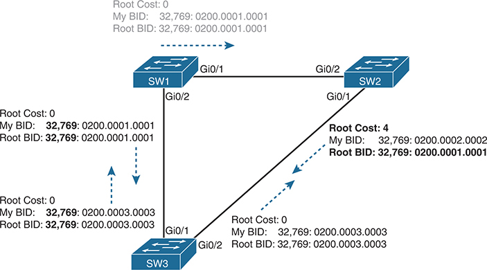

<figcaption>

<strong>图 9-3</strong> <em>根选举过程的开始阶段</em>

<aside class="hidden" id="a09fig03">

PC Larry 通过 Fast Ethernet 0/11 接口连接 SW1，PC Archie 通过 Fast Ethernet 0/12 接口连接 SW2。MAC 地址为 0200.3333.3333 的 PC Bob 通过 Fast Ethernet 0/13 接口连接 SW3。交换机之间的连接如下：SW1 通过 Gigabit Ethernet 0/1 和 Gigabit Ethernet 0/2 接口连接 SW2；SW2 通过 Gigabit Ethernet 0/1 和 Gigabit Ethernet 0/2 接口连接 SW3；SW1 通过 Gigabit Ethernet 0/2 和 Gigabit Ethernet 0/1 接口连接 SW3。这种配置为广播流量提供多条路径，可能导致广播风暴。从 SW1 到 SW2 的根路径开销为 0。SW1 的桥 ID（BID）优先级为 32,769，MAC 地址为 0200.0001.0001，与根桥 ID 相同，表示 SW1 是该网段的根桥。从 SW2 到 SW3 的根路径开销为 4。SW2 的 BID 优先级为 32,769，MAC 地址为 0200.0002.0002；根 BID 的优先级为 32,769，MAC 地址为 0200.0001.0001，表示 SW1 是根桥。从 SW3 到 SW2 和 SW1 的根路径开销为 0。SW3 的 BID 优先级为 32,769，MAC 地址为 0200.0003.0003，与发往这两台交换机的根 BID 相同，表示 SW3 是这些网段的根桥。

</aside>

</figcaption>

</figure>

<a href="#ch09fig03">图 9-3</a> 中仍有两个候选者：SW1 和 SW3。谁会获胜？比较 BID 时，优先级数值较低的交换机获胜；如果相同，则 MAC 地址较低者获胜。如图左侧所示，交换机优先级都为 32,769，但由于 SW1 的 MAC 地址更低，其 BID（32,769:0200.0001.0001）低于 SW3（32,769:0200.0003.0003）。SW1 获胜，SW3 现在也认为 SW1 是更好的交换机。<a href="#ch09fig04">图 9-4</a> 展示了此后各交换机发送的 Hello 消息。

<figure class="image-c" id="ch09fig04">

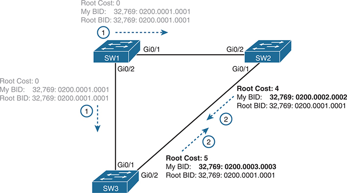

<figcaption>

<strong>图 9-4</strong> <em>SW1 赢得选举</em>

<aside class="hidden" id="a09fig04">

PC Larry 通过 Fast Ethernet 0/11 接口连接 SW1，PC Archie 通过 Fast Ethernet 0/12 接口连接 SW2。MAC 地址为 0200.3333.3333 的 PC Bob 通过 Fast Ethernet 0/13 接口连接 SW3。交换机之间的连接如下：SW1 通过 Gigabit Ethernet 0/1 和 Gigabit Ethernet 0/2 接口连接 SW2；SW2 通过 Gigabit Ethernet 0/1 和 Gigabit Ethernet 0/2 接口连接 SW3；SW1 通过 Gigabit Ethernet 0/2 和 Gigabit Ethernet 0/1 接口连接 SW3。这种配置为广播流量提供多条路径，可能导致广播风暴。从 SW1 到 SW2 的根路径开销为 0。SW1 的桥 ID（BID）优先级为 32,769，MAC 地址为 0200.0001.0001，与根桥 ID 相同，表示 SW1 是该网段的根桥。从 SW2 到 SW3 以及从 SW3 到 SW2 的根路径开销为 4。SW2 的 BID 优先级为 32,769，MAC 地址为 0200.0002.0002；根 BID 的优先级为 32,769，MAC 地址为 0200.0001.0001，表示 SW1 是根桥。从 SW1 到 SW3 的根路径开销为 0。SW3 的 BID 优先级为 32,769，MAC 地址为 0200.0003.0003，与根 BID 相同，表示 SW1 是该网段的根桥。

</aside>

</figcaption>

</figure>

概括而言，根选举开始时每台交换机都宣称自己为根，最终根据数值最低的 BID 选出最佳交换机。将 BID 分解为组成部分后，可以按以下顺序比较：

<ul class="sq">

<li>
最低的优先级数值
</li>

<li>
如果相同，则比较最低的交换机 MAC 地址
</li>

</ul>

</section>

<section>

<h5 class="h5" id="ch09lev3sec3">选择每台交换机的根端口</h5>

STP/RSTP 过程的第二部分，是每台非根交换机选择唯一的<em>根端口（RP）</em>。交换机的 RP 是其到达根交换机的 STP/RSTP 开销最低（根路径开销最低）所经过的接口。

交换机到达根的开销这一思路很容易理解。只需看一张网络图，图中标明根交换机、每个交换机端口的 STP/RSTP 开销，以及正在考察的非根交换机即可。当然，交换机所使用的过程不同于你观察网络图的过程，但通过图示更容易掌握这一概念。

<a href="#ch09fig05">图 9-5</a> 就是这样的图，使用前面几张图中相同的三台交换机。SW1 已赢得根选举，图中从 SW3 的角度考察开销。（注意，图中使用了一些非默认开销设置。）

<figure class="image-c" id="ch09fig05">

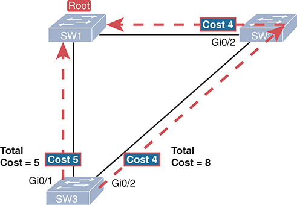

<figcaption>

<strong>图 9-5</strong> <em>人如何计算 SW3 到根交换机（SW1）的 STP/RSTP 开销</em>

<aside class="hidden" id="a09fig05">

SW1 通过 Gigabit Ethernet 0/1 和 Gigabit Ethernet 0/2 接口连接 SW2。SW2 通过 Gigabit Ethernet 0/1 和 Gigabit Ethernet 0/2 接口连接 SW3。SW1 还通过 Gigabit Ethernet 0/2 和 Gigabit Ethernet 0/1 接口直接连接 SW3。SW1 是根桥，SW3 到 SW1 的开销为 5，表示 SW3 的端口到达根桥需要 5 个开销单位。若考虑经过 SW2 的路径，SW3 到 SW2 的开销为 4，SW2 到 SW1 的开销也为 4，因此经由 SW2 到达根桥的总开销为 8。

</aside>

</figcaption>

</figure>

SW3 有两条可向根交换机发送帧的物理路径：左侧的直接路径，以及右侧经过 SW2 的间接路径。路径开销是帧沿该路径传输时，所有<em>帧所经过的交换机出端口</em>的开销之和。（计算时忽略入端口。）可以看到，从 SW3 的 G0/1 端口发出的直接路径总开销为 5，另一条路径总开销为 8。SW3 选择 G0/1 作为根端口，因为它属于向根交换机发送帧的最低开销路径。

交换机会得出相同结论，但使用不同的过程：将本地接口的 STP/RSTP 开销加到每个收到的 Hello BPDU 中所列的根路径开销上。STP/RSTP 端口开销只是按 VLAN 分配给每个接口的整数值，用来提供客观度量，使 STP/RSTP 能选择哪些接口加入 STP/RSTP 拓扑。交换机还会查看邻居的根路径开销，该值由从各邻居收到的 Hello BPDU 通告。

<a href="#ch09fig06">图 9-6</a> 展示了交换机如何计算最佳根路径开销并选择根端口，所用拓扑和 STP/RSTP 开销与<a href="#ch09fig05">图 9-5</a> 相同。SW3 上的 STP/RSTP 将 Hello 消息通告的开销与图中列出的接口开销相加，计算两条候选路径到达根的开销。

<figure class="image-c" id="ch09fig06">

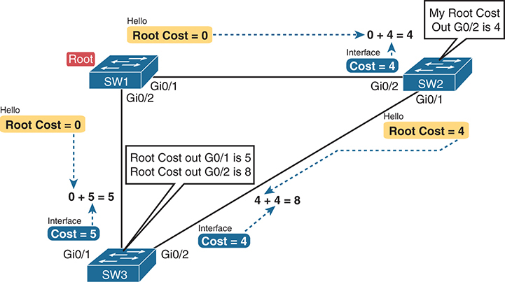

<figcaption>

<strong>图 9-6</strong> <em>STP/RSTP 实际如何计算 SW3 到根的开销</em>

<aside class="hidden" id="a09fig06">

SW1 通过 Gigabit Ethernet 0/1 和 Gigabit Ethernet 0/2 接口连接 SW2。SW2 通过 Gigabit Ethernet 0/1 和 Gigabit Ethernet 0/2 接口连接 SW3。SW1 还通过 Gigabit Ethernet 0/2 和 Gigabit Ethernet 0/1 接口直接连接 SW3。由于 SW1 是根桥，从 SW1 到 SW3 的开销初始为零。计算 SW2 到 SW3 的开销时，SW2 到 SW3 的 Hello 根路径开销为零，加上到达 SW2 的端口开销 4，得到总开销 4。同样，计算 SW1 到 SW2 的开销时，SW1 到 SW2 的 Hello 根路径开销为零，加上到达 SW1 的端口开销 4，得到总开销 4。

</aside>

</figcaption>

</figure>

先关注一下过程。根交换机发送 Hello，其中列出的根路径开销为 0。这表示根到达自身的开销为 0。

接着看图左侧。SW3 取出从 SW1 收到的 Hello 中的开销 0，再加上接收该 Hello 的接口开销 5。SW3 算出通过该端口（G0/1）到达根交换机的开销为 5。

图右侧，SW2 已确定其到达根的最佳开销为 4。因此，SW2 向 SW3 转发 Hello 时，会列出根路径开销 4。SW3 的 G0/2 端口 STP/RSTP 开销为 4，因此 SW3 确定通过 G0/2 到达根的总开销为 8。

按照<a href="#ch09fig06">图 9-6</a> 所示过程，SW3 选择 Gi0/1 作为 RP，因为通过该端口到达根交换机的开销 5，低于另一个选择 Gi0/2 的开销 8。同样，SW2 选择 Gi0/2 作为 RP，开销为 4（SW1 通告的开销 0，加上 SW2 的 Gi0/2 接口开销 4）。每台交换机都会将根端口置于转发状态。

如果两条或更多路径的最佳根路径开销相同，交换机就需要决胜规则。发生平局时，交换机按以下顺序对这些路径应用三条规则：

<ol class="number">

<li>
选择邻居桥 ID 最低的路径。
</li>

<li>
选择邻居端口优先级数值最低的路径。
</li>

<li>
选择邻居内部端口编号最低的路径。
</li>

</ol>

</section>

<section>

<h5 class="h5" id="ch09lev3sec4">选择每个 LAN 网段的指定端口</h5>

STP/RSTP 的最后一步是确定每个 LAN 网段的指定端口。根路径开销最低的交换机获胜。链路两端各有一台交换机时，到达根的开销较低者成为指定交换机，它在该链路上的端口成为该网段的 DP。如果链路一端是交换机，另一端是不使用 STP/RSTP 的设备（如路由器或 PC），则交换机一端成为 DP。

选择 DP 的过程从交换机向链路转发 Hello 开始。Hello 消息包含一个字段，列出转发该 Hello 的交换机的根路径开销。只需简单比较，就能确定哪台交换机的根路径开销最低。一旦某个交换机端口成为 DP，它就继续向该链路转发 Hello。

例如，前面的<a href="#ch09fig04">图 9-4</a> 用粗体显示了 SW2 和 SW3 的 Hello 消息中决定该网段 DP 选择的部分。注意，SW2 和 SW3 都列出了各自的根路径开销（SW2 为 4，SW3 为 5）。SW2 列出的开销较低，因此 SW2 的 Gi0/1 端口成为该 LAN 网段的指定端口。

所有 DP 都被置于转发状态；本例中，SW2 的 Gi0/1 接口将处于转发状态。

如果通告的开销相同，交换机会选择 BID 较低者来打破平局。本例中 SW2 仍会获胜，因为其 BID 为 32769:0200.0002.0002，而 SW3 的 BID 为 32769:0200.0003.0003。

注意

某些情况下还需要两个额外的决胜条件，虽然如今不太可能遇到。单台交换机可以通过连接集线器，将两个或更多接口接入同一冲突域。这时，该交换机会听到自己的 BPDU。因此，如果交换机与自身打成平局，就使用另外两条规则：最低的接口 STP/RSTP 优先级数值；若仍相同，则选择最低的内部接口编号。

在<a href="#ch09fig03">图 9-3</a> 到<a href="#ch09fig06">图 9-6</a> 所示三台交换机的示例中，唯一没有理由处于转发状态的接口是 SW3 的 Gi0/2。因此，STP/RSTP 过程至此完成。<a href="#ch09tab05">表 9-5</a> 概述了每个端口的状态及其原因。

<figure class="table" id="ch09tab05" tabindex="0">

<figcaption>

<strong>表 9-5</strong> 各接口的状态

</figcaption>

<table class="all">

<thead>

<tr>

<th class="th">
交换机接口
</th>

<th class="th">
状态
</th>

<th class="th">
接口处于转发状态的原因
</th>

</tr>

</thead>

<tbody>

<tr>

<td class="border">
SW1, Gi0/1
</td>

<td class="border">
转发
</td>

<td class="border">
接口位于根交换机上，因此成为该链路的 DP。
</td>

</tr>

<tr>

<td class="border">
SW1, Gi0/2
</td>

<td class="border">
转发
</td>

<td class="border">
接口位于根交换机上，因此成为该链路的 DP。
</td>

</tr>

<tr>

<td class="border">
SW2, Gi0/2
</td>

<td class="border">
转发
</td>

<td class="border">
SW2 的根端口。
</td>

</tr>

<tr>

<td class="border">
SW2, Gi0/1
</td>

<td class="border">
转发
</td>

<td class="border">
连接 SW3 的 LAN 网段上的指定端口。
</td>

</tr>

<tr>

<td class="border">
SW3, Gi0/1
</td>

<td class="border">
转发
</td>

<td class="border">
SW3 的根端口。
</td>

</tr>

<tr>

<td class="border">
SW3, Gi0/2
</td>

<td class="border">
阻塞
</td>

<td class="border">
既不是根端口，也不是指定端口。
</td>

</tr>

</tbody>

</table>

</figure>

注意，本节示例关注交换机之间的链路，但连接终端设备的交换机端口应成为 DP，并稳定在转发状态。按逻辑推演，每台交换机都会在各端口转发 BPDU，作为确定该 LAN 上 DP 的过程的一部分。终端不运行 STP/RSTP，应当忽略这些消息，因此交换机会获胜，在每个接入端口上成为 DP。

</section>

</section>

<section>

<h4 class="h4" id="ch09lev2sec4">通过配置影响 STP 拓扑</h4>

Cisco 交换机默认运行 STP/RSTP，因此交换机所需的所有设置都有可用的默认值。交换机具有默认 BID，由默认优先级值加上交换机硬件自带的全局通用 MAC 地址组成。此外，交换机接口的默认 STP/RSTP 开销取决于接口当前的运行速率。

网络工程师经常希望更改 STP/RSTP 设置，从而改变 STP/RSTP 在某个 LAN 中作出的选择。工程师可以使用的两种主要手段是配置桥 ID，以及更改 STP/RSTP 端口开销。

首先，要更改 BID，工程师可以设置交换机使用的优先级，同时仍使用全局通用 MAC 地址作为 BID 的最后 48 位。例如，将某台交换机的优先级数值设为所有交换机中最低，就能让它赢得根选举。

端口开销也有按端口、按 VLAN 设置的默认值。你可以配置这些端口开销，进而影响许多交换机的根路径开销计算。例如，要优先使用某条链路，就降低该链路端口的开销；要避免使用某条链路，就提高其端口开销。

<a href="#ch09tab06">表 9-6</a> 列出了 IEEE 建议的默认端口开销。Cisco 交换机上的 IOS 长期使用早在 1998 年版 STP 标准中定义的默认设置。最新 IEEE 标准建议的值更适用于速率高于 10 Gbps 的链路。可以通过全局命令（<strong>spanning-tree pathcost method</strong> {<strong>short</strong> | <strong>long</strong>}）配置交换机使用旧的 short 或新的 long 默认值，但同一园区的所有交换机使用相同设置才合理。

<figure class="table" id="ch09tab06" tabindex="0">

<figcaption>

<strong>表 9-6</strong> IEEE 规定的默认端口开销

</figcaption>

<table class="all">

<thead>

<tr>

<th class="th">
以太网速率
</th>

<th class="th">
IEEE 开销：1998 年及以前
</th>

<th class="th">
IEEE 开销：2004 年及以后
</th>

</tr>

</thead>

<tbody>

<tr>

<td class="border">
10 Mbps
</td>

<td class="border">
100
</td>

<td class="border">
2,000,000
</td>

</tr>

<tr>

<td class="border">
100 Mbps
</td>

<td class="border">
19
</td>

<td class="border">
200,000
</td>

</tr>

<tr>

<td class="border">
1 Gbps
</td>

<td class="border">
4
</td>

<td class="border">
20,000
</td>

</tr>

<tr>

<td class="border">
10 Gbps
</td>

<td class="border">
2
</td>

<td class="border">
2000
</td>

</tr>

<tr>

<td class="border">
100 Gbps
</td>

<td class="border">
不适用
</td>

<td class="border">
200
</td>

</tr>

<tr>

<td class="border">
1 Tbps
</td>

<td class="border">
不适用
</td>

<td class="border">
20
</td>

</tr>

</tbody>

</table>

</figure>

还要注意，Cisco 交换机根据链路的实际运行速率选择默认开销，而不是最高速率。也就是说，如果 10/100/1000 端口因某种原因以 10 Mbps 运行，它在 Cisco 交换机上的默认 STP 开销就是 100。

</section>

</section>

<section>

<h3 class="h3" id="ch09lev1sec4">STP 特有的细节（不适用于 RSTP）</h3>

正如本章引言所说，第一部分介绍的是同时适用于 STP 和 RSTP 的功能。接下来的标题是一个转折点，后面几页只讨论 STP。再后面的“<a href="#ch09lev1sec5">快速 STP 概念</a>”一节将通过与 STP 对比，介绍 RSTP 特有的细节。

工程师完成所有 STP 配置后，STP 拓扑应当进入稳定状态，不再变化，至少在网络拓扑改变之前如此。本节先考察网络稳定时 STP 的持续运行情况，然后介绍发生变化时 STP 如何收敛到新拓扑。

注意，STP 与 RSTP 的几乎所有差异都围绕等待拓扑变化及响应变化的活动展开。就诞生时的时代与条件而言，STP 的表现很好。RSTP 中的“快速”指的是它响应变化的速度得到了改进，因此理解 STP 如何响应，有助于理解 RSTP 为什么更快。接下来的几页介绍 STP 而非 RSTP 的具体行为，以及以太网 LAN 发生变化时 STP 如何响应并管理收敛。

<section>

<h4 class="h4" id="ch09lev2sec5">网络保持稳定时的 STP 活动</h4>

网络保持稳定时，根交换机生成新的 Hello BPDU，非根交换机转发该 Hello 的副本，使 Hello 遍历生成树。根每隔一个 Hello 时间（默认 2 秒）生成一个新的 Hello，各非根交换机更新 Hello 后，从所有处于转发状态的接口将其转发出去。以下步骤概括了 STP 拓扑当前没有变化时的稳态运行过程：

步骤 1. 根创建一个根路径开销为 0 的 Hello BPDU，并从所有正常工作的接口（处于转发状态的接口）发送出去。

步骤 2. 非根交换机在根端口收到 Hello。交换机将 Hello 中的发送方 BID 改为自己的 BID，并填入自身根路径开销，然后从所有指定端口转发该 Hello。

步骤 3. 每隔一个 Hello 时间重复步骤 1 和 2，直到发生变化。

当交换机未能在根端口收到 Hello 时，就知道网络可能出现问题。每台交换机都依赖定期收到的、来自根的 Hello，来确认自己到根的路径仍然可用。当交换机不再收到 Hello，或者收到的 Hello 中列出的细节发生变化，就说明发生了故障，于是交换机会作出响应，开始改变生成树拓扑的过程。

</section>

<section>

<h4 class="h4" id="ch09lev2sec6">管理 STP 收敛的定时器</h4>

出于各种原因，STP 收敛过程需要使用三个定时器，如<a href="#ch09tab07">表 9-7</a> 所列。注意，所有交换机都使用根交换机指定的定时器值，根会在周期性 Hello BPDU 消息中列出这些值。

<figure class="table" id="ch09tab07" tabindex="0">

<figcaption>

<strong>表 9-7</strong> STP 定时器

</figcaption>

<table class="all">

<thead>

<tr>

<th class="th">
定时器
</th>

<th class="th">
默认值
</th>

<th class="th">
说明
</th>

</tr>

</thead>

<tbody>

<tr>

<td class="border">
Hello
</td>

<td class="border">
2 秒
</td>

<td class="border">
根生成两个 Hello 之间的时间间隔。
</td>

</tr>

<tr>

<td class="border">
MaxAge
</td>

<td class="border">
Hello 的 10 倍
</td>

<td class="border">
任何交换机停止收到 Hello 后，在尝试改变 STP 拓扑之前应等待的时间。
</td>

</tr>

<tr>

<td class="border">
转发延迟（Forward delay）
</td>

<td class="border">
15 秒
</td>

<td class="border">
影响接口从阻塞状态转变为转发状态这一过程的延迟。端口先停留在临时的<a id="key_129" href="#ref-gloss_239">侦听状态</a>，然后停留在临时的<a id="key_128" href="#ref-gloss_229">学习状态</a><em>，</em>每个状态的持续秒数都由转发延迟定时器定义。
</td>

</tr>

</tbody>

</table>

</figure>

如果交换机在一个 Hello 时间内没有收到预期的 Hello BPDU，仍会照常运行。但是，如果在 MaxAge 时间内仍未收到 Hello，就会采取措施改变 STP 拓扑。默认设置下，MaxAge 为 20 秒，即默认 Hello 定时器 2 秒的十倍。因此，交换机要在 20 秒内没有听到 Hello，才会作出响应。

MaxAge 到期后，交换机会根据从其他交换机收到的 Hello，基本上重新作出全部 STP 选择。它会重新评估哪台交换机应成为根。如果本地交换机不是根，则选择自身 RP，并确定自己是否是其他每条链路上的 DP。

说明 STP 收敛的最佳方式，是使用同一熟悉拓扑举例。<a href="#ch09fig07">图 9-7</a> 使用这张熟悉的图，SW3 的 Gi0/2 处于阻塞状态，但 SW1 的 Gi0/2 接口刚刚失效。

<figure class="image-c" id="ch09fig07">

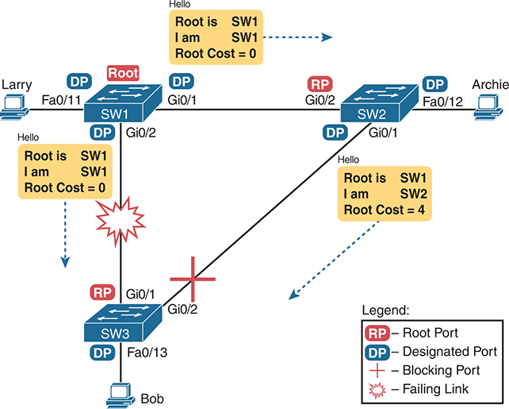

<figcaption>

<strong>图 9-7</strong> <em>SW1–SW3 链路失效前的初始 STP 状态</em>

<aside class="hidden" id="a09fig07">

PC Larry 通过 Fast Ethernet 0/11 指定端口（DP）连接 SW1，PC Archie 通过 Fast Ethernet 0/12 DP 连接 SW2，PC Bob 通过 Fast Ethernet 0/13 DP 连接 SW3。SW1 通过 Gigabit Ethernet 0/1 指定端口（DP）和 Gigabit Ethernet 0/2 根端口（RP）连接 SW2。SW2 通过 Gigabit Ethernet 0/1 DP 和 Gigabit Ethernet 0/2 RP 连接 SW3。SW1 还通过 Gigabit Ethernet 0/2 DP 和 Gigabit Ethernet 0/1 RP 直接连接 SW3。由于 SW1 是根桥，Hello 消息表明根桥为 SW1，从 SW1 到 SW3 的根路径开销为 0。同样，从 SW1 到 SW2 的根路径开销为 0，而从 SW2 到 SW3 的根路径开销为 4。SW1 与 SW3 之间的连接失效。

</aside>

</figcaption>

</figure>

图示场景中，SW3 会响应这一变化，因为它未能在 Gi0/1 接口收到预期的 Hello。但是 SW2 不需要响应，因为它仍在 Gi0/2 接口定期收到 Hello。在本例中，SW3 会在经过 <a id="key_131" href="#ref-gloss_253">MaxAge</a> 时间仍未听到 Hello 时作出响应，或者在发现 Gi0/1 接口失效时立即响应。（如果接口失效，交换机可以假定该接口今后不会再收到 Hello。）

现在 SW3 可以采取行动，它首先重新评估根交换机的选择。SW3 仍能收到由 SW2 转发、源自根 SW1 的 Hello。SW1 的 BID 仍低于 SW3，否则此前 SW1 就不可能成为根。因此，SW3 决定 SW1 赢得根选举，自己不是根。

接下来，SW3 重新评估 RP 的选择。此时，SW3 只在一个接口 Gi0/2 上收到 Hello。不论算出的根路径开销是多少，Gi0/2 都会成为 SW3 的新 RP。（假定 STP 开销与前面的<a href="#ch09fig05">图 9-5</a> 和<a href="#ch09fig06">图 9-6</a> 相同，则开销为 8。）

然后 SW3 重新评估其他接口上的 DP 角色。本例实际上无需做任何工作。SW3 原本已是 Fa0/13 接口上的 DP，由于该端口未连接其他交换机，它会继续作为 DP。

</section>

<section>

<h4 class="h4" id="ch09lev2sec7">STP 如何改变接口状态</h4>

STP 使用角色和状态这两个概念。<em>角色</em>（如根端口角色、指定端口角色）与 STP 如何分析 LAN 拓扑有关。<em>状态</em>（如转发和阻塞）则告诉交换机是否发送或接收帧。STP 收敛时，交换机会选择新的端口角色，而端口角色决定状态（转发或阻塞）。

使用 STP 的交换机可以立即从转发状态变为阻塞状态，但从阻塞转为转发时必须额外等待。例如，<a href="#ch09fig07">图 9-7</a> 中 SW3 原先使用 G0/1 作为 RP（一种角色），该端口处于转发状态。收敛后，G0/1 可能既不是 RP 也不是 DP，交换机可以立即将其置于阻塞状态。

但当原先阻塞的端口需要转为转发时，交换机会先让它经过两个中间接口状态。这些临时 STP 状态有助于防止临时环路：

<ul class="sq">

<li>
<strong>侦听：</strong>与阻塞状态一样，接口不转发帧。对于在这段时间内未收到对应源 MAC 地址帧的陈旧（未使用）MAC 表条目，交换机会将其删除。这些陈旧 MAC 表条目可能造成临时环路。
</li>

<li>
<strong>学习：</strong>该状态下接口仍不转发帧，但交换机开始学习接口所收到帧的 MAC 地址。
</li>

</ul>

STP 让接口从阻塞转为侦听，再到学习，最后进入转发状态。接口在每个中间状态停留的时间都等于转发延迟定时器，默认 15 秒。因此，导致接口从阻塞转为转发的收敛事件，需要 30 秒完成这一转换。此外，交换机在决定将接口从阻塞改为转发之前，可能还要等待 MaxAge 秒（默认 20 秒）。

例如，考虑初始 STP 拓扑如<a href="#ch09fig03">图 9-3</a> 到<a href="#ch09fig06">图 9-6</a> 所示、SW1 到 SW3 的链路如<a href="#ch09fig07">图 9-7</a> 所示失效时会发生什么。如果 SW1 只是停止向 SW3 发送 Hello，但两者之间的链路并未失效，SW3 就会在响应之前等待 MaxAge 秒（默认为 20 秒）。SW3 实际上能很快选出各端口的 STP 角色，但随后 Gi0/2 接口还要分别在侦听状态和学习状态各等待 15 秒，最终产生 50 秒的收敛延迟。

<a href="#ch09tab08">表 9-8</a> 总结了生成树的各种接口状态，便于复习。

<figure class="table" id="ch09tab08" tabindex="0">

<figcaption>

<strong>表 9-8</strong> IEEE STP（不是 RSTP）状态

</figcaption>

<table class="all">

<thead>

<tr>

<th class="th">
状态
</th>

<th class="th">
是否转发数据帧？
</th>

<th class="th">
是否根据接收帧学习 MAC 地址？
</th>

<th class="th">
过渡状态还是稳定状态？
</th>

</tr>

</thead>

<tbody>

<tr>

<td class="border">
阻塞
</td>

<td class="border">
否
</td>

<td class="border">
否
</td>

<td class="border">
稳定
</td>

</tr>

<tr>

<td class="border">
侦听
</td>

<td class="border">
否
</td>

<td class="border">
否
</td>

<td class="border">
过渡
</td>

</tr>

<tr>

<td class="border">
学习
</td>

<td class="border">
否
</td>

<td class="border">
是
</td>

<td class="border">
过渡
</td>

</tr>

<tr>

<td class="border">
转发
</td>

<td class="border">
是
</td>

<td class="border">
是
</td>

<td class="border">
稳定
</td>

</tr>

<tr>

<td class="border">
禁用
</td>

<td class="border">
否
</td>

<td class="border">
否
</td>

<td class="border">
稳定
</td>

</tr>

</tbody>

</table>

</figure>

</section>

</section>

<section>

<h3 class="h3" id="ch09lev1sec5">快速 STP 概念</h3>

在当时对网络和网络设备的假设条件下，最初的 STP 工作得很好。但与任何计算或网络标准一样，随着时间推移，硬件和软件能力不断提高，新协议也随之出现，以利用这些新能力。对于 STP，多年来最显著的改进之一，就是以 IEEE 802.1w 标准引入快速生成树协议（RSTP）。

注意

为确保术语清晰：在本章其余内容中，<em>STP</em> 仅指最初的 STP 标准，而 <em>RSTP</em> 这一术语不包含 STP。

在深入 RSTP 细节之前，先理清标准编号会有所帮助：802.1w 实际上是 802.1D 标准的一项修订案。IEEE 于 1990 年首次发布 802.1D，并于 1998 年重新发布。1998 年版 802.1D 之后，IEEE 在 2001 年发布了针对 802.1D 的 802.1w 修订案，首次将 RSTP 标准化。

多年来，标准还发生了其他有意义的变化，虽然这些变化可能不会影响大多数网络从业者使用 STP 或 RSTP 时的思路。但为了完整说明，IEEE 在 2004 年修订的 802.1D 标准中用 RSTP 替代了 STP。随后，在 2011 年，IEEE 又将所有 RSTP 细节移入修订后的 802.1Q 标准。如今，RSTP 实际上位于 802.1Q 标准文档中。

因此，阅读 RSTP 相关内容时，会看到文档、书籍、视频等资料同时引用 802.1w、802.1D 和 802.1Q；根据时间和上下文，它们可能都是正确的。同时，许多人将 RSTP 称为 802.1w，因为那是首次定义它的 IEEE 文档。不过，对于本书，应重点记住 RSTP 这一缩写，而不是它在历史上使用过的 IEEE 标准编号。

注意

IEEE 出售其标准，但通过“Get IEEE 802”计划，可以免费获取当前 802 标准的 PDF。如今要阅读 RSTP 内容，需要下载 802.1Q 标准，然后查找其中关于 RSTP 的章节。

现在回到本章的 RSTP 细节。如本章一直讨论的，RSTP 与 STP 有许多相似之处，因此本节先比较两者的异同。随后，本节其余部分讨论 RSTP 独有、STP 中不存在的概念：替代根端口、不同的端口状态、备份端口，以及 RSTP 使用的端口角色。

<section>

<h4 class="h4" id="ch09lev2sec8">比较 STP 与 RSTP</h4>

如本章第一个主要部分所述，RSTP 在多个方面与 STP 工作方式相同。回顾如下：

<ul class="sq">

<li>
RSTP 与 STP 使用相同的规则和决胜条件选举根交换机。
</li>

<li>
RSTP 与 STP 交换机使用相同的规则选择根端口。
</li>

<li>
RSTP 与 STP 使用相同的规则和决胜条件选举每个 LAN 网段的指定端口。
</li>

<li>
RSTP 与 STP 都将各端口置于转发状态或阻塞状态，只不过 RSTP 将阻塞状态称为<a id="key_123" href="#ref-gloss_104">丢弃状态</a>。
</li>

</ul>

事实上，RSTP 与 STP 的工作方式非常相似，因此可以共存于同一网络。可以在同一网络中部署 RSTP 和 STP 交换机，支持 RSTP 的交换机运行 RSTP 功能，而只支持 STP 的交换机运行传统 STP 功能。

既然有这么多相似之处，你可能想知道 IEEE 为什么还要创建 RSTP。最主要的原因是收敛。STP 收敛需要较长时间（默认设置下，如果必须经历全部等待时间，需要 50 秒）。RSTP 改善了拓扑变化时的网络收敛，通常在几秒内完成，较慢时也约为 10 秒。

RSTP 通过修改和扩展 STP，避免等待 STP 定时器，使转发状态与丢弃（阻塞）状态之间能够快速转换。具体来说，与 STP 相比，RSTP 定义了更多可避免等待定时器到期的情况，例如：

<ul class="sq">

<li>
RSTP 增加了一种机制，使交换机在某些条件下可以更换根端口，而无需等待就能进入转发状态。
</li>

<li>
RSTP 增加了一种替换指定端口的新机制，使其在某些条件下无需等待就能进入转发状态。
</li>

<li>
对于必须等待定时器的情况，RSTP 缩短了等待时间。
</li>

</ul>

例如，假设出现一种故障：链路仍然 up，但某台非根交换机出于某种原因不再收到此前一直收到的 Hello BPDU。STP 要求交换机等待 MaxAge 秒，该时间定义为 Hello 定时器的十倍，默认 20 秒。RSTP 缩短这一计时，将 MaxAge 定义为 Hello 定时器的三倍。此外，RSTP 可以向邻居交换机发送消息，询问是否发生问题，而不必等待定时器。

理解这些机制的最佳方式，是观察 RSTP 替代端口角色和备份端口角色如何工作。RSTP 使用<em>替代端口</em>一词，指交换机上在根端口失效后可被用作根端口的其他端口。<em>备份端口</em>概念则在本地交换机上为指定端口提供备用端口。（注意，备份端口只适用于使用集线器的设计，因此如今不太可能发挥作用。）不过，两者都有助于理解 RSTP 的工作方式。<a href="#ch09tab09">表 9-9</a> 列出了这些 RSTP 端口角色。

<figure class="table" id="ch09tab09" tabindex="0">

<figcaption>

<strong>表 9-9</strong> RSTP 中的端口角色

</figcaption>

<table class="all">

<thead>

<tr>

<th class="th">
功能
</th>

<th class="th">
端口角色
</th>

</tr>

</thead>

<tbody>

<tr>

<td class="border">
非根交换机到根的最佳路径
</td>

<td class="border">
<a id="key_136" href="#ref-gloss_344">根端口</a>
</td>

</tr>

<tr>

<td class="border">
根端口失效时用来替换根端口的端口
</td>

<td class="border">
<a id="key_111" href="#ref-gloss_021">替代端口</a>
</td>

</tr>

<tr>

<td class="border">
被指定为向一个冲突域转发的交换机端口
</td>

<td class="border">
<a id="key_120" href="#ref-gloss_094">指定端口</a>
</td>

</tr>

<tr>

<td class="border">
指定端口失效时用来替换指定端口的端口
</td>

<td class="border">
<a id="key_112" href="#ref-gloss_040">备份端口</a>
</td>

</tr>

<tr>

<td class="border">
接口处于非正常工作状态的端口，即任何不是 connected（up/up）的状态
</td>

<td class="border">
<a id="key_121" href="#ref-gloss_102">禁用端口</a>
</td>

</tr>

</tbody>

</table>

</figure>

RSTP 与 STP 在其他几个方面也有差异。例如，在 STP 中，根交换机创建 Hello，其他所有交换机更新并转发它；在 RSTP 中，每台交换机都独立生成自己的 Hello。此外，RSTP 允许邻居之间相互查询，而不是等待定时器到期，以避免为获取信息而等待。这些协议变化帮助运行 RSTP 的交换机确定网络中发生了什么变化，并快速作出响应，选出新的 RSTP 拓扑。

接下来的几页将介绍这些明显不同于 STP 的 RSTP 功能。

</section>

<section>

<h4 class="h4" id="ch09lev2sec9">RSTP 与替代（根）端口角色</h4>

在 STP 中，每台非根交换机将一个端口设置为 STP 根端口（RP）角色。RSTP 遵循同样的约定，并使用完全相同的 RP 选择规则。随后，RSTP 比 STP 更进一步，为其他可能成为 RP 的端口命名，将其标识为<em>替代端口</em>。

要成为替代端口，RP 与替代端口收到的 Hello 必须标识同一台根交换机。例如，在<a href="#ch09fig08">图 9-8</a> 中，SW1 是根。SW3 会在 G0/1 和 G0/2 两个端口收到 Hello BPDU。两个 Hello 都将 SW1 的桥 ID（BID）列为根交换机，因此未成为根端口的那个端口满足替代端口条件。本例中，SW3 选择 G0/1 作为根端口，然后将 G0/2 设为替代端口。

<figure class="image-c" id="ch09fig08">

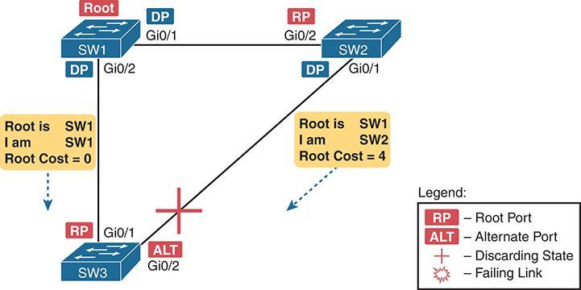

<figcaption>

<strong>图 9-8</strong> <em>SW3 将 G0/2 设为替代端口的示例</em>

<aside class="hidden" id="a09fig08">

SW1 通过 Gigabit Ethernet 0/1 指定端口（DP）和 Gigabit Ethernet 0/2 根端口（RP）连接 SW2。SW2 通过 Gigabit Ethernet 0/1 DP 和 Gigabit Ethernet 0/2 RP 连接 SW3。SW1 还通过 Gigabit Ethernet 0/2 DP 和 Gigabit Ethernet 0/1 RP 直接连接 SW3。SW1 是根桥。STP Hello 消息表明根桥为 SW1，从 SW1 到 SW3 的根路径开销为 0，从 SW2 到 SW3 的根路径开销为 4。SW2 与 SW3 之间的连接被阻塞，以防止网络环路。

</aside>

</figcaption>

</figure>

替代端口基本上相当于根端口的次优选择。它通常能够非常迅速地接替原根端口，无需在其他中间 RSTP 状态中等待。例如，根端口失效时，交换机改变原根端口的角色和状态：（a）角色从根端口改为<em>禁用端口</em>，因为接口已失效；（b）状态从转发改为丢弃，RSTP 对禁用端口角色使用丢弃状态。随后，交换机无需等待任何定时器，就将替代端口改为根端口，并立即将其端口状态从丢弃改为转发。

特别注意，新根端口也无需在学习等其他状态中停留，而是立即进入转发状态。

<a href="#ch09fig09">图 9-9</a> 展示了 RSTP 收敛的一个示例。在图中故障发生之前，SW3 的根端口是 G0/1，即直接连接根交换机 SW1 的链路。随后，SW3 到 SW1 的链路失效，如图中步骤 1 所示。

按照<a href="#ch09fig09">图 9-9</a> 中的步骤：

步骤 1. SW1 与 SW3 之间的链路失效，因此 SW3 当前的根端口 Gi0/1 失效。

步骤 2. SW3 与 SW2 交换 RSTP 消息，确认 SW3 将把原替代端口 Gi0/2 改为根端口。这一操作使 SW2 清除所需的 MAC 表条目。

步骤 3. SW3 将 G0/1 改为禁用端口角色，将 G0/2 改为根端口角色。

步骤 4. SW3 立即将 G0/2 改为转发状态，不经过学习状态，因为在这种情况下，RSTP 知道该转换不会产生环路。

<figure class="image-c" id="ch09fig09">

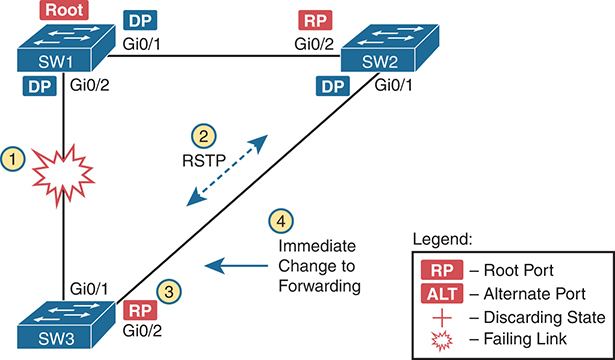

<figcaption>

<strong>图 9-9</strong> <em>SW3 G0/1 失效时的收敛事件</em>

<aside class="hidden" id="a09fig09">

SW1 通过 Gigabit Ethernet 0/1 指定端口（DP）和 Gigabit Ethernet 0/2 根端口（RP）连接 SW2。SW2 通过 Gigabit Ethernet 0/1 DP 和 Gigabit Ethernet 0/2 RP 连接 SW3。SW1 还通过 Gigabit Ethernet 0/2 DP 和 Gigabit Ethernet 0/1 RP 直接连接 SW3。SW1 是根桥。SW2 与 SW3 之间的连接使用快速生成树协议（RSTP），并立即转为转发状态，确保快速收敛和最佳流量流动。SW1 与 SW3 之间的连接则正在失效，形成一次收敛事件，网络协议通过重新路由流量来适应故障并维持网络连通性。

</aside>

</figcaption>

</figure>

一旦 SW3 意识到 G0/1 接口失效，图中的过程就只需很短时间。这些过程都不依赖定时器，因此相关工作一完成，收敛也就完成。（这个具体示例在实验中约需 1 秒。）

</section>

<section>

<h4 class="h4" id="ch09lev2sec10">RSTP 状态与过程</h4>

当然，前面示例的深度不足以揭示 RSTP 的所有细节，但已经足以用来讨论 RSTP 状态和内部过程。

STP 与 RSTP 都使用<em>端口状态</em>，但 RSTP 在一些细节上不同于 STP。两者使用转发状态的目的相同。对于 STP 收敛时使用的两个中间状态（侦听和学习），RSTP 认为侦听状态没有必要，因此不使用它；但 RSTP 使用学习状态的目的与 STP 相同。最后，RSTP 使用<em>丢弃</em>状态代替 STP 的<em>阻塞</em>状态。

为完整说明，还要注意 RSTP 和 STP 都为当前不能正常工作的端口定义了相关角色和状态。规则如下：

<ul class="sq">

<li>
STP 与 RSTP 都为接口处于非正常工作状态的端口定义并使用禁用端口角色。例如，没有连接线缆的接口，或配置了 <strong>shutdown</strong> 命令的接口。
</li>

<li>
STP 对这些端口使用禁用状态。RSTP 没有独立的禁用状态，而是使用丢弃状态。
</li>

</ul>

坦率地说，禁用角色和状态的复杂细节可能并不太重要；显然，不能正常工作的接口无法成为正常生成树中有用的一部分。无论如何，<a href="#ch09tab10">表 9-10</a> 列出了 STP 和 RSTP 状态，方便比较和学习。

<figure class="table" id="ch09tab10" tabindex="0">

<figcaption>

<strong>表 9-10</strong> 端口状态比较：STP 与 RSTP

</figcaption>

<table class="all">

<thead>

<tr>

<th class="th">
功能
</th>

<th class="th">
STP 状态
</th>

<th class="th">
RSTP 状态
</th>

</tr>

</thead>

<tbody>

<tr>

<td class="border">
端口因故障或被关闭而未处于正常工作（connected）状态
</td>

<td class="border">
禁用
</td>

<td class="border">
丢弃
</td>

</tr>

<tr>

<td class="border">
忽略收到的数据帧，也不用于转发数据帧的稳定状态
</td>

<td class="border">
阻塞
</td>

<td class="border">
丢弃
</td>

</tr>

<tr>

<td class="border">
既不学习 MAC 地址，也不转发帧的中间状态
</td>

<td class="border">
侦听
</td>

<td class="border">
不使用
</td>

</tr>

<tr>

<td class="border">
学习 MAC 地址但不转发帧的中间状态
</td>

<td class="border">
学习
</td>

<td class="border">
学习
</td>

</tr>

<tr>

<td class="border">
允许学习 MAC 地址并转发数据帧的稳定状态
</td>

<td class="border">
转发
</td>

<td class="border">
转发
</td>

</tr>

</tbody>

</table>

</figure>

为了加快收敛，RSTP 使用不同于 STP 的内部过程。例如，考虑 STP 改变端口角色、需要将端口从阻塞转为转发时发生的事情：

<ol class="number">

<li>
交换机将 MAC 表条目的老化定时器改为与 STP 转发延迟定时器相同的值，默认 15 秒。
</li>

<li>
交换机将接口转入侦听状态，并停留一个转发延迟时间，默认 15 秒。
</li>

<li>
经过转发延迟时间后：

<ol class="lower-alpha-n">

<li>
所有受此拓扑变化影响的 MAC 表条目都已从表中超时删除，从而消除产生环路的可能。
</li>

<li>
交换机现在可以将端口转入学习状态，并停留一个转发延迟时间。
</li>

</ol></li>

<li>
在学习状态停留一个转发延迟时间后，交换机将端口转入转发状态。
</li>

</ol>

为了更快收敛，RSTP 避免依赖定时器。RSTP 交换机通过消息相互通知拓扑已经改变。这些消息还会指示邻居交换机清除 MAC 表内容，无需等待即可删除所有可能导致环路的条目。因此，RSTP 提供了更多可以让原先丢弃状态的端口立即转为转发状态的情形，无需等待，也无需经过学习状态，如<a href="#ch09fig09">图 9-9</a> 的示例所示。

</section>

<section>

<h4 class="h4" id="ch09lev2sec11">RSTP 与备份（指定）端口角色</h4>

RSTP 备份端口角色也能改善收敛。它为指定端口角色提供快速故障切换，但只适用于<a href="#ch09fig10">图 9-10</a> 这样的设计，即一台交换机通过多个端口连接到同一个集线器。现代 LAN 不使用集线器，因此你不太可能在实践中见到这项 RSTP 功能，但为了掌握所有 RSTP 功能，仍需考察这个示例。

<a href="#ch09fig10">图 9-10</a> 所示设计中，SW3 通过一个端口、SW4 通过两个端口连接到同一个集线器。SW4 的 F0/1 端口恰好赢得指定端口（DP）选举。在这种拓扑中，SW4 的 F0/2 可以作为备份端口。

<figure class="image-c" id="ch09fig10">

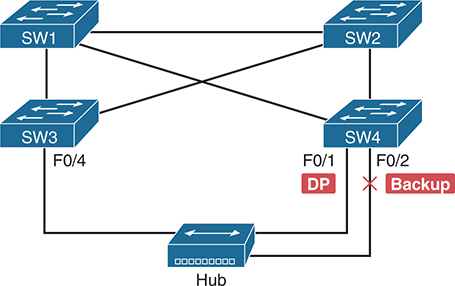

<figcaption>

<strong>图 9-10</strong> <em>RSTP 备份端口示例</em>

<aside class="hidden" id="a09fig10">

SW1、SW2、SW3 和 SW4 相互连接。SW1 通过 Fast Ethernet 0/1 指定端口（DP）和 Fast Ethernet 0/2 备份端口连接到集线器。SW3 通过 Fast Ethernet 0/4 接口连接到集线器。用 X 标记的备份线路表示网络拓扑中的冗余，可在链路故障或拥塞时提供故障切换能力。

</aside>

</figcaption>

</figure>

有了备份端口，如果当前指定端口失效，SW4 就能快速收敛，开始使用备份端口作为新的指定端口。例如，如果 SW4 的 F0/1 接口失效，SW4 可以将 F0/2 转为指定端口角色，并且从丢弃状态转为转发状态时没有延迟。

</section>

<section>

<h4 class="h4" id="ch09lev2sec12">RSTP 端口类型</h4>

这里介绍的最后一个 RSTP 概念，与 RSTP 用来表示不同端口类型及相连链路的术语有关。

首先，考察<a href="#ch09fig11">图 9-11</a> 的基本图示。图中展示了若干连接两台交换机的链路。RSTP 将这些链路视为点到点链路，将连接这些链路的端口视为点到点端口，因为每条链路恰好连接两个设备（两个点）。

<figure class="image-c" id="ch09fig11">

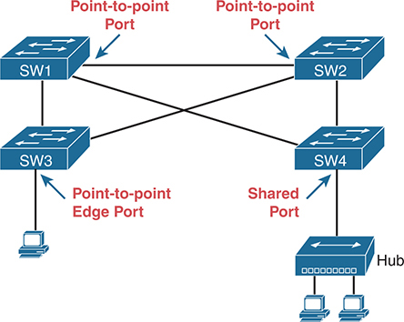

<figcaption>

<strong>图 9-11</strong> <em>RSTP 链路类型</em>

<aside class="hidden" id="a09fig11">

SW1 通过 Fast Ethernet 0/1 指定端口（DP）连接集线器。SW3 通过点到点边缘端口连接 PC，使交换机与终端设备直接通信。SW1 通过点到点端口连接 SW2，在交换机之间建立直接链路。另一方面，SW4 通过共享端口连接集线器，集线器再分支连接两台 PC，表示多个设备通过同一介质通信的共享链路。

</aside>

</figcaption>

</figure>

RSTP 进一步将点到点端口分为两类。连接两台交换机的点到点端口不在网络边缘，直接称为<em>点到点端口</em>。连接网络边缘单个终端设备（如 PC 或服务器）的端口，则称为<em>点到点边缘端口</em>，或简称<em>边缘端口</em>。在<a href="#ch09fig11">图 9-11</a> 中，SW3 连接 PC 的交换机端口就是边缘端口。

最后，RSTP 定义了<em>共享</em>一词，用来描述连接集线器的端口。<em>共享</em>这一术语源于集线器会创建共享以太网；集线器还会迫使相连的交换机端口使用半双工逻辑。RSTP 假定所有半双工端口都可能连接集线器，因此将半双工端口视为共享端口。与所有点到点端口相比，RSTP 在共享端口上的收敛更慢。

</section>

</section>

<section>

<h3 class="h3" id="ch09lev1sec6">可选 STP 功能</h3>

本章最后一个主要部分介绍让 STP 工作得更好或更安全的可选功能：EtherChannel、PortFast、BPDU Guard、Root Guard 和 Loop Guard。

<section>

<h4 class="h4" id="ch09lev2sec13">EtherChannel</h4>

减少 STP 收敛时间的最佳方式之一，是彻底避免收敛。<a id="key_124" href="#ref-gloss_129">EtherChannel</a> 提供了一种方法，使单个端口或线缆故障发生时无需触发 STP 收敛。

EtherChannel 将同一对交换机之间多条速率相同的并行网段（最多八条）捆绑成一个 EtherChannel。对于 STP，交换机将 EtherChannel 视为单个接口。因此，如果其中一条链路失效，只要至少还有一条链路处于 up 状态，就不必发生 STP 收敛。例如，<a href="#ch09fig12">图 9-12</a> 展示了熟悉的三交换机网络，但现在每对交换机之间都有两条 Gigabit Ethernet 连接。

<figure class="image-c" id="ch09fig12">

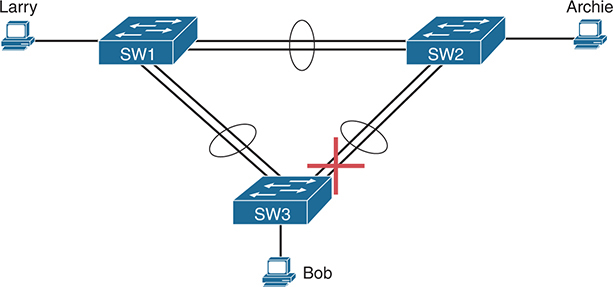

<figcaption>

<strong>图 9-12</strong> <em>交换机之间由两条网段组成的 EtherChannel</em>

<aside class="hidden" id="a09fig12">

Larry 连接 SW1，Archie 连接 SW2，Bob 也连接 SW2。连接用被椭圆包围的两条线表示，代表捆绑链路在交换机之间形成 EtherChannel。SW2 与 SW3 之间的连接被阻塞。

</aside>

</figcaption>

</figure>

将每对以太网链路配置为 EtherChannel 后，STP 会将每个 EtherChannel 视为单条链路。换句话说，连接同一交换机的两条链路必须都失效，才需要引发 STP 收敛。如果不使用 EtherChannel，两台交换机之间即使有多条并行链路，STP 也会阻塞除一条以外的所有链路。使用 EtherChannel 后，所有并行链路可以同时正常工作，同时减少 STP 必须收敛的次数，提高网络可用性。

当前 CCNA 考试大纲包含配置二层 EtherChannel（本节所述）和三层 EtherChannel 的主题。<a href="v1-10.html#ch10">第 10 章</a>“<a href="v1-10.html#ch10">RSTP 与 EtherChannel 配置</a>”介绍二层 EtherChannel 的配置，<a data-original-href="vol1_ch18.xhtml#ch18" data-unavailable="true" title="此内容不在当前提取范围内；请参阅原始 EPUB：vol1_ch18.xhtml#ch18">第 18 章</a>“<a data-original-href="vol1_ch18.xhtml#ch18" data-unavailable="true" title="此内容不在当前提取范围内；请参阅原始 EPUB：vol1_ch18.xhtml#ch18">LAN 中的 IP 路由</a>”介绍三层 EtherChannel 的配置。注意，二层 EtherChannel 将交换机用作交换端口的链路组合起来，交换机使用二层交换逻辑通过 EtherChannel 转发和接收以太网帧。三层 EtherChannel 也组合链路，但交换机使用三层路由逻辑通过 EtherChannel 转发分组。

</section>

<section>

<h4 class="h4" id="ch09lev2sec14">PortFast</h4>

直接连接终端而不是其他交换机的交换机端口，最终会采用指定端口（DP）角色并进入转发状态。但在默认端口设置下，它们会经历一些中间步骤：

<ol class="number">

<li>
接口达到 connected（up/up）状态后，交换机的 STP 逻辑首先将端口置于 STP 丢弃（阻塞）状态。
</li>

<li>
交换机开始从该端口发送 BPDU，并侦听收到的 BPDU，以决定该端口应承担根端口（RP）角色还是 DP 角色。
</li>

<li>
由于相连设备不是交换机，本地交换机不会收到 BPDU。因此，该交换机端口赢得 DP 选举，成为 DP。
</li>

<li>
交换机经过中间步骤转入转发状态：

<ol class="lower-alpha-n">

<li>
STP 先将端口转入侦听状态，再进入学习状态，最后进入转发状态。按照默认转发延迟定时器，每个中间状态默认需要 15 秒。
</li>

<li>
RSTP 遵循相同过程，但没有侦听状态。它从丢弃转到学习，再到转发。
</li>

</ol></li>

</ol>

<a id="key_132" href="#ref-gloss_309">PortFast</a> 会跳过这一过程。接口达到 connected 状态后，STP PortFast 会立即将端口置于 DP 角色和转发状态，没有延迟。只要接口保持 up，STP 角色就保持 DP，状态保持转发。

PortFast 用于支持连接终端的接入链路，如<a href="#ch09fig13">图 9-13</a> 所示。你知道，交换机在这些链路上总能赢得 DP 选举，因为终端不使用 STP。这些终端可以是单台计算机、连接计算机的电话，或者通过中继连接的服务器。

<figure class="image-c" id="ch09fig13">

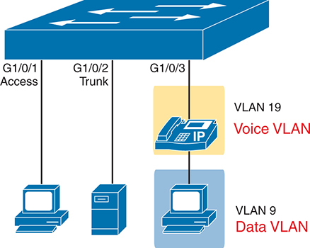

<figcaption>

<strong>图 9-13</strong> <em>适合使用 PortFast 功能的接入端口</em>

<aside class="hidden" id="a09fig13">

交换机通过 G1/0/1 端口连接 PC，该端口被指定为接入端口，为终端设备提供直接连接。交换机通过 G1/0/2 端口连接服务器，该端口配置为中继端口，以便在设备之间传输多个 VLAN 的流量。此外，交换机通过 G1/0/3 端口连接 IP 电话，电话被配置在承载语音流量的 VLAN 19 中。该端口配置通过指定的语音 VLAN 支持语音流量优先处理。语音 VLAN 还连接一台 PC，其数据流量配置在 VLAN 9 中。

</aside>

</figcaption>

</figure>

从 PortFast 能加快收敛这一点，你可能已经猜到：原始 STP 不包含 PortFast 功能，而 RSTP 将其作为快速收敛优化之一。你可能记得<a href="#ch09fig11">图 9-11</a> 附近提到的 RSTP 端口类型，尤其是点到点边缘端口。按照协议设计，RSTP 会在这种点到点边缘端口上跳过学习状态，从而快速收敛。注意，Cisco 在 IEEE 最终确定 RSTP 之前数年，就通过 PortFast 引入了这一思路，这也是数十年后我们仍称该功能为 PortFast 的原因。实际使用中，Cisco 交换机通过在端口上启用 PortFast，来启用 RSTP 点到点边缘端口。

PortFast 虽然实用且普遍，但也会带来环路风险。PortFast 端口绝不应连接网桥或交换机。启用 PortFast 后，端口忽略收到的 BPDU，始终作为指定端口并始终转发。因此，如果意外接入的交换机或非法交换机连接到启用 PortFast 的端口，就可能形成转发环路。

</section>

<section>

<h4 class="h4" id="ch09lev2sec15">BPDU Guard</h4>

PortFast 带来一个隐患：如果意外接入的交换机连接到 PortFast 端口，可能形成转发环路。Cisco 的 <a id="key_115" href="#ref-gloss_047">BPDU Guard</a> 功能通过在端口收到任何 BPDU 时禁用该端口，帮助防范这类问题。因此，这项功能适用于只应作为接入端口、绝不应连接另一台交换机的端口。

<a href="#ch09fig14">图 9-14</a> 展示了基本思路。右侧设备本应是 PC 等终端，却被一台名为 Rogue-1 的新交换机替代，连接到合法交换机 SW3。SW3 使用 BPDU Guard 防范这种情形。在步骤 2，Rogue-1 一旦向 SW3 发送 BPDU，SW3 的 BPDU Guard 逻辑就会响应，禁用该端口。

<figure class="image-c" id="ch09fig14">

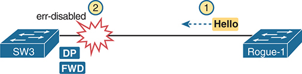

<figcaption>

<strong>图 9-14</strong> <em>BPDU Guard 的基本逻辑</em>

<aside class="hidden" id="a09fig14">

交换机 SW3 与非法交换机 1 之间的连接显示为已禁用，表示 BPDU Guard 已生效。非法交换机 1 尝试向 SW3 发送 Hello BPDU，但连接被阻止，从而避免潜在的网络环路。连接状态标为指定端口（DP）和转发（FWD），表明 BPDU Guard 能有效检测并禁用未经授权的交换机或设备。

</aside>

</figcaption>

</figure>

大多数交换机接入端口配置会组合使用 PortFast 和 BPDU Guard，虽然两者都可以独立使用。如果只使用 PortFast，而不防范<a href="#ch09fig14">图 9-14</a> 所示情形，就存在环路风险。在这些端口上使用 BPDU Guard 很合理，因为如果另一台交换机接入，本地交换机可以禁用端口以防止环路。

</section>

<section>

<h4 class="h4" id="ch09lev2sec16">BPDU Filter</h4>

<a id="key_114" href="#ref-gloss_048">BPDU Filter</a> 这一名称实际上包含两种不同功能。两者都称为 BPDU 过滤，因为它们在内部都会过滤（丢弃）STP BPDU。

首先，与 PortFast 一起使用时，BPDU Filter 可以替代 BPDU Guard。当启用 PortFast 的端口收到意料之外的 BPDU 时，BPDU Guard 和 BPDU Filter 都能防止环路。不过，BPDU Filter 的响应方式是禁用可能造成转发环路的 PortFast 逻辑，并在该端口恢复能够防止转发环路的正常 STP 逻辑。

另一种 BPDU Filter 功能是在接口上禁用 STP。启用后，BPDU Filter 会丢弃接口发送和接收的所有 BPDU。

接下来的内容将详细考察这两种逻辑分支。

<section>

<h5 class="h5" id="ch09lev3sec5">使用 BPDU Filter 防止 PortFast 端口上的环路</h5>

大多数园区 LAN 在接入端口和使用中继的服务器端口上广泛使用 PortFast。但是，如果只有 PortFast 而没有其他功能，就存在有人拔掉这些设备并换成交换机、从而形成转发环路的风险。<a href="#ch09fig15">图 9-15</a> 展示了这样的情况：SW1 的两个端口使用 PortFast，但终端被两台非法交换机替换。

<figure class="image-c" id="ch09fig15">

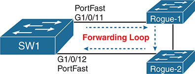

<figcaption>

<strong>图 9-15</strong> <em>非法交换机可能在 PortFast 端口上造成环路</em>

<aside class="hidden" id="a09fig15">

该设置包含交换机 SW1，以及非法交换机 Rogue 1 和 Rogue 2。Rogue 1 通过 PortFast G1/0/11 连接 SW1，Rogue 2 通过 PortFast G1/0/12 连接 SW2。两台非法交换机相互连接，形成从 SW1 出发又回到 SW1 的转发环路。

</aside>

</figcaption>

</figure>

为防范这种情况，可以使用 BPDU Guard 或 BPDU Filter。正常情况下，使用 PortFast 的端口不应收到 BPDU，但没有任何机制能阻止人们像<a href="#ch09fig15">图 9-15</a> 那样更换设备。如果发生这种情况，BPDU Filter 会通过禁用端口上的 PortFast 作出响应。随后，端口恢复正常 STP 规则。STP 将根据需要确定新的端口角色和状态，使用 STP 规则防止转发环路。根据正常 STP 逻辑的结果，该端口可能阻塞，也可能转发。

上一段说明了工程师为何可能选择这种 BPDU Filter 功能；下面的列表则详细列出具体步骤，其中包括一些 BPDU 过滤操作。

<ol class="number">

<li>
要启用 BPDU Filter 的这一逻辑分支，使用相关全局命令 <strong>spanning-tree portfast bpdufilter default</strong>。
</li>

<li>
IOS 找出当前使用 PortFast 的所有端口，并在这些端口上启用有条件的 BPDU Filter。
</li>

<li>
当任何此类端口变为 up 时：

<ol class="lower-alpha-n">

<li>
BPDU Filter 允许 STP 正常发送 BPDU，持续 10 × Hello 时间（默认 2 × 10 秒，总计 20 秒）。
</li>

<li>
如果端口在这段时间内没有收到任何 BPDU，BPDU Filter 就开始过滤（丢弃）发出的 BPDU。
</li>

</ol></li>

<li>
BPDU Filter 监视是否有 BPDU 到达。如果开始收到 BPDU：

<ol class="lower-alpha-n">

<li>
它会禁用该端口上的 PortFast。
</li>

<li>
它会让端口恢复使用正常的 STP 规则。
</li>

</ol></li>

</ol>

</section>

<section>

<h5 class="h5" id="ch09lev3sec6">使用 BPDU Filter 在端口上禁用 STP</h5>

BPDU Filter 还可以配置为启用完全不同的一类逻辑。正如你将在<a href="v1-10.html#ch10">第 10 章</a>“<a href="#ch09lev2sec16">BPDU Filter</a>”一节看到的，仅从配置本身并不容易看出启用了哪一类。不过，通过接口子命令启用时，BPDU Filter 的作用正如其名称所说：过滤（丢弃）端口上所有发送和接收的 BPDU。

以这种方式使用 BPDU Filter，实际上是在端口上禁用 STP。使用此功能存在危险：在充分测试和理解之前，不要在生产环境中使用。

作为可能需要用 BPDU Filter 在端口上禁用 STP 的例子，考虑<a href="#ch09fig16">图 9-16</a> 的场景。同一公司的两个 IT 团队各自建设网络。他们希望连接各自的 LAN，但左侧和右侧团队都不希望对方的 STP 影响自己的网络，例如究竟允许左侧还是右侧的交换机赢得根选举？两个团队协商后决定保持各自 STP 拓扑独立。为此，他们使用 BPDU Filter 过滤双方之间发送的所有 BPDU，在连接两个 LAN 的唯一链路上禁用 STP。

<figure class="image-c" id="ch09fig16">

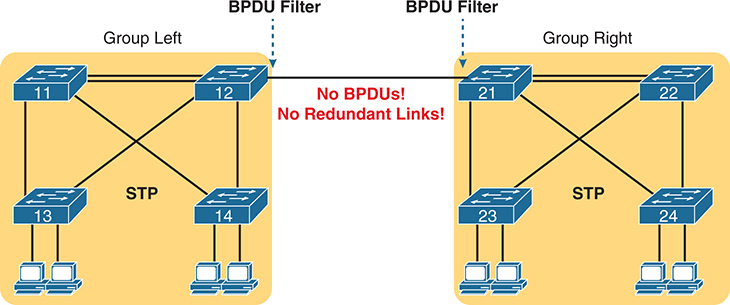

<figcaption>

<strong>图 9-16</strong> <em>可以考虑在链路上禁用 STP 的场景（BPDU 过滤）</em>

<aside class="hidden" id="a09fig16">

左侧组中，交换机 11、12、13 和 14 通过 STP 互联。交换机 13 和 14 各连接两台 PC。同样，右侧组中，交换机 21、22、23 和 24 通过 STP 互联，其中交换机 13 和 14 各连接两台 PC。值得注意的是，交换机 12 和 21 直接连接，该链路启用了 BPDU 过滤，因此没有桥协议数据单元（BPDU）通过。

</aside>

</figcaption>

</figure>

</section>

</section>

<section>

<h4 class="h4" id="ch09lev2sec17">Root Guard</h4>

<a id="key_135" href="#ref-gloss_343">Root Guard</a> 功能监视端口收到的 BPDU，如果收到的 BPDU 会改变 VLAN 中的根交换机，就会作出响应。要理解其用途，考虑<a href="#ch09fig17">图 9-17</a> 中有六台交换机的拓扑。每台交换机旁的标注说明其优先级的优劣。如果为交换机配置不同的优先级，就能知道并控制哪些交换机会成为根，其中 SW5 和 SW6 最不可能成为根。

<figure class="image-c" id="ch09fig17">

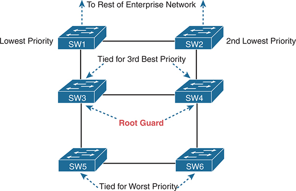

<figcaption>

<strong>图 9-17</strong> <em>较大 LAN 中最可能和最不可能成为根的交换机</em>

<aside class="hidden" id="a09fig17">

交换机 SW1 和 SW2 分别连接 SW3 和 SW4，并在它们之间互联。SW1 的优先级数值最低，SW2 次低。这些交换机是通往企业网络其余部分的入口。SW3 和 SW4 分别连接 SW5 和 SW6，并相互连接。它们并列第三优先级，承担根保护功能。最后，SW5 和 SW6 相互连接，在网络层次中并列最差优先级。

</aside>

</figcaption>

</figure>

现在假设你的组织规划了图示设计，但你直接控制 SW1 到 SW4，另一个组织控制 SW5 和 SW6。双方同意 SW1 应作为根交换机，并在 SW2 失效时由 SW2 接替；但是，这一约定并不能防止 SW5 或 SW6 上发生配置错误。

例如，对方团队的某个人可能将 SW5 的优先级数值配置得比 SW1 更低，于是 SW5 成为根交换机，形成非最佳 STP 拓扑。如果发生这种未计划的配置，SW5 就会向网络发送更优 BPDU。在该拓扑中，SW3 会收到更优 BPDU。同样，如果有人降低 SW6 的优先级数值，SW4 也可能从 SW6 收到更优 BPDU。

Root Guard 按端口启用，允许端口正常运行 STP，只有一种特殊情况例外：端口收到<a id="key_139" href="#ref-gloss_396">更优 BPDU</a>。因此，可以在连接其他交换机的端口（通常为中继）上启用 Root Guard，STP 仍会正常工作；但该端口上的 Root Guard 会阻止通过此端口可达的另一台交换机当选为根。Root Guard 通过侦听端口收到的 Hello 实现这一点：如果是更优 Hello，交换机就使用特殊的 STP 端口状态，即<a id="key_118" href="#ref-gloss_056">破损状态（broken）</a>，禁用该端口。当更优 Hello 不再出现时，Root Guard 会自动恢复端口。

是否使用 Root Guard，首先需要仔细分析拓扑。必须就哪些交换机绝不应成为根、哪些端口绝不应收到更优 BPDU 达成一致。

</section>

<section>

<h4 class="h4" id="ch09lev2sec18">Loop Guard</h4>

这里介绍的最后一项可选工具是 Loop Guard，它防范 STP 拓扑中的一种特定情况。这项功能有助于保护典型 STP 设计中优先级最差（BID 最高）的交换机，例如<a href="#ch09fig18">图 9-18</a> 中的 SW3。这些机制适用于典型 STP 设计中的正常运行，因此也需要回顾本章前面的一些主题。

<figure class="image-c" id="ch09fig18">

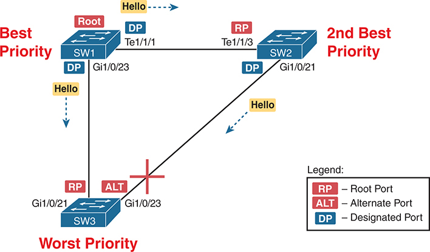

<figcaption>

<strong>图 9-18</strong> <em>典型 STP 设计</em>

<aside class="hidden" id="a09fig18">

SW1 的 Te1/1/1 端口为指定端口（DP），朝向 SW2 的 Te1/1/3 端口为根端口（RP），并发送 Hello 消息。SW2 将 Gi1/0/21 指定为指定端口（DP），将朝向 SW3 的 Gi1/0/23 指定为替代端口（ALT），该连接被阻塞。SW1 将 Gi1/0/21 指定为根端口（RP），将朝向 SW3 的 Gi1/0/23 指定为指定端口（DP），并发送 Hello 消息。SW1 的优先级最高，SW2 次高，SW3 最低。

</aside>

</figcaption>

</figure>

典型 STP 设计在正常情况下使用一台已知交换机作为根。为实现这一点，应为该交换机分配最低的优先级数值。另一台交换机承担最佳备用角色，因此为它分配第二低的优先级数值。<a href="#ch09fig18">图 9-18</a> 中的 SW1 和 SW2 分别承担这两个角色。其他所有交换机（如 SW3）的优先地位都低于 SW1 和 SW2。

接下来，观察这一设计中最差的交换机 SW3。SW3 的交换机间链路端口很少成为指定端口。为什么？STP 根据链路上各交换机最低的根路径开销确定 DP，并在相同时根据更好（更低）的 BID 决胜。在这个场景中，SW3 会输掉 DP 选举的决胜比较。

不过，SW3 的端口会承担其他角色，只是不是 DP，具体如下：

<ul class="sq">

<li>
一条链路成为根端口（<a href="#ch09fig18">图 9-18</a> 中的 G1/0/21），并稳定在转发状态。
</li>

<li>
另一条链路成为替代端口（<a href="#ch09fig18">图 9-18</a> 中的 G1/0/23），并稳定在丢弃状态。
</li>

</ul>

第二个有意义的观察是，最差的交换机 SW3 会在两条交换机间链路上反复收到 Hello。图中显示了这些 Hello。规则是交换机每隔一个 Hello 时间（默认 2 秒）从指定端口转发 Hello。

有助于理解 Loop Guard 的第三个事实涉及单向链路。<a href="#ch09fig19">图 9-19</a> 展示了这一概念。光纤链路两端的接口都是 up，处于 connected 状态，但两根光纤中的一根出现了问题，可能使帧无法到达光纤另一端。<a href="#ch09fig19">图 9-19</a> 就展示了这种情况，只有从右向左的方向能够工作。

<figure class="image-c" id="ch09fig19">

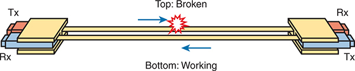

<figcaption>

<strong>图 9-19</strong> <em>单向光纤链路</em>

<aside class="hidden" id="a09fig19">

图中左侧接口标为 Tx（发送器），右侧接口标为 Rx（接收器），用两条线表示连接。上方线表示从左向右的连接已断开，下方线表示从右向左的连接仍正常工作。

</aside>

</figcaption>

</figure>

概括而言，Loop Guard 依赖以下基本事实：

<ul class="sq">

<li>
设计中优先级最差（数值最高）的交换机，其交换机间端口承担根端口（RP）和替代端口（ALT）角色，很少承担指定端口（DP）角色。
</li>

<li>
这些端口通常每隔一个 Hello 时间收到 Hello，因为每条链路的邻居交换机都是 DP。
</li>

<li>
可能出现<a id="key_140" href="#ref-gloss_422">单向链路</a>：两端接口状态仍然为 up（connected），但帧无法沿某个方向传输。
</li>

</ul>

<a id="key_130" href="#ref-gloss_247">Loop Guard</a> 功能利用上述观察，防范一类故障：如果没有 Loop Guard，这类故障会导致 SW3 的某条交换机间链路成为 DP。<a href="#ch09fig20">图 9-20</a> 对<a href="#ch09fig18">图 9-18</a> 作了调整，展示 SW2–SW3 链路变为单向的一种场景：

<ol class="number">

<li>
SW2–SW3 链路中负责从 SW2 向 SW3 传输的光纤失效。
</li>

<li>
由于 SW2 的 G1/0/21 和 SW3 的 G1/0/23 端口仍处于 connected 状态，没有接口故障来影响 STP。
</li>

<li>
SW3 不再在 G1/0/23 端口收到 Hello 消息。
</li>

<li>
经过适当的超时后，SW3 认为自己是连接 G1/0/23 接口的链路上唯一的交换机，因此将该端口改为 DP，并开始向转发状态转换。
</li>

</ol>

<figure class="image-c" id="ch09fig20">

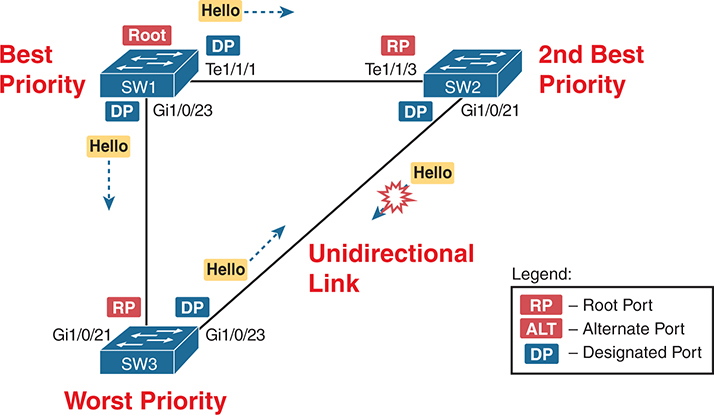

<figcaption>

<strong>图 9-20</strong> <em>SW3 的 ALT 端口变为 DP 并转发；所有链路都转发，形成环路</em>

<aside class="hidden" id="a09fig20">

SW1 的 Te1/1/1 端口被指定为指定端口（DP），朝向 SW2 的 Te1/1/3 端口为根端口（RP），并发送 Hello 消息。SW2 将 Gi1/0/21 指定为指定端口（DP），将朝向 SW3 的 Gi1/0/23 指定为 DP，该连接被阻塞。SW1 将 Gi1/0/21 指定为根端口（RP），将朝向 SW3 的 Gi1/0/23 指定为指定端口（DP），并发送 Hello 消息。SW1 的优先级最高，SW2 次高，SW3 最低。从 SW2 到 SW3 的 Hello 消息传输中断。

</aside>

</figcaption>

</figure>

花一点时间查看各交换机间链路的两端。所有端口都是 RP 或 DP，这两种角色都使用转发状态。因此出现了转发环路。注意，SW2 与 SW3 之间的单向链路在 SW2 到 SW3 方向断开，所以转发环路只存在于相反的逆时针方向。

到这里，你就能理解 Loop Guard 的作用了。在接口上启用后，它执行以下操作：

如果端口是根端口或替代端口，则通过将其置于特殊的 STP broken 状态，阻止它成为指定端口。

与 Root Guard 一样，必须理解其基本概念，才能决定在哪些端口上启用 Loop Guard。通常，只需要在连接其他交换机的光纤链路上启用。此外，应只选择 STP 优先级较差（数值较高）的交换机上的端口，因为这些交换机的交换机间端口通常处于 RP 或 ALT 角色，而不是 DP 角色。

</section>

</section>

</section>

<section class="ccna-source ccna-appendix" aria-label="答案解析与术语表">
<section data-epub-type="chapter">

<h2 class="h2" id="ref-appc">附录 C</h2>

<h2 class="h2a">自测题答案</h2>

<section>

<h3 class="h3" id="ref-appclev1sec9">第 9 章</h3>

<strong><a id="ref-ques9_1" href="#quess9_1">1</a>.</strong> A 和 B。侦听与学习都是过渡端口状态，仅在从阻塞转为转发时使用。丢弃不是 STP 端口状态。

<strong><a id="ref-ques9_2" href="#quess9_2">2</a>.</strong> C。数值最小的桥 ID 赢得选举。答案中的桥 ID 由左侧十进制优先级、冒号以及交换机的 12 位十六进制 MAC 地址组成。所有答案中，有两个具有相同的最低优先级 4097。其中，正确答案列出的 MAC 地址更低。

<strong><a id="ref-ques9_3" href="#quess9_3">3</a>.</strong> C 和 D。侦听与学习是仅在从阻塞转为转发时使用的过渡端口状态。丢弃不是 STP 端口状态。转发与阻塞是稳定状态。

<strong><a id="ref-ques9_4" href="#quess9_4">4</a>.</strong> B。非根交换机转发从根收到的 Hello；根根据自身配置的 Hello 定时器发送这些 Hello。

<strong><a id="ref-ques9_5" href="#quess9_5">5</a>.</strong> B 和 D。RSTP 使用转发、学习和丢弃三种端口状态。转发与学习的功能，与传统 STP 中对应端口状态的功能相同。

<strong><a id="ref-ques9_6" href="#quess9_6">6</a>.</strong> A 和 D。在 RSTP 中，交换机根端口失效时，替代端口是根端口的替代者。指定端口失效时，备份端口接替指定端口。

<strong><a id="ref-ques9_7" href="#quess9_7">7</a>.</strong> D。PortFast 功能允许 STP/RSTP 将端口从阻塞直接转为转发，而无需经过侦听和学习这两个中间状态。当已知链路另一端没有交换机、不存在交换环路风险时，STP 允许这种例外。Cisco 在 IEEE 发布 RSTP 之前就创建了 PortFast，但 RSTP 也包含等效功能，因此它是 STP 和 RSTP 都具备的功能。

BPDU Guard 经常与 PortFast 一起使用，因为它会监视收到的桥协议数据单元（BPDU）——接入端口上本不应出现这些消息——并通过禁用端口防止非法交换机造成环路。

<strong><a id="ref-ques9_8" href="#quess9_8">8</a>.</strong> C。交换机接口上的 Root Guard 监视收到的 STP BPDU，通常按正常 STP 方式处理，只有更优 BPDU 例外。更优 BPDU 标识一台具有更好（更低）桥 ID 的新根交换机。Root Guard 收到这种 BPDU 后会响应并禁用端口。

对于其他答案，BPDU Guard 也监视收到的 BPDU，但端口收到任何 BPDU 都会被禁用。PortFast 和 Loop Guard 都不监视收到的 BPDU，也不会对它们作出响应。

</section>

</section>

<section id="ref-glossary"><h2 class="h2a">术语表</h2>
<strong>替代端口角色（alternate port role）</strong> RSTP 中的一种端口角色，端口充当交换机根端口的替代者，使根端口失效时，替代端口能够立即接替为根端口。

<strong>备份端口角色（backup port role）</strong> RSTP 中的一种端口角色，端口为交换机上承担指定端口角色的某个端口提供备份。如果该指定端口失效，交换机会使用备份端口立即接替指定端口。

<strong>阻塞状态（blocking state）</strong> STP 中的一种端口状态，不处理任何接收帧，也不从该接口转发任何帧，STP 消息除外。

<strong>BPDU</strong> 桥协议数据单元。生成树协议消息的通用名称。

<strong>BPDU Guard</strong> Cisco 交换机的一项功能，侦听收到的 STP BPDU 消息，只要收到任何此类消息，就禁用接口。目的是在本应只连接主机的端口上接入交换机时防止环路。

<strong>BPDU Filter</strong> Cisco 交换机的一项功能，通过监视和过滤（丢弃）STP BPDU 实现某些目标，例如防范 PortFast 端口上的转发环路，以及通过过滤所有 BPDU 消息来禁用 STP。

<strong>桥 ID（BID）</strong> STP 和 RSTP 使用的网桥与交换机的 8 字节标识符。由 2 字节优先级字段和其后的 6 字节系统 ID 字段组成，后者通常填入 MAC 地址。

<strong>桥协议数据单元（bridge protocol data unit）</strong> <em>参见</em> <a href="#ref-gloss_046">BPDU</a>。

<strong>破损状态（broken）</strong> Cisco 交换机上的一种 STP 端口状态，Root Guard 和 Loop Guard 通过它让 STP 禁用端口。处于 broken 状态的端口不转发帧，也不处理收到的帧。

<strong>指定端口（designated port）</strong> STP 和 RSTP 中的一种端口角色，用于确定连接同一网段或冲突域的多台交换机上的多个接口中，哪一个应向该网段转发帧。向网段通告最低开销 Hello BPDU 的交换机一端成为 DP。

<strong>禁用端口角色（disabled port role）</strong> STP 中分配给非正常工作接口的端口角色，即未处于 connect 或 up/up 状态的接口。原因可能是管理设置（shutdown）或接口故障。

<strong>禁用状态（disabled state）</strong> STP 中用于禁用端口角色接口的状态，RSTP 不使用这一状态。

<strong>丢弃状态（discarding state）</strong> RSTP 接口状态，主要替代 STP 的阻塞状态，用于端口角色既非指定端口也非根端口的接口。在此状态下，交换机不从接口转发数据帧，也不处理收到的帧，RSTP 消息除外。

<strong>EtherChannel</strong> 一种功能，使相同两个设备之间最多可有八条速率相同的并行以太网网段。它可以是二层 EtherChannel，对于转发和生成树协议逻辑相当于单条链路；也可以是三层 EtherChannel，对于交换机的三层路由逻辑相当于单条链路。

<strong>转发延迟（forward delay）</strong> STP 定时器，默认为 15 秒，用于规定接口在侦听状态及学习状态各停留多长时间。也称转发延迟定时器。

<strong>转发状态（forwarding state）</strong> STP 和 RSTP 的一种端口状态，接口在此状态下不受 STP 限制地运行。

<strong>Hello BPDU</strong> 用于大多数 STP 通信的 STP 和 RSTP 消息，其中列出根的桥 ID、发送设备的桥 ID，以及发送设备到达根的开销。

<strong>学习状态（learning state）</strong> STP 中的一种临时端口状态，接口不转发帧，但可以开始从该接口收到的帧中学习 MAC 地址。

<strong>侦听状态（listening state）</strong> 当阻塞接口必须转为转发状态时，立即进入的临时 STP 端口状态。在此状态下，交换机让 MAC 表条目超时失效，同时忽略接口收到的帧，也不从接口转发任何帧。

<strong>Loop Guard</strong> Cisco 交换机的一种复杂机制，用于在某种常见的特定情况下防范 STP 环路。如果按照 STP 设计，交换机间链路应稳定在根端口或替代端口角色，那么当正常 STP 操作试图为这些端口分配指定端口角色时，Loop Guard 会禁用这些端口。

<strong>MaxAge</strong> STP 中的一个定时器，规定交换机不再收到根交换机的 Hello 后，在采取行动重新收敛 STP 拓扑之前应等待多长时间。也称 MaxAge 定时器。

<strong>PortFast</strong> 交换机的一项 STP 功能，接口一旦变为 up，端口就进入 STP 转发状态，跳过侦听和学习状态。该功能用于连接终端用户设备的端口。

<strong>快速生成树协议（RSTP）</strong> 在 IEEE 802.1w 中定义。它是 STP 的改进版本，比 STP（802.1D）收敛更快、更稳定。

<strong>根路径开销（root cost）</strong> 非根交换机到达根交换机的 STP 开销，等于帧到达根时所经过的所有出端口的 STP 开销之和。

<strong>Root Guard</strong> Cisco 交换机的一项功能，防范意料之外的新根交换机。在接口上启用后，IOS 使用正常 STP 规则，但收到更优 BPDU 后会禁用该端口。

<strong>根端口角色（root port role）</strong> STP 和 RSTP 中，非根交换机上收到最低开销 Hello 的唯一端口。交换机会将根端口置于转发状态。

<strong>根交换机（root switch）</strong> STP 和 RSTP 中因具有最低桥 ID 而赢得选举、并周期性发送 Hello BPDU（默认每 2 秒）的交换机。

<strong>生成树协议（Spanning Tree Protocol，STP）</strong> IEEE 802.ID 标准定义的协议。它允许交换机和网桥构建冗余局域网，通过动态使某些端口阻塞流量，避免网桥／交换机的转发逻辑导致帧在局域网中无限循环。

<strong>更优 BPDU（superior BPDU）</strong> STP 桥协议数据单元（BPDU），其中列出的根桥 ID（BID）比当前根桥更好（更低）。正常情况下，收到更优 BPDU 的交换机会开始使用这台 BID 更低的新交换机作为根。

<strong>单向链路（unidirectional link）</strong> 光纤链路的一种情况：所需的两根光纤之一以某种方式失效，但相连的两台交换机仍将各自接口保持在正常工作（connected）状态，实际上链路只能沿一个方向传送帧。

</section>
</section>


<nav class="ccna-chapter-nav" aria-label="章节导航"><a href="v1-08.html">← 上一章</a><a href="v1-10.html">下一章 →</a></nav>
