
<a href="{{ '/subjects/CCNA/' | relative_url }}">← 返回 CCNA 目录</a>

第一卷 · IPv4 编址

<nav class="ccna-chapter-nav" aria-label="章节导航"><a href="v1-10.html">← 上一章</a><a href="v1-12.html">下一章 →</a></nav>



<section data-epub-type="chapter">

<h2 class="h2" id="ch11">第 11 章</h2>

<h2 class="h2a">IPv4 子网划分概览</h2>

本章涵盖以下考试主题：

1.0 网络基础

1.6 配置与验证 IPv4 编址和子网划分

1.7 描述私有 IPv4 编址

大多数入门级网络工作要求你使用已有的 IP 编址与子网划分方案来运行网络和排查故障。CCNA 考试评估你是否能够利用既有的 IP 编址与子网划分信息，完成典型运维任务，例如监控网络、响应可能的问题、为网络新增部分配置地址，以及排查这些问题。

不过，你还需要理解网络是如何设计的，以及为什么这样设计。任何监控网络的人都必须思考：“网络是否<em>按照设计</em>运行？”如果存在问题，就必须考虑：“网络正常工作时会发生什么，现在又有什么不同？”这两个问题都要求你理解网络的预期设计，包括 IP 编址与子网划分的设计细节。

本章从不同角度探讨 IPv4 编址中的较大问题，并给出一些答案。哪些地址能够正常使用？应该使用哪些地址？当别人要求你使用某些数字时，这说明另一位网络工程师作出了什么选择？这些选择如何影响配置交换机、路由器和主机，以及日常运行网络的实际工作？本章在揭示 IPv4 地址工作细节的同时，帮助回答这些问题。

<section>

<h3 class="h3" id="ch11lev1sec1">自测</h3>

如果你希望根据得分决定在本章投入多少时间，可以完成这组自测题（在此作答，或使用 PTP 软件）。各题答案的选项字母列在自测题之后的页面底部。书末和配套网站上的<a href="#ref-appc">附录 C</a>都包含答案及解析。你也可以在 PTP 测试软件中找到答案及解析。

<figure class="table" id="ch11tab01" tabindex="0">

<figcaption>

<strong>表 11-1</strong> 核心主题小节与题目对应关系

</figcaption>

<table class="all">

<thead>

<tr>

<th class="th">
基础知识小节
</th>

<th class="th">
题目
</th>

</tr>

</thead>

<tbody>

<tr>

<td class="border">
分析子网划分与编址需求
</td>

<td class="border">
1–3
</td>

</tr>

<tr>

<td class="border">
作出设计选择
</td>

<td class="border">
4–7
</td>

</tr>

</tbody>

</table>

</figure>

<strong><a id="quess11_1" href="#ques11_1a">1</a>.</strong> 主机 A 是一台连接交换机 SW1、分配到 VLAN 1 的 PC。下列哪些接口或设备通常会被分配与主机 A 位于同一子网的 IP 地址？（选择两个答案。）

<ol class="lower-alpha">

<li>
本地路由器的 WAN 接口
</li>

<li>
本地路由器的 LAN 接口
</li>

<li>
连接同一交换机的所有其他主机
</li>

<li>
连接同一交换机并且也位于 VLAN 1 的其他主机
</li>

</ol>

<strong><a id="quess11_2" href="#ques11_2a">2</a>.</strong> 为什么每个子网的主机数量公式（2<em>H</em> − 2）需要减去两台主机？

<ol class="lower-alpha">

<li>
为冗余默认网关（路由器）保留两个地址
</li>

<li>
保留 DHCP 运行所需的两个地址
</li>

<li>
为子网 ID 和默认网关（路由器）保留地址
</li>

<li>
为子网广播地址和子网 ID 保留地址
</li>

</ol>

<strong><a id="quess11_3" href="#ques11_3a">3</a>.</strong> 需要对一个 B 类网络划分子网，以支持 100 个子网、每个子网 100 台主机。下列哪些答案给出了网络位、子网位和主机位数量的可行组合？（选择两个答案。）

<ol class="lower-alpha">

<li>
网络位 = 16，子网位 = 7，主机位 = 7
</li>

<li>
网络位 = 16，子网位 = 8，主机位 = 8
</li>

<li>
网络位 = 16，子网位 = 9，主机位 = 7
</li>

<li>
网络位 = 8，子网位 = 7，主机位 = 17
</li>

</ol>

<strong><a id="quess11_4" href="#ques11_4a">4</a>.</strong> 下列哪些是私有 IP 网络？（选择两个答案。）

<ol class="lower-alpha">

<li>
172.31.0.0
</li>

<li>
172.32.0.0
</li>

<li>
192.168.255.0
</li>

<li>
192.1.168.0
</li>

<li>
11.0.0.0
</li>

</ol>

<strong><a id="quess11_5" href="#ques11_5a">5</a>.</strong> 下列哪些是公有 IP 网络？（选择三个答案。）

<ol class="lower-alpha">

<li>
9.0.0.0
</li>

<li>
172.30.0.0
</li>

<li>
192.168.255.0
</li>

<li>
192.1.168.0
</li>

<li>
1.0.0.0
</li>

</ol>

<strong><a id="quess11_6" href="#ques11_6a">6</a>.</strong> 网络工程师对 B 类网络 172.16.0.0 进行子网划分之前，该网络中 IP 地址结构的哪些部分已经存在，并具有确定的长度？（选择两个答案。）

<ol class="lower-alpha">

<li>
网络层
</li>

<li>
子网
</li>

<li>
主机
</li>

<li>
广播
</li>

</ol>

<strong><a id="quess11_7" href="#ques11_7a">7</a>.</strong> 考虑未进行任何子网划分的 B 类网络 172.16.0.0 的地址结构中，网络、子网和主机部分的长度。将其与使用同一掩码划分所有子网的新方案比较。相对于原来不划分子网的方案，哪个答案描述了新方案中网络、子网或主机字段发生的变化？

<ol class="lower-alpha">

<li>
子网部分变小了。
</li>

<li>
主机部分变小了。
</li>

<li>
网络部分变小了。
</li>

<li>
主机部分被移除了。
</li>

<li>
网络部分被移除了。
</li>

</ol>

自测答案：

<strong><a id="ques11_1a" href="#ref-ques11_1">1</a></strong> B, D

<strong><a id="ques11_2a" href="#ref-ques11_2">2</a></strong> D

<strong><a id="ques11_3a" href="#ref-ques11_3">3</a></strong> B、C

<strong><a id="ques11_4a" href="#ref-ques11_4">4</a></strong> A, C

<strong><a id="ques11_5a" href="#ref-ques11_5">5</a></strong> A, D, E

<strong><a id="ques11_6a" href="#ref-ques11_6">6</a></strong> A、C

<strong><a id="ques11_7a" href="#ref-ques11_7">7</a></strong> B

</section>

<section>

<h3 class="h3box" id="ch11lev1sec2">基础知识</h3>

</section>

<section>

<h3 class="h3" id="ch11lev1sec3">子网划分简介</h3>

假设你恰好走进一家三明治店，店里正在出售世界上最长的三明治。你很饿，于是买了下来。现在你有了一个三明治，但它长达 2 千米以上，显然远超你一个人午餐所需。为了让三明治更实用，也更方便携带，你把它切成一餐大小的小块，分给身边同样准备吃午饭的人。

这与网络有什么关系？子网划分，至少其主要概念，与这个三明治故事相似。开始时你有一个网络，但它只是一个庞大的网络。作为一个整体，它可能并不实用，也很可能过于庞大。为了使它有用，你将其切分成较小的部分，称为<a id="key_157" href="#ref-gloss_382">子网</a>，然后把这些子网分配到企业互联网络的不同部分使用。

本章这个简短的开篇部分介绍 IP 子网划分。首先展示一个完整子网设计背后的总体思路，它确实将一个<a id="key_153" href="#ref-gloss_272">网络</a>切分，也就是划分为多个子网。本节其余内容介绍为创建这样的子网设计需要执行的许多设计步骤。读完本节后，你应当具备正确的背景认识，以便阅读本章其余部分介绍的子网划分设计步骤。

注意

从本章直到<a data-original-href="vol1_ch25.xhtml#ch25" data-unavailable="true" title="此内容不在当前提取范围内；请参阅原始 EPUB：vol1_ch25.xhtml#ch25">第 25 章</a>“<a data-original-href="vol1_ch25.xhtml#ch25" data-unavailable="true" title="此内容不在当前提取范围内；请参阅原始 EPUB：vol1_ch25.xhtml#ch25">IP 版本 6 基础</a>”之前的所有章节，都关注 IPv4 而不是 IPv6。除非另有说明，所有 <em>IP</em> 均指 IPv4。

<section>

<h4 class="h4" id="ch11lev2sec1">通过简单示例定义子网划分</h4>

IP 网络，也就是 A、B 或 C 类网络，只是一组遵循某些预定规则、编号连续的 IP 地址。这些 A、B、C 类规则规定，同一网络中的所有地址在某些八位组中具有相同的值。例如，B 类网络 172.16.0.0 包含所有以 172.16 开头的 IP 地址：172.16.0.0、172.16.0.1、172.16.0.2，依此类推，直到 172.16.255.255。再如，A 类网络 10.0.0.0 包含所有以 10 开头的地址。

IP 子网就是 A、B 或 C 类网络的一个子集。实际上，<em>subnet</em> 一词是 <em>subdivided network</em>（细分后的网络）的缩写。例如，B 类网络 172.16.0.0 的一个子网，可以是所有以 172.16.1 开头的 IP 地址集合，包括 172.16.1.0、172.16.1.1、172.16.1.2，依此类推，直到 172.16.1.255。同一 B 类网络的另一个子网可以包含所有以 172.16.2 开头的地址。

为了提供总体印象，<a href="#ch11fig01">图 11-1</a> 展示了一个已完成子网设计的基本文档，工程师对 B 类网络 172.16.0.0 划分子网时可以采用这一设计。

<figure class="image-c" id="ch11fig01">

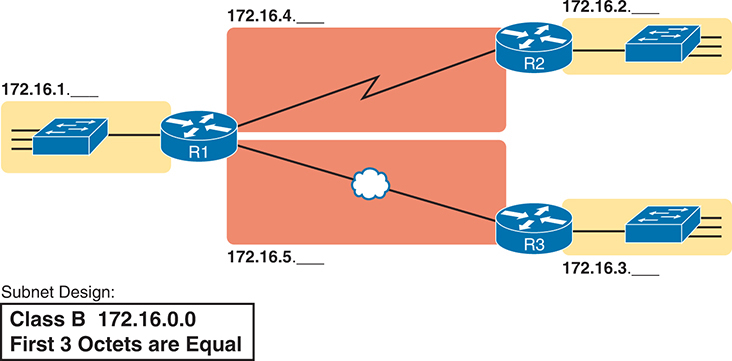

<figcaption>

<strong>图 11-1</strong> <em>子网规划文档</em>

<aside class="hidden" id="a11fig01">

网络以 172.16.1. 开始，连接交换机，再经过路由器 R1。随后网络分成两个有类网络，172.16.4. 和 172.16.4.。172.16.1. 网络经过 R2，到达 172.16.2. 类网络。同样，172.16.5 网络经过 R3，再通过 R2 到达 172.16.3 类网络。

</aside>

</figcaption>

</figure>

该设计显示五个子网：三个 LAN 各一个，两条 WAN 链路各一个。小字注释说明工程师采用的子网规则：每个子网中的地址在前三个八位组中具有相同值。例如，左侧 LAN 标注 172.16.1.__，表示“所有以 172.16.1 开头的地址”。还要注意，图中设计没有使用 B 类网络 172.16.0.0 的全部地址，因此工程师为扩展留下了充足空间。

</section>

<section>

<h4 class="h4" id="ch11lev2sec2">子网划分的运维视角与设计视角</h4>

大多数 IT 工作要求你从运维角度处理子网划分。也就是说，在你入职之前，其他人已经设计好该企业网络的 IP 编址与子网划分方式。你需要解读别人已经作出的选择。

要全面理解 IP 编址与子网划分，需要同时从设计和运维两个角度思考。例如，<a href="#ch11fig01">图 11-1</a> 只是规定这些子网的前三个八位组必须相同。为什么选择这一规则？还有哪些替代方案？这些方案是否更适合你目前的互联网络？这些问题更多涉及子网设计，而不是运维。

为了帮助你理解两个视角，本章通过完整的设计过程介绍 IP 子网划分的整体框架，因此更侧重设计问题。接下来的三章将各自从运维角度深入讨论本章的一个主题，而本部分最后一章再回到子网设计，作更仔细的考察。

本章余下三个主要部分将按顺序考察<a href="#ch11fig02">图 11-2</a> 列出的各个步骤。

<figure class="image-c" id="ch11fig02">

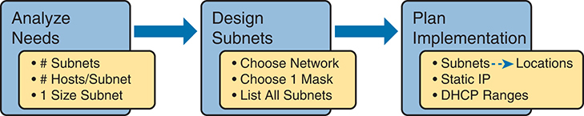

<figcaption>

<strong>图 11-2</strong> <em>子网规划、设计和实施任务</em>

<aside class="hidden" id="a11fig02">

规划包含三个主要阶段：分析需求、设计子网和规划实施。分析阶段确定所需子网数量、每个子网的主机数量，以及各子网的大小等因素。设计阶段根据分析决定使用哪个网络、选择合适的子网掩码，并列出所有需要的子网。实施规划阶段考虑子网位置、静态 IP 地址分配和 DHCP 地址范围定义，以便在网络基础设施中高效管理和分配 IP 地址。

</aside>

</figcaption>

</figure>

</section>

</section>

<section>

<h3 class="h3" id="ch11lev1sec4">分析子网划分与编址需求</h3>

本节讨论四个基本问题的含义，它们可用于分析任何新建或发生变化的企业网络的编址与子网划分需求：

<ol class="number">

<li>
哪些主机应归入同一子网？
</li>

<li>
这个互联网络需要多少个子网？
</li>

<li>
每个子网需要多少个主机 IP 地址？
</li>

<li>
是否为了简化而统一使用一种子网大小？
</li>

</ol>

<section>

<h4 class="h4" id="ch11lev2sec3">主机子网归属的规则</h4>

每个连接 IP 互联网络的设备都需要 IP 地址，包括终端用户计算机、服务器、手机、笔记本电脑、IP 电话、平板电脑，以及路由器、交换机、防火墙等网络设备。简言之，任何使用 IP 发送和接收分组的设备都需要 IP 地址。

注意

讨论 IP 编址时，<em>网络</em>一词有特定含义：A、B 或 C 类 IP 网络。为避免与这种<em>网络</em>用法混淆，本书在指主机、路由器、交换机等组成的集合时，使用<em>互联网络</em>和<em>企业网络</em>这两个术语。

IP 地址必须按照一些基本规则分配，而且这些规则有其合理原因。为了使路由高效运行，IP 编址规则将地址分成称为子网的组。规则如下：

<ul class="sq">

<li>
同一子网中的地址之间不由路由器分隔。
</li>

<li>
不同子网中的地址之间至少由一台路由器分隔。
</li>

</ul>

<a href="#ch11fig03">图 11-3</a> 展示总体概念，主机 A 和 B 位于一个子网，主机 C 位于另一个子网。特别注意，A 和 B 之间没有任何路由器分隔，而 C 与 A、B 之间至少隔着一台路由器，因此必须位于不同子网。

<figure class="image-c" id="ch11fig03">

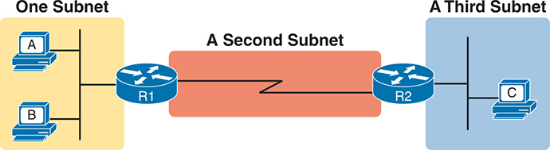

<figcaption>

<strong>图 11-3</strong> <em>PC A 与 B 位于同一子网，PC C 位于另一个子网</em>

<aside class="hidden" id="a11fig03">

PC A 和 PC B 连接路由器 R1，R1 通往第二个子网，再连接路由器 R2。最后，R2 连接第三个子网中的 PC C。这种配置将 PC A 和 PC B 划入一个子网，将 PC C 放在另一个子网。

</aside>

</figcaption>

</figure>

同一链路上的主机必须位于同一子网，这一思路很像邮政编码。同一城镇的所有邮寄地址使用相同的邮政编码（在美国称 ZIP code）。另一个城镇的地址，无论相距较近还是位于国家另一端，都使用不同的邮政编码。邮政编码让邮政系统能够更好地自动分拣邮件，将其送到正确地点。出于相似原因，同一 LAN 的主机位于同一子网，不同 LAN 的主机位于不同子网。

注意，图中的点到点 WAN 链路也需要一个子网。<a href="#ch11fig03">图 11-3</a> 显示 R1 左侧连接 LAN 子网，右侧连接 WAN 子网。R2 连接同一 WAN 子网。为此，R1 和 R2 的 WAN 接口都需要 IP 地址，且这些地址位于同一子网。（以太网 WAN 链路的 IP 编址需求相同，两台路由器各有一个位于同一子网的 IP 地址。）

<a href="#ch11fig03">图 11-3</a> 的以太网 LAN 还采用了一种略有不同的画法，只画简单线条，不画以太网交换机。当 LAN 交换机细节不重要时，以太网 LAN 图只需将每个设备画成连接同一条线，如<a href="#ch11fig03">图 11-3</a> 所示。（这种画法模仿了交换机和集线器出现前最初的以太网布线。）

最后，由于路由器的主要工作是将分组从一个子网转发到另一个子网，路由器通常连接多个子网。例如，本例 R1 左侧连接一个 LAN 子网，右侧连接一个 WAN 子网。因此，R1 会配置两个不同的 IP 地址，每个接口一个。由于接口将路由器连接到不同子网，这些地址也位于不同子网。

</section>

<section>

<h4 class="h4" id="ch11lev2sec4">确定子网数量</h4>

要确定所需子网数量，工程师必须根据文档分析互联网络，统计需要子网的位置。为此，需要网络图、VLAN 配置细节及 WAN 链路信息。对于本书讨论的链路类型，下列每一项都应规划一个子网：

<ul class="sq">

<li>
VLAN
</li>

<li>
点到点串行链路
</li>

<li>
以太网 WAN（以太网线路服务）
</li>

</ul>

注意

CCNA 考试范围以外的其他 WAN 技术，允许采用不同于这里所示“WAN 上每对路由器一个子网”的划分方式。但本书只使用点到点 WAN 技术，即串行链路和以太网 WAN 链路，两台路由器之间的每条点到点 WAN 连接各有一个子网。

例如，假设网络规划者只有<a href="#ch11fig04">图 11-4</a> 可作为子网设计依据。

<figure class="image-c" id="ch11fig04">

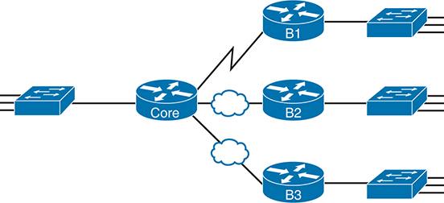

<figcaption>

<strong>图 11-4</strong> <em>具有小型中心站点的四站点互联网络</em>

<aside class="hidden" id="a11fig04">

网络中心的一台交换机连接核心路由器。核心路由器再将连接分支到 B1，并通过云连接 B2 和 B3。B1、B2、B3 各自连接独立交换机，形成支持四个站点之间通信与数据交换的网络架构。

</aside>

</figcaption>

</figure>

仅凭这张图无法完全预测所需子网数量。三条 WAN 链路显然需要三个子网，每条链路一个。但是，每台 LAN 交换机都可以配置一个或多个 VLAN。可以确定每个站点的 LAN 至少需要一个子网，但也可能需要更多。

接着看<a href="#ch11fig05">图 11-5</a> 所示同一网络的更详细版本。除了相同的三层拓扑，即路由器及其连接链路，图中还列出 VLAN 数量。图中显示中心站点有更多交换机，但无论有多少交换机，左侧的关键事实是中心站点总共有 12 个 VLAN。同样，每个分支站点都有两个 VLAN。再加上原来的三个 WAN 子网，该互联网络共需要 21 个子网。

<figure class="image-c" id="ch11fig05">

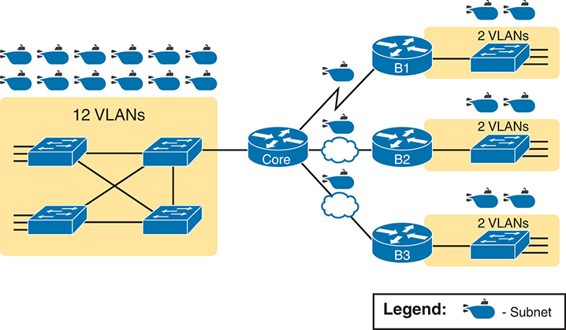

<figcaption>

<strong>图 11-5</strong> <em>具有较大中心站点的四站点互联网络</em>

<aside class="hidden" id="a11fig05">

中心站点连接大量交换机，总共有 12 个 VLAN；每个分支站点则显示两个 VLAN。虽然交换机数量不同，基本结构保持一致：交换机连接核心路由器，后者通过云分别连接 B1、B2 和 B3。这些路由器再连接各分支站点的独立交换机，每个分支支持两个 VLAN。这种完整互联网络配置需要总计 21 个子网，以满足各项网络需求。

</aside>

</figcaption>

</figure>

最后，在实际工作中，既要考虑当前需求，也要考虑未来互联网络的预期增长。任何子网划分方案，都应合理估计满足未来需求所需的子网数量。

</section>

<section>

<h4 class="h4" id="ch11lev2sec5">确定每个子网的主机数量</h4>

确定每个子网的主机数量，需要掌握几个简单概念，然后进行大量调查和询问。连接子网的每个设备都需要 IP 地址。对于全新网络，可以查看业务计划，如站点人数、已订购设备等，估计可能出现的设备。扩展现有网络以增加新站点时，可以将已有站点作为比较依据，再了解哪些站点将扩大或缩小。也不要忘记统计每个子网中路由器接口的 IP 地址，以及用于远程管理交换机的 IP 地址。

规划者往往不收集每个站点的数据，而是选取几个典型站点进行规划。例如，网络中可能有大型和小型销售办事处，你可以只深入了解一个大型办事处和一个小型办事处。再结合点到点链路只需要两个地址的子网这一事实，以及对其他独特子网的分析，就有足够信息来规划编址与子网划分设计。

例如，在<a href="#ch11fig06">图 11-6</a> 中，工程师画出最大分支 B1 每个 LAN 子网的主机数量。对于另外两个分支，工程师没有再深入调查所需主机数量。只要 B2 和 B3 所需 IP 地址数量不超过根据较大站点 B1 估计的 50 个，就可以按每个分支 LAN 子网 50 台主机规划，并为每个子网保留充足地址。

<figure class="image-c" id="ch11fig06">

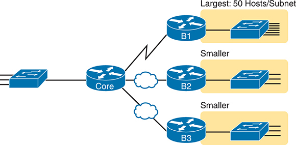

<figcaption>

<strong>图 11-6</strong> <em>大型分支 B1：每个子网 50 台主机</em>

<aside class="hidden" id="a11fig06">

核心路由器通过云网络将连接分支到 B1、B2 和 B3。每台路由器各连接独立交换机。连接 B1 的第一台交换机规模最大，每个子网最多容纳 50 台主机；连接 B2 和 B3 的交换机规模较小。

</aside>

</figcaption>

</figure>

</section>

<section>

<h4 class="h4" id="ch11lev2sec6">是否统一使用一种子网大小</h4>

初步规划的最后一个选择，是决定是否采用“所有子网大小相同”的思路来简化设计。子网的大小或长度，就是其中可用 IP 地址的数量。子网设计既可以统一使用一种大小，也可以使用不同大小，两种选择各有优缺点。

<section>

<h5 class="h5" id="ch11lev3sec1">定义子网大小</h5>

读完本书之前，你将学到确定子网大小的所有细节。现在，只需了解几个具体事实。<a href="v1-12.html#ch12">第 12 章</a>“<a href="v1-12.html#ch12">分析有类 IPv4 网络</a>”和<a href="v1-13.html#ch13">第 13 章</a>“<a href="v1-13.html#ch13">分析子网掩码</a>”将逐步深入介绍这些细节。

工程师为每个子网分配一个<a id="key_158" href="#ref-gloss_388">子网掩码</a>，掩码的作用之一就是定义该子网的大小。掩码划出一定数量的<em>主机位</em>，用于给子网中不同的主机 IP 地址编号。由于 x 位可以为 2<em>x</em> 个对象编号，如果掩码定义了 H 个主机位，子网就包含 2<em>H</em> 个不同数值。

但是，子网大小并不是 2<em>H</em>，而是 2<em>H</em> − 2，因为每个子网有两个数值保留作其他用途。每个子网将数值最低的地址保留为<em>子网编号</em>，将数值最高的地址保留为<em>子网广播地址</em>。因此，每个子网的可用 IP 地址数量是 2<em>H</em> − 2。

注意

<em>子网编号</em>、<em>子网 ID</em> 和<em>子网地址</em>这三个术语都指代表或标识一个子网的数值。

<a href="#ch11fig07">图 11-7</a> 展示由子网掩码定义的 IP 地址三部分结构的总体概念，重点是主机部分及由此产生的子网大小。

<figure class="image-c" id="ch11fig07">

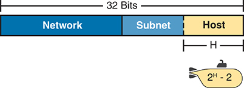

<figcaption>

<strong>图 11-7</strong> <em>子网大小概念</em>

<aside class="hidden" id="a11fig07">

一个 32 位子网分为三个部分。网络部分最大，其后依次是子网部分和主机部分。主机部分的位宽为 H，每个子网用 2 的 H 次方减 2 表示。

</aside>

</figcaption>

</figure>

</section>

<section>

<h5 class="h5" id="ch11lev3sec2">所有子网使用同一种大小</h5>

如果企业网络选择统一的子网大小，就必须为所有子网使用相同掩码，因为掩码定义子网大小。但应选择哪个掩码？

选择这一个掩码时必须考虑一项要求：它必须提供足够的主机 IP 地址，以支持最大的子网。因此，掩码定义的主机位数 H 必须足够大，使 2<em>H</em> − 2 大于或等于最大子网所需的主机 IP 地址数。

例如，考虑<a href="#ch11fig08">图 11-8</a>，其中显示每个 LAN 子网所需的主机数量。（图中忽略了每个只需要两个 IP 地址的 WAN 链路子网。）分支 LAN 子网只需要 50 个主机地址，但主站点 LAN 子网需要 200 个。为了容纳最大的子网，至少需要 8 个主机位。7 位不够，因为 2<em>7</em> − 2 = 126。8 位足够，因为 2<em>8</em> − 2 = 254，足以支持子网中的 200 台主机。

<figure class="image-c" id="ch11fig08">

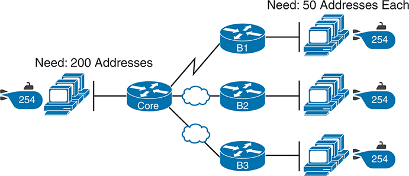

<figcaption>

<strong>图 11-8</strong> <em>使用统一子网大小的网络</em>

<aside class="hidden" id="a11fig08">

网络中心的一组 PC 连接核心路由器。该组有 254 个子网，需要 200 个地址。核心路由器将连接分支到 B1，并通过云连接 B2 和 B3。B1、B2、B3 各连接一组独立 PC，每组有 254 个子网，各需要 50 个地址。

</aside>

</figcaption>

</figure>

统一子网大小的最大优点是什么？运维简单，也就是保持简洁。所有需要处理网络的 IT 人员都可以习惯使用一个且仅一个掩码。由于每个人都习惯用同一个掩码进行子网计算，回答各种子网问题会更容易。

统一子网大小的主要缺点是浪费 IP 地址。例如，<a href="#ch11fig08">图 11-8</a> 中所有分支 LAN 子网都支持 254 个地址，但最大的分支子网只需要 50 个。WAN 子网只需要两个 IP 地址，却各支持 254 个，因此浪费更多地址。

不过，大多数情况下这些浪费不会造成实际问题。多数组织在企业互联网络中使用私有 IP 网络，即使存在浪费，单个 A 类或 B 类私有网络也能提供充足的 IP 地址。

</section>

<section>

<h5 class="h5" id="ch11lev3sec3">多种子网大小（变长子网掩码）</h5>

要在同一 A、B 或 C 类网络中创建不同大小的子网，工程师必须为部分子网使用一种掩码，为另一些使用另一种，依此类推。不同掩码意味着不同主机位数，根据 2<em>H</em> − 2 公式，部分子网的主机数量也就不同。

例如，考虑前面<a href="#ch11fig08">图 11-8</a> 的需求：左侧一个 LAN 子网需要 200 个主机地址，三个分支子网各需要 50 个，三条 WAN 链路各需要两个。为了满足这些需求并减少 IP 地址浪费，可以使用三个子网掩码，创建三种大小的子网，如<a href="#ch11fig09">图 11-9</a> 所示。

与前面<a href="#ch11fig08">图 11-8</a> 的设计相比，较小子网现在浪费的 IP 地址更少。右侧需要 50 个 IP 地址的子网使用 6 个主机位，每个子网有 2<em>6</em> − 2 = 62 个可用地址。WAN 链路使用具有 2 个主机位的掩码，每个子网有 2<em>2</em> − 2 = 2 个可用地址。

<figure class="image-c" id="ch11fig09">

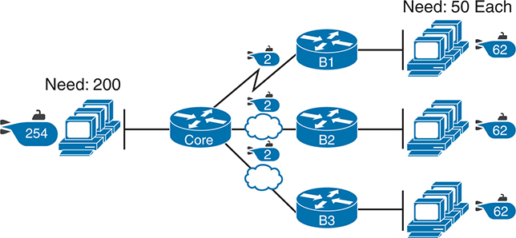

<figcaption>

<strong>图 11-9</strong> <em>三个掩码，三种子网大小</em>

<aside class="hidden" id="a11fig09">

网络中心的一组 PC 连接核心路由器。该组有 254 个子网，需要 200 个地址。核心路由器将连接分支到 B1，并通过云连接 B2 和 B3，每条连接表示 2 个子网。B1、B2、B3 各连接一组独立 PC，每组有 62 个子网，各需要 50 个地址。

</aside>

</figcaption>

</figure>

不过，仍然会有浪费，因为不能任意指定子网大小。所有子网的大小都基于 2<em>H</em> − 2 公式，其中 H 是每个子网掩码所定义的主机位数。

</section>

<section>

<h5 class="h5" id="ch11lev3sec4">所有子网使用一个掩码，还是多个掩码</h5>

本书大多数子网划分说明采用统一掩码的设计，为所有子网创建同一种大小。为什么？首先，这让学习子网划分更容易。其次，对网络进行的某些分析，尤其是计算有类网络中的子网数量，只有在使用单一掩码时才有意义。

不过，你仍需要能够处理在同一 A、B 或 C 类网络不同子网中使用多个掩码的设计。这种设计称为使用<a id="key_160" href="#ref-gloss_430">变长子网掩码（VLSM）</a>。例如，<a href="#ch11fig10">图 11-10</a> 的互联网络有 11 个子网：两个使用 /30 掩码，九个使用 /24 掩码。同一 A 类网络 10.0.0.0 的子网使用了不止一种掩码，因此该设计使用 VLSM。

<figure class="image-c" id="ch11fig10">

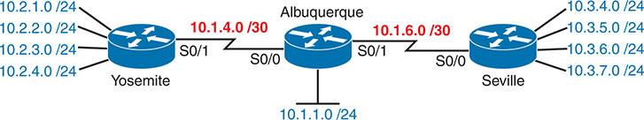

<figcaption>

<strong>图 11-10</strong> <em>使用 VLSM 的互联网络：网络 10.0.0.0，掩码多于一种</em>

<aside class="hidden" id="a11fig10">

该网络使用多个子网掩码，以高效分配地址。Yosemite 分支有四个子网：10.2.1.0/24、10.2.2.0/24、10.2.3.0/24 和 10.2.4.0/24。Yosemite 与 Albuquerque 通过串行接口 S0/1 和 S0/0 连接，前者分配子网 10.1.4.0/30，后者为 10.1.1.0/24。Albuquerque 通过串行接口 S0/1 和 S0/0 连接 Seville，前者分配子网 10.1.6.0/30，后者具有 10.3.4.0/24、10.3.5.0/24、10.3.6.0/24 和 10.3.7.0/24 四个子网。

</aside>

</figcaption>

</figure>

虽然 VLSM 在使用某些较旧的 IP 路由协议时会造成问题，但 CCNA 200-301 V1.1 大纲只包含 OSPF 路由协议，而 VLSM 不会给 OSPF 带来问题。只需了解这一术语及其含义，并知道它不应影响当前 CCNA 考试涉及的功能。

注意

过去的 CCNA 考试主题曾专门涉及 VLSM。如想进一步了解，可查看本书配套网站上的<a data-original-href="vol1_appm.xhtml#appm" data-unavailable="true" title="此内容不在当前提取范围内；请参阅原始 EPUB：vol1_appm.xhtml#appm">附录 M</a>“<a data-original-href="vol1_appm.xhtml#appm" data-unavailable="true" title="此内容不在当前提取范围内；请参阅原始 EPUB：vol1_appm.xhtml#appm">变长子网掩码</a>”。

</section>

</section>

</section>

<section>

<h3 class="h3" id="ch11lev1sec5">作出设计选择</h3>

了解如何分析 IP 编址与子网划分需求后，下一个主要步骤就是研究如何将 IP 编址和子网划分规则应用于这些需求，并作出选择。也就是说，知道所需子网数及最大子网所需主机地址数后，如何创建满足要求的实用子网设计？简要答案是，需要完成<a href="#ch11fig11">图 11-11</a> 右侧的三项任务。

<figure class="image-c" id="ch11fig11">

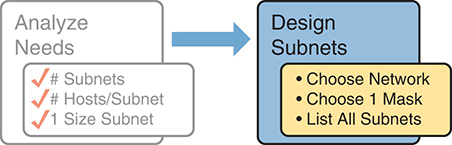

<figcaption>

<strong>图 11-11</strong> <em>设计阶段的输入与需要回答的设计问题</em>

<aside class="hidden" id="a11fig11">

过程从分析需求和提出指导子网设计的关键问题开始，包括理解网络需求，并确定设计阶段需要处理的关键参数。随后决定网络结构、子网掩码，并完整列出所有规划的子网。

</aside>

</figcaption>

</figure>

<section>

<h4 class="h4" id="ch11lev2sec7">选择一个有类网络</h4>

在今天所谓互联网的最初设计中，公司在内部实施 TCP/IP 时使用注册的<em>公有</em><a id="key_150" href="#ref-gloss_065">有类 IP 网络</a>。到 20 世纪 90 年代中期，另一种选择变得更加流行：<a id="key_155" href="#ref-gloss_318">私有 IP 网络</a>。本节讨论这两种选择的背景，因为它会影响公司选择哪个 IP 网络进行子网划分，并在企业互联网络中实施。

<section>

<h5 class="h5" id="ch11lev3sec5">公有 IP 网络</h5>

互联网的最初设计要求，任何连接互联网的公司都必须使用一个<em>已注册的</em><a id="key_156" href="#ref-gloss_321">公有 IP 网络</a>。公司需要提交一些文件，说明企业互联网络、现有主机数量和增长计划。提交后，公司会获分配一个 A、B 或 C 类网络。

公有 IP 网络及相关管理流程，确保所有连接互联网的公司使用唯一 IP 地址。具体来说，某个公有 IP 网络分配给公司后，只有该公司应使用其中的地址。这种唯一性保证使互联网路由能够正常工作，因为不会出现重复的公有 IP 地址。

例如，考虑<a href="#ch11fig12">图 11-12</a>。公司 1 获分配公有 A 类网络 1.0.0.0，公司 2 获分配公有 A 类网络 2.0.0.0。按照互联网公有编址的最初意图，分配完成后，其他任何公司都不能使用 A 类网络 1.0.0.0 或 2.0.0.0 中的地址。

<figure class="image-c" id="ch11fig12">

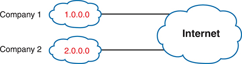

<figcaption>

<strong>图 11-12</strong> <em>两家公司使用唯一的公有 IP 网络</em>

</figcaption>

</figure>

这种最初的地址分配流程确保 IP 地址在全球唯一，就像你的电话号码、邮寄地址和电子邮件地址都应当唯一一样。别人给你打电话时，只有你的电话响，其他人的电话不会响。同样，如果公司 1 获分配 A 类网络 1.0.0.0，并由工程师将 1.1.1.1 分配给某台 PC，这个地址就应全球唯一。通过互联网发往目的地址 1.1.1.1 的分组应只到达公司 1 中的这台 PC，而不是其他主机。

</section>

<section>

<h5 class="h5" id="ch11lev3sec6">增长耗尽公有 IP 地址空间</h5>

到 20 世纪 90 年代初，可供分配的公有 IP 网络即将耗尽。在 90 年代的大部分时间里，新连接互联网的主机数量以<em>每月</em>两位数百分比的速度增长。各公司继续按规则申请公有 IP 网络，显然，如果不作改变，现有地址分配方案就无法持续。简单说，IPv4 的 32 位地址所支持的 A、B、C 类网络数量，不足以为每个组织分配一个公有有类网络，同时又为每家公司提供足够的 IP 地址。

注意

从几个重要方面看，全球公有 IPv4 地址已经耗尽。IANA 负责向全球五个区域互联网注册机构（RIR）分配公有 IPv4 地址块，它在 2011 年初分配完最后的 IPv4 地址空间。到 2015 年，北美 RIR——ARIN——也耗尽了 IPv4 地址库存，因此只有公司将未使用的公有 IPv4 地址归还 ARIN 后，它才有更多地址可分配给新公司。可以在线搜索“ARIN depletion”，查看这个 RIR 当前可用 IPv4 地址空间的状态页面。

互联网社区在 20 世纪 90 年代努力解决这一问题，提出了多种方案，包括：

<ul class="sq">

<li>
使用地址大得多的新 IP 版本 IPv6，地址长度为 128 位。
</li>

<li>
使用无类域间路由（CIDR）功能，为每家公司分配公有 IP 网络的一个子集，而不是整个网络，以减少浪费。
</li>

<li>
使用允许私有 IP 网络的网络地址转换（NAT）。
</li>

</ul>

如今，这三种方案都与实际网络密切相关。但为了专注于子网设计，本章重点讨论第三种，尤其是企业在同时使用 NAT 时可采用的私有 IP 网络。（注意，《<em>CCNA 200-301 官方认证指南，第 2 卷</em>》第 2 版的<a data-original-href="vol1_ch14.xhtml#ch14" data-unavailable="true" title="此内容不在当前提取范围内；请参阅原始 EPUB：vol1_ch14.xhtml#ch14">第 14 章</a>“<a data-original-href="vol1_ch14.xhtml#ch14" data-unavailable="true" title="此内容不在当前提取范围内；请参阅原始 EPUB：vol1_ch14.xhtml#ch14">网络地址转换</a>”会更详细讨论列表最后两项，本书<a data-original-href="vol1_part07.xhtml#part07" data-unavailable="true" title="此内容不在当前提取范围内；请参阅原始 EPUB：vol1_part07.xhtml#part07">第 VII 部分</a>则深入讨论第一项 IPv6。

聚焦列表第三项，NAT 允许多家公司使用完全相同的<em>私有 IP 网络</em>，即使 IP 地址与其他公司相同，也仍然能够连接互联网。例如，<a href="#ch11fig13">图 11-13</a> 与<a href="#ch11fig12">图 11-12</a> 一样显示两家公司连接互联网，但现在两者都使用私有 A 类网络 10.0.0.0。

<figure class="image-c" id="ch11fig13">

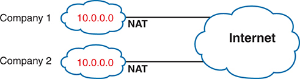

<figcaption>

<strong>图 11-13</strong> <em>通过 NAT 复用同一私有网络 10.0.0.0</em>

</figcaption>

</figure>

两家公司使用相同的有类 IP 网络 10.0.0.0。双方无需讨论各自计划，就可以在各自企业互联网络内部实施子网设计，甚至可以使用网络 10.0.0.0 中完全相同的 IP 地址。令人惊讶的是，两家公司仍然可以通过互联网相互通信。

称为网络地址转换的技术，使公司能够像<a href="#ch11fig13">图 11-13</a> 那样复用相同 IP 网络。NAT 在分组从企业前往互联网时转换其中的 IP 地址，用少量公有 IP 地址支持数万个私有 IP 地址。仅凭这一点信息还不足以理解 NAT 的工作方式；不过，为保持对子网划分的关注，本书将 NAT 原理留到《<em>CCNA 200-301 官方认证指南，第 2 卷</em>》第 2 版讨论。目前只需知道，大多数公司使用 NAT，因此能够在互联网络中使用私有 IP 网络。

</section>

<section>

<h5 class="h5" id="ch11lev3sec7">私有 IP 网络</h5>

使用 NAT 时——几乎每个连接互联网的组织都使用 NAT——公司只需从保留的私有 IP 网络编号列表中选择一个或多个网络。RFC 1918 定义了可用的私有 IP 网络列表，<a href="#ch11tab02">表 11-2</a> 作了总结。

<figure class="table" id="ch11tab02" tabindex="0">

<figcaption>

<strong>表 11-2</strong> RFC 1918 私有地址空间

</figcaption>

<table class="all">

<thead>

<tr>

<th class="th">
网络类别
</th>

<th class="th">
私有 IP 网络
</th>

<th class="th">
网络数量
</th>

</tr>

</thead>

<tbody>

<tr>

<td class="border">
A 类
</td>

<td class="border">
10.0.0.0
</td>

<td class="border">
1
</td>

</tr>

<tr>

<td class="border">
B 类
</td>

<td class="border">
172.16.0.0 到 172.31.0.0
</td>

<td class="border">
16
</td>

</tr>

<tr>

<td class="border">
C 类
</td>

<td class="border">
192.168.0.0 到 192.168.255.0
</td>

<td class="border">
256
</td>

</tr>

</tbody>

</table>

</figure>

注意

在我讲授的每次在线课程中，都会调查哪些学员的公司使用网络 10.0.0.0，平均有 60%–70% 的学员表示使用私有 A 类网络 10.0.0.0。

从让 IPv4 服务全球的角度看，私有 IP 网络帮助保留并延长了 IPv4 在企业和整个互联网中的使用。具体而言，私有网络从以下方面改善了 IPv4 在全球的实施：

<ul class="sq">

<li>
<strong>避免在私有网络中使用其他组织的公有地址范围：</strong>某些组织的部分网络完全不需要互联网访问，但其中的主机仍需要 IP 地址。RFC 1918 建议，真正的私有网络，即不需要互联网连接的网络，应使用 RFC 1918 私有网络列表中的地址。
</li>

<li>
<strong>推迟 IPv4 地址耗尽：</strong>为了推迟所有公有 IPv4 地址都被分配给组织的那一天，RFC 1918 倡导对组织内部地址采用私有网络并结合 NAT。
</li>

<li>
<strong>减小互联网路由器的路由表：</strong>使用私有网络还有助于减小互联网路由器中的 IP 路由表。例如，互联网路由器不需要组织内部私有 IP 网络的路由，事实上 ISP 会过滤这些路由。
</li>

</ul>

</section>

<section>

<h5 class="h5" id="ch11lev3sec8">在设计阶段选择 IP 网络</h5>

如今，大多数组织使用私有 IP 网络加 NAT，只需一小块公有 CIDR 地址。部分公司按照最初每家公司拥有唯一公有网络的方案，使用公有地址块，如公有 A、B 或 C 类网络。还有更少的公司可能为全部地址使用公有 CIDR 块，即 A、B 或 C 类网络的一个子集，再对该块划分子网。

本书大多数示例使用私有 IP 网络编号。在选择网络编号的设计步骤中，只需从 RFC 1918 私有网络列表中选择一个 A、B 或 C 类私有网络即可。无论从公有还是私有 IP 网络开始，子网计算方式都相同。

决定使用私有 IP 网络后，只需选择地址数量足够的网络。即使互联网络很小，也可以使用私有 A 类网络 10.0.0.0。选择一个拥有超过 1600 万个 IP 地址的 A 类网络可能看起来浪费，尤其当你只需几百个地址时。但使用大于当前或未来需求的私有网络，不会受到惩罚，也不会带来问题。

</section>

</section>

<section>

<h4 class="h4" id="ch11lev2sec8">选择掩码</h4>

如果设计工程师按顺序完成本章迄今的主题，就会知道以下信息：

<ul class="sq">

<li>
所需子网数量
</li>

<li>
每个子网所需主机数量
</li>

<li>
已决定所有子网只使用一个掩码，使它们大小相同，即每个子网的主机数量相同
</li>

<li>
将要划分子网的有类 IP 网络编号
</li>

</ul>

本节通过讨论如何选择用于所有子网的一个掩码，完成设计过程，至少完成本章描述的部分。首先，考察网络未划分子网时使用的默认掩码，作为比较基准。其次，探讨借用主机位作为子网位的概念。最后，举例说明如何根据需求分析创建子网掩码。

<section>

<h5 class="h5" id="ch11lev3sec9">子网划分前的有类 IP 网络</h5>

工程师对有类网络划分子网之前，网络就是单一的一组地址。换句话说，工程师尚未将它细分为许多称为<em>子网</em>的较小子集。

考虑未划分子网的有类网络时，其中的地址只有两部分：<a id="key_154" href="#ref-gloss_279">网络部分</a>和<a id="key_152" href="#ref-gloss_173">主机部分</a>。比较有类网络中的任意两个地址：

<ul class="sq">

<li>
它们的网络部分具有相同的值。
</li>

<li>
它们的主机部分具有不同的值。
</li>

</ul>

网络中地址的网络部分和主机部分的实际长度很容易确定，如<a href="#ch11fig14">图 11-14</a> 所示。

<figure class="image-c" id="ch11fig14">

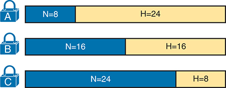

<figcaption>

<strong>图 11-14</strong> <em>未划分子网的 A、B、C 类网络格式</em>

</figcaption>

</figure>

<a href="#ch11fig14">图 11-14</a> 中，N 和 H 分别表示网络位数和主机位数。类别规则规定，A、B、C 类的网络八位组数量分别为 1、2、3，图中以位数表示这些值。相应主机八位组数量分别为 3、2、1。

继续分析子网划分前的有类网络，可以使用前面相同的 2<em>H</em> − 2 公式计算其中的地址数量。具体来说，未划分子网的 A、B、C 类网络大小如下：

<ul class="sq">

<li>
<strong>A 类：</strong>2<em>2</em><em>4</em> − 2 = 16,777,214
</li>

<li>
<strong>B 类：</strong>2<em>16</em> − 2 = 65,534
</li>

<li>
<strong>C 类：</strong>2<em>8</em> − 2 = 254
</li>

</ul>

</section>

<section>

<h5 class="h5" id="ch11lev3sec10">借用主机位创建子网位</h5>

要划分子网，设计者先考虑网络和主机部分，如<a href="#ch11fig15">图 11-15</a> 所示，然后在中间增加第三部分：<a id="key_159" href="#ref-gloss_390">子网部分</a>。但设计者不能改变网络部分的长度，也不能改变整个地址的长度（32 位）。为了在地址结构中创建子网部分，工程师从主机部分借用一些位。<a href="#ch11fig15">图 11-15</a> 展示了总体思路。

<figure class="image-c" id="ch11fig15">

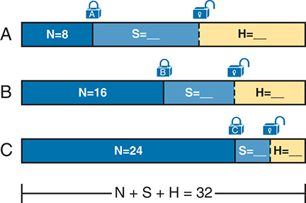

<figcaption>

<strong>图 11-15</strong> <em>借用主机位的概念</em>

<aside class="hidden" id="a11fig15">

A 类的 N、S、H 值分别为 8、未指定、未指定。N 与 S 之间的分界锁定，S 与 H 之间的分界未锁定。B 类的 N、S、H 值分别为 16、未指定、未指定，两个分界分别锁定和未锁定。C 类的 N、S、H 值分别为 24、未指定、未指定，两个分界同样分别锁定和未锁定。分配给网络的总长度为 N + S + H = 32。

</aside>

</figcaption>

</figure>

<a href="#ch11fig15">图 11-15</a> 用矩形表示子网掩码。代表网络位数的 N 根据类别固定为 8、16 或 24。从概念上说，设计者将一条虚线分界移入主机字段，使子网位 S 位于网络与主机部分之间，剩余主机位 H 位于右侧。三部分之和必须为 32，因为 IPv4 地址由 32 位组成。

</section>

<section>

<h5 class="h5" id="ch11lev3sec11">选择足够的子网位和主机位</h5>

设计过程要求决定<a href="#ch11fig15">图 11-15</a> 中虚线的位置。但怎样选择才正确？应选择多少子网位和主机位？答案取决于规划初期收集的需求：

<ul class="sq">

<li>
所需子网数量
</li>

<li>
每个子网的主机数量
</li>

</ul>

子网部分的位提供一种方法，为设计工程师希望创建的不同子网分配唯一编号。1 个子网位可以编号 2<em>1</em>，即 2 个子网；2 位可编号 2<em>2</em>，即 4 个；3 位可编号 2<em>3</em>，即 8 个，依此类推。子网位数必须足够大，能为规划阶段确定的全部子网唯一编号。

同时，剩余主机位也必须足以为最大子网中的主机 IP 地址编号。记住，本章假设所有子网使用同一个掩码。这个掩码必须既支持所需子网数量，也支持最大子网所需的主机数量。<a href="#ch11fig16">图 11-16</a> 展示这一概念。

<a href="#ch11fig16">图 11-16</a> 表示设计者先选择子网位数 S 和主机位数 H，再检查计算结果。2<em>S</em> 必须大于所需子网数量，否则掩码无法在该 IP 网络中提供足够子网。另外，2<em>H</em> − 2 必须大于每个子网所需主机数量。

<figure class="image-c" id="ch11fig16">

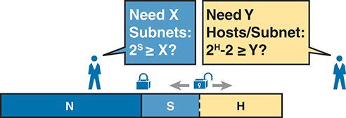

<figcaption>

<strong>图 11-16</strong> <em>分配足够的子网位和主机位</em>

<aside class="hidden" id="a11fig16">

存储空间分为 N、S、H。N 部分最大，其次是 H，再是 S。N 与 S 的分界锁定，S 与 H 的分界未锁定。N 块的注释为“需要 X 个子网：2 的 S 次方是否大于或等于 X？”H 块的注释为“需要 Y 个子网：2 的 H 次方减 2 是否大于或等于 Y？”

</aside>

</figcaption>

</figure>

注意

用 2<em>S</em> 计算子网数量，只适用于同一有类网络的所有子网使用单一掩码的情况，本章正是作此假设。

为了有效设计掩码，或解读他人选择的掩码，需要熟记常用的 2 的幂。<a data-original-href="vol1_appa.xhtml#appa" data-unavailable="true" title="此内容不在当前提取范围内；请参阅原始 EPUB：vol1_appa.xhtml#appa">附录 A</a>“<a data-original-href="vol1_appa.xhtml#appa" data-unavailable="true" title="此内容不在当前提取范围内；请参阅原始 EPUB：vol1_appa.xhtml#appa">数值参考表</a>”列出了直到 2<em>32</em> 的 2 的幂表，供你参考。

</section>

<section>

<h5 class="h5" id="ch11lev3sec12">设计示例：172.16.0.0，200 个子网，200 台主机</h5>

为了帮助理解迄今的理论讨论，考虑一个重点选择子网掩码的示例。本例此前的规划和设计选择告诉我们：

<ul class="sq">

<li>
所有子网使用一个掩码。
</li>

<li>
规划 200 个子网。
</li>

<li>
规划每个子网 200 个主机 IP 地址。
</li>

<li>
使用私有 B 类网络 172.16.0.0。
</li>

</ul>

为选择掩码，设计者提出这个问题：

为 200 个子网编号，需要多少个子网位 S？

可以看到，S = 7 不够大（2<em>7</em> = 128），但 S = 8 足够（2<em>8</em> = 256）。因此，需要<em>至少</em> 8 个子网位。

接着，设计者根据每个子网的主机数量提出相似问题：

为每个子网的 200 台主机编号，需要多少个主机位 H？

计算方式基本相同，但统计每个子网的主机数量时，公式要减去 2。可以看到，H = 7 不够大（2<em>7</em> − 2 = 126），但 H = 8 足够（2<em>8</em> − 2 = 254）。

本例只有一种掩码能够满足全部要求。首先，由于设计使用 B 类网络，网络位数 N 必须为 16。需求告诉我们，掩码至少需要 8 个子网位和 8 个主机位，而掩码总共只有 32 位。<a href="#ch11fig17">图 11-17</a> 展示了最终掩码。

<figure class="image-c" id="ch11fig17">

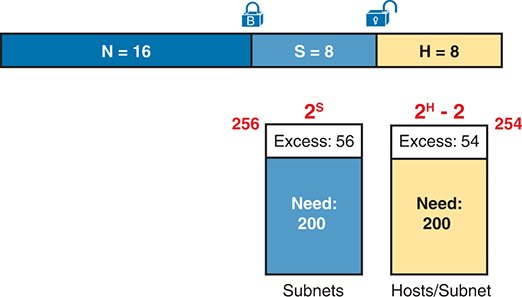

<figcaption>

<strong>图 11-17</strong> <em>掩码选择示例：N = 16，S = 8，H = 8</em>

<aside class="hidden" id="a11fig17">

N、S、H 的值分别为 16、8、8。N 与 S 的分界锁定，S 与 H 的分界未锁定。子网的 X 值为 2 的 S 次方，提供 256 个子网，需要 200 个，余量为 56。主机／子网的 Y 值为 2 的 H 次方减 2，提供 254 个，需要 200 个，余量为 54。

</aside>

</figcaption>

</figure>

</section>

<section>

<h5 class="h5" id="ch11lev3sec13">掩码及其格式</h5>

虽然工程师在设计时将 IP 地址分成网络、子网、主机三部分，但子网掩码提供了一种方法，将这些设计选择传达给子网中的所有设备。

子网掩码是一个 32 位二进制数，左侧为若干二进制 1，右侧为二进制 0。按照定义，二进制 0 的数量等于主机位数；实际上，掩码正是这样表达子网中地址的主机部分长度。掩码起始各位为二进制 1，其对应的位置表示地址中合并后的网络部分和子网部分。

由于网络部分总是在最前面，其后是子网部分，最后是主机部分，因此二进制形式的子网掩码不能交错出现 1 和 0。每个子网掩码左侧都是一串连续的二进制 1，其余位均为二进制 0。

工程师选定有类网络以及子网中的子网位数和主机位数后，就很容易写出二进制子网掩码。只需依次写出 N 个 1、S 个 1 和 H 个 0（假设 N、S、H 分别表示网络位数、子网位数和主机位数）。<a href="#ch11fig18">图 11-18</a> 根据前面的示例展示了该掩码：为 B 类网络划分子网时，设置 8 个子网位，剩下 8 个主机位。

<figure class="image-c" id="ch11fig18">

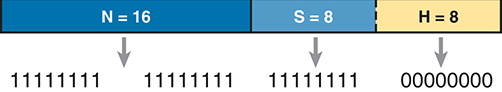

<figcaption>

<strong>图 11-18</strong> <em>创建子网掩码——二进制——B 类网络</em>

</figcaption>

</figure>

除了<a href="#ch11fig18">图 11-18</a> 中的二进制掩码，掩码还可以写成另外两种格式：IP 地址中常见的<a id="key_151" href="#ref-gloss_113">点分十进制表示法</a>（DDN），以及更简短的<em>前缀</em>表示法。<a href="v1-13.html#ch13">第 13 章</a> 将讨论这些格式及其相互转换方法。

</section>

</section>

<section>

<h4 class="h4" id="ch11lev2sec9">列出所有子网</h4>

列出所有子网是子网设计步骤的最后一项任务，需要根据前面做出的全部选择，确定实际可以使用的子网。先前的设计工作已经确定要使用的 A 类、B 类或 C 类网络，以及能提供足够子网数和每子网主机 IP 地址数的（唯一）子网掩码。但是，这些子网究竟是什么？如何标识或描述一个子网？本节将回答这些问题。

子网由一组连续的数字组成。其中大多数数字可以用作主机的 IP 地址。但是，每个子网都会保留这组数字中的第一个和最后一个数字，两者不能用作 IP 地址。具体而言，每个子网包含以下内容：

<ul class="sq">

<li>
<strong>子网号：</strong>也称为<em>子网 ID</em> 或<em>子网地址</em>，用于标识该子网。它是子网中数值最小的数字，不能用作主机的 IP 地址。
</li>

<li>
<strong>子网广播：</strong>也称为<em>子网广播地址</em>或<em>定向广播地址</em>，是子网中的最后一个数字（数值最大），同样不能用作主机的 IP 地址。
</li>

<li>
<strong>IP 地址：</strong>子网 ID 与子网广播地址之间的所有数字均可用作主机 IP 地址。
</li>

</ul>

例如，考虑前面设计结果如下的情况：

网络 172.16.0.0（B 类）

掩码 255.255.255.0（用于所有子网）

经过一些计算，就能求出该 B 类网络中每个子网的具体信息。在本例中，<a href="#ch11tab03">表 11-3</a> 列出了前十个子网，随后略过许多子网，列出最后两个（数值最大的）子网。

<figure class="table" id="ch11tab03" tabindex="0">

<figcaption>

<strong>表 11-3</strong> 172.16.0.0、255.255.255.0 中的前十个子网及最后几个子网

</figcaption>

<table class="all">

<thead>

<tr>

<th class="th">
子网号
</th>

<th class="th">
IP 地址
</th>

<th class="th" colspan="2">
广播地址
</th>

</tr>

</thead>

<tbody>

<tr>

<td class="border">
172.16.0.0
</td>

<td class="border">
172.16.0.1 – 172.16.0.254
</td>

<td class="border" colspan="2">
172.16.0.255
</td>

</tr>

<tr>

<td class="border">
172.16.1.0
</td>

<td class="border">
172.16.1.1 – 172.16.1.254
</td>

<td class="border" colspan="2">
172.16.1.255
</td>

</tr>

<tr>

<td class="border">
172.16.2.0
</td>

<td class="border">
172.16.2.1 – 172.16.2.254
</td>

<td class="border" colspan="2">
172.16.2.255
</td>

</tr>

<tr>

<td class="border">
172.16.3.0
</td>

<td class="border">
172.16.3.1 – 172.16.3.254
</td>

<td class="border" colspan="2">
172.16.3.255
</td>

</tr>

<tr>

<td class="border">
172.16.4.0
</td>

<td class="border">
172.16.4.1 – 172.16.4.254
</td>

<td class="border" colspan="2">
172.16.4.255
</td>

</tr>

<tr>

<td class="border">
172.16.5.0
</td>

<td class="border">
172.16.5.1 – 172.16.5.254
</td>

<td class="border" colspan="2">
172.16.5.255
</td>

</tr>

<tr>

<td class="border">
172.16.6.0
</td>

<td class="border">
172.16.6.1 – 172.16.6.254
</td>

<td class="border" colspan="2">
172.16.6.255
</td>

</tr>

<tr>

<td class="border">
172.16.7.0
</td>

<td class="border">
172.16.7.1 – 172.16.7.254
</td>

<td class="border" colspan="2">
172.16.7.255
</td>

</tr>

<tr>

<td class="border">
172.16.8.0
</td>

<td class="border">
172.16.8.1 – 172.16.8.254
</td>

<td class="border" colspan="2">
172.16.8.255
</td>

</tr>

<tr>

<td class="border">
172.16.9.0
</td>

<td class="border">
172.16.9.1 – 172.16.9.254
</td>

<td class="border" colspan="2">
172.16.9.255
</td>

</tr>

<tr>

<td class="border" colspan="4">
略过多个子网……
</td>

</tr>

<tr>

<td class="border">
172.16.254.0
</td>

<td class="border" colspan="2">
172.16.254.1 – 172.16.254.254
</td>

<td class="border">
172.16.254.255
</td>

</tr>

<tr>

<td class="border">
172.16.255.0
</td>

<td class="border" colspan="2">
172.16.255.1 – 172.16.255.254
</td>

<td class="border">
172.16.255.255
</td>

</tr>

</tbody>

</table>

</figure>

得到网络号和掩码后，还需要一些计算，才能求出所有子网的子网 ID 及其他详细信息。在实际工作中，大多数人会使用子网计算器或子网规划工具。对于 CCNA 考试，你需要能够求出这类信息，具体内容见<a href="v1-15.html#ch15">第 15 章</a>“<a href="v1-15.html#ch15">子网设计</a>”。

</section>

</section>

<section>

<h3 class="h3" id="ch11lev1sec6">规划实施</h3>

下一步是规划实施，这是实际配置设备以创建子网之前的最后一步。工程师首先需要决定每个子网的使用位置。例如，对于某个城市的分支机构，该站点的各个 VLAN 应使用子网规划表（<a href="#ch11tab03">表 11-3</a>）中的哪个子网？此外，对于需要静态 IP 地址的接口，分别应使用哪个地址？最后，应在 DHCP 服务器上配置每个子网中的哪个 IP 地址范围，供主机动态租用作为自己的 IP 地址？<a href="#ch11fig19">图 11-19</a> 汇总了实施规划任务。

<figure class="image-c" id="ch11fig19">

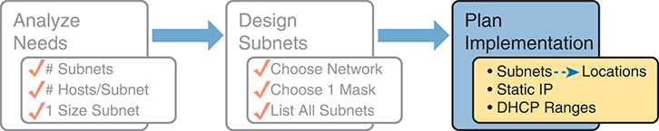

<figcaption>

<strong>图 11-19</strong> <em>提供给实施规划步骤的信息</em>

<aside class="hidden" id="a11fig19">

规划包括三个主要阶段：分析需求、设计子网和规划实施。在分析阶段，确定所需子网数量、每个子网的主机数量以及各子网的大小等因素。在设计阶段，根据分析结果决定使用哪个网络、选择合适的子网掩码，并列出所需的全部子网。在实施规划阶段，考虑子网的位置、静态 IP 地址的分配以及 DHCP 地址范围的定义，以便在整个网络基础设施中高效管理和分配 IP 地址。

</aside>

</figcaption>

</figure>

<section>

<h4 class="h4" id="ch11lev2sec10">将子网分配到不同位置</h4>

这项工作很简单：查看网络图，找出每个需要子网的位置，再从列出的全部可用子网表中选择一个。然后，使用电子表格或其他专用子网规划工具加以记录，以便知道各子网用在何处。就是这样！<a href="#ch11fig20">图 11-20</a> 展示了使用<a href="#ch11tab03">表 11-3</a> 完成的设计示例，恰好与前面<a href="#ch11fig01">图 11-1</a> 中的初始设计示例一致。

<figure class="image-c" id="ch11fig20">

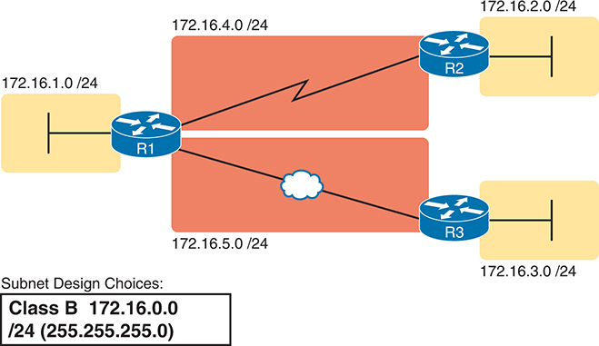

<figcaption>

<strong>图 11-20</strong> <em>将子网分配到不同位置的示例</em>

<aside class="hidden" id="a11fig20">

以 172.16.1. 开头的网络连接到一台交换机，再经过路由器 R1。该网络随后分成两个类网络：172.16.4. 和 172.16.4.。172.16.1. 网络经过 R2，到达 172.16.2. 类的网络。同样，172.16.5 网络经过 R3，再通过 R2 到达 172.16.3 类的网络。

</aside>

</figcaption>

</figure>

虽然此设计可以使用<a href="#ch11tab03">表 11-3</a> 中的任意五个子网，但在真实网络中，工程师通常会更仔细地考虑子网分配策略。例如，可以给所有 LAN 子网分配较小的号码，给 WAN 子网分配较大的号码；也可以为公司的不同部门划分较大的子网范围；或者采用相同策略，但依据地理区域，而不是公司内部的组织部门进行划分。

例如，一家总部在美国、同时在欧洲和亚洲开展较小规模业务的公司，可以按洲规划预留子网范围。这种选择在以后使用路由汇总功能时尤其有用。<a href="#ch11fig21">图 11-21</a> 再次使用<a href="#ch11tab03">表 11-3</a> 中的相同子网，说明合理安排网络地址以便于路由汇总的总体好处。

<figure class="image-c" id="ch11fig21">

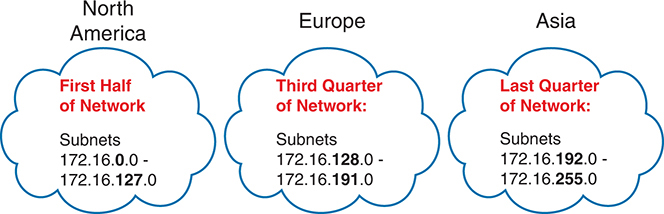

<figcaption>

<strong>图 11-21</strong> <em>为北美预留 50% 的子网，为欧洲和亚洲各预留 25%</em>

</figcaption>

</figure>

</section>

<section>

<h4 class="h4" id="ch11lev2sec11">为每个子网选择静态和动态地址范围</h4>

设备通过两种方式之一获得 IP 地址和掩码：利用动态主机配置协议（DHCP）动态获得，或通过配置静态指定。为了让 DHCP 正常工作，网络工程师必须告诉 DHCP 服务器应为哪些子网分配 IP 地址。此外，该配置还会将 DHCP 服务器限制为仅使用子网中的一部分地址。对于静态地址，只需在设备上配置要使用的 IP 地址和掩码。

为了尽量简化，大多数网络环境会采用一种策略：把静态 IP 地址安排在每个子网的一端，把 DHCP 分配的动态地址安排在另一端。静态地址位于地址范围的低端还是高端，其实并不重要。

例如，假设工程师决定对<a href="#ch11fig20">图 11-20</a> 中的 LAN 子网使用地址范围高端的地址作为 DHCP 地址池，即以 .101 至 .254 结尾的地址。（以 .255 结尾的地址当然是保留地址。）工程师还从范围低端分配静态地址，即以 .1 至 .100 结尾的地址。<a href="#ch11fig22">图 11-22</a> 展示了这一思路。

<figure class="image-c" id="ch11fig22">

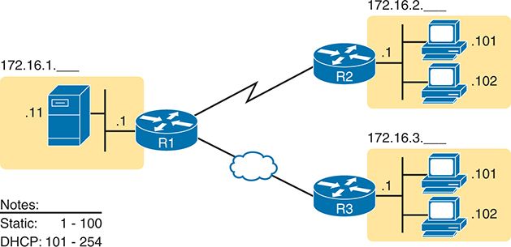

<figcaption>

<strong>图 11-22</strong> <em>从低端分配静态地址，从高端分配 DHCP 地址</em>

<aside class="hidden" id="a11fig22">

网络从子网 172.16.1. 开始。该子网中，一台服务器配置了静态 IP 地址：输入为 .11，输出为 .1。服务器连接到路由器 R1。R1 又通过云连接依次连接到路由器 R2 和路由器 R3。路由器 R2 连接到子网 172.16.2. 的网络，其中两台 PC 的输入静态 IP 地址为 .1，输出动态地址为 .101 和 .102。同样，路由器 R3 连接到子网 172.16.3. 的网络，其中两台 PC 的输入静态 IP 地址为 .1，输出动态地址为 .101 和 .102。

</aside>

</figcaption>

</figure>

<a href="#ch11fig22">图 11-22</a> 中的三台路由器都静态分配了以 .1 结尾的 IP 地址。图中唯一的另一个静态 IP 地址分配给左侧的服务器，其地址为 172.16.1.11（图中简写为 .11）。

右侧每个 LAN 中都有两台 PC，通过 DHCP 动态租用 IP 地址。DHCP 服务器通常从地址范围的底端开始出租地址，因此每个 LAN 中的主机都租用了以 .101 和 .102 结尾的地址，它们位于设计时选定地址范围的低端。

</section>

</section>

</section>

<section class="ccna-source ccna-appendix" aria-label="答案解析与术语表">
<section data-epub-type="chapter">

<h2 class="h2" id="ref-appc">附录 C</h2>

<h2 class="h2a">自测题答案</h2>

<section>

<h3 class="h3" id="ref-appclev1sec11">第 11 章</h3>

<strong><a id="ref-ques11_1" href="#quess11_1">1</a>.</strong> B 和 D。判断两个设备接口是否应位于同一子网的一般规则，是看两个接口之间是否隔着路由器。要让一个 VLAN 中的主机能够向该 VLAN 外的主机发送数据，本地路由器必须将其 LAN 接口连接到与主机相同的 VLAN，并使用与主机同一子网中的地址。同一交换机上、同一 VLAN 中的所有主机彼此之间没有路由器，因此这些主机也应位于同一个子网。但是，另一台连接到相同交换机却属于不同 VLAN 的 PC，其数据包必须经过路由器才能到达主机 A，因此主机 A 的 IP 地址必须与这台新主机的地址位于不同子网。

<strong><a id="ref-ques11_2" href="#quess11_2">2</a>.</strong> D。根据定义，每个 IPv4 子网中有两个地址值不能用作主机 IPv4 地址：子网中的第一个（最小）数值用于子网 ID，最后一个（最大）数值用于子网广播地址。

<strong><a id="ref-ques11_3" href="#quess11_3">3</a>.</strong> B 和 C。至少需要 7 个子网位，因为 2<em>6</em> = 64，6 个子网位无法为 100 个不同子网编号。7 个子网位则可以，因为 2<em>7</em> = 128 =&gt; 100。同样，6 个主机位不够，因为 2<em>6</em> − 2 = 62；但 7 个主机位足够，因为 2<em>7</em> − 2 = 126 =&gt; 100。

网络位、子网位和主机位总计必须为 32 位，因此有一个选项不正确。包含 8 个网络位的选项不可能正确，因为题目说明使用 B 类网络，网络位数必须始终为 16。两个正确选项都有 16 个网络位（题目规定使用 B 类网络，所以必须如此），并且子网位和主机位各至少 7 个。

<strong><a id="ref-ques11_4" href="#quess11_4">4</a>.</strong> A 和 C。RFC 1918 定义的私有 IPv4 网络包括：A 类网络 10.0.0.0，从 172.16.0.0 到 172.31.0.0 的 16 个 B 类网络，以及以 192.168 开头的 256 个 C 类网络。

<strong><a id="ref-ques11_5" href="#quess11_5">5</a>.</strong> A、D 和 E。RFC 1918 定义的私有 IPv4 网络包括：A 类网络 10.0.0.0，从 172.16.0.0 到 172.31.0.0 的 16 个 B 类网络，以及以 192.168 开头的 256 个 C 类网络。三个正确选项都属于公有 IP 网络范围，而且都不是保留值。

<strong><a id="ref-ques11_6" href="#quess11_6">6</a>.</strong> A 和 C。未划分子网的 A 类、B 类或 C 类网络包含两个部分：网络部分和主机部分。

<strong><a id="ref-ques11_7" href="#quess11_7">7</a>.</strong> B。未划分子网的 A 类、B 类或 C 类网络包含网络部分和主机部分，此时不存在子网部分。要划分子网，工程师会选择使用一个子网掩码，定义更少的主机位，从而腾出一些位来为不同子网编号，创建新的子网部分。因此，划分子网后，地址结构的主机部分会变小。在工程师选定子网掩码（非默认掩码）后，地址结构的子网部分会从 0 位（不存在）变为一定数量的子网位。无论是否划分子网，网络部分的大小始终不变。

</section>

</section>

<section id="ref-glossary"><h2 class="h2a">术语表</h2>
<strong>分类 IP 网络（classful IP network）</strong> IPv4 的 A 类、B 类或 C 类网络；之所以称为分类网络，是因为这些网络按照 IPv4 编址的类别规则定义。

<strong>点分十进制表示法（DDN）</strong> IPv4 地址采用的格式，由四个十进制值组成，各值之间以句点（点号）分隔。

<strong>主机部分</strong> IPv4 地址中用于唯一标识子网内某台主机的部分。子网掩码中值为 0 的位标识主机部分。

<strong>网络</strong> 由计算机、打印机、路由器、交换机及其他设备构成的集合，这些设备能够通过某种传输介质相互通信。

<strong>网络部分</strong> IPv4 地址中的一部分，其长度取决于地址属于 A 类、B 类还是 C 类网络，分别为 1、2 或 3 个八位组（字节）。

<strong>私有 IP 网络</strong> RFC 1918 定义的任意 IPv4 A 类、B 类或 C 类网络，供公司内部使用，不用作公有 IP 网络。

<strong>公有 IP 网络</strong> 分配给单一组织使用的任意 IPv4 A 类、B 类或 C 类网络。这样，网络中的地址在整个互联网上都是唯一的，能够使用这些地址经由公共互联网发送数据包。

<strong>子网</strong> 网络管理员配置的 A 类、B 类或 C 类网络的细分部分。通过子网，可以使用单个 A 类、B 类或 C 类网络代替多个网络，同时仍能提供大量 IP 地址分组，以满足高效 IP 路由的需要。

<strong>子网掩码</strong> 一个 32 位的数字，用于以数值形式描述 IP 地址的格式。掩码中值为 1 的位代表地址中的网络位和子网位，值为 0 的位代表地址中的主机位。

<strong>子网部分</strong> 在按有类编址规则解释的、已划分子网的 IPv4 地址中，子网部分是 IP 地址结构三个部分之一，用于唯一标识有类 IP 网络中的不同子网。

<strong>可变长度子网掩码（VLSM）</strong> 对同一个 A 类、B 类或 C 类网络号中的不同子网指定不同子网掩码的能力。VLSM 有助于优化可用地址空间。

</section>
</section>


<nav class="ccna-chapter-nav" aria-label="章节导航"><a href="v1-10.html">← 上一章</a><a href="v1-12.html">下一章 →</a></nav>
