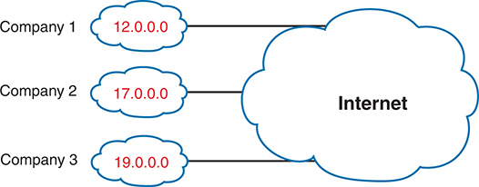
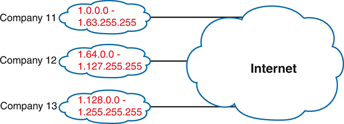
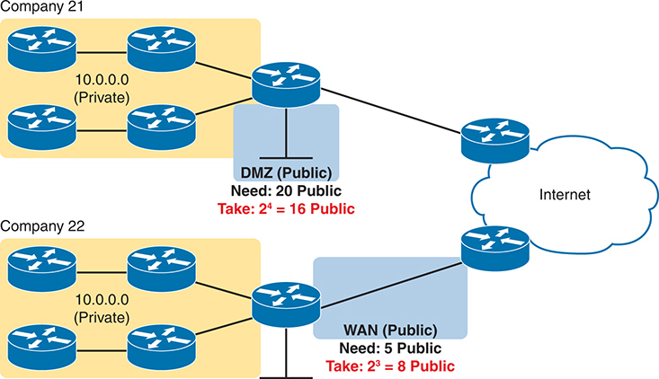
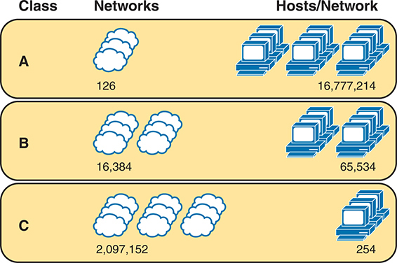
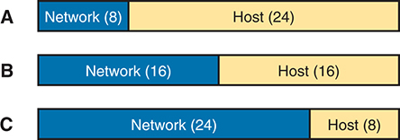
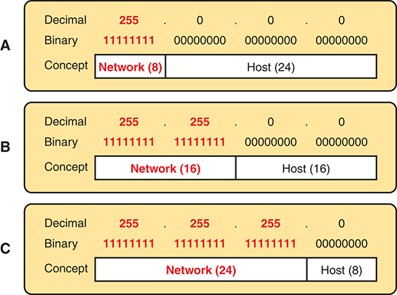
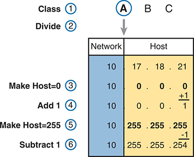
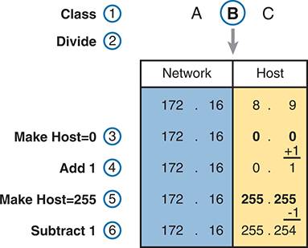

<a href="{{ '/subjects/CCNA/' | relative_url }}">← 返回 CCNA 目录</a>

第一卷 · IPv4 编址

<nav class="ccna-chapter-nav" aria-label="章节导航"><a href="v1-11.html">← 上一章</a><a href="v1-13.html">下一章 →</a></nav>



<section data-epub-type="chapter">

<h2 class="h2" id="ch12">第 12 章</h2>

<h2 class="h2a">分析有类 IPv4 网络</h2>

本章涵盖以下考试主题：

1.0 网络基础

1.6 配置与验证 IPv4 编址和子网划分

1.7 描述私有 IPv4 编址

在网络运维中，你通常会从一个 IP 地址及其掩码入手调查问题。仅根据 IP 地址，你就应当能够确定该地址所在的 A 类、B 类或 C 类网络的若干信息。

本章列出有类 IP 网络的关键信息，并说明如何确定这些信息。随后提供一些练习题。在进入下一章之前，你应不断练习，直到能够根据一个 IP 地址，快速、自信且稳定地确定所有这些信息。

<section>

<h3 class="h3" id="ch12lev1sec1">自测</h3>

如果你希望根据得分决定在本章投入多少时间，可以完成这组自测题（在此作答，或使用 PTP 软件）。各题答案的选项字母列在自测题之后的页面底部。书末和配套网站上的<a href="#ref-appc">附录 C</a>都包含答案及解析。你也可以在 PTP 测试软件中找到答案及解析。

<figure class="table" id="ch12tab01" tabindex="0">

<figcaption>

<strong>表 12-1</strong> 核心主题小节与题目对应关系

</figcaption>

<table class="all">

<thead>

<tr>

<th class="th">
基础知识小节
</th>

<th class="th">
题目
</th>

</tr>

</thead>

<tbody>

<tr>

<td class="border">
有类网络的概念
</td>

<td class="border">
1–5
</td>

</tr>

</tbody>

</table>

</figure>

<strong><a id="quess12_1" href="#ques12_1a">1</a>.</strong> 下列哪些不是有效的 A 类网络 ID？（选择两个答案。）

<ol class="lower-alpha">

<li>
1.0.0.0
</li>

<li>
130.0.0.0
</li>

<li>
127.0.0.0
</li>

<li>
9.0.0.0
</li>

</ol>

<strong><a id="quess12_2" href="#ques12_2a">2</a>.</strong> 下列哪些不是有效的 B 类网络 ID？

<ol class="lower-alpha">

<li>
130.0.0.0
</li>

<li>
191.255.0.0
</li>

<li>
128.0.0.0
</li>

<li>
150.255.0.0
</li>

<li>
全部都是有效的 B 类网络 ID。
</li>

</ol>

<strong><a id="quess12_3" href="#ques12_3a">3</a>.</strong> 关于 IP 地址 172.16.99.45 所在的 IP 网络，下列哪些说法正确？（选择两个答案。）

<ol class="lower-alpha">

<li>
网络 ID 为 172.0.0.0。
</li>

<li>
该网络是 B 类网络。
</li>

<li>
该网络的默认掩码为 255.255.255.0。
</li>

<li>
未划分子网的网络中有 16 个主机位。
</li>

</ol>

<strong><a id="quess12_4" href="#ques12_4a">4</a>.</strong> 关于 IP 地址 192.168.6.7 所在的 IP 网络，下列哪些说法正确？（选择两个答案。）

<ol class="lower-alpha">

<li>
网络 ID 为 192.168.6.0。
</li>

<li>
该网络是 B 类网络。
</li>

<li>
该网络的默认掩码为 255.255.255.0。
</li>

<li>
未划分子网的网络中有 16 个主机位。
</li>

</ol>

<strong><a id="quess12_5" href="#ques12_5a">5</a>.</strong> 下列哪一个是网络广播地址？

<ol class="lower-alpha">

<li>
10.1.255.255
</li>

<li>
192.168.255.1
</li>

<li>
224.1.1.255
</li>

<li>
172.30.255.255
</li>

</ol>

自测答案：

<strong><a id="ques12_1a" href="#ref-ques12_1">1</a></strong> B、C

<strong><a id="ques12_2a" href="#ref-ques12_2">2</a></strong> E

<strong><a id="ques12_3a" href="#ref-ques12_3">3</a></strong> B、D

<strong><a id="ques12_4a" href="#ref-ques12_4">4</a></strong> A, C

<strong><a id="ques12_5a" href="#ref-ques12_5">5</a></strong> D

</section>

<section>

<h3 class="h3box" id="ch12lev1sec2">基础知识</h3>

</section>

<section>

<h3 class="h3" id="ch12lev1sec3">有类网络的概念</h3>

假设你正在参加第一份 IT 工作的面试。面试官给出一个 IPv4 地址和掩码：10.4.5.99、255.255.255.0。对于该 IP 地址所在的有类<a id="key_165" href="#ref-gloss_272">网络</a>（本例为 A 类网络），你能向面试官说明哪些信息？

本节是本章两个主要部分中的第一个，将回顾<a id="key_162" href="#ref-gloss_065">有类 IP 网络</a>（即 A 类、B 类和 C 类网络）的概念。具体来说，本章将介绍如何从一个 IP 地址出发，确定以下信息：

<ul class="sq">

<li>
类别（A、B 或 C）
</li>

<li>
默认掩码
</li>

<li>
网络八位组数／位数
</li>

<li>
主机八位组数／位数
</li>

<li>
网络中的主机地址数量
</li>

<li>
网络 ID
</li>

<li>
网络广播地址
</li>

<li>
网络中第一个和最后一个可用地址
</li>

</ul>

在介绍本章的方法之前，先讨论其适用背景。分析 A 类、B 类和 C 类网络有实际价值，而且仍然是一项重要技能，但它在某些网络中可能不那么有用。本节首先介绍公有网络、大型公有 CIDR 地址块以及小型公有 CIDR 地址块的背景。随后，本节其余内容将假设地址分配过程仍然分配整个 A 类、B 类或 C 类网络，深入介绍如何确定一个地址所属有类 IP 网络的全部信息。

<section>

<h4 class="h4" id="ch12lev2sec1">了解公有网络和 CIDR 地址块的背景</h4>

正如<a href="v1-11.html#ch11">第 11 章</a>“<a href="v1-11.html#ch11">IPv4 子网划分概览</a>”所述，最初的规划要求每个组织申请并使用 A、B、C 三种类别之一的公有 IP 网络。这种方法从 20 世纪 80 年代一直沿用到 2010 年代，当时区域互联网注册管理机构（RIR）分配了最后一批 IP <a id="key_169" href="#ref-gloss_278">网络号</a>。即使 RIR 的 IPv4 地址储备已经耗尽，曾经获分配公有 A 类、B 类或 C 类网络的公司仍在继续使用这些网络。<a href="#ch12fig01">图 12-1</a> 用概念图展示了一些至今仍可能使用的 A 类网络。

<figure class="image-c" id="ch12fig01">

<figcaption>

<strong>图 12-1</strong> <em>概念：公司使用各自独立的公有 A 类网络</em>

</figcaption>

</figure>

20 世纪 90 年代出现的一种节省地址方案不再局限于 A 类、B 类和 C 类网络的三种固定大小，而是允许采用地址数为 2 的幂的任意大小地址块。从那时起，作为全球地址空间管理者的互联网号码分配机构（IANA）与五家 RIR 开始分配公有<em>无类域间路由（CIDR）地址块</em>。这样，公司就能获得浪费更少地址的分配结果。

例如，RIR 可以不把公有网络 1.0.0.0 分配给一家公司，而是按照一些简单规则，将该网络细分为较小的地址块。例如，每个地址块包含的地址数量必须是 2 的幂。<a href="#ch12fig02">图 12-2</a> 展示了这一概念：另外三家公司获得公有 CIDR 地址块，它们看起来就像原来 A 类网络 1.0.0.0 的子集。

<figure class="image-c" id="ch12fig02">

<figcaption>

<strong>图 12-2</strong> <em>概念：公司使用公有 CIDR 地址块</em>

</figcaption>

</figure>

公司使用大型公有 <a id="key_161" href="#ref-gloss_059">CIDR 地址块</a>时，其实施方式与公有 A 类、B 类或 C 类网络类似。无论起点是公有 A 类、B 类、C 类网络，还是公有 CIDR 地址块，公司都拥有一个较大的公有地址块。公司随后可以制定子网划分方案，进一步细分这个大地址块，并选择在各个位置使用哪些子网。网络中的所有主机都使用这个大型公有地址块中的地址。

随着时间推移，出现了第三种方案，所需的公有地址更少，而且后来成为最常用的方案。公司使用私有 IP 网络为内部所有主机编址，同时只需要一个较小的公有 CIDR 地址块，并使用 NAT 为往返互联网的数据包转换地址。即使对于大型公司，一个包含 4、8 或 16 个地址的地址块，通常也能提供足够的公有 IP 地址供 NAT 使用。所有公司都可以使用任意私有 IP 网络为内部主机编址，如<a href="#ch12fig03">图 12-3</a> 所示。

<figure class="image-c" id="ch12fig03">

<figcaption>

<strong>图 12-3</strong> <em>概念：小型 CIDR 地址块与私有 IP 网络</em>

<aside class="hidden" id="a12fig03">

公司 21 包含四个使用 IP 范围 10.0.0.0（私有）的子网，每个子网都连接到集群路由器 1。集群路由器 1 充当非军事区（DMZ），公有 IP 地址需求为 20，使用 16 个公有 IP 地址。公司 22 也包含四个使用 IP 范围 10.0.0.0（私有）的子网，连接到集群路由器 2。集群路由器 2 充当 DMZ，公有 IP 地址需求为 5，使用 8 个公有 IP 地址。两个集群路由器分别连接到互联网上不同的路由器。

</aside>

</figcaption>

</figure>

现在回到本章的重点：从一个<a id="key_171" href="#ref-gloss_421">单播 IP 地址</a>出发，确定 A 类、B 类和 C 类网络的关键信息。无论该地址恰好来自公有有类网络、公有 CIDR 地址块，还是私有有类网络，学习本章的方法都有助于你理解网络和子网划分计算。你们大多数人会在自己公司或客户公司中运用这些基础技能，它们也有助于准备考试。

最后还需了解一点：如果只给出一个公有 IP 地址，你无法仅凭这个地址判断它来自公有有类网络还是公有 CIDR 地址块。不过，本章重点讨论如何确定 A 类、B 类或 C 类网络的信息，并假定地址来自公有 IP 网络，而不是公有 CIDR 地址块。现在开始学习计算与方法！

注意

通过查询 WHOIS 记录，可以确定一个公有单播地址属于公有有类网络分配，还是公有 CIDR 地址块。具体方法是访问 ARIN 的 WHOIS 搜索页面（<a href="https://search.arin.net/rdap/">https://search.arin.net/rdap/</a>），搜索任意公有 IP 地址。例如，在该页面搜索 17.1.1.1，会显示地址块 17.0.0.0/8。你将在本章和下一章中学到，17.0.0.0/8 这种表示法代表 A 类网络 17.0.0.0，这意味着地址 17.1.1.1 来自一次公有 A 类网络分配。

</section>

<section>

<h4 class="h4" id="ch12lev2sec2">IPv4 网络类别及相关信息</h4>

IP 第 4 版（IPv4）定义了五个地址类别。其中 A 类、B 类和 C 类由单播 IP 地址组成。单播地址标识单个主机或接口，因此可以唯一标识该设备。D 类地址用作组播地址，所以发送到 D 类 IPv4 组播地址的一个数据包，实际上可以送达多台主机。最后，E 类地址最初用于实验，后来改为仅保留供将来使用。根据地址第一个八位组的值，即可判断其类别，如<a href="#ch12tab02">表 12-2</a> 所示。

<figure class="table" id="ch12tab02" tabindex="0">

<figcaption>

<strong>表 12-2</strong> 根据第一个八位组的值确定 IPv4 地址类别

</figcaption>

<table class="all">

<thead>

<tr>

<th class="th">
类别
</th>

<th class="th">
第一个八位组的值
</th>

<th class="th">
用途
</th>

</tr>

</thead>

<tbody>

<tr>

<td class="border">
A 类
</td>

<td class="border">
1–126
</td>

<td class="border">
单播（大型网络）
</td>

</tr>

<tr>

<td class="border">
B 类
</td>

<td class="border">
128–191
</td>

<td class="border">
单播（中型网络）
</td>

</tr>

<tr>

<td class="border">
C 类
</td>

<td class="border">
192–223
</td>

<td class="border">
单播（小型网络）
</td>

</tr>

<tr>

<td class="border">
D
</td>

<td class="border">
224–239
</td>

<td class="border">
组播
</td>

</tr>

<tr>

<td class="border">
E
</td>

<td class="border">
240–255
</td>

<td class="border">
保留（原用于实验）
</td>

</tr>

</tbody>

</table>

</figure>

确定单播地址属于 A 类、B 类还是 C 类之后，许多其他相关信息只需凭记忆便可得出。<a href="#ch12tab03">表 12-3</a> 列出这些信息供参考和后续学习；本章将逐一介绍其中的概念。

<figure class="table" id="ch12tab03" tabindex="0">

<figcaption>

<strong>表 12-3</strong> A 类、B 类和 C 类网络的关键信息

</figcaption>

<table class="all">

<thead>

<tr>

<th class="th">

</th>

<th class="th">
A 类
</th>

<th class="th">
B 类
</th>

<th class="th">
C 类
</th>

</tr>

</thead>

<tbody>

<tr>

<td class="border">
第一个八位组的范围
</td>

<td class="border">
1–126
</td>

<td class="border">
128–191
</td>

<td class="border">
192–223
</td>

</tr>

<tr>

<td class="border">
有效网络号
</td>

<td class="border">
1.0.0.0–126.0.0.0
</td>

<td class="border">
128.0.0.0–191.255.0.0
</td>

<td class="border">
192.0.0.0–223.255.255.0
</td>

</tr>

<tr>

<td class="border">
网络总数
</td>

<td class="border">
2<em>7</em> – 2 = 126
</td>

<td class="border">
2<em>14</em> = 16,384
</td>

<td class="border">
2<em>21</em> = 2,097,152
</td>

</tr>

<tr>

<td class="border">
每个网络的主机数
</td>

<td class="border">
2<em>24</em> – 2
</td>

<td class="border">
2<em>16</em> – 2
</td>

<td class="border">
2<em>8</em> – 2
</td>

</tr>

<tr>

<td class="border">
网络部分的八位组数（位数）
</td>

<td class="border">
1 (8)
</td>

<td class="border">
2 (16)
</td>

<td class="border">
3 (24)
</td>

</tr>

<tr>

<td class="border">
主机部分的八位组数（位数）
</td>

<td class="border">
3 (24)
</td>

<td class="border">
2 (16)
</td>

<td class="border">
1 (8)
</td>

</tr>

<tr>

<td class="border">
默认掩码
</td>

<td class="border">
255.0.0.0
</td>

<td class="border">
255.255.0.0
</td>

<td class="border">
255.255.255.0
</td>

</tr>

</tbody>

</table>

</figure>

请注意，所有以 0 开头和所有以 127 开头的地址范围都已保留。根据 RFC 791（1981 年发布）的规定，它们自 A 类网络诞生起就被保留；如果没有被保留，它们可能会被称为 A 类网络 0.0.0.0 和 127.0.0.0。但是，由于它们已被保留，地址空间中只有 126 个 A 类网络，而不是 128 个。还应注意，B 类和 C 类范围的起始和末尾并没有类似的保留范围。

除了将原本可作为 A 类网络的 0.0.0.0 和 127.0.0.0 保留作其他用途之外，其他较新的 RFC 也保留了 A 类、B 类和 C 类地址空间中的一些小部分。因此，<a href="#ch12tab03">表 12-3</a> 这类列出 A 类、B 类和 C 类网络数量的表格，可以帮助你了解其数量级；但由于其他保留地址范围的存在，保留网络数量确实会随时间略有变化，尽管变化很缓慢。

注意

如果你有兴趣查看所有保留的 IPv4 地址范围，可以在互联网上搜索“IANA IPv4 special-purpose address registry”（IANA IPv4 特殊用途地址注册表）。

<section>

<h5 class="h5" id="ch12lev3sec1">A 类、B 类和 C 类网络的数量与大小</h5>

<a href="#ch12tab03">表 12-3</a> 列出了 A 类、B 类和 C 类网络号的范围；但是，仅查阅信息表可能会忽略一些要点。本节将研究 A 类、B 类和 C 类网络号，重点介绍较重要的内容，以及例外和不常见的情况。

首先，各类别的网络数量差别很大。A 类网络只有 126 个：网络 1.0.0.0、2.0.0.0、3.0.0.0，依此类推，直到网络 126.0.0.0。相比之下，B 类网络有 16,384 个，C 类网络则超过 200 万个。

其次，各类别网络的大小也有显著差异。每个 A 类网络都相对较大，每个网络拥有超过 1600 万个主机 IP 地址，所以最初面向规模最大的公司和组织。B 类网络较小，每个网络有超过 65,000 个主机地址。最后，面向小型组织的 C 类网络，每个网络有 254 个主机地址。<a href="#ch12fig04">图 12-4</a> 汇总了这些信息。

<figure class="image-c" id="ch12fig04">

<figcaption>

<strong>图 12-4</strong> <em>A 类、B 类和 C 类网络的数量与大小</em>

<aside class="hidden" id="a12fig04">

A 类网络每个网络容纳 126 台主机，相当于 16,777,214 台 PC。B 类网络每个网络支持 16384 台主机，可容纳 65,534 台 PC。C 类网络每个网络允许 2,097,152 台主机，为 254 台 PC 提供连接。

</aside>

</figcaption>

</figure>

</section>

<section>

<h5 class="h5" id="ch12lev3sec2">地址格式</h5>

在某些情况下，工程师可能需要把 A 类、B 类或 C 类网络看作尚未经过子网划分的网络。此时，有类网络中的地址结构包含两个部分：<a id="key_170" href="#ref-gloss_279">网络部分</a>（有时称为<em>前缀</em>）和<a id="key_164" href="#ref-gloss_173">主机部分</a>。比较同一网络中的任意两个 IP 地址，可以得出以下结论：

同一网络中各地址的网络部分具有相同的值。

同一网络中各地址的主机部分具有不同的值。

例如，根据定义，在 A 类网络 10.0.0.0 中，网络部分由第一个八位组组成。因此，所有地址的网络部分都具有相同的值，即第一个八位组为 10。如果比较该网络中的任意两个地址，它们的最后三个八位组（主机八位组）的值就会不同。例如，IP 地址 10.1.1.1 和 10.1.1.2 的网络部分具有相同的值（10），但主机部分的值不同。

<a href="#ch12fig05">图 12-5</a> 展示了尚未进行子网划分时，A 类、B 类和 C 类网络中 IP 地址的网络部分与主机部分的格式和大小（位数）。

<figure class="image-c" id="ch12fig05">

<figcaption>

<strong>图 12-5</strong> <em>未划分子网的有类网络中，网络部分和主机部分的大小（位数）</em>

<aside class="hidden" id="a12fig05">

每个类别都画成一个分为两部分的矩形，并标明大小。A 类网络为主机分配 8 位，为网络地址分配 24 位。B 类网络为主机分配 16 位，为网络地址分配 16 位。C 类网络为主机分配 24 位，为网络地址分配 8 位。

</aside>

</figcaption>

</figure>

</section>

<section>

<h5 class="h5" id="ch12lev3sec3">默认掩码</h5>

虽然我们人类很容易理解<a href="#ch12fig05">图 12-5</a> 背后的概念，但计算机更喜欢数字。为了向计算机表达相同的含义，每种网络类别都有一个对应的<a id="key_163" href="#ref-gloss_091">默认掩码</a>，用于定义未划分子网的 A 类、B 类和 C 类网络中网络部分与主机部分的大小。具体做法是：对于视为网络部分的位，掩码写为二进制 1；对于视为主机部分的位，写为二进制 0。

例如，A 类网络 10.0.0.0 的网络部分是第一个八位组（8 位），主机部分是最后三个八位组（24 位）。因此，A 类默认掩码为 255.0.0.0，其二进制形式为

11111111 00000000 00000000 00000000

<a href="#ch12fig06">图 12-6</a> 以二进制和点分十进制两种格式展示了各类网络的默认掩码。

注意

十进制 255 转换为二进制值是 11111111。十进制 0 转换为 8 位二进制是 00000000。转换表见<a data-original-href="vol1_appa.xhtml#appa" data-unavailable="true" title="此内容不在当前提取范围内；请参阅原始 EPUB：vol1_appa.xhtml#appa">附录 A</a>“<a data-original-href="vol1_appa.xhtml#appa" data-unavailable="true" title="此内容不在当前提取范围内；请参阅原始 EPUB：vol1_appa.xhtml#appa">数值参考表</a>”。

<figure class="image-c" id="ch12fig06">

<figcaption>

<strong>图 12-6</strong> <em>A 类、B 类和 C 类的默认掩码</em>

<aside class="hidden" id="a12fig06">

每个类别都画成一个分为两部分的矩形，同时展示十进制和二进制表示以及概念上的划分。A 类默认掩码的十进制形式为 255.0.0.0，二进制形式为 11111111 00000000 00000000 00000000，网络部分占 8 位，主机部分占 24 位。B 类默认掩码的十进制形式为 255.255.0.0，二进制形式为 11111111 11111111 00000000 00000000，网络部分和主机部分各占 16 位。C 类默认掩码的十进制形式为 255.255.255.0，二进制形式为 11111111 11111111 11111111 00000000，网络部分占 24 位，主机部分占 8 位。

</aside>

</figcaption>

</figure>

</section>

</section>

<section>

<h4 class="h4" id="ch12lev2sec3">每个网络的主机数量</h4>

计算每个网络的主机数量需要一些基本的二进制运算。首先考虑只有一个二进制位的情况：有多少个不同的值？当然有两个：0 和 1。使用 2 位，可以组成四种组合：00、01、10 和 11。事实上，N 位能够组成的不同数值组合总数为 2<em>N</em>。

主机地址，也就是分配给主机的 IP 地址，必须是唯一的。主机位的作用正是通过让地址的主机部分取不同的值，为每台主机提供唯一的 IP 地址。因此，H 个主机位可以形成 2<em>H</em> 种不同组合。

但是，一个网络中的主机数量不是 2<em>H</em>，而是 2<em>H</em> − 2。每个网络都保留了两个本来可以用作主机地址的数值，改作特殊用途：一个用于<a id="key_168" href="#ref-gloss_275">网络 ID</a>，另一个用于<a id="key_167" href="#ref-gloss_274">网络广播地址</a>。因此，计算每个 A 类、B 类或 C 类网络中主机地址数量的公式为

2<em>H</em> − 2

其中，<em>H</em> 为主机位数。

</section>

<section>

<h4 class="h4" id="ch12lev2sec4">推导网络 ID 及相关数值</h4>

每个有类网络都有四个用于描述该网络的关键数值。只要给出网络中的一个 IP 地址，你就能推导出这四个数值。它们分别是：

<ul class="sq">

<li>
网络号
</li>

<li>
第一个（数值最小的）可用地址
</li>

<li>
最后一个（数值最大的）可用地址
</li>

<li>
网络广播地址
</li>

</ul>

首先，考虑网络号和第一个可用 IP 地址。<em>网络号</em>也称为<em>网络 ID</em> 或<a id="key_166" href="#ref-gloss_273">网络地址</a>，用于标识该网络。根据定义，网络号是网络中数值最小的数字。但是，为了避免歧义，IP 编址的制定者增加了一项限制：网络号不能分配为 IP 地址。因此，网络中的最小数值就是网络 ID，而第一个（数值最小的）主机 IP 地址则<em>比网络号大 1</em>。

接下来，考虑网络广播地址和最后一个（数值最大的）可用 IP 地址。TCP/IP RFC 将网络广播地址定义为每个网络中的一个特殊地址。该广播地址可以用作数据包的目的地址，路由器会将该数据包的一个副本转发给该有类网络中的所有主机。从数值上说，网络广播地址始终是网络中最大的（最后一个）数值。因此，能够用作 IP 地址的最大（最后一个）数值，就是<em>比网络广播地址小 1</em> 的地址。

简而言之，只要能求出网络号和网络广播地址，就很容易确定网络中第一个和最后一个可用 IP 地址。对于考试，你应当能够轻松求出全部四个值，步骤如下：

步骤 1。根据第一个八位组确定类别（A、B 或 C）。

步骤 2。根据类别，在脑中划分网络八位组和主机八位组。

步骤 3。将 IP 地址的主机八位组改为 0，得到网络号。

步骤 4。将网络 ID 的第四个八位组加 1，得到第一个地址。

步骤 5。将网络 ID 的主机八位组改为 255，得到广播地址。

步骤 6。将网络广播地址的第四个八位组减 1，得到最后一个地址。

写出来的步骤看上去比实际操作复杂。<a href="#ch12fig07">图 12-7</a> 使用 A 类 IP 地址 10.17.18.21 展示了这一过程，图中圆圈里的编号与上述步骤对应。

<figure class="image-c" id="ch12fig07">

<figcaption>

<strong>图 12-7</strong> <em>从 10.17.18.21 推导网络 ID 及其他数值的示例</em>

<aside class="hidden" id="a12fig07">

步骤 1：确定类别，本例选择 A 类。步骤 2：划分地址，网络为 10，主机为 17.18.21。步骤 3：将主机部分设为 0，网络为 10，主机为 0.0.0。步骤 4：将主机部分加 1，网络为 10，主机为 0.0.1。步骤 5：将主机部分设为 255，网络为 10，主机为 255.255.255。步骤 6：将主机部分减 1，网络为 10，主机为 255.255.254。

</aside>

</figcaption>

</figure>

<a href="#ch12fig07">图 12-7</a> 将类别确定为 A 类（步骤 1），网络八位组和主机八位组的数量分别为 1 和 3。因此，在步骤 3 求网络 ID 时，图中只复制第一个八位组，并将最后三个（主机）八位组设为 0。在步骤 4，只需复制网络 ID，再将第四个八位组加 1。同样，在步骤 5 求广播地址时，复制网络八位组，但将主机八位组设为 255。然后，在步骤 6，将第四个八位组减 1，得到最后一个（数值最大的）可用 IP 地址。

再举一个不同的示例，考虑 IP 地址 172.16.8.9。<a href="#ch12fig08">图 12-8</a> 展示了将上述步骤应用于该 IP 地址的过程。

<figure class="image-c" id="ch12fig08">

<figcaption>

<strong>图 12-8</strong> <em>从 172.16.8.9 推导网络 ID 及其他数值的示例</em>

<aside class="hidden" id="a12fig08">

步骤 1：确定类别，本例选择 B 类。步骤 2：划分地址，网络为 10，主机为 17.18.21。步骤 3：将主机部分设为 0，网络为 10，主机为 0.0.0。步骤 4：将主机部分加 1，网络为 10，主机为 0.0.1。步骤 5：将主机部分设为 255，网络为 10，主机为 255.255.255。步骤 6：将主机部分减 1，网络为 10，主机为 255.255.254。

</aside>

</figcaption>

</figure>

<a href="#ch12fig08">图 12-8</a> 将类别确定为 B 类（步骤 1），网络八位组和主机八位组的数量分别为 2 和 2。因此，在步骤 3 求网络 ID 时，图中只复制前两个八位组，并将最后两个（主机）八位组设为 0。同样，步骤 5 展示了相同的操作，但将最后两个（主机）八位组设为 255。

</section>

<section>

<h4 class="h4" id="ch12lev2sec5">不常见的网络 ID 和网络广播地址</h4>

A 类、B 类和 C 类网络号范围内及其附近的一些不常见数值，可能会引起困惑。本节列出一些示例，这些数值会让许多人对其含义做出错误判断。

对于 A 类，第一个容易让人疑惑的地方是，第一个八位组的取值范围跳过了 0 和 127。原本可作为 A 类网络的 0.0.0.0 最初被保留用于某些广播需求，因此第一个八位组为 0 的所有地址都已保留。原本可作为 A 类网络的 127.0.0.0 至今仍被保留，因为软件测试会使用其中一个特殊地址，即环回地址（127.0.0.1）。

对于 B 类（以及 C 类），某些网络号看起来可能有些奇怪，尤其是当你习惯性地认为末尾为 0 就表示网络 ID、末尾为 255 就表示网络广播地址时。首先，B 类网络号从 128.0.0.0 到 191.255.0.0，共有 2<em>14</em> 个网络。但是，即使是第一个（数值最小的）B 类网络号 128.0.0.0，由于末尾有三个 0，看起来也有点像 A 类网络号。然而，它的第一个八位组为 128，因此它是 B 类网络，网络部分包含两个八位组（128.0）。

再看另一个 B 类示例，B 类范围的高端值 191.255.0.0 乍看之下也可能显得奇怪，但它确实是有效 B 类网络号中数值最大的一个。该网络的广播地址 191.255.255.255，由于末尾有三个 255，看起来可能有点像 A 类广播地址，但它确实是 B 类网络的广播地址。

与 B 类网络类似，一些有效的 C 类网络号看起来也很奇怪。例如，C 类网络 192.0.0.0 的最后三个八位组都是 0，看起来有点像 A 类网络；但由于它是 C 类网络，所以包含所有前三个八位组为 192.0.0 的地址。同样，另一个有效的 C 类网络 223.255.255.0 包含所有以 223.255.255 开头的地址。

</section>

</section>

<section>

<h3 class="h3" id="ch12lev1sec4">有类网络练习</h3>

和 IP 编址及子网划分的所有内容一样，你需要通过练习来准备 CCNA 考试。在阅读本章时就应做一些练习，以确保理解相关步骤。此时，你可以参考笔记和本书，目标是理解方法。之后，继续练习本章及其他所有子网划分方法。在参加考试之前，你应该能够始终得到正确答案，并且速度足够快。<a href="#ch12tab04">表 12-4</a> 汇总了这种分两阶段学习方法的要点和建议。

<figure class="table" id="ch12tab04" tabindex="0">

<figcaption>

<strong>表 12-4</strong> 本章主题在继续学习前和参加考试前的目标

</figcaption>

<table class="all">

<thead>

<tr>

<th class="th">
时间阶段
</th>

<th class="th">
读完本章后
</th>

<th class="th">
参加考试前
</th>

</tr>

</thead>

<tbody>

<tr>

<td class="border">
<strong>关注重点……</strong>
</td>

<td class="border">
学会方法
</td>

<td class="border">
准确且快速
</td>

</tr>

<tr>

<td class="border">
<strong>允许使用的工具</strong>
</td>

<td class="border">
所有工具
</td>

<td class="border">
大脑和记事本
</td>

</tr>

<tr>

<td class="border">
<strong>目标：准确率</strong>
</td>

<td class="border">
90% 正确
</td>

<td class="border">
100% 正确
</td>

</tr>

<tr>

<td class="border">
<strong>目标：速度</strong>
</td>

<td class="border">
不限速度
</td>

<td class="border">
10 秒
</td>

</tr>

</tbody>

</table>

</figure>

<section>

<h4 class="h4" id="ch12lev2sec6">练习根据 IP 地址推导关键信息</h4>

练习求出本章所讨论的、可以根据 IP 地址推导出的各项信息。为此，请完成<a href="#ch12tab05">表 12-5</a>。

<figure class="table" id="ch12tab05" tabindex="0">

<figcaption>

<strong>表 12-5</strong> 练习题：求网络 ID 和网络广播地址

</figcaption>

<table class="all">

<thead>

<tr>

<th class="th">

</th>

<th class="th">
IP 地址
</th>

<th class="th">
类别
</th>

<th class="th">
网络八位组
</th>

<th class="th">
主机八位组
</th>

<th class="th">
网络 ID
</th>

<th class="th">
网络广播地址
</th>

</tr>

</thead>

<tbody>

<tr>

<td class="border">
1
</td>

<td class="border">
1.1.1.1
</td>

<td class="border">

</td>

<td class="border">

</td>

<td class="border">

</td>

<td class="border">

</td>

<td class="border">

</td>

</tr>

<tr>

<td class="border">
2
</td>

<td class="border">
128.1.6.5
</td>

<td class="border">

</td>

<td class="border">

</td>

<td class="border">

</td>

<td class="border">

</td>

<td class="border">

</td>

</tr>

<tr>

<td class="border">
3
</td>

<td class="border">
200.1.2.3
</td>

<td class="border">

</td>

<td class="border">

</td>

<td class="border">

</td>

<td class="border">

</td>

<td class="border">

</td>

</tr>

<tr>

<td class="border">
4
</td>

<td class="border">
192.192.1.1
</td>

<td class="border">

</td>

<td class="border">

</td>

<td class="border">

</td>

<td class="border">

</td>

<td class="border">

</td>

</tr>

<tr>

<td class="border">
5
</td>

<td class="border">
126.5.4.3
</td>

<td class="border">

</td>

<td class="border">

</td>

<td class="border">

</td>

<td class="border">

</td>

<td class="border">

</td>

</tr>

<tr>

<td class="border">
6
</td>

<td class="border">
200.1.9.8
</td>

<td class="border">

</td>

<td class="border">

</td>

<td class="border">

</td>

<td class="border">

</td>

<td class="border">

</td>

</tr>

<tr>

<td class="border">
7
</td>

<td class="border">
192.0.0.1
</td>

<td class="border">

</td>

<td class="border">

</td>

<td class="border">

</td>

<td class="border">

</td>

<td class="border">

</td>

</tr>

<tr>

<td class="border">
8
</td>

<td class="border">
191.255.1.47
</td>

<td class="border">

</td>

<td class="border">

</td>

<td class="border">

</td>

<td class="border">

</td>

<td class="border">

</td>

</tr>

<tr>

<td class="border">
9
</td>

<td class="border">
223.223.0.1
</td>

<td class="border">

</td>

<td class="border">

</td>

<td class="border">

</td>

<td class="border">

</td>

<td class="border">

</td>

</tr>

</tbody>

</table>

</figure>

答案列在本章后面的“<a data-original-href="vol1_ch12.xhtml#ch12lev1sec9" data-unavailable="true" title="此内容不在当前提取范围内；请参阅原始 EPUB：vol1_ch12.xhtml#ch12lev1sec9">前述练习题答案</a>”一节中。

</section>

<section>

<h4 class="h4" id="ch12lev2sec7">练习记忆地址类别的详细信息</h4>

本章前面的<a href="#ch12tab02">表 12-2</a> 和<a href="#ch12tab03">表 12-3</a> 汇总了 IPv4 地址类别的一些关键信息。<a href="#ch12tab06">表 12-6</a> 和<a href="#ch12tab07">表 12-7</a> 是这些表格的留空版本。请填写这些表格，练习回忆关键信息，尤其是用于确定地址类别的第一个八位组取值范围。然后，参考<a href="#ch12tab02">表 12-2</a> 和<a href="#ch12tab03">表 12-3</a> 检查答案。重复这一过程，直到能够回忆起表中的全部信息。

<figure class="table" id="ch12tab06" tabindex="0">

<figcaption>

<strong>表 12-6</strong> <a href="#ch12tab02">表 12-2</a> 的留空学习版本

</figcaption>

<table class="all">

<thead>

<tr>

<th class="th">
类别
</th>

<th class="th">
第一个八位组的值
</th>

<th class="th">
用途
</th>

</tr>

</thead>

<tbody>

<tr>

<td class="border">
A 类
</td>

<td class="border">

</td>

<td class="border">

</td>

</tr>

<tr>

<td class="border">
B 类
</td>

<td class="border">

</td>

<td class="border">

</td>

</tr>

<tr>

<td class="border">
C 类
</td>

<td class="border">

</td>

<td class="border">

</td>

</tr>

<tr>

<td class="border">
D
</td>

<td class="border">

</td>

<td class="border">

</td>

</tr>

<tr>

<td class="border">
E
</td>

<td class="border">

</td>

<td class="border">

</td>

</tr>

</tbody>

</table>

</figure>

<figure class="table" id="ch12tab07" tabindex="0">

<figcaption>

<strong>表 12-7</strong> <a href="#ch12tab03">表 12-3</a> 的留空学习版本

</figcaption>

<table class="all">

<thead>

<tr>

<th class="th">

</th>

<th class="th">
A 类
</th>

<th class="th">
B 类
</th>

<th class="th">
C 类
</th>

</tr>

</thead>

<tbody>

<tr>

<td class="border">
第一个八位组的范围
</td>

<td class="border">

</td>

<td class="border">

</td>

<td class="border">

</td>

</tr>

<tr>

<td class="border">
有效网络号
</td>

<td class="border">

</td>

<td class="border">

</td>

<td class="border">

</td>

</tr>

<tr>

<td class="border">
网络总数
</td>

<td class="border">

</td>

<td class="border">

</td>

<td class="border">

</td>

</tr>

<tr>

<td class="border">
每个网络的主机数
</td>

<td class="border">

</td>

<td class="border">

</td>

<td class="border">

</td>

</tr>

<tr>

<td class="border">
网络部分的八位组数（位数）
</td>

<td class="border">

</td>

<td class="border">

</td>

<td class="border">

</td>

</tr>

<tr>

<td class="border">
主机部分的八位组数（位数）
</td>

<td class="border">

</td>

<td class="border">

</td>

<td class="border">

</td>

</tr>

<tr>

<td class="border">
默认掩码
</td>

<td class="border">

</td>

<td class="border">

</td>

<td class="border">

</td>

</tr>

</tbody>

</table>

</figure>

</section>

</section>

</section>

<section class="ccna-source ccna-appendix" aria-label="答案解析与术语表">
<section data-epub-type="chapter">

<h2 class="h2" id="ref-appc">附录 C</h2>

<h2 class="h2a">自测题答案</h2>

<section>

<h3 class="h3" id="ref-appclev1sec12">第 12 章</h3>

<strong><a id="ref-ques12_1" href="#quess12_1">1</a>.</strong> B 和 C。A 类网络的第一个八位组取值范围为 1—126（含两端），网络 ID 的最后三个八位组均为 0。网络 ID 130.0.0.0 实际上是 B 类网络（第一个八位组取值范围为 128—191，含两端）。所有以 127 开头的地址都已保留，因此 127.0.0.0 不是 A 类网络。

<strong><a id="ref-ques12_2" href="#quess12_2">2</a>.</strong> E。所有 B 类网络的第一个八位组都在 128 到 191 之间（含两端）。网络 ID 的第一个八位组可以是 128—191 范围内的任意值，第二个八位组可以是 0 到 255 之间的任意值（含两端），最后两个八位组则为十进制 0。有两个选项的第二个八位组为 255，这是允许的；另外两个选项的第二个八位组为 0，这也是允许的。

<strong><a id="ref-ques12_3" href="#quess12_3">3</a>.</strong> B 和 D。第一个八位组（172）位于 B 类地址的取值范围（128—191）内。因此，复制前两个八位组（172.16），再将最后两个八位组写为 0，就能得到网络 ID（172.16.0.0）。所有 B 类网络的默认掩码都是 255.255.0.0，所有未划分子网的 B 类网络都有 16 个主机位。

<strong><a id="ref-ques12_4" href="#quess12_4">4</a>.</strong> A 和 C。第一个八位组（192）位于 C 类地址的取值范围（192—223）内。因此，复制前三个八位组（192.168.6），再将最后一个八位组写为 0，就能得到网络 ID（192.168.6.0）。所有 C 类网络的默认掩码都是 255.255.255.0，所有未划分子网的 C 类网络都有 8 个主机位。

<strong><a id="ref-ques12_5" href="#quess12_5">5</a>.</strong> D。求网络广播地址时，先确定类别，再确定主机八位组的数量。然后，将主机八位组改为 255，便得到网络广播地址。本题中，10.1.255.255 位于 A 类网络，最后三个八位组是主机八位组，因此网络广播地址为 10.255.255.255。192.168.255.1 是 C 类地址，最后一个八位组为主机部分，因此网络广播地址为 192.168.255.255。地址 224.1.1.255 是 D 类地址，不属于任何单播 IP 网络，因此题目所问不适用于它。172.30.255.255 是 B 类地址，最后两个八位组为主机八位组，因此网络广播地址为 172.30.255.255。

</section>

</section>

<section id="ref-glossary"><h2 class="h2a">术语表</h2>
<strong>CIDR 地址块</strong> 一组连续的公有 IPv4 地址，其大小可以是 2 的任意幂。它是原先按三种固定大小分配公有 IP 网络方法的一种替代方案。

<strong>分类 IP 网络（classful IP network）</strong> IPv4 的 A 类、B 类或 C 类网络；之所以称为分类网络，是因为这些网络按照 IPv4 编址的类别规则定义。

<strong>默认掩码</strong> 在 A 类、B 类或 C 类网络中使用、且不创建任何子网的掩码。具体而言，A 类网络为 255.0.0.0，B 类网络为 255.255.0.0，C 类网络为 255.255.255.0。

<strong>主机部分</strong> IPv4 地址中用于唯一标识子网内某台主机的部分。子网掩码中值为 0 的位标识主机部分。

<strong>网络</strong> 由计算机、打印机、路由器、交换机及其他设备构成的集合，这些设备能够通过某种传输介质相互通信。

<strong>网络地址</strong> <em>参见</em><a href="#ref-gloss_278">网络号</a>。

<strong>网络广播地址</strong> 在 IPv4 中，每个有类网络中的一个特殊地址，可用于向同一有类网络中的全部主机广播数据包。从数值上说，该地址的网络部分与网络号相同，主机八位组全部为 255；例如，10.255.255.255 是有类网络 10.0.0.0 的网络广播地址。

<strong>网络 ID</strong> 用于标识 IPv4 网络的数字，和 IP 地址一样采用点分十进制表示法；它表示某个 A 类、B 类或 C 类 IP 网络。

<strong>网络号</strong> 与 IP 地址一样采用点分十进制表示法的数字，但该数字本身代表某个 A 类、B 类或 C 类 IP 网络中的所有主机。

<strong>网络部分</strong> IPv4 地址中的一部分，其长度取决于地址属于 A 类、B 类还是 C 类网络，分别为 1、2 或 3 个八位组（字节）。

<strong>单播 IP 地址</strong> 表示单个接口的 IP 地址。在 IPv4 中，这些地址来自 A 类、B 类和 C 类范围。

</section>
</section>


<nav class="ccna-chapter-nav" aria-label="章节导航"><a href="v1-11.html">← 上一章</a><a href="v1-13.html">下一章 →</a></nav>
