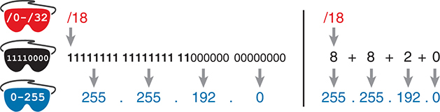
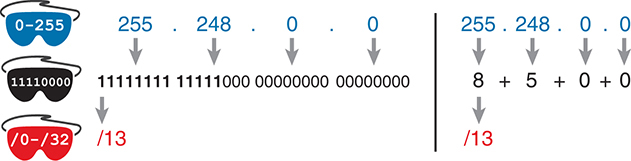
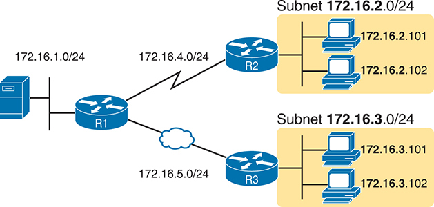
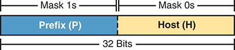
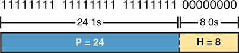
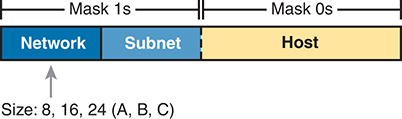
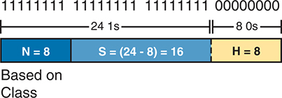
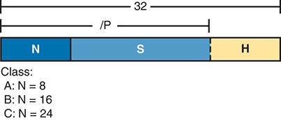
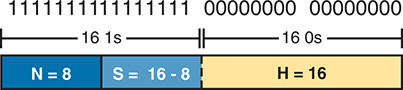
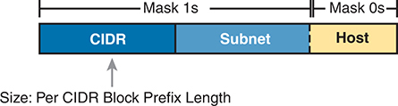

<a href="{{ '/subjects/CCNA/' | relative_url }}">← 返回 CCNA 目录</a>

第一卷 · IPv4 编址

<nav class="ccna-chapter-nav" aria-label="章节导航"><a href="v1-12.html">← 上一章</a><a href="v1-14.html">下一章 →</a></nav>



<section data-epub-type="chapter">

<h2 class="h2" id="ch13">第 13 章</h2>

<h2 class="h2a">分析子网掩码</h2>

本章涵盖以下考试主题：

1.0 网络基础

1.6 配置与验证 IPv4 编址和子网划分

IP 互连网络中一个或多个子网所使用的子网掩码，能够反映许多子网设计意图。首先，掩码将地址分为<em>前缀</em>和<em>主机</em>两部分，主机部分定义了子网的大小（即子网中的主机数量）。然后，类别（A、B 或 C）进一步划分子网中地址的结构，将前缀部分分为<em>网络</em>部分和<em>子网</em>部分。假设整个有类网络使用同一个掩码，子网部分就定义了一个有类 IP 网络中可能存在的子网数量。

子网掩码是理解若干重要子网设计要点的关键。不过，要分析子网掩码，首先需要掌握一些关于掩码的基本计算技能。这些计算用于在表示掩码的三种格式之间进行转换：

<ul class="sq">

<li>
二进制
</li>

<li>
点分十进制表示法（DDN）
</li>

<li>
前缀（也称为无类域间路由 [CIDR]）
</li>

</ul>

本章分为两个主要部分。第一部分重点介绍掩码格式，以及三种格式相互转换所用的计算。第二部分说明如何取得一个 IP 地址及其子网掩码，并分析这些值。具体而言，它将展示如何确定 IPv4 地址的三部分格式，并说明掩码所体现的子网设计信息。

注意

本章大部分内容都假设对 A 类、B 类或 C 类网络进行子网划分。章末还会讨论对公有 CIDR 地址块进行子网划分的类似情形。

<section>

<h3 class="h3" id="ch13lev1sec1">“这些知识我已经掌握了吗？”自测</h3>

如果你希望根据得分决定在本章投入多少时间，可以完成这组自测题（在此作答，或使用 PTP 软件）。各题答案的选项字母列在自测题之后的页面底部。书末和配套网站上的<a href="#ref-appc">附录 C</a>都包含答案及解析。你也可以在 PTP 测试软件中找到答案及解析。

<figure class="table" id="ch13tab01" tabindex="0">

<figcaption>

<strong>表 13-1</strong> “这些知识我已经掌握了吗？”核心主题小节与题目对应关系

</figcaption>

<table class="all">

<thead>

<tr>

<th class="th">
基础知识小节
</th>

<th class="th">
题目
</th>

</tr>

</thead>

<tbody>

<tr>

<td class="border">
子网掩码转换
</td>

<td class="border">
1–3
</td>

</tr>

<tr>

<td class="border">
利用掩码识别子网设计选择
</td>

<td class="border">
4–7
</td>

</tr>

</tbody>

</table>

</figure>

<strong><a id="quess13_1" href="#ques13_1a">1</a>.</strong> 下列哪个选项给出了与 255.255.254.0 等价的前缀（CIDR）格式？

<ol class="lower-alpha">

<li>
/19
</li>

<li>
/20
</li>

<li>
/23
</li>

<li>
/24
</li>

<li>
/25
</li>

</ol>

<strong><a id="quess13_2" href="#ques13_2a">2</a>.</strong> 下列哪个选项给出了与 255.255.255.240 等价的前缀（CIDR）格式？

<ol class="lower-alpha">

<li>
/26
</li>

<li>
/28
</li>

<li>
/27
</li>

<li>
/30
</li>

<li>
/29
</li>

</ol>

<strong><a id="quess13_3" href="#ques13_3a">3</a>.</strong> 下列哪个选项给出了与 /30 等价的点分十进制表示法（DDN）？

<ol class="lower-alpha">

<li>
255.255.255.192
</li>

<li>
255.255.255.252
</li>

<li>
255.255.255.240
</li>

<li>
255.255.254.0
</li>

<li>
255.255.255.0
</li>

</ol>

<strong><a id="quess13_4" href="#ques13_4a">4</a>.</strong> 你在技术支持中心工作，接到电话后得知用户 PC 的 IP 地址和掩码为 10.55.66.77、255.255.255.0。按照有类编址的思路，你确定网络位（N）、子网位（S）和主机位（H）的数量。在这种情况下，下列哪项正确？

<ol class="lower-alpha">

<li>
N=12
</li>

<li>
S=12
</li>

<li>
H=8
</li>

<li>
S=8
</li>

<li>
N=24
</li>

</ol>

<strong><a id="quess13_5" href="#ques13_5a">5</a>.</strong> 你在技术支持中心工作，接到电话后得知用户 PC 的 IP 地址和掩码为 192.168.9.1/27。按照有类编址的思路，你确定网络位（N）、子网位（S）和主机位（H）的数量。在这种情况下，下列哪项正确？

<ol class="lower-alpha">

<li>
N=24
</li>

<li>
S=24
</li>

<li>
H=8
</li>

<li>
H=7
</li>

</ol>

<strong><a id="quess13_6" href="#ques13_6a">6</a>.</strong> 关于无类 IP 编址的概念，下列哪项说法正确？

<ol class="lower-alpha">

<li>
使用 128 位 IP 地址
</li>

<li>
仅适用于 A 类和 B 类网络
</li>

<li>
将 IP 地址划分为网络、子网和主机三个部分
</li>

<li>
忽略 A 类、B 类和 C 类网络规则
</li>

</ol>

<strong><a id="quess13_7" href="#ques13_7a">7</a>.</strong> 在 B 类网络中仅使用一种掩码时，下列哪些掩码能够提供足够的子网位来支持 100 个子网？（选择两个答案。）

<ol class="lower-alpha">

<li>
/24
</li>

<li>
255.255.255.252
</li>

<li>
/20
</li>

<li>
255.255.252.0
</li>

</ol>

“这些知识我已经掌握了吗？”自测答案：

<strong><a id="ques13_1a" href="#ref-ques13_1">1</a></strong> C

<strong><a id="ques13_2a" href="#ref-ques13_2">2</a></strong> B

<strong><a id="ques13_3a" href="#ref-ques13_3">3</a></strong> B

<strong><a id="ques13_4a" href="#ref-ques13_4">4</a></strong> C

<strong><a id="ques13_5a" href="#ref-ques13_5">5</a></strong> A

<strong><a id="ques13_6a" href="#ref-ques13_6">6</a></strong> D

<strong><a id="ques13_7a" href="#ref-ques13_7">7</a></strong> A, B

</section>

<section>

<h3 class="h3box" id="ch13lev1sec2">基础知识</h3>

</section>

<section>

<h3 class="h3" id="ch13lev1sec3">子网掩码转换</h3>

本节介绍如何在不同子网掩码格式之间进行转换，随后你可以在练习中使用这些方法。如果你已经知道如何从一种格式转换为另一种格式，可以直接阅读本章后面的“<a href="#ch13lev2sec5">子网掩码转换练习</a>”一节。

<section>

<h4 class="h4" id="ch13lev2sec1">三种掩码格式</h4>

子网掩码可以写为 32 位二进制数，但并非任意二进制数都可以。具体来说，二进制子网掩码必须遵循以下规则：

<ul class="sq">

<li>
数值中不能交错出现 1 和 0。
</li>

<li>
如果存在 1，它们必须位于左侧。
</li>

<li>
如果存在 0，它们必须位于右侧。
</li>

</ul>

例如，以下值不合法。第一个不合法，是因为其中的 0 和 1 交错出现；第二个不合法，是因为它将 0 放在左侧，而将 1 放在右侧：

<code>10101010 01010101 11110000 00001111</code>

<code>00000000 00000000 00000000 11111111</code>

下面两个二进制值符合要求：它们的左侧全部为 1，随后全部为 0，1 和 0 没有交错出现：

<code>11111111 00000000 00000000 00000000</code>

<code>11111111 11111111 11111111 00000000</code>

另外两种子网掩码格式让我们不必直接处理 32 位二进制数。其中一种是<a id="key_177" href="#ref-gloss_113">点分十进制表示法（DDN）</a>，将每组 8 位转换成等价的十进制数。例如，前面的两个二进制掩码会转换为下面的 DDN 子网掩码，因为二进制 11111111 转换为十进制 255，而二进制 00000000 转换为十进制 0：

255.0.0.0

255.255.255.0

DDN 格式从 IPv4 编址诞生之初就已存在，而第三种掩码格式是在之后的 20 世纪 90 年代初加入的：<em>前缀</em>格式。这种格式利用了子网掩码以若干个 1 开始、其余位均为 0 的规则。前缀格式先写一个斜杠（/），后面写上<a id="key_172" href="#ref-gloss_042">二进制掩码</a>中二进制 1 的数量。使用本节前面的相同两个示例，其等价前缀格式掩码如下：

/8

/24

请注意，除了<em>前缀</em>或<a id="key_178" href="#ref-gloss_314">前缀掩码</a>，还可以使用<a id="key_173" href="#ref-gloss_060">CIDR 掩码</a>或<em>斜杠掩码</em>这些术语。这种较新的前缀形式掩码，与无类域间路由（CIDR）规范一样，大约诞生于 20 世纪 90 年代初。后来，缩写 CIDR 逐渐用于指代与 CIDR 有关的各种事物，包括前缀形式的掩码。另外，由于其数值中含有斜杠（/），有时也称为<em>斜杠掩码</em>。

你需要熟练处理不同格式的掩码。本节其余内容将介绍如何在这三种格式之间转换。

</section>

<section>

<h4 class="h4" id="ch13lev2sec2">二进制掩码与前缀掩码之间的转换</h4>

知道前缀值就是二进制掩码中二进制 1 的数量后，在二进制掩码和前缀掩码之间转换应该就比较直观了。为完整起见，两个方向的转换步骤如下：

<strong>二进制转前缀：</strong>统计二进制掩码中二进制 1 的数量，在 / 后面以十进制写出总数。

<strong>前缀转二进制：</strong>写出 P 个二进制 1，其中 P 为前缀值；然后补上所需数量的二进制 0，凑成一个 32 位数字。

<a href="#ch13tab02">表 13-2</a> 和<a href="#ch13tab03">表 13-3</a> 给出了一些示例。

<figure class="table" id="ch13tab02" tabindex="0">

<figcaption>

<strong>表 13-2</strong> 转换示例：二进制转前缀

</figcaption>

<table class="all">

<thead>

<tr>

<th class="th">
二进制掩码
</th>

<th class="th">
推导过程
</th>

<th class="th">
前缀掩码
</th>

</tr>

</thead>

<tbody>

<tr>

<td class="border">
<code><strong>11111111 11111111 11</strong>000000 00000000</code>
</td>

<td class="border">
统计得到 8 + 8 + 2 = 18 个二进制 1
</td>

<td class="border">
/18
</td>

</tr>

<tr>

<td class="border">
<code><strong>11111111 11111111 11111111 1111</strong>0000</code>
</td>

<td class="border">
统计得到 8 + 8 + 8 + 4 = 28 个二进制 1
</td>

<td class="border">
/28
</td>

</tr>

<tr>

<td class="border">
<code><strong>11111111 11111</strong>000 00000000 00000000</code>
</td>

<td class="border">
统计得到 8 + 5 = 13 个二进制 1
</td>

<td class="border">
/13
</td>

</tr>

</tbody>

</table>

</figure>

<figure class="table" id="ch13tab03" tabindex="0">

<figcaption>

<strong>表 13-3</strong> 转换示例：前缀转二进制

</figcaption>

<table class="all">

<thead>

<tr>

<th class="th">
前缀掩码
</th>

<th class="th">
推导过程
</th>

<th class="th">
二进制掩码
</th>

</tr>

</thead>

<tbody>

<tr>

<td class="border">
/18
</td>

<td class="border">
写出 18 个 1，再写 14 个 0，共 32 位
</td>

<td class="border">
<code><strong>11111111 11111111 11</strong>000000 00000000</code>
</td>

</tr>

<tr>

<td class="border">
/28
</td>

<td class="border">
写出 28 个 1，再写 4 个 0，共 32 位
</td>

<td class="border">
<code><strong>11111111 11111111 11111111 1111</strong>0000</code>
</td>

</tr>

<tr>

<td class="border">
/13
</td>

<td class="border">
写出 13 个 1，再写 19 个 0，共 32 位
</td>

<td class="border">
<code><strong>11111111 11111</strong>000 00000000 00000000</code>
</td>

</tr>

</tbody>

</table>

</figure>

</section>

<section>

<h4 class="h4" id="ch13lev2sec3">二进制掩码与 DDN 掩码之间的转换</h4>

根据定义，IPv4 编址中使用的点分十进制数（DDN）包含四个以点号分隔的十进制数。每个十进制数代表 8 位。因此，一个 DDN 中的四个十进制数共同表示某个 32 位二进制数。

将 DDN 掩码转换为等价二进制形式，说起来相对简单，但执行起来可能较费力。首先，转换过程如下：

对每个八位组进行十进制到二进制的转换。

不过，根据你对十进制到二进制转换的熟练程度，这个过程可能较困难或较耗时。如果你想在考试中使用二进制思考掩码，可以从以下方法中选择一种，并不断练习，直到能够快速而准确地完成转换：

<ul class="sq">

<li>
进行十进制与二进制转换，并通过练习提高速度。如果选择这种方法，可以试试 Cisco Binary Game（二进制游戏）：在 Cisco 学习网络（CLN）上搜索该名称，或尝试访问此链接：<a href="https://learningnetwork.cisco.com/s/binary-game">https://learningnetwork.cisco.com/s/binary-game</a>。
</li>

<li>
使用<a data-original-href="vol1_appa.xhtml#appa" data-unavailable="true" title="此内容不在当前提取范围内；请参阅原始 EPUB：vol1_appa.xhtml#appa">附录 A</a>“<a data-original-href="vol1_appa.xhtml#appa" data-unavailable="true" title="此内容不在当前提取范围内；请参阅原始 EPUB：vol1_appa.xhtml#appa">数值参考表</a>”中的十进制与二进制转换表。这样现在可以更快找到答案，但考试当天不能使用该表。
</li>

<li>
记住<a id="key_176" href="#ref-gloss_088">十进制掩码</a>中可能出现的九个十进制值，并使用包含这些值的参考表进行练习。
</li>

</ul>

第三种方法是本书推荐的方法，它利用了这样一个事实：任何 DDN 掩码的每个八位组都只能取九个值之一。为什么？还记得二进制掩码不能交错出现 1 和 0，而且 0 必须位于右侧吗？符合这些规则的 8 位二进制数总共只有九个。<a href="#ch13tab04">表 13-4</a> 列出了这些数值及其他相关信息。

<figure class="table" id="ch13tab04" tabindex="0">

<figcaption>

<strong>表 13-4</strong> 子网掩码的一个八位组中可能出现的九个值

</figcaption>

<table class="all">

<thead>

<tr>

<th class="th">
二进制掩码八位组
</th>

<th class="th">
等价十进制值
</th>

<th class="th">
二进制 1 的数量
</th>

</tr>

</thead>

<tbody>

<tr>

<td class="border">
<code>00000000</code>
</td>

<td class="border">
0
</td>

<td class="border">
0
</td>

</tr>

<tr>

<td class="border">
<code><strong>1</strong>0000000</code>
</td>

<td class="border">
128
</td>

<td class="border">
1
</td>

</tr>

<tr>

<td class="border">
<code><strong>11</strong>000000</code>
</td>

<td class="border">
192
</td>

<td class="border">
2
</td>

</tr>

<tr>

<td class="border">
<code><strong>111</strong>00000</code>
</td>

<td class="border">
224
</td>

<td class="border">
3
</td>

</tr>

<tr>

<td class="border">
<code><strong>1111</strong>0000</code>
</td>

<td class="border">
240
</td>

<td class="border">
4
</td>

</tr>

<tr>

<td class="border">
<code><strong>11111</strong>000</code>
</td>

<td class="border">
248
</td>

<td class="border">
5
</td>

</tr>

<tr>

<td class="border">
<code><strong>111111</strong>00</code>
</td>

<td class="border">
252
</td>

<td class="border">
6
</td>

</tr>

<tr>

<td class="border">
<code><strong>1111111</strong>0</code>
</td>

<td class="border">
254
</td>

<td class="border">
7
</td>

</tr>

<tr>

<td class="border">
<code><strong>11111111</strong></code>
</td>

<td class="border">
255
</td>

<td class="border">
8
</td>

</tr>

</tbody>

</table>

</figure>

许多子网划分过程既可以使用二进制运算，也可以不使用。其中某些过程，包括掩码转换，会用到<a href="#ch13tab04">表 13-4</a> 中的信息。你应该准备记住表中的内容。我建议复制一份，练习时放在手边。（只要充分练习转换过程，直到熟练而快速，你很可能自然就能记住这张表。）

利用该表，二进制掩码与十进制掩码两个方向的转换步骤如下：

<strong>二进制转十进制：</strong>将所有位分成四组，每组八位。对于每个八位组，在表中找到对应的二进制值，并写出相应的十进制值。

<strong>十进制转二进制：</strong>对于每个八位组，在表中找到对应的十进制值，并写出相应的 8 位二进制值。

<a href="#ch13tab05">表 13-5</a> 和<a href="#ch13tab06">表 13-6</a> 给出了一些示例。

<figure class="table" id="ch13tab05" tabindex="0">

<figcaption>

<strong>表 13-5</strong> 转换示例：二进制转十进制

</figcaption>

<table class="all">

<thead>

<tr>

<th class="th">
二进制掩码
</th>

<th class="th">
推导过程
</th>

<th class="th">
十进制掩码
</th>

</tr>

</thead>

<tbody>

<tr>

<td class="border">
<code><strong>11111111 11111111 11</strong>000000 00000000</code>
</td>

<td class="border">
<code>11111111</code> 对应 255

<code>11000000</code> 对应 192

<code>00000000</code> 对应 0
</td>

<td class="border">
255.255.192.0
</td>

</tr>

<tr>

<td class="border">
<code><strong>11111111 11111111 11111111 1111</strong>0000</code>
</td>

<td class="border">
<code>11111111</code> 对应 255

<code>11110000</code> 对应 240
</td>

<td class="border">
255.255.255.240
</td>

</tr>

<tr>

<td class="border">
<code><strong>11111111 11111</strong>000 00000000 00000000</code>
</td>

<td class="border">
<code>11111111</code> 对应 255

<code>11111000</code> 对应 248

<code>00000000</code> 对应 0
</td>

<td class="border">
255.248.0.0
</td>

</tr>

</tbody>

</table>

</figure>

<figure class="table" id="ch13tab06" tabindex="0">

<figcaption>

<strong>表 13-6</strong> 转换示例：十进制转二进制

</figcaption>

<table class="all">

<thead>

<tr>

<th class="th">
十进制掩码
</th>

<th class="th">
推导过程
</th>

<th class="th">
二进制掩码
</th>

</tr>

</thead>

<tbody>

<tr>

<td class="border">
255.255.192.0
</td>

<td class="border">
255 对应 <code>11111111</code>

192 对应 <code>11000000</code>

0 对应 <code>00000000</code>
</td>

<td class="border">
<code>11111111 11111111 11000000 00000000</code>
</td>

</tr>

<tr>

<td class="border">
255.255.255.240
</td>

<td class="border">
255 对应 <code>11111111</code>

240 对应 <code>11110000</code>
</td>

<td class="border">
<code>11111111 11111111 11111111 11110000</code>
</td>

</tr>

<tr>

<td class="border">
255.248.0.0
</td>

<td class="border">
255 对应 <code>11111111</code>

248 对应 <code>11111000</code>

0 对应 <code>00000000</code>
</td>

<td class="border">
<code>11111111 11111000 00000000 00000000</code>
</td>

</tr>

</tbody>

</table>

</figure>

</section>

<section>

<h4 class="h4" id="ch13lev2sec4">前缀掩码与 DDN 掩码之间的转换</h4>

在学习阶段，在前缀和十进制格式之间转换的最好方法，是先转换为二进制。例如，要从十进制转换为前缀，先将十进制转换为二进制，再将二进制转换为前缀。

为了应对考试，应以能够心算完成这些转换为目标。在学习时，你可能会用纸笔。为了训练自己无需写下所有内容就能完成计算，可以不写每个八位组的完整二进制形式，而只写该八位组中二进制 1 的数量。

<a href="#ch13fig01">图 13-1</a> 展示了前缀转十进制的示例。左侧将转换为二进制作为中间步骤。作为比较，右侧使用简写形式表示二进制中间步骤，只列出二进制掩码中每个八位组内二进制 1 的数量。

<figure class="image-c" id="ch13fig01">

<figcaption>

<strong>图 13-1</strong> <em>前缀转十进制：完整二进制形式与简写形式</em>

<aside class="hidden" id="a13fig01">

左侧将转换为二进制作为中间步骤。将 /0 到 /32 掩码转换为 /18 时，二进制掩码表示为 11111111 11111111 11000000 00000000，对应十进制掩码 255.255.192.0。右侧以简写形式展示二进制中间步骤，表示二进制掩码中每个八位组的二进制 1 数量。例如，/18 转换为 8 + 8 + 2 + 0，得到十进制掩码 255.255.192.0。

</aside>

</figcaption>

</figure>

同样，从十进制转换为前缀时，可以在脑中先转换为二进制；熟练之后，只需考虑每个八位组中 1 的数量。<a href="#ch13fig02">图 13-2</a> 展示了这种转换的示例。

<figure class="image-c" id="ch13fig02">

<figcaption>

<strong>图 13-2</strong> <em>十进制转前缀：完整二进制形式与简写形式</em>

<aside class="hidden" id="a13fig02">

左侧将转换为二进制作为中间步骤。将十进制掩码 255.248.0.0 转换为二进制时，表示为 11111111 11111000 00000000 00000000，对应前缀 /13。右侧以简写形式展示二进制中间步骤，表示二进制掩码中每个八位组的二进制 1 数量。例如，十进制掩码 255.248.0.0 的各八位组二进制 1 数量为 8 + 5 + 0 + 0，得到前缀 /13。

</aside>

</figcaption>

</figure>

请注意，<a data-original-href="vol1_appa.xhtml#appa" data-unavailable="true" title="此内容不在当前提取范围内；请参阅原始 EPUB：vol1_appa.xhtml#appa">附录 A</a> 中有一张表，列出了全部 33 个合法子网掩码，并展示了每个掩码的三种格式。

</section>

<section>

<h4 class="h4" id="ch13lev2sec5">子网掩码转换练习</h4>

在进入本章后半部分、思考这些子网掩码的含义之前，先做一些练习。练习本章介绍的方法，直到大多数时候都能得到正确答案。之后，在参加考试之前，还需进一步练习，直到掌握本章内容并能较快速地完成计算，如<a href="#ch13tab07">表 13-7</a> 右列所示。

<figure class="table" id="ch13tab07" tabindex="0">

<figcaption>

<strong>表 13-7</strong> 本章主题在继续学习前和参加考试前的目标

</figcaption>

<table class="all">

<thead>

<tr>

<th class="th">
时间阶段
</th>

<th class="th">
进入下一节之前
</th>

<th class="th">
参加考试前
</th>

</tr>

</thead>

<tbody>

<tr>

<td class="border">
<strong>关注重点……</strong>
</td>

<td class="border">
学会方法
</td>

<td class="border">
准确且快速
</td>

</tr>

<tr>

<td class="border">
<strong>允许使用的工具</strong>
</td>

<td class="border">
所有工具
</td>

<td class="border">
大脑和记事本
</td>

</tr>

<tr>

<td class="border">
<strong>目标：准确率</strong>
</td>

<td class="border">
90% 正确
</td>

<td class="border">
100% 正确
</td>

</tr>

<tr>

<td class="border">
<strong>目标：速度</strong>
</td>

<td class="border">
不限速度
</td>

<td class="border">
10 秒
</td>

</tr>

</tbody>

</table>

</figure>

<a href="#ch13tab08">表 13-8</a> 列出八道练习题。表中有三列，每列对应一种掩码格式。每行都以一种格式给出一个掩码，你的任务是求出每行掩码在另外两种格式下的值。答案见本章后面“<a data-original-href="vol1_ch13.xhtml#ch13lev1sec9" data-unavailable="true" title="此内容不在当前提取范围内；请参阅原始 EPUB：vol1_ch13.xhtml#ch13lev1sec9">前述练习题答案</a>”一节中的<a data-original-href="vol1_ch13.xhtml#ch13tab12" data-unavailable="true" title="此内容不在当前提取范围内；请参阅原始 EPUB：vol1_ch13.xhtml#ch13tab12">表 13-12</a>。

<figure class="table" id="ch13tab08" tabindex="0">

<figcaption>

<strong>表 13-8</strong> 练习题：求出掩码另外两种格式的值

</figcaption>

<table class="all">

<thead>

<tr>

<th class="th">
前缀
</th>

<th class="th">
二进制掩码
</th>

<th class="th">
十进制
</th>

</tr>

</thead>

<tbody>

<tr>

<td class="border">

</td>

<td class="border">
<code><strong>11111111 11111111 11</strong>000000 00000000</code>
</td>

<td class="border">

</td>

</tr>

<tr>

<td class="border">

</td>

<td class="border">

</td>

<td class="border">
<code>255.255.255.252</code>
</td>

</tr>

<tr>

<td class="border">
/25
</td>

<td class="border">

</td>

<td class="border">

</td>

</tr>

<tr>

<td class="border">
/16
</td>

<td class="border">

</td>

<td class="border">

</td>

</tr>

<tr>

<td class="border">

</td>

<td class="border">

</td>

<td class="border">
<code>255.0.0.0</code>
</td>

</tr>

<tr>

<td class="border">

</td>

<td class="border">
<code><strong>11111111 11111111 111111</strong>00 00000000</code>
</td>

<td class="border">

</td>

</tr>

<tr>

<td class="border">

</td>

<td class="border">

</td>

<td class="border">
<code>255.254.0.0</code>
</td>

</tr>

<tr>

<td class="border">
/27
</td>

<td class="border">

</td>

<td class="border">

</td>

</tr>

</tbody>

</table>

</figure>

</section>

</section>

<section>

<h3 class="h3" id="ch13lev1sec4">利用掩码识别子网设计选择</h3>

子网掩码有许多用途。事实上，如果分别向十位经验丰富的网络工程师询问“子网掩码有什么作用？”，他们很可能会给出多种不同但都正确的答案。子网掩码确实承担着多种角色。

本章关注子网掩码的一项具体用途：定义子网中 IP 地址的前缀部分。同一子网中所有地址的前缀部分必须具有相同的值。事实上，一个子网可以定义为其 IPv4 地址前缀部分具有相同值的所有 IPv4 地址的集合。

前一段的表述可能听起来有些正式，但其概念相当基础，如<a href="#ch13fig03">图 13-3</a> 所示。图的右侧有一个子网，由所有以 172.16.2 开头的地址组成；另一个子网则由所有以 172.16.3 开头的地址组成。在这个示例中，前缀，也就是同一子网所有地址中具有相同值的部分，是前三个八位组。

<figure class="image-c" id="ch13fig03">

<figcaption>

<strong>图 13-3</strong> <em>使用 /24 掩码的简单子网设计</em>

<aside class="hidden" id="a13fig03">

示意图展示了网络拓扑及子网内设备的连接方式，使用 /24 子网掩码分配地址。一台服务器通过网络 172.16.1.0/24 连接到路由器 1（R1）。路由器 1（R1）通过网络 172.16.4.0/24 连接到路由器 2（R2）。路由器 1（R1）通过云，使用网络 172.16.5.0/24 与路由器 3（R3）建立连接。路由器 2（R2）连接到两台 PC，其 IP 地址分别为 172.16.2.101 和 172.16.2.102，均属于子网 172.16.2.0/24。路由器 2（R2）还连接到另外两台 PC，其 IP 地址分别为 172.16.3.101 和 172.16.3.102，均属于子网 172.16.3.0/24。

</aside>

</figcaption>

</figure>

人们可以围坐在会议桌旁，讨论某个前缀有三个八位组长，而计算机则使用子网掩码来传达同样的概念。本例中，子网使用 /24 掩码，表示地址的前缀部分长度为 24 位（3 个八位组）。

本节将进一步说明如何通过子网掩码理解 IPv4 地址前缀部分的概念，以及子网掩码的其他用途。请注意，本节讨论下面列表中的前五项。

<ul class="sq">

<li>
定义子网中地址的前缀部分（网络部分与子网部分之和）的大小
</li>

<li>
定义子网中地址的主机部分的大小
</li>

<li>
可用于计算子网中的主机数量
</li>

<li>
为网络设计者提供一种向网络设备传达设计细节的方法，即子网位数和主机位数
</li>

<li>
在特定假设下，可用于计算整个有类网络中的子网数量
</li>

<li>
可用于子网 ID 和子网广播地址的二进制计算
</li>

</ul>

<section>

<h4 class="h4" id="ch13lev2sec6">掩码将子网中的地址分为两个部分</h4>

子网掩码将子网中的 IP 地址分成两个部分：<em>前缀</em>（或<em>子网部分</em>）以及<em>主机部分</em>。

前缀部分用于标识同一子网中的地址，因为同一子网中所有 IP 地址的前缀部分都具有相同的值。这个概念很像邮寄地址中的邮政编码（美国称为 ZIP code）。同一城镇中的所有邮寄地址都有相同的邮政编码。同样，同一子网中所有 IP 地址的前缀部分都具有相同的值。

地址的主机部分用于唯一标识子网内的主机。如果比较同一子网中的任意两个 IP 地址，虽然它们的前缀部分相同，主机部分却会不同。以下汇总了这些关键比较结果：

<strong>前缀（子网）部分：</strong>同一子网中的所有地址都相同

<strong>主机部分：</strong>同一子网中的所有地址都不同

例如，假设一个子网在概念上包含所有前三个八位组为 10.1.1 的地址。那么，下面列出的几个地址就属于该子网：

10.1.1.<strong>1</strong>

10.1.1.<strong>2</strong>

10.1.1.<strong>3</strong>

在这个列表中，前缀或子网部分（前三个八位组 10.1.1）相同，而主机部分（以粗体显示的最后一个八位组）不同。因此，地址的前缀或子网部分标识整个组，主机部分则标识组内的特定成员。

子网掩码定义了前缀部分和主机部分之间的分界线。它在二进制掩码中的二进制 1 和二进制 0 之间建立一条概念上的分界线。简单来说，如果掩码有 P 个二进制 1，那么前缀部分就长 P 位，其余位都是主机位。<a href="#ch13fig04">图 13-4</a> 展示了这一概念。

<figure class="image-c" id="ch13fig04">

<figcaption>

<strong>图 13-4</strong> <em>由掩码中的 1 和 0 定义前缀（子网）部分与主机部分</em>

<aside class="hidden" id="a13fig04">

图中说明了子网掩码中 1 和 0 的排列如何定义 IP 地址的网络部分与主机部分之间的分界。一个矩形分成前缀（P）和主机（H）两部分，分别表示 IP 地址的网络部分与主机部分。矩形包含 32 位，即 IPv4 地址的标准长度。掩码中的 1 分配给前缀，表示用于标识地址网络部分的位；掩码中的 0 表示主机，用于标识网络中的各个设备。

</aside>

</figcaption>

</figure>

<a href="#ch13fig05">图 13-5</a> 展示了使用掩码 255.255.255.0 的具体示例。掩码 255.255.255.0（/24）包含 24 个二进制 1，因此前缀长度为 24 位。

<figure class="image-c" id="ch13fig05">

<figcaption>

<strong>图 13-5</strong> <em>掩码 255.255.255.0：P=24，H=8</em>

<aside class="hidden" id="a13fig05">

图中展示了子网掩码中的位分配如何决定 IP 地址的网络部分与主机部分之间的分界。矩形分为前缀（P）和主机（H）两部分，分别表示 IP 地址的网络部分与主机部分。前缀分配了 24 位，表示地址中用于标识网络的部分；主机部分包含 8 位，用于标识网络中的各个设备。子网掩码 255.255.255.0 的二进制形式为 11111111 11111111 11111111 00000000，表示前 24 位用于网络（由 1 表示），剩下 8 位保留给主机（由 0 表示）。

</aside>

</figcaption>

</figure>

</section>

<section>

<h4 class="h4" id="ch13lev2sec7">掩码和类别将地址分为三个部分</h4>

除了将 IPv4 地址看成两个部分，也可以将其看成三个部分。对 A 类、B 类或 C 类网络进行子网划分时，只需将 A 类、B 类和 C 类规则应用到地址格式上，就能定义地址开头的网络部分。这项额外规则将前缀分成两个部分：<em>网络</em>部分和<em>子网</em>部分。类别定义网络部分的长度，而子网部分就是前缀中剩下的部分。<a href="#ch13fig06">图 13-6</a> 展示了这一概念。

<figure class="image-c" id="ch13fig06">

<figcaption>

<strong>图 13-6</strong> <em>应用类别概念，划分出三个部分</em>

<aside class="hidden" id="a13fig06">

示意图展示了如何应用类别概念，划分出网络、子网和主机三个部分。这些部分由子网掩码 255.255.255.0 定义，其中前缀（P）为 24 位，主机（H）为 8 位。矩形分为网络、子网和主机三个区域，分别表示 IP 地址的不同组成部分。各区域的位分配基于子网掩码：1 指定网络部分和子网部分，0 表示主机部分。网络部分由网络大小决定，分为 A、B、C 三类，大小分别为 8、16 和 24 位。

</aside>

</figcaption>

</figure>

合并后的网络部分和子网部分起到前缀的作用，因为同一子网中的所有地址，其网络部分和子网部分都必须具有相同的值。无论将地址看成两个部分还是三个部分，主机部分的大小都不变。

为完整起见，<a href="#ch13fig07">图 13-7</a> 展示了与上一节相同的示例，即“所有以 10.1.1 开头的地址”所构成的子网。该示例中，子网使用掩码 255.255.255.0，所有地址都属于 A 类网络 10.0.0.0。类别定义了 8 个网络位，掩码定义了 24 个前缀位，因此存在 24 − 8 = 16 个子网位。根据掩码，主机部分仍为 8 位。

<figure class="image-c" id="ch13fig07">

<figcaption>

<strong>图 13-7</strong> <em>子网 10.1.1.0，掩码 255.255.255.0：N=8，S=16，H=8</em>

<aside class="hidden" id="a13fig07">

图中展示了如何应用类别概念，将 IP 地址分为网络、子网和主机部分。矩形分成三个区域，分别表示 IP 地址的不同组成部分。网络部分与子网部分总计 16 位，通过从地址空间的总大小（24 位）中减去网络大小（N）得到。同时，主机部分包含 8 位。子网掩码 255.255.255.0 的二进制形式为 11111111 11111111 11111111 00000000，使用 1 指定网络部分和子网部分，使用 0 指定主机部分。

</aside>

</figcaption>

</figure>

</section>

<section>

<h4 class="h4" id="ch13lev2sec8">无类编址与有类编址</h4>

<a id="key_175" href="#ref-gloss_067">无类编址</a>和<a id="key_174" href="#ref-gloss_064">有类编址</a>这两个术语，指的是本章到目前为止介绍的两种不同 IPv4 地址分析方式。有类编址意味着考虑 A 类、B 类和 C 类规则，因此将前缀划分成网络部分和子网部分，如<a href="#ch13fig06">图 13-6</a> 和<a href="#ch13fig07">图 13-7</a> 所示。无类编址意味着忽略 A 类、B 类和 C 类规则，将前缀作为一个整体，如<a href="#ch13fig04">图 13-4</a> 和<a href="#ch13fig05">图 13-5</a> 所示。以下列出更正式的定义，供参考和学习：

<strong>无类编址：</strong>按照掩码将 IPv4 地址看成前缀部分和主机部分两个部分的概念，<em>不考虑类别</em>（A、B 或 C）。

<strong>有类编址：</strong>按照掩码<em>以及 A 类、B 类和 C 类规则</em>，将 IPv4 地址看成网络、子网和主机三个部分的概念。

注意

遗憾的是，网络领域会以几种不同方式使用<em>无类</em>和<em>有类</em>这两个术语。除了这里介绍的无类编址和有类编址，每种路由协议也可以归为<em>无类路由协议</em>或<em>有类路由协议</em>。在另一种用法中，<em>无类路由</em>和<em>有类路由</em>指的是 Cisco 路由器在某些情况下使用默认路由转发（路由）数据包的一些细节。因此，这些术语很容易被混淆和误用。看到<em>无类</em>和<em>有类</em>时，要仔细留意其上下文：是编址、路由，还是路由协议。

</section>

<section>

<h4 class="h4" id="ch13lev2sec9">基于 IPv4 地址格式的计算</h4>

掌握按照无类和有类编址规则拆分地址的方法后，就能使用一些基本数学公式，轻松计算若干重要信息。

首先，对于任意子网，只要知道主机位数，就能计算子网中的主机 IP 地址数量。其次，如果知道子网位数（使用有类编址概念），并且知道整个网络仅使用一个子网掩码，就还能计算网络中的子网数量。这些公式只要求你掌握 2 的幂：

<strong>子网中的主机数：</strong>2<em>H</em> − 2，其中 H 为主机位数。

<strong>网络中的子网数：</strong>2<em>S</em>，其中 S 为子网位数。只有整个网络仅使用一个掩码时，才能使用此公式。

注意

<a href="v1-11.html#ch11">第 11 章</a>“<a href="v1-11.html#ch11">IPv4 子网划分概览</a>”中的“<a href="v1-11.html#ch11lev2sec8">选择掩码</a>”一节，详细介绍了许多与掩码相关的概念，包括对单个 A 类、B 类或 C 类网络全程使用同一掩码这一假设的说明。

IPv4 地址各部分的大小也可以计算。运算很基础，但概念很重要。记住，IPv4 地址长 32 位，因此无类编址的两个部分之和必须为 32（P + H = 32）；有类编址的三个部分之和也必须为 32（N + S + H = 32）。<a href="#ch13fig08">图 13-8</a> 展示了这些关系。

<figure class="image-c" id="ch13fig08">

<figcaption>

<strong>图 13-8</strong> <em>/P、N、S 和 H 之间的关系</em>

<aside class="hidden" id="a13fig08">

图中描绘了 IP 地址的前缀长度（/P）、网络（N）、子网（S）和主机（H）部分之间的关系。矩形分成三个区域，分别表示 IP 地址的网络、子网和主机部分。类别概念决定网络部分（N）的大小：A 类网络的 N 为 8，B 类网络的 N 为 16，C 类网络的 N 为 24。前缀长度（/P）标为 32，表示地址空间的总位数。网络（N）和子网（S）部分的位分配由前缀长度（/P）决定。例如，在 A 类网络中，如果 /P 设为 8，则网络（N）部分为 8 位，剩余位留给子网（S）和主机（H）部分。

</aside>

</figcaption>

</figure>

无论回答 CCNA 考题，还是检查真实网络中出现的问题，你往往都会从 IP 地址和掩码入手。根据本章及前面各章的知识，你应该能够求出<a href="#ch13fig08">图 13-8</a> 中的所有信息，然后计算每个子网的主机数量，以及网络中的子网数量。以下详细列出步骤，供参考：

步骤 1。根据需要，将掩码转换为前缀格式（/P）。（可回顾前面的“<a href="#ch13lev2sec5">子网掩码转换练习</a>”一节。）

步骤 2。根据类别确定 N。（可回顾<a href="v1-12.html#ch12">第 12 章</a>“<a href="v1-12.html#ch12">分析有类 IPv4 网络</a>”。）

步骤 3。计算 S = P − N。

步骤 4。计算 H = 32 − P。

步骤 5。计算每个子网的主机数：2<em>H</em> − 2。

步骤 6。计算子网数：2<em>S</em>。

例如，考虑 IP 地址 8.1.4.5、掩码 255.255.0.0，按上述过程计算如下：

步骤 1。255.255.0.0 = /16，因此 P=16。

步骤 2。8.1.4.5 的第一个八位组位于 1—126 范围内，因此属于 A 类，所以 N=8。

步骤 3。S = P − N = 16 − 8 = 8。

步骤 4。H = 32 − P = 32 − 16 = 16。

步骤 5。每个子网的主机数为 2<em>16</em> − 2 = 65,534。

步骤 6。子网数为 2<em>8</em> = 256。

<a href="#ch13fig09">图 13-9</a> 用图示分析了同一道题。

<figure class="image-c" id="ch13fig09">

<figcaption>

<strong>图 13-9</strong> <em>题目的图示表示：8.1.4.5、255.255.0.0</em>

<aside class="hidden" id="a13fig09">

图中以 IP 地址 8.1.4.5 和子网掩码 255.255.0.0 为例，展示前缀长度（/P）、网络（N）、子网（S）和主机（H）部分之间的关系。矩形分为三个区域，分别表示 IP 地址的网络、子网和主机部分。类别概念决定网络部分（N）的大小，A 类网络的 N 为 8。子网掩码 255.255.0.0 表示网络（N）和子网（S）部分共分配 16 位，剩下 16 位给主机（H）部分。子网掩码 255.255.0.0 的二进制形式表示为 1111111111111111 00000000，前 16 位为 1，表示网络（N）和子网（S）部分，其余位设为 0，表示主机（H）部分。

</aside>

</figcaption>

</figure>

再举一个示例，考虑地址 200.1.1.1、掩码 255.255.255.252，按上述过程计算如下：

步骤 1。255.255.255.252 = /30，因此 P=30。

步骤 2。200.1.1.1 的第一个八位组位于 192—223 范围内，因此属于 C 类，所以 N=24。

步骤 3。S = P − N = 30 − 24 = 6。

步骤 4。H = 32 − P = 32 − 30 = 2。

步骤 5。每个子网的主机数为 2<em>2</em> − 2 = 2。

步骤 6。子网数为 2<em>6</em> = 64。

此示例使用了一种串行链路常用的掩码，因为串行链路只需要两个主机地址，而该掩码恰好只支持两个主机地址。

</section>

<section>

<h4 class="h4" id="ch13lev2sec10">子网掩码分析练习</h4>

和本书中的其他子网划分计算一样，采用两个阶段的学习方法可能有所帮助。现在花时间练习，直到你感觉已经理解这些步骤。然后，在考试之前，确保熟练掌握计算。<a href="#ch13tab09">表 13-9</a> 汇总了这种两阶段方法的关键概念与建议。

<figure class="table" id="ch13tab09" tabindex="0">

<figcaption>

<strong>表 13-9</strong> 本章主题在继续学习前和参加考试前的目标

</figcaption>

<table class="all">

<thead>

<tr>

<th class="th">
时间阶段
</th>

<th class="th">
进入下一章之前
</th>

<th class="th">
参加考试前
</th>

</tr>

</thead>

<tbody>

<tr>

<td class="border">
<strong>关注重点……</strong>
</td>

<td class="border">
学会方法
</td>

<td class="border">
准确且快速
</td>

</tr>

<tr>

<td class="border">
<strong>允许使用的工具</strong>
</td>

<td class="border">
所有工具
</td>

<td class="border">
大脑和记事本
</td>

</tr>

<tr>

<td class="border">
<strong>目标：准确率</strong>
</td>

<td class="border">
90% 正确
</td>

<td class="border">
100% 正确
</td>

</tr>

<tr>

<td class="border">
<strong>目标：速度</strong>
</td>

<td class="border">
不限速度
</td>

<td class="border">
15 秒
</td>

</tr>

</tbody>

</table>

</figure>

在草稿纸上回答以下问题。对于每道题：

<ul class="sq">

<li>
运用有类 IP 编址概念，根据类别和掩码确定每个子网中地址的结构。换言之，求出地址的网络部分、子网部分和主机部分的大小。
</li>

<li>
计算子网中的主机数量。
</li>

<li>
假设整个网络使用同一个掩码，计算网络中的子网数量。

<ol class="number-s">

<li>
8.1.4.5, 255.255.254.0
</li>

<li>
130.4.102.1, 255.255.255.0
</li>

<li>
199.1.1.100, 255.255.255.0
</li>

<li>
130.4.102.1, 255.255.252.0
</li>

<li>
199.1.1.100, 255.255.255.224
</li>

</ol></li>

</ul>

答案列在本章后面的“<a data-original-href="vol1_ch13.xhtml#ch13lev1sec9" data-unavailable="true" title="此内容不在当前提取范围内；请参阅原始 EPUB：vol1_ch13.xhtml#ch13lev1sec9">前述练习题答案</a>”一节中。

</section>

<section>

<h4 class="h4" id="ch13lev2sec11">掩码与 CIDR 地址块</h4>

正如引言所述，本章大部分内容，尤其是第二个主要部分，都以更常见的 A 类、B 类或 C 类网络子网划分为前提。不过，在某些情况下，公司会使用大型公有 <em>CIDR 地址块</em>，而不是有类公有 IP 网络或有类私有 IP 网络。虽然如今企业更常使用私有 A 类、B 类和 C 类 IP 网络为大多数主机编址，但了解改用大型公有 CIDR 地址块时如何划分子网，仍然很有帮助。

首先，无类编址下看待掩码的方式无需改变。但是，有类视角根据 A 类、B 类和 C 类规则确定网络字段长度并解释地址结构，这一点需要调整。好在相关概念很直观，也不需要新的步骤或计算。简单来说：

过去，你根据 A 类、B 类和 C 类规则定义网络字段。使用 CIDR 地址块时，改为使用该 CIDR 地址块指定的前缀长度。

进一步说明一下，CIDR 地址块分配会给出一个前缀 ID 和长度。前缀 ID 像网络 ID 或子网 ID 一样代表整个地址组，它是 CIDR 地址块中数值最小的数字。CIDR 地址块的前缀长度相当于该地址块的默认掩码。例如，1.1.0.0/16 表示“所有以 1.1 开头的地址”。/16 掩码意味着 CIDR 地址块中所有地址的前 16 位都相同。

用<a href="#ch13fig10">图 13-10</a> 概括，就是不再依据 A 类、B 类或 C 类规则创建 8、16 或 24 位的网络字段，而是首先依据 CIDR 字段的前缀长度，创建一个 CIDR 字段（前例中为 16 位）。

<figure class="image-c" id="ch13fig10">

<figcaption>

<strong>图 13-10</strong> <em>CIDR 与子网掩码将地址分为三个部分</em>

<aside class="hidden" id="a13fig10">

图中展示了 CIDR 与子网掩码如何将 IP 地址分为 CIDR、子网和主机部分，从而在 IP 网络中实现高效路由与编址。矩形分为三个区域，分别表示 IP 地址的 CIDR、子网和主机部分。CIDR 和子网掩码分别决定 CIDR 部分和子网部分的大小。子网掩码中，1 指定 CIDR 部分与子网部分，0 表示主机部分。CIDR 大小是指 CIDR 地址块的大小，通常用前缀长度表示。该前缀长度决定分配给地址 CIDR 部分的位数。

</aside>

</figcaption>

</figure>

与按有类视角分析地址结构时一样，对 CIDR 地址块进行子网划分时，CIDR 字段的宽度保持不变。选择掩码时，二进制 1 越多，设计中的子网位和子网就越多。掩码中的主机位越多，每个子网的主机数就越多。

</section>

</section>

</section>

<section class="ccna-source ccna-appendix" aria-label="答案解析与术语表">
<section data-epub-type="chapter">

<h2 class="h2" id="ref-appc">附录 C</h2>

<h2 class="h2a">“这些知识我已经掌握了吗？”自测题答案</h2>

<section>

<h3 class="h3" id="ref-appclev1sec13">第 13 章</h3>

<strong><a id="ref-ques13_1" href="#quess13_1">1</a>.</strong> C。逐个八位组进行转换，前两个八位组分别转换为 8 个二进制 1。254 转换为 8 位二进制 11111110，十进制 0 转换为 8 位二进制 00000000。因此，二进制 1 的总数（即前缀长度）为 8 + 8 + 7 + 0 = /23。

<strong><a id="ref-ques13_2" href="#quess13_2">2</a>.</strong> B。逐个八位组进行转换，前三个八位组分别转换为 8 个二进制 1。240 转换为 8 位二进制 11110000，因此二进制 1 的总数（即前缀长度）为 8 + 8 + 8 + 4 = /28。

<strong><a id="ref-ques13_3" href="#quess13_3">3</a>.</strong> B。记住，/30 等价于二进制形式中含有 30 个二进制 1 的掩码。要转换为 DDN 格式，先写出所有二进制 1（本例为 30 个），再在这个 32 位掩码的剩余位置补上二进制 0。然后，每次取 8 位，从二进制转换为十进制（或者记住 DDN 掩码八位组可能出现的九个值及其等价二进制形式）。本题中的 /30 掩码，其二进制形式为 11111111 11111111 11111111 11111100。前三个八位组都全部为二进制 1，因此各自转换为 255。最后一个八位组 11111100 转换为 252，得到 DDN 掩码 255.255.255.252。十进制与二进制转换表见<a data-original-href="vol1_appa.xhtml#appa" data-unavailable="true" title="此内容不在当前提取范围内；请参阅原始 EPUB：vol1_appa.xhtml#appa">附录 A</a>“<a data-original-href="vol1_appa.xhtml#appa" data-unavailable="true" title="此内容不在当前提取范围内；请参阅原始 EPUB：vol1_appa.xhtml#appa">数值参考表</a>”。

<strong><a id="ref-ques13_4" href="#quess13_4">4</a>.</strong> C。网络部分的大小根据地址属于 A 类、B 类还是 C 类，始终分别为 8、16 或 24 位。此地址为 A 类地址，因此 N=8。掩码 255.255.255.0 转换为前缀格式是 /24。子网位数等于前缀长度（24）与 N 之差，所以本例 S=16。主机部分的大小与前缀长度（24）相加必须等于 32，因此本例 H=8。

<strong><a id="ref-ques13_5" href="#quess13_5">5</a>.</strong> A。网络部分的大小根据地址属于 A 类、B 类还是 C 类，始终分别为 8、16 或 24 位。此地址为 C 类地址，因此 N=24。子网位数等于前缀长度（27）与 N 之差，所以本例 S=3。主机部分的大小与前缀长度（27）相加必须等于 32，因此本例 H=5。

<strong><a id="ref-ques13_6" href="#quess13_6">6</a>.</strong> D。无类编址规则定义了由前缀部分和主机部分组成的两部分 IP 地址结构。这种规则忽略 A 类、B 类和 C 类规则，可应用于任意地址类别的 32 位 IPv4 地址。由于忽略了 A 类、B 类和 C 类规则，无类编址也忽略了对 IPv4 地址网络部分的单独区分。

<strong><a id="ref-ques13_7" href="#quess13_7">7</a>.</strong> A 和 B。二进制形式的掩码定义一定数量的二进制 1，而二进制 1 的数量定义前缀部分（网络 + 子网）的长度。对于 B 类网络，网络部分为 16 位。为了支持 100 个子网，子网部分至少需要 7 位。6 个子网位只能提供 2<em>6</em> = 64 个子网，而 7 个子网位能提供 2<em>7</em> = 128 个子网。/24 选项提供 8 个子网位，255.255.255.252 选项提供 14 个子网位。

</section>

</section>

<section id="ref-glossary"><h2 class="h2a">术语表</h2>
<strong>二进制掩码</strong> 以 32 位二进制数形式表示的 IPv4 子网掩码。

<strong>CIDR 掩码</strong> 前缀掩码的另一种称呼，采用前缀或 CIDR 表示法，即用斜杠（/）后跟一个十进制数来表示掩码。

<strong>有类编址</strong> IPv4 编址中的一个概念，将已划分子网的 IP 地址定义为包含网络、子网和主机三个部分。

<strong>无类编址</strong> IPv4 编址中的一个概念，将已划分子网的 IP 地址定义为包含前缀（或子网）和主机两个部分。

<strong>十进制掩码</strong> 以点分十进制表示法书写的 IPv4 子网掩码，例如 255.255.255.0。

<strong>点分十进制表示法（DDN）</strong> IPv4 地址采用的格式，由四个十进制值组成，各值之间以句点（点号）分隔。

<strong>前缀掩码</strong> 用于描述以斜杠（/）后跟一个十进制数表示的 IPv4 子网掩码的术语。这个十进制数就是掩码中二进制 1 的数量。

</section>
</section>


<nav class="ccna-chapter-nav" aria-label="章节导航"><a href="v1-12.html">← 上一章</a><a href="v1-14.html">下一章 →</a></nav>
