
<a href="{{ '/subjects/CCNA/' | relative_url }}">← 返回 CCNA 目录</a>

第一卷 · IPv4 编址

<nav class="ccna-chapter-nav" aria-label="章节导航"><a href="v1-13.html">← 上一章</a><a href="v1-15.html">下一章 →</a></nav>



<section data-epub-type="chapter">

<h2 class="h2" id="ch14">第 14 章</h2>

<h2 class="h2a">分析现有子网</h2>

本章涵盖以下考试主题：

1.0 网络基础

1.6 配置与验证 IPv4 编址和子网划分

网络工作通常从找出某台主机使用的 IP 地址和掩码开始。随后，为了理解互连网络如何将数据包路由到该主机，你必须确定有关该子网的关键信息，具体包括：

<ul class="sq">

<li>
子网 ID
</li>

<li>
子网广播地址
</li>

<li>
子网中可用单播 IP 地址的范围
</li>

</ul>

本章讨论如何从已知 IP 地址和掩码出发，利用相关概念和计算，求出上面列出的数值，从而完整描述一个子网。这些具体任务很可能是本书所有 IP 编址和子网划分内容中最重要的 IP 技能，因为它们可能也是实际网络运维和故障排查中最常用的任务。还应注意，和其他章节一样，本章示例针对 A 类、B 类或 C 类网络划分子网，而不是 CIDR 地址块。

<section>

<h3 class="h3" id="ch14lev1sec1">“这些知识我已经掌握了吗？”自测</h3>

如果你希望根据得分决定在本章投入多少时间，可以完成这组自测题（在此作答，或使用 PTP 软件）。各题答案的选项字母列在自测题之后的页面底部。书末和配套网站上的<a href="#ref-appc">附录 C</a>都包含答案及解析。你也可以在 PTP 测试软件中找到答案及解析。

<figure class="table" id="ch14tab01" tabindex="0">

<figcaption>

<strong>表 14-1</strong> “这些知识我已经掌握了吗？”核心主题小节与题目对应关系

</figcaption>

<table class="all">

<thead>

<tr>

<th class="th">
基础知识小节
</th>

<th class="th">
题目
</th>

</tr>

</thead>

<tbody>

<tr>

<td class="border">
定义子网
</td>

<td class="border">
1
</td>

</tr>

<tr>

<td class="border">
分析现有子网：二进制方法
</td>

<td class="border">
2
</td>

</tr>

<tr>

<td class="border">
分析现有子网：十进制方法
</td>

<td class="border">
3–6
</td>

</tr>

</tbody>

</table>

</figure>

<strong><a id="quess14_1" href="#ques14_1a">1</a>.</strong> 按有类编址规则分析 IP 地址时，一个地址可以包含网络、子网和主机三个部分。如果以二进制形式检查同一子网中的所有地址，下列哪个选项正确指出了这三个部分中哪些部分在所有地址中都相同？（选择最佳答案。）

<ol class="lower-alpha">

<li>
仅网络部分
</li>

<li>
仅子网部分
</li>

<li>
仅主机部分
</li>

<li>
网络部分和子网部分
</li>

<li>
子网部分和主机部分
</li>

</ol>

<strong><a id="quess14_2" href="#ques14_2a">2</a>.</strong> 关于任意单个子网中二进制形式的子网 ID、子网广播地址和主机 IP 地址值，下列哪些说法正确？（选择两个答案。）

<ol class="lower-alpha">

<li>
广播地址的主机部分全部为二进制 0。
</li>

<li>
子网 ID 的主机部分全部为二进制 0。
</li>

<li>
可用 IP 地址的主机部分可以全部为二进制 1。
</li>

<li>
任意可用 IP 地址的主机部分都不能全部为二进制 0。
</li>

</ol>

<strong><a id="quess14_3" href="#ques14_3a">3</a>.</strong> IP 地址 10.7.99.133/24 所属子网的 ID 是下列哪一个？

<ol class="lower-alpha">

<li>
10.0.0.0
</li>

<li>
10.7.0.0
</li>

<li>
10.7.99.0
</li>

<li>
10.7.99.128
</li>

</ol>

<strong><a id="quess14_4" href="#ques14_4a">4</a>.</strong> IP 地址 192.168.44.97/30 所属的子网是下列哪一个？

<ol class="lower-alpha">

<li>
192.168.44.0
</li>

<li>
192.168.44.64
</li>

<li>
192.168.44.96
</li>

<li>
192.168.44.128
</li>

</ol>

<strong><a id="quess14_5" href="#ques14_5a">5</a>.</strong> IP 地址 172.31.77.201/27 所属子网的子网广播地址是下列哪一个？

<ol class="lower-alpha">

<li>
172.31.201.255
</li>

<li>
172.31.255.255
</li>

<li>
172.31.77.223
</li>

<li>
172.31.77.207
</li>

</ol>

<strong><a id="quess14_6" href="#ques14_6a">6</a>.</strong> 一位工程师同事让你配置 DHCP 服务器，出租子网 10.1.4.0/23 中最后 100 个可用 IP 地址。根据这项新配置，下列哪个 IP 地址可能被出租？

<ol class="lower-alpha">

<li>
10.1.4.156
</li>

<li>
10.1.4.254
</li>

<li>
10.1.5.200
</li>

<li>
10.1.7.200
</li>

<li>
10.1.255.200
</li>

</ol>

“这些知识我已经掌握了吗？”自测答案：

<strong><a id="ques14_1a" href="#ref-ques14_1">1</a></strong> D

<strong><a id="ques14_2a" href="#ref-ques14_2">2</a></strong> B、D

<strong><a id="ques14_3a" href="#ref-ques14_3">3</a></strong> C

<strong><a id="ques14_4a" href="#ref-ques14_4">4</a></strong> C

<strong><a id="ques14_5a" href="#ref-ques14_5">5</a></strong> C

<strong><a id="ques14_6a" href="#ref-ques14_6">6</a></strong> C

</section>

<section>

<h3 class="h3box" id="ch14lev1sec2">基础知识</h3>

</section>

<section>

<h3 class="h3" id="ch14lev1sec3">定义子网</h3>

IP 子网是有类网络的一个子集，由网络工程师通过选择来创建。不过，工程师不能任意挑选地址子集，而必须遵循一些规则，例如：

<ul class="sq">

<li>
子网包含一组连续的数值。
</li>

<li>
子网包含 2<em>H</em> 个数值，其中 H 为子网掩码定义的主机位数。
</li>

<li>
范围内有两个特殊数值不能用作 IP 地址：

<ul class="sq-i">

<li>
第一个（最小）数值用作子网的标识符（子网 ID）。
</li>

<li>
最后一个（最大）数值用作<em>子网广播地址</em>。
</li>

</ul></li>

<li>
其余地址的数值位于子网 ID 和子网广播地址之间，用作<em>单播 IP 地址</em>。
</li>

</ul>

本节回顾并进一步介绍子网 ID、子网广播地址以及子网地址范围的基本概念。

<section>

<h4 class="h4" id="ch14lev2sec1">网络 172.16.0.0 划分为四个子网的示例</h4>

假设你在客户支持中心工作，负责接听计算机出现问题的用户打来的初次求助电话。你指导用户找到她的 IP 地址和掩码：172.16.150.41、255.255.192.0。根据这些信息，最先执行且最常见的任务之一，就是求出该地址所属子网的子网 ID。（事实上，该子网 ID 有时称为<a id="key_179" href="#ref-gloss_331">所属子网</a>，因为这个 IP 地址存在于该子网中。）

在开始计算之前，先看一下掩码（255.255.192.0）和有类网络（172.16.0.0）。根据<a href="v1-13.html#ch13">第 13 章</a>“<a href="v1-13.html#ch13">分析子网掩码</a>”所学内容，你可以通过掩码确定子网中地址的结构，包括主机位数和子网位数。分析结果表明有两个子网位，意味着应该有四个（2<em>2</em>）子网。<a href="#ch14fig01">图 14-1</a> 展示了这一概念。

<figure class="image-c" id="ch14fig01">

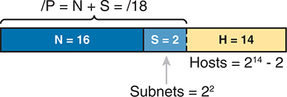

<figcaption>

<strong>图 14-1</strong> <em>地址结构：B 类网络，/18 掩码</em>

<aside class="hidden" id="a14fig01">

图中说明了采用 /18 掩码的 B 类网络结构，展示网络、子网和主机部分的位分配，以及网络中子网数和主机数的计算。矩形分为三个区域，分别表示 IP 地址的组成部分：N 等于 16 位，S 等于 2 位，H 等于 14 位。子网数（S）按 2 的平方计算，得到 4 个子网。主机数（H）按 2 的 14 次方减 2 计算，其中减去的 2 对应每个子网中的网络地址和广播地址。前缀长度（/P）通过将网络（N）和子网（S）的大小相加求出，结果为 /18。

</aside>

</figcaption>

</figure>

注意

与本书这一部分的其他章节一样，本章假设整个有类网络使用同一个掩码。

由于每个子网使用同一个掩码，这个 IP 网络中的所有子网必然大小相同，因为它们的结构相同。在本例中，四个子网都具有图中所示的结构，因此每个子网都有 2<em>14</em> − 2 个主机地址。

接下来，从整体上看这个子网设计示例：一个 B 类网络现在划分成了四个大小相等的子网。从概念上说，如果把整个 B 类网络表示为一条数轴，每个子网会占据数轴的四分之一，如<a href="#ch14fig02">图 14-2</a> 所示。每个子网都有一个子网 ID，即子网中数值最小的数字，因此位于子网的左端。每个子网也都有一个<a id="key_181" href="#ref-gloss_384">子网广播地址</a>，即子网中数值最大的数字，因此位于子网的右端。

<figure class="image-c" id="ch14fig02">

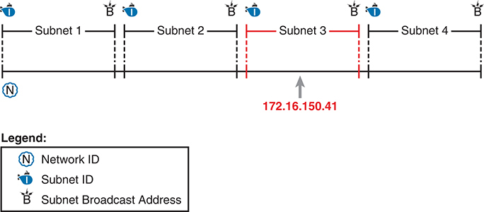

<figcaption>

<strong>图 14-2</strong> <em>将网络 172.16.0.0 划分为四个相等的子网</em>

</figcaption>

</figure>

本章其余内容将重点介绍，如何根据一个 IP 地址和掩码，确定该地址所属子网的详细信息。也就是说，你将学习如何求出 IP 地址所属的子网。仍以 IP 地址 172.16.150.41 和掩码 255.255.192.0 为例，<a href="#ch14fig03">图 14-3</a> 展示了其所属子网，以及界定该子网两端的子网 ID 和子网广播地址。

<figure class="image-c" id="ch14fig03">

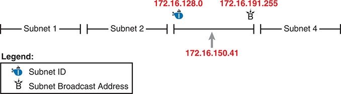

<figcaption>

<strong>图 14-3</strong> <em>172.16.150.41、255.255.192.0 所属的子网</em>

</figcaption>

</figure>

</section>

<section>

<h4 class="h4" id="ch14lev2sec2">子网 ID 的概念</h4>

子网 ID 只是一个用于简洁表示子网的数字。将子网 ID 与匹配的子网掩码一同列出，就能标识该子网，并据此推导出子网广播地址和子网地址范围。你不必写出有关子网的全部细节，只需写下子网 ID 和掩码，就拥有足够的信息来完整描述这个子网。

子网 ID 会出现在许多地方，其中最常见的是 IP 路由表。例如，工程师为路由器配置 IP 地址和掩码后，路由器会计算子网 ID，并在路由表中加入一条该子网的路由。随后，路由器通常会通过某种 IP 路由协议，向相邻路由器通告子网 ID／掩码组合。最终，企业中的所有路由器都会通过子网 ID 和子网掩码这一组合得知该子网，并将其显示在路由表中。（可以使用 <strong>show ip route</strong> 命令显示路由器 IP 路由表的内容。）

遗憾的是，与子网相关的术语有时会造成困扰。首先，<a id="key_182" href="#ref-gloss_385">子网 ID</a>、<a id="key_183" href="#ref-gloss_389">子网号</a>和<a id="key_180" href="#ref-gloss_383">子网地址</a>是同义词。此外，人们有时会直接用<em>子网</em>，同时指代子网这一概念以及作为子网 ID 的数值。在讨论路由时，人们有时用<em>前缀</em>代替<em>子网</em>。<em>前缀</em>与<em>子网</em>指的是同一个概念，只是采用了无类编址方式中描述 IP 地址的术语，详见<a href="v1-13.html#ch13">第 13 章</a>的“<a href="v1-13.html#ch13lev2sec8">无类编址与有类编址</a>”一节。

最大的术语混淆发生在<em>网络</em>和<em>子网</em>之间。在现实中，人们经常把这两个词作为同义词使用，在某些情况下完全合理。但在其他情况下，这些术语的具体含义及其差别，会影响所讨论的内容。

例如，人们常会问“网络 ID 是什么？”，实际上想知道的是子网 ID。但在另一种情况下，他们可能想知道的是 A 类、B 类或 C 类网络 ID。因此，当一位工程师问“172.16.150.41/18 的 net ID 是什么？”这类问题时，要结合上下文判断，他想要的是严格意义上的有类网络 ID（本例为 172.16.0.0），还是严格意义上的子网 ID（本例为 172.16.128.0）。

在考试中，要留意何时使用了<em>子网</em>和<em>网络</em>这些词，并利用上下文确定它们在具体情形下的含义。

<a href="#ch14tab02">表 14-2</a> 汇总了子网 ID 的关键信息及可能使用的同义词，便于复习和学习。

<figure class="table" id="ch14tab02" tabindex="0">

<figcaption>

<strong>表 14-2</strong> 子网 ID 关键信息汇总

</figcaption>

<table class="all">

<tbody>

<tr>

<td class="border">
<strong>定义</strong>
</td>

<td class="border">
代表子网的数字
</td>

</tr>

<tr>

<td class="border">
<strong>数值</strong>
</td>

<td class="border">
子网中的第一个（最小）数值
</td>

</tr>

<tr>

<td class="border">
<strong>严格意义上的同义词</strong>
</td>

<td class="border">
子网号、子网地址、前缀、所属子网
</td>

</tr>

<tr>

<td class="border">
<strong>日常用法中的同义词</strong>
</td>

<td class="border">
网络、网络 ID、网络号、网络地址
</td>

</tr>

<tr>

<td class="border">
<strong>常见于……</strong>
</td>

<td class="border">
路由表、文档
</td>

</tr>

</tbody>

</table>

</figure>

</section>

<section>

<h4 class="h4" id="ch14lev2sec3">子网广播地址</h4>

子网广播地址有两个主要作用：用作目的 IP 地址，向子网中的所有主机发送数据包；以及用于确定子网地址范围的高端边界。

子网广播地址最初的目的是为主机提供一种高效方式，只发送一个数据包就能送达某个子网中的所有主机。例如，子网 A 中的主机可以发送一个数据包，将目的地址设为子网 B 的子网广播地址。路由器会像转发发送给子网 B 中某台主机的单播 IP 数据包一样，转发这个数据包。数据包到达连接子网 B 的路由器后，最后这台路由器会将其转发给子网 B 中的所有主机，通常会把数据包封装进数据链路层广播帧。因此，主机 B 所在子网中的所有主机都会收到该数据包的副本。

子网广播地址也能帮助你确定子网中的地址范围，因为它是子网地址范围中的最后一个（最大）数值。要确定范围的低端，计算子网 ID；要确定范围的高端，计算子网广播地址。

<a href="#ch14tab03">表 14-3</a> 汇总了子网广播地址的关键信息及可能使用的同义词，便于复习和学习。

<figure class="table" id="ch14tab03" tabindex="0">

<figcaption>

<strong>表 14-3</strong> 子网广播地址关键信息汇总

</figcaption>

<table class="all">

<tbody>

<tr>

<td class="border">
<strong>定义</strong>
</td>

<td class="border">
每个子网中的一个保留数值。用作数据包的目的地址时，会使设备将数据包转发给该子网中的所有主机
</td>

</tr>

<tr>

<td class="border">
<strong>数值</strong>
</td>

<td class="border">
子网中的最后一个（最大）数值
</td>

</tr>

<tr>

<td class="border">
<strong>严格意义上的同义词</strong>
</td>

<td class="border">
定向广播地址
</td>

</tr>

<tr>

<td class="border">
<strong>较宽泛用法中的同义词</strong>
</td>

<td class="border">
网络广播
</td>

</tr>

<tr>

<td class="border">
<strong>常见于……</strong>
</td>

<td class="border">
子网地址范围的计算
</td>

</tr>

</tbody>

</table>

</figure>

</section>

<section>

<h4 class="h4" id="ch14lev2sec4">可用地址范围</h4>

负责实施 IP 互连网络的工程师需要了解每个子网中的单播 IP 地址范围。在规划哪些地址用作静态分配的 IP 地址、哪些地址配置为由 DHCP 服务器出租，以及哪些地址预留待用之前，必须先知道可用地址范围。

要确定子网中的可用 IP 地址范围，先求出子网 ID 和子网广播地址。然后，将子网 ID 的第四个八位组加 1，就得到第一个（最小的）可用地址；将子网广播地址的第四个八位组减 1，就得到子网中的最后一个（最大的）可用地址。

例如，<a href="#ch14fig03">图 14-3</a> 给出的子网 ID 是 172.16.128.0，掩码为 /18。第一个可用地址只比子网 ID 大 1，本例为 172.16.128.1。同一张图给出的子网广播地址为 172.16.191.255，因此最后一个可用地址比它小 1，即 172.16.191.254。

本节已经说明了共同定义一个子网的各项数值背后的概念，接下来本章其余内容将重点介绍求出这些值所需的计算。

</section>

</section>

<section>

<h3 class="h3" id="ch14lev1sec4">分析现有子网：二进制方法</h3>

“分析子网”是什么意思？在本书中，它意味着能够从 IP 地址和掩码入手，确定该地址所属子网的关键信息。具体来说，就是求出子网 ID、子网广播地址和地址范围。分析还可以包括<a href="v1-13.html#ch13">第 13 章</a>讨论的子网地址数量计算，但本章不再回顾那些概念。

根据地址／掩码计算子网详细信息的方法有很多。本节先介绍一些使用二进制运算的方法，下一节再介绍仅使用十进制运算的替代方法。虽然很多人为了在考试中提高速度，更喜欢十进制方法，但二进制计算最终能让你更深入地理解 IPv4 编址。尤其是，如果你打算继续获得高于 CCNA 的 Cisco 认证，即使考试时采用十进制方法，也应花时间理解本节讨论的二进制方法。

<section>

<h4 class="h4" id="ch14lev2sec5">求子网 ID：二进制方法</h4>

以下两句话概括了任意子网 ID 的二进制值背后的规律：

子网中的所有数值（子网 ID、子网广播地址和全部可用 IP 地址），其前缀部分都相同。

子网 ID 是子网中的最小数值，因此其主机部分的二进制形式全部为 0。

要以二进制求子网 ID，先取得 IP 地址的二进制形式，再将所有主机位改为二进制 0。因此，需要将 IP 地址转换为二进制，还需要识别前缀位和主机位；根据需要将掩码转换为前缀格式，就能轻松识别它们。<a href="#ch14fig04">图 14-4</a> 使用与本章前面示例相同的地址／掩码说明这一思路：172.16.150.41，掩码 /18。

<figure class="image-c" id="ch14fig04">

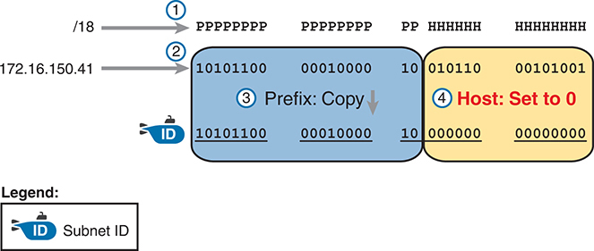

<figcaption>

<strong>图 14-4</strong> <em>二进制概念：将 IP 地址转换为子网 ID</em>

<aside class="hidden" id="a14fig04">

该过程包括四个步骤。步骤 1 将子网掩码 /18 表示为二进制格式 PPPPPPPP PPPPPPPP PP HHHHHH HHHHHHHH，其中 P 表示网络部分，H 表示主机部分。步骤 2 将 IP 地址 172.16.150.41 转换为二进制形式，得到 10101100 00010000 00101001。步骤 3 将前缀复制到子网 IDF，得到 10101100 00010000。步骤 4 将主机部分设为 0，把 010110 00101001 改为 000000 00000000。

</aside>

</figcaption>

</figure>

从<a href="#ch14fig04">图 14-4</a> 的顶部开始看，掩码用 18 个前缀位（P）和 14 个主机位（H）表示 IP 地址格式（步骤 1）。第二行（步骤 2）展示了 IP 地址的二进制形式，由点分十进制表示法（DDN）的值 172.16.150.41 转换而来。

接下来的两个步骤展示了复制 IP 地址前缀位（步骤 3），以及将主机位赋值为二进制 0（步骤 4）的操作。结果就是二进制形式的子网 ID。

最后一步没有显示在<a href="#ch14fig04">图 14-4</a> 中，即将子网 ID 从二进制转换为十进制。本书在<a href="#ch14fig05">图 14-5</a> 中单独展示这一步，主要是因为很多人会在此处出错。将 32 位数字（例如 IP 地址或 IP 子网 ID）转换回 IPv4 DDN 时，必须遵循以下规则：

每次将 8 位从二进制转换为十进制，无需考虑该数字中前缀部分与主机部分之间的分界。

<figure class="image-c" id="ch14fig05">

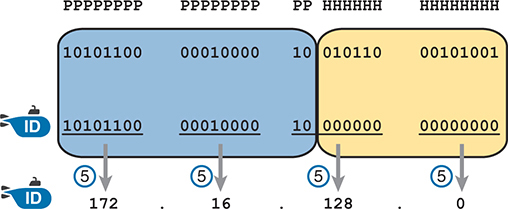

<figcaption>

<strong>图 14-5</strong> <em>将子网 ID 从二进制转换为 DDN</em>

<aside class="hidden" id="a14fig05">

该过程包括五个步骤。步骤 1 将子网掩码 /18 表示为二进制格式 PPPPPPPP PPPPPPPP PP HHHHHH HHHHHHHH，其中 P 表示网络部分，H 表示主机部分。步骤 2 将 IP 地址 172.16.150.41 转换为二进制：10101100 00010000 00101001。步骤 3 将前缀复制到子网 ID，得到 10101100 00010000。步骤 4 将主机部分设为 0，把 010110 00101001 改为 000000 00000000。步骤 5 将子网 ID 从二进制转换为点分十进制表示法（DDN），得到 172.16.128.0。

</aside>

</figcaption>

</figure>

<a href="#ch14fig05">图 14-5</a> 展示了最后这一步。请注意，第三个八位组（第三组 8 位）有 2 位属于前缀，6 位属于主机部分，但转换是针对整个 8 位进行的。

注意

可以利用<a data-original-href="vol1_appa.xhtml#appa" data-unavailable="true" title="此内容不在当前提取范围内；请参阅原始 EPUB：vol1_appa.xhtml#appa">附录 A</a>“<a data-original-href="vol1_appa.xhtml#appa" data-unavailable="true" title="此内容不在当前提取范围内；请参阅原始 EPUB：vol1_appa.xhtml#appa">数值参考表</a>”中的转换表，完成<a href="#ch14fig04">图 14-4</a> 和<a href="#ch14fig05">图 14-5</a> 中的数值转换。从 DDN 转为二进制时，逐个八位组在表中找到十进制值，然后写出等价的 8 位二进制形式。从二进制转回 DDN 时，逐个 8 位八位组在表中找到匹配的二进制条目，然后写出对应的十进制值。例如，172 转换为二进制 10101100，而 00010000 转换为十进制 16。

</section>

<section>

<h4 class="h4" id="ch14lev2sec6">求子网广播地址：二进制方法</h4>

求子网广播地址采用类似过程。使用求子网 ID 时的相同二进制方法，但不将所有主机位设为最小值（全部为二进制 0），而是将主机部分设为最大值（全部为二进制 1）。<a href="#ch14fig06">图 14-6</a> 展示了这一概念。

<a href="#ch14fig06">图 14-6</a> 展示的前三个步骤与<a href="#ch14fig04">图 14-4</a> 相同。具体而言，包括识别前缀位和主机位（步骤 1），将 IP 地址 172.16.150.41 转换为二进制（步骤 2），以及在步骤 3 复制前缀位（本例为前 18 位）。区别出现在步骤 4 的右侧主机位：将所有主机位（本例为最后 14 位）改为可能的最大值，即全部为二进制 1。步骤 5 再将 32 位子网广播地址转换为 DDN 格式。此外，请记住，无论从 DDN 转为二进制，还是反向转换，始终每次转换 8 位。特别是在本例中，第三个八位组的完整二进制值 10111111 转换为十进制 191。

<figure class="image-c" id="ch14fig06">

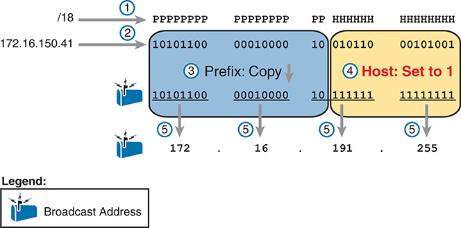

<figcaption>

<strong>图 14-6</strong> <em>求子网广播地址：二进制方法</em>

<aside class="hidden" id="a14fig06">

步骤 1 将子网掩码 /18 表示为二进制格式 PPPPPPPP PPPPPPPP PP HHHHHH HHHHHHHH，其中 P 表示网络部分，H 表示主机部分。步骤 2 将 IP 地址 172.16.150.41 转换为二进制：10101100 00010000 00101001。步骤 3 将前缀复制到广播地址，得到 10101100 00010000。随后，步骤 4 将主机部分全部设为 1，把 010110 00101001 改为 111111 11111111。最后，步骤 5 将广播地址从二进制转换为点分十进制表示法，得到 172.16.191.255。

</aside>

</figcaption>

</figure>

</section>

<section>

<h4 class="h4" id="ch14lev2sec7">二进制练习题</h4>

<a href="#ch14fig04">图 14-4</a> 和<a href="#ch14fig05">图 14-5</a> 展示了使用二进制运算求子网 ID 的过程。下面以文字形式汇总这些步骤，便于参考和练习：

步骤 1。将掩码转换为前缀格式，求出前缀长度（/P）和主机部分长度（32 − P）。

步骤 2。将 IP 地址转换为等价的 32 位二进制形式。

步骤 3。复制 IP 地址的前缀位。

步骤 4。将主机位写为 0。

步骤 5。将得到的 32 位数字每次取 8 位，转换回十进制。

求子网广播地址的过程完全相同，只是在步骤 4 中将这些位设为 1，如<a href="#ch14fig06">图 14-6</a> 所示。

花一点时间，在草稿纸上完成下面五道练习题。每道题都要求求出子网 ID 和子网广播地址，并记录前缀形式的掩码：

<ol class="number">

<li>
8.1.4.5, 255.255.0.0
</li>

<li>
130.4.102.1, 255.255.255.0
</li>

<li>
199.1.1.100, 255.255.255.0
</li>

<li>
130.4.102.1, 255.255.252.0
</li>

<li>
199.1.1.100, 255.255.255.224
</li>

</ol>

<a href="#ch14tab04">表 14-4</a> 至<a href="#ch14tab08">表 14-8</a> 给出了五个不同示例的结果。表中以粗体显示主机位，并包含地址和掩码的二进制形式，以及子网 ID 和子网广播地址的二进制形式。

<figure class="table" id="ch14tab04" tabindex="0">

<figcaption>

<strong>表 14-4</strong> 地址 8.1.4.5、掩码 255.255.0.0 所属子网的分析

</figcaption>

<table class="all">

<tbody>

<tr>

<td class="border">
<strong>前缀长度</strong>
</td>

<td class="border">
/16
</td>

<td class="border">
<code>11111111 11111111 <strong>00000000 00000000</strong></code>
</td>

</tr>

<tr>

<td class="border">
<strong>地址</strong>
</td>

<td class="border">
8.1.4.5
</td>

<td class="border">
<code>00001000 00000001 <strong>00000100 00000101</strong></code>
</td>

</tr>

<tr>

<td class="border">
<strong>子网 ID</strong>
</td>

<td class="border">
8.1.0.0
</td>

<td class="border">
<code>00001000 00000001 <strong>00000000 00000000</strong></code>
</td>

</tr>

<tr>

<td class="border">
<strong>广播地址</strong>
</td>

<td class="border">
8.1.255.255
</td>

<td class="border">
<code>00001000 00000001 <strong>11111111 11111111</strong></code>
</td>

</tr>

</tbody>

</table>

</figure>

<figure class="table" id="ch14tab05" tabindex="0">

<figcaption>

<strong>表 14-5</strong> 地址 130.4.102.1、掩码 255.255.255.0 所属子网的分析

</figcaption>

<table class="all">

<tbody>

<tr>

<td class="border">
<strong>前缀长度</strong>
</td>

<td class="border">
/24
</td>

<td class="border">
<code>11111111 11111111 11111111 <strong>00000000</strong></code>
</td>

</tr>

<tr>

<td class="border">
<strong>地址</strong>
</td>

<td class="border">
130.4.102.1
</td>

<td class="border">
<code>10000010 00000100 01100110 <strong>00000001</strong></code>
</td>

</tr>

<tr>

<td class="border">
<strong>子网 ID</strong>
</td>

<td class="border">
130.4.102.0
</td>

<td class="border">
<code>10000010 00000100 01100110 <strong>00000000</strong></code>
</td>

</tr>

<tr>

<td class="border">
<strong>广播地址</strong>
</td>

<td class="border">
130.4.102.255
</td>

<td class="border">
<code>10000010 00000100 01100110 <strong>11111111</strong></code>
</td>

</tr>

</tbody>

</table>

</figure>

<figure class="table" id="ch14tab06" tabindex="0">

<figcaption>

<strong>表 14-6</strong> 地址 199.1.1.100、掩码 255.255.255.0 所属子网的分析

</figcaption>

<table class="all">

<tbody>

<tr>

<td class="border">
<strong>前缀长度</strong>
</td>

<td class="border">
/24
</td>

<td class="border">
<code>11111111 11111111 11111111 <strong>00000000</strong></code>
</td>

</tr>

<tr>

<td class="border">
<strong>地址</strong>
</td>

<td class="border">
199.1.1.100
</td>

<td class="border">
<code>11000111 00000001 00000001 <strong>01100100</strong></code>
</td>

</tr>

<tr>

<td class="border">
<strong>子网 ID</strong>
</td>

<td class="border">
199.1.1.0
</td>

<td class="border">
<code>11000111 00000001 00000001 <strong>00000000</strong></code>
</td>

</tr>

<tr>

<td class="border">
<strong>广播地址</strong>
</td>

<td class="border">
199.1.1.255
</td>

<td class="border">
<code>11000111 00000001 00000001 <strong>11111111</strong></code>
</td>

</tr>

</tbody>

</table>

</figure>

<figure class="table" id="ch14tab07" tabindex="0">

<figcaption>

<strong>表 14-7</strong> 地址 130.4.102.1、掩码 255.255.252.0 所属子网的分析

</figcaption>

<table class="all">

<tbody>

<tr>

<td class="border">
<strong>前缀长度</strong>
</td>

<td class="border">
/22
</td>

<td class="border">
<code>11111111 11111111 111111<strong>00 00000000</strong></code>
</td>

</tr>

<tr>

<td class="border">
<strong>地址</strong>
</td>

<td class="border">
130.4.102.1
</td>

<td class="border">
<code>10000010 00000100 011001<strong>10 00000001</strong></code>
</td>

</tr>

<tr>

<td class="border">
<strong>子网 ID</strong>
</td>

<td class="border">
130.4.100.0
</td>

<td class="border">
<code>10000010 00000100 011001<strong>00 00000000</strong></code>
</td>

</tr>

<tr>

<td class="border">
<strong>广播地址</strong>
</td>

<td class="border">
130.4.103.255
</td>

<td class="border">
<code>10000010 00000100 011001<strong>11 11111111</strong></code>
</td>

</tr>

</tbody>

</table>

</figure>

<figure class="table" id="ch14tab08" tabindex="0">

<figcaption>

<strong>表 14-8</strong> 地址 199.1.1.100、掩码 255.255.255.224 所属子网的分析

</figcaption>

<table class="all">

<tbody>

<tr>

<td class="border">
<strong>前缀长度</strong>
</td>

<td class="border">
/27
</td>

<td class="border">
<code>11111111 11111111 11111111 111<strong>00000</strong></code>
</td>

</tr>

<tr>

<td class="border">
<strong>地址</strong>
</td>

<td class="border">
199.1.1.100
</td>

<td class="border">
<code>11000111 00000001 00000001 011<strong>00100</strong></code>
</td>

</tr>

<tr>

<td class="border">
<strong>子网 ID</strong>
</td>

<td class="border">
199.1.1.96
</td>

<td class="border">
<code>11000111 00000001 00000001 011<strong>00000</strong></code>
</td>

</tr>

<tr>

<td class="border">
<strong>广播地址</strong>
</td>

<td class="border">
199.1.1.127
</td>

<td class="border">
<code>11000111 00000001 00000001 011<strong>11111</strong></code>
</td>

</tr>

</tbody>

</table>

</figure>

</section>

<section>

<h4 class="h4" id="ch14lev2sec8">二进制过程的快捷方法</h4>

到目前为止，本节介绍的二进制方法需要将全部四个八位组转换为二进制，然后再转回十进制。不过，根据 DDN 掩码，你可以轻松预测四个八位组中至少三个的结果。这样，除一个八位组之外，其余八位组都可以避免二进制运算，从而减少所需的二进制转换次数。

首先，仅考虑一个 DDN 掩码值为 255 的八位组。掩码值 255 转换为二进制 11111111，表示这 8 位都是前缀位。逐步思考这一过程：在步骤 2，将地址转换成某个数值；在步骤 3，复制这个数值；在步骤 4，将同一个 8 位数字转换回十进制。对这个八位组而言，你在这三步中所做的全部事情，只是从十进制转换为二进制，再将同一个数字转换回原来的十进制值！

简而言之，对于值为 255 的任意掩码八位组，子网 ID 和子网广播地址中对应八位组的值，都等于 IP 地址中该八位组的值。

例如，172.16.150.41、掩码 255.255.192.0 所属的子网 ID 为 172.16.128.0。掩码的前两个八位组为 255。因此，无需考虑二进制运算，直接先复制地址中这两个八位组的值：172.16。

对于 DDN 掩码值为十进制 0（即二进制 00000000）的八位组，也存在一个快捷方法。当十进制掩码值为 0 时，无论 IP 地址中该八位组的初始值是什么，子网 ID 中的计算结果始终为十进制 0。具体来说，只需看此时的步骤 4 和 5：步骤 4 写出 8 个二进制 0，步骤 5 将 00000000 转回十进制 0。

下面修订后的步骤考虑了这两个快捷方法。但是，当掩码既不是 0 也不是 255 时，仍需进行相同的转换。最多只需要对一个八位组进行转换。要求子网 ID，对四个八位组分别应用以下规则：

步骤 1。如果掩码 = 255，复制 IP 地址中该八位组的十进制值。

步骤 2。如果掩码 = 0，将该八位组写为十进制 0。

步骤 3。如果该八位组的掩码既不是 0 也不是 255，使用本章前面“<a href="#ch14lev2sec5">求子网 ID：二进制方法</a>”一节中的相同二进制方法。

<a href="#ch14fig07">图 14-7</a> 再次使用 172.16.150.41、255.255.192.0，展示了这一过程的示例。

<figure class="image-c" id="ch14fig07">

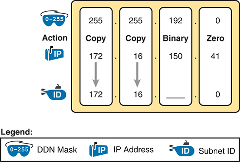

<figcaption>

<strong>图 14-7</strong> <em>二进制快捷方法示例</em>

<aside class="hidden" id="a14fig07">

给定的点分十进制表示法（DDN）掩码为 255.255.192.0，覆盖 0 到 255 的范围。操作通过复制二进制零来创建子网。给定 IP 地址为 172.16.150.41，子网 ID 为 172.16.0.0。

</aside>

</figcaption>

</figure>

求子网广播地址时，可以使用与求子网 ID 类似的十进制快捷方法：对于等于十进制 0 的 DDN 掩码八位组，将子网广播地址中对应的十进制值设为 255，而不是 0，如下所列：

步骤 1。如果掩码 = 255，复制 IP 地址中该八位组的十进制值。

步骤 2。如果掩码 = 0，将该八位组写为十进制 255。

步骤 3。如果该八位组的掩码既不是 0 也不是 255，使用本章前面“<a href="#ch14lev2sec6">求子网广播地址：二进制方法</a>”一节中的相同二进制方法。

</section>

<section>

<h4 class="h4" id="ch14lev2sec9">布尔运算简介</h4>

到目前为止，本章介绍了人们如何使用二进制运算求子网 ID 和子网广播地址。不过，计算机通常使用一种完全不同的二进制过程来求相同的值，它采用名为<em>布尔代数</em>的数学分支。计算机已经以二进制形式存储 IP 地址和掩码，因此不必在十进制与二进制之间转换。随后，某些布尔运算让计算机仅用几条 CPU 指令就能计算出子网 ID 和子网广播地址。

你无需掌握布尔运算，也能很好地理解 IP 子网划分。不过，如果你感兴趣，计算机分别使用以下布尔逻辑求子网 ID 和子网广播地址：

对 IP 地址和掩码执行<em>布尔与运算</em>。此过程会将所有主机位转换为二进制 0。

先将掩码取反，再对 IP 地址和取反后的子网掩码执行<em>布尔或运算</em>。此过程会将所有主机位转换为二进制 1。

</section>

<section>

<h4 class="h4" id="ch14lev2sec10">求地址范围</h4>

知道子网 ID 和子网广播地址后，只需简单的加减运算，就能确定子网中的可用地址范围。求子网中第一个（最小的）可用 IP 地址时，只需将子网 ID 的第四个八位组加 1。求最后一个（最大的）可用 IP 地址时，只需将子网广播地址的第四个八位组减 1。

</section>

</section>

<section>

<h3 class="h3" id="ch14lev1sec5">分析现有子网：十进制方法</h3>

使用二进制方法分析现有子网效果很好。不过，其中一些运算对大多数人来说比较耗时，尤其是十进制与二进制之间的转换。而 Cisco CCNA 考试要求你快速完成计算。对于考试，你确实应该能够根据 IP 地址和掩码，在大约 15 秒内算出子网 ID 和可用地址范围。采用二进制方法时，大多数人需要大量练习才能求出这些答案，即使使用简化的二进制过程也是如此。

本节讨论如何仅使用十进制运算求子网 ID 和子网广播地址。与二进制方法相比，大多数人使用此过程能更快得出答案，至少稍加练习后是这样。不过，十进制过程不会解释计算背后的含义。因此，如果你还没有阅读前面的“<a href="#ch14lev1sec4">分析现有子网：二进制方法</a>”一节，为了理解子网划分，值得回头读一读。本节重点是采用一种经过练习后应该更快的方法，得到正确答案。

<section>

<h4 class="h4" id="ch14lev2sec11">使用简单掩码进行分析</h4>

对于三个特定的简单子网掩码，求子网 ID 和子网广播地址只需简单推理，实际上完全不用计算。这三个简单掩码是：

255.0.0.0

255.255.0.0

255.255.255.0

这些简单掩码的十进制形式仅包含 255 和 0。相比之下，复杂掩码中有一个八位组既不是 255 也不是 0，使得推导更具挑战性。

注意

<em>简单掩码</em>和<em>复杂掩码</em>是本书为了描述掩码及其处理难度而使用的术语。

当题目使用简单掩码时，你可以根据 DDN 格式的 IP 地址和掩码，快速求出子网 ID。只需对四个八位组分别应用以下步骤：

步骤 1。如果掩码八位组 = 255，复制 IP 地址的十进制值。

步骤 2。如果掩码八位组 = 0，写入十进制 0。

求子网广播地址也有类似的简单过程，如下所示：

步骤 1。如果掩码八位组 = 255，复制 IP 地址的十进制值。

步骤 2。如果掩码八位组 = 0，写入十进制 255。

进入下一节之前，请花些时间填写<a href="#ch14tab09">表 14-9</a> 中的空白。然后，将答案与本章后面“<a data-original-href="vol1_ch14.xhtml#ch14lev1sec11" data-unavailable="true" title="此内容不在当前提取范围内；请参阅原始 EPUB：vol1_ch14.xhtml#ch14lev1sec11">前述练习题答案</a>”一节中的<a data-original-href="vol1_ch14.xhtml#ch14tab15" data-unavailable="true" title="此内容不在当前提取范围内；请参阅原始 EPUB：vol1_ch14.xhtml#ch14tab15">表 14-15</a> 对照。请在表中列出子网 ID 和子网广播地址。

<figure class="table" id="ch14tab09" tabindex="0">

<figcaption>

<strong>表 14-9</strong> 练习题：使用简单掩码求子网 ID 和广播地址

</figcaption>

<table class="all">

<thead>

<tr>

<th class="th">

</th>

<th class="th">
IP 地址
</th>

<th class="th">
掩码
</th>

<th class="th">
子网 ID
</th>

<th class="th">
广播地址
</th>

</tr>

</thead>

<tbody>

<tr>

<td class="border">
1
</td>

<td class="border">
10.77.55.3
</td>

<td class="border">
255.255.255.0
</td>

<td class="border">

</td>

<td class="border">

</td>

</tr>

<tr>

<td class="border">
2
</td>

<td class="border">
172.30.99.4
</td>

<td class="border">
255.255.255.0
</td>

<td class="border">

</td>

<td class="border">

</td>

</tr>

<tr>

<td class="border">
3
</td>

<td class="border">
192.168.6.54
</td>

<td class="border">
255.255.255.0
</td>

<td class="border">

</td>

<td class="border">

</td>

</tr>

<tr>

<td class="border">
4
</td>

<td class="border">
10.77.3.14
</td>

<td class="border">
255.255.0.0
</td>

<td class="border">

</td>

<td class="border">

</td>

</tr>

<tr>

<td class="border">
5
</td>

<td class="border">
172.22.55.77
</td>

<td class="border">
255.255.0.0
</td>

<td class="border">

</td>

<td class="border">

</td>

</tr>

<tr>

<td class="border">
6
</td>

<td class="border">
1.99.53.76
</td>

<td class="border">
255.0.0.0
</td>

<td class="border">

</td>

<td class="border">

</td>

</tr>

</tbody>

</table>

</figure>

</section>

<section>

<h4 class="h4" id="ch14lev2sec12">关键八位组中的可预测规律</h4>

虽然有三个掩码比较容易处理（255.0.0.0、255.255.0.0 和 255.255.255.0），但其余所有子网掩码都会使十进制运算稍微复杂一些，因此我们称之为<em>复杂掩码</em>。复杂掩码中有一个八位组的值既不是 0，也不是 255。为了突出这个值最难处理的八位组，本书将其称为<em>关键八位组</em>（interesting octet）。

如果花时间思考不同题目，并把注意力放在关键八位组上，就会开始发现其中的规律。本节将带你进行这种观察，让你学会以十进制预测规律并求出子网 ID。

首先，子网 ID 的十进制值具有可预测性，是因为我们假设单个有类网络的所有子网使用相同的子网掩码。本书这一部分的各章都假设，对于给定有类网络，设计工程师选择让所有子网使用一个子网掩码。（更多细节见<a href="v1-11.html#ch11">第 11 章</a>“<a href="v1-11.html#ch11">IPv4 子网划分概览</a>”中的“<a href="v1-11.html#ch11lev2sec6">一种子网大小适合所有情况吗</a>”一节。）

要观察这种可预测性，可以查看一位网络工程师记录的规划信息，如<a href="#ch14fig08">图 14-8</a> 所示。图中给出了工程师考虑在 IPv4 网络中使用的四种不同掩码，以及 B 类网络 172.16.0.0。图中从上到下，依次展示了使用掩码 255.255.128.0、255.255.192.0、255.255.224.0 和 255.255.240.0 时，所创建子网 ID 的第三个八位组取值。

<figure class="image-c" id="ch14fig08">

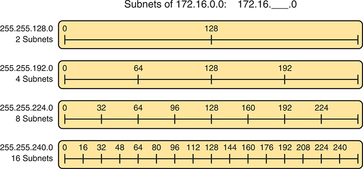

<figcaption>

<strong>图 14-8</strong> <em>关键八位组中的数值规律</em>

<aside class="hidden" id="a14fig08">

从基础网络地址 172.16.0.0 开始，通过划分八位组形成不同子网。对于 2 个子网，子网掩码 255.255.128.0 将时间线分为从 0 和 128 开始的区段。使用子网掩码 255.255.192.0 划分 4 个子网时，时间线分段起点为 0、64、128 和 192。使用子网掩码 255.255.224.0 划分 8 个子网时，时间线分段起点为 0、32、64、96、128、160、192 和 224。最后，使用子网掩码 255.255.240.0 划分 16 个子网时，时间线在 0、16、32、48、64、80、96、112、128、144、160、176、192、208、224 和 240 处标出区段。

</aside>

</figcaption>

</figure>

先进一步解释这张图，看看最上面一行。如果工程师使用掩码 255.255.128.0，就会创建两个子网，子网 ID 为 172.16.0.0 和 172.16.128.0。如果使用掩码 255.255.192.0，就会创建四个子网，子网 ID 为 172.16.0.0、172.16.64.0、172.16.128.0 和 172.16.192.0。

仔细观察图示，规律就很明显了。本例中：

掩码：255.255.128.0　　　规律：128 的倍数

掩码：255.255.192.0　　　规律：64 的倍数

掩码：255.255.224.0　　　规律：32 的倍数

掩码：255.255.240.0　　　规律：16 的倍数

要求子网 ID，只需找到确定这一规律的方法。如果给出 IP 地址和掩码，就找到最接近 IP 地址、但不超过它的子网 ID，下一节将讨论这一方法。

</section>

<section>

<h4 class="h4" id="ch14lev2sec13">求子网 ID：复杂掩码</h4>

下面以文字列出仅使用十进制运算求子网 ID 的全部步骤。这一过程在前面简单掩码方法的基础上增加了内容。对每个八位组：

步骤 1。如果掩码八位组 = 255，复制 IP 地址的十进制值。

步骤 2。如果掩码八位组 = 0，写入十进制 0。

步骤 3。如果掩码不属于以上两种情况，将此八位组称为<em>关键八位组</em>：

<ol class="step-lower-alpha">

<li>
计算<em>魔数</em>：256 − 掩码。
</li>

<li>
将子网 ID 的值设为最接近 IP 地址但不超过它的那个魔数倍数。
</li>

</ol>

这一过程使用了本书定义的两个新术语：<em>魔数</em>和<em>关键八位组</em>。<em>关键八位组</em>指步骤 3 中识别出的八位组，也就是掩码既不是 255 也不是 0 的八位组。步骤 3A 使用了<em>魔数</em>一词，它由 DDN 掩码推导得出。从概念上说，魔数就是在一个子网 ID 上相加后，能够得到按顺序排列的下一个子网 ID 的数值，如<a href="#ch14fig08">图 14-8</a> 所示。从数值上说，如步骤 3A 所述，用 256 减去 DDN 掩码在关键八位组中的值，就能求出魔数。

学习这一过程的最好方法，是观看实际演示。事实上，如果条件允许，现在可以暂停阅读，打开本书配套网站，观看使用复杂掩码求子网 ID 的视频。这些视频会演示这一过程。你也可以使用接下来几页展示的纸上计算示例，然后按照本章后面“<a href="#ch14lev1sec6">现有子网分析练习</a>”一节提供的安排进行练习。

<section>

<h5 class="h5" id="ch14lev3sec1">所属子网示例 1</h5>

例如，要求求出 IP 地址 130.4.102.1、掩码 255.255.240.0 所属的子网。这一过程不需要你区分前缀位和主机位、转换掩码、考虑掩码的二进制形式，或将 IP 地址转为二进制再转回。相反，只需对四个八位组分别根据掩码值选择操作。<a href="#ch14fig09">图 14-9</a> 展示了结果；图中圆圈内的编号对应前几页以文字列出的求子网 ID 过程的步骤编号。

<figure class="image-c" id="ch14fig09">

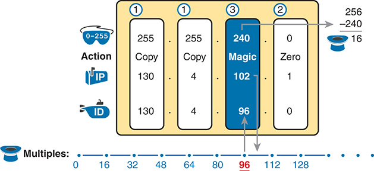

<figcaption>

<strong>图 14-9</strong> <em>求子网 ID：130.4.102.1、255.255.240.0</em>

<aside class="hidden" id="a14fig09">

点分十进制表示法（DDN）掩码的范围为 0 到 255，指定的子网掩码为 255.255.240.0。操作包括复制魔数零，其中 256 − 240 = 16，表示子网数量。给定 IP 地址为 130.4.102.1，得到子网 ID 130.4.96.0。倍数以 16 为间隔标记，包括 16、32、48、64、80、96、112、128，其中 96 表示第三个子网 ID。

</aside>

</figcaption>

</figure>

首先，检查三个非关键八位组（本例为第 1、2 和 4 个）。这一过程以掩码为依据：前两个八位组的掩码值为 255，因此只需把 IP 地址的值复制到准备填写子网 ID 的位置。第四个八位组的掩码值为 0，因此将子网 ID 的第四个八位组写为 0。

最有挑战性的推导发生在关键八位组中。本例是第三个八位组，因为该八位组的掩码值为 240。对于这个八位组，步骤 3A 要求按 256 − 掩码计算魔数，也就是用 256 减去掩码在关键八位组中的值（本例为 240）：256 − 240 = 16。因此，本例中子网 ID 在该八位组中的值必须是十进制 16 的倍数。

步骤 3B 随后要求求出魔数（本例为 16）的倍数，并选择最接近 IP 地址但不超过它的那个。具体而言，你应当从 0 开始心算魔数的倍数。（不要忘记从 0 开始！）依次计算：0、16、32、48、64、80、96、112，依此类推。然后，找到最接近 IP 地址在该八位组中的值（本例为 102）、但不超过 102 的倍数。因此，如<a href="#ch14fig09">图 14-9</a> 所示，将第三个八位组的值设为 96，得到完整子网 ID 130.4.96.0。

</section>

<section>

<h5 class="h5" id="ch14lev3sec2">所属子网示例 2</h5>

再考虑一个示例：192.168.5.77，掩码 255.255.255.224。<a href="#ch14fig10">图 14-10</a> 展示了结果。

<figure class="image-c" id="ch14fig10">

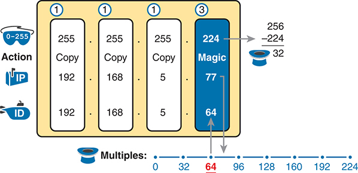

<figcaption>

<strong>图 14-10</strong> <em>192.168.5.77、255.255.255.224 所属的子网</em>

<aside class="hidden" id="a14fig10">

点分十进制表示法（DDN）掩码的范围为 0 到 255，指定的子网掩码为 255.255.255.224。操作包括复制魔数零，其中 256 − 224 = 32，表示子网数量。给定 IP 地址为 192.168.5.77，得到子网 ID 192.168.5.64。倍数以 32 为间隔标记，包括 16、32、48、64、80、96、112、128，其中 64 表示最后一个子网 ID。

</aside>

</figcaption>

</figure>

三个非关键八位组（本例为第 1、2 和 3 个）只需稍作判断。这些八位组的掩码值都为 255，因此只需分别复制 IP 地址中对应的值。

对于关键八位组，步骤 3A 得到的魔数为 256 − 224 = 32。魔数的倍数为 0、32、64、96，依此类推。本例中，IP 地址第四个八位组的值为 77，所以应选择最接近 77 但不超过它的倍数。因此，子网 ID 以 64 结尾，完整值为 192.168.5.64。

</section>

<section>

<h5 class="h5" id="ch14lev3sec3">所属子网练习题</h5>

进入下一节之前，请花时间填写<a href="#ch14tab10">表 14-10</a> 中的空白。然后，将答案与本章后面“<a data-original-href="vol1_ch14.xhtml#ch14lev1sec11" data-unavailable="true" title="此内容不在当前提取范围内；请参阅原始 EPUB：vol1_ch14.xhtml#ch14lev1sec11">前述练习题答案</a>”一节中的<a data-original-href="vol1_ch14.xhtml#ch14tab16" data-unavailable="true" title="此内容不在当前提取范围内；请参阅原始 EPUB：vol1_ch14.xhtml#ch14tab16">表 14-16</a> 对照。请在表中列出每种情况下的子网 ID。<a data-original-href="vol1_ch14.xhtml#ch14tab16" data-unavailable="true" title="此内容不在当前提取范围内；请参阅原始 EPUB：vol1_ch14.xhtml#ch14tab16">表 14-16</a> 后的文字还给出了每道题的解释。

<figure class="table" id="ch14tab10" tabindex="0">

<figcaption>

<strong>表 14-10</strong> 练习题：使用复杂掩码求子网 ID

</figcaption>

<table class="all">

<thead>

<tr>

<th class="th">
问题
</th>

<th class="th">
IP 地址
</th>

<th class="th">
掩码
</th>

<th class="th">
子网 ID
</th>

</tr>

</thead>

<tbody>

<tr>

<td class="border">
1
</td>

<td class="border">
10.77.55.3
</td>

<td class="border">
255.248.0.0
</td>

<td class="border">

</td>

</tr>

<tr>

<td class="border">
2
</td>

<td class="border">
172.30.99.4
</td>

<td class="border">
255.255.192.0
</td>

<td class="border">

</td>

</tr>

<tr>

<td class="border">
3
</td>

<td class="border">
192.168.6.54
</td>

<td class="border">
255.255.255.252
</td>

<td class="border">

</td>

</tr>

<tr>

<td class="border">
4
</td>

<td class="border">
10.77.3.14
</td>

<td class="border">
255.255.128.0
</td>

<td class="border">

</td>

</tr>

<tr>

<td class="border">
5
</td>

<td class="border">
172.22.55.77
</td>

<td class="border">
255.255.254.0
</td>

<td class="border">

</td>

</tr>

<tr>

<td class="border">
6
</td>

<td class="border">
1.99.53.76
</td>

<td class="border">
255.255.255.248
</td>

<td class="border">

</td>

</tr>

</tbody>

</table>

</figure>

</section>

</section>

<section>

<h4 class="h4" id="ch14lev2sec14">求子网广播地址：复杂掩码</h4>

要求子网的广播地址，可以使用类似过程。为简化起见，此过程从子网 ID 开始，而不是从 IP 地址开始。如果你拿到的是 IP 地址，先使用本章的方法求出子网 ID，再使用以下过程求同一子网的子网广播地址。对每个八位组：

步骤 1。如果掩码八位组 = 255，复制子网 ID 的值。

步骤 2。如果掩码八位组 = 0，写入 255。

步骤 3。如果掩码不属于以上两种情况，将此八位组确定为<em>关键八位组</em>：

<ol class="step-lower-alpha">

<li>
计算<em>魔数</em>：256 − 掩码。
</li>

<li>
取子网 ID 的值，加上魔数，再减去 1（ID + 魔数 − 1）。
</li>

</ol>

<section>

<h5 class="h5" id="ch14lev3sec4">子网广播示例 1</h5>

第一个示例延续本章前面“<a href="#ch14lev2sec13">求子网 ID：复杂掩码</a>”一节的第一个示例，如<a href="#ch14fig09">图 14-9</a> 所示。该示例从 IP 地址／掩码 130.4.102.1、255.255.240.0 出发，展示了如何求出子网 ID 130.4.96.0。现在，<a href="#ch14fig11">图 14-11</a> 从这个子网 ID 和相同掩码开始。

<figure class="image-c" id="ch14fig11">

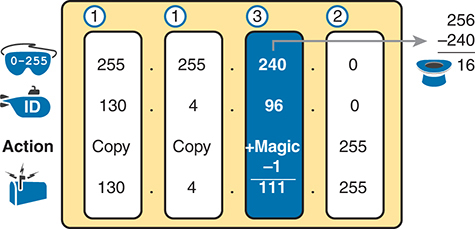

<figcaption>

<strong>图 14-11</strong> <em>求子网广播地址：130.4.96.0、255.255.240.0</em>

<aside class="hidden" id="a14fig11">

点分十进制表示法（DDN）掩码的范围为 0 到 255，指定的子网掩码为 255.255.240.0。操作包括复制魔数 255。由于子网掩码为 240，用 256 减去它得到 16，表示子网数量。给定 IP 地址为 130.4.96.0。将 IP 地址最后一个八位组加上 255，得到子网广播地址 130.4.111.256。

</aside>

</figcaption>

</figure>

首先，检查三个非关键八位组（第 1、2 和 4 个）。这一过程以掩码为依据，前两个八位组的掩码值为 255，因此只需将子网 ID 中对应的值复制到准备填写子网广播地址的位置。第四个八位组的掩码值为 0，因此将第四个八位组写为 255。

本例中，与关键八位组有关的推导发生在第三个八位组，因为其掩码值为 240。首先，步骤 3A 要求按 256 − 掩码计算魔数。（如果已经用本书的十进制方法计算出子网 ID，就应该已经知道魔数。）在步骤 3B，取子网 ID 的值（96），加上魔数（16），再减去 1，得到 111。因此，子网广播地址为 130.4.111.255。

</section>

<section>

<h5 class="h5" id="ch14lev3sec5">子网广播示例 2</h5>

本例同样延续前面的示例，即“<a href="#ch14lev3sec2">所属子网示例 2</a>”一节中<a href="#ch14fig10">图 14-10</a> 展示的示例。该示例从 IP 地址／掩码 192.168.5.77、255.255.255.224 出发，展示了如何求出子网 ID 192.168.5.64。现在，<a href="#ch14fig12">图 14-12</a> 从这个子网 ID 和相同掩码开始。

<figure class="image-c" id="ch14fig12">

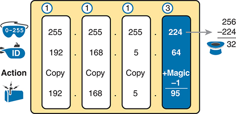

<figcaption>

<strong>图 14-12</strong> <em>求子网广播地址：192.168.5.64、255.255.255.224</em>

<aside class="hidden" id="a14fig12">

点分十进制表示法（DDN）掩码的范围为 0 到 255，指定的子网掩码为 255.255.255.224。操作包括复制魔数，魔数通过用 256 减去子网掩码值求出，结果为 32。给定 IP 地址为 192.168.5.64。将魔数减去 1，再加到 IP 地址最后一个八位组上，得到子网广播地址 192.168.5.95。

</aside>

</figcaption>

</figure>

首先，检查三个非关键八位组（第 1、2 和 3 个）。这一过程以掩码为依据，前三个八位组的掩码值为 255，因此只需将子网 ID 中对应的值复制到准备填写子网广播地址的位置。

关键推导发生在关键八位组中，本例是第四个八位组，因为其掩码值为 224。首先，步骤 3A 要求按 256 − 掩码计算魔数。（如果已经计算出子网 ID，由于使用相同掩码，魔数也相同。）在步骤 3B，取子网 ID 的值（64），加上魔数（32），再减去 1，得到 95。因此，子网广播地址为 192.168.5.95。

</section>

<section>

<h5 class="h5" id="ch14lev3sec6">子网广播地址练习题</h5>

进入下一节之前，请花时间在草稿纸上完成几道练习。回到列有 IP 地址和掩码的<a href="#ch14tab10">表 14-10</a>，练习求出表中每道题的子网广播地址。然后，将答案与本章后面“<a data-original-href="vol1_ch14.xhtml#ch14lev1sec11" data-unavailable="true" title="此内容不在当前提取范围内；请参阅原始 EPUB：vol1_ch14.xhtml#ch14lev1sec11">前述练习题答案</a>”一节中的<a data-original-href="vol1_ch14.xhtml#ch14tab17" data-unavailable="true" title="此内容不在当前提取范围内；请参阅原始 EPUB：vol1_ch14.xhtml#ch14tab17">表 14-17</a> 对照。

</section>

</section>

</section>

<section>

<h3 class="h3" id="ch14lev1sec6">现有子网分析练习</h3>

和本书中的其他子网划分计算一样，采用两个阶段的学习方法可能有所帮助。现在花时间练习，直到你感觉已经理解这一过程。然后，在考试之前，确保熟练掌握计算。<a href="#ch14tab11">表 14-11</a> 汇总了这种两阶段方法的关键概念与建议。

<figure class="table" id="ch14tab11" tabindex="0">

<figcaption>

<strong>表 14-11</strong> 本章主题在继续学习前和参加考试前的目标

</figcaption>

<table class="all">

<thead>

<tr>

<th class="th">
时间阶段
</th>

<th class="th">
进入下一章之前
</th>

<th class="th">
参加考试前
</th>

</tr>

</thead>

<tbody>

<tr>

<td class="border">
<strong>关注重点……</strong>
</td>

<td class="border">
学会方法
</td>

<td class="border">
准确且快速
</td>

</tr>

<tr>

<td class="border">
<strong>允许使用的工具</strong>
</td>

<td class="border">
所有工具
</td>

<td class="border">
大脑和记事本
</td>

</tr>

<tr>

<td class="border">
<strong>目标：准确率</strong>
</td>

<td class="border">
90% 正确
</td>

<td class="border">
100% 正确
</td>

</tr>

<tr>

<td class="border">
<strong>目标：速度</strong>
</td>

<td class="border">
不限速度
</td>

<td class="border">
20—30 秒
</td>

</tr>

</tbody>

</table>

</figure>

<section>

<h4 class="h4" id="ch14lev2sec15">一个选择：记忆还是计算</h4>

如本章所述，求子网 ID 和子网广播地址的十进制过程确实需要一些计算，包括魔数的计算（256 − 掩码）。这些过程还使用 DDN 掩码，所以如果考题给出的是前缀形式的掩码，在使用本书的方法之前，需要先转换为 DDN 格式。

多年来，一些人告诉我，他们更喜欢通过记住一张表来查找魔数。这类表可以列出不同 DDN 掩码和前缀掩码对应的魔数，从而避免把前缀掩码转换为 DDN。<a href="#ch14tab12">表 14-12</a> 展示了这样一张表的示例。你可以忽略它、使用它，或制作自己的表。

<figure class="table" id="ch14tab12" tabindex="0">

<figcaption>

<strong>表 14-12</strong> 参考表：DDN 掩码值、等价二进制值、魔数和前缀

</figcaption>

<table class="all">

<tbody>

<tr>

<td class="border">
前缀，关键八位组为第 2 个
</td>

<td class="border">
/9
</td>

<td class="border">
/10
</td>

<td class="border">
/11
</td>

<td class="border">
/12
</td>

<td class="border">
/13
</td>

<td class="border">
/14
</td>

<td class="border">
/15
</td>

<td class="border">
/16
</td>

</tr>

<tr>

<td class="border">
前缀，关键八位组为第 3 个
</td>

<td class="border">
/17
</td>

<td class="border">
/18
</td>

<td class="border">
/19
</td>

<td class="border">
/20
</td>

<td class="border">
/21
</td>

<td class="border">
/22
</td>

<td class="border">
/23
</td>

<td class="border">
/24
</td>

</tr>

<tr>

<td class="border">
前缀，关键八位组为第 4 个
</td>

<td class="border">
/25
</td>

<td class="border">
/26
</td>

<td class="border">
/27
</td>

<td class="border">
/28
</td>

<td class="border">
/29
</td>

<td class="border">
/30
</td>

<td class="border">

</td>

<td class="border">

</td>

</tr>

<tr>

<td class="border">
魔数
</td>

<td class="border">
128
</td>

<td class="border">
64
</td>

<td class="border">
32
</td>

<td class="border">
16
</td>

<td class="border">
8
</td>

<td class="border">
4
</td>

<td class="border">
2
</td>

<td class="border">
1
</td>

</tr>

<tr>

<td class="border">
关键八位组中的 DDN 掩码值
</td>

<td class="border">
128
</td>

<td class="border">
192
</td>

<td class="border">
224
</td>

<td class="border">
240
</td>

<td class="border">
248
</td>

<td class="border">
252
</td>

<td class="border">
254
</td>

<td class="border">
255
</td>

</tr>

</tbody>

</table>

</figure>

</section>

</section>

</section>

<section class="ccna-source ccna-appendix" aria-label="答案解析与术语表">
<section data-epub-type="chapter">

<h2 class="h2" id="ref-appc">附录 C</h2>

<h2 class="h2a">“这些知识我已经掌握了吗？”自测题答案</h2>

<section>

<h3 class="h3" id="ref-appclev1sec14">第 14 章</h3>

<strong><a id="ref-ques14_1" href="#quess14_1">1</a>.</strong> D。采用<a href="v1-13.html#ch13">第 13 章</a>“<a href="v1-13.html#ch13">分析子网掩码</a>”所述的有类 IP 编址概念时，地址包含网络、子网和主机三个部分。对于单个有类网络中的地址，要属于同一网络，其网络部分必须相同。对于同一子网中的地址，网络部分和子网部分都必须具有相同的值。比较同一子网中的不同地址时，主机部分则不同。

<strong><a id="ref-ques14_2" href="#quess14_2">2</a>.</strong> B 和 D。在任意子网中，子网 ID 是范围中的最小数值，子网广播地址是最大数值，可用 IP 地址位于两者之间。子网中所有数值的前缀部分（无类视角）以及网络 + 子网部分（有类视角）的二进制值都相同。要成为最小数值，子网 ID 的主机部分必须具有可能的最小二进制值，即全部为 0。要成为最大数值，广播地址的主机部分必须具有可能的最大二进制值，即全部为二进制 1。可用地址不包括子网 ID 和子网广播地址，因此可用 IP 地址范围中的地址，其主机部分绝不会全部为 0 或全部为 1。

<strong><a id="ref-ques14_3" href="#quess14_3">3</a>.</strong> C。掩码转换为 255.255.255.0。要求子网 ID，对于值为 255 的每个掩码八位组，可以复制 IP 地址中对应的值。对于十进制值为 0 的掩码八位组，可以将子网 ID 中对应八位组写为 0。因此，复制 10.7.99，并将第四个八位组写为 0，得到子网 ID 10.7.99.0。

<strong><a id="ref-ques14_4" href="#quess14_4">4</a>.</strong> C。首先，所属子网（即地址所在子网的子网 ID）在数值上必须小于该 IP 地址，这就排除了一个选项。掩码转换为 255.255.255.252。因此，由于掩码前三个八位组为 255，可以复制 IP 地址的前三个八位组。对于第四个八位组，子网 ID 的值必须是 4 的倍数，因为 256 − 252（掩码）= 4。这些倍数包括 96 和 100，正确选择是最接近 IP 地址在该八位组中的值（97）、但不超过它的倍数。因此，正确的子网 ID 为 192.168.44.96。

<strong><a id="ref-ques14_5" href="#quess14_5">5</a>.</strong> C。本例中，所属子网 ID 为 172.31.77.192。根据子网 ID 和掩码，可以使用多种方法求子网广播地址。按照本书的十进制过程，掩码转换为 255.255.255.224，因此第四个八位组为关键八位组，魔数为 256 − 224 = 32。对于掩码 = 255 的三个八位组，复制子网 ID（172.31.77）。对于关键八位组，取子网 ID 的值（192），加上魔数（32），再减去 1，得到 223。因此，子网广播地址为 172.31.77.223。

<strong><a id="ref-ques14_6" href="#quess14_6">6</a>.</strong> C。要回答此题，需要确定子网中的地址范围，通常意味着需要计算子网 ID 和子网广播地址。对于子网 ID／掩码 10.1.4.0/23，掩码转换为 255.255.254.0。按照本章介绍的十进制过程求子网广播地址时，由于掩码的前两个八位组都为 255，可以复制子网 ID 的前两个八位组。由于掩码第四个八位组为 0，将第四个八位组写为 255。对于第三个八位组，即关键八位组，将魔数（2）加到子网 ID 的值（4）上，再减去 1，得到 2 + 4 − 1 = 5。（本例中魔数的计算为 256 − 254 = 2。）因此，广播地址为 10.1.5.255。最后一个可用地址比它小 1：10.1.5.254。包含最后 100 个地址的范围为 10.1.5.155—10.1.5.254。

</section>

</section>

<section id="ref-glossary"><h2 class="h2a">术语表</h2>
<strong>所属子网</strong> 每个 IP 子网包含若干单播 IP 地址；对于其中的每个地址，该子网就是其所属子网，即这些地址所在的子网。

<strong>子网地址</strong> <em>参见</em><a href="#ref-gloss_389">子网号</a>。

<strong>子网广播地址（subnet broadcast address）</strong> 每个 IPv4 子网中的一个特殊地址，具体是该子网中数值最大的地址。发往这个地址的分组，应被交付给该子网中的所有主机。

<strong>子网 ID（IPv4）</strong> <em>参见</em><a href="#ref-gloss_389">子网号</a>。

<strong>子网号</strong> 在 IPv4 中，代表某个子网全部地址的点分十进制数。从数值上说，它是子网数值范围中的最小值，已被保留，不能由主机用作单播 IP 地址。

</section>
</section>


<nav class="ccna-chapter-nav" aria-label="章节导航"><a href="v1-13.html">← 上一章</a><a href="v1-15.html">下一章 →</a></nav>
