
<a href="{{ '/subjects/CCNA/' | relative_url }}">← 返回 CCNA 目录</a>

第一卷 · IPv4 编址

<nav class="ccna-chapter-nav" aria-label="章节导航"><a href="v1-14.html">← 上一章</a><a href="v1-16.html">下一章 →</a></nav>



<section data-epub-type="chapter">

<h2 class="h2" id="ch15">第 15 章</h2>

<h2 class="h2a">子网设计</h2>

本章涵盖以下考试主题：

1.0 网络基础

1.6 配置与验证 IPv4 编址和子网划分

到目前为止，本书对 IPv4 的大部分讨论都使用了已给出地址和掩码的示例。本书已经展示了许多示例，但这些示例并未要求你选择 IP 地址或掩码。相反，正如<a href="v1-11.html#ch11">第 11 章</a>“<a href="v1-11.html#ch11">IPv4 子网划分概览</a>”所述，本书此前都假设其他人已经设计好 IP 编址和子网划分方案，然后介绍如何实施。

本章将转变这种模式，回到<a href="v1-11.html#ch11">第 11 章</a>讨论的 IPv4 构建和实施过程，如<a href="#ch15fig01">图 15-1</a> 所示。本章从网络工程师已经选定一个 A 类、B 类或 C 类网络，用于企业 IPv4 网络的阶段开始。随后讨论为所有子网选择统一子网掩码时的设计选择（第一个主要部分），以及该选择会产生哪些子网 ID（第二个主要部分）。

<figure class="image-c" id="ch15fig01">

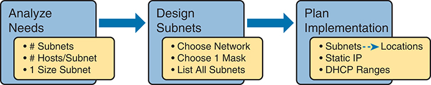

<figcaption>

<strong>图 15-1</strong> <em><a href="v1-11.html#ch11">第 11 章</a>中的子网设计与实施过程</em>

<aside class="hidden" id="a15fig01">

规划包括三个主要阶段：分析需求、设计子网和规划实施。在分析阶段，确定所需子网数量、每个子网的主机数量以及各子网的大小等因素。在设计阶段，根据分析结果决定使用哪个网络、选择合适的子网掩码，并列出所需的全部子网。在实施规划阶段，考虑子网的位置、静态 IP 地址的分配以及 DHCP 地址范围的定义，以便在整个网络基础设施中高效管理和分配 IP 地址。

</aside>

</figcaption>

</figure>

<section>

<h3 class="h3" id="ch15lev1sec1">自测</h3>

如果你希望根据得分决定在本章投入多少时间，可以完成这组自测题（在此作答，或使用 PTP 软件）。各题答案的选项字母列在自测题之后的页面底部。书末和配套网站上的<a href="#ref-appc">附录 C</a>都包含答案及解析。你也可以在 PTP 测试软件中找到答案及解析。

<figure class="table" id="ch15tab01" tabindex="0">

<figcaption>

<strong>表 15-1</strong> 核心主题小节与题目对应关系

</figcaption>

<table class="all">

<thead>

<tr>

<th class="th">
基础知识小节
</th>

<th class="th">
题目
</th>

</tr>

</thead>

<tbody>

<tr>

<td class="border">
选择满足需求的掩码
</td>

<td class="border">
1–3
</td>

</tr>

<tr>

<td class="border">
求出所有子网 ID
</td>

<td class="border">
4–6
</td>

</tr>

</tbody>

</table>

</figure>

<strong><a id="quess15_1" href="#ques15_1a">1</a>.</strong> 一家公司正在进行 IP 子网划分设计。目前，高级工程师已决定使用私有 B 类网络 172.23.0.0。设计要求 100 个子网，最大的子网需要 500 台主机。管理层要求该设计能够容纳子网数量和最大子网规模各增长 50%。需求还规定，整个 B 类网络必须使用同一个掩码。有多少个掩码能够满足这些需求？

<ol class="lower-alpha">

<li>
0
</li>

<li>
1
</li>

<li>
2
</li>

<li>
3+
</li>

</ol>

<strong><a id="quess15_2" href="#ques15_2a">2</a>.</strong> 一项 IP 子网划分设计需要 200 个子网，最大的子网每个需要 120 台主机，并要求在所使用的单个私有 IP 网络中统一采用一个掩码。设计还要求，为子网数量和最大子网中的主机数量各预留 20% 的增长空间。下列哪个选项列出的私有 IP 网络与掩码，能够满足这些需求？

<ol class="lower-alpha">

<li>
10.0.0.0/25
</li>

<li>
10.0.0.0/22
</li>

<li>
172.16.0.0/23
</li>

<li>
192.168.7.0/24
</li>

</ol>

<strong><a id="quess15_3" href="#ques15_3a">3</a>.</strong> 一位工程师计划使用私有 B 类网络 172.19.0.0，并在整个网络中统一使用一个子网掩码。各选项列出了工程师考虑的掩码。请从中选择一个掩码，使它既提供足够的子网位来支持 1000 个子网，又能在这些选项中提供最多的每子网主机数。

<ol class="lower-alpha">

<li>
255.255.255.0
</li>

<li>
/26
</li>

<li>
255.255.252.0
</li>

<li>
/28
</li>

</ol>

<strong><a id="quess15_4" href="#ques15_4a">4</a>.</strong> 一位工程师假设整个网络使用 /22 掩码，计算出了网络 172.30.0.0 中按连续顺序排列的子网 ID 列表。下列哪些说法正确？（选择两个答案。）

<ol class="lower-alpha">

<li>
任意两个相邻子网 ID 的第三个八位组相差 22。
</li>

<li>
任意两个相邻子网 ID 的第四个八位组相差 16。
</li>

<li>
列表包含 64 个子网 ID。
</li>

<li>
最后一个子网 ID 是 172.30.252.0。
</li>

</ol>

<strong><a id="quess15_5" href="#ques15_5a">5</a>.</strong> 对于私有网络 192.168.9.0，假设整个网络使用 /29 掩码，下列哪些是有效的子网 ID？

<ol class="lower-alpha">

<li>
192.168.9.144
</li>

<li>
192.168.9.58
</li>

<li>
192.168.9.242
</li>

<li>
192.168.9.9
</li>

</ol>

<strong><a id="quess15_6" href="#ques15_6a">6</a>.</strong> 对于私有网络 172.19.0.0，假设整个网络使用 /24 掩码，下列哪个不是有效的子网 ID？

<ol class="lower-alpha">

<li>
172.19.0.0
</li>

<li>
172.19.1.0
</li>

<li>
172.19.255.0
</li>

<li>
172.19.0.16
</li>

</ol>

自测答案：

<strong><a id="ques15_1a" href="#ref-ques15_1">1</a></strong> A

<strong><a id="ques15_2a" href="#ref-ques15_2">2</a></strong> B

<strong><a id="ques15_3a" href="#ref-ques15_3">3</a></strong> B

<strong><a id="ques15_4a" href="#ref-ques15_4">4</a></strong> C、D

<strong><a id="ques15_5a" href="#ref-ques15_5">5</a></strong> A

<strong><a id="ques15_6a" href="#ref-ques15_6">6</a></strong> D

</section>

<section>

<h3 class="h3box" id="ch15lev1sec2">基础知识</h3>

</section>

<section>

<h3 class="h3" id="ch15lev1sec3">选择满足需求的掩码</h3>

第一个主要部分研究如何找出满足指定子网数量和每子网主机数量需求的所有掩码。为此，本文假设设计者已经确定这些需求，并选定要划分子网的私有网络号。设计者也已经决定，在整个有类网络中统一使用一个子网掩码值。

掌握本章信息后，你就可以回答下面这类问题；这些问题对于真实工程工作和 Cisco 考试都很重要：

你正在使用 B 类网络 172.16.0.0，需要 200 个子网，每个子网需要 200 台主机。下列哪些子网掩码能够满足需求？（该问题后会列出若干不同子网掩码作为选项。）

首先，本节回顾<a href="v1-11.html#ch11">第 11 章</a>“<a href="v1-11.html#ch11lev2sec8">选择掩码</a>”一节中的概念。该节介绍了工程师在设计子网方案时，必须根据需求选择掩码的主要概念。

回顾<a href="v1-11.html#ch11">第 11 章</a>的相关概念之后，本节将更深入地研究这一主题。具体而言，本章讨论三种一般情况：

<ul class="sq">

<li>
没有掩码满足需求。
</li>

<li>
有且只有一个掩码满足需求。
</li>

<li>
有多个掩码满足需求。
</li>

</ul>

对于最后一种情况，本文将讨论如何确定所有满足需求的掩码，以及选择其中某一个时需要权衡的因素。

<section>

<h4 class="h4" id="ch15lev2sec1">回顾：选择最少的子网位和主机位</h4>

网络设计者必须检查子网数量和每子网主机数量的需求，然后选择掩码。正如<a href="v1-13.html#ch13">第 13 章</a>“<a href="v1-13.html#ch13">分析子网掩码</a>”详细讨论的那样，有类视角将 IP 地址定义为网络、子网和主机三个部分。网络设计者必须选择合适的掩码，使子网位数和主机位数（分别对应<a href="#ch15fig02">图 15-2</a> 中的 S 和 H）满足需求。

<figure class="image-c" id="ch15fig02">

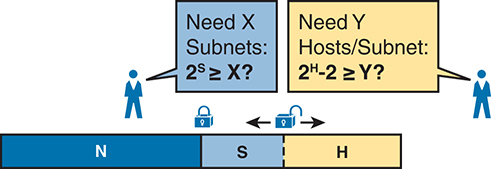

<figcaption>

<strong>图 15-2</strong> <em>选择子网位数和主机位数</em>

<aside class="hidden" id="a15fig02">

两个人分别站在两侧。左侧的人问：“需要 X 个子网：2 的 S 次方是否大于或等于 X？”右侧的人问：“需要每个子网 Y 台主机：2 的 H 次方减 2 是否大于或等于 Y？”图中显示 IP 地址的网络、子网和主机三部分结构，N 与 S 之间的边界锁定，S 与 H 之间的边界未锁定，并用接口符号标记。

</aside>

</figcaption>

</figure>

基本而言，设计者必须选择 S 个子网位，使 S 位能够唯一编号的子网数量（2<em>S</em>）至少等于所需的子网数量。对于主机位数 H，设计者采用类似逻辑，但需要注意公式为 2<em>H</em> − 2，因为每个子网有两个保留数值。因此，处理这类问题时，将<a href="#ch15tab02">表 15-2</a> 所示的 2 的幂参考表放在手边会很有帮助。

<figure class="table" id="ch15tab02" tabindex="0">

<figcaption>

<strong>表 15-2</strong> 掩码设计所用的 2 的幂参考表

</figcaption>

<table class="all">

<thead>

<tr>

<th class="th">
位数
</th>

<th class="th">
2<code>X</code>
</th>

<th class="th">
位数
</th>

<th class="th">
2<code>X</code>
</th>

<th class="th">
位数
</th>

<th class="th">
2<code>X</code>
</th>

<th class="th">
位数
</th>

<th class="th">
2<code>X</code>
</th>

</tr>

</thead>

<tbody>

<tr>

<td class="border">
1
</td>

<td class="border">
2
</td>

<td class="border">
5
</td>

<td class="border">
32
</td>

<td class="border">
9
</td>

<td class="border">
512
</td>

<td class="border">
13
</td>

<td class="border">
8192
</td>

</tr>

<tr>

<td class="border">
2
</td>

<td class="border">
4
</td>

<td class="border">
6
</td>

<td class="border">
64
</td>

<td class="border">
10
</td>

<td class="border">
1024
</td>

<td class="border">
14
</td>

<td class="border">
16,384
</td>

</tr>

<tr>

<td class="border">
3
</td>

<td class="border">
8
</td>

<td class="border">
7
</td>

<td class="border">
128
</td>

<td class="border">
11
</td>

<td class="border">
2048
</td>

<td class="border">
15
</td>

<td class="border">
32,768
</td>

</tr>

<tr>

<td class="border">
4
</td>

<td class="border">
16
</td>

<td class="border">
8
</td>

<td class="border">
256
</td>

<td class="border">
12
</td>

<td class="border">
4096
</td>

<td class="border">
16
</td>

<td class="border">
65,536
</td>

</tr>

</tbody>

</table>

</figure>

更正式地说，这一过程必须确定满足需求的 S 和 H 的最小值。下面汇总了选择掩码的初始步骤：

步骤 1。根据类别确定网络位数（N）。

步骤 2。确定满足 2<em>S</em> =&gt; X 的最小 S 值，其中 X 表示所需子网数量。

步骤 3。确定满足 2<em>H</em> − 2 =&gt; Y 的最小 H 值，其中 Y 表示每个子网所需的主机数量。

接下来的三节将研究如何利用这些初始步骤选择子网掩码。

</section>

<section>

<h4 class="h4" id="ch15lev2sec2">没有掩码满足需求</h4>

确定所需子网位数和主机位数后，32 位 IPv4 子网掩码可能容纳不下这些位。记住，掩码总计始终为 32 位，网络部分和子网部分为二进制 1，主机部分为二进制 0。考题可能给出一组根本无法在总计 32 位内满足的需求。

例如，考虑下面这道考试样题：

一位网络工程师正在规划子网设计，打算使用 B 类网络 172.16.0.0。该网络需要 300 个子网，每个子网需要 280 台主机。工程师可以选择下列哪个掩码？

上一节的三步过程表明，这些需求意味着总计需要 34 位，因此没有任何掩码满足需求。首先，作为 B 类网络，已有 16 个网络位，可以从另外 16 个主机位中创建子网部分，同时还要保留足够的主机位，为每个子网中的主机编号。对于子网位数，S=8 不可行，因为 2<em>8</em> = 256 &lt; 300；但 S=9 可行，因为 2<em>9</em> = 512 =&gt; 300。同样，由于 2<em>8</em> − 2 = 254，小于 300，8 个主机位不够，而 9 个主机位（2<em>9</em> − 2 = 510）刚好足够。

这些需求没有留下足够空间为所有主机和子网编号，因为网络、子网和主机部分相加超过 32 位：

N=16，因为 B 类网络有 16 个网络位。

最小 S=9，因为 S=8 提供的子网太少（2<em>8</em> = 256 &lt; 300），但 S=9 可提供 2<em>9</em> = 512 个子网。

最小 H=9，因为 H=8 提供的主机地址太少（2<em>8</em> − 2 = 254 &lt; 280），但 H=9 可提供每个子网 2<em>9</em> − 2 = 510 个主机地址。

<a href="#ch15fig03">图 15-3</a> 展示了工程师在纸上分配 9 个子网位之后，该子网中 IP 地址的格式。只剩下 7 个主机位，但工程师需要 9 个主机位。

<figure class="image-c" id="ch15fig03">

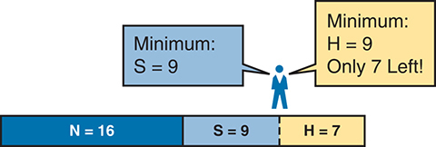

<figcaption>

<strong>图 15-3</strong> <em>根据给定需求，主机部分的位数不足</em>

<aside class="hidden" id="a15fig03">

一个人站在 IP 地址三部分结构的 S 与 H 边界上方，说：“最少 H=9，只剩 7 位”和“最少 S=9”。下方结构显示 N=16、S=9、H=7。

</aside>

</figcaption>

</figure>

</section>

<section>

<h4 class="h4" id="ch15lev2sec3">一个掩码满足需求</h4>

本章讨论的过程有一部分重点，是找出满足需求的最少子网位数和最少主机位数。如果工程师尝试使用这些最小值，而网络、子网和主机部分相加恰好为 32 位，那么有且只有一个掩码满足需求。

例如，对上一节的示例稍作修改，减少子网数量和主机数量，如下所示：

一位网络工程师正在规划子网设计，打算使用 B 类网络 172.16.0.0。该网络需要 200 个子网，每个子网需要 180 台主机。工程师可以选择下列哪个掩码？

通过确定网络位数、最少子网位数和最少主机位数的三步过程，得到分别需要 16、8 和 8 位。和之前一样，B 类网络有 16 个网络位。由于只需要 200 个子网，S=8 可行，因为 2<em>8</em> = 256 =&gt; 200；7 个子网位则无法提供足够的子网（2<em>7</em> = 128）。同样，因为 2<em>8</em> − 2 = 254 =&gt; 180，8 个主机位满足需求；7 个主机位（每个子网总计 126 台主机）则不够。

<a href="#ch15fig04">图 15-4</a> 展示了该子网中 IP 地址的最终格式。

<figure class="image-c" id="ch15fig04">

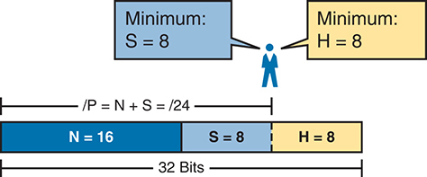

<figcaption>

<strong>图 15-4</strong> <em>一个满足需求的掩码</em>

<aside class="hidden" id="a15fig04">

一个人站在 IP 地址三部分结构的 S 与 H 边界上方，说：“最少 H=8”和“最少 S=8”。下方结构显示 N=16、S=8、H=8。整个结构包含 32 位。N 和 S 所在区域用前缀格式记录掩码：/P = N + S = /24。

</aside>

</figcaption>

</figure>

<a href="#ch15fig04">图 15-4</a> 从概念上展示了掩码。要求实际掩码值，只需以前缀格式（/P）记录掩码，其中 P = N + S，本例为 /24。

</section>

<section>

<h4 class="h4" id="ch15lev2sec4">多个掩码满足需求</h4>

根据需求和所选网络的不同，可能有多个掩码满足子网数量和每子网主机数量的要求。此时，需要找出所有可用的掩码。随后，你有了选择余地，但在所有满足需求的掩码中选择一个时，应考虑什么？本节将介绍如何找出全部掩码，以及从中选取一个时需要考虑的因素。

<section>

<h5 class="h5" id="ch15lev3sec1">找出所有掩码：概念</h5>

为了帮助你更好地理解如何以二进制找出所有子网掩码，本节采用两个主要步骤。第一步是在纸上构造 32 位二进制子网掩码。和往常一样，网络位写为二进制 1，子网位写为二进制 1，主机位写为二进制 0。不过，这次将使用 S 和 H 的最小值。写下这些位后，还不足 32 位！

例如，考虑以下问题，它与本章前面的示例类似，但需求有所变化：

一位网络工程师正在规划子网设计，打算使用 B 类网络 172.16.0.0。该网络需要 50 个子网，每个子网需要 180 台主机。工程师可以选择下列哪个掩码？

此示例与前面的一个示例类似，但这里只需要 50 个子网。工程师仍然使用私有 IP 网络 172.16.0.0，这意味着有 16 个网络位。本例中，设计只需要 6 个子网位，因为 2<em>6</em> = 64 =&gt; 50；如果只有 5 个子网位，则 2<em>5</em> = 32 &lt; 50。此外，该设计至少需要 8 个主机位。

一种讨论这些概念并找出所有满足需求掩码的方法，是写出子网掩码中的各位：网络部分和子网部分写二进制 1，主机部分写二进制 0。不过，应将 32 位掩码看成 32 个位置，写二进制 0 时，<em>将它们写在最右侧</em>。<a href="#ch15fig05">图 15-5</a> 展示了总体思路。

<a href="#ch15fig05">图 15-5</a> 显示了掩码的 30 位，但掩码必须有 32 位。剩下 2 位可以作为子网位，设为二进制 1；也可以作为主机位，设为二进制 0。工程师只需根据偏好做出选择：是希望有更多子网位，以便为更多子网编号，还是希望有更多主机位，以便为每个子网中的更多主机编号。

<figure class="image-c" id="ch15fig05">

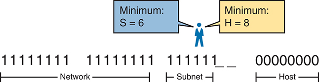

<figcaption>

<strong>图 15-5</strong> <em>N=16、S=6、H=8 的不完整掩码</em>

</figcaption>

</figure>

无论需求如何，选择任何 IPv4 子网掩码时，都必须始终遵循以下规则：

子网掩码开头全部为二进制 1，随后全部为二进制 0，1 和 0 不能交错出现。

在<a href="#ch15fig05">图 15-5</a> 的示例中，有 2 个待定的位，其中一种取值（二进制 01）违反这条规则。但另外三种 2 位组合（00、10 和 11）并不违反规则。因此，本例中有三个掩码满足需求，如<a href="#ch15fig06">图 15-6</a> 所示。

<figure class="image-c" id="ch15fig06">

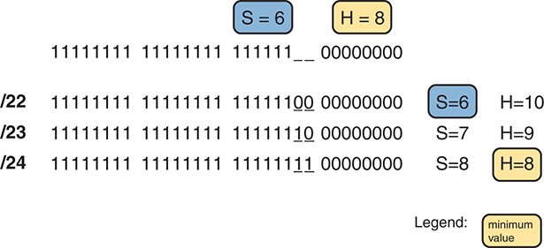

<figcaption>

<strong>图 15-6</strong> <em>三个满足需求的掩码</em>

<aside class="hidden" id="a15fig06">

一个 N=16、S=6、H=8 的不完整掩码。掩码 /22 在 S=6、H=10 时满足需求；掩码 /23 在 S=7、H=9 时满足需求；掩码 /24 在 S=8、H=8 时满足需求。

</aside>

</figcaption>

</figure>

三个掩码中，第一个的子网位最少，因此主机位最多，所以它使每个子网的主机数量最大化。最后一个掩码使用最少的主机位，因此在仍满足需求的前提下使用最多的子网位，所以它使允许的子网数量最大化。

</section>

<section>

<h5 class="h5" id="ch15lev3sec2">找出所有掩码：计算</h5>

虽然<a href="#ch15fig05">图 15-5</a> 和<a href="#ch15fig06">图 15-6</a> 示例涉及的概念很重要，但仅用一些简单计算，就可以更容易地找出满足需求的掩码范围。知道 N 以及 S 和 H 的最小值后，只需几个步骤就能找出掩码。该过程分别求出使用最少子网位和使用最少主机位时的 /P 值，如下所示：

步骤 1。根据 <em>S 的最小值</em>计算最短前缀掩码（/P），其中 P = N + S。

步骤 2。根据 <em>H 的最小值</em>计算最长前缀掩码（/P），其中 P = 32 − H。

步骤 3。有效掩码范围包含前两个步骤所得两值之间的所有 /P 值。

例如，在<a href="#ch15fig06">图 15-6</a> 的示例中，N=16，最小 S=6，最小 H=8。第一步将 N 和 S 相加（16 + 6），确定最短前缀掩码为 /22，即 P 值最小的 /P。第二步从 32 中减去 H 的最小可能值（本例为 8），得到满足需求的最长前缀掩码 /24。第三步提醒我们，范围是从 /22 到 /24，这意味着 /23 也是一个选项。

</section>

<section>

<h5 class="h5" id="ch15lev3sec3">选择最佳掩码</h5>

当多个可能的掩码都满足指定需求时，工程师就有了选择空间。由此自然产生一些问题：应该选择哪个掩码？为什么某个掩码会比另一个更好？相关理由可以归纳为三个主要选项：

<strong>使每个子网的主机数量最大化：</strong>选择最短前缀掩码（即 /P 值最小的掩码），因为该掩码的主机部分最大。

<strong>使子网数量最大化：</strong>选择最长前缀掩码（即 /P 值最大的掩码），因为该掩码的子网部分最大。

<strong>同时增加支持的子网数量和主机数量：</strong>选择范围中间的一个掩码，它会同时提供更多子网位和更多主机位。

例如，在<a href="#ch15fig06">图 15-6</a> 中，满足需求的掩码范围为 /22—/24。最短掩码 /22 在三个选项中子网位最少，但主机位最多（10 位），使每个子网的主机数量最大化。最长掩码 /24 使子网位数最大（8 位），至少在满足原始需求的选项中，使子网数量最大化。中间的掩码 /23 则为子网数和每子网主机数都提供一定的增长空间。

</section>

</section>

<section>

<h4 class="h4" id="ch15lev2sec5">完整步骤</h4>

虽然本章已经解释了寻找满足设计需求的子网掩码所需的各种步骤，但尚未将这些概念整理成完整过程的列表。下面将所有步骤集中列出，供参考。请注意，与本章其他内容相比，这个列表没有引入新概念，只是把所有思路汇集到一处。

步骤 1。根据类别规则求出网络位数（N）。

步骤 2。计算最少子网位数（S），使 2<em>S</em> =&gt; 所需子网数量。

步骤 3。计算最少主机位数（H），使 2<em>H</em> − 2 =&gt; 每个子网所需的主机数量。

步骤 4。如果 N + S + H &gt; 32，没有掩码满足需求。

步骤 5。如果 N + S + H = 32，有一个掩码满足需求。将掩码计算为 /P，其中 P = N + S。

步骤 6。如果 N + S + H &lt; 32，有多个掩码满足需求：

<ol class="step-lower-alpha">

<li>
根据 S 的最小值计算掩码 /P，其中 P = N + S。此掩码使每个子网的主机数量最大化。
</li>

<li>
根据 H 的最小值计算掩码 /P，其中 P = 32 − H。此掩码使可能的子网数量最大化。
</li>

<li>
请注意，完整掩码范围包含步骤 6A 和 6B 计算所得两值之间的全部前缀长度。
</li>

</ol>

</section>

<section>

<h4 class="h4" id="ch15lev2sec6">子网掩码选择练习</h4>

采用学习新子网划分计算和方法时常用的两阶段方式。现在花时间练习，确保理解基础知识，根据需要使用本书和笔记。然后，在参加考试之前，继续练习，直到达到<a href="#ch15tab03">表 15-3</a> 右列中的目标。

<figure class="table" id="ch15tab03" tabindex="0">

<figcaption>

<strong>表 15-3</strong> 子网掩码选择在继续学习前和参加考试前的目标

</figcaption>

<table class="all">

<thead>

<tr>

<th class="th">
时间阶段
</th>

<th class="th">
进入下一章之前
</th>

<th class="th">
参加考试前
</th>

</tr>

</thead>

<tbody>

<tr>

<td class="border">
<strong>关注重点……</strong>
</td>

<td class="border">
学会方法
</td>

<td class="border">
准确且快速
</td>

</tr>

<tr>

<td class="border">
<strong>允许使用的工具</strong>
</td>

<td class="border">
所有工具
</td>

<td class="border">
大脑和记事本
</td>

</tr>

<tr>

<td class="border">
<strong>目标：准确率</strong>
</td>

<td class="border">
90% 正确
</td>

<td class="border">
100% 正确
</td>

</tr>

<tr>

<td class="border">
<strong>目标：速度</strong>
</td>

<td class="border">
不限速度
</td>

<td class="border">
15 秒
</td>

</tr>

</tbody>

</table>

</figure>

<section>

<h5 class="h5" id="ch15lev3sec4">子网掩码选择练习题</h5>

下面列出三个独立问题，每题给出一个有类网络号，以及所需的子网数量和每子网主机数量。对于每道题，确定满足需求的最少子网位数和主机位数。如果有多个掩码，指出哪个掩码使每个子网的主机数量最大，哪个使子网数量最大。如果只有一个掩码满足需求，直接列出该掩码。请使用前缀格式：

<ol class="number">

<li>
网络 10.0.0.0，需要 1500 个子网，每个子网需要 300 台主机
</li>

<li>
网络 172.25.0.0，需要 130 个子网，每个子网需要 127 台主机
</li>

<li>
网络 192.168.83.0，需要 8 个子网，每个子网需要 8 台主机
</li>

</ol>

答案列在后面“<a data-original-href="vol1_ch15.xhtml#ch15lev1sec9" data-unavailable="true" title="此内容不在当前提取范围内；请参阅原始 EPUB：vol1_ch15.xhtml#ch15lev1sec9">前述练习题答案</a>”一节的<a data-original-href="vol1_ch15.xhtml#ch15tab08" data-unavailable="true" title="此内容不在当前提取范围内；请参阅原始 EPUB：vol1_ch15.xhtml#ch15tab08">表 15-8</a> 中。

</section>

</section>

</section>

<section>

<h3 class="h3" id="ch15lev1sec4">求出所有子网 ID</h3>

IP 子网划分方案的设计者选定在整个 A 类、B 类或 C 类网络中统一使用的掩码后，很快就需要开始为具体 VLAN、WAN 链路以及互连网络中其他需要子网的位置，分配具体的子网 ID。但这些子网 ID 究竟是什么？事实上，选定网络 ID 和所有子网统一使用的子网掩码后，只需少量计算就能找出全部子网 ID。本章第二个主要部分将重点介绍这些计算，围绕一个问题展开：

给定单个 A 类、B 类或 C 类网络，以及所有子网统一使用的子网掩码，全部子网 ID 是什么？

学习回答这个问题时，既可以用二进制思考，也可以用十进制思考。本章采用十进制方法。虽然过程本身只需要简单运算，但大多数人仍需练习，才能有把握地回答这个问题。

十进制过程首先确定第一个，也就是数值最小的子网 ID。随后，对于给定子网掩码，识别所有子网 ID 的规律，从而通过简单相加，求出每个后续子网 ID。本节先研究这一过程背后的关键思路，然后给出正式步骤。

注意

配套网站中的一些视频介绍了求出全部子网 ID 的相同基本方法。你可以在阅读本节之前或之后观看，甚至可以用观看视频代替阅读本节，只要学会如何求出全部子网 ID 即可。视频中的步骤编号可能与本版书中的步骤编号不同。

<section>

<h4 class="h4" id="ch15lev2sec7">第一个子网 ID：零子网</h4>

求一个网络全部子网 ID 的第一步非常简单：复制网络 ID。也就是说，取 A 类、B 类或 C 类网络 ID，即有类网络 ID，将它写为第一个子网 ID。无论使用哪个 A 类、B 类或 C 类网络，也无论使用哪个子网掩码，第一个（数值最小的）子网 ID 都等于网络 ID。

例如，如果从有类网络 172.20.0.0 开始，无论掩码是什么，第一个子网 ID 都是 172.20.0.0。

每个网络的第一个子网 ID 有两个特殊名称：<a id="key_185" href="#ref-gloss_393">子网零</a>（subnet zero）或<a id="key_186" href="#ref-gloss_447">零子网</a>（zero subnet）。这些名称源于一个事实：以二进制查看网络的零子网时，其子网部分全部为二进制 0。以十进制表示时，零子网很容易识别，因为它的数值始终与网络 ID 本身完全相同。

过去，工程师会避免使用零子网，因为同一个数值可能表示整个有类网络，也可能表示该有类网络中的一个子网，容易产生歧义。为了控制这种情况，IOS 提供了一个全局命令，可以设置为以下两种形式之一：

<strong>ip subnet-zero</strong>，允许配置零子网中的地址。

<strong>no ip subnet-zero</strong>，阻止配置零子网中的地址。

虽然大多数站点使用默认设置，允许零子网，但你仍可使用 <strong>no ip subnet-zero</strong> 命令，阻止配置属于零子网的地址。<a href="#exa15_1">例 15-1</a> 展示了改为使用 <strong>no ip subnet-zero</strong> 之后，路由器如何拒绝 <strong>ip address</strong> 命令。请注意，错误信息并未提到零子网，只是简单地显示“bad mask”（掩码错误）。

<strong>例 15-1</strong> <em><strong>[no] ip subnet-zero</strong> 对本地路由器的影响</em>

<a href="#code-f0388-01" id="f0388-01a">点击此处查看代码原图</a>

<pre class="pre-ex" tabindex="0"><code>R1# <strong>configure terminal</strong>

Enter configuration commands, one per line. End with CNTL/Z.

R1(config)# <strong>no ip subnet-zero</strong> 

R1(config)# <strong>interface g0/1</strong>

R1(config-if)# <strong>ip address 10.0.0.1 255.255.255.0</strong>

Bad mask /24 for address 10.0.0.1</code></pre>

请注意，<strong>no ip subnet-zero</strong> 命令会影响本地路由器的 <strong>ip address</strong> 命令，以及本地路由器的 <strong>ip route</strong> 命令（用于定义静态路由）。但是，它不会影响本地路由器通过路由协议学习到的路由。

</section>

<section>

<h4 class="h4" id="ch15lev2sec8">利用魔数找规律</h4>

至少在我们假设一个网络的所有子网使用统一子网掩码时，子网 ID 遵循可预测的规律。该规律使用<a href="v1-14.html#ch14">第 14 章</a>“<a href="v1-14.html#ch14">分析现有子网</a>”讨论的<em>魔数</em>。回顾一下，魔数等于 256 减去掩码某个特定八位组的十进制值，本书将这个八位组称为<em>关键八位组</em>。

<a href="#ch15fig07">图 15-7</a> 使用四个不同掩码展示了四种规律。先看图的最上方：左侧列出掩码 255.255.128.0。第三个八位组是关键八位组，因为该八位组的掩码值既不是 0 也不是 255。左侧显示魔数计算为 256 − 128 = 128。因此，高亮的数轴显示了子网 ID 的规律：使用该掩码时，子网 ID 的第三个八位组为 0 或 128。例如，使用网络 172.16.0.0 时，子网 ID 将为 172.16.0.0 和 172.16.128.0。

<figure class="image-c" id="ch15fig07">

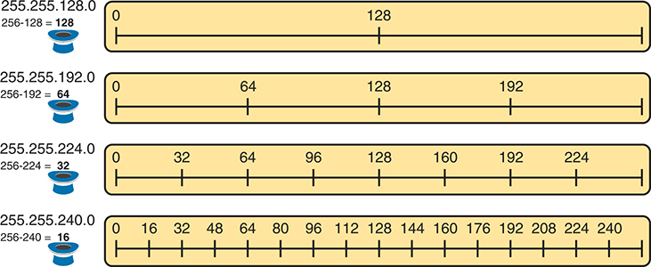

<figcaption>

<strong>图 15-7</strong> <em>/17—/20 掩码的魔数规律</em>

<aside class="hidden" id="a15fig07">

第一行左侧列出掩码 255.255.128.0，下方魔数计算为 256 − 128 = 128。高亮数轴上的子网 ID 规律使用值 0 或 128。第二行左侧列出掩码 255.255.192.0，下方魔数为 256 − 192 = 64。高亮数轴上的子网 ID 规律使用值 0、64、128 或 192。第三行左侧列出掩码 255.255.224.0，下方魔数为 256 − 224 = 32。高亮数轴上的子网 ID 规律使用值 0、32、64、96、128、160、192 或 224。第四行左侧列出掩码 255.255.240.0，下方魔数为 256 − 240 = 16。高亮数轴上的子网 ID 规律使用值 0、16、32、48、64、80、96、112、128、114、160、176、192、208、224 或 240。

</aside>

</figcaption>

</figure>

现在关注第二行的另一个示例，掩码为 255.255.192.0。这一行显示魔数为 64（256 − 192 = 64），因此子网 ID 的第三个八位组将使用 0、64、128 或 192，即 64 的倍数。例如，配合网络 172.16.0.0 使用时，子网 ID 为 172.16.0.0、172.16.64.0、172.16.128.0 和 172.16.192.0。

再看第三行示例，掩码为 255.255.224.0，魔数为 256 − 224 = 32。因此，如图中央所示，子网 ID 的值将是 32 的倍数。例如，再次配合网络 172.16.0.0 使用时，该掩码告诉我们，子网 ID 为 172.16.0.0、172.16.32.0、172.16.64.0、172.16.96.0，依此类推。

最后，最下面的示例使用掩码 255.255.240.0，使第三个八位组的魔数为 16。因此，所有子网 ID 的第三个八位组都是 16 的倍数，具体值显示在图的中间。

</section>

<section>

<h4 class="h4" id="ch15lev2sec9">少于 8 个子网位时的完整步骤</h4>

虽然<a href="#ch15fig07">图 15-7</a> 中的规律很容易看出来，但具体如何应用这些概念，在各种情况下求出所有子网 ID，可能没有那么直观。本节将列出求所有子网 ID 的具体步骤。

为简化说明，本节假设子网位少于 8 位。后面的“<a href="#ch15lev2sec11">超过 8 个子网位时求出所有子网</a>”一节，将介绍可用于所有情况的完整过程。

首先，为了整理思路，可以将数据整理成类似<a href="#ch15tab04">表 15-4</a> 的表格。本书将其称为“全部子网列表”。

<figure class="table" id="ch15tab04" tabindex="0">

<figcaption>

<strong>表 15-4</strong> 通用的全部子网列表

</figcaption>

<table class="all">

<thead>

<tr>

<th class="th">
八位组
</th>

<th class="th">
1
</th>

<th class="th">
2
</th>

<th class="th">
3
</th>

<th class="th">
4
</th>

</tr>

</thead>

<tbody>

<tr>

<td class="border">
掩码
</td>

<td class="border">

</td>

<td class="border">

</td>

<td class="border">

</td>

<td class="border">

</td>

</tr>

<tr>

<td class="border">
魔数
</td>

<td class="border">

</td>

<td class="border">

</td>

<td class="border">

</td>

<td class="border">

</td>

</tr>

<tr>

<td class="border">
网络号／零子网
</td>

<td class="border">

</td>

<td class="border">

</td>

<td class="border">

</td>

<td class="border">

</td>

</tr>

<tr>

<td class="border">
下一个子网
</td>

<td class="border">

</td>

<td class="border">

</td>

<td class="border">

</td>

<td class="border">

</td>

</tr>

<tr>

<td class="border">
下一个子网
</td>

<td class="border">

</td>

<td class="border">

</td>

<td class="border">

</td>

<td class="border">

</td>

</tr>

<tr>

<td class="border">
下一个子网
</td>

<td class="border">

</td>

<td class="border">

</td>

<td class="border">

</td>

<td class="border">

</td>

</tr>

<tr>

<td class="border">
广播子网
</td>

<td class="border">

</td>

<td class="border">

</td>

<td class="border">

</td>

<td class="border">

</td>

</tr>

<tr>

<td class="border">
超出范围——供计算过程使用
</td>

<td class="border">

</td>

<td class="border">

</td>

<td class="border">

</td>

<td class="border">

</td>

</tr>

</tbody>

</table>

</figure>

给定网络和统一子网掩码后，求所有子网 ID 的完整步骤如下：

步骤 1。在表中第一个空行，以十进制写下子网掩码。

步骤 2。确定关键八位组，即掩码中值既不是 255 也不是 0 的八位组。在关键八位组所在列的周围画一个矩形框。

步骤 3。用 256 减去<em>子网掩码关键八位组的值</em>，计算并写下魔数。

步骤 4。在全部子网列表的下一个空行写下有类网络号，它与零子网的数值相同。

步骤 5。求出每个后续子网号：

<ol class="step-lower-alpha">

<li>
对于三个非关键八位组，复制前一个子网号的值。
</li>

<li>
对于关键八位组，将魔数加到前一个子网号的关键八位组上。
</li>

</ol>

步骤 6。当步骤 5B 计算出的和达到 256 时，停止此过程。包含 256 的数值超出范围，前一个子网号就是广播子网。

虽然文字描述较长，但经过练习后，大多数人使用这种基于十进制的过程，会比使用二进制运算快得多。和往常一样，大多数人通过观看实际演示、亲自操作，再进行练习，能够最好地掌握这一过程。为此，请学习下面两个示例，并观看配套网站上的相关视频，了解更多示例。

<section>

<h5 class="h5" id="ch15lev3sec5">示例 1：网络 172.16.0.0，掩码 255.255.240.0</h5>

本例使用掩码 255.255.240.0 对网络 172.16.0.0 进行子网划分，先关注六个步骤中的前四步。<a href="#ch15fig08">图 15-8</a> 展示了这四步的结果：

步骤 1。记录题目给出的掩码 255.255.240.0。（<a href="#ch15fig08">图 15-8</a> 也显示了网络 ID 172.16.0.0，方便参考。）

步骤 2。掩码第三个八位组既不是 0 也不是 255，因此第三个八位组是关键八位组。

步骤 3。由于掩码第三个八位组的值为 240，魔数 = 256 − 240 = 16。

步骤 4。由于网络 ID 为 172.16.0.0，第一个子网 ID，也就是零子网，同样为 172.16.0.0。

<figure class="image-c" id="ch15fig08">

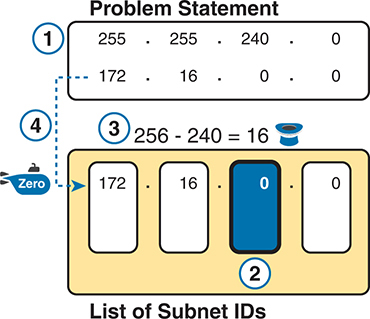

<figcaption>

<strong>图 15-8</strong> <em>前四步的结果：172.16.0.0、255.255.240.0</em>

<aside class="hidden" id="a15fig08">

示意图的题目说明突出显示步骤 1：使用掩码 255.255.240.0 对网络 172.16.0.0 进行子网划分。步骤 2 突出显示子网 ID 列表，其中掩码的第三个八位组为 0。步骤 3 展示魔数：256 − 240 = 16。步骤 4 突出显示网络 ID 172.16.0.0。

</aside>

</figcaption>

</figure>

前四步找出第一个子网（零子网），并通过确定关键八位组和魔数，为后续步骤做好准备。步骤 5 要求复制三个非关键八位组，并在关键八位组（本例为第三个）上加上魔数（本例为 16）。不断重复此步骤，直到关键八位组的值等于 256（按照步骤 6）。当总和达到 256 时，就已经列出了全部子网 ID，包含 256 的那一行不是正确的子网 ID。<a href="#ch15fig09">图 15-9</a> 展示了步骤 5 的操作结果。

<figure class="image-c" id="ch15fig09">

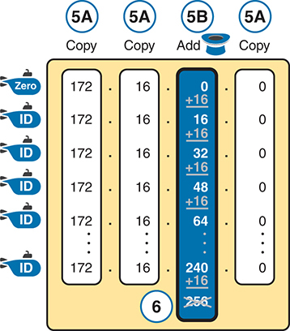

<figcaption>

<strong>图 15-9</strong> <em>子网 ID 列表：172.16.0.0、255.255.240.0</em>

<aside class="hidden" id="a15fig09">

步骤 5 的示意图显示 172.16.0.0 的子网 ID：第 1、2 和 4 个八位组连续重复六行，第三个八位组则每行增加魔数 16，直到达到 256，该值被划掉。

</aside>

</figcaption>

</figure>

注意

在任何一个网络的全部子网 ID 列表中，数值最大的子网 ID 称为<a id="key_184" href="#ref-gloss_055">广播子网</a>。几十年前，工程师会避免使用广播子网。不过，使用广播子网不会造成问题。<em>广播子网</em>一词源于这样一个事实：如果求出广播子网内的子网广播地址，它的数值与整个网络的广播地址相同。

注意

人们有时会混淆<em>广播子网</em>和<em>子网广播地址</em>这两个术语。<em>广播子网</em>是一个子网，即数值最大的那个子网，每个网络只有一个这样的子网。<em>子网广播地址</em>则指每个子网中数值最大的那个数字。

</section>

<section>

<h5 class="h5" id="ch15lev3sec6">示例 2：网络 192.168.1.0，掩码 255.255.255.224</h5>

本例使用 C 类网络和掩码 255.255.255.224，因此第四个八位组是关键八位组。不过，过程及其逻辑完全相同，只是把关键运算应用于不同的八位组。和前一个示例一样，下面列出前四步，<a href="#ch15fig10">图 15-10</a> 展示这些步骤的结果：

步骤 1。记录题目给出的掩码 255.255.255.224，也可以同时记录网络号 192.168.1.0。

步骤 2。掩码第四个八位组既不是 0 也不是 255，因此第四个八位组是关键八位组。

步骤 3。由于掩码第四个八位组的值为 224，魔数 = 256 − 224 = 32。

步骤 4。由于网络 ID 为 192.168.1.0，第一个子网 ID，也就是零子网，同样为 192.168.1.0。

<figure class="image-c" id="ch15fig10">

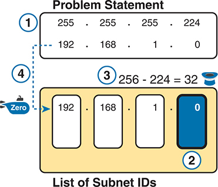

<figcaption>

<strong>图 15-10</strong> <em>前四步的结果：192.168.1.0、255.255.255.224</em>

<aside class="hidden" id="a15fig10">

示意图的题目说明突出显示步骤 1：使用掩码 255.255.255.224 对网络 192.168.1.0 进行子网划分。步骤 2 突出显示子网 ID 列表，其中掩码的第四个八位组为 0。步骤 3 展示魔数：256 − 224 = 32。步骤 4 突出显示网络 ID 192.168.1.0。

</aside>

</figcaption>

</figure>

接下来，步骤 5 要求复制前三个八位组的值，然后在关键八位组（本例为第四个）上加上魔数（本例为 32）。不断重复，直到关键八位组的值等于 256（按照步骤 6）。当总和达到 256 时，就已经列出了全部子网 ID，包含 256 的那一行不是正确的子网 ID。<a href="#ch15fig11">图 15-11</a> 展示了这些步骤的结果。

<figure class="image-c" id="ch15fig11">

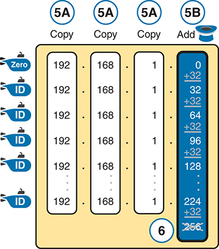

<figcaption>

<strong>图 15-11</strong> <em>子网 ID 列表：192.168.1.0、255.255.255.224</em>

<aside class="hidden" id="a15fig11">

步骤 5 的示意图显示 192.168.1.0 的子网 ID：第 1、2 和 3 个八位组连续重复六行，第四个八位组则每行增加魔数 32，直到达到 256，该值被划掉。

</aside>

</figcaption>

</figure>

</section>

</section>

<section>

<h4 class="h4" id="ch15lev2sec10">恰好 8 个子网位时求出所有子网</h4>

前面“<a href="#ch15lev2sec9">少于 8 个子网位时的完整步骤</a>”一节，将掩码值既不是 255 也不是 0 的八位组确定为关键八位组。如果掩码恰好定义了 8 个子网位，就必须使用不同逻辑来识别关键八位组；除此之外，其余过程仍然适用。事实上，此时实际的子网 ID 可能更加直观。

恰好有 8 个子网位的情况只有两种：

A 类网络使用掩码 255.255.0.0，整个第二个八位组都是子网位。

B 类网络使用掩码 255.255.255.0，整个第三个八位组都是子网位。

两种情况都使用与少于 8 个子网位时相同的过程，但将包含子网位的那个八位组确定为关键八位组。此外，由于掩码值为 255，魔数为 256 − 255 = 1，因此每个子网 ID 都比前一个子网 ID 大 1。

例如，对于 172.16.0.0、掩码 255.255.255.0，第三个八位组是关键八位组，魔数为 256 − 255 = 1。从数值等于网络号 172.16.0.0 的零子网开始，然后在第三个八位组上加 1。例如，前四个子网如下：

172.16.0.0（零子网）

172.16.1.0

172.16.2.0

172.16.3.0

</section>

<section>

<h4 class="h4" id="ch15lev2sec11">超过 8 个子网位时求出所有子网</h4>

前面的“<a href="#ch15lev2sec9">少于 8 个子网位时的完整步骤</a>”一节，为了在学习时简化讨论，假设子网位少于 8 位。在实际工作中，你需要能够在使用任意有效掩码时求出全部子网 ID，因此不能假设子网位少于 8 位。

至少有 9 个子网位的示例，至少包含 512 个子网 ID，写出这样的列表会耗费很多时间。为了节省篇幅，示例将使用简写，而不会列出数百或数千个子网 ID。

少于 8 个子网位时，过程要求在一个八位组中按魔数递增。超过 8 个子网位时，扩展后的过程必须说明如何在多个八位组中计数。因此，本节分成两种一般情况：（a）有 9—16 个子网位，意味着子网字段只跨越两个八位组；（b）有 17 个或更多子网位，意味着子网字段跨越三个八位组。

<section>

<h5 class="h5" id="ch15lev3sec7">9—16 个子网位时的过程</h5>

为了理解这个过程，需要先了解其中使用的几个术语。<a href="#ch15fig12">图 15-12</a> 给出详细信息，示例使用 B 类网络 130.4.0.0 和掩码 255.255.255.192。图的下半部分根据掩码详细展示地址结构：因为是 B 类地址，网络部分包含两个八位组；根据掩码 /26，子网部分为 10 位；主机部分为 6 位。

<figure class="image-c" id="ch15fig12">

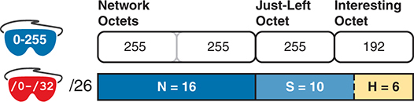

<figcaption>

<strong>图 15-12</strong> <em>超过 8 个子网位时所用过程的基本概念和术语</em>

<aside class="hidden" id="a15fig12">

示意图显示一个 0—255 掩码，网络部分的两个八位组包含 255 和 255，左邻八位组包含 255，关键八位组包含 192。图的下半部分按掩码 /0—/32、/26 详细展示地址结构：网络部分为 16 位，子网部分为 10 位，主机部分为 6 位。

</aside>

</figcaption>

</figure>

本例中，子网位位于两个八位组中，即第三个和第四个八位组。对于此过程，最右侧的那个称为关键八位组，紧挨着它左侧的八位组则被形象地称为<em>左邻</em>八位组。

更新后的过程针对子网字段长度超过一个八位组的情况进行了调整：在关键八位组中按魔数递增，而在左邻八位组中按 1 递增。正式步骤如下：

步骤 1。使用子网位数不超过 8 位时的过程计算子网 ID。但是，当累加值达到 256 时，转到下一步；将目前列出的子网 ID 视为一个<em>子网块</em>。

步骤 2。复制前一个子网块，但将新块中所有子网 ID 的左邻八位组加 1。

步骤 3。重复步骤 2，直到创建出左邻八位组为 255 的块，然后停止。

坦率地说，在亲自完成一些示例之前，这种正式描述可能会让你困惑。因此，即使脑中对该过程仍有些模糊，也应继续完成下面的示例，而不是反复阅读正式步骤。

首先，考虑一个基于<a href="#ch15fig12">图 15-12</a> 的示例，网络为 130.4.0.0，掩码为 255.255.255.192。<a href="#ch15fig12">图 15-12</a> 已经展示了结构，<a href="#ch15fig13">图 15-13</a> 则展示步骤 1 创建的子网 ID 块。

<figure class="image-c" id="ch15fig13">

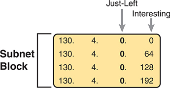

<figcaption>

<strong>图 15-13</strong> <em>步骤 1：列出第一个子网 ID 块</em>

<aside class="hidden" id="a15fig13">

一个块显示 130.4.0.0 的子网 ID：第 1、2 和 3 个八位组连续重复四行，关键八位组则每行增加魔数 64，直到达到 192。

</aside>

</figcaption>

</figure>

步骤 1 创建这个包含四个子网 ID 的子网 ID 块，使用的是前面相同的魔数方法。第一个子网 ID 130.4.0.0 是零子网。后面的三个子网 ID 每个都比前一个大 64，因为本例的魔数为 256 − 192 = 64。

完整过程的步骤 2 和 3 说明如何创建 256 个子网块，从而列出全部 1024 个子网 ID。具体来说，总计创建 256 个子网块：一个的左邻八位组为 0，一个为 1，另一个为 2，依此类推直到 255。过程持续进行，直到创建出左邻八位组（本例为第三个八位组）为 255 的子网块。<a href="#ch15fig14">图 15-14</a> 通过加入最初几个子网块，展示了这一思路。

<figure class="image-c" id="ch15fig14">

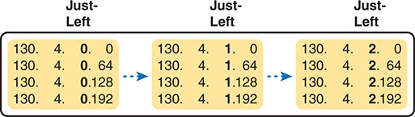

<figcaption>

<strong>图 15-14</strong> <em>步骤 2：复制子网块，并将左邻八位组加 1</em>

<aside class="hidden" id="a15fig14">

第一个块显示 130.4.0.0 的子网 ID：第 1、2 和左邻八位组连续重复四行，关键八位组每行增加魔数 64，直到达到 192。第二个块显示 130.4.1.0 的子网 ID：第 1、2 和左邻八位组连续重复四行，关键八位组每行增加魔数 64，直到达到 192。第三个块显示 130.4.2.0 的子网 ID：第 1、2 和左邻八位组连续重复四行，关键八位组每行增加魔数 64，直到达到 192。

</aside>

</figcaption>

</figure>

本例总计有 10 个子网位，创建 256 个块，每块包含四个子网，总计 1024 个子网。这一结果与通常的子网计数方法一致，因为 2<em>10</em> = 1024。

</section>

<section>

<h5 class="h5" id="ch15lev3sec8">17 个或更多子网位时的过程</h5>

要创建允许 17 个或更多子网位的设计，必须使用 A 类网络。此外，子网部分将包含整个第二和第三个八位组，以及第四个八位组的一部分。这意味着子网 ID 很多：至少有 2<em>17</em>（即 131,072）个子网。<a href="#ch15fig15">图 15-15</a> 使用 A 类网络和 /26 掩码，展示了这样的结构示例。

<figure class="image-c" id="ch15fig15">

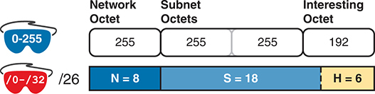

<figcaption>

<strong>图 15-15</strong> <em>具有 18 个子网位的地址结构</em>

<aside class="hidden" id="a15fig15">

示意图显示一个 0—255 掩码，其中网络八位组包含 255，两个子网八位组包含 255 和 255，关键八位组包含 192。图的下半部分按掩码 /0—/32、/26 详细展示地址结构：网络部分为 8 位，子网部分为 18 位，主机部分为 6 位。

</aside>

</figcaption>

</figure>

要求本例中的全部子网 ID，使用与 9—16 个子网位时相同的一般过程，只是需要创建更多子网块。实际上，你必须为第二和第三个八位组所有取值组合（0—255，含两端）分别创建一个子网块。<a href="#ch15fig16">图 15-16</a> 展示了总体思路。请注意，本例第四个八位组中只有 2 个子网位，因此每个子网块包含四个子网。

<figure class="image-c" id="ch15fig16">

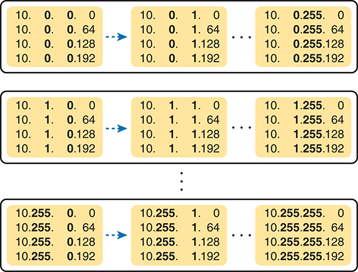

<figcaption>

<strong>图 15-16</strong> <em>256 × 256 个子网块，每块包含四个子网</em>

<aside class="hidden" id="a15fig16">

第一行显示三个子网块，子网 ID 分别为 10.0.0.0、10.0.1.0 和 10.0.255.0；第 1、2 和左邻八位组连续重复四行，关键八位组每行增加魔数 64，直到达到 192。第二行显示三个子网块，子网 ID 分别为 10.1.0.0、10.1.1.0 和 10.1.255.0；第 1、2 和左邻八位组连续重复四行，关键八位组每行增加魔数 64，直到达到 192。第三行显示三个子网块，子网 ID 分别为 10.255.0.0、10.255.1.0 和 10.255.255.0；第 1、2 和左邻八位组连续重复四行，关键八位组每行增加魔数 64，直到达到 192。

</aside>

</figcaption>

</figure>

</section>

</section>

<section>

<h4 class="h4" id="ch15lev2sec12">求所有子网 ID 的练习</h4>

<em>进入下一章之前</em>，请练习到大多数时候都能得到正确答案；此时可以使用任何工具，也不必限制用时。之后，就可以继续阅读。<em>参加考试之前</em>，请练习到达到<a href="#ch15tab05">表 15-5</a> 右列中的目标。该表汇总了这种两阶段方法的关键概念与建议。

<figure class="table" id="ch15tab05" tabindex="0">

<figcaption>

<strong>表 15-5</strong> 本章主题在继续学习前和参加考试前的目标

</figcaption>

<table class="all">

<thead>

<tr>

<th class="th">
时间阶段
</th>

<th class="th">
进入下一章之前
</th>

<th class="th">
参加考试前
</th>

</tr>

</thead>

<tbody>

<tr>

<td class="border">
<strong>关注重点……</strong>
</td>

<td class="border">
学会方法
</td>

<td class="border">
准确且快速
</td>

</tr>

<tr>

<td class="border">
<strong>允许使用的工具</strong>
</td>

<td class="border">
所有工具
</td>

<td class="border">
大脑和记事本
</td>

</tr>

<tr>

<td class="border">
<strong>目标：准确率</strong>
</td>

<td class="border">
90% 正确
</td>

<td class="border">
100% 正确
</td>

</tr>

<tr>

<td class="border">
<strong>目标：速度</strong>
</td>

<td class="border">
不限速度
</td>

<td class="border">
45 秒
</td>

</tr>

</tbody>

</table>

</figure>

<section>

<h5 class="h5" id="ch15lev3sec9">求所有子网 ID 的练习题</h5>

下面列出三个独立问题，每题给出一个有类网络号和前缀形式的掩码。请为每道题求出全部子网 ID：

<ol class="number">

<li>
192.168.9.0/27
</li>

<li>
172.30.0.0/20
</li>

<li>
10.0.0.0/17
</li>

</ol>

答案列在本章后面的“<a data-original-href="vol1_ch15.xhtml#ch15lev1sec9" data-unavailable="true" title="此内容不在当前提取范围内；请参阅原始 EPUB：vol1_ch15.xhtml#ch15lev1sec9">前述练习题答案</a>”一节中。

</section>

</section>

</section>

</section>

<section class="ccna-source ccna-appendix" aria-label="答案解析与术语表">
<section data-epub-type="chapter">

<h2 class="h2" id="ref-appc">附录 C</h2>

<h2 class="h2a">自测题答案</h2>

<section>

<h3 class="h3" id="ref-appclev1sec15">第 15 章</h3>

<strong><a id="ref-ques15_1" href="#quess15_1">1</a>.</strong> A。考虑 50% 的增长后，掩码需要定义足够的子网位，以创建 150 个子网。因此，掩码至少需要 8 个子网位：7 个子网位提供 2<em>7</em>，即 128 个子网；8 个子网位提供 2<em>8</em>，即 256 个子网。同样，最大子网规模需要增长 50%，意味着主机部分必须有足够位数，为每个子网的 750 台主机编号。9 个主机位不够（2<em>9</em> − 2 = 510），但 10 个主机位可提供每个子网 1022 台主机（2<em>10</em> − 2 = 1022）。由于选择 B 类网络，已有 16 个网络位，因此该设计在掩码中总计至少需要 34 位（16 个网络位、8 个子网位、10 个主机位），但实际只有 32 位，所以没有任何单个掩码满足需求。

<strong><a id="ref-ques15_2" href="#quess15_2">2</a>.</strong> B。考虑 20% 的增长后，设计需要支持 240 个子网。7 个子网位不满足需求（2<em>7</em> = 128），但 8 个子网位满足需求（2<em>8</em> = 256）。每个子网原需支持 120 台主机，考虑 20% 的增长后，掩码应支持每个子网 144 台主机。该数量需要 8 个主机位（2<em>8</em> − 2 = 254）。因此，至少需要 8 个子网位和 8 个主机位。

正确答案 10.0.0.0/22 属于 A 类网络，因此有 8 个网络位、14 个子网位（/22 − 8 = 14）和 10 个主机位（32 − 22 = 10）。该掩码提供至少 8 个子网位和至少 8 个主机位。

使用 /25 掩码的选项仅提供 7 个主机位，因此不正确。172.16.0.0/23 选项提供 9 个主机位，足够满足需求；但它使用 B 类网络，占用 16 个网络位，剩下的子网位过少（7 位）。使用 C 类网络 192.168.7.0 和 /24 掩码的选项，提供 8 个主机位，但子网位为 0。

<strong><a id="ref-ques15_3" href="#quess15_3">3</a>.</strong> B。支持 1000 个子网需要 10 个子网位（2<em>10</em> = 1024）。该设计使用 B 类网络，意味着还有 16 个网络位。因此，满足需求的最短掩码是 255.255.255.192，即 /26，由 16 个网络位加 10 个子网位组成。/28 选项也提供足够子网来满足需求，但与 /26 相比，/28 的主机位更少，因此每个子网的主机数也更少。

<strong><a id="ref-ques15_4" href="#quess15_4">4</a>.</strong> C 和 D。掩码转换为 255.255.252.0，因此相邻子网 ID 之间的差值（本章称为魔数）为 256 − 252 = 4。所以，子网 ID 从 172.30.0.0 开始，随后是 172.30.4.0、172.30.8.0，依此类推，每次在第三个八位组上加 4。该掩码与 B 类网络配合使用，意味着有 6 个子网位，总计 64 个子网 ID。最后一个为 172.30.252.0，识别它的一个依据是：子网位所在的第三个八位组，其值与掩码的第三个八位组相同。

<strong><a id="ref-ques15_5" href="#quess15_5">5</a>.</strong> A。第一个（数值最小的）子网 ID 与有类网络号相同，即 192.168.9.0。其余子网 ID 按顺序各比前一个大 8，即 192.168.9.8、192.168.9.16、192.168.9.24、192.168.9.32，依此类推，直到 192.168.9.248。

<strong><a id="ref-ques15_6" href="#quess15_6">6</a>.</strong> D。使用掩码 /24（255.255.255.0）时，子网 ID 的第三个八位组按 1 递增。原因是：B 类网络有 16 个网络位，/24 掩码使其后的 8 位成为子网位，因此整个第三个八位组都是子网位。所有子网 ID 的最后一个八位组均为 0，因为整个第四个八位组都由主机位组成。请注意，172.19.0.0（零子网）和 172.19.255.0（广播子网）看起来可能有些奇怪，但都是有效的子网 ID。

</section>

</section>

<section id="ref-glossary"><h2 class="h2a">术语表</h2>
<strong>广播子网</strong> 对 A 类、B 类或 C 类网络进行子网划分时，每个有类网络中所有子网位都为二进制 1 的那个子网。该子网的子网广播地址，与该有类网络的全网广播地址具有相同数值。

<strong>子网零</strong> <em>零子网</em>的另一种称呼。<em>参见</em><a href="#ref-gloss_393">零子网</a>。

<strong>零子网</strong> 对于每个已经划分子网的有类 IPv4 网络，子网号的子网部分全部为二进制 0 的那个子网。以十进制表示时，零子网很容易识别，因为它与有类网络号是同一个数字。

</section>
</section>

<section class="ccna-source ccna-appendix" aria-label="代码原图">
<section data-epub-type="chapter">

<a href="#f0388-01a" id="code-f0388-01">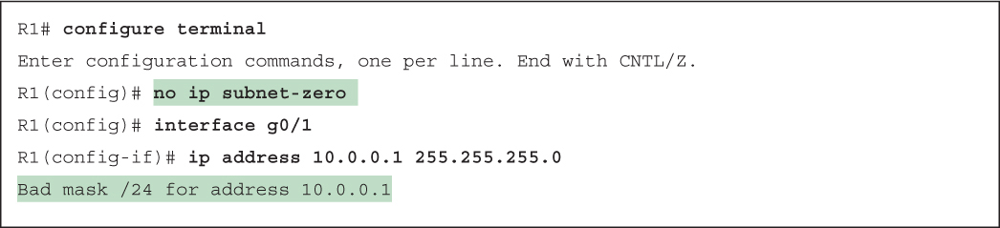</a>

</section>

</section>


<nav class="ccna-chapter-nav" aria-label="章节导航"><a href="v1-14.html">← 上一章</a><a href="v1-16.html">下一章 →</a></nav>
