
<a href="{{ '/subjects/CCNA/' | relative_url }}">← 返回 CCNA 目录</a>

第一卷 · IPv4 路由

<nav class="ccna-chapter-nav" aria-label="章节导航"><a href="v1-15.html">← 上一章</a><a href="v1-17.html">下一章 →</a></nav>



<section data-epub-type="chapter">

<h2 class="h2" id="ch16">第 16 章</h2>

<h2 class="h2a">操作 Cisco 路由器</h2>

本章涵盖以下考试主题：

1.0 网络基础

1.1 解释网络组件的角色和功能

1.1.a 路由器

1.2 描述网络拓扑架构的特征

1.2.e 小型办公室／家庭办公室（SOHO）

1.6 配置与验证 IPv4 编址和子网划分

从本章开始，接下来的一系列章节将重点介绍 Cisco 路由器的具体功能。本章首先讨论 Cisco 路由器的硬件、操作系统、接口，以及构成路由器的其他组件。在后面大量概念图和拓扑图出现之前，第一节先通过具体示例帮助你认识接口和设备。

本章第二节随后讨论 Cisco 路由器的命令行界面（CLI），其外观和操作方式与 Cisco 交换机 CLI 相同。不过，与交换机不同，路由器必须经过一些最基本的配置，才能执行其主要任务：转发 IP 数据包。本章第二节讨论配置路由器、使其开始在接口上转发 IP 数据包所需的概念和命令。

<section>

<h3 class="h3" id="ch16lev1sec1">自测</h3>

如果你希望根据得分决定在本章投入多少时间，可以完成这组自测题（在此作答，或使用 PTP 软件）。各题答案的选项字母列在自测题之后的页面底部。书末和配套网站上的<a href="#ref-appc">附录 C</a>都包含答案及解析。你也可以在 PTP 测试软件中找到答案及解析。

<figure class="table" id="ch16tab01" tabindex="0">

<figcaption>

<strong>表 16-1</strong> 核心主题小节与题目对应关系

</figcaption>

<table class="all">

<thead>

<tr>

<th class="th">
基础知识小节
</th>

<th class="th">
题目
</th>

</tr>

</thead>

<tbody>

<tr>

<td class="border">
安装 Cisco 路由器
</td>

<td class="border">
1
</td>

</tr>

<tr>

<td class="border">
在 Cisco 路由器接口上启用 IPv4 支持
</td>

<td class="border">
2–6
</td>

</tr>

</tbody>

</table>

</figure>

<strong><a id="quess16_1" href="#ques16_1a">1</a>.</strong> 哪些操作系统运行于 Cisco 企业级路由器上，其 CLI 的工作方式与 Cisco LAN 交换机的 CLI 非常相似？（选择两个答案。）

<ol class="lower-alpha">

<li>
CatOS
</li>

<li>
IOS
</li>

<li>
Windows
</li>

<li>
IOS XE
</li>

</ol>

<strong><a id="quess16_2" href="#ques16_2a">2</a>.</strong> 下列哪种操作会出现在路由器 CLI 交互中，却不会出现在仅执行第 2 层交换功能的 LAN 交换机配置中？

<ol class="lower-alpha">

<li>
从全局配置模式进入物理接口配置模式
</li>

<li>
在物理接口配置模式下配置 IP 地址
</li>

<li>
配置 10/100/1000 端口的速率及自动协商相关设置
</li>

<li>
配置控制台密码
</li>

</ol>

<strong><a id="quess16_3" href="#ques16_3a">3</a>.</strong> 下列哪些任务有助于使路由器接口 G0/0 准备好路由数据包？（选择两个答案。）

<ol class="lower-alpha">

<li>
在 G0/0 配置模式下配置 <strong>ip address</strong> <em>address mask</em> 命令
</li>

<li>
在 G0/0 配置模式下配置 <strong>ip address</strong> <em>address</em> 和 <strong>ip mask</strong> <em>mask</em> 命令
</li>

<li>
在 G0/0 配置模式下配置 <strong>no shutdown</strong> 命令
</li>

<li>
在 G0/0 配置模式下设置接口 <strong>description</strong>
</li>

</ol>

<strong><a id="quess16_4" href="#ques16_4a">4</a>.</strong> R1 上的 <strong>show ip interface brief</strong> 命令输出显示，接口 GigabitEthernet 0/0 的两个状态码都是“down”。该接口通过 UTP 直通线连接到 LAN 交换机。下列哪种情况可能成立？

<ol class="lower-alpha">

<li>
路由器接口 G0/0 当前配置了 <strong>shutdown</strong> 命令。
</li>

<li>
电缆另一端的交换机接口当前配置了 <strong>shutdown</strong> 命令。
</li>

<li>
路由器从未在该接口上配置 <strong>ip address</strong> 命令。
</li>

<li>
路由器配置了 <strong>no ip address</strong> 命令。
</li>

</ol>

<strong><a id="quess16_5" href="#ques16_5a">5</a>.</strong> 下列哪个命令会列出接口的 IP 地址，但不列出子网掩码？

<ol class="lower-alpha">

<li>
<strong>show running-config</strong>
</li>

<li>
<strong>show protocols</strong> <em>type number</em>
</li>

<li>
<strong>show ip interface brief</strong>
</li>

<li>
<strong>show interfaces</strong>
</li>

</ol>

<strong><a id="quess16_6" href="#ques16_6a">6</a>.</strong> 与 Cisco 路由器 CLI 相比，Cisco 第 2 层交换机 CLI 的下列哪一项有所不同？

<ol class="lower-alpha">

<li>
为控制台配置简单密码验证所用的命令
</li>

<li>
配置的 IP 地址数量
</li>

<li>
设备主机名的配置
</li>

<li>
接口描述的配置
</li>

</ol>

自测答案：

<strong><a id="ques16_1a" href="#ref-ques16_1">1</a></strong> B, D

<strong><a id="ques16_2a" href="#ref-ques16_2">2</a></strong> B

<strong><a id="ques16_3a" href="#ref-ques16_3">3</a></strong> A、C

<strong><a id="ques16_4a" href="#ref-ques16_4">4</a></strong> B

<strong><a id="ques16_5a" href="#ref-ques16_5">5</a></strong> C

<strong><a id="ques16_6a" href="#ref-ques16_6">6</a></strong> B

</section>

<section>

<h3 class="h3box" id="ch16lev1sec2">基础知识</h3>

</section>

<section>

<h3 class="h3" id="ch16lev1sec3">安装 Cisco 路由器</h3>

路由器共同提供网络层的主要功能，即通过网络端到端转发数据包的能力。正如<a href="v1-03.html#ch03">第 3 章</a>“<a href="v1-03.html#ch03">WAN 与 IP 路由基础</a>”所介绍，路由器连接到各种物理网络链路，例如以太网 LAN、以太网 WAN 和串行 WAN 链路，然后使用第 3 层路由逻辑选择每个数据包的转发方向。回顾一下，<a href="v1-02.html#ch02">第 2 章</a>“<a href="v1-02.html#ch02">以太网 LAN 基础</a>”介绍了建立以太网物理连接的细节，<a href="v1-03.html#ch03">第 3 章</a>则介绍了 WAN 链路布线的基础知识。

本节研究路由器安装和布线的一些细节，先从企业角度出发，再讨论典型的小型办公室／家庭办公室（SOHO）如何使用高速互联网连接到 ISP。

<section>

<h4 class="h4" id="ch16lev2sec1">安装企业路由器</h4>

典型的企业网络包含少数几个中心站点，以及许多较小的远程站点。为了支持各站点的设备，包括计算机、IP 电话、打印机及其他设备，网络在每个站点都至少部署一台 LAN 交换机。此外，每个站点都有一台路由器，连接到 LAN 交换机和某种 WAN 链路。WAN 链路将各远程站点连接回中心站点，并通过中心站点连接到其他站点。

<a href="#ch16fig01">图 16-1</a> 和<a href="#ch16fig02">图 16-2</a> 展示了两种可用于表示企业网络的网络图。<a href="#ch16fig01">图 16-1</a> 的样式适合讨论第 3 层主题，以简写形式显示子网 ID、掩码和接口 IP 地址。该图还采用以下约定，尽量减少物理层和数据链路层细节：

<strong>以太网 LAN：</strong>用简单直线表示，隐含一个或多个 LAN 交换机，但不将其画出。

<strong>以太网 WAN：</strong>用直线表示，线上通常覆盖一个云形图标，并在路由器旁标出某种以太网接口标识符（本例中为 G0/1/0 和 G0/0/0，表示 GigabitEthernet 接口）。

<strong>串行 WAN：</strong>用中间弯折成“闪电”形状的线，表示<a href="v1-03.html#ch03">第 3 章</a>介绍的典型点到点串行链路。

<figure class="image-c" id="ch16fig01">

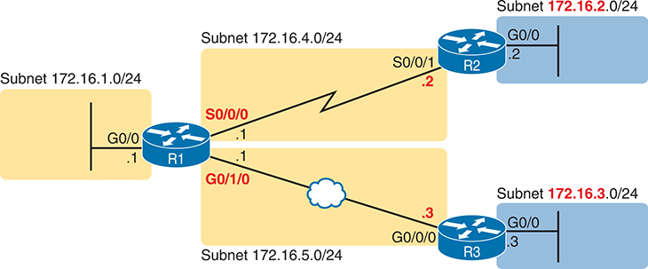

<figcaption>

<strong>图 16-1</strong> <em>通用企业网络图</em>

<aside class="hidden" id="a16fig01">

子网为 172.16.1.0/24 的主机，通过 R1、G0/0 和图标旁的 .1 向另一台主机发送数据包。R1 使用子网 172.16.4.0/24 和 S0/0/0，通过串行线路将数据包传给 R2、S0/0/1 和 .2。R2 将数据包传给子网为 172.16.2.0/24 的主机。主机再次通过 R1、G0/0 和图标旁的 .1 向另一台主机发送数据包。R1 使用子网 172.16.5.0/24 和 G0/1/0，通过以太网 WAN 将数据包传给 R3、G0/0/0 和 .3。R3 将数据包传给子网为 172.16.3.0/24 的主机。

</aside>

</figcaption>

</figure>

<figure class="image-c" id="ch16fig02">

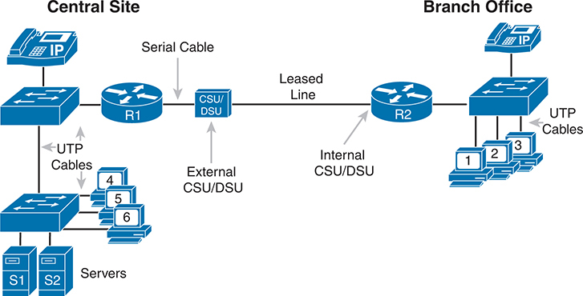

<figcaption>

<strong>图 16-2</strong> <em>同一企业网络的更详细布线图</em>

<aside class="hidden" id="a16fig02">

在中心站点，一部 IP 电话连接到一台交换机，该交换机又通过 UTB 电缆连接到另一台交换机。第一台交换机使用 UTP 电缆连接到路由器，路由器通过串行电缆连接到外部 CSU/DSU。一条租用线路将外部 CSU/DSU 连接到 R2 内部的 CSU/DSU，后者再通过 UTP 电缆连接到 IP 电话、交换机和三台个人计算机。第二台交换机通过 UTP 电缆连接到标为 S1 和 S2 的两台服务器，以及三组个人计算机。

</aside>

</figcaption>

</figure>

相比之下，<a href="#ch16fig02">图 16-2</a> 展示同一个网络，但增加物理布线细节，去掉了 IP 细节。关注其中的 LAN，所有连接 LAN 交换机的线路，都可能是采用 RJ-45 接头的标准 UTP 电缆。

接下来，考虑两台路由器之间串行链路两端的硬件。在经过服务提供商的真实串行链路中，链路终接于信道服务单元／数据服务单元（CSU/DSU）。CSU/DSU 可以作为独立设备位于路由器外部（如左侧路由器 R1 所示），也可以集成到路由器的串行接口硬件中（如右侧所示）。

在布线方面，服务提供商会将电缆引入企业配线间，通常在电缆末端安装 RJ-48 接头，其尺寸与 RJ-45 接头相同。这根电缆应连接到 CSU/DSU。对于内部 CSU/DSU（如<a href="#ch16fig02">图 16-2</a> 中的路由器 R2），路由器串行端口具有 RJ-48 插口，串行电缆应连接到该插口。对于外部 CSU/DSU，必须用一根较短的串行电缆，将其连接到路由器的串行接口卡。

<section>

<h5 class="h5" id="ch16lev3sec1">Cisco 路由器操作系统</h5>

所有路由器都具有计算机中常见的组件：CPU、RAM、永久存储器（通常为闪存）及其他电子元件。它们也运行一个名为 <a id="key_190" href="#ref-gloss_201">IOS</a> 的操作系统（OS）。最初的 Cisco 路由器使用 IOS，直到今天，一些现有路由器产品仍使用 IOS。不过，Cisco 还推出了其他企业级路由器产品系列，使用 IOS 的另一种变体，名为 <a id="key_191" href="#ref-gloss_202">IOS XE</a>。

Cisco 在 2000 年代推出 IOS XE，以改进 IOS 软件架构。这些改进对普通观察者而言可能并不明显，但举例来说，IOS XE 可以减少计划内和计划外停机，更好地抵御网络攻击，并帮助实现网络自动化。例如，IOS XE 设备可以支持在继续转发帧和数据包的同时升级操作系统，而 IOS 无法做到这一点。

好在 IOS XE 使用与 IOS 相同、大家熟悉的 CLI。两者的命令大多相同，命令语法、导航方式和模式等也一样。如果你使用 IOS 路由器学习 CLI，后来改用运行 IOS XE 的路由器时，甚至可能察觉不到区别。

由于本书中大多数情况下 IOS 和 IOS XE 的差别并不重要，本书几乎统一使用 <em>IOS</em> 一词指代路由器操作系统。当两者的差别确实重要时，正文会明确指出。

</section>

<section>

<h5 class="h5" id="ch16lev3sec2">Cisco 集成多业务路由器</h5>

包括 Cisco 在内的产品厂商通常提供多种不同类型的路由器硬件。如今，路由器所做的工作往往远不止路由数据包；事实上，它们是提供多种网络服务的设备或平台。

例如，考虑典型分支机构所需的网络功能。典型企业分支机构需要路由器提供 WAN/LAN 连接，需要 LAN 交换机提供高性能本地网络，并连接到路由器和 WAN。许多分支机构还需要 IP 语音（VoIP）服务来支持 IP 电话，以及多种安全服务。此外，如今很难想象一个有用户的站点没有 Wi-Fi 接入。因此，Cisco 提供了同时充当路由器、交换机并具备其他功能的单台设备，使站点不必像<a href="#ch16fig02">图 16-2</a> 那样部署多台独立设备。

为了便于学习和理解不同功能，本书重点采用独立交换机和独立路由器，这样学习基础知识的思路更清晰。不过，大多数 Cisco 产品及产品系列都支持在一台设备中提供多种功能。

Cisco <a id="key_189" href="#ref-gloss_192">集成多业务路由器（ISR）</a>产品系列包含的路由器，功能远不止路由。Cisco 在 2000 年代中期推出了第一批 ISR；本章最近一次更新时，即 2020 年代初，仍有部分 ISR 系列在使用。这个名称本身强调了路由器的角色，同时也整合其他功能（服务）。

<a href="#ch16fig03">图 16-3</a> 展示了 Cisco 4321 ISR，并标出一些较重要的功能。图的上半部分是路由器背面的全景。该型号内置两个千兆以太网接口，并提供两个模块化插槽，可添加称为网络接口模块（NIM）的小型卡。图的下半部分展示了一个 NIM 示例，它提供两个串行接口。路由器还具有其他组件，包括 RJ-45 和 USB 两种控制台端口。

<figure class="image-c" id="ch16fig03">

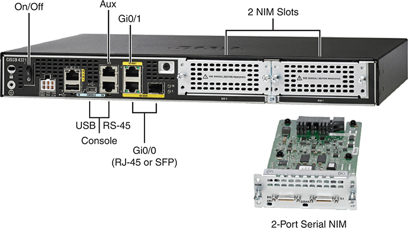

<figcaption>

<strong>图 16-3</strong> <em>Cisco 4321 型集成多业务路由器（ISR）的照片</em>

<aside class="hidden" id="a16fig03">

设备上标出的按钮和端口包括电源开关、Aux、Gi0/1、2 个 NIM 插槽、USB、Console、RS-45、Gi0/0（RJ-45 或 SFP），以及 2 端口串行 NIM。

</aside>

</figcaption>

</figure>

该图展示了路由器同时连接以太网 LAN 和以太网 WAN 服务的一项重要特性。仔细看<a href="#ch16fig03">图 16-3</a> 中的千兆接口。G0/1 表示接口 GigabitEthernet0/1，是仅支持 UTP 电缆的 RJ-45 端口。不过，接口 G0/0（GigabitEthernet0/0 的缩写）有一些值得关注的特点：

<ul class="sq">

<li>
路由器为同一个接口（G0/0）提供了两个端口。
</li>

<li>
任何时刻都只能使用其中一个，不能同时使用两个。
</li>

<li>
其中一个物理端口是支持铜缆的 RJ-45 端口（意味着它用于连接 LAN）。
</li>

<li>
另一个 G0/0 物理端口是小型可插拔（SFP）端口，支持各种光纤以太网标准，因此可以用于以太网 WAN。
</li>

</ul>

Cisco 通常会让企业级路由器上的一个或多个以太网端口支持 SFP，以便工程师选择与以太网 WAN 服务提供商所提供电缆类型相匹配的 SFP。

注意

搭建用于学习 CCNA 或 CCNP 的实验网络时，由于设备都在同一地点，可以使用 RJ-45 端口和 UTP 电缆建立以太网 WAN 链路，无需为每台路由器购买 SFP。

</section>

<section>

<h5 class="h5" id="ch16lev3sec3">Cisco Catalyst 边缘平台</h5>

2020 年，Cisco 发布了使用 <a id="key_187" href="#ref-gloss_062">Cisco Catalyst 边缘平台</a>品牌的新路由器系列，区别于之前的 ISR 品牌。新系列包括 8000 系列中的型号，例如 8200、8300 和 8500。这些新型号替代了 Cisco 产品线中的部分现有 ISR 系列，但并非全部。

如果说 ISR 品牌强调现代路由器的多功能特点，那么 <em>Catalyst 边缘平台</em>则进一步强化了这一点。首先，尽管设备使用 IOS XE，主要充当路由器，名称中甚至没有出现<em>路由器</em>一词。<em>平台</em>一词强调设备作为平台运行各种网络服务的作用。

另请注意，新品牌使用了 <em>Catalyst</em> 一词，历史上该词仅用于交换机。在 Catalyst 8000 系列之前，<em>Catalyst</em> 始终指交换机，但现在 Cisco 更广泛地使用这个术语。在 CCNA 学习之外接触到 Catalyst 8000 系列设备时，要记得把它们视为路由器。

就备考而言，本章提供 ISR 和 Catalyst 8000 的信息，是为了介绍背景。不过，考试主题并未提及具体的 Cisco 产品系列。但是，了解一些路由器型号和系列，有助于你把 CCNA 中较一般性的主题与工作网络中的设备联系起来。

</section>

<section>

<h5 class="h5" id="ch16lev3sec4">物理安装</h5>

掌握<a href="#ch16fig02">图 16-2</a> 这类图中的布线细节，以及<a href="#ch16fig03">图 16-3</a> 这类照片中的路由器硬件细节后，就可以进行路由器的物理安装。安装路由器时，执行以下步骤：

步骤 1。对于每个以太网 LAN 接口，使用合适的铜缆以太网电缆，将其 RJ-45 接头分别连接到路由器上的 RJ-45 以太网端口和某个 LAN 交换机端口。

步骤 2。对于每个串行 WAN 端口：

步骤 A。如果使用外部 CSU/DSU，将路由器串行接口连接到 CSU/DSU，再将 CSU/DSU 连接到电信运营商提供的线路。

步骤 B。如果使用内部 CSU/DSU，将路由器串行接口连接到电信运营商提供的线路。

步骤 3。对于每个以太网 WAN 端口：

步骤 A。订购以太网 WAN 服务时，确认接入该链路所需的以太网标准和 SFP 类型，并订购相应 SFP。

步骤 B。将 SFP 安装到路由器中，并将以太网 WAN 链路的以太网电缆连接到链路两端的 SFP。

步骤 4。根据需要，将路由器控制台端口连接到 PC，以便配置路由器，具体方法见<a href="v1-04.html#ch04">第 4 章</a>“<a href="v1-04.html#ch04">使用命令行界面</a>”。

步骤 5。用电源线将电源插座连接到路由器的电源端口。

步骤 6。使用电源开关启动路由器。

请注意，Cisco 企业级路由器通常具有电源开关，而交换机没有。

</section>

</section>

<section>

<h4 class="h4" id="ch16lev2sec2">安装 SOHO 路由器</h4>

无论从 Cisco 这类厂商向市场提供产品的方式来看，还是从企业使用和配置设备的方式来看，<a id="key_188" href="#ref-gloss_123">企业路由器</a>与<em>小型办公室／家庭办公室（SOHO）路由器</em>都是一对相对的路由器类别。<em>企业路由器</em>通常指公司在固定营业地点使用的路由器，而 <a id="key_192" href="#ref-gloss_367">SOHO 路由器</a>通常位于员工家中，或仅有少数人员的小型固定站点。不过，正如你可能想到的，企业路由器和 SOHO 路由器之间的界限并不清晰，因此应把它们当作大致分类。

即使只是这种一般性比较，SOHO 路由器通常仍有两项企业路由器较少具备的特点：

<ul class="sq">

<li>
SOHO 路由器几乎总是使用互联网和虚拟专用网络（VPN）技术作为 WAN 连接，与企业其他部分收发数据。
</li>

<li>
SOHO 路由器几乎总是多功能设备，提供路由、LAN 交换、VPN、无线以及可能的其他功能。
</li>

</ul>

例如，在企业营业地点，楼内可能部署企业路由器、独立以太网交换机和独立无线接入点（AP），并将它们相互连接。对于一个有四名员工、网络中总共 10 台设备的固定营业站点，一台 SOHO 路由器就能在单个设备中提供同样的全部功能。

例如，<a href="#ch16fig04">图 16-4</a> 展示了一个典型 SOHO 站点。表示路由器、交换机和接入点的三个图标，实际上都位于同一个盒子中；图中将它们分开，是为了强调一台 SOHO 路由器提供多种功能。左侧，SOHO 路由器提供有线和无线 LAN 服务器；右侧则通过有线电视互联网连接提供 WAN 接入。

<figure class="image-c" id="ch16fig04">

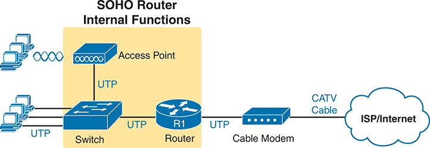

<figcaption>

<strong>图 16-4</strong> <em>采用高速 CATV 互联网的 SOHO 网络中的设备</em>

<aside class="hidden" id="a16fig04">

示意图展示了简化的 SOHO 路由器布局：计算机装置表示数字空间，云形符号表示 ISP／互联网。CATV 电缆将电缆调制解调器连接到 ISP／互联网。UTP 将电缆调制解调器连接到标为 R1 的路由器。R1 通过 UTP 连接交换机，交换机再连接计算机装置和接入点。接入点通过无线网络连接其他装置。

</aside>

</figcaption>

</figure>

<a href="#ch16fig04">图 16-4</a> 并未反映 SOHO 路由器的实际物理形态，因此<a href="#ch16fig05">图 16-5</a> 给出一个布线示例。图左侧的用户设备通过无线或以太网 UTP 电缆连接到路由器。右侧，路由器使用外部电缆调制解调器连接 ISP 提供的同轴电缆。然后，必须使用普通 UTP 以太网端口，通过一根短以太网电缆连接 SOHO 路由器和电缆调制解调器。

<figure class="image-c" id="ch16fig05">

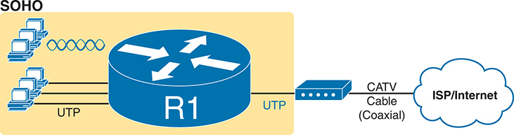

<figcaption>

<strong>图 16-5</strong> <em>使用有线电视互联网和集成设备的 SOHO 网络</em>

<aside class="hidden" id="a16fig05">

示意图展示了简化的 SOHO 路由器布局：计算机装置表示数字空间，云形符号表示 ISP／互联网。CATV 电缆（同轴电缆）将电缆调制解调器连接到互联网。UTP 将电缆调制解调器连接到标为 R1 的路由器，R1 再通过 UTP 和无线网络连接计算机装置。

</aside>

</figcaption>

</figure>

</section>

</section>

<section>

<h3 class="h3" id="ch16lev1sec4">在 Cisco 路由器接口上启用 IPv4 支持</h3>

路由器支持相当多的功能，并提供大量配置命令和 EXEC 命令来支持这些功能。在本书后续内容中，你将学习其中的许多功能。

注意

作为参考，Cisco 路由器文档包含命令参考手册，索引列出每一个路由器命令。一次快速的非正式统计发现，CLI 命令超过 5000 条。

本章第二节重点介绍与路由器接口相关的命令。要让路由器工作，也就是路由 IPv4 数据包，就必须配置接口。本节介绍最常见的接口配置命令，使接口正常工作，并为其设置 IP 地址和掩码。

<section>

<h4 class="h4" id="ch16lev2sec3">访问路由器 CLI</h4>

路由器命令行界面（CLI）的工作方式与交换机非常相似。事实上，这里不再重复<a href="v1-04.html#ch04">第 4 章</a>的细节，只需认为该章的 CLI 内容同样适用于路由器。如果你对<a href="v1-04.html#ch04">第 4 章</a>的细节记忆不够清晰，继续阅读之前，值得花几分钟简要回顾该章，以及<a href="v1-07.html#ch07">第 7 章</a>“<a href="v1-07.html#ch07">配置和验证交换机接口</a>”。以下列表回顾了交换机和路由器共有的一些基本 CLI 功能：

<ul class="sq">

<li>
用户模式和特权（enable）模式
</li>

<li>
使用 <strong>configure terminal</strong>、<strong>end</strong>、<strong>exit</strong> 命令和 Ctrl+Z 组合键进入和退出配置模式
</li>

<li>
配置控制台、Telnet（vty）和 enable secret 密码
</li>

<li>
配置安全外壳（SSH）加密密钥以及用户名／密码登录凭据
</li>

<li>
配置主机名和接口描述
</li>

<li>
配置接口，使其处于管理性禁用（<strong>shutdown</strong>）或管理性启用（<strong>no shutdown</strong>）状态
</li>

<li>
使用 <strong>line console 0</strong> 和 <strong>interface</strong> <em>type number</em> 等命令，在不同配置模式上下文之间切换
</li>

<li>
CLI 帮助、命令编辑和命令回调功能
</li>

<li>
startup-config（位于 NVRAM）、running-config（位于 RAM）和外部服务器（如 TFTP）的含义与用途，以及如何使用 <strong>copy</strong> 命令复制配置文件和 IOS 镜像
</li>

</ul>

Cisco 路由器与交换机 CLI 最显著的区别，源于各自设备的主要功能：交换机执行第 2 层 LAN 交换，路由器执行第 3 层 IP 路由。LAN 交换机将物理接口视为<em>第 2 层接口</em>或<em>交换接口</em>，意味着交换机应在接口上接收以太网帧，并将其交给 LAN 交换逻辑。路由器将物理接口视为<em>第 3 层接口</em>或<em>路由接口</em>。第 3 层接口接收帧后，会解封装取出帧内的数据包，再将数据包交给路由器内部的路由处理过程。

熟悉交换机和路由器差异的最好方法，是逐渐学习两者更多的命令。从这里到本书结尾的各章，以及 <em>CCNA 200-301 Official Cert Guide, Volume 2</em> 第二版中的若干章节，会进一步介绍路由器功能和相关命令。下面列出你将学习的几个路由器 CLI 主题，每项附一个命令示例：

<ul class="sq">

<li>
配置接口 IP 地址（<strong>ip address</strong> <em>address mask</em>）
</li>

<li>
配置 IP 路由协议，例如 OSPF（<strong>router ospf</strong> <em>process-id</em>）
</li>

<li>
验证 IP 路由表（<strong>show ip route</strong>）
</li>

<li>
配置静态 IP 路由（<strong>ip route</strong> <em>subnet mask next-hop-address</em>）
</li>

</ul>

注意

现代路由器和交换机往往同时支持路由与交换功能。网络工程师可以据此决定，在网络设计中的特定位置需要交换机（通常需要更强的交换功能时），还是路由器（需要更强的路由功能时）。学习 CCNA 时，要知道路由器和交换机通常都支持路由和交换两类命令，其中有些命令你原本可能认为只会出现在其中一种设备上。

Cisco 路由器使用相同的命令保护 Telnet 和 SSH，因此请花时间回顾<a href="v1-06.html#ch06">第 6 章</a>“<a href="v1-06.html#ch06">配置基本交换机管理</a>”中的“<a href="v1-06.html#ch06lev1sec3">保护交换机 CLI</a>”一节。此外，要特别注意一条与 Telnet 和 SSH 配置相关的命令：线路子命令 <strong>transport input</strong>。该命令在交换机和路由器上的默认值不同，而且默认设置也已经发生过变化。例如，使用 IOS（而非 IOS XE）的较旧企业级路由器，通常默认为 <strong>transport input none</strong>，意味着路由器既不支持 Telnet，也不支持 SSH。运行 IOS XE 的企业级路由器通常默认为 <strong>transport input ssh</strong>，支持 SSH，但不支持 Telnet。

</section>

<section>

<h4 class="h4" id="ch16lev2sec4">路由器接口</h4>

Cisco 交换机与路由器的一个小区别是，路由器支持的接口类型广泛得多。如今，LAN 交换机仅支持各种速率的以太网接口。路由器还支持许多其他接口类型，包括串行接口、有线电视接口、4G/5G 无线接口，以及本书未提及的其他接口。

大多数 Cisco 路由器至少具有一个某种类型的以太网接口。其中许多支持多种速率并使用自动协商，因此为保持一致，路由器 IOS 根据其最高速率来命名这些接口。例如，仅支持 10 Mbps 的以太网接口，使用 <strong>interface ethernet</strong> <em>number</em> 配置命令；10/100 接口使用 <strong>interface fastethernet</strong> <em>number</em> 命令；10/100/1000 接口使用 <strong>interface gigabitethernet</strong> <em>number</em> 命令。不过，综合讨论这些接口时，工程师会直接将其称为<em>以太网接口</em>，而不区分最高速率。

一些 Cisco 路由器具有串行接口。你可能还记得<a href="v1-03.html#ch03">第 3 章</a>介绍过，Cisco 路由器使用串行接口连接串行链路。每条点到点串行链路可以使用高级数据链路控制（HDLC，默认值）或点到点协议（PPP）。

路由器命令引用接口时，先指定接口类型（Ethernet、Fast Ethernet、Gigabit Ethernet、Serial 等），再指定该路由器上唯一的接口标识符（数字）。根据路由器型号，接口标识符可能是单个数字、斜杠分隔的两个数字，或斜杠分隔的三个数字。例如，下列配置命令都至少在一种 Cisco 路由器型号上是正确的：

<a href="#code-f0415-01" id="f0415-01a">点击此处查看代码原图</a>

<pre class="pre" tabindex="0"><code class="highlight"><strong>interface ethernet 0</strong>
<strong>interface fastethernet 0/1</strong>
<strong>interface gigabitethernet 0/0</strong>
<strong>interface gigabitethernet 0/1/0</strong>
<strong>interface serial 1/0/1</strong>
<strong>interface cellular 0/0/1</strong></code></pre>

显示接口及其状态最常用的两个命令是 <strong>show ip interface brief</strong> 和 <strong>show interfaces</strong>。第一个命令以每接口一行的列表形式，显示一些基本信息，包括接口 IP 地址和接口状态。第二个命令同样列出接口，但每个接口的信息量很大。<a href="#exa16_1">例 16-1</a> 展示了这两个命令的示例。输出来自一台同时具有 GigabitEthernet0/0 和 GigabitEthernet0/1/0 接口的 ISR 路由器，展示了两段式和三段式接口标识符并存的情况。

<strong>例 16-1</strong> <em>列出路由器中的接口</em>

<a href="#code-f0416-01" id="f0416-01a">点击此处查看代码原图</a>

<pre class="pre-ex" tabindex="0"><code class="highlight">R1# <strong>show ip interface brief</strong>
Interface                  IP-Address     OK? Method Status                Protocol
Embedded-Service-Engine0/0 unassigned     YES NVRAM  administratively down down
GigabitEthernet0/0         172.16.1.1     YES NVRAM  down                  down
GigabitEthernet0/1         unassigned     YES NVRAM  administratively down down
Serial0/0/0                172.16.4.1     YES manual up                    up
Serial0/0/1                unassigned     YES unset  administratively down down
GigabitEthernet0/1/0       172.16.5.1     YES NVRAM  up                    up

R1# <strong>show interfaces gigabitEthernet 0/1/0</strong>
GigabitEthernet0/1/0 is up, line protocol is up
  Hardware is EHWIC-1GE-SFP-CU, address is 0201.a010.0001 (bia 30f7.0d29.8570)
  Description: Link in lab to R3's G0/0/0
  Internet address is 172.16.5.1/24
  MTU 1500 bytes, BW 1000000 Kbit/sec, DLY 10 usec,
     reliability 255/255, txload 1/255, rxload 1/255
  Encapsulation ARPA, loopback not set
  Keepalive set (10 sec)
  Full Duplex, 1Gbps, media type is RJ45
  output flow-control is XON, input flow-control is XON
  ARP type: ARPA, ARP Timeout 04:00:00
  Last input 00:00:29, output 00:00:08, output hang never
  Last clearing of "show interface" counters never
  Input queue: 0/75/0/0 (size/max/drops/flushes); Total output drops: 0
  Queueing strategy: fifo
  Output queue: 0/40 (size/max)
  5 minute input rate 0 bits/sec, 0 packets/sec
  5 minute output rate 0 bits/sec, 0 packets/sec
     12 packets input, 4251 bytes, 0 no buffer
     Received 12 broadcasts (0 IP multicasts)
     0 runts, 0 giants, 0 throttles
     0 input errors, 0 CRC, 0 frame, 0 overrun, 0 ignored
     0 watchdog, 0 multicast, 0 pause input
     55 packets output, 8098 bytes, 0 underruns
     0 output errors, 0 collisions, 0 interface resets
     0 unknown protocol drops
     0 babbles, 0 late collision, 0 deferred
     0 lost carrier, 0 no carrier, 0 pause output
     0 output buffer failures, 0 output buffers swapped out</code></pre>

注意

引用路由器接口的命令，可以通过截短单词大幅简写。例如，可以用 <strong>sh int gi0/0</strong> 或 <strong>sh int g0/0</strong> 代替 <strong>show interfaces gigabitethernet0/0</strong>。事实上，许多网络工程师在旁指导别人时，会说“执行一下 show int G-I 零零命令”之类的话，而不是念出完整命令。

另请注意，如果配置了接口描述，<strong>show interfaces</strong> 命令会在大约第三行列出该文本。本例中，之前已在 G0/1/0 接口配置模式下，为接口 G0/1/0 配置了 <strong>description Link in lab to R3’s G0/0/0</strong> 命令。<strong>description</strong> 接口子命令让你能方便地添加简短备注，记录路由器接口连接到哪个相邻设备，<strong>show interfaces</strong> 命令则会列出这些信息。

<section>

<h5 class="h5" id="ch16lev3sec5">接口状态码</h5>

每个接口都有两个<em>接口状态码</em>。要使接口可用，这两个状态码都必须处于“up”状态。第一个状态码表示第 1 层是否正常，第二个状态码通常（但不总是）表示数据链路层协议是否正常。<a href="#ch16tab02">表 16-2</a> 汇总了这两个状态码。

<figure class="table" id="ch16tab02" tabindex="0">

<figcaption>

<strong>表 16-2</strong> 接口状态码及其含义

</figcaption>

<table class="all">

<thead>

<tr>

<th class="th">
名称
</th>

<th class="th">
位置
</th>

<th class="th">
一般含义
</th>

</tr>

</thead>

<tbody>

<tr>

<td class="border">
线路状态
</td>

<td class="border">
第一个状态码
</td>

<td class="border">
表示第 1 层状态。（例如，是否连接电缆、电缆是否正确、另一端设备是否通电？）
</td>

</tr>

<tr>

<td class="border">
协议状态
</td>

<td class="border">
第二个状态码
</td>

<td class="border">
通常表示第 2 层状态。线路状态为 down 时，它始终为 down。如果线路状态为 up，协议状态为 down 通常由数据链路层配置不匹配引起。
</td>

</tr>

</tbody>

</table>

</figure>

接口状态码存在多种组合，如<a href="#ch16tab03">表 16-3</a> 所汇总。表中按顺序列出状态码，从通过配置有意禁用，到完全正常工作的状态。

<figure class="table" id="ch16tab03" tabindex="0">

<figcaption>

<strong>表 16-3</strong> 典型接口状态码组合

</figcaption>

<table class="all">

<thead>

<tr>

<th class="th">
线路状态
</th>

<th class="th">
协议状态
</th>

<th class="th">
典型原因
</th>

</tr>

</thead>

<tbody>

<tr>

<td class="border">
Administratively down
</td>

<td class="border">
Down
</td>

<td class="border">
接口上配置了 <strong>shutdown</strong> 命令。
</td>

</tr>

<tr>

<td class="border">
Down
</td>

<td class="border">
Down
</td>

<td class="border">
接口未被 <strong>shutdown</strong>，但物理层存在问题。例如，接口没有连接电缆；或者对于以太网，电缆另一端的交换机接口被关闭、交换机断电，或电缆两端设备使用不同的传输速率。
</td>

</tr>

<tr>

<td class="border">
Up
</td>

<td class="border">
Down
</td>

<td class="border">
几乎总是表示数据链路层问题，最常见的是配置问题。例如，一台路由器配置为使用 PPP，另一台仍默认使用 HDLC 时，串行链路就会出现这种组合。
</td>

</tr>

<tr>

<td class="border">
Up
</td>

<td class="border">
Up
</td>

<td class="border">
该接口的第 1 层和第 2 层都正常工作。
</td>

</tr>

</tbody>

</table>

</figure>

例如，回看<a href="#exa16_1">例 16-1</a> 的 <strong>show ip interface brief</strong> 命令，关注下面列表中的三个接口。它们各自具有不同的接口状态码组合；列表说明了为本书创建该示例时，实验环境中产生这些状态码的具体原因。

<strong>G0/0：</strong>接口为 down/down，本例原因是接口没有连接电缆。

<strong>G0/1：</strong>接口为 administratively down/down，因为 G0/1 接口的配置中包含 <strong>shutdown</strong> 命令。

<strong>S0/0/0：</strong>接口为 up/up，因为已安装串行电缆，连接到实验环境中的另一台路由器，并且正常工作。

</section>

<section>

<h5 class="h5" id="ch16lev3sec6">路由器接口 IP 地址</h5>

Cisco 企业级路由器必须在默认配置之外进行一些配置，才能执行其主要工作：路由 IP 数据包。首先，路由器的默认行为可能会使接口处于禁用（shutdown）状态。其次，路由器使用默认接口命令 <strong>no ip address</strong>，意味着接口没有配置 IP 地址或掩码。为了让路由器接口能够路由数据包，该接口必须处于 up 状态，并配置 IP 地址和掩码。

配置地址和掩码时，只需使用 <strong>ip address</strong> <em>address mask</em> 接口子命令，并通过 <strong>no shutdown</strong> 命令确保接口启用。<a href="#ch16fig06">图 16-6</a> 展示了一个简单 IPv4 网络及路由器 R1 上的 IPv4 地址，<a href="#exa16_2">例 16-2</a> 则展示相应配置。

<figure class="image-c" id="ch16fig06">

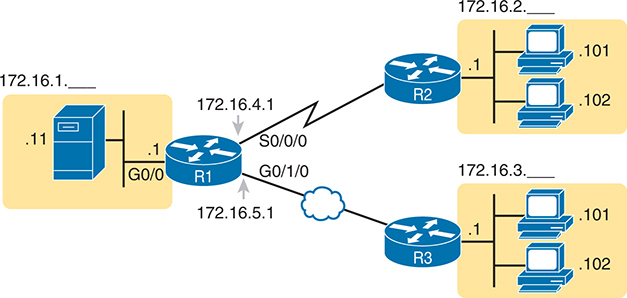

<figcaption>

<strong>图 16-6</strong> <em><a href="#exa16_2">例 16-2</a> 中使用的 IPv4 地址</em>

<aside class="hidden" id="a16fig06">

服务器的简写子网为 172.16.1.，图标旁标有 .1；它通过 R1、G0/0 和图标旁的 .1 向个人计算机发送数据包。R1 使用 IP 地址 172.16.4.1 和 S0/0/0，通过串行线路将数据包传给 R2。R2 将数据包传给简写子网为 172.16.2.、主机图标旁标有 .101 和 .102 的主机。服务器再次通过 R1、G0/0 和图标旁的 .1 向其他个人计算机发送数据包。R1 使用 IP 地址 172.16.5.1 和 G0/1/0，通过以太网 WAN 将数据包传给 R3。R3 将数据包传给子网为 172.16.3.、主机图标旁标有 .101 和 .102 的主机。

</aside>

</figcaption>

</figure>

<strong>例 16-2</strong> <em>在 Cisco 路由器上配置 IP 地址</em>

<a href="#code-f0419-01" id="f0419-01a">点击此处查看代码原图</a>

<pre class="pre-ex" tabindex="0"><code class="highlight">R1# <strong>configure terminal</strong>
Enter configuration commands, one per line. End with CNTL/Z.
R1config)# <strong>interface G0/0</strong>
R1(config-if)# <strong>ip address 172.16.1.1 255.255.255.0</strong>
R1(config-if)# <strong>no shutdown</strong>
R1(config-if)# <strong>interface S0/0/0</strong>
R1(config-if)# <strong>ip address 172.16.4.1 255.255.255.0</strong>
R1(config-if)# <strong>no shutdown</strong>
R1(config-if)# <strong>interface G0/1/0</strong>
R1(config-if)# <strong>ip address 172.16.5.1 255.255.255.0</strong>
R1(config-if)# <strong>no shutdown</strong>
R1(config-if)# <strong>^Z</strong>
R1#</code></pre>

<a href="#exa16_3">例 16-3</a> 中的 <strong>show protocols</strong> 命令，确认了<a href="#ch16fig06">图 16-6</a> 中 R1 三个接口各自的状态，以及这些接口上配置的 IP 地址和掩码。

<strong>例 16-3</strong> <em>验证 Cisco 路由器上的 IP 地址</em>

<a href="#code-f0419-02" id="f0419-02a">点击此处查看代码原图</a>

<pre class="pre-ex" tabindex="0"><code class="highlight">R1# <strong>show protocols</strong>
Global values:
   Internet Protocol routing is enabled
Embedded-Service-Engine0/0 is administratively down, line protocol is down
GigabitEthernet0/0 is up, line protocol is up
   Internet address is 172.16.1.1/24
GigabitEthernet0/1 is administratively down, line protocol is down
Serial0/0/0 is up, line protocol is up
   Internet address is 172.16.4.1/24
Serial0/0/1 is administratively down, line protocol is down
GigabitEthernet0/1/0 is up, line protocol is up
   Internet address is 172.16.5.1/24</code></pre>

验证路由器是否正常工作时，首先要做的操作之一就是找出接口、检查接口状态，并检查是否使用正确的 IP 地址和掩码。<a href="#exa16_1">例 16-1</a> 和<a href="#exa16_3">例 16-3</a> 展示了关键 <strong>show</strong> 命令的示例，<a href="#ch16tab04">表 16-4</a> 则汇总了这些命令及其显示的信息类型。

<figure class="table" id="ch16tab04" tabindex="0">

<figcaption>

<strong>表 16-4</strong> 列出路由器接口状态的关键命令

</figcaption>

<table class="all">

<thead>

<tr>

<th class="th">
命令
</th>

<th class="th">
每接口输出行数
</th>

<th class="th">
列出的 IP 配置
</th>

<th class="th">
是否列出接口状态？
</th>

</tr>

</thead>

<tbody>

<tr>

<td class="border">
<strong>show ip interface brief</strong>
</td>

<td class="border">
1
</td>

<td class="border">
地址
</td>

<td class="border">
是
</td>

</tr>

<tr>

<td class="border">
<strong>show protocols</strong> [<em>type number</em>]
</td>

<td class="border">
1 或 2
</td>

<td class="border">
地址／掩码
</td>

<td class="border">
是
</td>

</tr>

<tr>

<td class="border">
<strong>show interfaces</strong> [<em>type number</em>]
</td>

<td class="border">
多行
</td>

<td class="border">
地址／掩码
</td>

<td class="border">
是
</td>

</tr>

</tbody>

</table>

</figure>

</section>

<section>

<h5 class="h5" id="ch16lev3sec7">以太网接口自动协商</h5>

使路由器以太网接口达到 up/up 状态的第一步，是安装正确的电缆。例如，对于以太网 WAN 链路，物理标准可能需要支持数千米距离，因此接口硬件通常需要光纤电缆。路由器 LAN 接口通常使用 UTP 电缆连接附近的 LAN 交换机，并采用预期的直通线引脚排列。

对于允许多种标准和速率的以太网接口，还需要确保接口使用自动协商，或使用正确的静态设置。IOS 路由器使用与 Cisco 交换机相同的概念和命令，详见<a href="v1-07.html#ch07">第 7 章</a>的“<a href="v1-07.html#ch07lev2sec2">配置自动协商、速率和双工模式</a>”一节。IOS XE 路由器使用相同的自动协商过程，但命令不同，接下来的几页将介绍这些差异。

先看熟悉的情况，<a href="#ch16fig07">图 16-7</a> 上半部分展示了一台 IOS 路由器 R1 连接到 Cisco 交换机的示例。图中列出路由器和交换机上的全部默认设置，这些设置使两台设备都执行 IEEE 自动协商。

<figure class="image-c" id="ch16fig07">

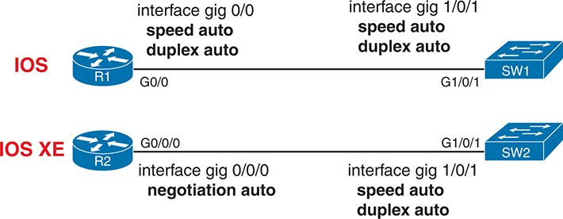

<figcaption>

<strong>图 16-7</strong> <em>默认以太网自动协商配置：IOS 与 IOS XE</em>

<aside class="hidden" id="a16fig07">

IOS 连接显示，R1 的 interface gig 0/0、speed auto、duplex auto，连接到 SW1 的 interface gig 1/0/1、speed auto、duplex auto。IOS XE 连接显示，R2 的 interface gig 0/0/0、negotiation auto，连接到 SW2 的 interface gig 1/0/1、speed auto、duplex auto。

</aside>

</figcaption>

</figure>

图的下半部分重点展示 IOS XE 路由器 R2 上不同的配置。IOS XE 的默认接口子命令 <strong>negotiation auto</strong>，正如其名称所示，会启用 IEEE 自动协商。因此，两台设备都通过自动协商选择链路速率和双工模式。

<strong>show interfaces</strong> EXEC 命令显示选定的双工模式和速率。对于 IOS（非 IOS XE）的示例，可以查看<a href="#exa16_1">例 16-1</a> 的 <strong>show interfaces</strong> 命令输出，大约第九行列出了速率（1Gbps）和双工模式（full）。不过，IOS 的任何 <strong>show</strong> 命令都不会明确注明路由器使用了自动协商。

对于 IOS XE，有几个命令能够表明使用了 IEEE 自动协商，如<a href="#exa16_4">例 16-4</a> 中来自<a href="#ch16fig07">图 16-7</a> 的 IOS XE 路由器 R2 的输出所示。<strong>show interfaces</strong> 命令的高亮行确认了速率和双工模式。该行还列出“link type is auto”，表示这些值通过自动协商获得。

<strong>例 16-4</strong> <em>验证 IOS XE 自动协商结果（默认设置）</em>

<a href="#code-f0421-01" id="f0421-01a">点击此处查看代码原图</a>

<pre class="pre-ex" tabindex="0"><code class="highlight">! Output below is from IOS XE router R2
R2# <strong>show interfaces g0/0/0</strong>
GigabitEthernet0/0/0 is up, line protocol is up
  Hardware is C1111-2x1GE, address is 0200.1111.1111 (bia 2436.dadf.5680)
  Internet address is 10.1.1.1/24
  MTU 1500 bytes, BW 1000000 Kbit/sec, DLY 10 usec,
     reliability 255/255, txload 1/255, rxload 1/255
  Encapsulation ARPA, loopback not set
  Keepalive not supported
  Full Duplex, 1000Mbps, link type is auto, media type is RJ45
! Lines omitted for brevity
R2# <strong>show interfaces g0/0/0 controller | include Autoneg</strong>
Admin State Up MTU 1500 Speed 1000mbps Duplex full Autoneg On Stats Interval 5</code></pre>

示例末尾的 IOS XE <strong>show interfaces g0/0/0 controller</strong> 命令过滤输出，只显示包含“Autoneg”文本的部分行。该行也确认使用了自动协商。

无论使用 IOS 还是 IOS XE，路由器以太网接口的自动协商使用建议都与交换机接口相同，概括如下：

<ul class="sq">

<li>
在以太网链路两端都使用自动协商。
</li>

<li>
如果必须设置速率或双工模式，确保链路两端设备配置为相同的速率和双工模式。
</li>

<li>
避免一端配置速率和双工模式，另一端却依赖自动协商。
</li>

</ul>

如果必须手动配置，IOS 和 IOS XE 在手动设置速率和双工模式的方法上略有不同。IOS 路由器采用与交换机相同的约定：只需将 <strong>speed</strong> 和 <strong>duplex</strong> 两个接口子命令配置为具体设置，如<a href="#ch16fig08">图 16-8</a> 左侧所示。在 IOS 路由器上，同时配置速率和双工模式也会禁用自动协商。

<figure class="image-c" id="ch16fig08">

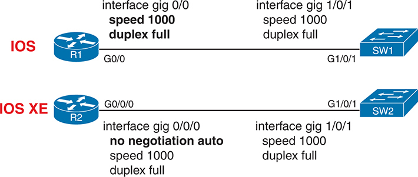

<figcaption>

<strong>图 16-8</strong> <em>路由器以太网速率、双工模式和自动协商配置</em>

<aside class="hidden" id="a16fig08">

IOS 连接显示，R1 的 interface gig 0/0、speed 1000、duplex full，连接到 SW1 的 interface gig 1/0/1、speed 1000、duplex full。IOS XE 连接显示，R2 的 interface gig 0/0/0、no negotiation auto、speed 1000、duplex full，连接到 SW2 的 interface gig 1/0/1、speed 1000、duplex full。

</aside>

</figcaption>

</figure>

IOS XE 需要使用图中路由器 R2 旁显示的命令，<a href="#exa16_5">例 16-5</a> 演示了相同配置步骤。示例首先说明，在使用 <strong>no negotiation auto</strong> 接口子命令禁用自动协商之前，IOS XE 不允许配置 <strong>speed</strong> 或 <strong>duplex</strong> 命令。禁用自动协商之后，IOS XE 才允许设置具体的 <strong>speed</strong> 和 <strong>duplex</strong> 值。随后，示例显示日志消息，通知接口先发生故障再恢复；这在使用新的速率和双工设置时很常见，整个过程大约需要十秒。

<strong>例 16-5</strong> <em>IOS XE 路由器：设置速率和双工模式</em>

<a href="#code-f0422-01" id="f0422-01a">点击此处查看代码原图</a>

<pre class="pre-ex" tabindex="0"><code class="highlight">R2# <strong>configure terminal</strong>
Enter configuration commands, one per line.  End with CNTL/Z.
R2(config)# <strong>interface g0/0/0</strong>
R2(config-if)# <strong>speed 1000</strong>
Auto-negotiation is enabled. Speed cannot be set

R2(config-if)# <strong>no negotiation auto</strong>
R2(config-if) # <strong>speed 1000</strong>
R2(config-if) # <strong>duplex full</strong>
*Oct 14 12:24:16.014: %LINEPROTO-5-UPDOWN: Line protocol on Interface 
GigabitEthernet0/0/0, changed state to down
*Oct 14 12:24:24.207: %LINEPROTO-5-UPDOWN: Line protocol on Interface 
GigabitEthernet0/0/0, changed state to up
R2(config-if)# <strong>^Z</strong>
*Oct 14 12:19:10.210: %LINK-3-UPDOWN: Interface GigabitEthernet0/0/0, changed state
to up
R2#
R2# <strong>show interfaces g0/0/0 controller</strong>
GigabitEthernet0/0/0 is up, line protocol is up
  Hardware is C1111-2x1GE, address is 0200.1111.1111 (bia 2436.dadf.5680)
  Internet address is 10.1.1.1/24
  MTU 1500 bytes, BW 1000000 Kbit/sec, DLY 10 usec,
     reliability 255/255, txload 1/255, rxload 1/255
  Encapsulation ARPA, loopback not set
  Keepalive not supported
  Full Duplex, 1000Mbps, link type is force-up, media type is RJ45
  output flow-control is on, input flow-control is on
! Lines omitted for brevity
Driver Configuration Block:
Admin State Up MTU 1500 Speed 1000mbps Duplex full Autoneg Off Stats Interval 5
! More lines omitted for brevity</code></pre>

<a href="#exa16_5">例 16-5</a> 末尾附近的高亮文本确认了最终的速率和双工模式。它还通过“link type is force-up”表明未使用自动协商，与<a href="#exa16_4">例 16-4</a> 自动协商情况下的“link type is auto”形成对照。输出后面有一行明确指出自动协商已关闭。

注意

在 IOS XE 路由器上，[<strong>no</strong>] <strong>negotiation auto</strong> 命令控制自动协商。在 IOS 路由器上，将 <strong>speed</strong> 和 <strong>duplex</strong> 配置为具体值会禁用自动协商。

</section>

<section>

<h5 class="h5" id="ch16lev3sec8">串行接口上的带宽和时钟速率</h5>

从 CCNA 于 1998 年推出，到 2020 年初的 CCNA 200-301 Version 1.0 考试大纲，Cisco 一直将串行 WAN 纳入考试主题。虽然现在考试主题不再提及串行链路，但考试中仍可能出现，并期望你至少了解其基础知识，例如：只要两端路由器接口都处于 up/up 状态，且两台路由器的 IP 地址位于同一子网，就可以通过串行链路收发数据。

不过，你们有些人可能因为实验环境中有串行接口卡，而希望让串行链路实际工作。如果是这样，请花时间阅读<a data-original-href="vol1_appk.xhtml#appk" data-unavailable="true" title="此内容不在当前提取范围内；请参阅原始 EPUB：vol1_appk.xhtml#appk">附录 K</a>“<a data-original-href="vol1_appk.xhtml#appk" data-unavailable="true" title="此内容不在当前提取范围内；请参阅原始 EPUB：vol1_appk.xhtml#appk">历版主题</a>”中“<a href="#ch16lev3sec8">串行接口上的带宽和时钟速率</a>”一节的几页内容，其中介绍了如何在实验环境中布线和配置 WAN 串行链路。

</section>

</section>

<section>

<h4 class="h4" id="ch16lev2sec5">路由器辅助端口</h4>

路由器和交换机都有控制台端口，允许管理员访问，但大多数 Cisco 路由器还有一个额外物理端口，称为辅助（Aux）端口。Aux 端口通常用于通过拨打电话连接路由器，从 CLI 发出命令。

Aux 端口的工作方式与控制台端口类似，不同之处是 Aux 端口通常通过电缆连接到外部模拟调制解调器，调制解调器再连接电话线。随后，工程师使用 PC、终端仿真器和调制解调器拨号连接远程路由器。接通后，即可通过终端仿真器访问路由器 CLI，像往常一样从用户模式开始。

配置 Aux 端口时，首先使用 <strong>line aux 0</strong> 命令进入 aux 线路配置模式。随后，可以使用控制台线路的所有命令，这些命令主要在<a href="v1-06.html#ch06">第 6 章</a>介绍。例如，在 aux 线路上使用 <strong>login</strong> 和 <strong>password</strong> <em>password</em> 子命令，就可以为拨入用户设置简单密码验证。

</section>

</section>

</section>

<section class="ccna-source ccna-appendix" aria-label="答案解析与术语表">
<section data-epub-type="chapter">

<h2 class="h2" id="ref-appc">附录 C</h2>

<h2 class="h2a">自测题答案</h2>

<section>

<h3 class="h3" id="ref-appclev1sec16">第 16 章</h3>

<strong><a id="ref-ques16_1" href="#quess16_1">1</a>.</strong> B 和 D。Cisco 路由器最初使用 IOS，如今仍有一些型号使用 IOS。企业路由器产品线的大多数产品使用较新的 IOS XE 操作系统。CatOS 是 Catalyst OS 的缩写，指最初的 Cisco 交换机操作系统。

<strong><a id="ref-ques16_2" href="#quess16_2">2</a>.</strong> B。交换机和路由器 CLI 遵循相同的基本流程，并具有许多共同命令。三个错误选项描述的操作都可以在路由器和交换机上进行，所以不正确。不过，用户必须为路由器接口配置 IP 地址。交换机仅用作第 2 层交换机时，其第 2 层物理接口不需要 IP 地址。

<strong><a id="ref-ques16_3" href="#quess16_3">3</a>.</strong> A 和 C。要在接口上路由数据包，路由器接口配置必须包含 IP 地址和掩码。一个正确选项给出了同时配置这两个值所需的单条正确命令，而一个错误选项将这两项设置写成两条独立且不存在的命令。此外，要路由数据包，接口必须达到“up/up”状态；也就是说，<strong>show interfaces</strong> 等命令列出的两个状态值都必须为“up”。<strong>no shutdown</strong> 命令启用接口，在布线正确且连接到合适设备的前提下，使其能够达到 up/up 状态。一个错误选项提到 <strong>description</strong> 命令，该命令很有用，但与使接口正常工作无关。

<strong><a id="ref-ques16_4" href="#quess16_4">4</a>.</strong> B。如果两个状态码中的第一个是“down”，通常意味着存在第 1 层问题。本题说明路由器使用 UTP 直通线连接交换机，这种电缆引脚排列正确。两个提到 <strong>shutdown</strong> 命令的选项中，如果关闭的是路由器接口，第一个路由器状态码应为“administratively down”，因此该选项错误。不过，如果相邻设备接口处于 shutdown 状态，路由器将检测不到电缆上的电信号，把它视为物理问题，并将接口置于“down/down”状态，因此该选项正确。

其次，两个提到接口 IP 地址的选项，不会影响 <strong>show interfaces brief</strong> 命令的状态码。两者都表示接口未配置 IP 地址，但 IP 地址配置对接口状态码没有影响，因此这两个选项都不正确。

<strong><a id="ref-ques16_5" href="#quess16_5">5</a>.</strong> C。<strong>show ip interface brief</strong> 命令列出全部接口的 IPv4 地址，但不列出任何掩码。另外三个命令都会列出地址和掩码。

<strong><a id="ref-ques16_6" href="#quess16_6">6</a>.</strong> B。路由器的每个使用中接口都有一个 IPv4 地址，而 LAN 交换机只有一个用于访问交换机的 IPv4 地址。其他选项列出的配置设置，在路由器和交换机上采用相同约定。

</section>

</section>

<section id="ref-glossary"><h2 class="h2a">术语表</h2>
<strong>Cisco Catalyst 边缘平台</strong> Cisco 为一个产品系列创建的品牌名称。这些产品主要充当路由器，同时也构成运行其他许多网络服务的平台，包括 SD-WAN、SASE 和云功能。

<strong>企业路由器</strong> 描述路由器一般用途的术语，指在企业自有或租用的固定站点使用的路由器，例如办公楼、制造设施、分支机构或零售地点。这些站点通常有足够多的用户，适合分别部署路由器、交换机和无线接入点；与 SOHO 路由器相比，也更可能适合采用专用 WAN 服务。

<strong>集成多业务路由器（ISR）</strong> Cisco 长期使用的术语，指多个不同型号系列的企业级路由器，主要用作企业路由器，也有部分用作 SOHO 路由器。ISR 首先充当路由器；根据系列或具体型号，还支持各种现有 WAN 连接（专用和互联网）、LAN 交换端口、无线 AP、VPN，以及集成在单台设备中的其他功能。

<strong>互联网络操作系统（Internetwork Operating System）</strong> Cisco 路由器和交换机的操作系统，提供路由器或交换机的大部分功能，其余功能由硬件提供。

<strong>IOS</strong> <em>参见</em><a href="#ref-gloss_200">互联网络操作系统</a>。

<strong>IOS XE</strong> 一种 Cisco 操作系统，采用基于 Linux 的现代多任务软件架构，用作许多企业级局域网交换机和路由器产品的操作系统。

<strong>SOHO 路由器</strong> 描述路由器一般用途的术语，指作为企业网络一部分、但位于员工家中或较小营业站点的路由器；相比大型企业站点，这些地点可能采用短期租约。这些站点通常设备很少，因此适合使用一台集路由、交换、无线及其他功能于一体的设备（SOHO 路由器），也更可能适合以互联网接入作为主要 WAN 接入方式。

</section>
</section>

<section class="ccna-source ccna-appendix" aria-label="代码原图">
<section data-epub-type="chapter">

<a href="#f0415-01a" id="code-f0415-01">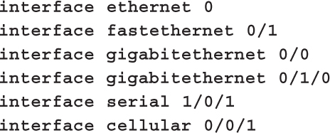</a>

<a href="#f0416-01a" id="code-f0416-01">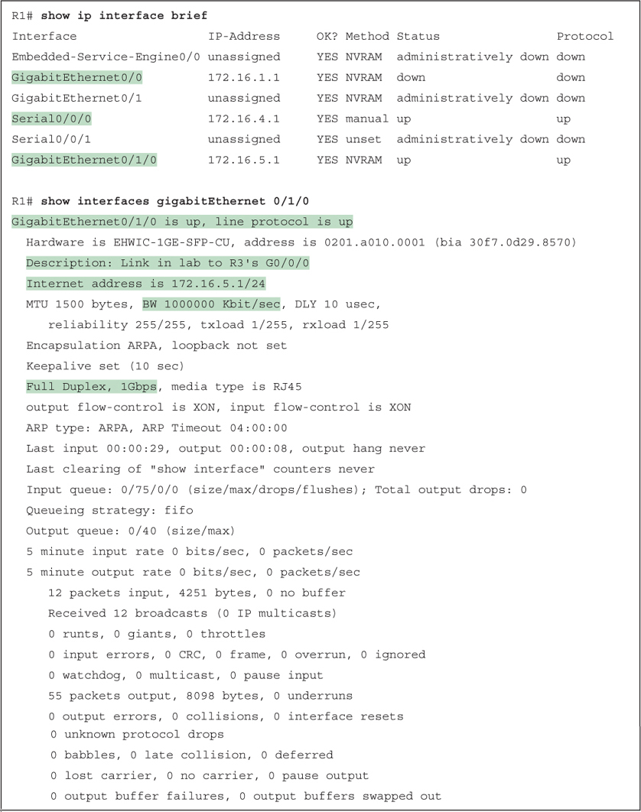</a>

<a href="#f0419-01a" id="code-f0419-01">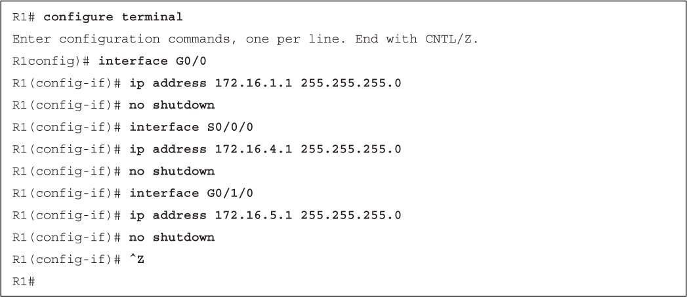</a>

<a href="#f0419-02a" id="code-f0419-02">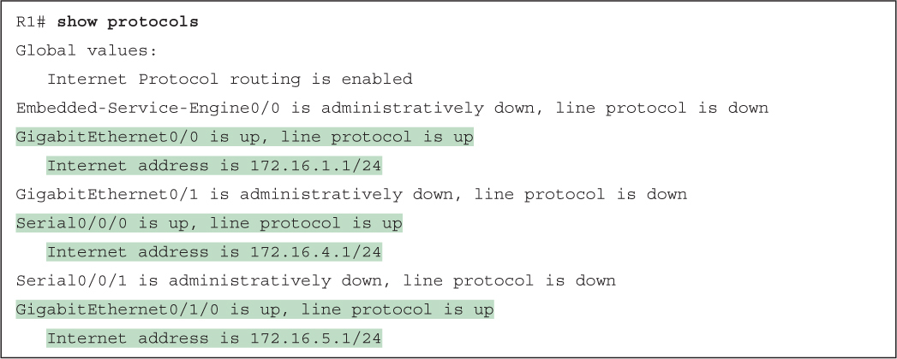</a>

<a href="#f0421-01a" id="code-f0421-01">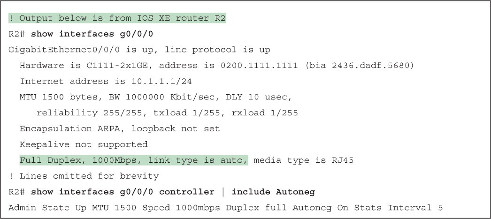</a>

<a href="#f0422-01a" id="code-f0422-01">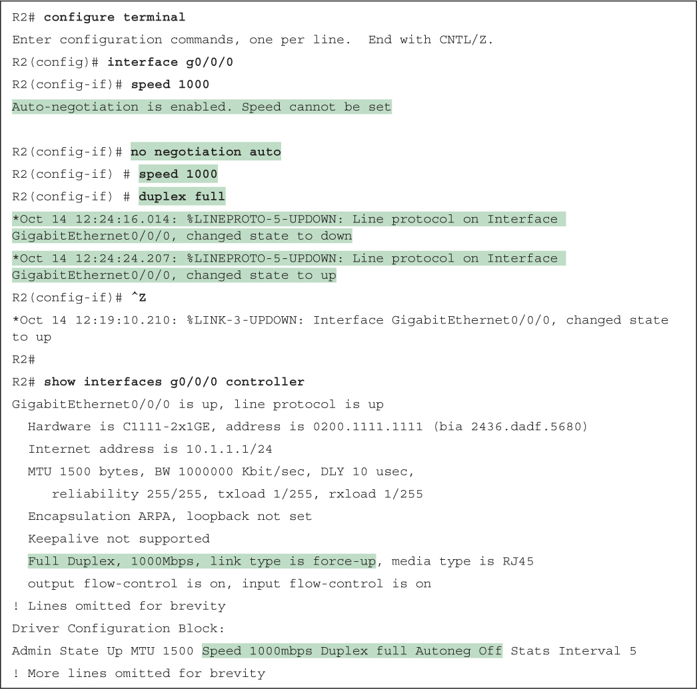</a>

</section>

</section>


<nav class="ccna-chapter-nav" aria-label="章节导航"><a href="v1-15.html">← 上一章</a><a href="v1-17.html">下一章 →</a></nav>
