
<a href="{{ '/subjects/CCNA/' | relative_url }}">← 返回 CCNA 目录</a>

第一卷 · IPv4 路由

<nav class="ccna-chapter-nav" aria-label="章节导航"><a href="v1-16.html">← 上一章</a><a href="v1-18.html">下一章 →</a></nav>



<section data-epub-type="chapter">

<h2 class="h2" id="ch17">第 17 章</h2>

<h2 class="h2a">配置 IPv4 地址和静态路由</h2>

本章涵盖以下考试主题：

1.0 网络基础

1.6 配置与验证 IPv4 编址和子网划分

3.0 IP 连接

3.1 解读路由表的组成部分

3.1.a 路由协议代码

3.1.b 前缀

3.1.c 网络掩码

3.1.d 下一跳

3.1.e 管理距离

3.1.f 度量值

3.1.g 最后可用网关

3.2 确定路由器默认如何做出转发决策

3.2.a 最长前缀匹配

3.2.b 管理距离

3.3 配置和验证 IPv4 与 IPv6 静态路由

3.3.a 默认路由

3.3.b 网络路由

3.3.c 主机路由

3.3.d 浮动静态路由

路由器路由 IPv4 数据包。这句简单的话实际上包含许多隐含意义。为了路由数据包，路由器遵循一个路由过程，而该过程依赖于称为 IP 路由的信息。每条 IP 路由都列出一个目的地，即 IP 网络、IP 子网或其他某组 IP 地址。每条路由还列出指示，告诉路由器应将发往该 IP 网络或子网中地址的数据包转发到哪里。为了正确完成数据包路由，路由器需要一份详细且准确的 IP 路由列表。

路由器通过三种方法向 IPv4 路由表添加 IPv4 路由。首先学习<a id="key_195" href="#ref-gloss_077">直连路由</a>，即连接在路由器接口上的子网的路由。路由器也可以使用<a id="key_203" href="#ref-gloss_378">静态路由</a>，通过配置命令（<strong>ip route</strong>）创建，告诉路由器应在 IPv4 <a id="key_202" href="#ref-gloss_354">路由表</a>中放入哪条路由。另外，路由器还可以使用路由协议，彼此通告已知的所有路由，让所有路由器都能学习并建立通往各网络和子网的动态路由。

本章通过可添加到路由器路由表中的最简单路由，深入研究 IP 路由。首先详细分析 IP 数据包的路由（转发）过程，该过程依赖每台路由器的路由表中都具有可用的 IP 路由。第二节研究直连路由，即通往本地路由器接口所连接子网的路由。第三节研究静态路由，即网络工程师直接配置的路由。

<section>

<h3 class="h3" id="ch17lev1sec1">自测</h3>

如果你希望根据得分决定在本章投入多少时间，可以完成这组自测题（在此作答，或使用 PTP 软件）。各题答案的选项字母列在自测题之后的页面底部。书末和配套网站上的<a href="#ref-appc">附录 C</a>都包含答案及解析。你也可以在 PTP 测试软件中找到答案及解析。

<figure class="table" id="ch17tab01" tabindex="0">

<figcaption>

<strong>表 17-1</strong> 核心主题小节与题目对应关系

</figcaption>

<table class="all">

<thead>

<tr>

<th class="th">
基础知识小节
</th>

<th class="th">
题目
</th>

</tr>

</thead>

<tbody>

<tr>

<td class="border">
IP 路由
</td>

<td class="border">
1、2
</td>

</tr>

<tr>

<td class="border">
配置 IP 地址和直连路由
</td>

<td class="border">
3
</td>

</tr>

<tr>

<td class="border">
配置静态路由
</td>

<td class="border">
4–6
</td>

</tr>

</tbody>

</table>

</figure>

<strong><a id="quess17_1" href="#ques17_1a">1</a>.</strong> 路由器 R1 的路由表中列出一条路由。匹配数据包目的地址时，路由器会使用路由中的哪些信息？（选择两个答案。）

<ol class="lower-alpha">

<li>
掩码
</li>

<li>
下一跳路由器
</li>

<li>
子网 ID
</li>

<li>
出接口
</li>

</ol>

<strong><a id="quess17_2" href="#ques17_2a">2</a>.</strong> PC1 向 PC2 发送一个 IP 数据包。为此，PC1 先将数据包发给路由器 R1，R1 将它路由到 R2，R2 路由到 R3，R3 再路由到最终目的地 PC2。所有链路都使用以太网。从 PC1 到 PC2 的过程中，有多少台路由器会从以太网帧中解封装出 IP 数据包？

<ol class="lower-alpha">

<li>
0
</li>

<li>
1
</li>

<li>
2
</li>

<li>
3
</li>

</ol>

<strong><a id="quess17_3" href="#ques17_3a">3</a>.</strong> 为正常工作的路由器接口配置 IP 地址／掩码 10.1.1.100/26 后，预期会在 <strong>show ip route</strong> 命令输出中看到下列哪些路由？（选择两个答案。）

<ol class="lower-alpha">

<li>
子网 10.1.1.64 255.255.255.192 的直连路由
</li>

<li>
子网 10.1.1.0 255.255.255.0 的直连路由
</li>

<li>
主机 10.1.1.100 255.255.255.192 的本地路由
</li>

<li>
主机 10.1.1.100 255.255.255.255 的本地路由
</li>

<li>
主机 10.1.1.64 255.255.255.255 的本地路由
</li>

</ol>

<strong><a id="quess17_4" href="#ques17_4a">4</a>.</strong> 本地路由器上一条正确的 <strong>ip route</strong> 命令，可以列出下列哪些信息？（选择两个答案。）

<ol class="lower-alpha">

<li>
两台路由器之间链路上，本地路由器的 IP 地址
</li>

<li>
两台路由器之间链路上，下一跳路由器的 IP 地址
</li>

<li>
两台路由器之间链路上，下一跳路由器的接口 ID
</li>

<li>
两台路由器之间链路上，本地路由器的接口 ID
</li>

</ol>

<strong><a id="quess17_5" href="#ques17_5a">5</a>.</strong> 下列哪个命令正确配置了静态路由？

<ol class="lower-alpha">

<li>
<strong>ip route 10.1.3.0 255.255.255.0 10.1.130.253</strong>
</li>

<li>
<strong>ip route 10.1.3.0 serial 0</strong>
</li>

<li>
<strong>ip route 10.1.3.0 /24 10.1.130.253</strong>
</li>

<li>
<strong>ip route 10.1.3.0 /24 serial 0</strong>
</li>

</ol>

<strong><a id="quess17_6" href="#ques17_6a">6</a>.</strong> 网络工程师在路由器上配置 <strong>ip route 10.1.1.0 255.255.255.0 s0/0/0</strong> 命令，然后在 enable 模式下执行 <strong>show ip route</strong> 命令。输出中没有出现子网 10.1.1.0/24 的路由。下列哪种情况可能成立？

<ol class="lower-alpha">

<li>
<strong>ip route</strong> 命令语法错误，在配置模式下被拒绝。
</li>

<li>
接口 s0/0/0 处于 down 状态。
</li>

<li>
路由器在 A 类网络 10.0.0.0 中没有任何 up/up 接口。
</li>

<li>
<strong>ip route</strong> 命令缺少下一跳路由器的 IP 地址。
</li>

</ol>

自测答案：

<strong><a id="ques17_1a" href="#ref-ques17_1">1</a></strong> A、C

<strong><a id="ques17_2a" href="#ref-ques17_2">2</a></strong> D

<strong><a id="ques17_3a" href="#ref-ques17_3">3</a></strong> A、D

<strong><a id="ques17_4a" href="#ref-ques17_4">4</a></strong> B, C

<strong><a id="ques17_5a" href="#ref-ques17_5">5</a></strong> A

<strong><a id="ques17_6a" href="#ref-ques17_6">6</a></strong> B

</section>

<section>

<h3 class="h3box" id="ch17lev1sec2">基础知识</h3>

</section>

<section>

<h3 class="h3" id="ch17lev1sec3">IP 路由</h3>

IP 路由，即转发 IP 数据包的过程，将数据包从最初构造它的设备，经由整个 TCP/IP 网络，送达应当接收它的设备。换言之，IP 路由将 IP 数据包从发送主机送达目的主机。

完整的端到端路由过程依赖于主机和路由器上的网络层逻辑。发送主机使用第 3 层概念创建 IP 数据包，并将其转发到主机的默认网关（默认路由器）。这个过程也需要路由器上的第 3 层逻辑：路由器将数据包中的目的地址与路由表比较，以决定下一步将 IP 数据包转发到哪里。

路由过程还依赖各条链路的数据链路层和物理层细节。IP 路由依赖串行 WAN 链路、以太网 WAN 链路、以太网 LAN、无线 LAN，以及许多实现数据链路层和物理层标准的其他网络。这些低层设备和协议通过将 IP 数据包封装在数据链路层帧中并发送，使其在 TCP/IP 网络中传递。

前两段汇总了<a href="v1-03.html#ch03">第 3 章</a>“<a href="v1-03.html#ch03">WAN 与 IP 路由基础</a>”介绍的 IP 路由关键概念。接下来，本节将回顾 IP 路由，并利用此前各章深入介绍的知识，将讨论进一步推进。

<section>

<h4 class="h4" id="ch17lev2sec1">IPv4 路由过程参考</h4>

由于你已经在<a href="v1-03.html#ch03">第 3 章</a>学习了基础知识，本节将路由过程整理成步骤供参考。这些步骤使用本书<a href="v1-04.html#part02">第二部分</a>和<a href="v1-08.html#part03">第三部分</a>讨论的许多具体以太网 LAN 术语，以及<a href="v1-11.html#part04">第四部分</a>讨论的一些 IP 编址术语。后续说明和示例会进一步讨论这些路由逻辑概要，确保每个步骤都清楚易懂。

路由过程从创建 IP 数据包的主机开始。首先，主机会判断：这个新数据包的目的 IP 地址是否位于我的本地子网？主机使用自己的 IP 地址／掩码，确定本地子网的地址范围。根据主机自身认定的本地子网地址范围，LAN 主机会执行以下操作：

步骤 1。如果目的地在本地，直接发送：

<ol class="step-lower-alpha">

<li>
查找目的主机的 MAC 地址。使用已有的地址解析协议（ARP）表项，或者通过 ARP 消息学习该信息。
</li>

<li>
将 IP 数据包封装在数据链路帧中，目的数据链路地址设为目的主机的地址。
</li>

</ol>

步骤 2。如果目的地不在本地，发送给默认网关：

<ol class="step-lower-alpha">

<li>
查找默认网关的 MAC 地址。使用已有的地址解析协议（ARP）表项，或者通过 ARP 消息学习该信息。
</li>

<li>
将 IP 数据包封装在数据链路帧中，目的数据链路地址设为默认网关的地址。
</li>

</ol>

<a href="#ch17fig01">图 17-1</a> 汇总了这些概念。图中，主机 A 将本地数据包直接发给主机 D。但对于发往路由器另一侧、因而属于不同子网的主机 B 的数据包，主机 A 会将其发给默认路由器 R1。（提醒一下，<em>默认网关</em>与<em>默认路由器</em>是同义词。）

<figure class="image-c" id="ch17fig01">

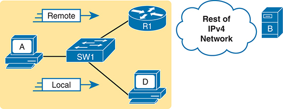

<figcaption>

<strong>图 17-1</strong> <em>主机路由逻辑概要</em>

<aside class="hidden" id="a17fig01">

示意图中，代表主机 A 的 PC 通过 SW1，将本地数据包发给代表主机 D 的另一台 PC。主机 A 又通过 SW1 将数据包发给远程路由器 R1，R1 再将数据包发给路由器另一侧的主机 B。

</aside>

</figcaption>

</figure>

与主机相比，路由器需要完成更多路由工作。主机逻辑从内存中已有的 IP 数据包开始，而路由器在到达这一阶段之前，还要执行一些操作。在下面的路由器路由逻辑五步概要中，前两步只是接收帧并提取 IP 数据包，到步骤 3 才考虑数据包的目的地址。步骤如下：

<ol class="number">

<li>
对于每个收到的数据链路帧，决定是否处理它。符合以下条件时进行处理：

<ol class="lower-alpha">

<li>
帧没有错误，以数据链路尾部的帧校验序列（FCS）字段为依据。
</li>

<li>
帧的目的数据链路地址是路由器的地址，或合适的组播或广播地址。
</li>

</ol></li>

<li>
如果步骤 1 决定处理该帧，则从数据链路帧中解封装出数据包。
</li>

<li>
做出路由决策。为此，将数据包的目的 IP 地址与路由表比较，找到匹配目的地址的路由。该路由指出路由器的<a id="key_201" href="#ref-gloss_294">出接口</a>，也可能指出<a id="key_200" href="#ref-gloss_282">下一跳路由器</a>。
</li>

<li>
将数据包封装成适合出接口的数据链路帧。通过 LAN 接口转发时，根据需要使用 ARP 查找下一个设备的 MAC 地址。
</li>

<li>
通过匹配的 IP 路由所列出的出接口发送该帧。
</li>

</ol>

这份路由过程概要列出了许多细节，但有时可以更简单地理解路由过程。例如，省略一些细节后，可用下面这段话表达相同的主要概念：

路由器接收帧，从帧中取出数据包，决定将数据包转发到哪里，将数据包放进另一个帧，再发送该帧。

为帮助你进一步理解这些步骤，<a href="#ch17fig02">图 17-2</a> 以图示形式拆解了相同的五步路由过程。图中数据包从左侧到达，进入路由器的以太网接口，其 IP 目的地为主机 C。到达的数据包封装在以太网帧内，包含帧头和帧尾。

<figure class="image-c" id="ch17fig02">

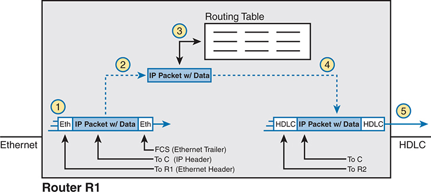

<figcaption>

<strong>图 17-2</strong> <em>路由器路由逻辑概要</em>

<aside class="hidden" id="a17fig02">

步骤 1 显示路由器 R1 确认收到的以太网帧通过 FCS（以太网帧尾）检查，包含数据的 IP 数据包从以太网帧头和帧尾内部通过。步骤 2 解封装 IP 数据包。步骤 3 在路由表中比较 IP 数据包。步骤 4 将 IP 数据包封装在新的数据链路帧头和帧尾内部。步骤 5 向右发送 IP 数据包。

</aside>

</figcaption>

</figure>

路由器 R1 按图中编号处理帧和数据包，与图前介绍的五步过程相对应，具体如下：

<ol class="number">

<li>
路由器 R1 确认收到的以太网帧通过 FCS 检查，且目的以太网 MAC 地址为 R1 的 MAC 地址，因此处理该帧。
</li>

<li>
R1 从以太网帧头和帧尾内部解封装出 IP 数据包。
</li>

<li>
R1 将 IP 数据包的目的 IP 地址与自己的 IP 路由表比较。
</li>

<li>
R1 将 IP 数据包封装进新的数据链路帧；本例中是封装进高级数据链路控制（HDLC）的帧头和帧尾之间。
</li>

<li>
R1 将封装在新 HDLC 帧内的 IP 数据包，通过右侧串行链路发送出去。
</li>

</ol>

注意

本章有几幅图显示 IP 数据包封装在数据链路层帧内。这些图通常同时展示数据链路帧头和帧尾，IP 数据包位于中间。所有 IP 数据包都包含 IP 首部及其中封装的数据。

</section>

<section>

<h4 class="h4" id="ch17lev2sec2">IP 路由示例</h4>

接下来的几页将通过一个示例，按顺序讨论数据经过多台设备时的每个路由步骤。示例中，主机 A（172.16.1.9）向主机 B（172.16.2.9）发送数据包，并通过主机路由逻辑及五个步骤，展示 R1 如何转发该数据包。

<a href="#ch17fig03">图 17-3</a> 展示了采用常见地址简写的典型 IPv4 网络编址图。如果列出每个路由器接口的完整 IP 地址，图示可能会显得过于杂乱。在可能的情况下，这些图通常先列出子网，再只标出各 IP 地址的最后一个或两个八位组，这样既足以让你确定 IP 地址，又能减少杂乱。例如，主机 A 使用 IP 地址 172.16.1.9，可由子网 172.16.1.0/24（其中所有地址都以 172.16.1 开头）和主机 A 图标旁的 .9 得出。另一个例子是，R1 的 LAN 接口使用地址 172.16.1.1，一个串行接口使用 172.16.4.1，以太网 WAN 接口使用 172.16.5.1。

<figure class="image-c" id="ch17fig03">

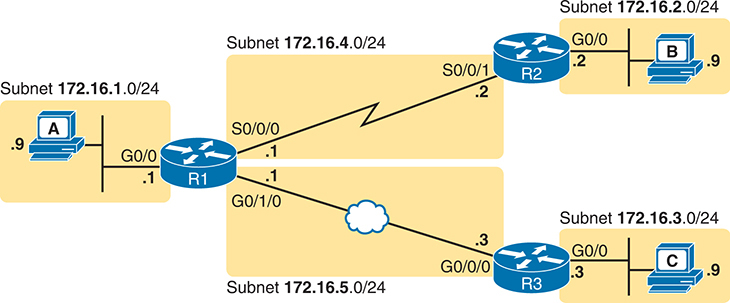

<figcaption>

<strong>图 17-3</strong> <em>用于展示五步路由示例的 IPv4 网络</em>

<aside class="hidden" id="a17fig03">

主机 A 所在子网为 172.16.1.0/24，图标旁标有 .9；它通过 R1、G0/0 和图标旁的 .1 向主机 B 发送数据包。R1 使用子网 172.16.4.0/24、S0/0/0 和 .1，通过串行线路将数据包传给 R2、S0/0/1 和 .2。R2、G0/0 和 .2 将数据包传给主机 B，其子网为 172.16.2.0/24，图标旁标有 .9。主机 A 再次通过 R1、G0/0 和图标旁的 .1 向主机 C 发送数据包。R1 使用子网 172.16.5.0/24、G0/1/0 和 .1，通过以太网 WAN 将数据包传给 R3、G0/0/0 和 .3。R3、G0/0 和 .3 将数据包传给主机 C，其子网为 172.16.3.0/24，图标旁标有 .9。

</aside>

</figcaption>

</figure>

现在开始这个示例：主机 A（172.16.1.9）向主机 B（172.16.2.9）发送数据包。

<section>

<h5 class="h5" id="ch17lev3sec1">主机将 IP 数据包转发给默认路由器（网关）</h5>

本例中，主机 A 使用某个应用向主机 B（172.16.2.9）发送数据。IP 数据包进入主机 A 的内存后，其处理逻辑可简化为：

<ul class="sq">

<li>
我的 IP 地址／掩码为 172.16.1.9/24，因此本地子网包含数值 172.16.1.0—172.16.1.255，包括子网 ID 和子网广播地址。
</li>

<li>
目的地址是 172.16.2.9，显然不在本地子网中。
</li>

<li>
将数据包发给我的默认网关，其设置为 172.16.1.1。
</li>

<li>
要发送数据包，将其封装在以太网帧中。把目的 MAC 地址设为 R1 的 G0/0 MAC 地址，也就是主机 A 的默认网关地址。
</li>

</ul>

<a href="#ch17fig04">图 17-4</a> 将这些概念汇总在一起，展示本例主机 A 所发送帧和数据包中的目的 IP 地址和目的 MAC 地址。请注意，该图采用网络图中常见的画法，仅用几条线表示以太网，隐藏第 2 层交换机的所有细节。

<figure class="image-c" id="ch17fig04">

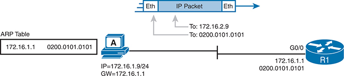

<figcaption>

<strong>图 17-4</strong> <em>主机 A 通过路由器 R1 向主机 B 发送数据包</em>

<aside class="hidden" id="a17fig04">

主机 A 的 IP 地址为 172.16.1.9/24，网关地址为 172.16.1.1；左侧 ARP 表显示网关地址 172.16.1.1 和目的 MAC 地址 0200.0101.0101。它将数据包封装在以太网帧中，IP 地址为 172.16.2.9，MAC 地址为 0200.0101.0101，并将其发给 R1 的 G0/0。

</aside>

</figcaption>

</figure>

</section>

<section>

<h5 class="h5" id="ch17lev3sec2">路由步骤 1：决定是否处理收到的帧</h5>

路由器会在接口上接收许多帧，尤其是在 LAN 接口上。不过，路由器可以且应该忽略其中一些帧。因此，路由过程的第一步，是决定应该处理该帧，还是静默丢弃（忽略）它。

首先，路由器执行一个简单但重要的检查（过程概要中的步骤 1A），以忽略传输过程中发生比特错误的所有帧。路由器使用数据链路帧尾的 FCS 字段检查帧，如果传输中发生错误，就丢弃该帧。（路由器不会尝试错误恢复，也就是说，不会要求发送方重新传输数据。）

路由器还会检查目的数据链路地址（概要中的步骤 1B），以判断该帧是否发给自己。例如，发送到路由器该接口单播 MAC 地址的帧，显然是发给该路由器的。不过，路由器实际上也可能收到发往其他单播 MAC 地址的帧，它应该忽略这些帧。

例如，回想 LAN 交换机如何转发未知单播帧，即目的 MAC 地址未列在交换机 MAC 地址表中的帧。LAN 交换机会泛洪这些帧。结果是什么？路由器有时会收到发往其他设备的帧，其中目的 MAC 地址是其他设备的 MAC 地址。路由器应该忽略这些帧。

<a href="#ch17fig05">图 17-5</a> 展示了一个正常工作的示例，主机 A 发送目的地址为 R1 的 MAC 地址的帧。收到帧后，R1 通过 FCS 确认没有错误，并确认帧发往自己的 MAC 地址（本例为 0200.0101.0101）。所有检查均通过，因此 R1 将处理该帧。（请注意，图中的大矩形代表路由器 R1 的内部。）

<figure class="image-c" id="ch17fig05">

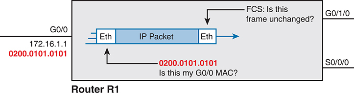

<figcaption>

<strong>图 17-5</strong> <em>R1 上的路由步骤 1：检查 FCS 和目的 MAC 地址</em>

<aside class="hidden" id="a17fig05">

路由器 R1 的内部组件。左侧是 G0/0 端口，网关地址为 172.16.1.1，MAC 地址为 0200.0101.0101；右侧是 G0/1/0 和 S0/0/0 端口。帧中的 IP 数据包被突出显示，左侧标注“0200.0101.0101：这是我的 G0/0 MAC 地址吗？”，右侧标注“FCS：这个帧未发生改变吗？”

</aside>

</figcaption>

</figure>

</section>

<section>

<h5 class="h5" id="ch17lev3sec3">路由步骤 2：解封装 IP 数据包</h5>

路由器在步骤 1 确认应处理收到的帧后，下一步相对简单：解封装数据包。在路由器内存中，原始帧的数据链路帧头和帧尾已不再需要，因此路由器将它们移除并丢弃，只留下 IP 数据包，如<a href="#ch17fig06">图 17-6</a> 所示。请注意，目的 IP 地址保持不变，仍为 172.16.2.9。

<figure class="image-c" id="ch17fig06">

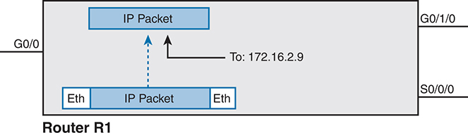

<figcaption>

<strong>图 17-6</strong> <em>R1 上的路由步骤 2：解封装数据包</em>

<aside class="hidden" id="a17fig06">

路由器 R1 的内部组件。左侧是 G0/0 端口，右侧是 G0/1/0 和 S0/0/0 端口。帧内的 IP 数据包被解封装，其目的 IP 地址为 172.16.2.9。

</aside>

</figcaption>

</figure>

</section>

<section>

<h5 class="h5" id="ch17lev3sec4">路由步骤 3：选择数据包的转发方向</h5>

路由步骤 2 几乎不需要思考，而步骤 3 是所有步骤中需要最多判断的一步。此时，路由器需要选择接下来将数据包转发到哪里。这一过程使用路由器的 IP 路由表，并通过匹配逻辑，将数据包的目的地址与表中内容比较。

首先，IP 路由表列出多条路由。每条路由包含若干信息，又可按<a href="#ch17fig07">图 17-7</a> 所示方式分组。每条路由的一部分用于匹配数据包的目的地址，其余部分列出转发指示，即下一步将数据包发到哪里。

<figure class="image-c" id="ch17fig07">

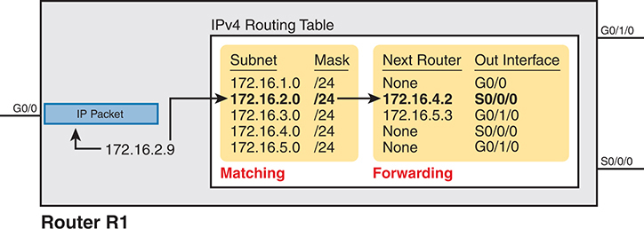

<figcaption>

<strong>图 17-7</strong> <em>R1 上的路由步骤 3：匹配路由表</em>

<aside class="hidden" id="a17fig07">

路由器 R1 的内部组件。左侧是 G0/0 端口，右侧是 G0/1/0 和 S0/0/0 端口。目的 IP 地址为 172.16.2.9 的 IP 数据包经过 IPv4 路由表处理。在第一个区域，子网与子网列的第二行匹配，掩码列的各行则相同。转发区域指向第二行的下一台路由器 172.16.4.2，以及出接口 S0/0/0。

</aside>

</figcaption>

</figure>

先看整个路由表，注意其中列出了五条路由。前面的<a href="#ch17fig03">图 17-3</a> 展示了包含五个子网的完整示例网络，因此 R1 对这五个子网各有一条路由。

接下来，查看这五条路由中 R1 用于匹配数据包的部分。为了完整定义各个子网，每条路由同时列出子网 ID 和子网掩码。将 IP 数据包目的地与路由表匹配时，路由器查看数据包的目的 IP 地址（172.16.2.9），并将它与每个子网定义的地址范围比较。具体而言，路由器查看子网和掩码信息，经过少量计算，就能确定 172.16.2.9 位于哪个子网中，即子网 172.16.2.0/24 对应的路由。

最后，查看图右侧这五条路由的转发指示。匹配到具体路由后，路由器使用其中的转发信息，决定下一步将数据包发到哪里。本例中，匹配到子网 172.16.2.0/24 的路由，因此 R1 将从自己的 S0/0/0 接口转发数据包，下一站是路由器 R2，其下一跳路由器 IP 地址列为 172.16.4.2。

注意

远程子网的路由通常同时列出出接口和下一跳路由器 IP 地址。直接连接到路由器的子网路由只列出出接口，因为发往这些目的地的数据包无需交给另一台路由器。

</section>

<section>

<h5 class="h5" id="ch17lev3sec5">路由步骤 4：将数据包封装在新帧中</h5>

此时，路由器已经知道如何转发数据包。不过，在转发之前，必须先为数据包加上数据链路帧头和帧尾，即进行封装。

为串行链路封装数据包不需要太多判断，当前 CCNA 考试对此的要求也不高。点到点串行 WAN 链路使用 HDLC（默认）或 PPP 作为数据链路协议。不过，这里可以忽略数据链路逻辑，甚至忽略数据链路编址，因为串行链路上只有两个设备：发送方和显而易见的接收方，数据链路地址并不重要。本例中，R1 将数据包封装在 HDLC 帧内，再从 S0/0/0 转发出去，如<a href="#ch17fig08">图 17-8</a> 所示。

<figure class="image-c" id="ch17fig08">

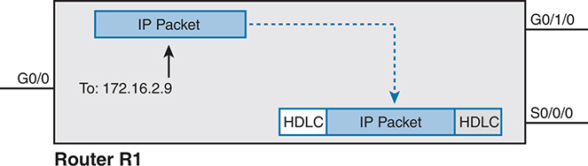

<figcaption>

<strong>图 17-8</strong> <em>R1 上的路由步骤 4：封装数据包</em>

<aside class="hidden" id="a17fig08">

路由器 R1 的内部组件。左侧是 G0/0 端口，右侧是 G0/1/0 和 S0/0/0 端口。目的 IP 地址为 172.16.2.9 的 IP 数据包被封装在 HDLC 帧中。

</aside>

</figcaption>

</figure>

请注意，对于其他某些类型的数据链路，路由器在这个路由步骤中还有更多工作。例如，路由器有时从以太网接口转发数据包。要封装 IP 数据包，就需要构造以太网帧头，而且帧头中的目的 MAC 地址必须具有正确的值。

例如，仍由<a href="#ch17fig03">图 17-3</a> 中的 PC A（172.16.1.9）发送数据包，但这次目的地是 PC C（172.16.3.9）。R1 处理数据包时，匹配到的路由要求它从 G0/1/0 以太网接口转发，下一站是 172.16.5.3（R3）。R1 需要将 R3 的 MAC 地址放入帧头，为此使用自己的 IP ARP 表信息，如<a href="#ch17fig09">图 17-9</a> 所示。如果 R1 没有 172.16.5.3 的 ARP 表项，就必须先使用 ARP 学习对应的 MAC 地址。

<figure class="image-c" id="ch17fig09">

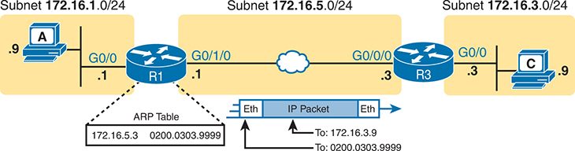

<figcaption>

<strong>图 17-9</strong> <em>使用 LAN 出接口时，R1 上的路由步骤 4</em>

<aside class="hidden" id="a17fig09">

主机 A 的子网为 172.16.1.0/24，图标旁标有 .9；它通过 R1、G0/0 和图标旁的 .1 向主机 C 发送数据包。R1 旁突出显示一张包含 172.16.5.3 和 0200.0303.9999 的表。R1 使用子网 172.16.5.0/24、G0/1/0 和 .1，通过以太网 WAN 将数据包传给 R3、G0/0/0 和 .3。以太网帧中的 IP 数据包显示目的 IP 地址 172.16.3.9 和 MAC 地址 0200.0303.9999。R3、G0/0 和 .3 将数据包传给主机 C，其子网为 172.16.3.0/24，图标旁标有 .9。

</aside>

</figcaption>

</figure>

</section>

<section>

<h5 class="h5" id="ch17lev3sec6">路由步骤 5：发送帧</h5>

帧准备好后，路由器只需将其发送出去。路由器可能需要等待，尤其是在其他帧已排队等候从该接口发出的情况下。

</section>

</section>

</section>

<section>

<h3 class="h3" id="ch17lev1sec4">配置 IP 地址和直连路由</h3>

Cisco 路由器默认全局启用 IPv4 路由。要使路由器能够在某个特定接口上路由数据包，必须为接口配置 IP 地址，并进行适当配置使接口启动，达到“线路状态 up、线路协议状态 up”。只有达到这一状态，路由器才能通过该接口收发并路由 IP 数据包。

当路由器能够通过一个或多个接口路由 IP 数据包后，还需要一些路由。路由器可以通过三种方式向路由表添加路由：

<strong>直连路由：</strong>由于在本地路由器上配置 <strong>ip address</strong> 接口子命令而添加。

<strong>静态路由：</strong>由于在本地路由器上配置 <strong>ip route</strong> 全局命令而添加。

<strong>路由协议：</strong>通过在所有路由器上配置来添加这一功能，使路由器动态向彼此通告网络信息，从而让所有路由器学习路由。

本章三个主要部分中的第二部分，将讨论配置直连路由的几种方式，下一部分则讨论静态路由。

<section>

<h4 class="h4" id="ch17lev2sec3">直连路由与 ip address 命令</h4>

假设以下两个条件成立，Cisco 路由器会自动向路由表添加每个接口所连接子网的路由：

<ul class="sq">

<li>
接口处于工作状态。也就是说，<strong>show interfaces</strong> 命令中的接口状态显示线路状态为 up，协议状态也为 up。
</li>

<li>
接口通过 <strong>ip address</strong> 接口子命令分配了 IP 地址。
</li>

</ul>

直连路由的概念相当基础。路由器当然需要知道每个接口所连接的子网号，才能将数据包路由到该子网。路由器会使用接口 IP 地址和掩码进行计算，求出子网 ID。不过，只有接口启动并正常工作时，路由器才需要该路由，因此只有在接口正常工作时，才会在路由表中加入直连路由。

<a href="#exa17_1">例 17-1</a> 展示了<a href="#ch17fig10">图 17-10</a> 中路由器 R1 的直连路由。示例第一部分展示 R1 三个接口的 IP 地址配置。示例末尾列出 <strong>show ip route</strong> 命令输出，其中这些路由的代码为 C，表示<em>直连</em>。

<figure class="image-c" id="ch17fig10">

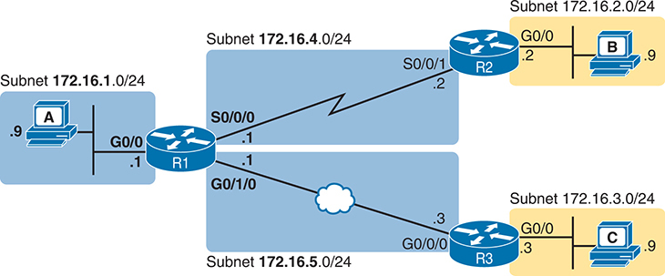

<figcaption>

<strong>图 17-10</strong> <em>用于展示直连路由的示例网络</em>

<aside class="hidden" id="a17fig10">

主机 A 所在子网为 172.16.1.0/24，图标旁标有 .9；它通过 R1、G0/0 和图标旁的 .1 向主机 B 发送数据包。R1 使用子网 172.16.4.0/24、S0/0/0 和 .1，通过串行线路将数据包传给 R2、S0/0/1 和 .2。R2、G0/0 和 .2 将数据包传给主机 B，其子网为 172.16.2.0/24，图标旁标有 .9。主机 A 再次通过 R1、G0/0 和图标旁的 .1 向主机 C 发送数据包。R1 使用子网 172.16.5.0/24、G0/1/0 和 .1，通过以太网 WAN 将数据包传给 R3、G0/0/0 和 .3。R3、G0/0 和 .3 将数据包传给主机 C，其子网为 172.16.3.0/24，图标旁标有 .9。

</aside>

</figcaption>

</figure>

<strong>例 17-1</strong> <em>路由器 R1 上的直连路由和本地路由</em>

<a href="#code-f0437-01" id="f0437-01a">点击此处查看代码原图</a>

<pre class="pre-ex" tabindex="0"><code>! Excerpt from show running-config follows...

!

interface GigabitEthernet0/0

 ip address 172.16.1.1 255.255.255.0

!

interface Serial0/0/0

 ip address 172.16.4.1 255.255.255.0

!

interface GigabitEthernet0/1/0

 ip address 172.16.5.1 255.255.255.0

R1# <strong>show ip route</strong>

Codes: L - local, C - connected, S - static, R - RIP, M - mobile, B - BGP

       D - EIGRP, EX - EIGRP external, O - OSPF, IA - OSPF inter area

       N1 - OSPF NSSA external type 1, N2 - OSPF NSSA external type 2

       E1 - OSPF external type 1, E2 - OSPF external type 2

       i - IS-IS, su - IS-IS summary, L1 - IS-IS level-1, L2 - IS-IS level-2

       ia - IS-IS inter area, * - candidate default, U - per-user static route

       o - ODR, P - periodic downloaded static route, H - NHRP, l - LISP

       a - application route

       + - replicated route, % - next hop override, p - overrides from PfR

Gateway of last resort is not set

      172.16.0.0/16 is variably subnetted, 6 subnets, 2 masks

C        172.16.1.0/24 is directly connected, GigabitEthernet0/0

L        172.16.1.1/32 is directly connected, GigabitEthernet0/0

C        172.16.4.0/24 is directly connected, Serial0/0/0

L        172.16.4.1/32 is directly connected, Serial0/0/0

C        172.16.5.0/24 is directly connected, GigabitEthernet0/1/0

L        172.16.5.1/32 is directly connected, GigabitEthernet0/1/0</code></pre>

每次做实验或看到 <strong>show ip route</strong> 命令输出示例时，都要仔细查看各个有类网络的标题行及其后缩进的行。缩进行列出通往具体子网的路由。在<a href="#exa17_1">例 17-1</a> 中，标题行将 B 类网络 172.16.0.0 显示为“172.16.0.0/16”，其中 /16 表示 B 类网络的默认掩码。为什么？因为 IOS 按 A 类、B 类或 C 类网络对输出分组。本例中的标题行告诉我们，后面的缩进行都与网络 172.16.0.0/16 有关。

请仔细看 B 类网络 172.16.0.0 标题行下方高亮的三条路由。每条的第一列都是 C，并且都带有“directly connected”文字，两者都表明该路由与路由器直连。每条路由的前半部分列出匹配参数，即子网 ID 和掩码，与前面<a href="#ch17fig07">图 17-7</a> 的示例相同。每条路由的末尾列出出接口。

请注意，路由器还会自动生成另一类路由，称为<em>本地路由</em>。本地路由为路由器接口上配置的那个具体 IP 地址定义路由。每条本地路由的前缀长度都是 /32，构成一条<em>主机路由</em>，即只针对单个 IP 地址的路由。例如，最后一条 172.16.5.1/32 的本地路由，只匹配 IP 地址 172.16.5.1。路由器使用这些列出自身本地 IP 地址的路由，更高效地处理发给路由器自己的数据包。

示例中的 <strong>show ip route</strong> 命令展示了考试主题 3.1 的几个具体子项（依据 CCNA 200-301 V1.1），本章后续示例会展示更多细节。本节说明了考试主题中的以下术语：

<ul class="sq">

<li>
<strong>路由协议代码：</strong><strong>show ip route</strong> 输出顶部的图例（约九行）列出全部路由协议代码（考试主题 3.1.a）。本书涉及直连路由（C）、本地路由（L）、静态路由（S）和 OSPF（O）的代码。
</li>

<li>
<strong>前缀：</strong><em>前缀</em>（考试主题 3.1.b）只是子网 ID 的另一种名称。
</li>

<li>
<strong>掩码：</strong>每条路由都列出前缀（子网 ID）和网络掩码（考试主题 3.1.c），掩码使用前缀格式，例如 /24。
</li>

</ul>

</section>

<section>

<h4 class="h4" id="ch17lev2sec4">ip address 子命令的常见错误</h4>

如果遵循正确的 IP 地址规划，路由器上的 <strong>ip address</strong> 命令应该能被接受，也应该能正常工作，使路由器作为默认网关为 LAN 中的终端主机提供支持。不过，这个命令可能出现几种乍看之下不明显的错误。

接下来将以<a href="#ch17fig11">图 17-11</a> 为背景，研究其中一些错误。该图更详细地展示了<a href="#ch17fig10">图 17-10</a> 中连接到 R1 的 LAN，现在其中有两台 PC。

<figure class="image-c" id="ch17fig11">

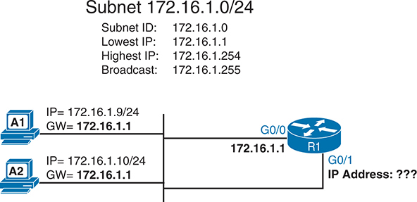

<figcaption>

<strong>图 17-11</strong> <em>路由器 R1 的 LAN 的详细扩展视图</em>

<aside class="hidden" id="a17fig11">

示意图展示两台子网主机连接到路由器。上方信息说明，子网 172.16.1.0/24 的子网 ID 为 172.16.1.0，最小可用 IP 地址为 172.16.1.1，最大可用 IP 地址为 172.16.1.254，广播地址为 172.16.1.255。主机 A1 的 IP 地址为 172.16.1.9，网关为 172.16.1.1。主机 A2 的 IP 地址为 172.16.1.10，网关为 172.16.1.1。两台主机分别连接到路由器的 G0/0 和 G0/1 端口。

</aside>

</figcaption>

</figure>

首先，如果 <strong>ip address</strong> 命令使用子网中的保留数值，例如子网 ID 或子网广播地址，IOS 会在配置模式下拒绝该命令。<a href="#exa17_2">例 17-2</a> 展示了三条被拒绝的 <strong>ip address</strong> 命令。第一条尝试将子网 ID 配置为地址，第二条尝试配置子网广播地址。最后一个示例使用无效子网掩码，也被拒绝。请注意，错误信息没有说明具体原因，只是含糊地提示使用该掩码时这些值存在问题。

<strong>例 17-2</strong> <em>IOS 拒绝使用保留地址的 <strong>ip address</strong> 命令</em>

<a href="#code-f0439-01" id="f0439-01a">点击此处查看代码原图</a>

<pre class="pre-ex" tabindex="0"><code>R1# <strong>configure terminal</strong>

Enter configuration commands, one per line.  End with CNTL/Z.

R1(config)# <strong>interface gigabitEthernet 0/0</strong>

R1(config-if)# <strong>ip address 172.16.1.0 255.255.255.0</strong>

Bad mask /24 for address 172.16.1.0

R1(config-if)# <strong>ip address 172.16.1.255 255.255.255.0</strong>

Bad mask /24 for address 172.16.1.255

R1(config-if)# <strong>ip address 172.16.1.1 255.0.255.0</strong>

Bad mask 0xFF00FF00 for address 172.16.1.1

R1(config-if)#</code></pre>

你也可能在 <strong>ip address</strong> 命令中配置 IOS 接受、但不符合地址规划的值，导致网络问题。例如，在<a href="#ch17fig11">图 17-11</a> 中，两台 PC 的默认网关设置意味着路由器 R1 的地址应为 172.16.1.1。R1 会接受其 G0/0 接口上的 <strong>ip address 172.16.1.2 255.255.255.0</strong> 命令，从而设置错误地址；但路由器没有机制知道自己的地址与 PC 的默认网关设置不符。结果是 PC 无法与子网外通信。解决方法是在 R1 上配置正确地址。

第三个问题是，一台路由器只能将一个接口连接到某个子网。在<a href="#ch17fig11">图 17-11</a> 中，R1 有两个接口 G0/0 和 G0/1 连接到同一个 LAN。如果尝试为两个接口都分配同一 172.16.1.0/24 子网中的 IP 地址，且两个接口均为 up/up，IOS 会拒绝第二条 <strong>ip address</strong> 命令。<a href="#exa17_3">例 17-3</a> 展示这一顺序：先配置 R1 的 G0/0，再配置 G0/1，后者被拒绝。

<strong>例 17-3</strong> <em>IOS 拒绝同一子网中第二个接口的 <strong>ip address</strong> 命令</em>

<a href="#code-f0439-02" id="f0439-02a">点击此处查看代码原图</a>

<pre class="pre-ex" tabindex="0"><code>R1# <strong>configure terminal</strong>

Enter configuration commands, one per line.  End with CNTL/Z.

R1(config)# <strong>interface gigabitEthernet 0/0</strong>

R1(config-if)# <strong>ip address 172.16.1.1 255.255.255.0</strong>

R1(config)# <strong>interface gigabitEthernet 0/1</strong>

R1(config-if)# <strong>ip address 172.16.1.2 255.255.255.0</strong>

% 172.16.1.0 overlaps with GigabitEthernet0/0

R1(config-if)#</code></pre>

</section>

<section>

<h4 class="h4" id="ch17lev2sec5">Cisco 路由器上的 ARP 表</h4>

添加这些直连路由后，路由器就可以在这些子网之间路由 IPv4 数据包。为此，路由器会使用自己的 IP ARP 表。

IPv4 <a id="key_194" href="#ref-gloss_026">ARP 表</a>列出与路由器连接到同一子网的主机的 IPv4 地址及对应 MAC 地址。向同一子网中的主机转发数据包时，路由器会使用从 ARP 表中查到的目的 MAC 地址进行封装。如果路由器要将数据包转发到同一子网中的某个 IP 地址，却找不到该地址的 ARP 表项，就会使用 ARP 消息学习该设备的 MAC 地址。

<a href="#exa17_4">例 17-4</a> 根据前面的示例展示 R1 的 ARP 表。输出列出 R1 自己的 IP 地址 172.16.1.1，老化时间为 -，表示该表项不会超时。动态学习的 ARP 表项具有向上计数的计时器，例如 IP 地址 172.16.1.9 的表项显示 35 分钟。默认情况下，ARP 表项连续 240 分钟未使用，IOS 就会使其超时并删除。（使用表项时，IOS 会将计时器重置为 0。）请注意，做实验时，你可能希望用 <strong>clear ip arp</strong> [<em>ip-address</em>] EXEC 命令清空所有动态表项，或仅清除某个 IP 地址的表项。

<strong>例 17-4</strong> <em>显示路由器的 IP ARP 表</em>

<a href="#code-f0440-01" id="f0440-01a">点击此处查看代码原图</a>

<pre class="pre-ex" tabindex="0"><code>R1# <strong>show ip arp</strong>

Protocol  Address        Age (min) Hardware Addr   Type   Interface

Internet  172.16.1.1            -  0200.0101.0101  ARPA   GigabitEthernet0/0

Internet  172.16.1.9           35  0200.aaaa.aaaa  ARPA   GigabitEthernet0/0</code></pre>

考虑 R1 如何通过最后一个子网向主机 A（172.16.1.9）转发数据包，它会执行以下操作：

<ol class="number">

<li>
R1 在 ARP 表中查找 172.16.1.9 的表项。
</li>

<li>
R1 将 IP 数据包封装在以太网帧中，在以太网帧头加入目的地址 0200.aaaa.aaaa，该地址来自 ARP 表。
</li>

<li>
R1 从接口 G0/0 发送该帧。
</li>

</ol>

</section>

</section>

<section>

<h3 class="h3" id="ch17lev1sec5">配置静态路由</h3>

在真实网络中，每台路由器都有直连路由，由路由器为接口连接的子网创建。你会使用 OSPF 和 EIGRP 等动态路由协议，学习企业中其他子网的路由，即相对于本地路由器而言的远程子网路由。

企业使用静态路由，即通过直接配置 <strong>ip route</strong> 命令加入路由表的路由，其频率远低于直连路由和动态路由协议学习的路由。不过，静态路由有时很有用，研究静态路由也是非常好的学习方法。当然，考试主题列出了多种静态路由，因此备考时需要掌握。

注意

CCNA 200-301 V1.1 考试的主题 3.3，将 IPv4（以及 IPv6）静态路由细分为四个子主题：网络路由、默认路由、主机路由和浮动静态路由。本节将按照后续标题，解释 IPv4 中的这四种类型。

<section>

<h4 class="h4" id="ch17lev2sec6">静态网络路由</h4>

IOS 允许通过 <strong>ip route</strong> 全局配置命令定义单条静态路由。每条 <strong>ip route</strong> 命令都通过子网 ID 和掩码定义目的子网，同时列出转发指示，即出接口或下一跳路由器的 IP 地址，也可以同时列出两者。IOS 随后使用这些信息，将路由添加到 IP 路由表。

静态<a id="key_199" href="#ref-gloss_280">网络路由</a>在 <strong>ip route</strong> 命令中定义一个子网，或整个 A 类、B 类或 C 类网络。相比之下，<a id="key_196" href="#ref-gloss_092">默认路由</a>定义所有目的 IP 地址的集合，而<a id="key_198" href="#ref-gloss_174">主机路由</a>只定义单个 IP 地址，即某台主机的地址。

<a href="#ch17fig12">图 17-12</a> 展示了后续示例使用的新网络图。请注意，该设计使用与本章前面一些图相同的子网，但采用两条 GigabitEthernet WAN 链路，没有串行链路。

<figure class="image-c" id="ch17fig12">

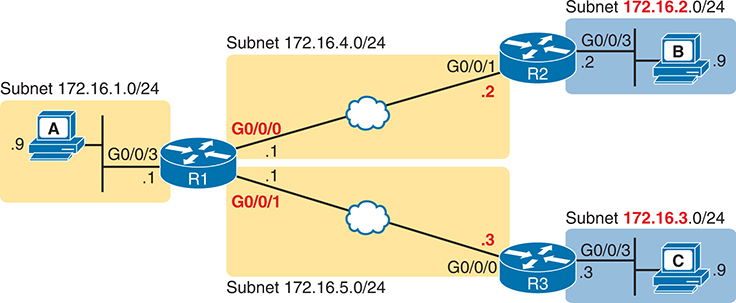

<figcaption>

<strong>图 17-12</strong> <em>静态路由配置示例使用的网络</em>

<aside class="hidden" id="a17fig12">

主机 A 的子网为 172.16.1.0/24，图标旁标有 .9；它通过 R1、G0/0/3 和图标旁的 .1 向主机 B 发送数据包。R1 使用子网 172.16.4.0/24、G0/0/0 和 .1，通过以太网 WAN 将数据包传给 R2、G0/0/1 和 .2。R2、G0/0/3 和 .2 将数据包传给主机 B，其子网为 172.16.2.0/24，图标旁标有 .9。主机 A 再次通过 R1、G0/0/3 和图标旁的 .1 向主机 C 发送数据包。R1 使用子网 172.16.5.0/24、G0/0/1 和 .1，通过以太网 WAN 将数据包传给 R3、G0/0/0 和 .3。R3、G0/0/3 和 .3 将数据包传给主机 C，其子网为 172.16.3.0/24，图标旁标有 .9。

</aside>

</figcaption>

</figure>

<a href="#ch17fig13">图 17-13</a> 展示了在 R1 上为 R2 右侧子网（172.16.2.0/24）配置网络路由的概念。要在 R1 创建该静态网络路由，需要配置子网 ID 和掩码。在转发指示方面，配置 R1 的出接口 G0/0/0，或把 R2 的 IP 地址 172.16.4.2 配置为下一跳路由器 IP 地址。

<figure class="image-c" id="ch17fig13">

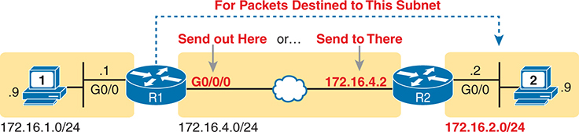

<figcaption>

<strong>图 17-13</strong> <em>静态路由配置概念</em>

<aside class="hidden" id="a17fig13">

子网为 172.16.1.0/24 的主机 1 连接到路由器 R1。R1 的子网为 172.16.4.0/24，有两个接口：G0/0 连接主机 1，G0/0/0 通过以太网 WAN 连接到另一台路由器 R2 上的子网 172.16.4.2。R2 的 G0/0 接口连接到子网为 172.16.2.0/24 的主机 2。G0/0/0 标为“从这里发送”，172.16.4.2 标为“发送到那里”，从 R1 到主机 2 的路由过程标为“针对发往此子网的数据包”。

</aside>

</figcaption>

</figure>

<a href="#exa17_5">例 17-5</a> 使用<a href="#ch17fig12">图 17-12</a> 的三路由器拓扑，展示了两条静态路由的配置。示例在 R1 上为图右侧的两个子网各配置一条路由。第一条命令定义子网 172.16.2.0 255.255.255.0 的路由，即 R2 后方的子网。转发指示参数仅列出 R1 的出接口 G0/0/0。这条路由基本上表示：要向 R2 后方的子网发送数据包，就从我的本地 G0/0/0 接口发出。

<strong>例 17-5</strong> <em>添加到 R1 的静态路由</em>

<a href="#code-f0442-01" id="f0442-01a">点击此处查看代码原图</a>

<pre class="pre-ex" tabindex="0"><code><strong>ip route 172.16.2.0 255.255.255.0 G0/0/0</strong>

<strong>ip route 172.16.3.0 255.255.255.0 172.16.5.3</strong></code></pre>

第二条路由采用同样的思路，但将相邻路由器在 WAN 链路上的 IP 地址列为下一跳路由器。它基本上表示：要向 R3 后方的子网 172.16.3.0 255.255.255.0 发送数据包，下一步就把数据包发给 R3 的 WAN IP 地址 172.16.5.3。

<section>

<h5 class="h5" id="ch17lev3sec7">验证静态网络路由</h5>

IP 路由表中的静态路由列出与配置命令中相同的参数。仔细比较<a href="#exa17_6">例 17-6</a> 的 <strong>show ip route static</strong> 命令输出，就能看到这一点。该命令只列出静态路由，本例列出<a href="#exa17_5">例 17-5</a> 配置的两条静态路由。首先，两条静态路由行都以图例代码 S 开头，表示静态。两者都列出各自路由中定义的子网和掩码，但输出采用前缀形式的掩码。关键区别在于：仅配置出接口的路由只列出出接口；仅配置下一跳 IP 地址的路由，输出只列出下一跳地址。

<strong>例 17-6</strong> <em>添加到 R1 的静态路由</em>

<a href="#code-f0442-02" id="f0442-02a">点击此处查看代码原图</a>

<pre class="pre-ex" tabindex="0"><code>R1# <strong>show ip route static</strong>

Codes: L - local, C - connected, S - static, R - RIP, M - mobile, B - BGP

! Legend lines omitted for brevity

      172.16.0.0/16 is variably subnetted, 8 subnets, 2 masks

S        172.16.2.0/24 is directly connected, GigabitEthernet0/0/0S

S        172.16.3.0/24 [1/0] via 172.16.5.3</code></pre>

虽然路由是静态配置的，IOS 仍会随着出接口工作状态的变化，在路由表中添加或删除静态路由。例如，本例中如果 R1 的 G0/0/0 接口发生故障，R1 会从 IPv4 路由表中删除 172.16.2.0/24 的静态路由。之后接口恢复时，IOS 会将该路由重新加入路由表。

<a href="#exa17_3">例 17-3</a> 和<a href="#exa17_4">例 17-4</a> 展示了如何配置静态网络路由，支持<a href="#ch17fig12">图 17-12</a> 中从左向右的数据包流动；但要支持所有方向的数据包流动，路由器需要通往全部子网的路由。即使只是用于 CCNA 学习的小型实验环境，如果仅使用静态路由，也需要为双向数据包流动配置所有子网的静态路由。例如，在<a href="#ch17fig13">图 17-13</a> 中，要支持 PC A 与 PC B 之间的数据包传输，需要：

R1 上通往 PC B 所在子网 172.16.2.0/24 的路由

R2 上通往 PC A 所在子网 172.16.1.0/24 的路由

</section>

<section>

<h5 class="h5" id="ch17lev3sec8">以太网出接口与代理 ARP</h5>

虽然<a href="#exa17_5">例 17-5</a> 中两种静态路由形式都能工作，即指定下一跳 IP 地址或指定出接口，但使用下一跳地址更好。两者都可行，不过，当工作人员开始研究静态路由背后的工作机制时，使用下一跳地址造成的困惑要少得多。简单来说，使用下一跳地址不会强制相邻路由器使用代理 ARP，而在以太网链路上指定出接口则需要代理 ARP。

本节尝试解释代理 ARP 如何工作，以及静态路由如何使用它。首先，考虑代理 ARP 的一般定义：

<ol class="number">

<li>
路由器在接口 X 收到 ARP 请求，其目标地址不在接口 X 所连接的子网中。
</li>

<li>
路由器具有将数据包转发到该目标地址的路由，而且该路由不应将数据包从同一个接口发回，以免形成环路。换言之，路由器拥有通往目标的有效转发路由。
</li>

<li>
因此，路由器愿意且能够有效地充当目标主机的代理。为此，路由器在 ARP 应答中提供自己的 MAC 地址。
</li>

</ol>

这些描述虽然正确，但通过示例更容易理解。再次考虑<a href="#exa17_5">例 17-5</a> 中的 <strong>ip route 172.16.2.0 255.255.255.0 G0/0/0</strong> 命令。假设 PC A 向地址为 172.16.2.9 的 PC B 发送数据包。数据包到达 R1，R1 将它匹配到子网 172.16.2.0/24 的静态路由；现在，R1 必须根据转发指示决定如何转发。R1 使用以下逻辑：

<ol class="number">

<li>
路由的转发指示表明目的子网连接在接口 G0/0/0 上。这使 R1 发送 ARP 请求，查找目标地址 172.16.2.9。实际上，R1 的路由使其表现得仿佛目的子网 172.16.2.0/24 直接连接到 G0/0/0。当然，PC B 位于另一台路由器的另一侧，所以不会收到该 ARP 请求。
</li>

<li>
R2 收到 R1 针对目标 172.16.2.9 的 ARP 请求。该请求符合代理 ARP 的条件：地址不在本地子网，但 R2 有匹配 172.16.2.9 的有效路由。R2 发送 ARP 应答，列出自己 G0/0/1 接口的 MAC 地址，这就是代理 ARP 应答。
</li>

<li>
R1 收到 ARP 应答后，就能转发发往 172.16.2.9 的数据包。R1 将这些数据包封装在以太网帧中，以 R2 的 G0/0/1 MAC 地址为目的 MAC 地址，再进行转发。
</li>

<li>
R2 收到该帧，按照正常路由过程，将其中封装的数据包路由到 PC B。
</li>

</ol>

从前面大约一页内容可以看出，在路由中使用以太网出接口，其底层逻辑需要相当多的分析。在实际应用中，应改用指定下一跳地址的静态路由。

</section>

</section>

<section>

<h4 class="h4" id="ch17lev2sec7">静态默认路由</h4>

路由器尝试路由数据包时，可能找不到任何匹配该数据包目的 IP 地址的路由。发生这种情况时，路由器通常直接丢弃数据包。

路由器可以使用<em>默认路由</em>匹配所有数据包。如果数据包没有匹配到路由表中其他更具体的路由，路由器就会根据默认路由转发它。路由器可以通过路由协议学习默认路由，也可以配置静态默认路由。

<a href="#ch17fig14">图 17-14</a> 展示了一个经典示例：公司有许多类似图中 R2 和 R3 的分支机构路由器，每台只有一条 WAN 连接。对于这些孤立分支机构，无论路由器学习到多少条具体子网路由，每条路由中的转发细节都相同。例如，R2 上所有远程子网路由都会使用出接口 G0/0/1 和下一跳地址 172.16.4.1。R2 可以改用一条匹配所有目的地的默认路由，并采用相同的转发指示。

<figure class="image-c" id="ch17fig14">

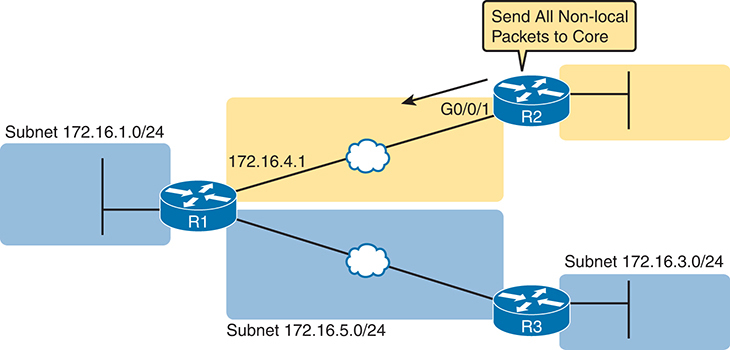

<figcaption>

<strong>图 17-14</strong> <em>静态默认路由使用示例</em>

<aside class="hidden" id="a17fig14">

子网 172.16.1.0/24 连接到路由器 R1，R1 又连接 R2 和 R3。R1 使用 IP 路由 172.16.4.1 连接到 R2 的 G0/0/1，旁边标注“将所有非本地数据包发送到核心”。R1 通过子网 172.16.5.0/24 连接 R3，R3 又连接子网 172.16.3.0/24。路由器之间通过以太网 WAN 连接。

</aside>

</figcaption>

</figure>

IOS 允许在 <strong>ip route</strong> 命令的子网和掩码字段中使用特殊值 0.0.0.0 和 0.0.0.0，配置静态默认路由。例如，<strong>ip route 0.0.0.0 0.0.0.0 172.16.4.1</strong> 命令会在 R2 上创建<a href="#ch17fig14">图 17-14</a> 所示的静态路由，匹配所有 IP 数据包，并将它们发给 R1（172.16.4.1）。<a href="#exa17_7">例 17-7</a> 展示这条静态默认路由，不过要留意 0.0.0.0/0 路由出现在一个可能意料之外的位置。

<strong>例 17-7</strong> <em>在 R2 上添加静态默认路由（<a href="#ch17fig14">图 17-14</a>）</em>

<a href="#code-f0444-01" id="f0444-01a">点击此处查看代码原图</a>

<pre class="pre-ex" tabindex="0"><code>R2# <strong>configure terminal</strong>

Enter configuration commands, one per line. End with CNTL/Z.

R2(config)# <strong>ip route 0.0.0.0 0.0.0.0 172.16.4.1</strong>

R2(config)# <strong>^Z</strong>

R2# <strong>show ip route</strong>

Codes: L - local, C - connected, S - static, R - RIP, M - mobile, B - BGP

       D - EIGRP, EX - EIGRP external, O - OSPF, IA - OSPF inter area

       N1 - OSPF NSSA external type 1, N2 - OSPF NSSA external type 2

       E1 - OSPF external type 1, E2 - OSPF external type 2

       i - IS-IS, su - IS-IS summary, L1 - IS-IS level-1, L2 - IS-IS level-2

       ia - IS-IS inter area, * - candidate default, U - per-user static route

       o - ODR, P - periodic downloaded static route, H - NHRP, l - LISP

       + - replicated route, % - next hop override

Gateway of last resort is 172.16.4.1 to network 0.0.0.0S*

S*    0.0.0.0/0 [1/0] via 172.16.4.1

      172.16.0.0/16 is variably subnetted, 4 subnets, 2 masks

C        172.16.2.0/24 is directly connected, GigabitEthernet0/0/0

L        172.16.2.2/32 is directly connected, GigabitEthernet0/0/0

C        172.16.4.0/24 is directly connected, GigabitEthernet0/0/1

L        172.16.4.2/32 is directly connected, GigabitEthernet0/0/1</code></pre>

<strong>show ip route</strong> 命令输出列出一些新的、值得关注的信息。首先，路由显示为 0.0.0.0/0，这是子网与掩码均为 0.0.0.0 的另一种表示法。输出代码为 S，表示静态，但旁边还有一个 *，表示它是<em>候选默认路由</em>。（路由器可以学习到多条默认路由，随后必须选择使用哪一条；* 表示它至少有资格成为默认路由。）路由列表正上方的“Gateway of Last Resort”行指出选定的默认路由。本例中，R2 只有一个候选项，所以输出显示刚配置的静态默认路由，下一跳地址为 172.16.4.1。

注意

如果在实验练习中尝试重现本书示例，请注意，按照<a href="#ch17fig13">图 17-13</a> 和<a href="#ch17fig14">图 17-14</a> 搭建网络，并使用<a href="#exa17_5">例 17-5</a> 和<a href="#exa17_7">例 17-7</a> 的配置后，PC A 和 PC B 应能互相 ping 通。作为练习，你可以思考，需要向 R3 添加什么网络静态路由或默认静态路由，才能让 PC C 也能 ping 通另外两台 PC。

</section>

<section>

<h4 class="h4" id="ch17lev2sec8">静态主机路由</h4>

<em>网络路由</em>指匹配整个 IP 网络或子网中地址的路由，默认路由则匹配所有目的地。相比之下，<em>主机路由</em>定义通往单个主机地址的路由。配置这类静态路由时，<strong>ip route</strong> 命令使用一个 IP 地址和掩码 255.255.255.255，使匹配逻辑仅匹配该地址。

为什么使用静态主机路由？坦率地说，这是最不常用的静态路由形式，因为网络工程师很少遇到需要借助静态主机路由解决的问题。不过，为了大致理解它的作用，可以考虑<a href="#ch17fig15">图 17-15</a> 的拓扑，它对前几幅图中的拓扑进行了扩展。

<figure class="image-c" id="ch17fig15">

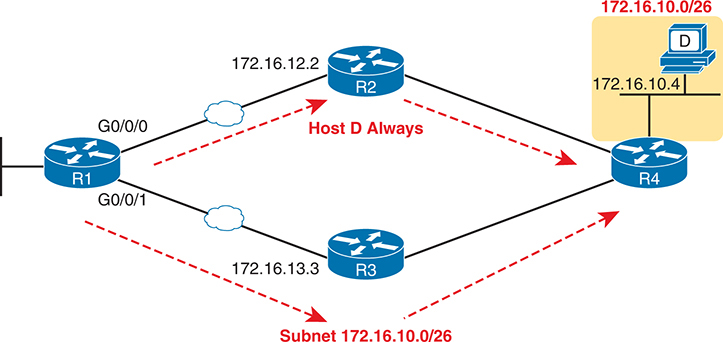

<figcaption>

<strong>图 17-15</strong> <em>静态主机路由的一种可能用途</em>

<aside class="hidden" id="a17fig15">

示意图中，路由器 R1 的 G0/0/0 和 G0/0/1 端口分别通过以太网 WAN 连接到 R2（172.16.12.2）和 R3（172.16.13.3）。R3 承载子网 172.16.10.0/26。R2 和 R3 通过电缆直接连接 R4。R4（172.16.10.4）连接到主机 D，其子网为 172.16.10.0/26。

</aside>

</figcaption>

</figure>

首先，假设运行 OSPF 这类动态路由协议，R1 学习到子网 172.16.10.0/26 的路由。根据网络状况，这条路由可能将数据包下一步发给 R2，也可能发给 R3。大多数企业对两种情况都会满意。图中显示该路由经过下方的路由器 R3。

现在假设有某个特殊业务原因，要求所有发往主机 D 的数据包，只要 R2 正常工作，就必须经过 R2。图中也展示了这条只针对主机 D（172.16.10.4）的路由。

上述场景产生了静态主机路由的需求。例如，所有路由器使用 OSPF，动态学习设计中全部子网的网络路由。不过，工程师还会在 R1 上配置前几段讨论的那一条主机路由，如<a href="#exa17_8">例 17-8</a> 顶部所示。

<strong>例 17-8</strong> <em>主机路由配置与重叠的静态网络路由</em>

<a href="#code-f0446-01" id="f0446-01a">点击此处查看代码原图</a>

<pre class="pre-ex" tabindex="0"><code>R1# <strong>configure terminal</strong>

! The static host route for one IP address within that same subnet

R1(config)# <strong>ip route</strong> <strong>172.16.10.4 255.255.255.255</strong> <strong>172.16.4.2</strong>

R1(config)# <strong>^Z</strong>

R1# <strong>show ip route</strong>

! Irrelevant portions omitted for brevity

      172.16.0.0/16 is variably subnetted, 12 subnets, 4 masks

O IA     172.16.10.0/26 [110/3] via 172.16.5.3, 01:52:58, GigabitEthernet0/0/1

S        172.16.10.4/32 [1/0] via 172.16.4.2</code></pre>

请注意，主机路由与其他某条网络路由重叠，像这里这样，是正常现象。路由器始终尝试将每个前缀（子网）的最佳路由放入 IP 路由表。不过，主机路由使用掩码 255.255.255.255（/32），而该地址所在子网的动态路由使用不同掩码。R1 不会将它们视为同一子网的两条路由，而会视为不同路由，并将两者都放入路由表。

进入路由表后，当发往那个特殊主机地址 172.16.10.4 的数据包到达时，R1 使用主机路由。为什么？当数据包目的地址匹配路由表中多条路由时，路由器使用最具体的路由，也就是前缀长度最长的路由。因此，发往 172.16.10.4 的数据包会使用主机路由，因为 /32 掩码比 /26 掩码更长、更具体。R1 将根据主机路由，把该数据包转发给下一跳路由器 172.16.4.2。发往子网 172.16.10.0/26 中其他目的地的数据包，则会发给下一跳路由器 172.16.5.3，因为它们只匹配一条路由。

请注意，<a data-original-href="vol1_ch25.xhtml#ch25" data-unavailable="true" title="此内容不在当前提取范围内；请参阅原始 EPUB：vol1_ch25.xhtml#ch25">第 25 章</a>“<a data-original-href="vol1_ch25.xhtml#ch25" data-unavailable="true" title="此内容不在当前提取范围内；请参阅原始 EPUB：vol1_ch25.xhtml#ch25">IP 第 6 版基础</a>”接近末尾的“<a data-original-href="vol1_ch24.xhtml#ch24lev2sec6" data-unavailable="true" title="此内容不在当前提取范围内；请参阅原始 EPUB：vol1_ch24.xhtml#ch24lev2sec6">使用最长前缀匹配进行 IP 转发</a>”一节，将更详细地说明多条路由匹配数据包目的地时，路由器如何选择路由。

</section>

<section>

<h4 class="h4" id="ch17lev2sec9">浮动静态路由</h4>

<a id="key_197" href="#ref-gloss_146">浮动静态路由</a>存在于路由器配置中，但路由器会根据特定条件，将它移入或移出路由表。为什么？它是更大配置方案的一部分，使路由器能够在主 WAN 链路发生故障时，建立临时 WAN 链路。

要理解其工作方式，可以考虑<a href="#ch17fig16">图 17-16</a> 的示例，其中显示前几幅图中的 R1 和 R2。大多数时候，以太网 WAN 链路是唯一工作的 WAN 链路，但现在两台路由器都具有蜂窝接口。当主链路中断时，它们可以通过 4G/LTE/5G 网络相互连接。

<figure class="image-c" id="ch17fig16">

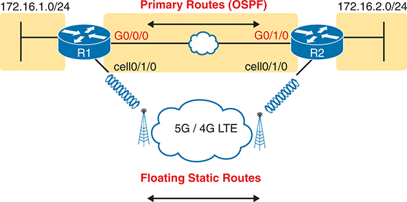

<figcaption>

<strong>图 17-16</strong> <em>使用浮动静态路由到达关键子网 172.16.2.0/24</em>

<aside class="hidden" id="a17fig16">

示意图中，R1 连接子网 172.16.1.0/24，R2 连接子网 172.16.2.0/24。两台路由器通过 G0/0/0 和 G0/1/0 端口连接，各自的蜂窝接口均标为 cell0/1/0。路由器之间的以太网 WAN 标为主要路由（OSPF）；图的下方强调，当主链路中断时，两台路由器通过 5G/4G/LTE 网络彼此连接。

</aside>

</figcaption>

</figure>

有意思的是，使用蜂窝网络为以太网 WAN 链路提供备份的配置，关键在于路由。路由器在永久链路上使用 OSPF 等路由协议，因此在本例中，R1 学到一条通往子网 172.16.2.0/24、使用以太网 WAN 链路的 OSPF 路由。R1 还为同一子网定义一条浮动静态路由，将数据包通过蜂窝接口发往路由器 R2。虽然配置了这条路由，但路由器 R1 <em>仅在 OSPF 路由不可用时</em>才选择将该浮动静态路由加入路由表。如果以太网链路正常，R1 就通过该链路路由数据包；否则，就通过蜂窝网络路由数据包。

要创建浮动静态路由，需要配置一条路由，并为其指定比竞争的动态学习路由更高（更差）的管理距离。当路由器学到多条通往相同子网／掩码组合的路由时，必须先确定哪个路由来源具有更优的<a id="key_193" href="#ref-gloss_018">管理距离</a>，数值越低越好，然后采用从更优来源学到的路由。默认设置使路由器认为静态路由优于通过任何动态路由协议学到的路由。浮动静态路由则颠倒了这一逻辑。

要实现浮动静态路由，需要在 <strong>ip route</strong> 命令中使用一个参数，仅设置该路由的管理距离，使其大于路由协议的默认管理距离。例如，在 R1（见<a href="#ch17fig15">图 17-15</a>）上执行 <strong>ip route 172.16.2.0 255.255.255.0 cell0/1/0 130</strong> 命令，就能将静态路由的管理距离设为 130。只要主链路保持正常，并且 R1 上的 OSPF 学到一条通往 172.16.2.0/24 的路由（OSPF 默认管理距离为 110），R1 就会忽略这条浮动静态路由。当以太网 WAN 链路故障时，R1 会失去该子网的 OSPF 学习路由，于是将浮动静态路由加入路由表。（其余配置未在此处展示，它们告诉路由器如何发起呼叫，以便通过蜂窝网络建立备份链路。）

最后请注意，<strong>show ip route</strong> 命令将大多数路由的管理距离列为方括号内两个数字中的第一个，而 <strong>show ip route</strong> <em>subnet</em> 命令则会明确列出管理距离。<a href="#exa17_9">例 17-9</a> 展示了与刚才这个示例相符的输出。

<strong>例 17-9</strong> <em>显示静态路由的管理距离</em>

<a href="#code-f0448-01" id="f0448-01a">点击此处查看代码原图</a>

<pre class="pre-ex" tabindex="0"><code>R1# <strong>show ip route static</strong>

! Legend omitted for brevity

       172.16.0.0/16 is variably subnetted, 6 subnets, 2 masks

S         172.16.2.0/24 is directly connected, Cellular0/1/0

R1# <strong>show ip route 172.16.2.0</strong>

Routing entry for 172.16.2.0/24

  Known via "static", distance 130, metric 0 (connected)

  Routing Descriptor Blocks:

  * directly connected, via Cellular0/1/0

      Route metric is 0, traffic share count is 1</code></pre>

</section>

<section>

<h4 class="h4" id="ch17lev2sec10">静态路由故障排查</h4>

关于 IPv4 静态路由的最后几页探讨静态路由可能出现的一些问题，既回顾前面几页提到的部分原因，也补充更多细节。本主题从三个角度讨论静态路由故障排查：

<ul class="sq">

<li>
路由存在于路由表中，但不正确。
</li>

<li>
路由没有出现在路由表中。
</li>

<li>
路由存在于路由表中且正确，但数据包未到达目的主机。
</li>

</ul>

<section>

<h5 class="h5" id="ch17lev3sec9">出现在 IP 路由表中的错误静态路由</h5>

第一个排查要点可能很明显，但值得停下来思考一下。静态路由的正确性取决于输入 <strong>ip route</strong> 命令的内容。IOS 会检查语法，并如前所述执行其他几项检查，下一小节将回顾这些检查。然而，一旦通过检查，即使路由参数选择不当，IOS 也会将该路由加入 IP 路由表。

例如，你原本想为子网 172.16.2.0/24 配置静态路由，却配置成了通往子网 172.16.222.0/24 的路由。路由器会接受该命令，但它指向错误的子网。又或者，在选择下一跳路由器地址时，你查看网络图并采用了左侧路由器的下一跳地址，而目的子网却位于图的右侧。还有一种情况是，你参考文档选择命令中的下一跳地址，该地址确实位于正确的目的子网中，却不是下一跳路由器的地址。在这些情况下，路由器都会接受命令，甚至将路由加入路由表，但该路由并无用处。

另一个例子是，如果前两个参数表明配置的是子网内的 IP 地址而不是子网 ID，IOS 就会拒绝 <strong>ip route</strong> 命令。例如，前面的<a href="#exa17_5">例 17-5</a> 中，命令使用掩码 255.255.255.0，子网 ID 为 172.16.2.0 和 172.16.3.0。<a href="#exa17_10">例 17-10</a> 再次展示了这些命令，但改为使用子网内的地址 172.16.2.1 和 172.16.3.1。在这两种情况下，IOS 都会显示错误消息，并且不会将命令加入配置。

<strong>例 17-10</strong> <em>IOS 拒绝使用子网内地址的 <strong>ip route</strong> 命令</em>

<a href="#code-f0449-01" id="f0449-01a">点击此处查看代码原图</a>

<pre class="pre-ex" tabindex="0"><code>R1# <strong>configure terminal</strong>

Enter configuration commands, one per line.  End with CNTL/Z.

R1-8200(config)# <strong>ip route</strong> 172.16.2.1 255.255.255.0 <strong>G0/0/0</strong>

%Inconsistent address and mask

R1-8200(config)# <strong>ip route</strong> 172.16.3.1 255.255.255.0 <strong>172.16.5.3</strong>

%Inconsistent address and mask

R1-8200(config)#</code></pre>

当考试题目涉及静态路由，而且你在 <strong>show ip route</strong> 的输出中看到这些路由时，请记得检查以下事项：

<ul class="sq">

<li>
子网 ID 和掩码是否正确？
</li>

<li>
下一跳 IP 地址是否正确，且指向相邻路由器上的 IP 地址？
</li>

<li>
下一跳 IP 地址是否标识了正确的路由器？
</li>

<li>
出接口是否正确，且引用的是本地路由器（即配置该静态路由的同一台路由器）上的接口？
</li>

</ul>

</section>

<section>

<h5 class="h5" id="ch17lev3sec10">静态路由未出现在 IP 路由表中</h5>

配置 <strong>ip route</strong> 命令后，IOS 可能将该路由加入 IP 路由表，也可能不加入。在将路由加入路由表之前，IOS 还会考虑以下条件：

<ul class="sq">

<li>
对于列出出接口的 <strong>ip route</strong> 命令，该接口必须处于 up/up 状态。
</li>

<li>
对于列出下一跳 IP 地址的 <strong>ip route</strong> 命令，本地路由器必须拥有一条能到达该下一跳地址的路由。
</li>

</ul>

例如，在前面的<a href="#exa17_5">例 17-5</a> 中，R1 的命令 <strong>ip route 172.16.3.0 255.255.255.0 172.16.5.3</strong> 定义了一条静态路由。在将其加入 IP 路由表之前，R1 会查找能到达 172.16.5.3 的现有 IP 路由。在该示例中，只要以太网 WAN 链路正常，R1 就能找到子网 172.16.5.0/24 的直连路由。因此，R1 会加入通往子网 172.16.3.0/24 的静态路由。此后，如果 R1 的 G0/0/1 故障，R1 就会从 IP 路由表中移除通往 172.16.5.0/24 的直连路由，这一操作又会导致 R1 移除通往 172.16.3.0/24 的静态路由。

你可以配置静态路由，使 IOS 忽略这些基本检查，始终将该 IP 路由放入路由表。为此，只需在 <strong>ip route</strong> 命令中使用 <strong>permanent</strong> 关键字。例如，像<a href="#exa17_11">例 17-11</a> 那样，在这两条命令末尾加入 <strong>permanent</strong> 关键字后，无论两条 WAN 链路是否正常，R1 都会加入这些路由。

<strong>例 17-11</strong> <em>将静态路由永久加入 IP 路由表（路由器 R1）</em>

<a href="#code-f0450-01" id="f0450-01a">点击此处查看代码原图</a>

<pre class="pre-ex" tabindex="0"><code>ip route 172.16.2.0 255.255.255.0 G0/0/0 permanent

ip route 172.16.3.0 255.255.255.0 172.16.5.3 permanent</code></pre>

请注意，虽然 <strong>permanent</strong> 关键字使路由器无需检查出接口或通往下一跳地址的路由，就能将路由保留在路由表中，但它并不能神奇地修复失效的路由。例如，如果出接口故障，路由仍会保留在路由表中，但由于出接口已关闭，路由器无法转发数据包。

</section>

<section>

<h5 class="h5" id="ch17lev3sec11">正确的静态路由出现在表中，但工作不正常</h5>

最后这一节说明两点：一个常见要点，以及一个需要复习的小细节。

首先，对于常见要点，静态路由可能完全正确，但数据包仍可能因其他问题而无法到达。当你排查“主机 A 无法连接服务器 B”之类的问题时，错误的静态路由只是众多检查项目之一。根本原因可能是静态路由，也可能是其他因素。<a href="v1-20.html#ch20">第 20 章</a>“<a href="v1-20.html#ch20">IPv4 路由故障排查</a>”将深入讨论此类问题的排查。

更具体的一点是，要留意任何带有 <strong>permanent</strong> 关键字的 <strong>ip route</strong> 命令。IOS 会将这些路由加入路由表，而不检查其正确性。你应检查出接口是否关闭，以及路由器是否拥有到达下一跳地址的路由。

</section>

</section>

</section>

</section>

<section class="ccna-source ccna-appendix" aria-label="答案解析与术语表">
<section data-epub-type="chapter">

<h2 class="h2" id="ref-appc">附录 C</h2>

<h2 class="h2a">自测题答案</h2>

<section>

<h3 class="h3" id="ref-appclev1sec17">第 17 章</h3>

<strong><a id="ref-ques17_1" href="#quess17_1">1</a>．</strong> A 和 C。路由通过子网 ID 和掩码定义其代表的地址组。路由器可以利用这些数值求出应与该路由匹配的地址范围。另外两个答案列出的信息，有助于转发恰好与该路由匹配的数据包。

<strong><a id="ref-ques17_2" href="#quess17_2">2</a>．</strong> D。路由器每次路由 IP 数据包时，都会从入站数据链路帧中解封装（取出）IP 数据包。在决定下一步将数据包转发到何处之后，它会将数据包重新封装到一个新的数据链路帧中。即使入站和出站数据链路碰巧属于相同类型（本场景正是如此），也会执行这一过程。因此，三台路由器都会对 IP 数据包进行解封装。由于所有链路都是以太网链路，三次解封装都从以太网帧中取出了数据包。

<strong><a id="ref-ques17_3" href="#quess17_3">3</a>．</strong> A 和 D。首先，根据子网划分计算，地址 10.1.1.100 配合掩码 /26 得出的子网 ID 是 10.1.1.64。此外，掩码 /26 转换为点分十进制（DDN）掩码后是 255.255.255.192。对于任何正常工作的路由器接口，在加入 <strong>ip address</strong> 命令配置地址和掩码之后，路由器都会为该子网加入一条直连路由。在本例中，路由器加入的是子网 10.1.1.64 255.255.255.192 的直连路由。路由器还会加入一条称为本地路由的路由，它以接口 IP 地址为目的地址，掩码为 255.255.255.255。在本例中，这意味着路由器加入地址为 10.1.1.100、掩码为 255.255.255.255 的本地路由。

<strong><a id="ref-ques17_4" href="#quess17_4">4</a>．</strong> B 和 C。<strong>ip route</strong> 命令可以引用两台路由器之间链路上的下一跳路由器 IP 地址，也可以引用本地路由器的出接口 ID。错误答案将这些项目颠倒了，提到的是本地路由器的 IP 地址和下一跳路由器的接口 ID。

<strong><a id="ref-ques17_5" href="#quess17_5">5</a>．</strong> A。正确语法先列出子网号，然后是点分十进制形式的子网掩码，最后是出接口或下一跳 IP 地址。错误答案中，一个省略了子网掩码，另外两个使用了前缀式掩码而非 DDN 掩码。

<strong><a id="ref-ques17_6" href="#quess17_6">6</a>．</strong> B。网络工程师执行了该命令，但路由器没有加入 IP 路由。因此，要么命令存在语法错误，要么路由器接受了命令，却因某种原因认为不应将路由加入表中。

两个（错误）答案认为命令存在语法错误：一个笼统地声称有语法错误，另一个明确指出缺少下一跳 IP 地址。然而，<strong>ip route 10.1.1.0 255.255.255.0 s0/0/0</strong> 命令的语法是正确的。请注意，既然列出了出接口 S0/0/0，命令就不需要下一跳 IP 地址。

至于 IOS 接受命令并将其加入配置后，为什么可能不加入路由，原因是 IOS 在把路由加入路由表之前，会对有效的 <strong>ip route</strong> 命令内容执行若干检查。它会检查出接口是否处于 up/up 状态（如本题正确答案所述），以及是否存在到达下一跳地址的路由。此外，如果路由器已经拥有从其他来源学到的同一子网路由，它还会检查那条路由是否具有更优的管理距离。

</section>

</section>

<section id="ref-glossary"><h2 class="h2a">术语表</h2>
<strong>管理距离（administrative distance）</strong> 在 Cisco 路由器中，当多条通往同一子网的路由由不同路由协议学习而来时，路由器用来在这些路由之间进行选择的方法。管理距离越低，路由信息的来源越优。

<strong>ARP 表（ARP table）</strong> 主机和路由器保存在内存中的列表，记录同一 VLAN 中邻居的 IP 地址及其 MAC 地址。

<strong>直连路由（connected route）</strong> 路由器接口既处于启用状态又配置了 IP 地址时，加入路由表的 IP 路由。该路由对应的子网可根据所配置的 IP 地址和掩码计算得出。

<strong>默认路由（default route）</strong> 路由器上被认为能够匹配所有未被更具体路由匹配的数据包的路由。

<strong>浮动静态路由（floating static route）</strong> 管理距离高于其他路由（通常是由路由协议学到的路由）的静态 IP 路由。因此，如果已经学到路由协议路由，路由器就不会使用该静态路由；但如果路由协议未能学到路由，路由器就会使用它。

<strong>主机路由（host route）</strong> 掩码为 /32 的路由。由于该掩码的作用，它代表通往单个主机 IP 地址的路由。

<strong>网络路由（network route）</strong> 通往某个有类网络的路由。

<strong>下一跳路由器（next-hop router）</strong> 在路由表中的 IP 路由中，路由表项的一部分，用 IP 地址指明应接收与该路由匹配的数据包的下一台 IP 路由器。

<strong>出接口（outgoing interface）</strong> 在路由表中的 IP 路由中，路由表项的一部分，指明本地路由器应通过哪个本地接口转发与该路由匹配的数据包。

<strong>路由表（routing table）</strong> 路由器中的路由列表；每条路由列出目的子网和掩码、转发去往该子网的分组所使用的路由器出接口，以及在需要时列出的下一跳路由器 IP 地址。

<strong>静态路由（static route）</strong> 用户通过在本地路由器上配置路由的详细信息而创建的 IP 路由。

</section>
</section>

<section class="ccna-source ccna-appendix" aria-label="代码原图">
<section data-epub-type="chapter">

<a href="#f0437-01a" id="code-f0437-01">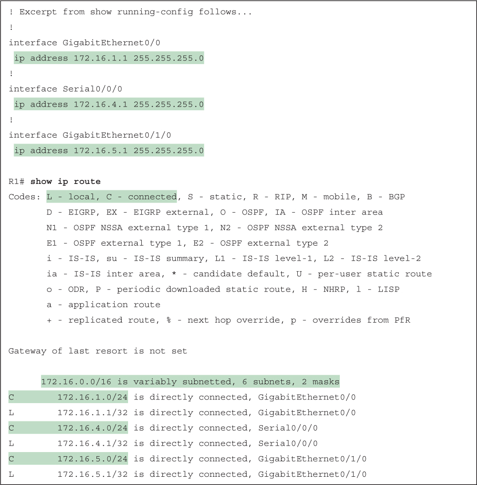</a>

<a href="#f0439-01a" id="code-f0439-01">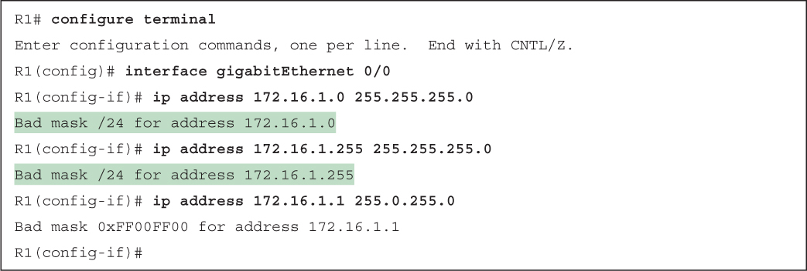</a>

<a href="#f0439-02a" id="code-f0439-02">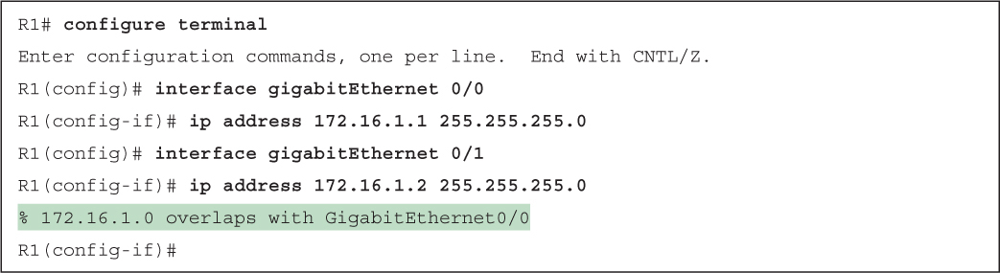</a>

<a href="#f0440-01a" id="code-f0440-01">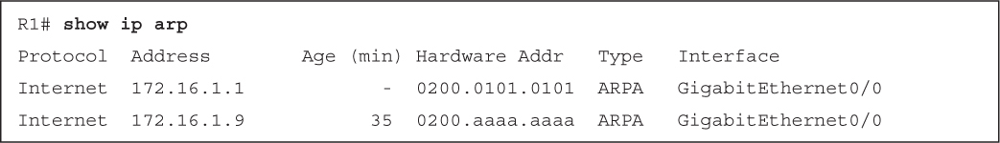</a>

<a href="#f0442-01a" id="code-f0442-01">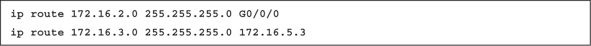</a>

<a href="#f0442-02a" id="code-f0442-02">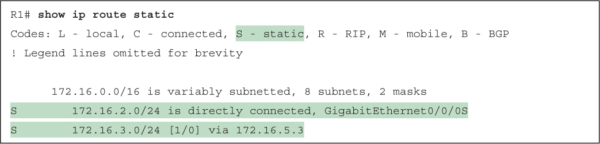</a>

<a href="#f0444-01a" id="code-f0444-01">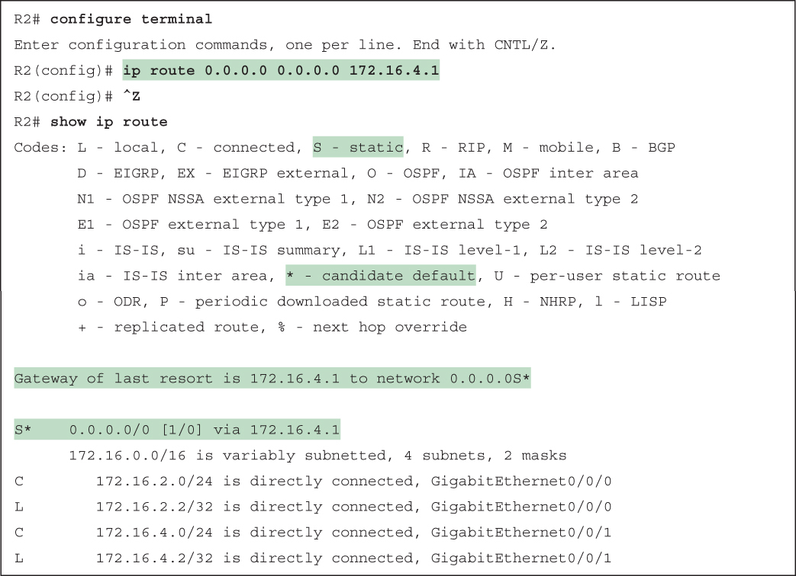</a>

<a href="#f0446-01a" id="code-f0446-01">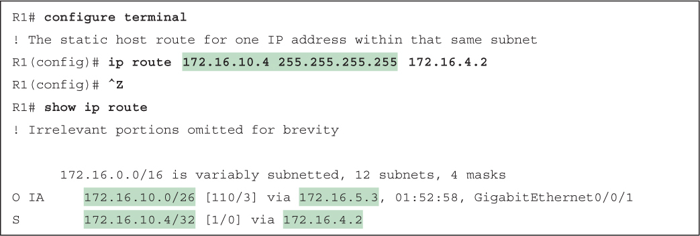</a>

<a href="#f0448-01a" id="code-f0448-01">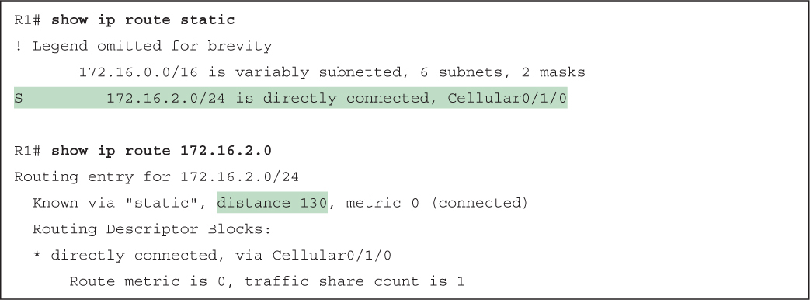</a>

<a href="#f0449-01a" id="code-f0449-01">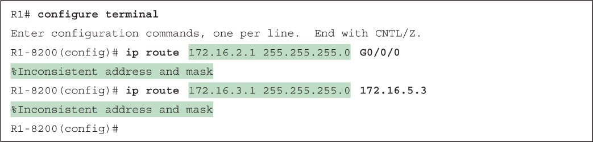</a>

<a href="#f0450-01a" id="code-f0450-01">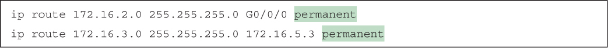</a>

</section>

</section>


<nav class="ccna-chapter-nav" aria-label="章节导航"><a href="v1-16.html">← 上一章</a><a href="v1-18.html">下一章 →</a></nav>
