
<a href="{{ '/subjects/CCNA/' | relative_url }}">← 返回 CCNA 目录</a>

第一卷 · IPv4 路由

<nav class="ccna-chapter-nav" aria-label="章节导航"><a href="v1-17.html">← 上一章</a><a href="v1-19.html">下一章 →</a></nav>



<section data-epub-type="chapter">

<h2 class="h2" id="ch18">第 18 章</h2>

<h2 class="h2a">局域网中的 IP 路由</h2>

本章涵盖以下考试主题：

1.0 网络基础

1.1 解释网络组件的角色和功能

1.1.a 路由器

1.1.b 二层交换机和三层交换机

1.6 配置与验证 IPv4 编址和子网划分

2.0 网络接入

2.1 配置与验证跨越多台交换机的 VLAN（普通范围）

2.1.c VLAN 间连接

2.4 配置与验证（二层／三层）EtherChannel（LACP）

前两章介绍了如何在路由器接口上配置 IP 地址和掩码，使路由器能够路由进出该地址／掩码组合所表示子网的数据包。虽然这些内容正确且实用，但迄今所有示例都忽略了 LAN 交换机以及 VLAN 的可能存在。实际上，前面的示例都是最简单的情况：连接的交换机是二层交换机，只使用一个 VLAN，路由器在物理接口上配置一条 <strong>ip address</strong> 命令。本章详细探讨如何配置路由器，使其能够路由进出每个 VLAN 上子网的数据包。

由于二层交换机不会在 VLAN 之间转发二层帧，网络必须使用能够执行 IP 路由的设备，在子网之间路由 IP 数据包。该设备可以是路由器，也可以是兼具路由功能的交换机。

回顾一下，以太网定义了 VLAN 的概念，而 IP 定义了 IP 子网的概念，因此 VLAN 并不等同于子网。不过，一个 VLAN 中的设备通常使用同一子网内的 IP 地址。同理，位于两个不同 VLAN 中的设备通常也属于两个不同的子网。为了让不同 VLAN 中的两台设备相互通信，路由器必须连接到各 VLAN 上的子网，然后在这些子网中的设备之间转发 IP 数据包。

本章讨论多种 VLAN 间路由方法，它们在不同场景下都可能有用：

<ul class="sq">

<li>
<strong>通过路由器 802.1Q 中继进行 VLAN 路由：</strong>第一节讨论配置路由器，在连接二层交换机的链路上使用 VLAN 中继。路由器负责路由，交换机负责创建 VLAN。路由器与交换机之间的链路使用 VLAN 中继，使路由器拥有连接每个 VLAN／子网的接口。这项功能称为通过 VLAN 中继进行路由，也称为<a id="key_208" href="#ref-gloss_351">单臂路由（router-on-a-stick，ROAS）</a>。
</li>

<li>
<strong>通过三层交换机 SVI 进行 VLAN 路由：</strong>第二节讨论使用同时支持二层交换和三层路由的 LAN 交换机（称为<a id="key_205" href="#ref-gloss_227">三层交换机</a>或<a id="key_206" href="#ref-gloss_261">多层交换机</a>）。为执行路由，三层交换机配置使用称为交换虚拟接口（SVI）的接口，也称为 VLAN 接口。
</li>

<li>
<strong>通过三层交换机路由端口进行 VLAN 路由：</strong>本章第三个主要部分讨论 SVI 的替代方案，即<a id="key_207" href="#ref-gloss_346">路由端口</a>，它使物理交换机端口像路由器接口一样工作。这一节还介绍将 EtherChannel 用作路由端口的概念，这项功能称为<a id="key_204" href="#ref-gloss_225">三层 EtherChannel（L3 EtherChannel）</a><em>。</em>
</li>

<li>
<strong>在路由器的 LAN 交换端口上进行 VLAN 路由：</strong>最后一个主要部分讨论集成 LAN 交换端口的 Cisco 路由器。例如，在分支机构中，可以部署带有少量集成交换端口的路由器，来代替一台小型路由器加一台独立小型交换机。本节展示如何配置路由器的交换端口及内部逻辑，使路由器为这些交换端口上的子网路由数据包。
</li>

</ul>

<section>

<h3 class="h3" id="ch18lev1sec1">自测</h3>

如果你希望根据得分决定在本章投入多少时间，可以完成这组自测题（在此作答，或使用 PTP 软件）。各题答案的选项字母列在自测题之后的页面底部。书末和配套网站上的<a href="#ref-appc">附录 C</a>都包含答案及解析。你也可以在 PTP 测试软件中找到答案及解析。

<figure class="table" id="ch18tab01" tabindex="0">

<figcaption>

<strong>表 18-1</strong> 基础主题小节与题目对应关系

</figcaption>

<table class="all">

<thead>

<tr>

<th class="th">
基础知识小节
</th>

<th class="th">
题目
</th>

</tr>

</thead>

<tbody>

<tr>

<td class="border">
通过路由器 802.1Q 中继进行 VLAN 路由
</td>

<td class="border">
1、2
</td>

</tr>

<tr>

<td class="border">
通过三层交换机 SVI 进行 VLAN 路由
</td>

<td class="border">
3, 4
</td>

</tr>

<tr>

<td class="border">
通过三层交换机路由端口进行 VLAN 路由
</td>

<td class="border">
5, 6
</td>

</tr>

<tr>

<td class="border">
在路由器的 LAN 交换端口上进行 VLAN 路由
</td>

<td class="border">
7
</td>

</tr>

</tbody>

</table>

</figure>

<strong><a id="quess18_1" href="#ques18_1a">1</a>．</strong>路由器 1 有一个 Fast Ethernet 0/0 接口，IP 地址为 10.1.1.1。该接口连接到一台交换机。随后，这条连接迁移为使用 802.1Q 中继。假设中继支持的 VLAN 包含 VLAN 4，以下哪些命令可以成为路由器 1 的 Fa0/0 接口有效配置的一部分？（选择两个答案。）

<ol class="lower-alpha">

<li>
<strong>interface fastethernet 0/0.4</strong>
</li>

<li>
<strong>dot1q enable</strong>
</li>

<li>
<strong>dot1q enable 4</strong>
</li>

<li>
<strong>trunking enable</strong>
</li>

<li>
<strong>trunking enable 4</strong>
</li>

<li>
<strong>encapsulation dot1q 4</strong>
</li>

</ol>

<strong><a id="quess18_2" href="#ques18_2a">2</a>．</strong>路由器 R1 配置了单臂路由（ROAS），在接口 G0/1 上有两个子接口：G0/1.1 和 G0/1.2。物理接口 G0/1 当前处于 down/down 状态。网络工程师随后在 G0/1.1 的接口配置模式下配置 <strong>shutdown</strong> 命令，并在 G0/1.2 的接口配置模式下配置 <strong>no shutdown</strong> 命令。关于这些子接口的接口状态，哪些答案是正确的？（选择两个答案。）

<ol class="lower-alpha">

<li>
G0/1.1 将处于 down/down 状态。
</li>

<li>
G0/1.2 将处于 down/down 状态。
</li>

<li>
G0/1.1 将处于 administratively down 状态。
</li>

<li>
G0/1.2 将处于 up/up 状态。
</li>

</ol>

<strong><a id="quess18_3" href="#ques18_3a">3</a>．</strong>一台三层交换机已配置为使用 SVI 在 VLAN 1、2 和 3 之间路由 IP 数据包，它们分别连接子网 172.20.1.0/25、172.20.2.0/25 和 172.20.3.0/25。工程师在三层交换机上执行 <strong>show ip route connected</strong> 命令，列出直连路由。以下哪个答案列出的信息应至少出现在其中一条路由中？

<ol class="lower-alpha">

<li>
接口 Gigabit Ethernet 0/0.3
</li>

<li>
下一跳路由器 172.20.2.1
</li>

<li>
接口 VLAN 2
</li>

<li>
掩码 255.255.255.0
</li>

</ol>

<strong><a id="quess18_4" href="#ques18_4a">4</a>．</strong>工程师已成功在三层交换机上为 VLAN 2 和 3 配置 SVI，默认启用 autostate。使用 VLAN 2 和 3 的子网中的主机能够相互 ping 通，数据包由三层交换机路由。下一周，网络工程师接到电话，得知这些用户无法再相互 ping 通。如果问题出在三层交换功能上，以下哪些情况可能导致该问题？（选择两个答案。）

<ol class="lower-alpha">

<li>
十个正常工作的 VLAN 2 接入端口中有六个（或更多）因物理问题而故障
</li>

<li>
在 interface VLAN 4 配置模式下执行了 <strong>shutdown</strong> 命令
</li>

<li>
在全局配置模式下执行了 <strong>no vlan 2</strong> 命令
</li>

<li>
在 VLAN 2 配置模式下执行了 <strong>shutdown</strong> 命令
</li>

</ol>

<strong><a id="quess18_5" href="#ques18_5a">5</a>．</strong>某 LAN 设计在两台交换机 SW1 和 SW2 之间使用三层 EtherChannel，两台交换机均使用 port-channel 1 接口。SW1 将 G0/1、G0/2、G0/3 和 G0/4 端口用于该通道。关于 SW1 上使该通道能够正确路由 IPv4 数据包的配置，以下哪些说法正确？（选择两个答案。）

<ol class="lower-alpha">

<li>
必须在 port-channel 1 接口上配置 <strong>ip address</strong> 命令。
</li>

<li>
必须在接口 G0/1（编号最小的端口）上配置 <strong>ip address</strong> 命令。
</li>

<li>
必须在 port-channel 1 接口上配置 <strong>no switchport</strong> 命令。
</li>

<li>
必须在接口 G0/1 上配置 <strong>routedport</strong> 命令。
</li>

</ol>

<strong><a id="quess18_6" href="#ques18_6a">6</a>．</strong>某 LAN 设计在两台交换机 SW1 和 SW2 之间使用三层 EtherChannel。工程师成功将 SW1 的 G0/1 端口加入通道，但随后加入 SW1 的 G0/2 端口时失败。哪些答案列出的 G0/2 配置设置会导致这一问题？（选择两个答案。）

<ol class="lower-alpha">

<li>
不同的 STP 开销（<strong>spanning-tree cost</strong> <em>value</em>）
</li>

<li>
不同的速率（<strong>speed</strong> <em>value</em>）
</li>

<li>
switchport 的默认设置（<strong>switchport</strong>）
</li>

<li>
不同的接入 VLAN（<strong>switchport access vlan</strong> <em>vlan-id</em>）
</li>

</ol>

<strong><a id="quess18_7" href="#ques18_7a">7</a>．</strong>某路由器的一部分物理端口为路由端口，另一部分为交换端口。你预计以下哪些接口子命令仅受交换端口支持？

<ol class="lower-alpha">

<li>
<strong>switchport access vlan</strong> <em>vlan-id</em> 子命令
</li>

<li>
<strong>ip address</strong> <em>address mask</em> 子命令
</li>

<li>
<strong>description</strong> <em>text</em> 子命令
</li>

<li>
<strong>hostname</strong> <em>name</em> 子命令
</li>

</ol>

自测答案：

<strong><a id="ques18_1a" href="#ref-ques18_1">1</a></strong> A, F

<strong><a id="ques18_2a" href="#ref-ques18_2">2</a></strong> B, C

<strong><a id="ques18_3a" href="#ref-ques18_3">3</a></strong> C

<strong><a id="ques18_4a" href="#ref-ques18_4">4</a></strong> C、D

<strong><a id="ques18_5a" href="#ref-ques18_5">5</a></strong> A, C

<strong><a id="ques18_6a" href="#ref-ques18_6">6</a></strong> B、C

<strong><a id="ques18_7a" href="#ref-ques18_7">7</a></strong> A

</section>

<section>

<h3 class="h3box" id="ch18lev1sec2">基础知识</h3>

</section>

<section>

<h3 class="h3" id="ch18lev1sec3">通过路由器 802.1Q 中继进行 VLAN 路由</h3>

几乎所有企业网络都使用 VLAN。为了路由进出这些 VLAN 的 IP 数据包，某些设备（路由器或三层交换机）需要在每个子网中拥有一个 IP 地址，并且拥有到达每个子网的直连路由。这样，这些路由器或三层交换机上的 IP 地址就可以充当各子网的默认网关。

本章将 LAN 路由选项分为五类：

<ul class="sq">

<li>
使用路由器，为每个 VLAN 各用一个路由器 LAN 接口和一条线缆连接交换机（通常不采用）
</li>

<li>
使用路由器，通过 VLAN 中继连接 LAN 交换机（称为单臂路由或 ROAS）
</li>

<li>
使用带有交换虚拟接口（SVI）的三层交换机
</li>

<li>
使用带有路由接口的三层交换机（这些接口可以是三层 EtherChannel，也可以不是）
</li>

<li>
使用集成交换端口的路由器，配置方式与使用 SVI 的三层交换机很相似
</li>

</ul>

在这些选项中，第一个可行，但所需接口太多，难以实际采用。此处提及它只是为了使列表完整。

至于其他选项，本章会逐一讨论。实际网络会使用这些功能，选择哪一种取决于特定网络部分的设计和需求。<a href="#ch18fig01">图 18-1</a> 展示了可以使用这些选项的场景。

<figure class="image-c" id="ch18fig01">

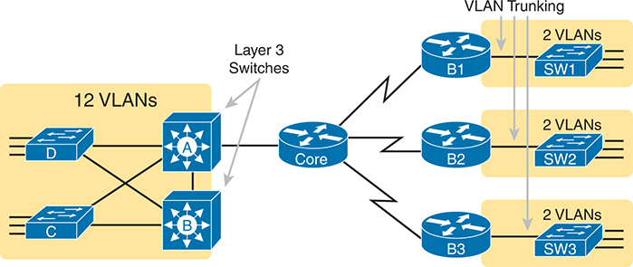

<figcaption>

<strong>图 18-1</strong> <em>中心站点使用三层交换，分支机构使用 ROAS</em>

<aside class="hidden" id="a18fig01">

示意图显示两台三层交换机 A 和 B 连接到中心站点的核心路由器。这些交换机实现 12 个 VLAN 之间的路由。核心路由器向三个分支机构 B1、B2 和 B3 延伸连接，每处分支机构配有一台路由器，分别为 SW1、SW2 和 SW3，具有两个接口和 VLAN。分支机构与路由器之间通过 VLAN 中继建立连接。

</aside>

</figcaption>

</figure>

<a href="#ch18fig01">图 18-1</a> 中标为 A 和 B 的两台交换机可以充当三层交换机，同时使用 SVI 和路由接口。图左侧是包含 12 个 VLAN 的中心站点园区 LAN。在中心站点，两台交换机充当三层交换机，结合路由器和交换机的功能，在全部 12 个子网／VLAN 之间进行路由。这些三层交换机可以使用 SVI、路由接口，或同时使用两者。

<a href="#ch18fig01">图 18-1</a> 还展示了路由器使用 VLAN 中继的典型场景。像图右侧远程站点这样的站点，可能拥有连接 WAN 的路由器和 LAN 交换机。这些站点可以使用 ROAS，利用路由器通过 802.1Q 中继进行路由的能力。

请注意，<a href="#ch18fig01">图 18-1</a> 只是一个示例。工程师可以在每个站点使用三层交换，也可以在每个站点使用带 VLAN 中继的路由器。

<section>

<h4 class="h4" id="ch18lev2sec1">配置 ROAS</h4>

接下来讨论路由器如何将数据包路由到与路由器 802.1Q 中继所连接 VLAN 关联的子网。每次讨论此功能时都重复这么长的描述会有些麻烦，因此，随着时间推移，网络领域为它确定了一个更简短、更有趣的名称：单臂路由（ROAS）。

ROAS 使用路由器 VLAN 中继配置，为路由器提供连接每个 VLAN 的逻辑接口。由于路由器随后拥有连接每个 VLAN 的接口，也就能为其配置各 VLAN 所在子网中的 IP 地址。

路由器需要为中继上的每个 VLAN 关联一个 IP 地址／掩码。然而，路由器在连接中继的链路上只有一个物理接口。Cisco 通过创建多个虚拟路由器接口来解决这个问题，为该中继上每个受支持的 VLAN 创建一个接口。Cisco 将这些虚拟接口称为<a id="key_209" href="#ref-gloss_381">子接口</a>，路由器配置中为每个子接口包含一条 <strong>ip address</strong> 命令。

<a href="#ch18fig02">图 18-2</a> 通过<a href="#ch18fig01">图 18-1</a> 中的一台分支路由器 B1 展示这一概念。由于该路由器只需要在两个 VLAN 之间进行路由，图中也展示了两个子接口，名称分别为 G0/0/0.10 和 G0/0/0.20，它们在配置中创建了新的位置，可用于设置各 VLAN 的配置参数。路由器将带 VLAN 10 标记的帧视为从 G0/0/0.10 进出，将带 VLAN 20 标记的帧视为从 G0/0/0.20 进出。

<figure class="image-c" id="ch18fig02">

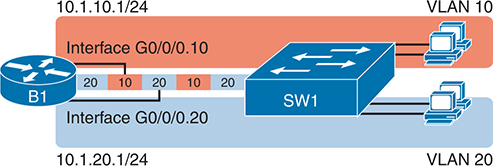

<figcaption>

<strong>图 18-2</strong> <em>路由器 B1 上的子接口</em>

<aside class="hidden" id="a18fig02">

配置了多个子接口的路由器 B1。每个子接口对应单独的 VLAN 和 IP 地址分配。接口 G0/0/0.10 关联 G0/0/0 的子接口 10，分配给 SW1 上的 VLAN 10，IP 地址为 10.1.10.1/24。接口 G0/0/0.20 对应 G0/0/0 的子接口 20，分配给 SW1 上的 VLAN 20，IP 地址为 10.1.20.1/24。

</aside>

</figcaption>

</figure>

此外，请注意大多数 Cisco 路由器不会尝试协商中继，因此路由器和交换机都需要手动配置中继。本章讨论中继配置的路由器一侧；相应的交换机接口需要配置 <strong>switchport mode trunk</strong> 命令。

<a href="#exa18_1">例 18-1</a> 展示了<a href="#ch18fig02">图 18-2</a> 中路由器 B1 所需的完整 802.1Q 中继配置示例。更一般地说，以下步骤详细说明如何在路由器上配置 802.1Q 中继：

<figure class="figure1">

</figure>

步骤 1。在全局配置模式下使用 <strong>interface</strong> <em>type number.subint</em> 命令，为每个需要路由的 VLAN 创建唯一的子接口。

步骤 2。在子接口配置模式下使用 <strong>encapsulation dot1q</strong> <em>vlan_id</em> 命令，启用 802.1Q，并将某个特定 VLAN 与该子接口关联。

步骤 3。在子接口配置模式下使用 <strong>ip address</strong> <em>address mask</em> 命令，配置 IP 设置（地址和掩码）。

<strong>例 18-1</strong> <em>与<a href="#ch18fig02">图 18-2</a> 对应的路由器 802.1Q 配置</em>

<a href="#code-f0459-01" id="f0459-01a">点击此处查看代码原图</a>

<pre class="pre-ex" tabindex="0"><code class="highlight">B1# <strong>show running-config</strong>
! Only pertinent lines shown
interface gigabitethernet 0/0/0
! No IP address or encapsulation up here!
!
interface gigabitethernet 0/0/0.10
 encapsulation dot1q 10
 ip address 10.1.10.1 255.255.255.0
!
interface gigabitethernet 0/0/0.20
 encapsulation dot1q 20
 ip address 10.1.20.1 255.255.255.0</code></pre>

首先查看子接口编号。子接口编号以句点开头，例如本例中的 .10 和 .20。这些编号可以是从 1 到一个非常大的数值（超过 40 亿）之间的任意数字。它只需要在与该物理接口关联的所有子接口中唯一即可。实际上，子接口编号甚至不必与关联的 VLAN ID 一致。（定义子接口关联 VLAN ID 的是 <strong>encapsulation</strong> 命令，而不是子接口编号。）

注意

虽然并非必须，但大多数站点会使子接口编号与 VLAN ID 一致，如<a href="#exa18_1">例 18-1</a> 所示，以避免混淆。

每个子接口配置列出两条子命令。一条命令（<strong>encapsulation</strong>）启用中继，并定义路由器与进出该子接口的帧关联的 VLAN。<strong>ip address</strong> 命令的工作方式与其他任何路由器接口上的相同。

现在路由器有了正常工作且配置了 IPv4 地址的接口，就能够在这些子接口上路由 IPv4 数据包。也就是说，在加入直连路由、匹配这些路由以及转发进出这些直连子网的数据包方面，路由器对待这些子接口与物理接口完全相同。

<a href="#exa18_1">例 18-1</a> 使用 VLAN 10 和 20，两者都不是中继上的本征 VLAN。ROAS 可以使用本征 VLAN，但配置有两种变体，因此需要多加考虑。本征 VLAN 可以配置在子接口或物理接口上，也可以像<a href="#exa18_1">例 18-1</a> 那样忽略。每条 802.1Q 中继都有一个本征 VLAN，如果路由器需要为该本征 VLAN 中的子网路由数据包，就需要通过配置来支持该子网。为本征 VLAN 定义路由器接口有两个选项：

<ul class="sq">

<li>
在物理接口上配置 <strong>ip address</strong> 命令，但不配置 <strong>encapsulation</strong> 命令；路由器会认为该物理接口使用本征 VLAN。
</li>

<li>
在子接口上配置 <strong>ip address</strong> 命令，并使用 <strong>encapsulation dot1q</strong> <em>vlan-id</em> <strong>native</strong> 子命令，向路由器同时说明 VLAN ID 以及它是本征 VLAN 这一事实。
</li>

</ul>

<a href="#exa18_2">例 18-2</a> 对<a href="#exa18_1">例 18-1</a> 的配置略作修改，展示两种本征 VLAN 配置选项。在此例中，VLAN 10 成为本征 VLAN。示例上半部分展示将路由器物理接口配置为使用本征 VLAN 10 的方式，下半部分展示如何在子接口上配置同一本征 VLAN。在这两种情况下，还需要修改交换机配置，将 VLAN 10 设为本征 VLAN。

<strong>例 18-2</strong> <em>在路由器 B1 上配置本征 VLAN 10 的两种选项</em>

<a href="#code-f0460-01" id="f0460-01a">点击此处查看代码原图</a>

<pre class="pre-ex" tabindex="0"><code class="highlight">! First option: put the native VLAN IP address on the physical interface
interface gigabitethernet 0/0/0
 ip address 10.1.10.1 255.255.255.0
!
interface gigabitethernet 0/0/0.20
 encapsulation dot1q 20
 ip address 10.1.20.1 255.255.255.0</code></pre>

<pre class="pre-ex" tabindex="0"><code class="highlight">! Second option: like <a href="#exa18_1">Example 18-1</a>, but add the <strong>native</strong> keyword
interface gigabitethernet 0/0/0.10
 encapsulation dot1q 10 native
 ip address 10.1.10.1 255.255.255.0
!
interface gigabitethernet 0/0/0.20
 encapsulation dot1q 20
 ip address 10.1.20.1 255.255.255.0</code></pre>

</section>

<section>

<h4 class="h4" id="ch18lev2sec2">验证 ROAS</h4>

除了使用 <strong>show running-config</strong> 命令之外，验证路由器上的 ROAS 配置最合适的两个命令是 <strong>show ip route</strong> [<strong>connected</strong>] 和 <strong>show vlans</strong>。与任何路由器接口一样，只要接口处于 up/up 状态且配置了 IPv4 地址，IOS 就会在 IPv4 路由表中加入直连路由（及本地路由）。因此，首要且明显的检查是确认所有预期的直连路由是否存在。<a href="#exa18_3">例 18-3</a> 列出根据<a href="#exa18_1">例 18-1</a> 的配置产生的直连路由。

<strong>例 18-3</strong> <em>基于<a href="#exa18_1">例 18-1</a> 配置的直连路由</em>

<a href="#code-f0461-01" id="f0461-01a">点击此处查看代码原图</a>

<pre class="pre-ex" tabindex="0"><code class="highlight">B1# <strong>show ip route connected</strong>
Codes: L - local, C - connected, S - static, R - RIP, M - mobile, B - BGP
! Legend omitted for brevity

      10.0.0.0/8 is variably subnetted, 4 subnets, 2 masks
C        10.1.10.0/24 is directly connected, <strong>GigabitEthernet0/0/0.10</strong>
L        10.1.10.1/32 is directly connected, GigabitEthernet0/0/0.10
C        10.1.20.0/24 is directly connected, <strong>GigabitEthernet0/0/0.20</strong>
L        10.1.20.1/32 is directly connected, GigabitEthernet0/0/0.20</code></pre>

关于接口和子接口状态，请注意 ROAS 子接口的状态在一定程度上取决于物理接口状态。具体来说，子接口状态不能优于对应物理接口的状态。例如，迄今为止，路由器 B1 上的物理接口及相关子接口都处于 up/up 状态。如果拔掉该物理端口的线缆，物理接口和所有子接口都会变为 down/down 状态。或者，如果关闭物理接口，物理接口及子接口都会进入 administratively down 状态，如<a href="#exa18_4">例 18-4</a> 所示。

<strong>例 18-4</strong> <em>子接口状态与物理接口状态关联</em>

<a href="#code-f0461-02" id="f0461-02a">点击此处查看代码原图</a>

<pre class="pre-ex" tabindex="0"><code class="highlight">B1# <strong>configure terminal</strong>
Enter configuration commands, one per line. End with CNTL/Z.
B1(config)# <strong>interface g0/0/0</strong>
B1(config-if)# <strong>shutdown</strong>
B1(config-if)# <strong>^Z</strong>
B1# <strong>show ip interface brief | include 0/0/0</strong>
GigabitEthernet0/0/0         unassigned      YES manual administratively down down
GigabitEthernet0/0/0.10      10.1.10.1       YES manual administratively down down
GigabitEthernet0/0/0.20      10.1.20.1       YES manual administratively down down</code></pre>

此外，还可以在子接口配置模式下使用 <strong>no shutdown</strong> 和 <strong>shutdown</strong> 命令，独立于物理接口启用或禁用子接口。例如，物理接口和子接口 .10 可以保持 up/up，而子接口 .20 可以单独关闭。

另一个实用的 ROAS 验证命令是 <strong>show vlans</strong>，它明确说明哪些路由器中继接口使用哪些 VLAN、哪个 VLAN 是本征 VLAN，并提供部分数据包统计。在验证是否存在流量时，持续增加的数据包计数器可能很有帮助。<a href="#exa18_5">例 18-5</a> 展示了基于<a href="#exa18_2">例 18-2</a> 下半部分路由器 B1 配置的示例，其中本征 VLAN 10 配置在子接口 G0/0/0.10 上。请注意，输出标明 VLAN 1 与物理接口关联，本征 VLAN 10 与 G0/0/0.10 关联，VLAN 20 与 G0/0/0.20 关联。它还列出分配给各接口／子接口的 IP 地址。

<strong>例 18-5</strong> <em>路由器 <strong>show vlans</strong> 命令显示 ROAS 配置</em>

<a href="#code-f0462-01" id="f0462-01a">点击此处查看代码原图</a>

<pre class="pre-ex" tabindex="0"><code class="highlight">B1# <strong>show vlans</strong>
VLAN ID: 1 (IEEE 802.1Q Encapsulation)

   Protocols Configured:          Received:        Transmitted:

VLAN trunk interfaces for VLAN ID 1:
GigabitEthernet0/0/0

GigabitEthernet0/0/0 (1)
      Total 5 packets, 330 bytes input
      Total 20 packets, 3134 bytes output

VLAN ID: 10 (IEEE 802.1Q Encapsulation)

 This is configured as native Vlan for the following interface(s) :
GigabitEthernet0/0/0    Native-vlan Tx-type: Untagged

   Protocols Configured:          Received:        Transmitted:
                     IP                  0                   0

VLAN trunk interfaces for VLAN ID 10:
GigabitEthernet0/0/0.10

GigabitEthernet0/0/0.10 (10)
                     IP: 10.1.10.1
      Total 38 packets, 5696 bytes input
      Total 2 packets, 128 bytes output

VLAN ID: 20 (IEEE 802.1Q Encapsulation)
   Protocols Configured:          Received:        Transmitted:
                     IP                  0                   0

VLAN trunk interfaces for VLAN ID 20:
GigabitEthernet0/0/0.20

GigabitEthernet0/0/0.20 (20)
                     IP: 10.1.20.1
      Total 0 packets, 0 bytes input
      Total 2 packets, 128 bytes output</code></pre>

</section>

<section>

<h4 class="h4" id="ch18lev2sec3">ROAS 故障排查</h4>

排查 ROAS 时最大的挑战在于：如果仅路由器或仅交换机配置错误，中继另一端的设备无法知道对端存在配置错误。也就是说，路由器配置可能正确，但路由仍可能因相连交换机上的问题而失败。因此，ROAS 故障排查通常从检查路由器和交换机两端的配置开始，因为任何一端的状态输出都无法告诉你问题可能出在哪里。

首先，要检查路由器上的 ROAS，需要从预期配置出发，针对配置提出以下问题：

<ol class="number">

<li>
是否为每个非本征 VLAN 在路由器子接口上配置了 <strong>encapsulation dot1q</strong> <em>vlan-id</em> 命令？
</li>

<li>
相邻交换机的中继上是否存在相同的 VLAN（<strong>show interfaces trunk</strong>），而且它们是否位于允许列表中、未被 VTP 修剪且未被 STP 阻塞？
</li>

<li>
每个路由器 ROAS 子接口是否都按规划配置了 IP 地址／掩码？
</li>

<li>
如果使用本征 VLAN，是否已在路由器上正确配置：要么在子接口上使用 <strong>encapsulation dot1q</strong> <em>vlan-id</em> <strong>native</strong> 命令，要么隐含地配置在物理接口上？
</li>

<li>
相邻交换机中继上配置的本征 VLAN 是否与路由器上配置的相同？
</li>

<li>
路由器物理接口或 ROAS 子接口是否配置了 <strong>shutdown</strong> 命令？
</li>

</ol>

对于其中某些步骤，需要准备检查 LAN 交换机可能存在的 VLAN 中继问题。许多 Cisco 路由器接口不会协商中继。因此，ROAS 依赖路由器和交换机两端的静态中继配置。如果交换机一侧的 VLAN 或 VLAN 中继配置存在问题，路由器无法察觉。

例如，假设你像<a href="#exa18_1">例 18-1</a> 或<a href="#exa18_2">例 18-2</a> 那样在路由器上配置了 ROAS，但链路另一端的交换机却没有相应配置。比如，交换机可能根本没有定义 VLAN 10 和 20，或者连接路由器的端口没有配置中继。即使交换机上存在明显的配置错误或缺失，路由器仍会显示 up/up 的 ROAS 接口和子接口，<strong>show ip route</strong> 的输出中仍有 IP 路由，<strong>show vlans</strong> 命令的输出中仍有有意义的配置信息。路由器会向交换机转发数据包（封装在帧中），但交换机的配置不足以支持正确转发该帧。

</section>

</section>

<section>

<h3 class="h3" id="ch18lev1sec4">通过三层交换机 SVI 进行 VLAN 路由</h3>

在某些情况下，特别是小型远程站点，使用 ROAS 路由器路由数据包很合理。在 LAN 较大的站点，网络设计人员会选择三层交换机来执行大部分 VLAN 间路由。

三层交换机（也称多层交换机）是一台设备，但执行两个层次的逻辑：二层 LAN 交换和三层 IP 路由。二层交换功能在每个 VLAN 内转发帧，但不会在 VLAN 之间转发帧。三层转发（路由）逻辑则对这些 VLAN 中设备发出的 IP 数据包应用 IP 路由逻辑，在 VLAN 之间转发 IP 数据包。

三层交换机通常支持两种配置选项，用于在交换机内部启用 IPv4 路由，具体来说，是在交换机接口上启用 IPv4。本节介绍使用交换虚拟接口（SVI）的选项。本章下一个主要部分将讨论在三层交换机上配置 IPv4 地址的另一个选项：路由接口。

<section>

<h4 class="h4" id="ch18lev2sec4">使用交换机 SVI 配置路由</h4>

三层交换机的配置大部分与本书<a href="v1-04.html#part02">第二部分</a>和<a href="v1-08.html#part03">第三部分</a>介绍的二层交换配置相似，只需为三层功能增加少量配置。三层交换功能需要在交换机内部为每个 VLAN 连接一个虚拟接口。这些 <a id="key_212" href="#ref-gloss_434">VLAN 接口</a>像路由器接口一样工作，具有 IP 地址和掩码。三层交换机具有 IP 路由表，其中包含经由各 VLAN 接口的直连路由。Cisco 将这些虚拟接口称为<a id="key_211" href="#ref-gloss_400">交换虚拟接口（SVI）</a>。

为展示使用 SVI 进行三层交换的概念，以下示例仍采用前面那个包含两个 VLAN 的分支机构，但现在的设计将在 LAN 交换机中使用三层交换。<a href="#ch18fig03">图 18-3</a> 详细展示物理连接、子网和 VLAN ID。随后，<a href="#ch18fig04">图 18-4</a> 展示内部路由逻辑和 SVI。

<figure class="image-c" id="ch18fig03">

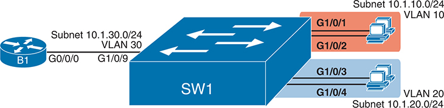

<figcaption>

<strong>图 18-3</strong> <em>三层交换示例中的物理接口和子网</em>

<aside class="hidden" id="a18fig03">

路由器 B1 从 G0/0/0 接口连接到 SW1 的 G1/0/9，使用子网 10.1.30.0/24 和 VLAN 30。交换机 SW1 有四个物理千兆以太网接口：G1/0/1、G1/0/2、G1/0/3 和 G1/0/4。每个接口都配置了 VLAN 和 IP 子网。G1/0/1 和 G1/0/2 分配到 VLAN 10 及子网 10.1.10.0/24；G1/0/3 和 G1/0/4 分配到 VLAN 20 及子网 10.1.20.0/24。

</aside>

</figcaption>

</figure>

<figure class="image-c" id="ch18fig04">

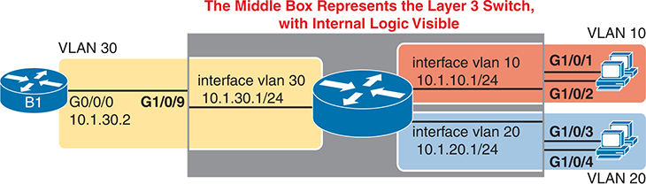

<figcaption>

<strong>图 18-4</strong> <em>三层交换示例中的内部 VLAN 接口</em>

<aside class="hidden" id="a18fig04">

路由器 B1 从 G0/0/0 接口（10.1.30.2）连接到另一台路由器的 G1/0/9 接口，使用子网 10.1.30.1/24 和 interface vlan 30。该路由器有四个物理千兆以太网接口：G1/0/1、G1/0/2、G1/0/3 和 G1/0/4。每个接口都配置了 VLAN 和 IP 子网。G1/0/1 和 G1/0/2 分配到 interface VLAN 10 及子网 10.1.10.1/24；G1/0/3 和 G1/0/4 分配到 interface VLAN 20 及子网 10.1.20.1/24。中间方框代表三层交换机，并展示其内部逻辑。

</aside>

</figcaption>

</figure>

请注意，<a href="#ch18fig04">图 18-4</a> 中间方框表示三层交换机的内部结构。分支机构仍有两个用户 VLAN（10 和 20），因此三层交换机需要为每个 VLAN 配置一个 VLAN 接口（SVI）。灰色方框中的路由器图标表示三层交换（路由）功能，图标右侧有两个 VLAN 接口。此外，流量仍需要到达路由器 B1（一台物理路由器）才能访问 WAN，因此交换机为连接 B1 的链路使用第三个 VLAN（本例为 VLAN 30）。交换机将三层交换机与路由器 B1 之间的链路视为接入链路；路由器不会感知任何 VLAN，也不需要 VLAN 中继配置。

以下步骤说明如何使用 SVI 配置三层交换。

<figure class="figure1">

</figure>

步骤 1。根据需要，在交换机上启用 IP 路由：

<ol class="step-lower-alpha">

<li>
（根据需要）使用型号特定的命令更改交换机转发 ASIC 设置，为 IPv4 路由分配空间，并重新加载交换机使设置生效。
</li>

<li>
在全局配置模式下使用 <strong>ip routing</strong> 命令，启用 IOS 软件中的 IPv4 路由功能，同时启用 <strong>show ip route</strong> 等关键命令。
</li>

</ol>

步骤 2。配置各 SVI 接口，为每个需要由该三层交换机进行路由的 VLAN 配置一个：

<ol class="step-lower-alpha">

<li>
在全局配置模式下使用 <strong>interface vlan</strong> <em>vlan_id</em> 命令创建 VLAN 接口，为交换机的路由逻辑提供连接相同编号 VLAN 的三层接口。
</li>

<li>
在 VLAN 接口配置模式下使用 <strong>ip address</strong> <em>address mask</em> 命令，为 VLAN 接口配置 IP 地址和掩码，并在该接口上启用 IPv4 路由。
</li>

<li>
（根据需要）在接口配置模式下使用 <strong>no shutdown</strong> 命令，启用当前处于关闭状态的 VLAN 接口。
</li>

</ol>

注意

关于步骤 1A，一些较旧的交换机型号需要重新编程转发 ASIC 后才能支持 IP 路由。例如，Cisco 在 2010 年代广泛销售的 2960 和 2960-XR 交换机，需要先执行全局命令 <strong>sdm prefer</strong>，再重新加载交换机。较新的 Cisco 交换机型号默认支持 IP 路由，无需类似步骤。

<a href="#exa18_6">例 18-6</a> 展示与<a href="#ch18fig04">图 18-4</a> 对应的配置。在本例中，交换机的转发 ASIC 默认支持 IP 路由，无需任何特殊命令。示例展示了全部三个 VLAN 接口的相关配置。

<strong>例 18-6</strong> <em>用于三层交换的 VLAN 接口配置</em>

<a href="#code-f0466-01" id="f0466-01a">点击此处查看代码原图</a>

<pre class="pre-ex" tabindex="0"><code class="highlight"><strong>ip routing</strong>
!
<strong>interface vlan 10</strong>
 <strong>ip address 10.1.10.1 255.255.255.0</strong>
!
<strong>interface vlan 20</strong>
 <strong>ip address 10.1.20.1 255.255.255.0</strong>
!
<strong>interface vlan 30</strong>
 <strong>ip address 10.1.30.1 255.255.255.0</strong></code></pre>

</section>

<section>

<h4 class="h4" id="ch18lev2sec5">验证使用 SVI 的路由</h4>

通过上一节所示的 VLAN 配置，交换机已经可以像<a href="#ch18fig04">图 18-4</a> 那样在 VLAN 之间路由数据包。为支持数据包路由，交换机加入直连 IP 路由，如<a href="#exa18_7">例 18-7</a> 所示；请注意，每条路由都列为连接到不同的 VLAN 接口。

<strong>例 18-7</strong> <em>三层交换机上的直连路由</em>

<a href="#code-f0466-02" id="f0466-02a">点击此处查看代码原图</a>

<pre class="pre-ex" tabindex="0"><code class="highlight">SW1# <strong>show ip route connected</strong>
! legend omitted for brevity

       10.0.0.0/8 is variably subnetted, 6 subnets, 2 masks
C         10.1.10.0/24 is directly connected, Vlan10
L         10.1.10.1/32 is directly connected, Vlan10
C         10.1.20.0/24 is directly connected, Vlan20
L         10.1.20.1/32 is directly connected, Vlan20
C         10.1.30.0/24 is directly connected, Vlan30
L         10.1.30.1/32 is directly connected, Vlan30</code></pre>

交换机还需要通往网络其余部分的其他路由（本章图中未展示）。三层交换机可以根据其能力使用静态路由或路由协议。例如，如果随后在三层交换机上启用 OSPF，配置和验证方式将与路由器相同，详见<a data-original-href="vol1_part06.xhtml#part06" data-unavailable="true" title="此内容不在当前提取范围内；请参阅原始 EPUB：vol1_part06.xhtml#part06">第六部分</a>“<a data-original-href="vol1_part06.xhtml#part06" data-unavailable="true" title="此内容不在当前提取范围内；请参阅原始 EPUB：vol1_part06.xhtml#part06">OSPF</a>”。IOS 加入三层交换机 IP 路由表的路由，会将 VLAN 接口列为出接口。

注意

Cisco 企业交换机支持的 IP 路由及路由协议能力，取决于具体型号、IOS 版本及 IOS 功能集。在实际网络中使用时，请通过 <a href="http://www.cisco.com/go/cfn">www.cisco.com/go/cfn</a> 上的 Cisco Feature Navigator（CFN）工具检查交换机型号的能力。

</section>

<section>

<h4 class="h4" id="ch18lev2sec6">使用 SVI 的路由故障排查</h4>

在物理路由器上使用物理接口时，路由器可以根据物理因素为接口确定状态，例如是否接入线缆，或是否通过线缆收到电信号或光信号。然而，SVI 是三层交换机路由功能的虚拟接口，交换机必须使用其他逻辑来决定是否将 SVI 置于工作状态（up/up）。

三层交换机通过两种接口配置设置之一，指定确定接口状态的逻辑：<strong>autostate</strong> 或 <strong>no autostate</strong>。VLAN 接口的默认设置 <strong>autostate</strong> 会检查底层 VLAN 的多个因素，以确定 VLAN 接口状态。配置 VLAN 接口子命令 <strong>no autostate</strong> 后，交换机会改用更简单、检查项更少的逻辑。下面几页将解释这两种方式。

<section>

<h5 class="h5" id="ch18lev3sec1">启用 autostate 时的 SVI 接口状态</h5>

VLAN 接口充当交换机路由功能与 VLAN 之间的接口。要使该 VLAN 接口正常工作，VLAN 本身必须正常。具体而言，使用 autostate 设置时，VLAN 接口要处于 up/up 状态，需满足以下条件：

步骤 1。本地交换机上必须定义该 VLAN（显式配置或通过 VTP 学习）。

步骤 2。交换机必须至少有一个使用该 VLAN 的 up/up 接口，包括：

<ol class="step-lower-alpha">

<li>
分配给该 VLAN 的 up/up 接入接口
</li>

<li>
该 VLAN 位于允许列表中、处于 STP 转发状态且未被 VTP 修剪的中继接口
</li>

</ol>

步骤 3。VLAN 必须在管理上启用（即没有 <strong>shutdown</strong>）。

步骤 4。VLAN 接口必须在管理上启用（即没有 <strong>shutdown</strong>）。

不要忽略这一点：VLAN 和 VLAN 接口是相关但不同的概念，分别在 CLI 中配置。全局命令 <strong>interface vlan</strong> <em>vlan-id</em> 配置 VLAN 接口，创建交换机上连接该 VLAN 的三层接口。全局命令 <strong>vlan</strong> <em>vlan-id</em> 则创建 VLAN。如果要使用 SVI 为 VLAN 11、12 和 13 上的子网路由数据包，就必须配置相同 VLAN ID 11、12 和 13 的 VLAN 接口。这些相同 VLAN ID 的 VLAN 也必须存在。

IOS 支持通过 <strong>shutdown</strong> 和 <strong>no shutdown</strong> 命令禁用和启用 VLAN 及 VLAN 接口（如前面列表中的步骤 3 和 4 所述）。作为配置核对任务的一部分，应检查状态，确保配置启用了所有相关 VLAN 和 VLAN 接口。

<a href="#exa18_8">例 18-8</a> 展示三个场景，每个场景都会使前一个配置示例（<a href="#ch18fig04">图 18-4</a>、<a href="#exa18_6">例 18-6</a>）中的一个 VLAN 接口失效。示例开始时，三个 VLAN 接口均为 up/up。此时，VLAN 10、20 和 30 各至少有一个接入接口处于启用且正常工作的状态。示例依次演示三个场景：

<ul class="sq">

<li>
<strong>场景 1：</strong>VLAN 10 中最后一个接入接口（G1/0/1）被关闭，因此 IOS 关闭 VLAN 10 接口。
</li>

<li>
<strong>场景 2：</strong>VLAN 20（是 VLAN 20，而非 VLAN 接口 20）被删除，使 IOS 随后将 VLAN 20 接口置为 down 状态（并非执行 shutdown）。
</li>

<li>
<strong>场景 3：</strong>VLAN 30（是 VLAN 30，而非 VLAN 接口 30）被关闭，使 IOS 随后将 VLAN 30 接口置为 down 状态（并非执行 shutdown）。
</li>

</ul>

<strong>例 18-8</strong> <em>导致 VLAN 接口失效的三个示例</em>

<a href="#code-f0468-01" id="f0468-01a">点击此处查看代码原图</a>

<pre class="pre-ex" tabindex="0"><code class="highlight">SW1# <strong>show interfaces status</strong>
! Only ports related to the example are shown
Port      Name               Status       Vlan       Duplex  Speed Type
Gi1/0/1                      connected    10         a-full  a-100 10/100/1000BaseTX
Gi1/0/2                      notconnect   10           auto   auto 10/100/1000BaseTX
Gi1/0/3                      connected    20         a-full  a-100 10/100/1000BaseTX
Gi1/0/4                      connected    20         a-full  a-100 10/100/1000BaseTX
Gi1/0/9                      connected    30         a-full a-1000 10/100/1000BaseTX

SW1# <strong>configure terminal</strong>
Enter configuration commands, one per line. End with CNTL/Z.

! Case 1: Interface G1/0/1, the last up/up access interface in VLAN 10, is shutdown
SW1(config)# <strong>interface GigabitEthernet 1/0/1</strong>
SW1(config-if)# <strong>shutdown</strong>
SW1(config-if)#
*Apr 2 19:54:08.784: %LINEPROTO-5-UPDOWN: Line protocol on Interface Vlan10, changed 
state to down
*Apr 2 19:54:10.772: %LINK-5-CHANGED: Interface GigabitEthernet1/0/1, changed state
to administratively down
*Apr 2 19:54:11.779: %LINEPROTO-5-UPDOWN: Line protocol on Interface GigabitEther-
net1/0/1, changed state to down

! Case 2: VLAN 20 is deleted
SW1(config)# <strong>no vlan 20</strong>
SW1(config)#
*Apr 2 19:54:39.688: %LINEPROTO-5-UPDOWN: Line protocol on Interface Vlan20, changed 
state to down

! Case 3: VLAN 30, the VLAN from the switch to the router, is shutdown
SW1(config)# <strong>vlan 30</strong>
SW1(config-vlan)# <strong>shutdown</strong>
SW1(config-vlan)# <strong>exit</strong>
SW1(config)#
*Apr 2 19:55:25.204: %LINEPROTO-5-UPDOWN: Line protocol on Interface Vlan30, changed
state to down
! Final status of all three VLAN interfaces is below
SW1# <strong>show ip interface brief | include Vlan</strong>
Vlan1                  unassigned      YES manual administratively down down
Vlan10                 10.1.10.1       YES manual up                    down
Vlan20                 10.1.20.1       YES manual up                    down
Vlan30                 10.1.30.1       YES manual up                    down</code></pre>

请注意，示例结束时，<strong>show ip interface brief</strong> 命令显示三个 VLAN 接口均处于 up/down 状态。

</section>

<section>

<h5 class="h5" id="ch18lev3sec2">禁用 autostate 时的 SVI 接口状态</h5>

禁用 autostate 后，交换机只检查自身是否定义了该 VLAN，无论是显式配置还是通过 VTP 学习。它会忽略启用 autostate 时执行的其他所有检查。如果没有匹配的 VLAN，交换机会将 VLAN 接口置于 up/down 状态。

<a href="#exa18_9">例 18-9</a> 展示如何通过 <strong>show interfaces vlan</strong> 命令输出确定是否启用 autostate。示例中，工程师已在 VLAN 10 接口下配置 <strong>no autostate</strong> 命令，而 VLAN 20 接口使用默认设置 <strong>autostate</strong>。

<strong>例 18-9</strong> <em>识别 VLAN 接口上的 autostate 设置</em>

<a href="#code-f0469-01" id="f0469-01a">点击此处查看代码原图</a>

<pre class="pre-ex" tabindex="0"><code class="highlight">SW1# <strong>show interfaces vlan 10</strong>
Vlan10 is up, line protocol is up , Autostate Disabled
! Lines omitted for brevity
SW1# <strong>show interfaces vlan 20</strong>
Vlan10 is up, line protocol is up , Autostate Enabled
! Lines omitted for brevity</code></pre>

</section>

</section>

</section>

<section>

<h3 class="h3" id="ch18lev1sec5">通过三层交换机路由端口进行 VLAN 路由</h3>

当三层交换机使用 SVI 时，交换机的物理接口仍像以往一样作为二层接口工作。也就是说，物理接口接收以太网帧，交换机学习帧的源 MAC 地址，并根据目的 MAC 地址转发帧。这一逻辑独立于任何已配置的路由逻辑。

使用三层交换机时，交换机充当终端主机的默认路由器。与通常情况一样，主机向默认路由器发送数据包时，先使用 ARP 学习其 MAC 地址，再将数据包封装到目的地址为默认路由器 MAC 地址的帧中。因此，在使用 SVI 的三层交换机中，主机会将帧发送到 SVI 的 MAC 地址。这些帧到达物理交换端口后，端口根据目的 MAC 地址将帧转发到内部目的地 VLAN 接口。这一过程会触发内部路由操作，例如剥离数据链路首部、作出路由决策等。

另一种方式是通过三层交换机配置，让物理端口作为路由器接口而不是交换机接口工作。为此，需要将该端口配置为路由端口。在<em>路由端口</em>上，交换机不会对帧执行二层交换逻辑。相反，到达路由端口的帧会触发三层路由逻辑，包括：

<ol class="number">

<li>
剥离入站帧的以太网数据链路首部／尾部
</li>

<li>
将目的 IP 地址与 IP 路由表比较，作出三层转发决策
</li>

<li>
为数据包添加新的以太网数据链路首部／尾部
</li>

<li>
转发封装在新帧中的数据包
</li>

</ol>

本章第三个主要部分研究 Cisco 三层交换机上路由接口的配置，但还有一个特定目标：讨论三层 EtherChannel。三层 EtherChannel 使用路由端口，因此学习它之前必须先理解路由端口。

<section>

<h4 class="h4" id="ch18lev2sec7">在交换机上实现路由接口</h4>

当三层交换机需要一个连接某子网的三层接口，而且只有一个物理接口连接该子网时，设计可以采用路由端口代替 SVI。换句话说，当通过仅连接另一台设备的点到点链路进行路由时，使用路由端口很合理。相反，当三层交换机需要连接某子网的三层接口，而交换机上有多个物理接口连接该子网时，设计必须采用 SVI。

为理解原因，请看<a href="#ch18fig05">图 18-5</a>，它重复了 SVI 示例所使用的<a href="#ch18fig04">图 18-4</a> 中的设计。右侧灰色矩形表示交换机及其内部结构。在交换机右侧，VLAN 10 和 VLAN 20 各至少有两个接入端口。因为每个 VLAN 都连接了两个或更多端口，三层交换机必须使用 SVI 作为进入这些 VLAN 的接口。

<figure class="image-c" id="ch18fig05">

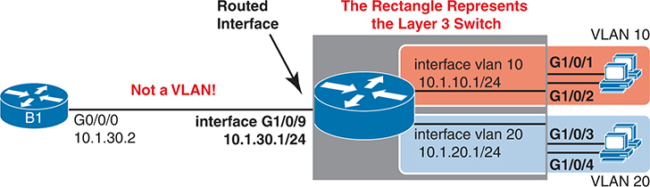

<figcaption>

<strong>图 18-5</strong> <em>通过交换机的路由接口进行路由</em>

<aside class="hidden" id="a18fig05">

路由器 B1 从 G0/0/0 接口（10.1.30.2）连接到另一台路由器的 G1/0/9（路由接口），使用子网 10.1.30.1/24。该路由器有四个物理千兆以太网接口：G1/0/1、G1/0/2、G1/0/3 和 G1/0/4。每个接口都配置了 VLAN 和 IP 子网。G1/0/1 和 G1/0/2 分配到 interface VLAN 10 及子网 10.1.10.1/24；G1/0/3 和 G1/0/4 分配到 interface VLAN 20 及子网 10.1.20.1/24。矩形表示三层交换机。

</aside>

</figcaption>

</figure>

图左侧链路将交换机连接到路由器 B1。该设计需要在 B1 与交换机之间进行路由。前面的<a href="#exa18_6">例 18-6</a> 和<a href="#exa18_7">例 18-7</a> 展示了如何通过交换机上的接入端口和 SVI 完成路由；由于设计在两台设备之间建立了点到点拓扑，使用路由端口同样可行。

将交换机接口启用为路由接口而不是交换接口很简单：只需在物理接口上使用 <strong>no switchport</strong> 子命令。能够充当三层交换机的 Cisco 交换机，其每个物理接口默认使用 <strong>switchport</strong> 命令。请想一想 <em>switchport</em> 这个词。Cisco 用它告诉交换机，将该端口视为交换机上的端口，也就是二层交换端口。若要让端口停止作为交换端口工作，改为像路由器端口一样工作，就在接口上使用 <strong>no switchport</strong> 命令。

端口作为路由端口工作之后，就将其视为路由器接口。也就是说，如<a href="#ch18fig05">图 18-5</a> 所示，在物理端口上配置 IP 地址。<a href="#exa18_10">例 18-10</a> 展示<a href="#ch18fig05">图 18-5</a> 中交换机各接口的完整配置。请注意，该设计使用的 IP 子网与<a href="#exa18_6">例 18-6</a> 展示 SVI 配置时完全相同，只是现在连接子网 10.1.30.0 的端口已转换为路由端口。你只需在物理接口上添加 <strong>no switchport</strong> 命令，并在该物理接口上配置 IP 地址。

<strong>例 18-10</strong> <em>将交换机 SW1 的接口 G0/1 配置为路由端口</em>

<a href="#code-f0471-01" id="f0471-01a">点击此处查看代码原图</a>

<pre class="pre-ex" tabindex="0"><code class="highlight">ip routing
!
interface vlan 10
 ip address 10.1.10.1 255.255.255.0
!
interface vlan 20
 ip address 10.1.20.1 255.255.255.0
!
interface gigabitethernet 1/0/9
 no switchport
 ip address 10.1.30.1 255.255.255.0</code></pre>

配置之后，路由接口在交换机命令输出中的显示会有所不同。特别是对于配置为路由端口且具有 IP 地址的接口，例如上一示例中的 GigabitEthernet1/0/9：

<strong>show interfaces：</strong>与路由器上的同一命令相似，输出会显示接口的 IP 地址。（相反，对于交换端口，该命令不会列出 IP 地址。）

<strong>show interfaces status：</strong>在“VLAN”标题下，输出不再列出接入 VLAN 或 <em>trunk</em>，而是列出 <em>routed</em>，表示它是路由端口。

<strong>show ip route：</strong>在路由中将路由端口列为出接口。

<strong>show interfaces</strong> <em>type number</em> <strong>switchport：</strong>如果是路由端口，输出很简短，并确认该端口不是交换端口。（如果是二层端口，该命令会列出许多配置和状态细节。）

<a href="#exa18_11">例 18-11</a> 展示这四条命令在按<a href="#exa18_10">例 18-10</a> 配置的交换机上的输出示例。

<strong>例 18-11</strong> <em>交换机路由端口的验证命令</em>

<a href="#code-f0472-01" id="f0472-01a">点击此处查看代码原图</a>

<pre class="pre-ex" tabindex="0"><code class="highlight">SW1# <strong>show interfaces g1/0/9</strong>
GigabitEthernet1/0/9 is up, line protocol is up (connected)
  Hardware is Gigabit Ethernet, address is 4488.165a.f277 (bia 4488.165a.f277)
  Internet address is 10.1.30.1/24 
! lines omitted for brevity

SW1# <strong>show interfaces status</strong>
! Only ports related to the example are shown; the command lists physical only
Port      Name               Status       Vlan       Duplex  Speed Type
Gi1/0/1                      connected    10         a-full a-1000 10/100/1000BaseTX
Gi1/0/2                      connected    10         a-full a-1000 10/100/1000BaseTX
Gi1/0/3                      connected    20         a-full a-1000 10/100/1000BaseTX
Gi1/0/4                      connected    20         a-full a-1000 10/100/1000BaseTX
Gi1/0/9                      <strong>connected    routed</strong>     a-full a-1000 10/100/1000BaseTX

SW1# <strong>show ip route</strong>
! legend omitted for brevity

       10.0.0.0/8 is variably subnetted, 6 subnets, 2 masks
C         10.1.10.0/24 is directly connected, Vlan10
L         10.1.10.1/32 is directly connected, Vlan10
C         10.1.20.0/24 is directly connected, Vlan20
L         10.1.20.1/32 is directly connected, Vlan20
C         10.1.30.0/24 is directly connected, GigabitEthernet1/0/9
L         10.1.30.1/32 is directly connected, GigabitEthernet1/0/9

SW1# <strong>show interfaces g0/1 switchport</strong>
Name: Gi1/0/9
Switchport: Disabled</code></pre>

那么，在 SVI 和路由端口这两种选项中，各应在何处使用？

对于两台执行路由的设备之间具有点到点链路的拓扑，路由接口更合适。对于其他任何拓扑，都必须使用 SVI。

<a href="#ch18fig06">图 18-6</a> 展示了在典型核心层／分布层／接入层设计中，何处使用 SVI、何处使用路由端口。在此设计中，核心交换机（Core1、Core2）和分布层交换机（D11、D12、D21、D22）执行三层交换。接入交换机（标为 A11、A12 等）仅执行二层交换。直接连接三层交换机的链路端口都可以是路由接口。对于有多个接口（接入和中继）连接的 VLAN，使用 SVI 很合理，因为 SVI 可以通过同一交换机上同一 VLAN 中的多个端口收发流量。在此设计中，Core1 和 Core2 的所有端口都是路由端口，而四台分布层交换机将同时使用路由端口和 SVI。

<figure class="image-c" id="ch18fig06">

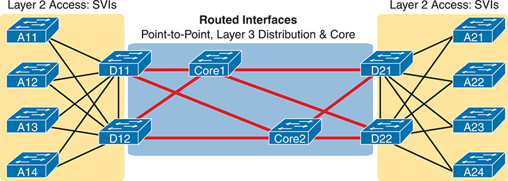

<figcaption>

<strong>图 18-6</strong> <em>在核心层和分布层的三层链路上使用路由接口</em>

<aside class="hidden" id="a18fig06">

在这一设计中，核心交换机 Core1、Core2 和汇聚交换机 D11、D12、D21、D22，利用路由接口和点对点接入执行三层交换。标为 A11、A12、A13、A14、A21、A22、A23、A24 的接入交换机仅使用 SVI 执行二层交换。（译注：原书这段隐藏的无障碍说明与本图不符；本图实际展示 PC1 经 SW1、SW2 向 PC2 发送帧，各条链路均为全双工。）

</aside>

</figcaption>

</figure>

</section>

<section>

<h4 class="h4" id="ch18lev2sec8">实现三层 EtherChannel</h4>

到目前为止，本节指出，两台三层交换机之间，或者三层交换机与路由器之间，可以在单条点到点链路上使用路由接口。然而，在大多数设计中，网络工程师会在每对分布层和核心交换机之间使用至少两条链路，如<a href="#ch18fig07">图 18-7</a> 所示。

<figure class="image-c" id="ch18fig07">

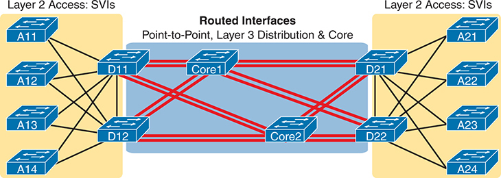

<figcaption>

<strong>图 18-7</strong> <em>每对分布层和核心交换机之间的两条链路</em>

<aside class="hidden" id="a18fig07">

在这一设计中，核心交换机 Core1、Core2 和汇聚交换机 D11、D12、D21、D22，利用路由接口和点对点接入执行三层交换。每台汇聚交换机与核心交换机之间的两条链路十分显眼。标为 A11、A12、A13、A14、A21、A22、A23、A24 的接入交换机仅使用 SVI 执行二层交换。（译注：原书这段隐藏的无障碍说明与本图不符；本图实际展示 Archie 和 Bob 同时向 Hub 1 发送信号，集线器将两路信号转发给 Larry，导致冲突。）

</aside>

</figcaption>

</figure>

虽然分布层和核心层中的每个端口都可以作为单独的路由端口，但将每对并行链路组合成三层 EtherChannel 更好。即使不使用 EtherChannel，仍可以将图中央每台交换机的各端口设为路由端口，这也能工作。然而，一旦启用路由协议却不使用 EtherChannel，每台三层交换机就会学到两条以同一相邻交换机为下一跳的 IP 路由：一条经过一根链路，另一条经过另一根链路。

两台交换机之间存在多条并行链路时，使用三层 EtherChannel 更合理。这样，每对链路就作为一条三层链路工作。因此，每对交换机与邻居只有一个路由协议邻居关系，而不是两个。对于每个目的地，每台交换机经由这对链路学到一条路由，而不是两条。随后 IOS 会分担流量，其均衡效果通常优于使用多条通往同一子网的 IP 路由时的效果。总体而言，三层 EtherChannel 的方式，比让每条链路保持独立路由端口并使用三层负载均衡的方式更好。

与已经学过的内容相比，配置三层 EtherChannel 只需要多做一点工作。<a href="v1-10.html#ch10">第 10 章</a>“<a href="v1-10.html#ch10">RSTP 和 EtherChannel 配置</a>”已介绍如何配置 EtherChannel，本章也已介绍如何将端口设为三层路由端口。接下来，需要将两者结合，同时配置 EtherChannel 和路由端口。以下清单展示操作步骤，假设采用静态方式定义 EtherChannel。

<figure class="figure1">

</figure>

步骤 1。在接口配置模式下，按如下方式配置物理接口：

<ol class="step-lower-alpha">

<li>
添加 <strong>no switchport</strong> 命令，将每个物理端口设为路由端口。
</li>

<li>
添加 <strong>channel-group</strong> <em>number</em> <strong>mode on</strong> 命令，将其加入通道。同一交换机上的所有物理接口使用相同编号，但两台相邻交换机使用的编号（channel-group 编号）可以不同。
</li>

</ol>

步骤 2。配置 PortChannel 接口：

<ol class="step-lower-alpha">

<li>
使用 <strong>interface port-channel</strong> <em>number</em> 命令进入 PortChannel 配置模式，通道编号应与物理接口上配置的相同。
</li>

<li>
添加 <strong>no switchport</strong> 命令，确保 PortChannel 接口作为路由端口工作。（IOS 可能已经添加了该命令。）
</li>

<li>
使用 <strong>ip address</strong> <em>address mask</em> 命令配置地址和掩码。
</li>

</ol>

注意

Cisco 在本节讨论概念时使用 <em>EtherChannel</em> 一词，而在验证和配置 EtherChannel 时使用 <em>PortChannel</em> 一词，命令关键字为 <strong>port-channel</strong>。为了理解技术，可以将这些术语视为同义词。不过，学习本节示例时，仔细留意 <em>PortChannel</em> 和 <em>EtherChannel</em> 的用法会很有帮助，因为 IOS 同时使用两者。

<a href="#exa18_12">例 18-12</a> 展示<a href="#ch18fig08">图 18-8</a> 中交换机 SW1 的三层 EtherChannel 配置示例。该 EtherChannel 定义 PortChannel 接口 12，使用子网 10.1.12.0/24。设计在两台交换机之间使用万兆接口。

<figure class="image-c" id="ch18fig08">

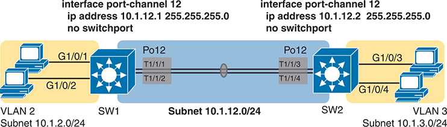

<figcaption>

<strong>图 18-8</strong> <em>EtherChannel 配置示例采用的设计</em>

<aside class="hidden" id="a18fig08">

示意图展示两台三层交换机 SW1 和 SW2，通过端口通道接口 Po12 相连。每台交换机都有特定 IP 地址，子网掩码为 255.255.255.0，且未配置为交换端口（no switchport）。左侧 SW1 的 IP 地址为 10.1.12.1，通过 G1/0/1 和 G1/0/2 接口连接到子网为 10.1.2.0/24 的 VLAN 2。右侧 SW2 的 IP 地址为 10.1.12.2，通过 G1/0/3 和 G1/0/4 接口连接到子网为 10.1.3.0/24 的 VLAN 3。SW1 与 SW2 之间通过各自的 Po12 接口连接。（译注：原书这段隐藏的无障碍说明与本图不符；本图实际展示 SW1、SW2 及其所连 PC 使用全双工，而 SW2 的 F0/2 与集线器、以及集线器与 PC C 之间的连接使用半双工。）

</aside>

</figcaption>

</figure>

<strong>例 18-12</strong> <em>交换机 SW1 上的三层 EtherChannel 配置</em>

<a href="#code-f0475-01" id="f0475-01a">点击此处查看代码原图</a>

<pre class="pre-ex" tabindex="0"><code class="highlight">interface TenGigabit1/1/1
 no switchport
 no ip address
 channel-group 12 mode on
!
interface TenGigabit1/1/2
 no switchport
 no ip address
 channel-group 12 mode on
!
interface Port-channel12
 no switchport
 ip address 10.1.12.1 255.255.255.0</code></pre>

尤其要注意，虽然物理接口和 PortChannel 接口都是路由端口，但 IP 地址应仅配置在 PortChannel 接口上。实际上，在接口上配置 <strong>no switchport</strong> 命令时，IOS 会为该接口添加 <strong>no ip address</strong> 命令。随后只在 PortChannel 接口上配置 IP 地址。

配置完成后，PortChannel 接口会出现在多个命令的输出中，如<a href="#exa18_13">例 18-13</a> 所示。列出 IP 地址和路由的命令会引用 PortChannel 接口。还请注意，<strong>show interfaces status</strong> 命令显示物理端口和 port-channel 12 接口都是路由端口。

<strong>例 18-13</strong> <em>在交换机 SW1 上列出 Port-Channel12 接口的验证命令</em>

<a href="#code-f0475-02" id="f0475-02a">点击此处查看代码原图</a>

<pre class="pre-ex" tabindex="0"><code class="highlight">SW1# <strong>show interfaces port-channel 12</strong>
Port-channel12 is up, line protocol is up (connected)
  Hardware is EtherChannel, address is 4488.165a.f26c (bia 4488.165a.f26c)
  Internet address is 10.1.12.1/24
! lines omitted for brevity

SW1# <strong>show interfaces status</strong>
! Only ports related to the example are shown.
Port        Name            Status       Vlan      Duplex  Speed Type
Te1/1/1                     connected    routed      full    10G SFP-10GBase-SR
Te1/1/2                     connected    routed      full    10G SFP-10GBase-SR
Po12                        connected    routed    a-full    a-10G N/A

SW1# <strong>show ip route</strong>
! legend omitted for brevity
       10.0.0.0/8 is variably subnetted, 4 subnets, 2 masks
C         10.1.2.0/24 is directly connected, Vlan2
L         10.1.2.1/32 is directly connected, Vlan2
C         10.1.12.0/24 is directly connected, Port-channel12
L         10.1.12.1/32 is directly connected, Port-channel12</code></pre>

最后，还可以通过<a href="#exa18_14">例 18-14</a> 所列的 <strong>show etherchannel summary</strong> 命令直接检查 EtherChannel。尤其要注意，它列出标志字符图例，用于标识关键运行状态，例如端口是否已绑定（包含）在 PortChannel 中（P），以及它作为路由端口（R）还是交换端口（S）工作。

<strong>例 18-14</strong> <em>验证 EtherChannel</em>

<a href="#code-f0476-01" id="f0476-01a">点击此处查看代码原图</a>

<pre class="pre-ex" tabindex="0"><code class="highlight">SW1# <strong>show etherchannel 12 summary</strong>
Flags:  D - down        P - bundled in port-channel
        I - stand-alone s - suspended
        H - Hot-standby (LACP only)
        R - Layer3      S - Layer2
        U - in use      f - failed to allocate aggregator

        M - not in use, minimum links not met
        u - unsuitable for bundling
        w - waiting to be aggregated
        d - default port

        A - formed by Auto LAG

Number of channel-groups in use: 1
Number of aggregators:           1

Group  Port-channel  Protocol    Ports
------+-------------+-----------+-----------------------------------------------
12     Po12(RU)         -          Te1/1/1(P)      Te1/1/2(P)</code></pre>

</section>

<section>

<h4 class="h4" id="ch18lev2sec9">三层 EtherChannel 故障排查</h4>

排查三层 EtherChannel 时，主要考虑两个方面。首先，需要查看 <strong>channel-group</strong> 命令的配置，该命令将接口启用为 EtherChannel 成员。其次，应检查一组必须在接口间匹配的设置，以确保三层 EtherChannel 正常工作。

<strong>channel-group</strong> 接口子命令可以静态或动态地启用 EtherChannel。如果采用动态方式，该命令的关键字将指定端口聚合协议（PAgP）或链路聚合控制协议（LACP），由相邻交换机通过该协议协商是否将链路加入 EtherChannel。

如果这些听起来有点熟悉，那是因为它与前面<a href="v1-10.html#ch10">第 10 章</a>“<a href="v1-10.html#ch10lev2sec12">配置动态 EtherChannel</a>”一节介绍的配置完全相同。无论配置二层还是三层 EtherChannel，<strong>channel-group</strong> 子命令的配置及要求都完全一致。因此，现在可能正适合复习<a href="v1-10.html#ch10">第 10 章</a> 的这些 EtherChannel 配置细节。无论何时复习并掌握这些命令，都请记住：无论二层还是三层，EtherChannel 的配置（使用 <strong>channel-group</strong> 子命令）都相同。

此外，要将所有物理端口绑定进 EtherChannel，仅正确配置 <strong>channel-group</strong> 命令还不够。二层 EtherChannel 的要求列表更长，但三层 EtherChannel 在加入端口之前，也需要执行一些端口间一致性检查。以下是三层 EtherChannel 的要求：

<strong>no switchport：</strong>PortChannel 接口及物理接口都必须配置 <strong>no switchport</strong> 命令。如果物理接口没有配置 <strong>no switchport</strong> 命令，它就无法在 EtherChannel 中投入运行。

<strong>速率：</strong>通道中的物理端口必须使用相同速率。

<strong>双工：</strong>通道中的物理端口必须使用相同双工模式。

</section>

</section>

<section>

<h3 class="h3" id="ch18lev1sec6">在路由器的 LAN 交换端口上进行 VLAN 路由</h3>

本章前面的主要部分展示的设计，都是将主机连接到交换机。可能由交换机执行路由，也可能由连接交换机的路由器执行路由，但主机都是通过线缆连接交换机。

最后一个主要部分讨论仅使用一台路由器的设计，具体来说，是硬件包含一组 LAN 交换端口的路由器。实际上，路由器硬件内嵌了一台 LAN 交换机。因此，路由器需要同时实现路由和交换。

包含小型分支机构的设计可以充分利用带内嵌交换端口的路由器。这类站点需要能够通过 WAN 进行路由的路由器，但可能只需要少量 LAN 端口。许多厂商（包括 Cisco）都提供带有少量 LAN 交换端口的路由器产品，以满足此类需求。许多消费级路由器，例如你家用于互联网接入的路由器，也内嵌了少量交换端口。

作为硬件示例，<a href="#ch18fig09">图 18-9</a> 展示 ISR1K 路由器和 Catalyst 8200L 边缘路由器的照片。Cisco 将某些 ISR1K 定位为适合较小站点的企业级路由器，它们包含几个路由端口以及一组<a id="key_210" href="#ref-gloss_399">交换端口</a>。路由端口像本书迄今讨论的路由器端口一样工作，收发 IP 数据包，并需要配置 IP 地址和掩码。交换端口像 LAN 交换机上的端口一样工作，收发以太网帧，由路由器的交换逻辑学习 MAC 地址表项。

<figure class="image-c" id="ch18fig09">

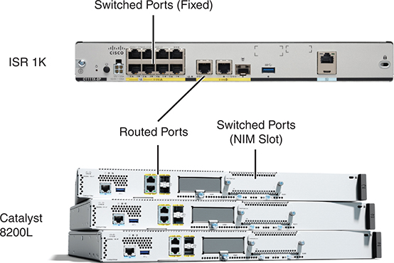

<figcaption>

<strong>图 18-9</strong> <em>Cisco ISR 1000 和 Catalyst 8200L 路由器</em>

<aside class="hidden" id="a18fig09">

上方展示 Cisco ISR 1000 系列集成多业务路由器，带有固定交换端口和路由端口。Cisco Catalyst 8200L 系列边缘平台带有路由端口和交换端口（NIM 插槽）。

</aside>

</figcaption>

</figure>

图下方是三台 Catalyst 8200 边缘平台（路由器）的照片。图中的每个型号都支持四个固定以太网路由端口（两个 RJ-45 端口和两个模块化 SFP 插槽）。网络接口模块（NIM）插槽允许通过模块化 NIM 扩展，包括带四个或八个 LAN 交换端口的 NIM。

<section>

<h4 class="h4" id="ch18lev2sec10">为内嵌交换端口配置路由</h4>

带有交换端口的路由器同时实现路由和交换。为使其工作，在交换端口上配置 LAN 交换命令，在路由接口上配置路由命令。要将这些逻辑连接起来，则使用多层交换机配置中已经熟悉的概念：SVI 接口。

<a href="#ch18fig10">图 18-10</a> 和<a href="#ch18fig11">图 18-11</a> 提供了示例背景。<a href="#ch18fig10">图 18-10</a> 展示分支机构中的路由器 B1，四个交换端口连接若干 PC。设计要求使用两个 VLAN，VLAN ID 和子网与本章前面多个示例相同。该路由器（与<a href="#ch18fig09">图 18-9</a> 所示 ISR1K 型号相同）通过路由端口 G0/0/1 连接 WAN。

<figure class="image-c" id="ch18fig10">

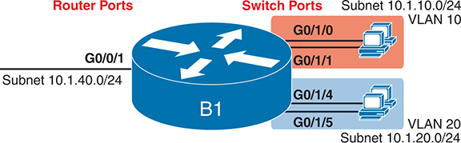

<figcaption>

<strong>图 18-10</strong> <em>具有路由端口和交换端口的路由器的物理视图</em>

<aside class="hidden" id="a18fig10">

路由器 B1 使用子网 10.1.40.0/24 和接口 G0/0/1（路由端口）。路由器有四个物理千兆以太网接口（交换端口）：G0/1/0、G0/1/1、G0/1/4 和 G0/1/5。每个接口都配置了 VLAN 和 IP 子网。G0/1/0 和 G0/1/1 分配到 interface VLAN 10 及子网 10.1.10.0/24；G0/1/4 和 G0/1/5 分配到 interface VLAN 20 及子网 10.1.20.0/24。

</aside>

</figcaption>

</figure>

<a href="#ch18fig11">图 18-11</a> 展示使用 SVI 的内部逻辑：SVI 为路由器 B1 内部的路由进程提供接口，直接连接 VLAN 10 和 20 上的子网。这些概念应该很熟悉，因为内部工作方式与三层交换机相同。

<figure class="image-c" id="ch18fig11">

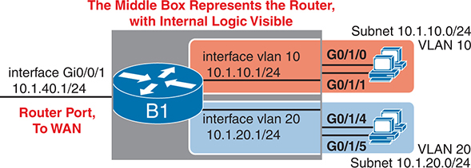

<figcaption>

<strong>图 18-11</strong> <em>具有路由端口和交换端口的路由器的配置视图</em>

<aside class="hidden" id="a18fig11">

路由器 B1 使用子网 10.1.40.1/24 和接口 Gi0/0/1（路由器端口，通往 WAN）。B1 的端口包含子网 10.1.10.1/24 和 10.1.20.1/24，连接四个物理千兆以太网接口：G0/1/0、G0/1/1、G0/1/4 和 G0/1/5。每个接口都配置了 VLAN 和 IP 子网。G0/1/0 和 G0/1/1 分配到 interface VLAN 10 及子网 10.1.10.0/24；G0/1/4 和 G0/1/5 分配到 interface VLAN 20 及子网 10.1.20.0/24。中间方框表示路由器，并展示其内部逻辑。

</aside>

</figcaption>

</figure>

配置步骤包括熟悉的 LAN 交换任务、IP 路由及路由端口任务，以及额外的 SVI 配置任务。为便于回顾，以下配置清单列出从默认配置开始，在三个接口上启用 IP 所需的最少任务，使路由器拥有全部三个子网的直连路由，并能在这些直连子网之间路由数据包。

<figure class="figure1">

</figure>

步骤 1。配置 VLAN，并将接入 VLAN 分配给交换端口。

<ol class="step-lower-alpha">

<li>
在全局配置模式下使用 <strong>vlan</strong> <em>vlan-number</em> 命令创建各 VLAN。
</li>

<li>
在交换接口的接口配置模式下使用 <strong>switchport access vlan</strong> <em>vlan-id</em> 命令，分配正确的接入 VLAN。
</li>

<li>
（根据需要）在接口配置模式下使用 <strong>no shutdown</strong> 命令启用接口。
</li>

</ol>

步骤 2。为交换端口使用的每个 VLAN 配置一个 SVI 接口。

<ol class="step-lower-alpha">

<li>
在全局配置模式下使用 <strong>interface vlan</strong> <em>vlan_id</em> 命令创建 VLAN 接口，编号与 VLAN ID 相同。
</li>

<li>
在 VLAN 接口配置模式下使用 <strong>ip address</strong> <em>address mask</em> 命令，为接口分配 IP 地址和掩码，启用接口上的 IPv4 处理。
</li>

<li>
（根据需要）在接口配置模式下使用 <strong>no shutdown</strong> 命令启用 VLAN 接口。
</li>

</ol>

步骤 3。为所有路由接口配置 IP 地址。

<ol class="step-lower-alpha">

<li>
在接口配置模式下使用 <strong>ip address</strong> <em>address mask</em> 命令，为接口分配 IP 地址和掩码，启用 IPv4 处理。
</li>

<li>
根据需要配置路由协议。
</li>

</ol>

<a href="#exa18_15">例 18-15</a> 展示与<a href="#ch18fig11">图 18-11</a> 对应的配置。配置顶部添加 VLAN 10 和 20，并按图所示将其作为接入 VLAN 分配给端口。<strong>interface vlan</strong> 命令创建 SVI，并为每个 SVI 添加 IP 地址配置。最后一个接口 G0/0/1 是路由端口，采用传统路由器接口配置，包含 <strong>ip address</strong> 命令，但没有 <strong>switchport access</strong> 子命令。

<strong>例 18-15</strong> <em>用于路由进出交换端口 VLAN 流量的 VLAN 接口配置</em>

<a href="#code-f0480-01" id="f0480-01a">点击此处查看代码原图</a>

<pre class="pre-ex" tabindex="0"><code class="highlight"><strong>vlan 10</strong>
<strong>vlan 20</strong>
!
<strong>interface GigabitEthernet0/1/0</strong>
 <strong>switchport access vlan 10</strong>
!
<strong>interface GigabitEthernet0/1/1</strong>
 <strong>switchport access vlan 10</strong>
!
<strong>interface GigabitEthernet0/1/4</strong>
 <strong>switchport access vlan 20</strong>
!
<strong>interface GigabitEthernet0/1/5</strong>
 <strong>switchport access vlan 20</strong>
!
<strong>interface vlan 10</strong>
 <strong>ip address 10.1.10.1 255.255.255.0</strong>
!
<strong>interface vlan 20</strong>
 <strong>ip address 10.1.20.1 255.255.255.0</strong>
!
<strong>interface gigabitEthernet0/0/1</strong>
 <strong>description physical, routed interface</strong>

<strong>ip address 10.1.40.1 255.255.255.0</strong></code></pre>

</section>

<section>

<h4 class="h4" id="ch18lev2sec11">验证内嵌交换端口的路由</h4>

通过上一节的 VLAN 配置，路由器已能像<a href="#ch18fig11">图 18-11</a> 那样在子网之间路由数据包。<a href="#exa18_16">例 18-16</a> 的输出列出两条连接不同 VLAN 接口的路由，以及一条连接路由接口 G0/0/1 的路由。除这些路由之外，路由器还需要通往远程子网的路由，可以采用静态路由或路由协议。

<strong>例 18-16</strong> <em><a href="#exa18_15">例 18-15</a> 中路由器 B1 上的直连路由</em>

<a href="#code-f0480-02" id="f0480-02a">点击此处查看代码原图</a>

<pre class="pre-ex" tabindex="0"><code class="highlight">B1# <strong>show ip route connected</strong>
Codes: L - local, C - connected, S - static, R - RIP, M - mobile, B - BGP
       D - EIGRP, EX - EIGRP external, O - OSPF, IA - OSPF inter area
! Remaining legend omitted for brevity

      10.0.0.0/8 is variably subnetted, 13 subnets, 2 masks
C        10.1.10.0/24 is directly connected, Vlan10
L        10.1.10.1/32 is directly connected, Vlan10
C        10.1.20.0/24 is directly connected, Vlan20
L        10.1.20.1/32 is directly connected, Vlan20
C        10.1.30.0/24 is directly connected, GigabitEthernet0/0/1
L        10.1.30.1/32 is directly connected, GigabitEthernet0/0/1</code></pre>

相关接口达到 up/up 状态时，路由器会加入直连路由。对于 SVI，其状态根据底层 VLAN 及 VLAN 内端口状态的相关规则变化。这些规则的工作方式与本章前面“<a href="#ch18lev2sec6">使用 SVI 的路由故障排查</a>”一节所述相同。

路由器执行 LAN 交换时，遵循本书<a href="v1-04.html#part02">第二部分</a>和<a href="v1-08.html#part03">第三部分</a>介绍的 LAN 交换机惯例。例如，为支持 LAN 交换端口，路由器支持你预期会在 LAN 交换机上找到的相同命令。<a href="#exa18_17">例 18-17</a> 展示在最近几幅图的四个交换端口上学到的 MAC 地址。它确认，G0/1/0 和 G0/1/1 端口上学到的地址属于 VLAN 10，而 G0/1/4 和 G0/1/5 上学到的地址属于 VLAN 20。

<strong>例 18-17</strong> <em>路由器上的 MAC 地址表</em>

<a href="#code-f0481-01" id="f0481-01a">点击此处查看代码原图</a>

<pre class="pre-ex" tabindex="0"><code class="highlight">B1# <strong>show mac address-table dynamic</strong>
          Mac Address Table
-------------------------------------------

Vlan    Mac Address       Type        Ports
----    -----------       --------    -----
  10    0200.aaaa.aaaa    DYNAMIC     Gi0/1/0
  10    0200.bbbb.bbbb    DYNAMIC     Gi0/1/1
  20    0200.cccc.cccc    DYNAMIC     Gi0/1/4
  20    0200.dddd.dddd    DYNAMIC     Gi0/1/5
Total Mac Addresses for this criterion: 4</code></pre>

注意

交换机使用 <strong>show vlan</strong> [<strong>brief</strong>] 命令显示 VLAN 配置。带内嵌交换端口的路由器也有仿照交换机命令的命令：<strong>show vlan-switch</strong> [<strong>brief</strong>]（IOS）和 <strong>show vlan</strong> [<strong>brief</strong>]（IOS XE）。提醒一下，路由器上相似的 <strong>show vlans</strong> 命令列出的不是 VLAN，而是 ROAS 配置。

</section>

<section>

<h4 class="h4" id="ch18lev2sec12">识别路由器中的交换端口</h4>

当查看路由器或使用其 CLI 时，如何知道哪些以太网端口是路由端口，哪些是交换端口？答案可能不容易找到。最后这个简短小节将说明方法。

首先，路由器端口作为路由端口还是交换端口的角色，并不是由你配置的。Cisco 创建的路由器接口固定作为两者之一工作。你可以在 <a href="http://www.cisco.com">www.cisco.com</a> 上研究路由器型号和系列，了解各型号自带的固定端口。相关文档还会说明 NIM 等插卡的模块化选项。

也可以通过 CLI 发现路由器的交换端口，但其规律并不明显。大多数 <strong>show</strong> 命令没有帮助，只有少数有用。需要注意：

<strong>show running-config、show startup-config：</strong>这些命令不会区分路由端口和交换端口。

<strong>show interfaces、show interfaces description、show ip interface brief、show protocols：</strong>这些命令都会列出全部接口，包括路由接口和交换接口，但不会标注各自属于哪一种。

<strong>show interfaces status：</strong>该命令仅列出交换端口。

使用 <strong>show interfaces status</strong> 识别交换端口最为合适。

此外，还可以尝试配置仅受某一种端口支持的命令，来确认哪些是路由端口、哪些是交换端口。例如，路由端口接受 <strong>ip address</strong> <em>address mask</em> 子命令，但拒绝 <strong>switchport access vlan</strong> <em>vlan-id</em> 子命令。交换端口则相反。

<a href="#exa18_18">例 18-18</a> 使用前面示例中的路由器 B1，展示几种识别路由端口和交换端口的情况。首先，<strong>show interfaces status</strong> 命令输出仅显示交换端口 G0/1/0–G0/1/7。请注意，输出遵循 LAN 交换机的格式，标明分配给每个接口的接入 VLAN。随后，输出展示交换端口拒绝 <strong>ip address</strong> 接口子命令的情况。

<strong>例 18-18</strong> <em>显示交换接口并省略路由接口</em>

<a href="#code-f0482-01" id="f0482-01a">点击此处查看代码原图</a>

<pre class="pre-ex" tabindex="0"><code class="highlight">B1# <strong>show interfaces status</strong>

Port         Name            Status       Vlan       Duplex  Speed Type
Gi0/1/0                      connected    10         a-full a-1000 10/100/1000BaseTX
Gi0/1/1                      connected    10         a-full a-1000 10/100/1000BaseTX
Gi0/1/2                      notconnect   1            auto   auto 10/100/1000BaseTX
Gi0/1/3                      notconnect   1            auto   auto 10/100/1000BaseTX
Gi0/1/4                      connected    20         a-full a-1000 10/100/1000BaseTX
Gi0/1/5                      connected    20         a-full a-1000 10/100/1000BaseTX
Gi0/1/6                      notconnect   1            auto   auto 10/100/1000BaseTX
Gi0/1/7                      notconnect   1            auto   auto 10/100/1000BaseTX
B1# <strong>configure terminal</strong>
Enter configuration commands, one per line.  End with CNTL/Z.
B1(config)# <strong>interface g0/1/7</strong>
B1(config-if)# <strong>ip address 10.1.90.1 255.255.255.0</strong>
               ^
% Invalid input detected at '^' marker.
B1(config-if)#</code></pre>

</section>

</section>

</section>

<section class="ccna-source ccna-appendix" aria-label="答案解析与术语表">
<section data-epub-type="chapter">

<h2 class="h2" id="ref-appc">附录 C</h2>

<h2 class="h2a">自测题答案</h2>

<section>

<h3 class="h3" id="ref-appclev1sec18">第 18 章</h3>

<strong><a id="ref-ques18_1" href="#quess18_1">1</a>．</strong> A 和 F。所有列出的命令中，只有这两个正确答案是语法正确的路由器配置命令。启用 802.1Q 中继的命令是 <strong>encapsulation dot1q</strong> <em>vlan_id</em>。

<strong><a id="ref-ques18_2" href="#quess18_2">2</a>．</strong> B 和 C。由于在子接口 G0/1.1 上执行了 <strong>shutdown</strong> 命令，它必须处于 administratively down 状态。对于子接口 G0/1.2，由于执行了 <strong>no shutdown</strong> 命令，其状态不可能是 administratively down。G0/1.2 的状态随后会跟随底层物理接口。由于物理接口处于 down/down 状态，本例中的子接口 G0/1.2 也将处于 down/down 状态。

<strong><a id="ref-ques18_3" href="#quess18_3">3</a>．</strong> C。三层交换机路由功能的配置使用 VLAN 接口。VLAN 接口编号必须与关联的 VLAN ID 一致，因此使用 VLAN 1、2 和 3 时，交换机会配置 <strong>interface vlan 1</strong>、<strong>interface vlan 2</strong>（正确答案）和 <strong>interface vlan 3</strong>。对应直连路由与所有直连 IP 路由一样，将列出 VLAN 接口。

对于错误答案，直连路由列表不会列出任何下一跳 IP 地址。每条路由都会列出出接口；由于题目说明配置使用 SVI，所以出接口不会是物理接口，而是 VLAN 接口。最后，所有列出的子网都采用 /25 掩码，即 255.255.255.128，因此没有任何路由会列出 255.255.255.0 掩码。

<strong><a id="ref-ques18_4" href="#quess18_4">4</a>．</strong> C 和 D。首先解释正确答案：除非 VLAN 接口处于 up/up 状态，否则三层交换机不会在其上路由数据包。使用 autostate 时，只有当匹配的 VLAN（相同 VLAN 编号）存在于交换机上、未被关闭，而且至少有一个端口在该 VLAN 中处于启用和活动状态，VLAN 接口才会为 up/up。一个正确答案是，如果执行 <strong>no vlan 2</strong> 命令删除 VLAN 2，交换机会将 VLAN 2 接口置于 up/down 状态，使其无法继续路由数据包。另一个正确答案是，在 VLAN 配置模式下使用 <strong>shutdown</strong> 命令禁用 VLAN 2，也会产生相同结果。

对于错误答案，使用 autostate 时，三层交换机只需要一个为 VLAN 转发的接入端口或中继端口，就能为该 VLAN 启用路由。因此，VLAN 2 的十个接入端口中即使有九个故障，只剩一个正常端口，交换机仍会继续为 VLAN 2 路由。

对 VLAN 4 执行 <strong>shutdown</strong> 不会影响 VLAN 接口 2 和 3 的路由。如果该答案列出的是 VLAN 2 或 3，就会构成使该 VLAN 接口路由失败的原因。

<strong><a id="ref-ques18_5" href="#quess18_5">5</a>．</strong> A 和 C。对于三层 EtherChannel，物理端口和 PortChannel 接口必须通过配置 <strong>no switchport</strong> 接口子命令，禁用交换端口行为，从而作为路由端口工作。（<strong>routedport</strong> 不是 IOS 命令。）创建之后，物理接口不应配置 IP 地址，应在代表 EtherChannel 的 PortChannel 接口上配置 IP 地址。

<strong><a id="ref-ques18_6" href="#quess18_6">6</a>．</strong> B 和 C。对于三层 EtherChannel，所有物理端口上必须有两项配置相同，即通过 <strong>speed</strong> 和 <strong>duplex</strong> 命令设置的速率及双工。此外，物理端口和 PortChannel 端口都必须配置 <strong>no switchport</strong> 命令，使各自作为路由端口工作。因此，不同的速率设置，或配置了 <strong>switchport</strong> 而非 <strong>no switchport</strong>，都会阻止 IOS 将 G0/2 接口加入三层 EtherChannel。

对于错误答案，两者都会在将端口加入二层 EtherChannel 时导致问题，但不会对三层 EtherChannel 造成问题。通过 <strong>no switchport</strong> 命令禁用二层操作后，这些设置就不会再影响三层 EtherChannel。因此，接入 VLAN、中继允许列表和 STP 等二层设置，虽然在接口加入二层 EtherChannel 前必须匹配，但对三层 EtherChannel 并不重要。

<strong><a id="ref-ques18_7" href="#quess18_7">7</a>．</strong> A。在同时拥有路由端口和交换端口的路由器上，IOS 仅在交换端口上支持 LAN 交换子命令。因此，在某个路由器交换接口的接口配置模式下，IOS 接受 <strong>switchport access</strong> 命令，但不接受 <strong>ip address</strong> 命令。路由器在交换端口和路由端口上都支持 <strong>description</strong> 子命令，因此该答案不正确。最后，一个答案列出全局命令 <strong>hostname</strong>，而题目询问接口子命令，因此也不正确。

</section>

</section>

<section id="ref-glossary"><h2 class="h2a">术语表</h2>
<strong>三层 EtherChannel（L3 EtherChannel）</strong> 作为路由端口（而非交换端口）工作的 EtherChannel，由交换机的三层转发逻辑使用。因此，三层交换机会在 IP 路由表的各种路由中列出三层 EtherChannel，并在其中各端口之间分担流量。

<strong>三层交换机（Layer 3 switch）</strong> <em>参见</em><a href="#ref-gloss_261">多层交换机</a>。

<strong>多层交换机（multilayer switch）</strong> 同时能够执行三层路由功能的 LAN 交换机。这个名称源于该设备会根据多个 OSI 层（二层和三层）的逻辑作出转发决策。

<strong>路由端口（routed port）</strong> 指路由器接口上的默认逻辑，例如从入站二层帧中解封装三层数据包，并将数据包交给设备的三层转发逻辑。

<strong>单臂路由（Router-on-a-Stick，ROAS）</strong> 指 Cisco 路由器在以太网接口上使用 VLAN 中继的功能的术语。这使路由器能够路由从该中继进入、又从同一中继离开但属于不同 VLAN 的数据包。

<strong>子接口（subinterface）</strong> 单个物理接口上的虚拟接口之一。

<strong>交换端口（switched port）</strong> 指二层交换端口上的默认逻辑，例如学习收到帧的源 MAC 地址，并将入站帧交给设备的二层转发逻辑。

<strong>交换虚拟接口（switched virtual interface，SVI）</strong> Cisco 交换机上任何 VLAN 接口的另一个名称。<em>另请参阅</em> <a href="#ref-gloss_434">VLAN 接口</a>。

<strong>VLAN 接口（VLAN interface）</strong> Cisco 交换机内部的一种配置概念，作为交换机上运行的 IOS 与交换机内部支持的某个 VLAN 之间的接口，使交换机可以分配 IP 地址，并向该 VLAN 发送 IP 分组。

</section>
</section>

<section class="ccna-source ccna-appendix" aria-label="代码原图">
<section data-epub-type="chapter">

<a href="#f0459-01a" id="code-f0459-01">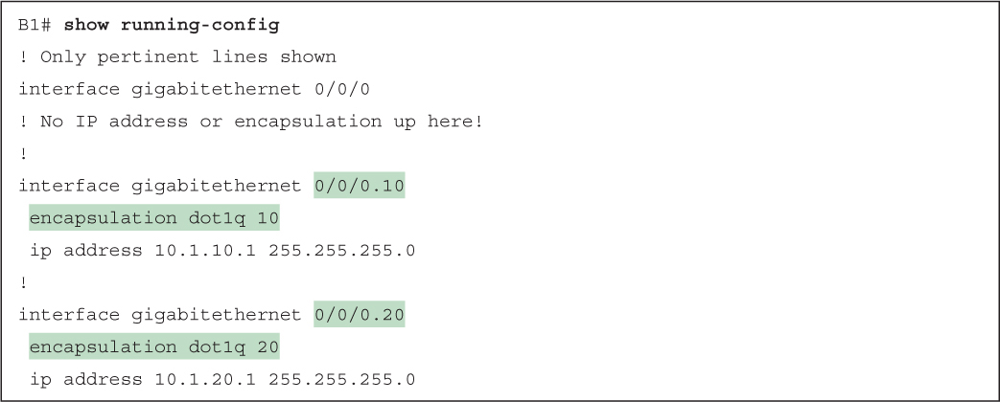</a>

<a href="#f0460-01a" id="code-f0460-01">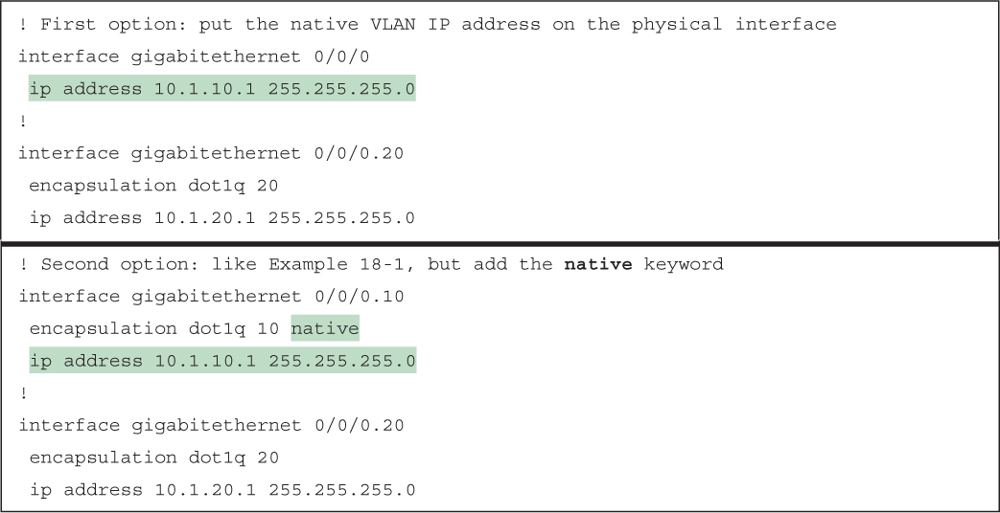</a>

<a href="#f0461-01a" id="code-f0461-01">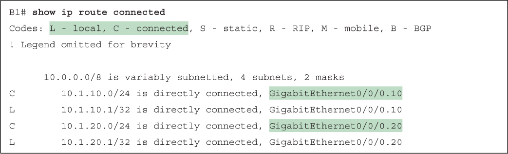</a>

<a href="#f0461-02a" id="code-f0461-02">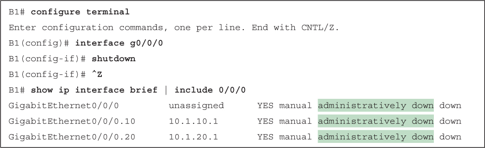</a>

<a href="#f0462-01a" id="code-f0462-01">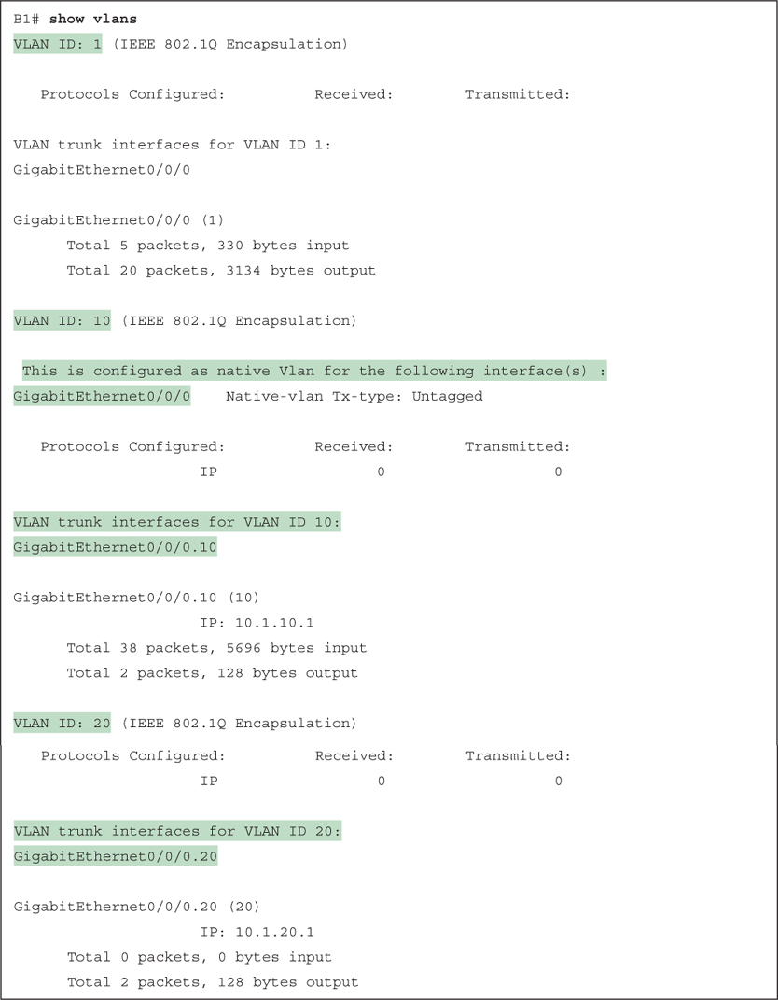</a>

<a href="#f0466-01a" id="code-f0466-01">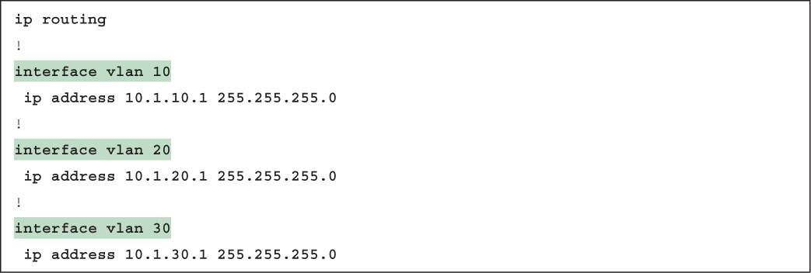</a>

<a href="#f0466-02a" id="code-f0466-02">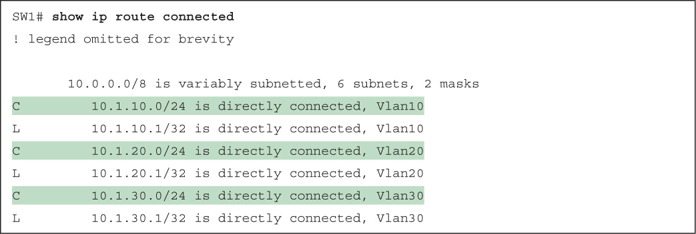</a>

<a href="#f0468-01a" id="code-f0468-01">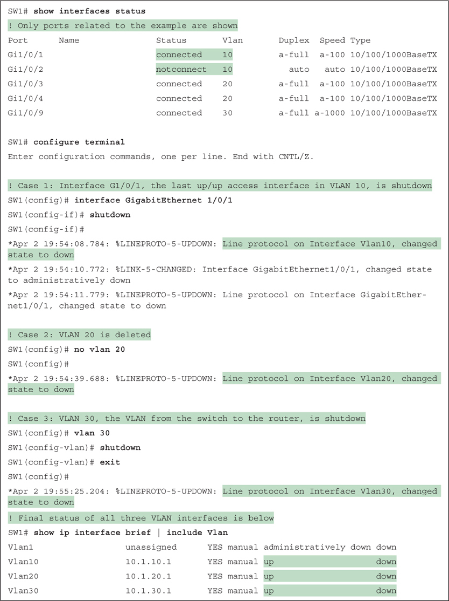</a>

<a href="#f0469-01a" id="code-f0469-01">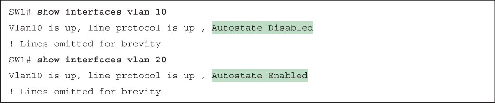</a>

<a href="#f0471-01a" id="code-f0471-01">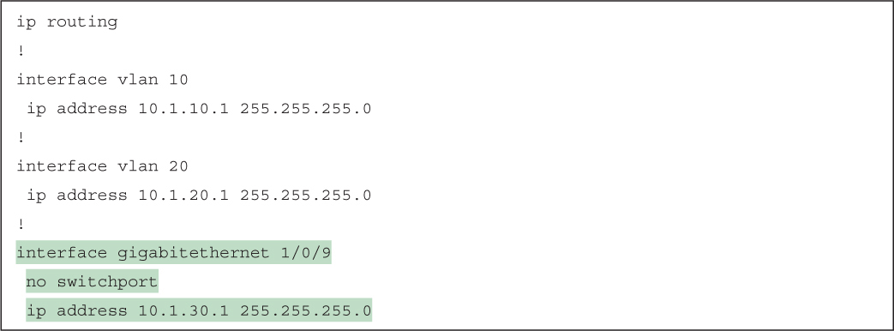</a>

<a href="#f0472-01a" id="code-f0472-01">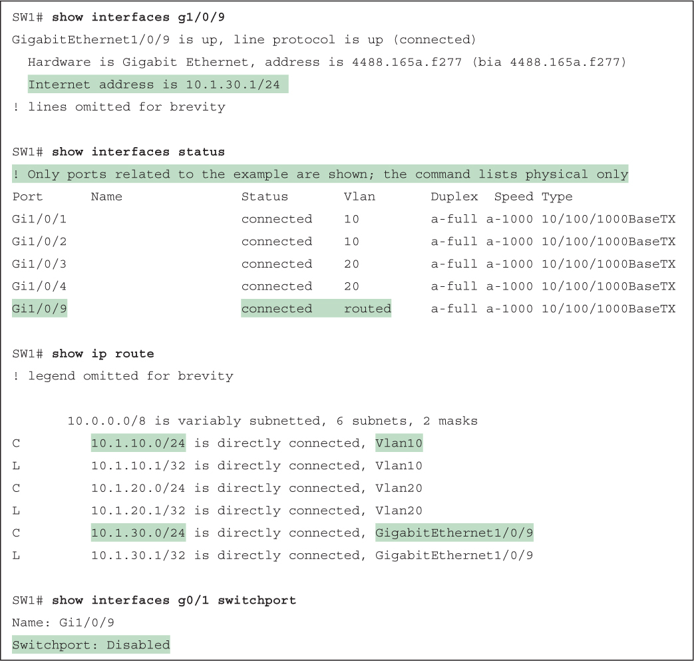</a>

<a href="#f0475-01a" id="code-f0475-01">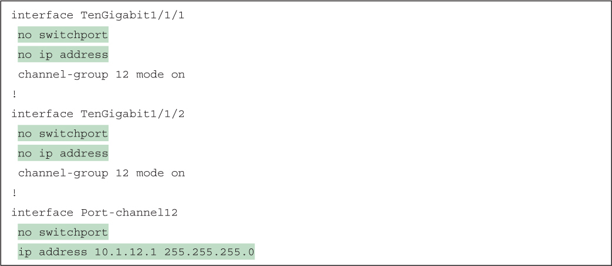</a>

<a href="#f0475-02a" id="code-f0475-02">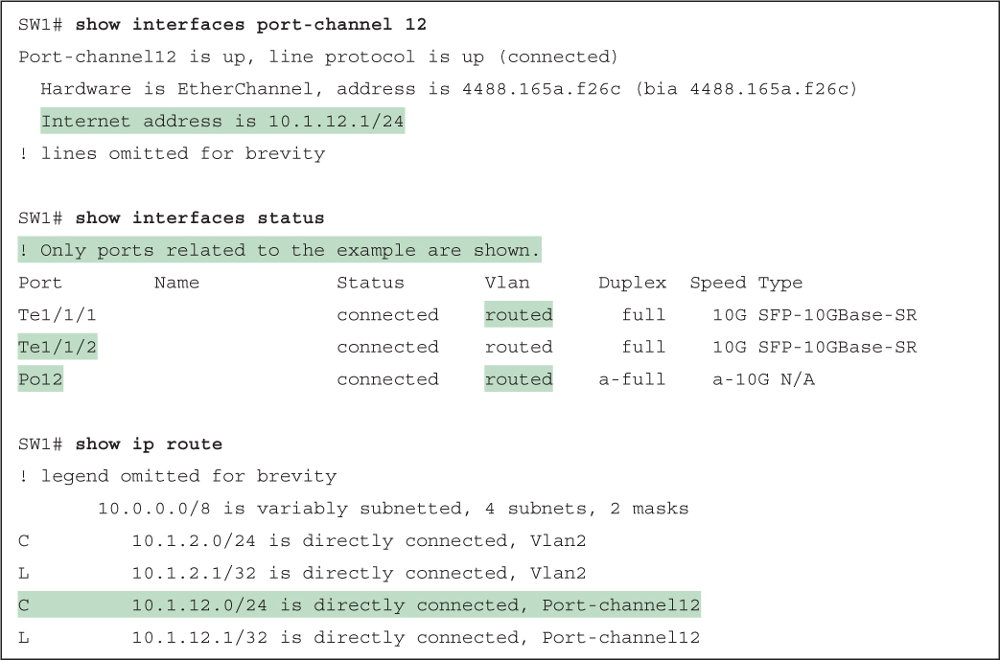</a>

<a href="#f0476-01a" id="code-f0476-01">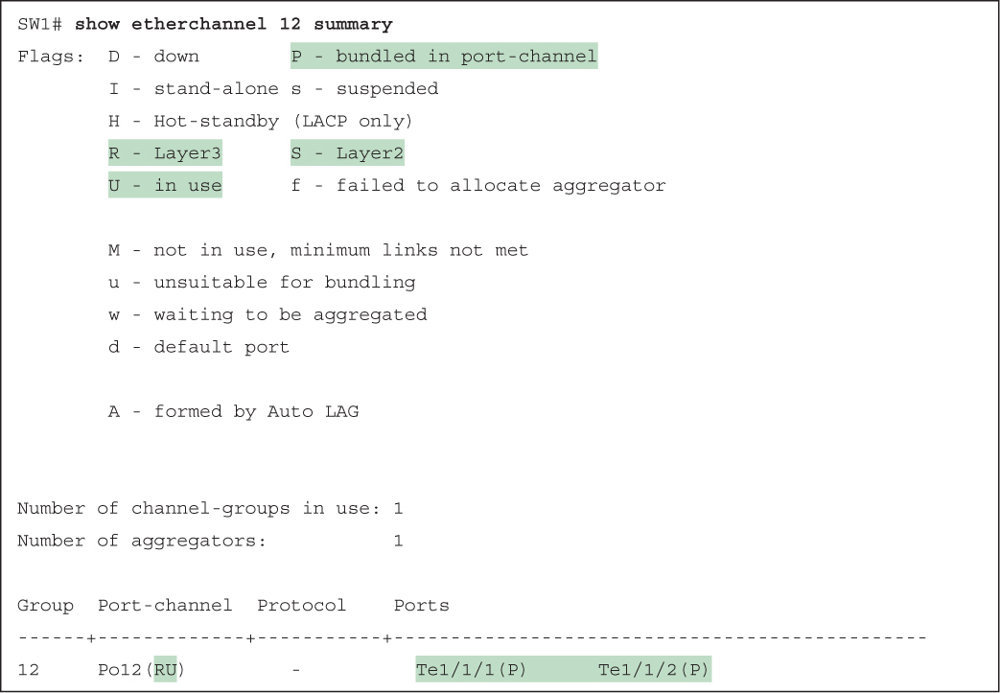</a>

<a href="#f0480-01a" id="code-f0480-01">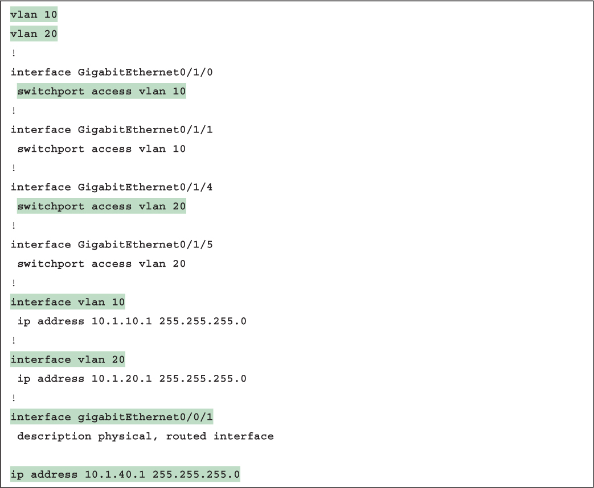</a>

<a href="#f0480-02a" id="code-f0480-02">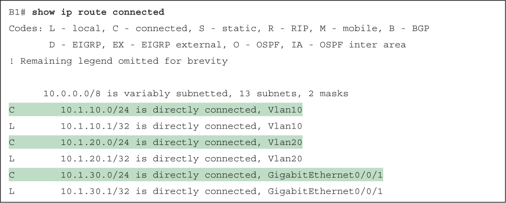</a>

<a href="#f0481-01a" id="code-f0481-01">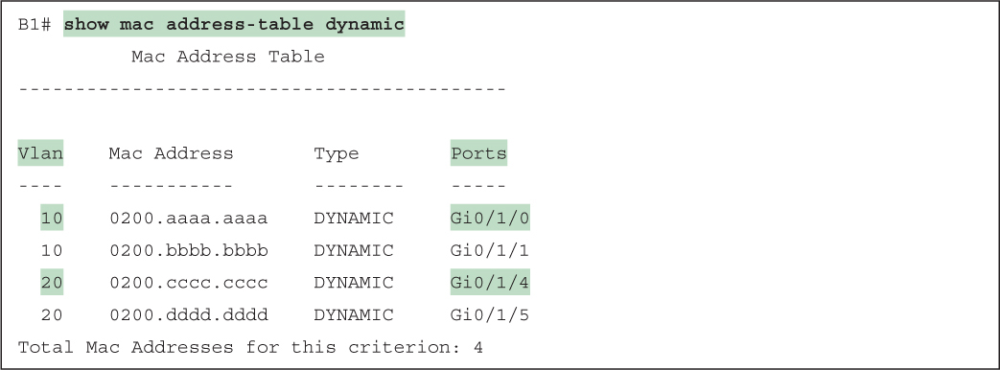</a>

<a href="#f0482-01a" id="code-f0482-01">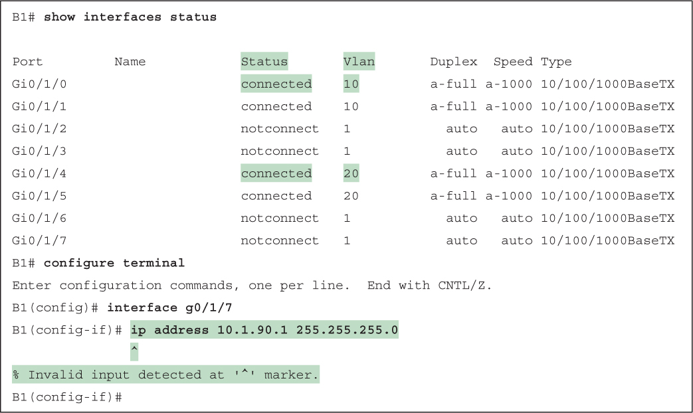</a>

</section>

</section>


<nav class="ccna-chapter-nav" aria-label="章节导航"><a href="v1-17.html">← 上一章</a><a href="v1-19.html">下一章 →</a></nav>
