
<a href="{{ '/subjects/CCNA/' | relative_url }}">← 返回 CCNA 目录</a>

第一卷 · IPv4 路由

<nav class="ccna-chapter-nav" aria-label="章节导航"><a href="v1-18.html">← 上一章</a><a href="v1-20.html">下一章 →</a></nav>



<section data-epub-type="chapter">

<h2 class="h2" id="ch19">第 19 章</h2>

<h2 class="h2a">主机上的 IP 编址</h2>

本章涵盖以下考试主题：

1.0 网络基础

1.10 验证客户端操作系统（Windows、Mac OS、Linux）的 IP 参数

4.0 IP 服务

4.3 解释 DHCP 和 DNS 在网络中的作用

4.6 配置与验证 DHCP 客户端和中继

在 TCP/IP 的世界中，<em>主机</em>一词指任何具有 IP 地址的设备：手机、平板电脑、PC、服务器、路由器、交换机——任何使用 IP 提供服务，或只需 IP 地址进行管理的设备。<em>主机</em>这一术语还包括一些不那么显而易见的设备：商场里的电子广告视频屏、采用与手机相同技术上传用电信息以供计费的电表，以及你的新汽车。

无论属于哪种主机，任何使用 IPv4 的主机都需要四项 IPv4 设置才能正常工作：

<ul class="sq">

<li>
IP 地址
</li>

<li>
子网掩码
</li>

<li>
默认路由器
</li>

<li>
DNS 服务器 IP 地址
</li>

</ul>

本章讨论主机上的这些基本 IP 设置。首先介绍主机如何使用动态主机配置协议（DHCP）动态学习这四项设置。本章后半部分展示如何查找主机上的设置，以及显示设置时需要关注的关键信息。

<section>

<h3 class="h3" id="ch19lev1sec1">“这些知识我已经掌握了吗？”自测</h3>

如果你希望根据得分决定在本章投入多少时间，可以完成这组自测题（在此作答，或使用 PTP 软件）。各题答案的选项字母列在自测题之后的页面底部。书末和配套网站上的<a href="#ref-appc">附录 C</a>都包含答案及解析。你也可以在 PTP 测试软件中找到答案及解析。

<figure class="table" id="ch19tab01" tabindex="0">

<figcaption>

<strong>表 19-1</strong> “这些知识我已经掌握了吗？”基础主题小节与题目对应关系

</figcaption>

<table class="all">

<thead>

<tr>

<th class="th">
基础知识小节
</th>

<th class="th">
题目
</th>

</tr>

</thead>

<tbody>

<tr>

<td class="border">
动态主机配置协议
</td>

<td class="border">
1–4
</td>

</tr>

<tr>

<td class="border">
识别主机 IPv4 设置
</td>

<td class="border">
5, 6
</td>

</tr>

</tbody>

</table>

</figure>

<strong><a id="quess19_1" href="#ques19_1a">1</a>．</strong>一台 PC 连接 LAN，并首次使用 DHCP 租用 IP 地址。在 PC 和 DHCP 服务器之间通常交换的四种 DHCP 消息中，哪些<code>由</code>客户端发送？（选择两个答案。）

<ol class="lower-alpha">

<li>
确认（Acknowledgment）
</li>

<li>
发现（Discover）
</li>

<li>
提供（Offer）
</li>

<li>
请求（Request）
</li>

</ol>

<strong><a id="quess19_2" href="#ques19_2a">2</a>．</strong>以下哪些信息属于 DHCP 服务器配置的一部分？（选择两个答案。）

<ol class="lower-alpha">

<li>
服务器应在各子网中出租的 IP 地址范围
</li>

<li>
各子网中不应出租的 IP 地址范围
</li>

<li>
DNS 服务器主机名
</li>

<li>
每个子网中默认路由器的 IP 地址和 MAC 地址
</li>

</ol>

<strong><a id="quess19_3" href="#ques19_3a">3</a>．</strong>哪些答案列出了选择应将哪些路由器接口配置为 DHCP 中继代理的标准？（选择两个答案。）

<ol class="lower-alpha">

<li>
接口所连子网中没有 DHCP 服务器
</li>

<li>
接口所连子网中有 DHCP 服务器
</li>

<li>
接口所连子网中有 DHCP 客户端
</li>

<li>
路由器接口已经配置了 <strong>ip address dhcp</strong> 命令
</li>

</ol>

<strong><a id="quess19_4" href="#ques19_4a">4</a>．</strong>路由器使用 G0/0/0 接口连接互联网服务提供商（ISP），并配置了 <strong>ip address dhcp</strong> 命令。路由器如何处理通过 DHCP 学到的默认网关信息？

<ol class="lower-alpha">

<li>
路由器忽略从 DHCP 服务器学到的默认网关值。
</li>

<li>
路由器像主机一样使用默认网关，并忽略路由表。
</li>

<li>
路由器根据路由表转发收到的数据包，但使用默认网关设置转发自身生成的数据包。
</li>

<li>
路由器根据默认网关信息向 IP 路由表加入一条默认路由。
</li>

</ol>

<strong><a id="quess19_5" href="#ques19_5a">5</a>．</strong>在以下 Mac 命令输出摘录中，哪些部分代表从 DHCP 服务器学到的信息？（选择两个答案。）

<a href="#code-f0487-01" id="f0487-01a">点击此处查看代码原图</a>

<pre class="pre-q" tabindex="0"><code>Macprompt$ <strong>ifconfig en0</strong>

En1: flags=8863&lt;UP,BROADCAST,SMART,RUNNING,SIMPLEX,MULTICAST&gt; mtu 1500

        options=10b&lt;RXCSUM,TXCSUM,VLAN_HWTAGGING,AV&gt;

        ether 00:6d:e7:b1:9a:11

        inet 172.16.4.2 netmask 0xffffff00 broadcast 172.16.4.255</code></pre>

<ol class="lower-alpha">

<li>
00:6d:e7:b1:9a:11
</li>

<li>
172.16.4.2
</li>

<li>
0xffffff00
</li>

<li>
172.16.4.255
</li>

</ol>

<strong><a id="quess19_6" href="#ques19_6a">6</a>．</strong>在 Windows 操作系统上，以下哪个命令应同时列出通过 DHCP 学到的主机 IP 地址和 DNS 服务器 IP 地址？

<ol class="lower-alpha">

<li>
<strong>ifconfig</strong>
</li>

<li>
<strong>ipconfig</strong>
</li>

<li>
<strong>ifconfig /all</strong>
</li>

<li>
<strong>ipconfig /all</strong>
</li>

</ol>

“这些知识我已经掌握了吗？”自测答案：

<strong><a id="ques19_1a" href="#ref-ques19_1">1</a></strong> B, D

<strong><a id="ques19_2a" href="#ref-ques19_2">2</a></strong> A, B

<strong><a id="ques19_3a" href="#ref-ques19_3">3</a></strong> A、C

<strong><a id="ques19_4a" href="#ref-ques19_4">4</a></strong> D

<strong><a id="ques19_5a" href="#ref-ques19_5">5</a></strong> B、C

<strong><a id="ques19_6a" href="#ref-ques19_6">6</a></strong> D

</section>

<section>

<h3 class="h3box" id="ch19lev1sec2">基础知识</h3>

</section>

<section>

<h3 class="h3" id="ch19lev1sec3">动态主机配置协议</h3>

动态主机配置协议（DHCP）提供 TCP/IP 网络中最常用的服务之一。TCP/IP 网络中的绝大多数主机都是用户设备，而绝大多数用户设备通过 DHCP 学习 IPv4 设置。

与手动配置 IPv4 设置相比，使用 DHCP 有若干优势。主机 IP 设置的配置保存在 DHCP 服务器中，每个客户端通过 DHCP 消息学习这些设置。因此，主机 IP 配置由 IT 人员集中控制，而不是在每台主机上本地配置，从而减少用户错误。DHCP 允许永久分配主机地址，但更常见的方式是临时租用 IP 地址。通过这些租约，<a id="key_217" href="#ref-gloss_099">DHCP 服务器</a>可以在设备离开网络后回收 IP 地址，更充分地利用可用地址。

DHCP 还支持移动性。例如，用户每次带着平板电脑移动到新位置——咖啡店、客户现场或返回办公室——设备都可以连接另一个无线 LAN，使用 DHCP 租用该 LAN 中的新 IP 地址，然后开始在新网络中工作。如果没有 DHCP，用户就必须询问本地网络的信息，并手动配置设置，而且会有不少用户出错。

虽然 DHCP 对用户主机自动工作，但它需要网络事先做些准备，并在路由器上配置一些内容。在某些企业网络中，这种路由器配置可能是在许多 LAN 接口上各配置一条命令（<strong>ip helper-address</strong> <em>server-ip</em>），通过 IP 地址标识 DHCP 服务器。在其他情况下，路由器自身充当 DHCP 服务器。无论如何，路由器都要发挥某种作用。

本章第一个主要部分概览 DHCP，包括相关概念，以及使路由器能够与独立 DHCP 服务器协同工作的路由器配置。

<section>

<h4 class="h4" id="ch19lev2sec1">DHCP 概念</h4>

请停下来想一想 DHCP 对主机计算机的作用。主机充当 <a id="key_215" href="#ref-gloss_097">DHCP 客户端</a>。作为 DHCP 客户端，主机最初没有任何 IPv4 设置：没有 IPv4 地址、掩码、默认路由器，也没有 <a id="key_218" href="#ref-gloss_111">DNS 服务器</a> IP 地址。但 DHCP 客户端确实了解 DHCP 协议，因此可以使用该协议来（a）发现 DHCP 服务器，以及（b）请求租用 IPv4 地址。

DHCP 在客户端与服务器之间使用以下四种消息。（为便于记忆，请注意它们的首字母组成 DORA。）

<strong>Discover（发现）：</strong>由 DHCP 客户端发送，以寻找愿意提供服务的 DHCP 服务器

<strong>Offer（提供）：</strong>由 DHCP 服务器发送，提议向该客户端出租特定 IP 地址，并告知其他参数

<strong>Request（请求）：</strong>由 DHCP 客户端发送，请求服务器出租 Offer 消息中列出的 IPv4 地址

<strong>Acknowledgment（确认）：</strong>由 DHCP 服务器发送，用于分配地址，并列出掩码、默认路由器和 DNS 服务器 IP 地址

然而，DHCP 客户端面临一个比较特殊的问题：尚未拥有 IP 地址，却需要在 IP 数据包内发送这些 DHCP 消息。为实现这一点，DHCP 消息使用两个特殊的 IPv4 地址，使没有 IP 地址的主机仍能在本地子网上收发消息：

<strong>0.0.0.0：</strong>保留给尚未拥有 IP 地址的主机用作源 IPv4 地址的地址。

<strong>255.255.255.255：</strong>本地广播 IP 地址。发往该目的地址的数据包会在本地数据链路上广播，但路由器不会转发它们。

为展示这些地址的工作方式，<a href="#ch19fig01">图 19-1</a> 举例说明同一 LAN 上主机 A 与 DHCP 服务器之间使用的 IP 地址。主机 A 作为客户端发送 Discover 消息，源 IP 地址为 0.0.0.0，因为它还没有可用的 IP 地址。主机 A 将数据包发往目的地址 255.255.255.255，并放在 LAN 广播帧中发送，到达子网内所有主机。客户端希望本地子网上有 DHCP 服务器。为什么？因为发往 255.255.255.255 的数据包只会到达本地子网的主机，路由器 R1 不会转发该数据包。

注意

<a href="#ch19fig01">图 19-1</a> 展示 DHCP 请求可使用地址的一个示例。此例假设 DHCP 客户端选择使用名为<em>广播标志</em>的 DHCP 选项；本书所有示例都假设使用广播标志。

<figure class="image-c" id="ch19fig01">

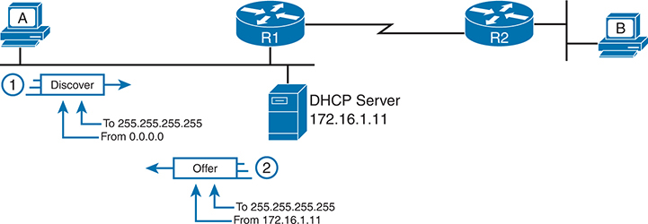

<figcaption>

<strong>图 19-1</strong> <em>DHCP Discover 和 Offer</em>

<aside class="hidden" id="a19fig01">

主机 A 通过从未指定地址 0.0.0.0 向广播地址 255.255.255.255 发送 Discover 消息，发起 DHCP 过程。IP 地址为 172.16.1.11 的 DHCP 服务器收到 Discover 消息后，从 172.16.1.11 向广播地址 255.255.255.255 发送 Offer 消息作为响应。R1 帮助将主机 A 的 Discover 消息在网络中传播，直到它经由 R2 到达主机 B。

</aside>

</figcaption>

</figure>

现在看 DHCP 服务器返回的 Offer 消息。服务器再次将目的 IP 地址设为 255.255.255.255。为什么？主机 A 仍没有 IP 地址，所以服务器无法直接向它发送数据包。因此，服务器将数据包发往代表“子网中所有本地主机”的地址 255.255.255.255。（数据包也封装在以太网广播帧中。）

请注意，子网中的所有主机都会收到 Offer 消息。不过，最初的 Discover 消息列出一个名为客户端 ID 的编号，其中包含主机的 MAC 地址，用来标识最初的主机（本例为主机 A）。因此，主机 A 知道 Offer 消息是发给自己的。其他主机也会收到 Offer 消息，但注意到其中列出的是另一台设备的 DHCP 客户端 ID，因此忽略该消息。

<section>

<h5 class="h5" id="ch19lev3sec1">APIPA IP 地址（169.254.x.x）</h5>

如果 DHCP 客户端的 DHCP 过程失败，主机有一种默认方式自行分配 IP 地址，使用的功能称为自动私有 IP 编址（<a id="key_213" href="#ref-gloss_023">APIPA</a>）。当 DHCP 过程失败时，DHCP 客户端从 169.254.0.0 B 类网络的一个子集中自行分配 APIPA IP 地址，并使用默认掩码 255.255.0.0。

使用 APIPA 地址并不能让设备像普通主机一样工作。例如，主机不知道默认路由器，也不会学到 DNS 服务器列表。它只能向同一 LAN 上的其他 APIPA 主机发送数据包。

APIPA 过程如下：

<ol class="number">

<li>
客户端从网络 169.254.0.0 中选择任意 IP 地址（实际地址范围：169.54.1.0–169.254.254.255）。
</li>

<li>
DHCP 客户端通过 ARP 执行重复地址检测（DAD），发现同一链路上是否已有其他主机使用所选的 APIPA 地址。如果已有主机使用相同地址，客户端就停止使用该地址，并选择另一个。
</li>

<li>
客户端只能在本地网络上收发数据包。
</li>

</ol>

</section>

<section>

<h5 class="h5" id="ch19lev3sec2">通过 DHCP 中继支持远程子网的 DHCP</h5>

网络工程师在 DHCP 方面有一个重要设计选择：在每个 LAN 子网中放置 DHCP 服务器，还是将 DHCP 服务器集中在中心站点？这是一个合理的问题。Cisco 路由器可以充当 DHCP 服务器，因此分布式设计可以使用每个站点的路由器作为 DHCP 服务器。如果像<a href="#ch19fig01">图 19-1</a> 那样，每个子网中都有 DHCP 服务器，协议消息流就保持在各自 LAN 内。

不过，集中式 DHCP 服务器方案也有优势。实际上，一些 Cisco 设计文档将集中式设计建议为最佳实践，部分原因是它允许集中控制和配置整个企业中分配的所有 IPv4 地址。

使用集中式 DHCP 服务器时，<a href="#ch19fig01">图 19-1</a> 中原本只在本地子网内流动的 DHCP 消息，需要以某种方式通过 IP 网络到达集中式 DHCP 服务器并返回。为实现这一点，连接远程 LAN 子网的路由器需要配置接口子命令 <strong>ip helper-address</strong> <em>server-ip</em>。

<strong>ip helper-address</strong> <em>server-ip</em> 子命令指示路由器，对从接口进入的 DHCP 客户端消息执行以下操作：

<ol class="number">

<li>
留意目的 IP 地址为 255.255.255.255 的入站 DHCP 消息。
</li>

<li>
将该数据包的源 IP 地址更改为路由器入接口的 IP 地址。
</li>

<li>
将该数据包的目的 IP 地址更改为 DHCP 服务器地址（即 <strong>ip helper-address</strong> 命令中配置的地址）。
</li>

<li>
将数据包路由到 DHCP 服务器。
</li>

</ol>

该命令通过更改目的 IP 地址，绕过“不路由发往 255.255.255.255 的本地子网广播数据包”这一规则。一旦目的地址设为 DHCP 服务器的 IP 地址，网络就能将数据包路由到服务器。

注意

路由器通过更改数据包首部中的 IP 地址来中继 DHCP 消息的功能，称为 <em>DHCP 中继</em>。

<a href="#ch19fig02">图 19-2</a> 展示该过程的示例。主机 A 位于左侧，作为 DHCP 客户端；DHCP 服务器（172.16.2.11）位于右侧。R1 在 G0/0 接口下配置了 <strong>ip helper-address 172.16.2.11</strong> 命令。在步骤 1，路由器 R1 发现目的地址为 255.255.255.255 的入站 DHCP 数据包。步骤 2 展示更改源和目的 IP 地址后的结果，并由 R1 路由该数据包。

<figure class="image-c" id="ch19fig02">

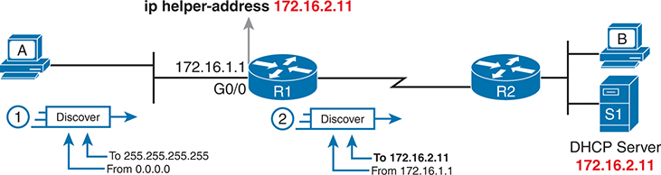

<figcaption>

<strong>图 19-2</strong> <em>IP 辅助地址的作用</em>

<aside class="hidden" id="a19fig02">

主机 A 通过发送 Discover 消息发起 DHCP 过程，该消息从源地址 0.0.0.0 发往目的地址 255.255.255.255，在网络中广播。路由器 R1 在 G0/0 接口收到该广播，该接口的 IP 地址为 172.16.1.1（ip helper-address 172.16.2.11）。R1 通过 R2 将 Discover 消息转发给主机 B 及属于 DHCP 服务器 S1 的地址 172.16.2.11。

</aside>

</figcaption>

</figure>

对于服务器返回的 DHCP 消息，路由器使用类似过程。首先，DHCP 服务器返回数据包时，只需对调从路由器（中继代理）收到的数据包的源和目的 IP 地址。例如，在<a href="#ch19fig02">图 19-2</a> 中，Discover 消息列出的源 IP 地址为 172.16.1.1，因此服务器将 Offer 消息发回目的 IP 地址 172.16.1.1。

当路由器收到目的地址为自身某个 IP 地址的 DHCP 消息时，它会意识到该数据包可能属于 DHCP 中继功能的一部分。此时，<a id="key_216" href="#ref-gloss_098">DHCP 中继代理</a>（路由器 R1）需要更改目的 IP 地址，让尚未拥有 IP 地址的真正 DHCP 客户端（主机 A）能够接收并处理该数据包。

<a href="#ch19fig03">图 19-3</a> 展示 R1 收到发往自身地址 172.16.1.1 的 DHCP Offer 消息时，这些地址如何工作。R1 将数据包目的地址改为 255.255.255.255，并从 G0/0 转发出去，因为该数据包原本发往 G0/0 的 IP 地址 172.16.1.1。因此，该 LAN 中的所有主机（包括 DHCP 客户端 A）都会收到消息。

<figure class="image-c" id="ch19fig03">

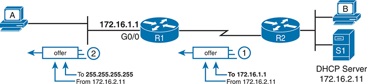

<figcaption>

<strong>图 19-3</strong> <em>IP 辅助地址对 DHCP 服务器返回的 Offer 消息的处理</em>

<aside class="hidden" id="a19fig03">

主机 B 和属于 DHCP 服务器 S1 的地址 172.16.2.11，通过向路由器 R1 发送 Offer 消息发起 DHCP 过程。路由器 R1 通过 R2，在 IP 地址为 172.16.1.1 的 G0/0 接口收到该广播。R1 从源地址 172.16.2.11 向目的地址 255.255.255.255 发送 Offer，将其送给主机 A。

</aside>

</figcaption>

</figure>

许多企业网络使用集中式 DHCP 服务器，因此常规路由器配置会在每个 LAN 接口／子接口上包含一条 <strong>ip helper-address</strong> 命令。有了这种标准配置，任何路由器 LAN 接口所连接的用户主机都能到达 DHCP 服务器并租用 IP 地址。

</section>

<section>

<h5 class="h5" id="ch19lev3sec3">DHCP 服务器存储的信息</h5>

DHCP 服务器听起来可能像是一台放在上锁大房间里的大型硬件，周围有大量空调为其散热。然而，与大多数服务器一样，这里的服务器实际上是运行在某种服务器操作系统上的软件。DHCP 服务器可以是免费下载并安装在旧 PC 上的软件。不过，为支持新的 DHCP 客户端，服务器需要始终可用，因此大多数公司将软件安装在非常稳定、具备高可用性功能的数据中心中。但 DHCP 服务仍由软件提供。

为了能够响应 DHCP 客户端，为其提供 IPv4 地址和其他信息，DHCP 服务器（软件）需要进行配置。DHCP 服务器按子网组织这些 IPv4 设置，列出地址池和默认路由器设置，这些设置因子网而异。以下列表展示 DHCP 服务器为支持客户端需要了解的设置类型：

<strong>子网 ID 和掩码：</strong>DHCP 服务器可利用这些信息确定子网中的所有地址。（DHCP 服务器知道不能出租子网 ID 或子网广播地址。）

<strong>保留（排除）地址：</strong>服务器需要知道子网中哪些地址<em>不能</em>出租。该列表允许工程师保留用作静态 IP 地址的地址。例如，大多数路由器和交换机 IP 地址、服务器地址，以及用户设备以外的大多数设备地址，都使用静态分配的 IP 地址。多数情况下，工程师对所有子网采用相同惯例，要么保留各子网中最低的 IP 地址，要么保留最高的 IP 地址。

<strong>默认路由器：</strong>该子网上路由器的 IP 地址。

<strong>DNS IP 地址：</strong>DNS 服务器 IP 地址的列表。

<a href="#ch19fig04">图 19-4</a> 展示 DHCP 服务器为两个 LAN 子网 172.16.1.0/24 和 172.16.2.0/24 预先配置的概念。DHCP 服务器位于右侧，为每个子网定义上述所有项目。在本例中，配置保留了子网中最低的 IP 地址，供静态地址使用。

<figure class="image-c" id="ch19fig04">

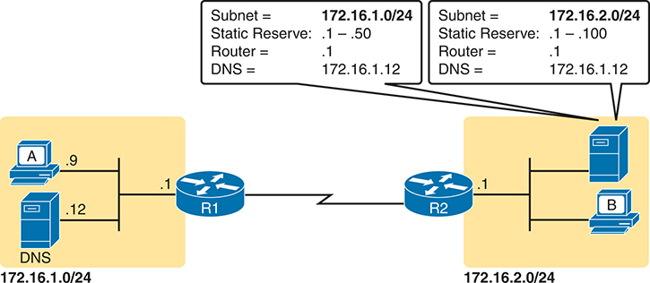

<figcaption>

<strong>图 19-4</strong> <em>DHCP 服务器上的预先配置</em>

<aside class="hidden" id="a19fig04">

路由器 R1 的 IP 地址为 172.16.1.0/24，静态保留范围为 .1 至 .50，连接子网为 172.16.1.12 的 DNS 服务器，以及 IP 地址以 .9 结尾的主机 A。路由器 R2 使用子网 172.16.2.0/24，静态保留范围为 .1 至 .100，连接 IP 地址为 172.16.1.12 的 DNS 服务器及主机 B。两台路由器通过串行线路互连。

</aside>

</figcaption>

</figure>

配置还可以列出其他参数。例如，可以设置租用 IP 地址的时间限制。服务器将地址出租一段时间（通常若干天），随后客户端可以请求续租。如果客户端不续租，服务器就可以回收 IP 地址，将其放回可用 IP 地址池。服务器配置规定租约的最长时间。

根据 DHCP 服务器配置上的细微差别，DHCP 使用三种分配模式。<em>动态分配</em>指本章通篇描述的 DHCP 机制和配置。另一种方法是<em>自动分配</em>，它将 DHCP 租期设为无限。因此，一旦服务器从地址池选择并向客户端分配 IP 地址，该地址就无限期地归该客户端使用。第三种模式是<em>静态分配</em>，根据客户端 MAC 地址预先为其配置特定 IP 地址，此后只有该特定客户端使用这个地址。（请注意，本章仅展示动态分配的示例和配置。）

此外，还可以配置 DHCP 服务器提供其他有用的设置。例如，服务器可以提供简单文件传输协议（TFTP）服务器的 IP 地址。TFTP 服务器提供一种基本的文件存储方式，可将文件传输到客户端主机。例如，Cisco IP 电话在初始化时依赖 TFTP 获取若干配置文件。DHCP 通过提供电话应使用的 TFTP 服务器 IP 地址，发挥关键作用。

</section>

</section>

<section>

<h4 class="h4" id="ch19lev2sec2">在路由器和交换机上配置 DHCP 功能</h4>

Cisco 路由器和交换机支持多种功能。只需几条简单命令，就可以将路由器配置为 DHCP 服务器，这一功能适用于实验室及某些有限场景。更常见的做法是企业使用集中式 DHCP 服务器（不运行在路由器上），并在几乎每个路由器接口上启用 DHCP 中继功能。最后，Cisco 路由器和交换机还可以充当 DHCP 客户端，从 DHCP 服务器学习自身的 IP 地址。

本节讨论 CCNA 200-301 V1.1 考试大纲提及的 DHCP 配置主题，包括路由器 DHCP 中继功能，以及在交换机和路由器上启用 DHCP 客户端服务的配置。

注意

CCNA 200-301 V1.1 考试大纲未提及 DHCP 服务器功能，但许多人喜欢在实验室中使用 IOS DHCP 服务器测试 DHCP。如果有兴趣了解如何在路由器上配置 DHCP 服务器，请参阅<a data-original-href="vol1_appk.xhtml#appk" data-unavailable="true" title="此内容不在当前提取范围内；请参阅原始 EPUB：vol1_appk.xhtml#appk">附录 K</a>“<a data-original-href="vol1_appk.xhtml#appk" data-unavailable="true" title="此内容不在当前提取范围内；请参阅原始 EPUB：vol1_appk.xhtml#appk">以往版本的主题</a>”。

<section>

<h5 class="h5" id="ch19lev3sec4">配置 DHCP 中继</h5>

配置 DHCP 中继只需要一个简单决策和一条直接的配置命令。首先，必须确定哪些接口需要该功能。对于连接到满足以下条件的子网的任何路由器接口，都必须配置 DHCP 中继功能：

<ul class="sq">

<li>
子网中有 DHCP 客户端
</li>

<li>
子网中没有 DHCP 服务器
</li>

</ul>

确定这些接口之后，就需要在每个接口上配置 <strong>ip helper-address</strong> 接口子命令。例如，在前面三幅图的拓扑中，R1 的 G0/0 接口需要配置 <strong>ip helper-address 172.16.2.11</strong> 接口子命令。在接口上启用后，IOS DHCP 中继代理就会按本章前面所述，更改入站 DHCP 消息中的地址。如果没有 DHCP 中继代理，DHCP 请求就永远无法到达服务器。

验证中继代理时，可以使用 <strong>show running-config</strong> 命令查找那条配置命令，也可以像<a href="#exa19_1">例 19-1</a> 那样使用 <strong>show ip interface g0/0</strong> 命令。高亮行确认了配置值。请注意，如果接口上没有配置任何 <strong>ip helper-address</strong> 命令，高亮行将改为显示“Helper address is not set”（未设置辅助地址）。

<strong>例 19-1</strong> <em>使用 <strong>show ip interface</strong> 列出当前辅助地址设置</em>

<a href="#code-f0494-01" id="f0494-01a">点击此处查看代码原图</a>

<pre class="pre-ex" tabindex="0"><code>R1# <strong>show ip interface g0/0</strong>

GigabitEthernet0/0 is up, line protocol is up

 Internet address is 172.16.1.1/24

 Broadcast address is 255.255.255.255

 Address determined by non-volatile memory

 MTU is 1500 bytes

 Helper address is 172.16.2.11

! Lines omitted for brevity</code></pre>

</section>

<section>

<h5 class="h5" id="ch19lev3sec5">将交换机配置为 DHCP 客户端</h5>

交换机可以作为 DHCP 客户端租用管理 IP 地址。大多数情况下，你会希望改用静态 IP 地址，以便工作人员更容易确定交换机地址进行远程管理。不过，为展示 DHCP 客户端的工作方式，接下来介绍如何在交换机上配置和验证 DHCP 客户端操作。

注意

<a href="v1-06.html#ch06">第 6 章</a>“<a href="v1-06.html#ch06">配置基本交换机管理</a>”也展示了将交换机配置为 DHCP 客户端的同一个示例。本章再次列出它，让你能在本卷同一处看到所有相关 DHCP 配置细节。

要将交换机配置为使用 DHCP 租用地址，按通常方式配置交换机 IP 地址，但使用 <strong>ip address dhcp</strong> 接口子命令。<a href="#exa19_2">例 19-2</a> 展示一个示例。

<strong>例 19-2</strong> <em>使用 DHCP 配置交换机动态 IP 地址</em>

<a href="#code-f0495-01" id="f0495-01a">点击此处查看代码原图</a>

<pre class="pre-ex" tabindex="0"><code>Emma# <strong>configure terminal</strong>

Enter configuration commands, one per line. End with CNTL/Z.

Emma(config)# <strong>interface vlan 1</strong>

Emma(config-if)# <strong>ip address dhcp</strong>

Emma(config-if)# <strong>no shutdown</strong>

Emma(config-if)# <strong>^Z</strong>

Emma#

00:38:20: %LINK-3-UPDOWN: Interface Vlan1, changed state to up

00:38:21: %LINEPROTO-5-UPDOWN: Line protocol on Interface Vlan1, changed state to up</code></pre>

验证 DHCP 是否工作时，先采用检查交换机 VLAN 接口 IP 地址的传统方法：如<a href="#exa19_3">例 19-3</a> 所示，使用 <strong>show interfaces vlan</strong> <em>x</em> 命令。首先检查接口状态，因为只有 VLAN 接口达到 up/up 状态后，交换机才会尝试 DHCP。特别是，如果忘记执行 <strong>no shutdown</strong> 命令，VLAN 1 接口将保持关闭状态，并在 <strong>show</strong> 命令输出中列为“administratively down”。然后，如果 DHCP 尚未成功，你会看到示例上半部分的高亮行。一旦交换机租到 IP 地址，就会看到下半部分所示的不同文字。

<strong>例 19-3</strong> <em>验证交换机通过 DHCP 学到的 IP 地址</em>

<a href="#code-f0495-02" id="f0495-02a">点击此处查看代码原图</a>

<pre class="pre-ex" tabindex="0"><code>! First, output when the switch has not yet leased an IP address

Emma# <strong>show interfaces vlan 1</strong>

Vlan1 is up, line protocol is up, Autostate Enabled

 Hardware is Ethernet SVI, address is 4488.165a.f247 (bia 4488.165a.f247)

 Internet address will be negotiated using DHCP

! lines omitted for brevity

! Next, the output after DHCP works

Emma# <strong>show interfaces vlan 1</strong>

Vlan1 is up, line protocol is up, Autostate Enabled

 Hardware is Ethernet SVI, address is 4488.165a.f247 (bia 4488.165a.f247)

 Internet address is 192.168.1.101/24

! lines omitted for brevity</code></pre>

有意思的是，无论显式配置地址，还是由交换机租用地址，列出地址的第三行输出看起来都相同。例如，<a href="#exa19_3">例 19-3</a> 后半部分列出地址 192.168.1.101，却没有任何信息说明它是静态 IP 地址还是通过 DHCP 学到的地址。

若要查看更多 DHCP 专属细节，应使用 <strong>show dhcp lease</strong> 命令，查看临时租用的 IP 地址和其他参数。（请注意，交换机不会将通过 DHCP 学到的 IP 配置存入 running-config 文件。）<a href="#exa19_4">例 19-4</a> 展示输出示例。另请注意，交换机也通过 DHCP 学习默认网关设置。

<strong>例 19-4</strong> <em>验证交换机通过 DHCP 学到的信息</em>

<a href="#code-f0496-01" id="f0496-01a">点击此处查看代码原图</a>

<pre class="pre-ex" tabindex="0"><code>Emma# <strong>show dhcp lease</strong>

Temp IP addr: 192.168.1.101 for peer on Interface: Vlan1

Temp sub net mask: 255.255.255.0

 DHCP Lease server: 192.168.1.1, state: 3 Bound

 DHCP transaction id: 1966

 Lease: 86400 secs, Renewal: 43200 secs, Rebind: 75600 secs

Temp default-gateway addr: 192.168.1.1

 Next timer fires after: 11:59:45

 Retry count: 0 Client-ID: cisco-0019.e86a.6fc0-Vl1

 Hostname: Emma

Emma# <strong>show ip default-gateway</strong>

192.168.1.1</code></pre>

</section>

<section>

<h5 class="h5" id="ch19lev3sec6">将路由器配置为 DHCP 客户端</h5>

与交换机一样，可以将路由器接口配置为通过 DHCP 租用 IP 地址，而不是使用静态 IP 地址，尽管这种情况很少见。几乎所有情况下，通过 <strong>ip address</strong> <em>address mask</em> 接口子命令静态配置路由器接口 IP 地址更合理。不过，在某些路由器连接互联网的场景中，将路由器配置为使用 DHCP 租用地址很合理；实际上，几乎所有家用路由器都这样做。

具有互联网链路的路由器可以通过 DHCP 学习自身 IP 地址和掩码，也可以将相邻 ISP 路由器的地址学为<a id="key_214" href="#ref-gloss_090">默认网关</a>。<a href="#ch19fig05">图 19-5</a> 展示一个示例，左侧是企业某站点的三台路由器。路由器 R1 通过互联网连接，使用 DHCP 从 ISP 路由器学习自身 IP 地址 192.0.2.2。

<figure class="image-c" id="ch19fig05">

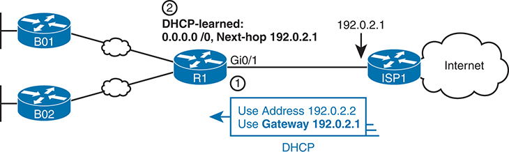

<figcaption>

<strong>图 19-5</strong> <em>企业路由器通过 DHCP 客户端构建和通告默认路由</em>

<aside class="hidden" id="a19fig05">

R1 通过以太网 WAN 连接两台交换机 B01 和 B02。DHCP 客户端为 R1 提供 IP 地址 192.0.2.2 和网关 192.0.2.1，以访问连接互联网的 ISP1，互联网用云图标表示。通过 DHCP 学到的路由为 0.0.0.0/0，下一跳为 192.0.2.1，使 R1 能够连接 ISP1，并进一步连接互联网。

</aside>

</figcaption>

</figure>

DHCP 过程为路由器 R1 提供默认网关 IP 地址，但路由器通常不使用默认网关设置，只有主机使用。不过，路由器可以利用该信息，以默认网关 IP 地址为基础创建默认路由。例如，在<a href="#ch19fig05">图 19-5</a> 中，路由器 R1 动态地向路由表加入一条默认路由，将 DHCP 消息中的默认网关 IP 地址（即 ISP 路由器的 IP 地址）作为下一跳地址。此时，R1 就有了一条可用于将数据包转发到互联网的有效路由。

此外，路由器 R1 可以使用 OSPF 等内部路由协议，将该默认路由分发给其他路由器。更多信息请参阅<a data-original-href="vol1_ch23.xhtml#ch23" data-unavailable="true" title="此内容不在当前提取范围内；请参阅原始 EPUB：vol1_ch23.xhtml#ch23">第 23 章</a>“<a data-original-href="vol1_ch23.xhtml#ch23" data-unavailable="true" title="此内容不在当前提取范围内；请参阅原始 EPUB：vol1_ch23.xhtml#ch23">实现可选的 OSPF 功能</a>”中的“<a data-original-href="vol1_ch23.xhtml#ch23lev2sec4" data-unavailable="true" title="此内容不在当前提取范围内；请参阅原始 EPUB：vol1_ch23.xhtml#ch23lev2sec4">OSPF 默认路由</a>”一节。

<a href="#exa19_5">例 19-5</a> 展示路由器 R1 与<a href="#ch19fig05">图 19-5</a> 对应的配置。请注意，首先 R1 使用 <strong>ip address dhcp</strong> 命令，将 G0/1 接口配置为通过 DHCP 学习该接口应使用的 IP 地址。

<strong>例 19-5</strong> <em>通过 DHCP 学习地址和默认静态路由</em>

<a href="#code-f0497-01" id="f0497-01a">点击此处查看代码原图</a>

<pre class="pre-ex" tabindex="0"><code>R1# <strong>configure terminal</strong>

R1(config)# <strong>interface gigabitethernet0/1</strong>

R1(config-if)# <strong>ip address dhcp</strong>

R1(config-if)# <strong>end</strong>

R1#

R1# <strong>show ip route static</strong>

! Legend omitted

Gateway of last resort is 192.0.2.1 to network 0.0.0.0

S* 0.0.0.0/0 [254/0] via 192.0.2.1</code></pre>

示例末尾展示生成的默认路由。奇怪的是，虽然该路由是根据 DHCP 学到的默认网关动态获得的，IOS 却将其显示为静态路由（目的地 0.0.0.0/0）。要识别它是通过 DHCP 学到的默认路由，可查看值为 254 的管理距离。对于通过 <strong>ip route</strong> 配置命令配置的静态路由，IOS 默认管理距离为 1；对于因 DHCP 而加入的默认路由，默认值则为 254。

</section>

</section>

</section>

<section>

<h3 class="h3" id="ch19lev1sec4">识别主机 IPv4 设置</h3>

无论是否通过 DHCP 学习，每台使用 IP 第 4 版的主机都需要一些设置才能正常工作。本章第二个主要部分研究这些设置，并展示 Windows、Linux 和 macOS 上的示例。

<section>

<h4 class="h4" id="ch19lev2sec3">主机的 IPv4 设置</h4>

要正常工作，IPv4 主机需要知道以下值：

<ul class="sq">

<li>
DNS 服务器 IP 地址
</li>

<li>
默认网关（路由器）IP 地址
</li>

<li>
设备自身的 IP 地址
</li>

<li>
设备自身的子网掩码
</li>

</ul>

回顾基础知识，主机必须知道一个或多个 DNS 服务器的 IP 地址，才能向它们发送名称解析请求。在企业中，这些服务器可能位于企业内部，如<a href="#ch19fig06">图 19-6</a> 所示。左侧主机（有时称为终端）通常至少知道两台 DNS 服务器的地址，以提供冗余。如果第一台 DNS 服务器没有响应，终端就可以尝试使用下一台进行名称解析。

<figure class="image-c" id="ch19fig06">

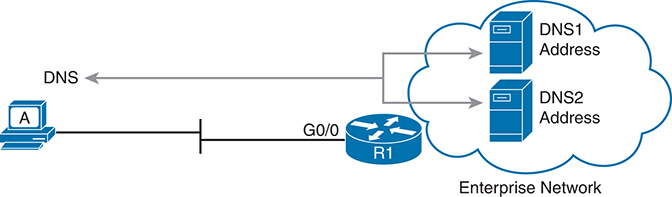

<figcaption>

<strong>图 19-6</strong> <em>主机 A 需要知道 DNS 服务器的 IP 地址</em>

<aside class="hidden" id="a19fig06">

主机 A 通过 G0/0 接口连接路由器 R1。路由器连接两台 DNS 服务器，分别标为“DNS1 Address”和“DNS2 Address”。连接用从路由器指向 DNS 服务器及主机 A 的箭头表示。DNS 布局包含在标为“Enterprise Network”的云形区域内。

</aside>

</figcaption>

</figure>

每个终端都需要知道同一子网中某台路由器的 IP 地址。终端将其用作默认路由器或默认网关，如<a href="#ch19fig07">图 19-7</a> 所示。从主机逻辑的角度看，主机可以将目的地址位于子网之外的数据包转发给默认路由器，再由该路由器根据路由表继续转发。

<figure class="image-c" id="ch19fig07">

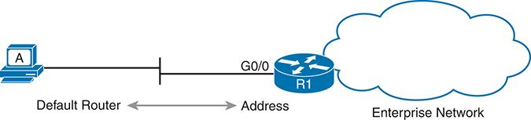

<figcaption>

<strong>图 19-7</strong> <em>主机的默认路由器设置应等于路由器接口地址</em>

<aside class="hidden" id="a19fig07">

主机 A 通过 G0/0 接口连接默认路由器 R1。图中 R1 连接到用云图标表示的企业网络。双向箭头表示连接，左侧标为“Default Router”，右侧标为“Address”。

</aside>

</figcaption>

</figure>

当然，每台设备都需要自己的 IP 地址和子网掩码。同样重要的是，主机与默认路由器必须对子网内部地址的范围达成一致。主机会使用地址和掩码计算哪些地址属于同一子网，哪些属于其他子网。要让路由正确工作，默认路由器的接口地址和掩码应得出相同的子网定义，包含相同地址，如<a href="#ch19fig08">图 19-8</a> 所示。

<figure class="image-c" id="ch19fig08">

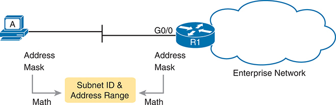

<figcaption>

<strong>图 19-8</strong> <em>主机与默认路由器需要具有一致的子网认知</em>

<aside class="hidden" id="a19fig08">

主机 A 通过 G0/0 接口连接默认路由器 R1。图中 R1 连接到用云图标表示的企业网络。主机和路由器的“Address Mask”都指向“子网 ID 和地址范围”。

</aside>

</figcaption>

</figure>

本节余下部分展示三种不同主机操作系统的图形用户界面（GUI）和命令行界面（CLI）中的设置示例。本章余下示例使用子网 10.1.1.0/24 中的主机，如<a href="#ch19fig09">图 19-9</a> 左侧所示。

<figure class="image-c" id="ch19fig09">

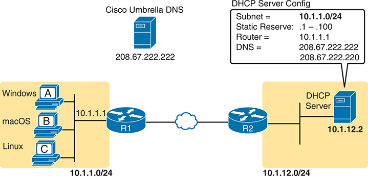

<figcaption>

<strong>图 19-9</strong> <em>后续主机示例使用的子网 10.1.1.0/24</em>

<aside class="hidden" id="a19fig09">

示意图包含三台主机 A、B 和 C，分别代表 Windows、macOS 和 Linux 操作系统。每台计算机都连接到 IP 地址为 10.1.1.1/24 的路由器 R1。R1 通过以太网 WAN 连接另一台路由器 R2，R2 连接 IP 地址为 10.1.1.2/24 的 DHCP 服务器，并连接 IP 地址为 208.67.222.222 的 Cisco Umbrella DNS。图中还展示 DHCP 服务器配置细节，包括子网 10.1.1.0/24、静态保留范围 .1–.100、路由器 10.1.1.1，以及 DNS 208.67.222.222。

</aside>

</figcaption>

</figure>

</section>

<section>

<h4 class="h4" id="ch19lev2sec4">Windows 上的主机 IP 设置</h4>

世界上几乎所有操作系统，至少人们每天使用的常见操作系统，都有一个比较容易找到的设置窗口，在同一处列出大部分甚至全部 IPv4 设置。

例如，<a href="#ch19fig10">图 19-10</a> 展示 Windows 主机控制面板网络区域中的网络配置屏幕。图中展示四项重要设置：地址、掩码、路由器和 DNS。请注意，该主机是<a href="#ch19fig09">图 19-9</a> 中的 Windows 主机 A，它通过 DHCP 从图中的 DHCP 服务器学习设置。

<figure class="image-c" id="ch19fig10">

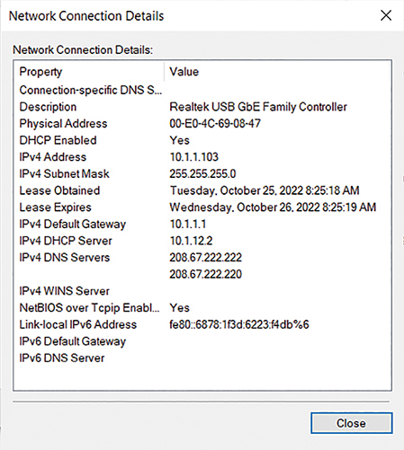

<figcaption>

<strong>图 19-10</strong> <em>Windows DHCP 客户端的 IP 地址、掩码和默认路由器设置</em>

<aside class="hidden" id="a19fig10">

截图展示网络连接的各项属性及其对应值。属性包括“连接特定的 DNS 后缀”“描述”“物理地址”“已启用 DHCP”“IPv4 地址”“IPv4 子网掩码”“获得租约的时间”“租约过期的时间”“IPv4 默认网关”“IPv4 DHCP 服务器”“IPv4 DNS 服务器”“IPv4 WINS 服务器”“已启用 TCP/IP 上的 NetBIOS”“链路本地 IPv6 地址”“IPv6 默认网关”和“IPv6 DNS 服务器”。各属性的值也一并显示，提供网络连接的具体信息。底部是“关闭”按钮。

</aside>

</figcaption>

</figure>

不过，除了 GUI，大多数操作系统还提供各种命令行网络命令。几十年来，在多个 Windows 版本中，<strong>ipconfig</strong> 和 <strong>ipconfig /all</strong> 命令都能提供最直接的帮助，如<a href="#exa19_6">例 19-6</a> 所示。可以看到，两者都列出地址、掩码和默认网关。<strong>ipconfig /all</strong> 列出更多细节，包括 <a id="key_219" href="#ref-gloss_112">DNS 服务器列表</a>、主机使用 DHCP 的确认信息，以及 DHCP 服务器的 IP 地址。

<strong>例 19-6</strong> <em><strong>ipconfig</strong> 和 <strong>ipconfig /all</strong>（Windows）</em>

<a href="#code-f0500-01" id="f0500-01a">点击此处查看代码原图</a>

<pre class="pre-ex" tabindex="0"><code>Windows_A&gt; <strong>ipconfig</strong>

! Lines omitted for brevity

Ethernet adapter Ethernet 5:

   Connection-specific DNS Suffix . :

   Link-local IPv6 Address . . . . . : fe80::6878:1f3d:6223:f4db%6

   IPv4 Address. . . . . . . . . . . : 10.1.1.103

   Subnet Mask . . . . . . . . . . . : 255.255.255.0

   Default Gateway . . . . . . . . . : 10.1.1.1

Windows_A&gt; <strong>ipconfig /all</strong>

! Lines omitted for brevity

Ethernet adapter Ethernet 5:

   Connection-specific DNS Suffix .  :

   Description . . . . . . . . . . . : Realtek USB GbE Family Controller

   Physical Address. . . . . . . . . : 00-E0-4C-69-08-47

   DHCP Enabled. . . . . . . . . . . : Yes

   Autoconfiguration Enabled . . . . : Yes

   Link-local IPv6 Address . . . . . : fe80::6878:1f3d:6223:f4db%6(Preferred)

   IPv4 Address. . . . . . . . . . . : 10.1.1.103(Preferred)

   Subnet Mask . . . . . . . . . . . : 255.255.255.0

   Lease Obtained. . . . . . . . . . : Tuesday, October 25, 2022 8:25:19 AM

   Lease Expires . . . . . . . . . . : Wednesday, October 26, 2022 8:25:19 AM

   Default Gateway . . . . . . . . . : 10.1.1.1

   DHCP Server . . . . . . . . . . . : 10.1.12.2

   DHCPv6 IAID . . . . . . . . . . . : 100720716

   DHCPv6 Client DUID. . . . . . . . : 00-01-00-01-19-A0-DC-F0-24-FD-52-CB-50-C9

   DNS Servers . . . . . . . . . . . : 208.67.222.222

                                       208.67.222.220

   NetBIOS over Tcpip. . . . . . . . : Enabled</code></pre>

<a href="#exa19_6">例 19-6</a> 展示传统的 Windows <strong>ipconfig</strong> 命令，而<a href="#exa19_7">例 19-7</a> 展示 Windows 网络 shell 中类似的命令。网络 shell 命令替代了部分较旧的 Windows 命令行命令，例如 <strong>ipconfig</strong>。

<strong>例 19-7</strong> <em>Windows 网络 shell 的 <strong>show config</strong> 命令</em>

<a href="#code-f0501-01" id="f0501-01a">点击此处查看代码原图</a>

<pre class="pre-ex" tabindex="0"><code>Windows_A&gt; <strong>netsh interface ip show config</strong>

Configuration for interface "Ethernet 5"

   DHCP enabled:                        Yes

   IP Address:                          10.1.1.103

   Subnet Prefix:                       10.1.1.0/24 (mask 255.255.255.0)

   Default Gateway:                     10.1.1.1

   Gateway Metric:                      0

   InterfaceMetric:                     25

   DNS servers configured through DHCP: 208.67.222.222

                                        208.67.222.220

   Register with which suffix:          Primary only

   WINS servers configured through DHCP: None

! Next, use the network shell to allow repeated commands.

Windows_A&gt; <strong>netsh</strong>

netsh&gt; <strong>interface ip</strong>

netsh interface ip&gt; <strong>show config</strong>

Configuration for interface "Ethernet 5"

   DHCP enabled:                        Yes

   IP Address:                          10.1.1.103

   Subnet Prefix:                       10.1.1.0/24 (mask 255.255.255.0)

! Remaining lines omitted; same output as at the top of the example.

netsh interface ip&gt; <strong>show dnsservers</strong>

Configuration for interface "Ethernet 5"

   DNS servers configured through DHCP: 208.67.222.222

                                        208.67.222.220

   Register with which suffix:          Primary only</code></pre>

有意思的是，可以将网络 shell 命令作为单条命令执行（如<a href="#exa19_7">例 19-7</a> 顶部所示），也可以在网络 shell 界面中逐层进入。示例先执行 <strong>netsh</strong>，再执行 <strong>interface ip</strong>，进入一种可使用多种 IP 相关命令简写的模式，例如 <strong>show config</strong> 和 <strong>show dnsservers</strong>。（请注意，所有输出都经过编辑，仅显示与本例所用以太网接口相关的条目。）

还应查看主机的 IP 路由表，重点关注主导主机大部分路由行为的两条路由。使用 DHCP 时，主机会根据从 DHCP 服务器学到的信息创建这些路由：

<ul class="sq">

<li>
一条默认路由，以默认网关为下一跳地址，目的子网和掩码均列为 0.0.0.0。
</li>

<li>
一条通往工作接口所连子网的路由，由接口 IP 地址和掩码计算得出，本例为子网 10.1.1.0/24。
</li>

</ul>

<a href="#exa19_8">例 19-8</a> 使用两条命令显示 Windows 主机 A 的路由表：较旧的 <strong>netstat -rn</strong> 和较新的 <strong>netsh interface ip show route</strong>。示例经过编辑，仅列出与子网 10.1.1.0/24 和示例所用以太网 LAN 接口相关的路由。请注意，网关为“on-link”表示 PC 认为目的地位于本地子网（链路）上。

<strong>例 19-8</strong> <em>Windows 主机的 IPv4 路由</em>

<a href="#code-f0502-01" id="f0502-01a">点击此处查看代码原图</a>

<pre class="pre-ex" tabindex="0"><code>Windows_A&gt; <strong>netstat -rn</strong>

IPv4 Route Table

===========================================================================

Active Routes:

Network Destination         Netmask    Gateway    Interface  Metric

           0.0.0.0          0.0.0.0    10.1.1.1   10.1.1.103     25

          10.1.1.0    255.255.255.0    On-link    10.1.1.103    281

        10.1.1.103  255.255.255.255    On-link    10.1.1.103    281

        10.1.1.255  255.255.255.255    On-link    10.1.1.103    281

! Lines omitted for brevity

Windows_A&gt; <strong>netsh interface ip show route</strong>

Publish Type     Met Prefix                   Idx Gateway/Interface Name

------- -------- --- ------------------------ --- ------------------------

No     Manual    0   0.0.0.0/0                6 10.1.1.1

No     System    256 10.1.1.0/24              6 Ethernet 5

No     System    256 10.1.1.103/32            6 Ethernet 5

No     System    256 10.1.1.255/32            6 Ethernet 5

!      Lines     omitted for brevity</code></pre>

</section>

<section>

<h4 class="h4" id="ch19lev2sec5">macOS 上的主机 IP 设置</h4>

虽然细节与 Windows 不同，但 macOS 也提供查看网络设置的图形界面和多种网络命令。本节从<a href="#ch19fig11">图 19-11</a> 开始展示两者的示例。图中是 macOS 以太网接口的网络设置，包括地址、掩码、默认路由器和 DNS 服务器地址。还请注意，设置表明接口正在使用 DHCP。

macOS 和 Linux 都支持 <strong>ifconfig</strong> 命令，可列出与 Windows <strong>ipconfig /all</strong> 命令类似的信息。但 <strong>ifconfig</strong> 没有类似 <strong>/all</strong> 的选项，不会列出默认网关或 DNS 服务器信息。<a href="#exa19_9">例 19-9</a> 展示<a href="#ch19fig11">图 19-11</a> 中 Mac 主机 B 的 <strong>ifconfig</strong> 命令示例，以及另一条列出默认路由器的命令。

<figure class="image-c" id="ch19fig11">

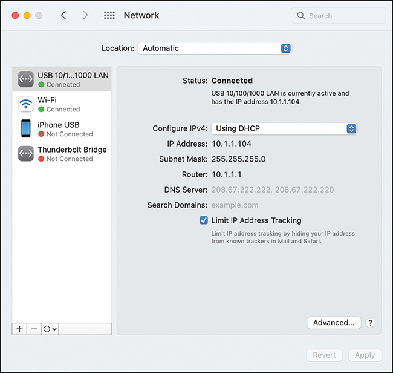

<figcaption>

<strong>图 19-11</strong> <em>macOS DHCP 客户端的 IP 地址、掩码和默认路由器设置</em>

<aside class="hidden" id="a19fig11">

截图展示 macOS 的网络设置界面，左侧面板列出网络连接，包括已连接的“USB 10/100/1000 LAN”。右侧状态显示“已连接”，“USB 10/100/1000 LAN 当前处于活动状态，IP 地址为 10.1.10.104”。IPv4 配置设为“使用 DHCP”，IP 地址为“10.1.10.104”，子网掩码为“255.255.255.0”，路由器为“10.1.1.1”。界面还显示 DNS 服务器地址和搜索域字段。

</aside>

</figcaption>

</figure>

<strong>例 19-9</strong> <em><strong>ifconfig</strong> 和 <strong>networksetup -getinfo</strong>（macOS）</em>

<a href="#code-f0503-01" id="f0503-01a">点击此处查看代码原图</a>

<pre class="pre-ex" tabindex="0"><code>Mac_B$ <strong>ifconfig en8</strong>

 en8: flags=8863&lt;UP,BROADCAST,SMART,RUNNING,SIMPLEX,MULTICAST&gt; mtu 1500

       options=6467&lt;RXCSUM,TXCSUM,VLAN_MTU,TSO4,TSO6,CHANNEL_IO,PARTIAL_CSUM,

       ZEROINVERT_CSUM&gt;

          ether 00:e0:4c:68:1f:26 

          inet6 fe80::184c:56f9:fd3b:d6e7%en8 prefixlen 64 secured scopeid 0x14

          inet 10.1.1.104 netmask 0xffffff00 broadcast 10.1.1.255

          nd6 options=201&lt;PERFORMNUD,DAD&gt;

          media: autoselect (1000baseT &lt;full-duplex&gt;)

          status: active

Mac_B$ <strong>networksetup -getinfo "USB 10/100/1000 LAN"</strong>

DHCP Configuration

IP address: 10.1.1.104

Subnet mask: 255.255.255.0

Router: 10.1.1.1

Client ID:

IPv6: Automatic

IPv6 IP address: none

IPv6 Router: none

Ethernet Address: 00:e0:4c:68:1f:26</code></pre>

重点看 <strong>ifconfig</strong> 命令，它以十六进制列出子网掩码，本例为 0xffffff00。要将掩码转换为点分十进制，先将每对十六进制数字转换为二进制，再将二进制转换为对应十进制，得到点分十进制掩码的四个八位组。本例中，0xffffff00 的前三对是 ff，转换为二进制 11111111，再转换为十进制 255；最后一对 00 转换为二进制 00000000，再转换为十进制 0。最终得到熟悉的十进制掩码 255.255.255.0。

<a href="#exa19_9">例 19-9</a> 中的 <strong>networksetup</strong> 命令比旧的 <strong>ifconfig</strong> 列出更多细节，包含除 DNS 服务器列表之外的常见 IP 设置。请注意，macOS 的 <strong>networksetup</strong> 命令具有多种选项。

与 Windows 一样，macOS 根据默认网关向主机路由表加入默认路由，并根据 IP 地址和掩码计算并加入本地子网路由。同样，macOS 使用 <strong>netstat -rn</strong> 命令列出这些路由，但输出存在若干差别。值得注意的是，<a href="#exa19_10">例 19-10</a> 的 macOS 输出使用 <em>default</em> 一词表示默认路由，而不是目的子网和掩码 0.0.0.0 与 0.0.0.0。示例高亮显示默认路由和直连子网路由。与通常一样，为提高可读性，示例仅保留与网络 10.0.0.0 相关的路由。

<strong>例 19-10</strong> <em><strong>netstat -rn</strong> 命令（macOS）</em>

<a href="#code-f0504-01" id="f0504-01a">点击此处查看代码原图</a>

<pre class="pre-ex" tabindex="0"><code>Mac_B&gt; <strong>netstat -rn</strong>

Routing tables

Internet:

Destination      Gateway            Flags        Netif Expire

default          10.1.1.1           UGScg        en8

10.1.1/24        link#20            UCS          en8        !

10.1.1.1/32      link#20            UCS          en8        !

10.1.1.1         2:0:11:11:11:11    UHLWIir      en8      385

10.1.1.104/32    link#20            UCS          en8        !

! lines omitted for brevity</code></pre>

</section>

<section>

<h4 class="h4" id="ch19lev2sec6">Linux 上的主机 IP 设置</h4>

与其他桌面操作系统一样，Linux 可通过 GUI 和命令显示网络设置。不过，要注意 Linux 世界包含许多不同发行版。此外，Linux 架构将操作系统与桌面（图形界面）分开。因此，其他 Linux 用户可能使用不同的 GUI 管理工具和命令查看网络设置。

<a href="#ch19fig12">图 19-12</a> 展示使用 Mate 桌面的 Ubuntu Linux 发行版（<a href="http://www.ubuntu-mate.org">www.ubuntu-mate.org</a>）中的示例。该主机是<a href="#ch19fig09">图 19-9</a> 中的主机 C，它使用 DHCP 学习子网 10.1.1.0/24 中的地址。<a href="#ch19fig12">图 19-12</a> 展示以太网适配器的 IP 细节，包括 IPv4 地址、掩码、默认路由器和 DNS IP 地址。

<figure class="image-c" id="ch19fig12">

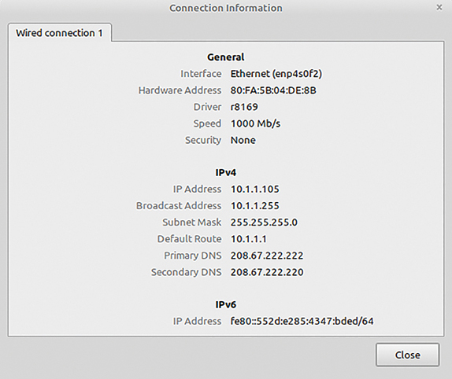

<figcaption>

<strong>图 19-12</strong> <em>Linux DHCP 客户端的 IP 地址、掩码和默认路由器设置</em>

<aside class="hidden" id="a19fig12">

截图详细展示 DHCP 客户端的 IP 地址、掩码和默认路由器设置。“常规”部分显示接口为以太网（enp4s0f2），硬件地址为 80:FA:5B:04:DE:B8，驱动程序为 r8169。连接速度为每秒 1000 兆字节，未启用安全功能。“IPv4”部分显示 IP 地址 10.1.1.105、广播地址 10.1.1.255、子网掩码 255.255.255.0，以及默认路由 10.1.1.1。首选 DNS 为 208:67:222:222，备用 DNS 为 208:67:220:220。

</aside>

</figcaption>

</figure>

Linux 主机通常支持大量命令行命令。不过，一组统称为 <em>net-tools</em> 的旧命令已在 Linux 中弃用，以至于某些发行版不再包含 net-tools。（多数 Linux 发行版都可以轻松添加它。）net-tools 库包含 <strong>ifconfig</strong> 和 <strong>netstat -rn</strong> 等常用命令。为替代这些工具，Linux 使用 <em>iproute</em> 库，提供一组替代命令和功能，其中许多通过 <strong>ip</strong> 命令及参数执行。

<a href="#exa19_11">例 19-11</a> 展示 Linux <strong>ifconfig</strong> 命令及其替代命令 <strong>ip address</strong> 的示例，针对<a href="#ch19fig12">图 19-12</a> 中同一个接口。两条命令都列出以太网 MAC 地址、IPv4 地址和子网掩码。

<strong>例 19-11</strong> <em><strong>ifconfig</strong> 和 <strong>ip address</strong> 命令（Linux）</em>

<a href="#code-f0505-01" id="f0505-01a">点击此处查看代码原图</a>

<pre class="pre-ex" tabindex="0"><code>Linux_C$ <strong>ifconfig</strong>

enp4s0f2: flags=4163&lt;UP,BROADCAST,RUNNING,MULTICAST&gt; mtu 1500

        inet 10.1.1.105 netmask 255.255.255.0 broadcast 10.1.1.255

        inet6 fe80::552d:e285:4347:bded prefixlen 64 scopeid 0x20&lt;link&gt;

        ether 80:fa:5b:04:de:8b txqueuelen 1000 (Ethernet)

        RX packets 4958 bytes 384498 (384.4 KB)

        RX errors 0 dropped 0 overruns 0 frame 0

        TX packets 16270 bytes 1320108 (1.3 MB)

        TX errors 0 dropped 0 overruns 0 carrier 0 collisions 0

Linux_C$ <strong>ip address</strong>

2: enp4s0f2: &lt;BROADCAST,MULTICAST,UP,LOWER_UP&gt; mtu 1500 qdisc fq_codel state UP

group default qlen 1000

    link/ether 80:fa:5b:04:de:8b brd ff:ff:ff:ff:ff:ff

    inet 10.1.1.105/24 brd 10.1.1.255 scope global dynamic noprefixroute enp4s0f2

      valid_lft 81056sec preferred_lft 81056sec

    inet6 fe80::552d:e285:4347:bded/64 scope link noprefixroute

      valid_lft forever preferred_lft forever</code></pre>

<a href="#exa19_12">例 19-12</a> 展示另一对新旧 Linux 命令：<strong>netstat -rn</strong> 和 <strong>ip route</strong>。<strong>netstat -rn</strong> 列出默认路由时，将目的地和掩码均显示为 0.0.0.0。与通常一样，默认路由使用学到的默认网关 IP 地址 10.1.1.1 作为下一跳 IP 地址。<strong>netstat -rn</strong> 输出还列出本地子网 10.1.1.0/24 的路由。<strong>ip route</strong> 列出相同路由，但格式和措辞有很大不同。

<strong>例 19-12</strong> <em><strong>netstat -rn</strong> 和 <strong>ip route</strong> 命令（Linux）</em>

<a href="#code-f0506-01" id="f0506-01a">点击此处查看代码原图</a>

<pre class="pre-ex" tabindex="0"><code>Linux_C$ <strong>netstat -rn</strong>

Kernel IP routing table

Destination       Gateway     Genmask         Flags   MSS Window irtt Iface

0.0.0.0           10.1.1.1    0.0.0.0         UG        0 0         0 enp4s0f2

10.1.1.0          0.0.0.0     255.255.255.0   U         0 0         0 enp4s0f2

! Lines omitted for brevity

Linux_C$ <strong>ip route</strong>

default via 10.1.1.1 dev enp4s0f2 proto dhcp metric 20100

10.1.1.0/24 dev enp4s0f2 proto kernel  scope link  src 10.1.1.105 metric 100

! Lines omitted for brevity</code></pre>

</section>

<section>

<h4 class="h4" id="ch19lev2sec7">主机 IP 设置故障排查</h4>

前几页展示的 Windows、macOS 和 Linux 示例，是<a href="#ch19fig09">图 19-9</a> 中 DHCP 客户端 A、B 和 C 成功运行的结果。为补全认识，本节最后几个示例展示不同场景及常用 Windows <strong>ipconfig /all</strong> 命令的相应输出。所有场景都来自图中的 Windows 主机 A，具体如下：

<ol class="number">

<li>
主机 A 使用静态 IP 配置，且设置正确。
</li>

<li>
主机 A 作为 DHCP 客户端，但网络问题阻止 DHCP 客户端与服务器通信。
</li>

<li>
主机 A 作为 DHCP 客户端，网络正常，DHCP 工作成功，但 DHCP 服务器提供了部分错误信息（错误的默认网关地址）。
</li>

</ol>

<section>

<h5 class="h5" id="ch19lev3sec7">使用静态 IP 配置且正常工作的 Windows 主机</h5>

<a href="#exa19_13">例 19-13</a> 展示第一个场景。有人在 Windows 主机 A 上禁用了 DHCP，并手动配置所有 IP 设置。他选择了正确的值，符合 <a href="#ch19fig09">图 19-9</a> 的设计。特别是，图中保留地址 .1–.100 作为静态地址，因此手动配置主机 A 的人员分配了 10.1.1.99。

<strong>例 19-13</strong> <em>使用静态 IP 设置且正常工作的 Windows 主机（无 DHCP）</em>

<a href="#code-f0507-01" id="f0507-01a">点击此处查看代码原图</a>

<pre class="pre-ex" tabindex="0"><code>Windows_A&gt; <strong>ipconfig /all</strong>

! Showing only the Ethernet adapter connected to subnet 10.1.1.0/24

Ethernet adapter Ethernet 5:

   Connection-specific DNS Suffix .  :

   Description . . . . . . . . . . . : Realtek USB GbE Family Controller

   Physical Address. . . . . . . . . : 00-E0-4C-69-08-47

   DHCP Enabled. . . . . . . . . . . : No

   Autoconfiguration Enabled . . . . : Yes

   Link-local IPv6 Address . . . . . : fe80::6878:1f3d:6223:f4db%6(Preferred)

   IPv4 Address. . . . . . . . . . . : 10.1.1.99(Preferred)

   Subnet Mask . . . . . . . . . . . : 255.255.255.0

   Default Gateway . . . . . . . . . : 10.1.1.1

   DHCPv6 IAID . . . . . . . . . . . : 100720716

   DHCPv6 Client DUID. . . . . . . . : 00-01-00-01-19-A0-DC-F0-24-FD-52-CB-50-C9

   DNS Servers . . . . . . . . . . . : 208.67.222.222

                                       208.67.222.220

   NetBIOS over Tcpip. . . . . . . . : Enabled</code></pre>

<a href="#exa19_13">例 19-13</a> 中 <strong>ipconfig /all</strong> 的输出指出 DHCP 已禁用（第一条高亮行），由此表明主机使用静态设置。请花一点时间将其与前面<a href="#exa19_7">例 19-7</a> 中的相同行比较，后者的主机 A 作为 DHCP 客户端工作。

<a href="#exa19_13">例 19-13</a> 的输出还通过缺少通常为 DHCP 客户端显示的若干输出行，表明主机使用静态设置而不是 DHCP。省略的行包括：

<ul class="sq">

<li>
已启用 DHCP（DHCP Enabled）
</li>

<li>
获得租约的时间（Lease Obtained）
</li>

<li>
租约过期的时间（Lease Expires）
</li>

</ul>

了解这些信息后，你应该能够区分 Windows 主机使用和不使用 DHCP 的情况。

</section>

<section>

<h5 class="h5" id="ch19lev3sec8">因 IP 连通性问题而失败的 Windows DHCP 客户端</h5>

下一个示例仍来自 Windows 主机 A，主机同样按照<a href="#ch19fig09">图 19-9</a> 的设计充当 DHCP 客户端。不过，任何阻止 DHCP DORA 消息在客户端与 DHCP 服务器之间流动的问题，都会导致 DHCP 过程失败。客户端没有租到地址，也未从 DHCP 服务器学到其他 IP 细节，而是自行分配 APIPA 地址，并使用 APIPA 默认掩码 255.255.0.0。（若需复习 APIPA，请参阅本章前面“<a href="#ch19lev3sec1">APIPA IP 地址（169.254.x.x）</a>”一节。）

<a href="#exa19_14">例 19-14</a> 展示相应的 <strong>ipconfig /all</strong> 命令输出。输出确认客户端启用了 DHCP，但以下信息表明该过程失败：

<ul class="sq">

<li>
缺少列出 DHCP 服务器 IP 地址的输出行。
</li>

<li>
缺少列出 DHCP 租约细节的两行输出。
</li>

<li>
显示以 169.254 开头的 APIPA IP 地址。
</li>

<li>
未列出 IPv4 默认网关地址。
</li>

<li>
未列出 IPv4 DNS 服务器。
</li>

</ul>

<strong>例 19-14</strong> <em>Windows DHCP 客户端因 IP 连通性故障而失败</em>

<a href="#code-f0508-01" id="f0508-01a">点击此处查看代码原图</a>

<pre class="pre-ex" tabindex="0"><code>Windows_A&gt; <strong>ipconfig /all</strong>

! Showing only the Ethernet adapter connected to subnet 10.1.1.0/24

Ethernet adapter Ethernet 5:

   Connection-specific DNS Suffix .  :

   Description . . . . . . . . . . . : Realtek USB GbE Family Controller

   Physical Address. . . . . . . . . : 00-E0-4C-69-08-47

   DHCP Enabled. . . . . . . . . . . : Yes

   Autoconfiguration Enabled . . . . : Yes

   Link-local IPv6 Address . . . . . : fe80::6878:1f3d:6223:f4db%6(Preferred)

   Autoconfiguration IPv4 Address. . : 169.254.244.219(Preferred)

   Subnet Mask . . . . . . . . . . . : 255.255.0.0

   Default Gateway . . . . . . . . . :

   DHCPv6 IAID . . . . . . . . . . . : 100720716

   DHCPv6 Client DUID. . . . . . . . : 00-01-00-01-19-A0-DC-F0-24-FD-52-CB-50-C9

   DNS Servers . . . . . . . . . . . : fec0:0:0:ffff::1%1

                                       fec0:0:0:ffff::2%1

                                       fec0:0:0:ffff::3%1

   NetBIOS over Tcpip. . . . . . . . : Enabled</code></pre>

</section>

<section>

<h5 class="h5" id="ch19lev3sec9">DHCP 正常工作但设置错误的 Windows 客户端</h5>

最后一个场景，假设 DHCP 过程正常工作，但服务器配置错误。因此，DHCP 客户端可能学到错误信息，并在某些情况下无法通信。例如，DHCP 过程可能完成，但客户端学到以下不准确或不完整的设置：

<ul class="sq">

<li>
错误的子网掩码
</li>

<li>
错误或缺失的默认网关
</li>

<li>
错误或缺失的 DNS 服务器列表
</li>

</ul>

<a href="#exa19_15">例 19-15</a> 展示 DHCP 服务器为子网 10.1.1.0/24 配置了错误默认网关 10.1.1.254 的情况。设计中的正确默认网关是路由器 R1（10.1.1.1）。<a href="#exa19_15">例 19-15</a> 的 <strong>ipconfig /all</strong> 输出显示 DHCP 成功的常见迹象：DHCP 已启用，并有租约开始和结束时间。它还显示主机 IP 地址、掩码、默认网关和 DNS 服务器。但与预期设计比较，输出表明主机学到的默认网关指向一台不存在的路由器。

<strong>例 19-15</strong> <em>Windows DHCP 客户端学到错误的默认网关</em>

<a href="#code-f0509-01" id="f0509-01a">点击此处查看代码原图</a>

<pre class="pre-ex" tabindex="0"><code>Windows_A&gt; <strong>ipconfig /all</strong>

Ethernet adapter Ethernet 5:

   Connection-specific DNS Suffix  . :

   Description . . . . . . . . . . . : Realtek USB GbE Family Controller

   Physical Address. . . . . . . . . : 00-E0-4C-69-08-47

   DHCP Enabled. . . . . . . . . . . : Yes

   Autoconfiguration Enabled . . . . : Yes

   Link-local IPv6 Address . . . . . : fe80::6878:1f3d:6223:f4db%6(Preferred)

   IPv4 Address. . . . . . . . . . . : 10.1.1.103(Preferred)

   Subnet Mask . . . . . . . . . . . : 255.255.255.0

   Lease Obtained. . . . . . . . . . : Tuesday, October 25, 2022 7:54:17 AM

   Lease Expires . . . . . . . . . . : Wednesday, October 26, 2022 7:54:16 AM

   Default Gateway . . . . . . . . . : 10.1.1.254 

   DHCP Server . . . . . . . . . . . : 10.1.12.2

   DHCPv6 IAID . . . . . . . . . . . : 100720716

   DHCPv6 Client DUID. . . . . . . . : 00-01-00-01-19-A0-DC-F0-24-FD-52-CB-50-C9

   DNS Servers . . . . . . . . . . . : 208.67.222.222

                                       208.67.222.220

   NetBIOS over Tcpip. . . . . . . . : Enabled

Windows_A&gt; <strong>netstat -rn</strong>

IPv4 Route Table

===========================================================================

Active Routes:

Network Destination          Netmask      Gateway     Interface  Metric

           0.0.0.0           0.0.0.0   10.1.1.254     10.1.1.103     25

          10.1.1.0     255.255.255.0      On-link     10.1.1.103    281

! Lines omitted for brevity</code></pre>

解决该问题的根本方法，是修正 DHCP 服务器的配置错误。在考试中，更可能要求你思考设计，并注意到 DHCP 客户端学到的内容与正确设置之间存在差异。还请注意，下一章“<a href="v1-20.html#ch20">IPv4 路由故障排查</a>”将介绍如何探查 IP 网络中问题的不同症状。

</section>

</section>

</section>

</section>

<section class="ccna-source ccna-appendix" aria-label="答案解析与术语表">
<section data-epub-type="chapter">

<h2 class="h2" id="ref-appc">附录 C</h2>

<h2 class="h2a">“这些知识我已经掌握了吗？”自测题答案</h2>

<section>

<h3 class="h3" id="ref-appclev1sec19">第 19 章</h3>

<strong><a id="ref-ques19_1" href="#quess19_1">1</a>．</strong> B 和 D。客户端发送 Discover 消息，服务器返回 Offer 消息。随后客户端发送 Request，服务器通过 Acknowledgment 消息返回 IP 地址。

<strong><a id="ref-ques19_2" href="#quess19_2">2</a>．</strong> A 和 B。两个正确答案列出决定服务器向客户端出租哪些 IP 地址的两项主要信息。对于涉及 DNS 服务器的错误答案，DHCP 服务器确实提供 DNS 服务器的 IP 地址，但不提供其主机名。此外，DHCP 服务器提供每个子网默认网关的 IP 地址，但不提供 MAC 地址。

<strong><a id="ref-ques19_3" href="#quess19_3">3</a>．</strong> A 和 C。如果直连子网中有 DHCP 客户端，却没有 DHCP 服务器，路由器就需要充当 DHCP 中继代理。如果子网中存在 DHCP 服务器，路由器就不需要向远程 DHCP 服务器转发 DHCP 消息（这正是 DHCP 中继代理的功能）。提到 <strong>ip address dhcp</strong> 命令的答案，会使路由器接口充当 DHCP 客户端，与 DHCP 中继代理无关。

<strong><a id="ref-ques19_4" href="#quess19_4">4</a>．</strong> D。<strong>ip address dhcp</strong> 命令指示路由器通过 DHCP 获取地址。路由器学到的信息与普通 DHCP 客户端完全相同。它使用列为默认网关的地址构建默认路由，将默认网关 IP 地址用作下一跳地址。路由器继续按通常方式工作，根据 IP 路由表转发数据包。

<strong><a id="ref-ques19_5" href="#quess19_5">5</a>．</strong> B 和 C。输出显示 MAC 地址、IP 地址、子网掩码（十六进制）和子网广播地址。其中，DHCP 服务器提供两个正确答案中的信息。两个错误答案分别提到 MAC 地址（不是由 DHCP 提供，而是设备 NIC 已知）和子网广播地址（由主机计算）。

<strong><a id="ref-ques19_6" href="#quess19_6">6</a>．</strong> D。Windows 同时支持 <strong>ipconfig</strong> 和 <strong>ipconfig /all</strong> 命令，但 <strong>ipconfig</strong> 不会提及 DNS 服务器。请注意，<strong>ifconfig</strong> 可用于 Linux 和 macOS，但不能用于 Windows，而 <strong>ifconfig /all</strong> 在这三种系统上都是无效命令。

</section>

</section>

<section id="ref-glossary"><h2 class="h2a">术语表</h2>
<strong>APIPA</strong> 自动私有 IP 编址。RFC 3927 规定的一种惯例，包含一个过程和一组保留 IPv4 地址（169.254.0.0/16），供需要使用 IPv4 地址、却未能通过 DHCP 等动态过程租到 IPv4 地址的主机使用。

<strong>默认网关／默认路由器（default gateway/default router）</strong> 在 IP 主机上，指某台路由器的 IP 地址；当分组的目的地址位于本地子网之外的子网时，主机会将分组发送给该路由器。

<strong>DHCP 客户端（DHCP client）</strong> 任何使用 DHCP 协议请求从 DHCP 服务器租用 IP 地址，或从该服务器学习 IP 设置的设备。

<strong>DHCP 中继代理（DHCP relay agent）</strong> 路由器 IOS 功能的名称，通过将目的 IP 地址从 255.255.255.255 更改为 DHCP 服务器的 IP 地址，将 DHCP 消息从客户端转发给服务器。

<strong>DHCP 服务器（DHCP server）</strong> 等待 DHCP 客户端请求租用 IP 地址的软件。服务器为客户端分配 IP 地址租约，并列出其他重要 IP 设置。

<strong>DNS 服务器（DNS server）</strong> 依据域名系统（DNS）协议和全球系统提供名称解析服务的服务器应用程序。

<strong>DNS 服务器列表（DNS server list）</strong> IP 主机已知的 DNS 服务器 IP 地址列表，供主机发送 DNS 名称解析请求时使用。

</section>
</section>

<section class="ccna-source ccna-appendix" aria-label="代码原图">
<section data-epub-type="chapter">

<a href="#f0487-01a" id="code-f0487-01">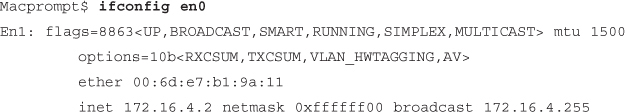</a>

<a href="#f0494-01a" id="code-f0494-01">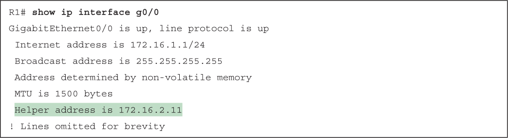</a>

<a href="#f0495-01a" id="code-f0495-01">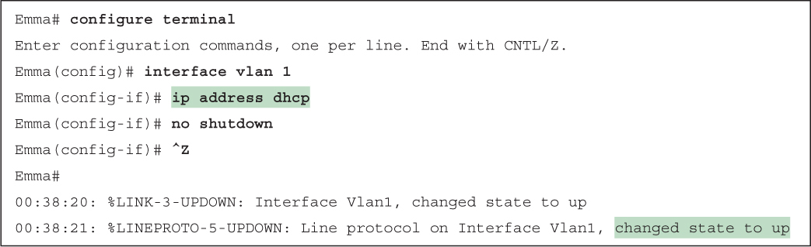</a>

<a href="#f0495-02a" id="code-f0495-02">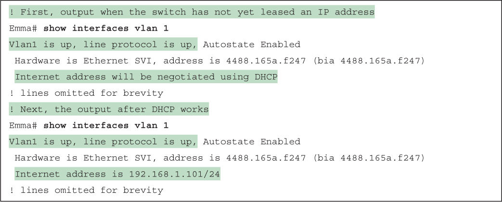</a>

<a href="#f0496-01a" id="code-f0496-01">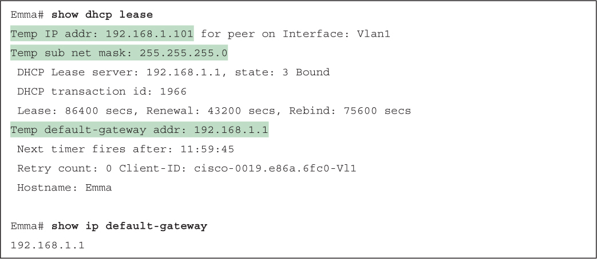</a>

<a href="#f0497-01a" id="code-f0497-01">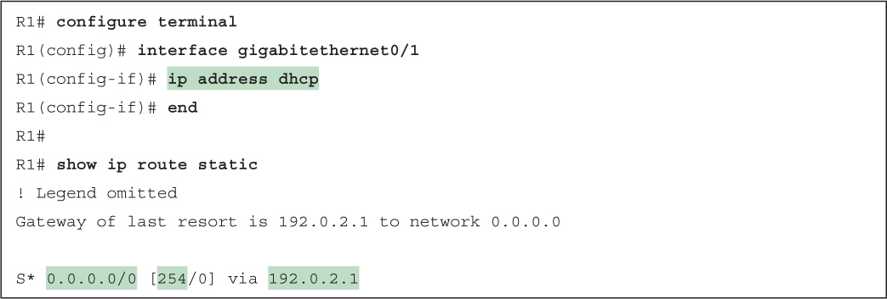</a>

<a href="#f0500-01a" id="code-f0500-01">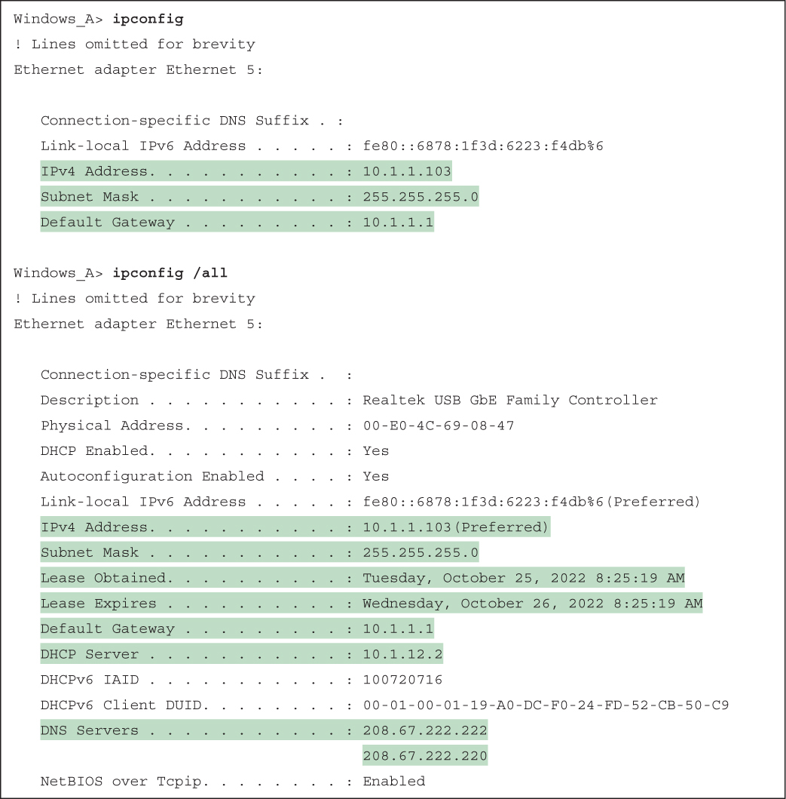</a>

<a href="#f0501-01a" id="code-f0501-01">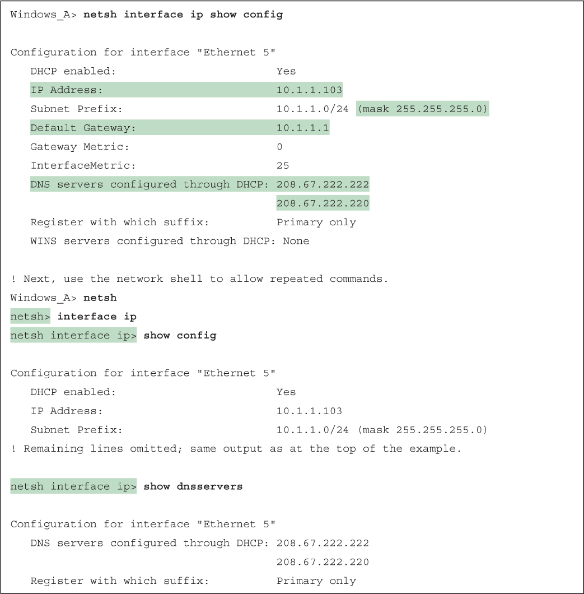</a>

<a href="#f0502-01a" id="code-f0502-01">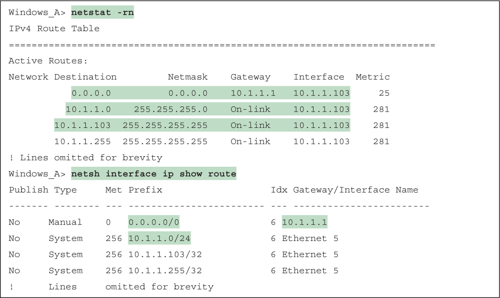</a>

<a href="#f0503-01a" id="code-f0503-01">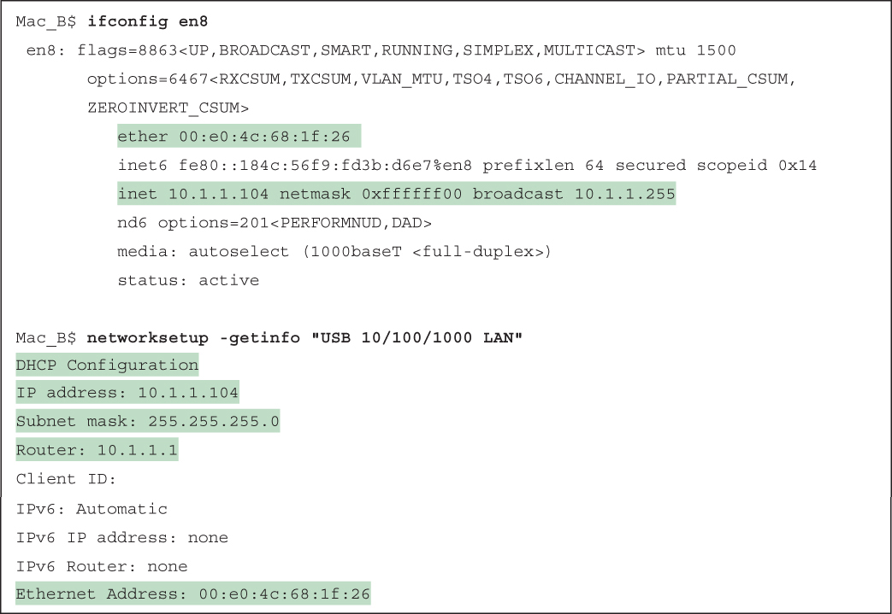</a>

<a href="#f0504-01a" id="code-f0504-01">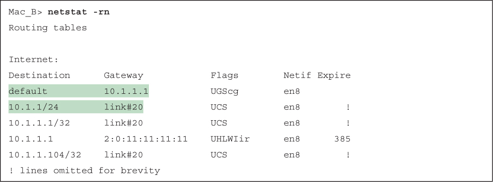</a>

<a href="#f0505-01a" id="code-f0505-01">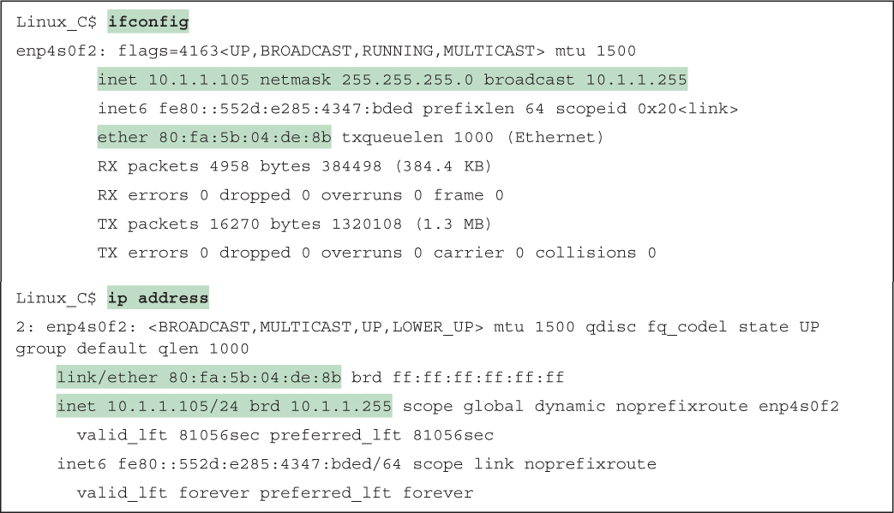</a>

<a href="#f0506-01a" id="code-f0506-01">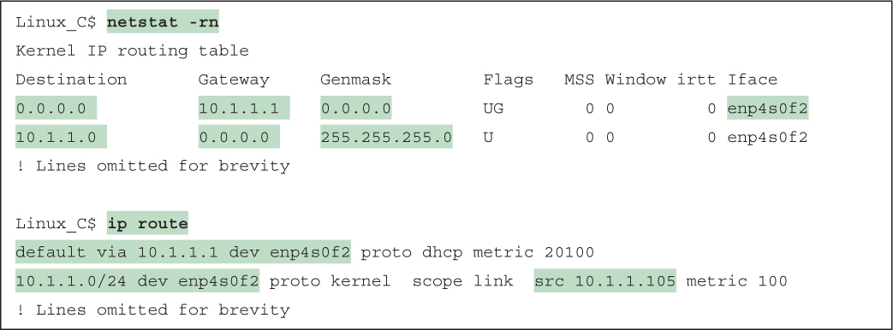</a>

<a href="#f0507-01a" id="code-f0507-01">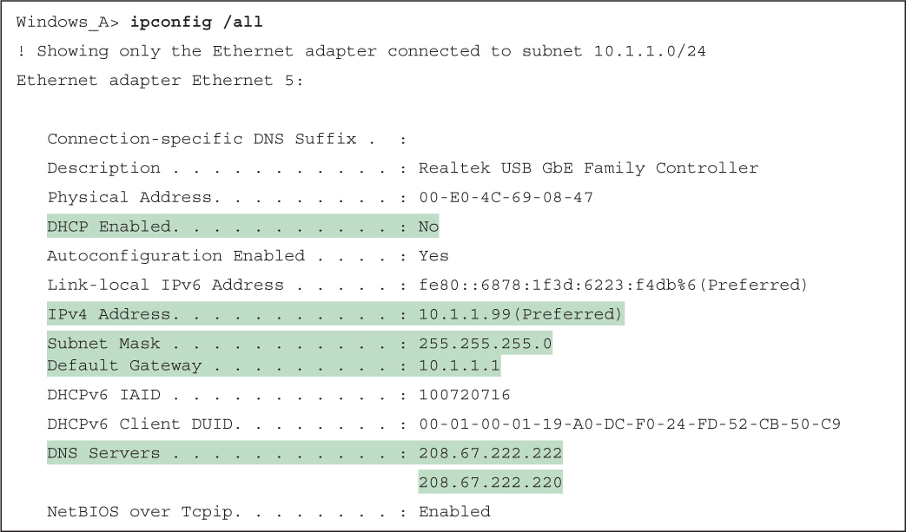</a>

<a href="#f0508-01a" id="code-f0508-01">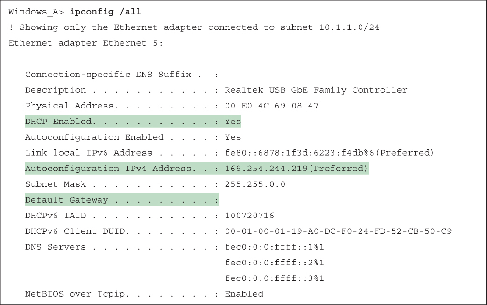</a>

<a href="#f0509-01a" id="code-f0509-01">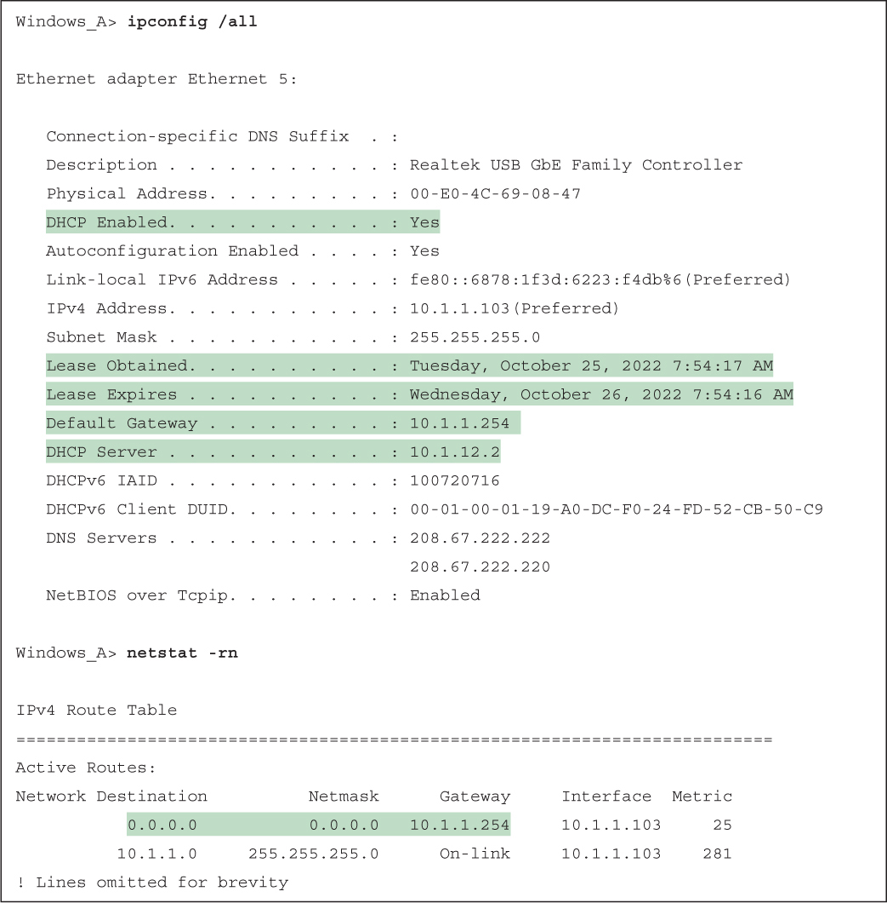</a>

</section>

</section>


<nav class="ccna-chapter-nav" aria-label="章节导航"><a href="v1-18.html">← 上一章</a><a href="v1-20.html">下一章 →</a></nav>
