
<a href="{{ '/subjects/CCNA/' | relative_url }}">← 返回 CCNA 目录</a>

第一卷 · IPv4 路由

<nav class="ccna-chapter-nav" aria-label="章节导航"><a href="v1-19.html">← 上一章</a><a href="v1-21.html">下一章 →</a></nav>



<section data-epub-type="chapter">

<h2 class="h2" id="ch20">第 20 章</h2>

<h2 class="h2a">IPv4 路由故障排查</h2>

本章涵盖以下考试主题：

2.0 网络接入

2.8 描述网络设备的管理访问方式（Telnet、SSH、HTTP、HTTPS、控制台、TACACS+/RADIUS 和云管理）

3.0 IP 连接

3.3 配置和验证 IPv4 与 IPv6 静态路由

3.3.a 默认路由

3.3.b 网络路由

3.3.c 主机路由

3.3.d 浮动静态路由

本章将注意力转向整个企业网络中的端到端路由。如何排查 IPv4 网络故障？如何验证各种 IP 路由功能是否正确运行、识别根本原因并加以修复？面对 IP 编址和子网划分方案时，如何应用本书<a href="v1-11.html#part04">第四部分</a>的子网计算知识，以及<a href="#part05">第五部分</a>其他章节中的基本地址／掩码和静态路由配置，完成这些工作？本章将回答其中一些问题。

具体来说，本章重点介绍两个工具及其用法：<em>ping</em> 和 <em>traceroute</em>。两者都测试 IPv4 数据平面，即各网络设备路由或转发 IPv4 数据包的能力。本章分别用一个主要部分介绍 <strong>ping</strong> 和 <strong>traceroute</strong>，最后简要讨论另外两种同样有助于故障排查的路由器工具：Telnet 和 Secure Shell（SSH）。

<section>

<h3 class="h3" id="ch20lev1sec1">自测</h3>

我在大多数章节中安排 DIKTA 自测题，帮助你决定如何阅读某章。但本章没有 DIKTA 自测题，因为我认为无论你已有多少相关知识，都应该阅读本章。与本书所有章节一样，本章会介绍新概念，同时也帮助你复习并加深对 IP 路由的理解。希望你喜欢本章关于使用 <strong>ping</strong> 和 <strong>traceroute</strong> 的视角。

</section>

<section>

<h3 class="h3box" id="ch20lev1sec2">基础知识</h3>

</section>

<section>

<h3 class="h3" id="ch20lev1sec3">使用 ping 命令隔离问题</h3>

有人通过电子邮件、短信或电话留言，请你调查用户的网络问题。你通过 Secure Shell（SSH）登录路由器，执行 <strong>ping</strong> 命令并成功。这个结果能够排除哪些可能原因？又有哪些原因仍可能是问题根源？

然后，你向另一个地址执行 <strong>ping</strong>，这一次失败了。同样，这次 <strong>ping</strong> 命令失败说明什么？IPv4 路由的哪些部分仍可能有问题，哪些部分现在可以确定没有问题？

<strong>ping</strong> 是最常用的网络故障排查工具之一。<strong>ping</strong> 成功时，确认了 IP 路由工作过程中的许多个别环节，从而排除当前问题的一些可能原因。<strong>ping</strong> 失败时，通常有助于缩小互联网络中根本原因可能所在的位置，进一步隔离问题。

本节首先简要解释 ping 的工作方式，随后提供一些建议和分析，说明如何使用 <strong>ping</strong> 命令排除某些因素，从而隔离问题。

<section>

<h4 class="h4" id="ch20lev2sec1">ping 命令基础</h4>

<strong>ping</strong> 命令通过向某个 IP 地址发送数据包，并期待该地址的设备返回数据包来测试连通性。命令发送的数据包表达的意思是：“如果你收到这个数据包，而且它是发给你的，请回复。”每当 <strong>ping</strong> 发送一个这样的数据包并收到另一台主机返回的消息时，<strong>ping</strong> 就知道数据包已经从源主机到达目的主机并成功返回。

更正式地说，<strong>ping</strong> 使用互联网控制消息协议（ICMP），具体采用 <a id="key_225" href="#ref-gloss_181">ICMP 回显请求</a>和 <a id="key_224" href="#ref-gloss_180">ICMP 回显应答</a>消息。ICMP 还定义许多其他消息，但这两种专门用于 <strong>ping</strong> 等命令进行连通性测试。作为协议，ICMP 不依赖 TCP 或 UDP，也不使用任何应用层协议。它作为三层的一部分工作，是辅助 IP 管理网络功能的控制协议。

<a href="#ch20fig01">图 20-1</a> 通过示例展示带 IP 首部的 ICMP 消息。本例中，主机 A 的用户打开命令提示符，执行 <strong>ping 172.16.2.101</strong>，测试到主机 B 的连通性。命令发送一个回显请求并等待（步骤 1）；主机 B 收到消息后返回回显应答（步骤 2）。

<figure class="image-c" id="ch20fig01">

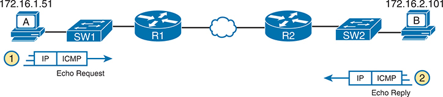

<figcaption>

<strong>图 20-1</strong> <em>主机 A 执行 <strong>ping 172.16.2.101</strong> 的原理</em>

<aside class="hidden" id="a20fig01">

示意图显示 IP 地址为 172.16.1.51 的主机 A 发送互联网控制消息协议（ICMP）回显请求。请求经过交换机 SW1 和路由器 R1，再经过另一台路由器 R2 和交换机 SW2，最终到达 IP 地址为 172.16.2.101 的主机 B。主机 B 沿相同路径返回 ICMP 回显应答。数据流用箭头表示，并分别标注请求和应答。

</aside>

</figcaption>

</figure>

许多不同设备和常见操作系统都支持 <strong>ping</strong> 命令。它具有许多选项：目的地名称或 IP 地址、发送回显请求的次数、等待回显应答的时间（超时）、数据包大小，以及许多其他选项。<a href="#exa20_1">例 20-1</a> 展示主机 A 的示例，使用与<a href="#ch20fig01">图 20-1</a> 概念相符的命令：在主机 A 上执行 <strong>ping 172.16.2.101</strong>。

<strong>例 20-1</strong> <em>主机 A 的 <strong>ping 172.16.2.101</strong> 命令输出示例</em>

<a href="#code-f0514-01" id="f0514-01a">点击此处查看代码原图</a>

<pre class="pre-ex" tabindex="0"><code class="highlight">Mac_A$ <strong>ping 172.16.2.101</strong>
PING 172.16.2.101 (172.16.2.101): 56 data bytes
64 bytes from 172.16.2.101: icmp_seq=0 ttl=64 time=1.112 ms
64 bytes from 172.16.2.101: icmp_seq=1 ttl=64 time=0.673 ms
64 bytes from 172.16.2.101: icmp_seq=2 ttl=64 time=0.631 ms
64 bytes from 172.16.2.101: icmp_seq=3 ttl=64 time=0.674 ms
64 bytes from 172.16.2.101: icmp_seq=4 ttl=64 time=0.642 ms
64 bytes from 172.16.2.101: icmp_seq=5 ttl=64 time=0.656 ms
^C
--- 172.16.2.101 ping statistics ---
6 packets transmitted, 6 packets received, 0.0% packet loss
round-trip min/avg/max/stddev = 0.631/0.731/1.112/0.171 ms</code></pre>

</section>

<section>

<h4 class="h4" id="ch20lev2sec2">使用 ping 命令测试时的策略和结果</h4>

通常，最先接听用户故障来电的人员（常称客户支持代表，CSR）无法从用户设备上执行 <strong>ping</strong>。某些情况下，指导用户输入正确命令并在机器上点击正确位置并不容易；或者用户恰好不在。作为替代，从不同路由器执行不同的 <strong>ping</strong> 命令可以帮助隔离问题。

从路由器而不是出现问题的主机执行 <strong>ping</strong> 的问题在于：任何单条路由器 <strong>ping</strong> 命令，都无法精确复制用户设备上执行 <strong>ping</strong> 的效果。不过，每种不同的 <strong>ping</strong> 命令都能进一步帮助隔离问题。本节关于 <strong>ping</strong> 的余下内容，将讨论如何从路由器命令行界面（CLI）使用各种 <strong>ping</strong> 命令排查 IPv4 路由故障。

<section>

<h5 class="h5" id="ch20lev3sec1">从问题源头附近测试较长路径</h5>

大多数问题始于“主机 X 无法与主机 Y 通信”之类的描述。很好的第一步是从 X 向主机 Y 的 IP 地址执行 <strong>ping</strong>。但假设工程师无法访问主机 X，就可以改从最接近 X 的路由器执行 <strong>ping</strong>，通常是充当 X 默认网关的路由器。

例如，在<a href="#ch20fig01">图 20-1</a> 中，假设主机 A 的用户向 IT 支持报告了向主机 B 发送数据包的问题。在主机 A 上执行 <strong>ping 172.16.2.101</strong> 是很好的第一步，但 CSR 无法访问主机 A，也联系不到其用户。因此，CSR 通过 Telnet 登录路由器 R1，并从那里 ping 主机 B，如<a href="#exa20_2">例 20-2</a> 所示。

<strong>例 20-2</strong> <em>路由器 R2 ping 主机 B（两条命令）</em>

<a href="#code-f0515-01" id="f0515-01a">点击此处查看代码原图</a>

<pre class="pre-ex" tabindex="0"><code class="highlight">R1# <strong>ping 172.16.2.101</strong>
Type escape sequence to abort.
Sending 5, 100-byte ICMP Echos to 172.16.2.101, timeout is 2 seconds:
.!!!!
Success rate is 80 percent (4/5), round-trip min/avg/max = 1/2/4 ms
R1# <strong>ping 172.16.2.101</strong>
Type escape sequence to abort.
Sending 5, 100-byte ICMP Echos to 172.16.2.101, timeout is 2 seconds:
!!!!!
Success rate is 100 percent (5/5), round-trip min/avg/max = 1/2/4 ms</code></pre>

首先，花一点时间查看第一条 IOS <strong>ping</strong> 命令的输出。默认情况下，Cisco IOS <strong>ping</strong> 发送五个回显消息，超时时间为 2 秒。如果 2 秒内没有收到回显应答，命令就将该消息判为失败，并列出一个句点。如果在 2 秒内收到成功应答，命令就显示一个感叹号。因此，第一条命令中，第一个回显应答超时，其余四个都在 2 秒内收到匹配的回显应答。

顺便一提，示例展示 <strong>ping</strong> 的一种常见且正常的现象：第一条 <strong>ping</strong> 命令最初显示一次失败，随后其余消息都成功。这通常是因为端到端路径中的某台设备缺少 ARP 表项。

现在思考故障排查，以及成功的 <strong>ping</strong> 对该互联网络当前行为说明了什么。先从整体看：

<ul class="sq">

<li>
R1 能够向主机 B（172.16.2.101）发送 ICMP 回显请求消息。
</li>

<li>
R1 默认以出接口的 IP 地址作为这些消息的源地址，本例为 172.16.4.1。
</li>

<li>
主机 B 能够向 R1 的 IP 地址 172.16.4.1 发送 ICMP 回显应答消息（主机将回显应答发往回显请求的源 IP 地址）。
</li>

</ul>

<a href="#ch20fig02">图 20-2</a> 展示数据包流。

<figure class="image-c" id="ch20fig02">

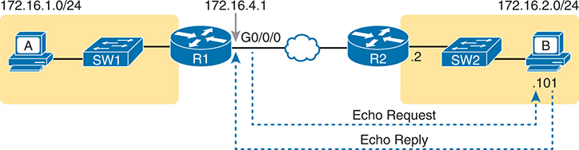

<figcaption>

<strong>图 20-2</strong> <em>标准 <strong>ping 172.6.2.101</strong> 命令使用源接口 IP 地址</em>

<aside class="hidden" id="a20fig02">

示意图显示 IP 地址为 172.16.1.0/24 的主机 A 连接交换机 SW1，SW1 连接 IP 地址为 172.16.4.1 的路由器 R1。另一侧，IP 地址为 172.16.2.101 的主机 B 连接另一台交换机 SW2，SW2 连接另一台路由器 R2。R1 的 G0/0/0 接口通过以太网 WAN 连接 R2。图中展示从路由器 R1 发往主机 B 的回显请求，以及从主机 B 返回 R1 的回显应答。

</aside>

</figcaption>

</figure>

接下来考虑 IPv4 路由。在正向，R1 必须有一条匹配主机 B 地址 172.16.2.101 的路由，它可能是静态路由，也可能通过路由协议学习。R2 也需要匹配主机 B 地址的路由，本例为通往 B 所在子网 172.16.2.0/24 的直连路由，如<a href="#ch20fig03">图 20-3</a> 上方箭头所示。

<figure class="image-c" id="ch20fig03">

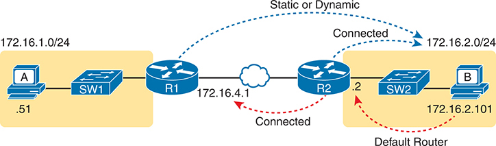

<figcaption>

<strong>图 20-3</strong> <em>R1 的 <strong>ping 172.16.2.101</strong> 成功所需的三层路由</em>

<aside class="hidden" id="a20fig03">

示意图显示主机 A 和 B 分别连接交换机 SW1 和 SW2。IP 地址为 172.16.0.51/24 的主机 A 通过 SW1 连接路由器 R1；IP 地址为 172.16.2.101/24 的主机 B 通过 SW2 连接路由器 R2。R1 和 R2 通过以太网 WAN 互连，IP 地址分别为 172.16.4.1 和 172.16.4.2。图中标明三种连接：“Connected”表示 R1 到 R2 及 R2 到主机 B 的直接链路；“Static or Dynamic”表示 R1 到主机 B 的路由；“Default Router”表示 R2 到主机 B 的直接路由。

</aside>

</figcaption>

</figure>

<a href="#ch20fig03">图 20-3</a> 下方箭头展示将 ICMP 回显应答转发回路由器 R1 的 172.16.4.1 接口所需的路由。首先，主机 B 必须有有效的默认路由器设置，因为 172.16.4.1 与主机 B 不在同一子网。R2 也必须有一条匹配目的地址 172.16.4.1 的路由（本例中很可能是直连路由）。

<a href="#exa20_2">例 20-2</a> 中成功的 <strong>ping</strong> 也要求数据链路层和物理层的各项细节正常工作。WAN 链路必须正常：路由器接口必须为 up/up，这通常表示链路能够传输数据。在 LAN 上，R2 的 LAN 接口必须为 up/up。此外，前面讨论的所有以太网 LAN 相关环节都必须正常，因为 <strong>ping</strong> 确认数据包从 R1 一路到达主机 B 并成功返回。具体包括：

<ul class="sq">

<li>
所用交换机接口处于 connected（up/up）状态。
</li>

<li>
端口安全（见《<em>CCNA 200-301 官方认证指南，第 2 卷</em>》第二版）没有过滤 R2 或主机 B 发送的帧。
</li>

<li>
STP 已将正确的端口置于转发状态。
</li>

</ul>

<a href="#exa20_2">例 20-2</a> 中的 <strong>ping 172.16.2.101</strong> 还确认 IP 访问控制列表（ACL）没有过滤这些 ICMP 消息。一个 ACL 包含一组匹配规则和动作：某些匹配的数据包被过滤（丢弃），另一些则正常继续前进。ACL 可以在数据包进入或离开路由器接口时检查它们，因此<a href="#ch20fig04">图 20-4</a> 展示 R1 和 R2 上 ACL 可能过滤（丢弃）ICMP 消息的各个位置。（请注意，R1 上的出站 ACL 不会过滤 R1 自身创建的数据包，因此 R1 上方没有向右的箭头。）

<figure class="image-c" id="ch20fig04">

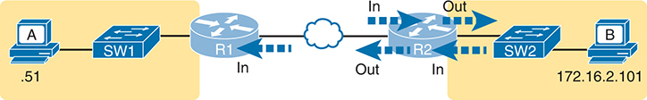

<figcaption>

<strong>图 20-4</strong> <em>IP ACL 可能过滤 ping 消息的位置</em>

<aside class="hidden" id="a20fig04">

示意图显示主机 A 和 B 分别连接交换机 SW1 和 SW2。主机 A 的 IP 地址以 .51 结尾，连接 SW1，再连接路由器 R1。R1 的入站和出站数据流分别用标为 In 和 Out 的箭头表示。R1 通过以太网 WAN 连接 R2。R2 在连接 SW2 之前也有入站和出站数据流。IP 地址为 172.16.2.101 的主机 B 连接 SW2。

</aside>

</figcaption>

</figure>

最后，R1 上成功的 <strong>ping 172.16.2.101</strong> 也可以用来合理推断 ARP 正常工作，而且交换机 SW2 为 MAC 地址表学到了 MAC 地址。R2 和主机 B 需要知道彼此的 MAC 地址，才能将 IP 数据包封装进以太网帧，这意味着双方都必须有匹配的 ARP 表项。交换机会在 R2 和主机 B 发送 ARP 消息，或发送承载 IP 数据包的帧时，学习它们使用的 MAC 地址。<a href="#ch20fig05">图 20-5</a> 展示这些表中预期包含的信息类型。

<figure class="image-c" id="ch20fig05">

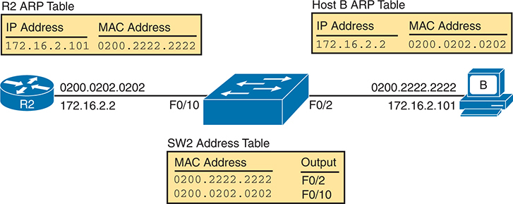

<figcaption>

<strong>图 20-5</strong> <em>路由器和主机的 ARP 表，以及交换机的 MAC 地址表</em>

<aside class="hidden" id="a20fig05">

路由器 R2 的 IP 地址为 172.16.2.2，关联 MAC 地址 0200.0202.0202。R2 的 ARP 表包含 IP 地址 172.16.2.101 与 MAC 地址 0200.2222.2222 的条目。主机 B 的 IP 地址为 172.16.2.101，关联 MAC 地址 0200.2222.2222。主机 B 的 ARP 表包含 IP 地址 172.16.2.2 与 MAC 地址 0200.0202.0202 的条目。交换机 SW2 的 MAC 地址表显示两项：MAC 地址 0200.2222.2222 的出端口为 F0/10，MAC 地址 0200.0202.0202 的出端口也为 F0/10。

</aside>

</figcaption>

</figure>

从前几页可以看到，在问题源头附近执行 <strong>ping</strong> 的策略，只要 <strong>ping</strong> 成功，就能排除两台主机之间问题的许多可能根本原因。但这种 <strong>ping</strong> 与在实际主机上执行相同 <strong>ping</strong> 的行为并不完全一致。为弥补邻近路由器上 <strong>ping</strong> 测试的不足，接下来几个示例展示测试两台主机之间路径上其他可能存在问题的部分的策略。

</section>

<section>

<h5 class="h5" id="ch20lev3sec2">使用扩展 ping 测试反向路由</h5>

前几页讨论从默认路由器执行 ping，却错过了更全面测试 IP 路由的机会。这些测试检查<a id="key_222" href="#ref-gloss_150">正向路由</a>，即朝向目的地的路由。然而，从默认路由执行 ping 并不会测试返回原始主机的<a id="key_227" href="#ref-gloss_332">反向路由</a>。

例如，再看<a href="#ch20fig02">图 20-2</a> 的互联网络，注意反向路由并不指向主机 A 子网中的地址。R1 处理 <strong>ping 172.16.2.101</strong> 时，必须为回显请求选择源 IP 地址，而路由器会选择<em>出接口的 IP 地址</em>。R1 发往主机 B 的回显请求使用源 IP 地址 172.16.4.1（R1 的 G0/0/0 IP 地址），回显应答也返回该地址 172.16.4.1。

标准 ping 往往无法测试你需要测试的反向路由。本例中，R1 上标准的 <strong>ping 172.16.2.101</strong> 并不测试路由器能否路由回子网 172.16.1.0/24，而是测试它们到子网 172.16.4.0 的路由。更好的 ping 测试应检查返回主机 A 子网的路由；从 R1 执行<em>扩展 ping</em> 就能做到。扩展 ping 允许 R1 的 <strong>ping</strong> 使用 R1 位于子网 172.16.1.0/24 中的 LAN IP 地址，这样回显应答就会流向主机 A 的子网，如<a href="#ch20fig06">图 20-6</a> 所示。

<figure class="image-c" id="ch20fig06">

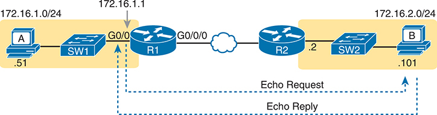

<figcaption>

<strong>图 20-6</strong> <em>扩展 ping 命令测试通往 172.16.1.51（主机 A）的路由</em>

<aside class="hidden" id="a20fig06">

左侧主机 A 标有 IP 地址 172.16.1.0/24，下方标有 .51，连接交换机 SW1。SW1 通过 G0/0 接口连接路由器 R1，该接口 IP 地址为 172.16.1.1。R1 通过 G0/0/0 端口和以太网 WAN 连接另一台路由器 R2。R2 连接 SW2，再连接主机 B；主机 B 标有 IP 地址 172.16.2.0/24，下方标有 .101。图中箭头标明从 R1 到主机 B 的“Echo Request”和从主机 B 到 R1 的“Echo Reply”，展示测试期间发送和接收 ping 的过程。

</aside>

</figcaption>

</figure>

扩展 <strong>ping</strong> 允许用户在一条可能很长的命令中输入全部参数，也允许用户只执行 <strong>ping</strong> 并按 Enter，随后由 IOS 提问，用户逐一回答以完成命令，如<a href="#exa20_3">例 20-3</a> 所示。示例展示 R1 上符合<a href="#ch20fig06">图 20-6</a> 逻辑的 <strong>ping</strong>。也可以直接在命令行执行同样的命令：<strong>ping 172.16.2.101 source 172.16.1.1</strong>。

<strong>例 20-3</strong> <em>使用扩展 ping 测试反向路由</em>

<a href="#code-f0518-01" id="f0518-01a">点击此处查看代码原图</a>

<pre class="pre-ex" tabindex="0"><code class="highlight">R1# <strong>ping</strong>
Protocol [ip]:
Target IP address: <strong>172.16.2.101</strong>
Repeat count [5]:
Datagram size [100]:
Timeout in seconds [2]:
Extended commands [n]: <strong>y</strong>
Source address or interface: <strong>172.16.1.1</strong>
Type of service [0]:
Set DF bit in IP header? [no]:
Validate reply data? [no]:
Data pattern [0xABCD]:
Loose, Strict, Record, Timestamp, Verbose[none]:
Sweep range of sizes [n]:
Type escape sequence to abort.
Sending 5, 100-byte ICMP Echos to 172.16.2.101, timeout is 2 seconds:
Packet sent with a source address of 172.16.1.1
!!!!!
Success rate is 100 percent (5/5), round-trip min/avg/max = 1/2/4 ms</code></pre>

这条扩展 <strong>ping</strong> 对向右发送的回显请求测试相同路由，但强制对向左返回 ICMP 回显应答的路由进行更有针对性的测试。在这一方向，R2 需要匹配地址 172.16.1.1 的路由，它很可能是通往子网 172.16.1.0/24 的路由，也就是主机 A 所在子网。

从故障排查角度看，同时使用标准和扩展 <strong>ping</strong> 很有帮助。但两者都无法精确模拟主机自身创建的 <strong>ping</strong>，因为路由器无法以该主机 IP 地址发送数据包。例如，<a href="#exa20_3">例 20-3</a> 的扩展 <strong>ping</strong> 使用源 IP 地址 172.16.1.1，它不是主机 A 的 IP 地址。因此，本章迄今两个示例中的标准和扩展 <strong>ping</strong> 都无法测试某些问题，例如：

<ul class="sq">

<li>
根据主机 A 的 IP 地址丢弃数据包，却允许匹配路由器 IP 地址数据包的 IP ACL
</li>

<li>
根据主机 A 的 MAC 地址过滤其帧的 LAN 交换机端口安全
</li>

<li>
路由器上恰好匹配主机 A 地址 172.16.1.51 的 IP 路由，与匹配 R1 地址 172.16.1.1 的路由不同
</li>

<li>
主机 A 的默认路由器设置有问题
</li>

</ul>

注意

IP ACL 和 LAN 交换机端口安全将在《<em>CCNA 200-301 官方认证指南，第 2 卷</em>》第二版中介绍。目前，只需知道 IP ACL 可以在路由器上过滤数据包，重点检查三层和四层首部。端口安全可以在二层交换机上启用，根据源 MAC 地址过滤。

</section>

<section>

<h5 class="h5" id="ch20lev3sec3">使用标准 ping 测试 LAN 邻居</h5>

对 LAN 上另一台设备执行 <strong>ping</strong>，能够迅速确认 LAN 是否可以传送数据包和帧。具体来说，成功的 <strong>ping</strong> 能排除许多可能的根本原因。例如，<a href="#ch20fig07">图 20-7</a> 展示 R1 执行 <strong>ping 172.16.1.51</strong> 时产生的 ICMP 消息，它测试的是与 R1 位于同一 VLAN 的主机 A。

<figure class="image-c" id="ch20fig07">

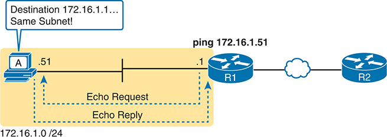

<figcaption>

<strong>图 20-7</strong> <em>标准 <strong>ping</strong> 命令确认 LAN 正常工作</em>

<aside class="hidden" id="a20fig07">

子网 172.16.1.0/24 上 IP 地址为 172.16.1.51 的主机 A，在收到回显请求后，向 IP 地址为 .1 的路由器 R1 发送回显应答。主机上方说明目的地确认位于同一子网。R1 向 172.16.1.51 发送 ping。回显应答确认局域网（LAN）正常工作。

</aside>

</figcaption>

</figure>

如果 ping 成功，就能确认以下事项，从而排除部分潜在问题：

<ul class="sq">

<li>
地址为 172.16.1.51 的主机作出了应答。
</li>

<li>
LAN 能在 R1 与主机 172.16.1.51 之间双向传送单播帧。
</li>

<li>
可以合理推断交换机已学到路由器和主机的 MAC 地址，并将其加入 MAC 地址表。
</li>

<li>
主机 A 和路由器 R1 完成了 ARP 过程，在各自的地址解析协议（ARP）表中列出了对方。
</li>

</ul>

即使两台设备位于同一子网，ping 失败仍可能指向各种问题，例如以下列表中的问题。如果 R1 上的 <strong>ping 172.16.1.51</strong> 失败（见<a href="#ch20fig07">图 20-7</a>），该结果指向以下潜在根本原因：

<ul class="sq">

<li>
<strong>IP 编址问题：</strong>主机 A 或路由器可能配置了错误的 IP 地址。
</li>

<li>
<strong>IP 掩码问题：</strong>主机或路由器使用错误子网掩码，会改变其对直连子网地址范围的计算结果，从而影响转发逻辑。例如，主机地址为 172.16.1.51，却使用错误掩码 255.255.255.240，就会认为路由器地址 172.16.1.1 位于另一个子网。
</li>

<li>
<strong>DHCP 问题：</strong>如果使用动态主机配置协议（DHCP），可能存在许多问题。<a href="v1-19.html#ch19">第 19 章</a>“<a href="v1-19.html#ch19">主机上的 IP 编址</a>”对此进行了较深入的讨论。
</li>

<li>
<strong>VLAN 中继问题：</strong>路由器可能配置了 802.1Q 中继，而交换机没有配置，或者相反。
</li>

<li>
<strong>LAN 问题：</strong>二层交换机可能存在多种问题，阻止任何帧在主机 A 与路由器之间流动。
</li>

</ul>

因此，无论 ping 成功还是失败，仅从路由器 ping LAN 主机就有助于进一步隔离问题。

</section>

<section>

<h5 class="h5" id="ch20lev3sec4">使用扩展 ping 测试 LAN 邻居</h5>

从路由器对 LAN 主机执行标准 ping，并不测试主机的默认路由器设置，但扩展 ping 可以。两种测试都很有用，尤其有助于隔离问题，因为：

<ul class="sq">

<li>
如果对本地 LAN 主机的标准 ping 成功……
</li>

<li>
但对同一 LAN 主机的扩展 ping 失败……
</li>

<li>
问题很可能以某种方式与主机的默认路由器设置有关。
</li>

</ul>

要理解标准和扩展 ping 结果为何具有不同意义，先看前面<a href="#ch20fig07">图 20-7</a> 中 R1 的标准 <strong>ping 172.16.1.51</strong>。作为标准 <strong>ping</strong>，R1 使用 LAN 接口 IP 地址 172.16.1.1 作为 ICMP 回显请求的源地址。因此，主机 A 返回 ICMP 回显应答时，认为目的地址 172.16.1.1 位于同一子网。即使主机 A 完全没有默认路由器设置，发回 172.16.1.1 的 ICMP 回显应答仍能成功！

相比之下，<a href="#ch20fig08">图 20-8</a> 展示在 R1 上使用扩展 ping 的不同之处。本地路由器 R1 执行扩展 ping，使用其 WAN IP 地址 172.16.4.1 作为 ICMP 回显请求的源地址，这意味着主机 A 的 ICMP 回显应答将发往另一个子网的地址，迫使主机 A 使用默认路由器设置。

<figure class="image-c" id="ch20fig08">

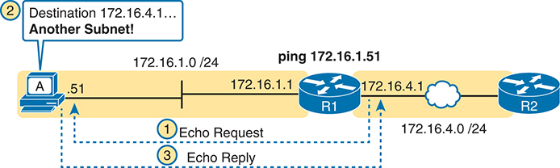

<figcaption>

<strong>图 20-8</strong> <em>扩展 <strong>ping</strong> 命令确实会测试主机 A 的默认路由器设置</em>

<aside class="hidden" id="a20fig08">

网络布局中，子网 172.16.1.0/24 上 IP 地址为 .51 的主机 A，在收到 IP 地址为 172.16.1.1 的路由器 R1 的请求后，向其发送回显应答。随后 R1 尝试 ping 另一台路由器 R2，其 IP 地址为 172.16.4.1，位于另一个子网。两台路由器通过以太网 WAN（172.16.1/24 和 172.16.4/24）连接。过程包含三步：R1 向主机 A 发送回显请求，R1 ping IP 地址为 172.16.4. 的 R2，以及回显应答返回 R1。

</aside>

</figcaption>

</figure>

前面两幅图的对比展示了网络故障排查中最经典的错误之一。有时，工程师会连接路由器，ping 直连 LAN 上的主机，结果成功，于是认为路由器与主机之间的网络层没有问题，继续检查其他地方，而实际问题仍存在于主机的默认路由器设置中。

</section>

<section>

<h5 class="h5" id="ch20lev3sec5">使用标准 ping 测试 WAN 邻居</h5>

与跨 LAN 的标准 ping 测试一样，通过串行或以太网 WAN 链路在路由器之间进行标准 ping，可以测试链路是否能够传送 IPv4 数据包。在合理设计的 IPv4 编址方案中，同一串行或以太网 WAN 链路上的两台路由器，其 IP 地址应属于同一子网。从一台路由器 ping 另一台的 IP 地址，确认 IP 数据包能够通过链路往返，如<a href="#ch20fig09">图 20-9</a> 中 R1 上的 <strong>ping 172.16.4.2</strong> 所示。

<figure class="image-c" id="ch20fig09">

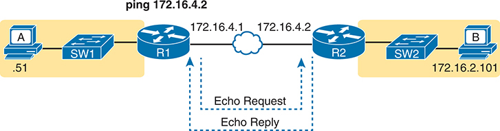

<figcaption>

<strong>图 20-9</strong> <em>通过 WAN 链路进行 ping</em>

<aside class="hidden" id="a20fig09">

网络布局中，IP 地址末段为 .51 的主机 A 连接 SW1，SW1 连接路由器 R1。IP 地址为 172.16.4.1 的 R1 向 IP 地址为 172.16.4.2 的路由器 R2 发送回显请求。随后 R1 尝试 ping 172.16.4.2 子网。两台路由器通过以太网 WAN 连接。R2 连接 IP 地址为 172.16.2.101 的主机 B。

</aside>

</figcaption>

</figure>

成功 ping 通两台路由器之间以太网 WAN 链路另一端的 IP 地址，可以确认若干具体事实，例如：

<ul class="sq">

<li>
两台路由器的 WAN 接口都处于 up/up 状态。
</li>

<li>
链路的第一层和第二层功能正常。
</li>

<li>
路由器认为相邻路由器的 IP 地址位于同一子网。
</li>

<li>
两台路由器的入站 ACL 都没有过滤各自收到的数据包。
</li>

<li>
远程路由器配置了预期 IP 地址（本例为 172.16.4.2）。
</li>

</ul>

ping 相邻路由器并不测试其他许多功能。不过，虽然测试范围有限，却可以排除 WAN 链路存在第一层或第二层问题，并排除某些基本的三层编址问题。

</section>

</section>

<section>

<h4 class="h4" id="ch20lev2sec3">使用名称和 IP 地址进行 ping</h4>

本章迄今所有示例都是 ping IP 地址。不过，<strong>ping</strong> 可以使用<a id="key_223" href="#ref-gloss_175">主机名</a>，ping 主机名允许网络工程师进一步测试域名系统（<a id="key_220" href="#ref-gloss_108">DNS</a>）过程是否正常工作。

首先，几乎所有 TCP/IP 应用程序都使用主机名而非 IP 地址标识另一台设备。没有人打开浏览器就输入 72.163.4.185，而是输入 <a href="https://www.cisco.com">https://www.cisco.com</a> 这样的网页地址，其中包含主机名 <a href="http://www.cisco.com">www.cisco.com</a>。随后，主机在向特定 IP 地址发送数据之前，必须先请求 DNS 服务器将该主机名解析为对应的 IP 地址。

例如，在本章多个示例所用的小型互联网络中，主机 A 上的 <strong>ping B</strong> 会测试 A 的 DNS 设置，如<a href="#ch20fig10">图 20-10</a> 所示。当主机 A 发现使用了主机名 B 时，会先查看本地 DNS 名称缓存，确定是否已解析过名称 B。如果没有，主机 A 首先请求 DNS 提供（解析）与名称对应的 IP 地址（图中步骤 1）。只有这样，它才会向主机 B 的 IP 地址 172.16.2.101 发送数据包（步骤 2）。

<figure class="image-c" id="ch20fig10">

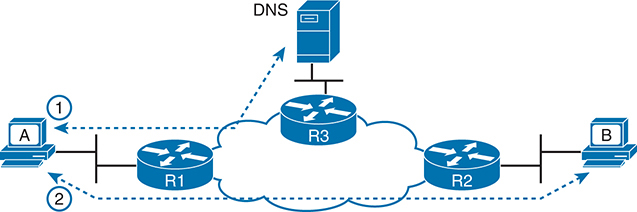

<figcaption>

<strong>图 20-10</strong> <em>主机 A 的 DNS 名称解析</em>

<aside class="hidden" id="a20fig10">

主机 A 发起过程，向路由器 R1 发送查询。R1 将查询转发到连接 DNS 服务器的路由器 R3。DNS 服务器处理查询并将响应返回 R3，R3 再经由 R1 将响应路由回主机 A。第二步中，主机 A 向 R1 发送查询，R1 将查询转发到连接主机 B 的 R2。主机 B 处理查询，并通过 R2 和 R1 将响应返回主机 A。

</aside>

</figcaption>

</figure>

故障排查时，从主机使用主机名进行 ping 测试很有帮助，当然也会测试主机自身的 DNS 客户端设置。例如，一种经典对比是先使用主机名 ping 目的主机，这需要 DNS 请求；然后重复相同测试，但使用目的主机的 IP 地址代替名称，这不需要 DNS 请求。如果 ping 主机名失败，而 ping IP 地址成功，问题通常与 DNS 有关。

路由器和交换机也可以为 <strong>ping</strong> 和 <strong>traceroute</strong> 等引用主机的命令使用名称解析。网络设备可以使用 DNS、本地定义的主机名，或同时使用两者。<a href="#exa20_4">例 20-4</a> 展示最近几个示例中 R1 的 DNS 配置。具体来说：

<ul class="sq">

<li>
<strong>ip domain lookup</strong> 命令指示路由器尝试使用 DNS 服务器。
</li>

<li>
<strong>ip name-server</strong> {<em>address</em> [<em>address address</em>]} 命令定义 DNS 服务器 IP 地址列表。
</li>

<li>
<strong>ip domain name</strong> <em>domain-name</em> 命令定义设备使用的域。
</li>

</ul>

示例中请注意，一旦配置为使用 DNS，<strong>ping hostB</strong> 就能成功。输出显示 DNS 解析为名称 hostB 找到的 IP 地址为 172.16.2.101。

<strong>例 20-4</strong> <em>配置 R1 使用 DNS，DNS 中包含 hostB 名称</em>

<a href="#code-f0523-01" id="f0523-01a">点击此处查看代码原图</a>

<pre class="pre-ex" tabindex="0"><code class="highlight">R1# <strong>configure terminal</strong>
Enter configuration commands, one per line.  End with CNTL/Z.
R1(config)# <strong>ip domain lookup</strong>
R1(config)# <strong>ip domain name example.com</strong>
R1(config)# <strong>ip name-server 8.8.8.8 8.8.8.4</strong>
R1(config)# <strong>^Z</strong>
R1#
R1# <strong>ping</strong> hostB
Type escape sequence to abort.
Sending 5, 100-byte ICMP Echos to 172.16.2.101, timeout is 2 seconds:
!!!!!
Success rate is 100 percent (5/5), round-trip min/avg/max = 1/1/4 ms</code></pre>

注意

较旧的 IOS 版本使用 <strong>ip domain-name</strong> <em>domain-name</em> 语法，而不是较新的 <strong>ip domain name</strong> <em>domain-name</em>（以空格代替连字符）。

注意

练习时，特别是在实验室设备上，你可能希望使用 <strong>no ip domain lookup</strong> 禁用 DNS 解析。Cisco 路由器和交换机默认通过 <strong>ip domain lookup</strong> 启用 DNS 解析，但没有通过 <strong>ip name-server</strong> 标识名称服务器。这两个默认设置会使路由器或交换机为了执行名称解析，在每个直连子网上广播寻找 DNS 服务器。此外，如果命令的第一个单词拼错，IOS 会认为你把该词用作主机名，并尝试解析这个拼错的命令。结果是：任何命令首词拼写错误，都会因默认名称解析设置而导致等待几分钟，才能重新取得 CLI 控制权。

在不打算使用 DNS 的实验室环境中，通过 <strong>no ip domain lookup</strong> 禁用 DNS 解析。

也可以将路由器或交换机配置为使用本地配置的主机名，或同时使用本地名称和 DNS。采用<a href="#exa20_5">例 20-5</a> 这样的配置，为每个主机名添加全局配置命令 <strong>ip host</strong> <em>name address</em>。无论是否使用 DNS，或者是否配置 <strong>ip domain lookup</strong>，路由器或交换机都会查找本地主机名。

<strong>例 20-5</strong> <em>配置使用本地主机名，R1 配置中包含 hostB 名称</em>

<a href="#code-f0523-02" id="f0523-02a">点击此处查看代码原图</a>

<pre class="pre-ex" tabindex="0"><code class="highlight">R1# <strong>configure terminal</strong>
Enter configuration commands, one per line.  End with CNTL/Z.
R1(config)# <strong>ip host hostB 172.16.2.101</strong>
R1(config)# <strong>^Z</strong>
R1#
R1# <strong>show hosts</strong>
Default domain is example.com
Name servers are 8.8.8.8, 8.8.8.4
NAME  TTL  CLASS   TYPE      DATA/ADDRESS
-----------------------------------------
 101.2.16.172.in-addr.arpa        10       IN       PTR     hostB
 hostB                            10       IN       A       172.16.2.101</code></pre>

</section>

</section>

<section>

<h3 class="h3" id="ch20lev1sec4">使用 traceroute 命令隔离问题</h3>

与 <strong>ping</strong> 一样，<strong>traceroute</strong> 帮助网络工程师隔离问题。两者比较如下：

<ul class="sq">

<li>
两者都在网络中发送消息以测试连通性。
</li>

<li>
两者都依赖其他设备返回应答。
</li>

<li>
两者都得到多种操作系统的广泛支持。
</li>

<li>
两者都可以使用主机名或 IP 地址标识目的地。
</li>

<li>
在路由器上，两者都有标准版和扩展版，可以更好地测试反向路由。
</li>

</ul>

最大的差异在于，<strong>traceroute</strong> 输出的结果更详细，而生成这些输出也需要 <strong>traceroute</strong> 花费额外时间和工作。接下来这一主要部分研究 traceroute 的工作方式，并提供一些建议，说明如何利用更详细的信息更快隔离 IP 路由问题。

<section>

<h4 class="h4" id="ch20lev2sec4">traceroute 基础</h4>

假设某位网络工程师或 CSR 开始排查问题。她从用户主机执行 ping，又从附近路由器执行 ping，几条命令之后，确信主机确实能收发 IP 数据包。问题可能尚未解决，但看起来并不是网络问题。

现在假设另一个问题出现，这次 <strong>ping</strong> 失败了。看来 IP 网络中确实存在问题。问题在哪里？工程师应该进一步检查何处？虽然 <strong>ping</strong> 有助于隔离问题来源，但 <strong>traceroute</strong> 可能是更好的选择。<strong>traceroute</strong> 通过展示数据包在被丢弃前能在 IP 网络中走多远，系统地帮助定位路由问题。

<strong>traceroute</strong> 标识从源主机到目的主机正向路径上的路由器。具体而言，它列出各条独立路由中每台路由器的下一跳 IP 地址。例如，在<a href="#ch20fig11">图 20-11</a> 的主机 A 上执行 <strong>traceroute 172.16.2.101</strong>，将识别路由器 R1 的一个 IP 地址、R2 的另一个 IP 地址，最后识别主机 B，如图所示。随后<a href="#exa20_6">例 20-6</a> 列出主机 A 上该命令的输出。

<figure class="image-c" id="ch20fig11">

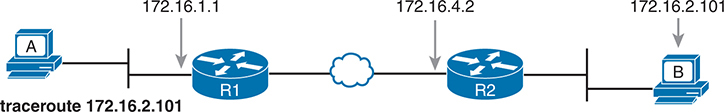

<figcaption>

<strong>图 20-11</strong> <em>成功的 <strong>traceroute 172.16.2.101</strong> 命令识别出的 IP 地址</em>

<aside class="hidden" id="a20fig11">

主机 A 发起 traceroute，经过两台路由器 R1 和 R2，其 IP 地址分别为 172.16.1.1 和 172.16.4.2。两台路由器通过以太网 WAN 连接。traceroute 最终到达目的地主机 B，其 IP 地址为 172.16.2.101。

</aside>

</figcaption>

</figure>

<strong>例 20-6</strong> <em>主机 A 上 <strong>traceroute 172.16.2.101</strong> 的输出</em>

<a href="#code-f0525-01" id="f0525-01a">点击此处查看代码原图</a>

<pre class="pre-ex" tabindex="0"><code class="highlight">Mac_A$ <strong>traceroute 172.16.2.101</strong>
traceroute to 172.16.2.101, 64 hops max, 52 byte packets
  1 172.16.1.1 (172.16.1.1) 0.870 ms 0.520 ms 0.496 ms
  2 172.16.4.2 (172.16.4.2) 8.263 ms 7.518 ms 9.319 ms
  3 172.16.2.101 (172.16.2.101) 16.770 ms 9.819 ms 9.830 ms</code></pre>

<section>

<h5 class="h5" id="ch20lev3sec6">traceroute 命令的工作方式</h5>

<strong>traceroute</strong> 通过生成会触发路由器错误消息的数据包来收集信息；这些消息标识路由器，使 <strong>traceroute</strong> 能在输出中列出其 IP 地址。该错误消息是 ICMP 生存时间超限（TTL Exceeded）消息，最初用于在数据包陷入网络循环时通知主机。

暂时不看 traceroute，转而关注 IP 路由。IPv4 路由器通过丢弃循环的 IP 数据包，部分地解决路由环路问题。为此，IPv4 首部包含名为生存时间（TTL）的字段。创建数据包的原始主机设置初始 TTL 值，随后每台转发数据包的路由器将 TTL 减 1。当某路由器将 TTL 减到 0 时，它就认为数据包正在循环，并丢弃数据包。路由器还会发送 ICMP TTL Exceeded 消息，通知发送该被丢弃数据包的主机。

现在回到 traceroute。它发送 TTL 较低的消息，以迫使路由器返回 TTL Exceeded。具体而言，<strong>traceroute</strong> 首先发送若干数据包（通常三个），每个首部的 TTL 字段都为 1。当数据包到达下一台路由器时——在<a href="#ch20fig12">图 20-12</a> 示例中为主机 A 的默认路由器 R1——路由器将 TTL 减到 0 并丢弃数据包，然后向主机 A 发送 TTL Exceeded 消息，为 <strong>traceroute</strong> 标识该路由器的 IP 地址。

<figure class="image-c" id="ch20fig12">

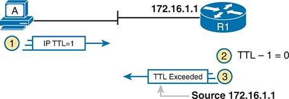

<figcaption>

<strong>图 20-12</strong> <em><strong>traceroute</strong> 如何识别路径中的第一台路由器</em>

<aside class="hidden" id="a20fig12">

主机 A 向 IP 地址为 172.16.1.1 的路由器 R1 发送 TTL 为 1 的 IP 数据包。R1 收到后将 TTL 减 1，结果为 0，因此从源地址 172.16.1.1 向主机 A 返回“TTL Exceeded”消息。

</aside>

</figcaption>

</figure>

<strong>traceroute</strong> 发送多个 TTL=1 的数据包，并根据 TTL Exceeded 消息的源 IP 地址，检查它们是否来自同一路由器。假设消息来自同一路由器，<strong>traceroute</strong> 就将该 IP 地址列为下一行命令输出。

为了找到路径中的所有路由器，并最终确认数据包一路到达目的主机，<strong>traceroute</strong> 先发送一小组 TTL=1 的数据包，再发送一组 TTL=2 的数据包，随后依次为 3、4 等，直到目的主机应答。<a href="#ch20fig13">图 20-13</a> 展示第二组中 TTL=2 的数据包。本例中，一台路由器 R1 实际转发了数据包，而另一台路由器 R2 恰好将 TTL 减为 0，导致向主机 A 返回 TTL Exceeded 消息。

<figure class="image-c" id="ch20fig13">

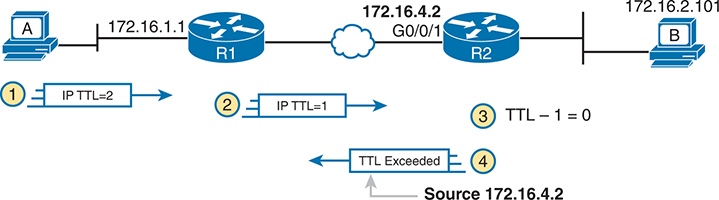

<figcaption>

<strong>图 20-13</strong> <em><strong>traceroute</strong> 发送的 TTL=2 消息</em>

<aside class="hidden" id="a20fig13">

IP 地址为 172.16.1.1 的主机 A 发送 TTL 为 2 的 IP 数据包。数据包首先到达路由器 R1，TTL 减为 1；随后到达第二台路由器 R2，其接口标为 G0/0/1，IP 地址为 172.16.4.2。在这里 TTL 再次递减至 0。R2 向源主机 A 返回“TTL Exceeded”消息。R2 连接 IP 地址为 172.16.2.101 的主机 B。

</aside>

</figcaption>

</figure>

图中展示四个步骤：

<ol class="number">

<li>
<strong>traceroute</strong> 发送第二组中的一个数据包，TTL=2。
</li>

<li>
路由器 R1 处理数据包，将 TTL 减为 1，并转发数据包。
</li>

<li>
路由器 R2 处理数据包，将 TTL 减为 0，并丢弃数据包。
</li>

<li>
R2 通过发送 ICMP TTL Exceeded 消息，通知发送主机数据包已被丢弃。该消息的源 IP 地址为 172.16.4.2。
</li>

</ol>

最后，路由器返回的超时消息选择哪个源 IP 地址，对 <strong>traceroute</strong> 输出影响很大。大多数路由器采用较简单的逻辑，也使 <strong>traceroute</strong> 等命令输出更一致、更有意义：根据被丢弃的原始消息到达的接口，选择 TTL Exceeded 消息的源 IP 地址。在<a href="#ch20fig13">图 20-13</a> 中，步骤 2 的原始消息到达 R2 的 G0/0/1 接口，因此步骤 3 中，R2 使用 G0/0/1 的 IP 地址作为 TTL Exceeded 消息源地址，并通过该接口发送消息。

</section>

<section>

<h5 class="h5" id="ch20lev3sec7">标准与扩展 traceroute</h5>

<strong>traceroute</strong> 的标准和扩展选项提供许多与 <strong>ping</strong> 相同的选项。例如，<a href="#exa20_7">例 20-7</a> 列出 R1 上标准 <strong>traceroute</strong> 的输出。与标准 <strong>ping</strong> 一样，标准 <strong>traceroute</strong> 根据命令所发数据包的出接口选择 IP 地址。因此，本例中 R1 发送的数据包采用源 IP 地址 172.16.4.1，即 R1 的 G0/0/0 IP 地址。

<strong>例 20-7</strong> <em>R1 上的标准 <strong>traceroute</strong> 命令</em>

<a href="#code-f0527-01" id="f0527-01a">点击此处查看代码原图</a>

<pre class="pre-ex" tabindex="0"><code class="highlight">R1# <strong>traceroute 172.16.2.101</strong>
Type escape sequence to abort.
Tracing the route to 172.16.2.101
VRF info: (vrf in name/id, vrf out name/id)
   1 172.16.4.2 0 msec 0 msec 0 msec
   2 172.16.2.101 0 msec 0 msec *</code></pre>

如<a href="#exa20_8">例 20-8</a> 所示，扩展 <strong>traceroute</strong> 遵循与扩展 <strong>ping</strong> 相同的基本命令结构。用户可以在一行命令中输入全部参数，但更容易的方式是只输入 <strong>traceroute</strong> 并按 Enter，由 IOS 提示所有参数，包括数据包的源 IP 地址（本例为 172.16.1.1）。

<strong>例 20-8</strong> <em>R1 上的扩展 <strong>traceroute</strong> 命令</em>

<a href="#code-f0527-02" id="f0527-02a">点击此处查看代码原图</a>

<pre class="pre-ex" tabindex="0"><code class="highlight">R1# <strong>traceroute</strong>
Protocol [ip]:
Target IP address: <strong>172.16.2.101</strong>
Source address: <strong>172.16.1.1</strong>
Numeric display [n]:
Timeout in seconds [3]:
Probe count [3]:
Minimum Time to Live [1]:
Maximum Time to Live [30]:
Port Number [33434]:
Loose, Strict, Record, Timestamp, Verbose[none]:
Type escape sequence to abort.
Tracing the route to 172.16.2.101
VRF info: (vrf in name/id, vrf out name/id)
   1 172.16.4.2 0 msec 0 msec 0 msec
   2 172.16.2.101 0 msec 0 msec *</code></pre>

大多数操作系统（包括 Cisco IOS）都有 <strong>ping</strong> 和 <strong>traceroute</strong> 命令。不过，有些操作系统的 <strong>traceroute</strong> 语法略有不同。例如，大多数 Windows 操作系统支持 <strong>tracert</strong> 和 <strong>pathping</strong>，而不是 <strong>traceroute</strong>。Linux 和 OS X 支持 <strong>traceroute</strong> 命令。

注意

主机操作系统的 <strong>traceroute</strong> 通常创建 ICMP 回显请求，而 Cisco IOS 的 <strong>traceroute</strong> 则创建带 UDP 首部的 IP 数据包。这一点目前看似微不足道，但请注意，ACL 实际上可能过滤主机 <strong>traceroute</strong> 消息的流量，却不过滤路由器 <strong>traceroute</strong> 的流量，反之亦然。

</section>

</section>

</section>

<section>

<h3 class="h3" id="ch20lev1sec5">Telnet 和 SSH</h3>

<strong>ping</strong> 和 <strong>traceroute</strong> 为网络人员提供了两个出色工具，用来开始隔离 IP 路由问题的原因。但这两条命令不会告诉我们各网络设备内部的运行状态。当你通过 <strong>ping</strong> 和 <strong>traceroute</strong> 开始了解问题类型及可能位置后，下一步就是查看各种路由器和交换机功能的状态。一种方法是通过 Telnet 或 Secure Shell（SSH）登录设备。

<section>

<h4 class="h4" id="ch20lev2sec5">使用 IOS Telnet 和 SSH 客户端的常见原因</h4>

通常，网络工程师使用 PC、平板电脑或其他用户设备上的 Telnet 或 SSH 客户端登录远程设备。实际上，同一个软件包通常同时支持 Telnet 和 SSH。不过，有时你可能希望利用路由器和交换机 IOS 内置的 Telnet 与 SSH 客户端，从一台 Cisco 设备 Telnet／SSH 到下一台。

要理解原因，请看<a href="#ch20fig14">图 20-14</a> 的示例。图中的箭头指向三台不同 Cisco 路由器上的三个不同 IP 地址。PC1 在其 Telnet／SSH 客户端的不同标签页中，尝试 Telnet 到各地址。然而，R2 恰好存在路由协议配置错误，导致 R1、R2 和 R3 无法相互学习路由。因此，PC1 对 10.1.2.2（R2）和 10.1.3.3（R3）的 Telnet 尝试都失败。

<figure class="image-c" id="ch20fig14">

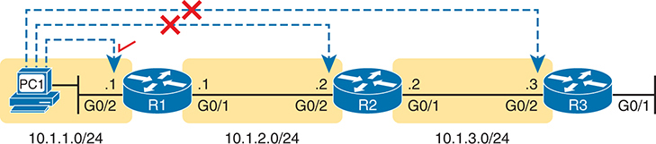

<figcaption>

<strong>图 20-14</strong> <em>PC1 可以 Telnet 到 R1，但无法到达 R2 或 R3</em>

<aside class="hidden" id="a20fig14">

网络场景中，IP 地址为 10.1.1.0/24 的主机 PC1 通过 Telnet 连接路由器 R1。然而，从 R1 到 IP 地址为 10.1.2.0/24 的另一台路由器 R2 的 Telnet 连接标有叉号，表示失败。从 R2 到 IP 地址为 10.1.3.0/24 的路由器 R3 的连接也用叉号表示未成功。

</aside>

</figcaption>

</figure>

在某些情况下，例如本例，从网络工程师设备发起 Telnet 或 SSH 登录可能失败，但仍可以通过 <strong>telnet</strong> 和 <strong>ssh</strong> 命令使用路由器或交换机上的客户端，找到登录办法。在这个特定场景中，每条独立数据链路都正常，问题出在路由协议交换路由的过程。PC1 可以 ping R1 的 10.1.1.1，R1 可以 ping R2 的 10.1.2.2，R2 可以 ping R3 的 10.1.3.3。由于每条链路正常，而且各路由器都能通过共享数据链路与邻居收发数据包，就可以逐台 Telnet／SSH 到后续设备。

<a href="#ch20fig15">图 20-15</a> 展示这一思路。PC1 首先建立到路由器 R1 的 Telnet／SSH 连接，如左侧所示。随后用户在 R1 上执行 <strong>telnet 10.1.2.2</strong>，Telnet 到 R2。登录 R2 后，用户可以在 R2 上执行命令。随后又可以从 R2 执行 <strong>telnet 10.1.3.3</strong>，Telnet 到 R3，并在 R3 上执行命令。

<figure class="image-c" id="ch20fig15">

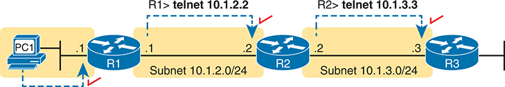

<figcaption>

<strong>图 20-15</strong> <em>连续的 Telnet 连接：PC1 到 R1、R1 到 R2，以及 R2 到 R3</em>

<aside class="hidden" id="a20fig15">

左侧主机 PC1 发起到路由器 R1 的 Telnet 连接，用箭头表示。R1 有一个到 10.1.2.2 的 Telnet 连接，使用子网 10.1.2.0/24。从 R1 建立到第二台路由器 R2 的另一条 Telnet 连接，也用箭头表示。R2 有一个到 10.1.3.3 的 Telnet 连接，属于子网 10.1.3.0/24。第三条 Telnet 连接从 R2 到 R3，用箭头表示。整个过程说明连续 Telnet 连接的概念：PC1 到 R1、R1 到 R2，以及 R2 到 R3。

</aside>

</figcaption>

</figure>

<a href="#ch20fig15">图 20-15</a> 中的 Telnet 连接能够工作，是因为每条连接都使用同一子网中的源和目的地址。例如，R1 的 <strong>telnet 10.1.2.2</strong> 当然使用 10.1.2.2 作为目的地址。R1 采用向 10.1.2.2 发送数据包所用出接口的 IP 地址，本例为 10.1.2.1。由于每条 <strong>telnet</strong> 都连接直连子网中的 IP 地址，即使路由协议完全配置错误，你仍可逐台 Telnet／SSH 到后续设备，排查并修复问题。

网络工程师有时也只是出于个人偏好而使用 IOS Telnet 和 SSH 客户端。例如，需要登录多台 Cisco 设备时，可以在 PC 上打开多个窗口和标签页，分别从 PC 登录（假设网络没有问题）；也可以从 PC 登录附近某台 Cisco 路由器或交换机，再从那里 Telnet 或 SSH 到其他 Cisco 设备。

</section>

<section>

<h4 class="h4" id="ch20lev2sec6">IOS Telnet 和 SSH 示例</h4>

通过 <strong>telnet</strong> <em>host</em> 使用 IOS Telnet 客户端非常简单。只需用 IP 地址或主机名标识要连接的主机，然后按 Enter。<a href="#exa20_9">例 20-9</a> 基于<a href="#ch20fig15">图 20-15</a>，展示 R1 使用 Telnet 连接 10.1.2.2（R2）的示例。

<strong>例 20-9</strong> <em>从 R1 Telnet 到 R2，查看 R2 的接口状态</em>

<a href="#code-f0529-01" id="f0529-01a">点击此处查看代码原图</a>

<pre class="pre-ex" tabindex="0"><code class="highlight">R1# <strong>telnet 10.1.2.2</strong>
Trying 10.1.2.2 ... Open

User Access Verification

Username: wendell
Password:
R2&gt;
R2&gt; <strong>show ip interface brief</strong>
Interface                  IP-Address      OK? Method Status                Protocol
GigabitEthernet0/0         unassigned      YES unset  administratively down down
GigabitEthernet0/1         10.1.3.2        YES manual up                    up
GigabitEthernet0/2         10.1.2.2        YES manual up                    up
GigabitEthernet0/3         unassigned      YES unset  administratively down down</code></pre>

请仔细留意命令提示符。示例开始时用户已登录路由器 R1，提示符为 R1#。用户执行 <strong>telnet 10.1.2.2</strong> 后，R2 要求输入用户名和密码，因为 R2 使用本地用户名身份验证，需要这些凭据。输出末尾的 <strong>show ip interfaces brief</strong> 再次显示与<a href="#exa20_9">例 20-9</a> 和<a href="#ch20fig15">图 20-15</a> 对应的 R2 接口及 IP 地址。

<a href="#exa20_10">例 20-10</a> 中的 <strong>ssh -l</strong> <em>username host</em> 与 <strong>telnet</strong> <em>host</em> 遵循相同基本思路，但使用 SSH 客户端。<strong>-l</strong> 标志表示下一个参数是登录用户名。本例中，用户最初登录路由器 R1，然后通过 <strong>ssh -l wendell 10.1.2.2</strong> SSH 到 R2。R2 预期的用户名／密码为 wendell／odom，其中 wendell 在命令中提供，odom 在 R2 提示时输入。

<strong>例 20-10</strong> <em>使用 SSH 客户端从 R1 连接 R2，查看 R2 的接口状态</em>

<a href="#code-f0530-01" id="f0530-01a">点击此处查看代码原图</a>

<pre class="pre-ex" tabindex="0"><code class="highlight">R1# <strong>ssh -l wendell 10.1.2.2</strong>

Password:

R2&gt;
Interface                  IP-Address      OK? Method Status                Protocol
GigabitEthernet0/0         unassigned      YES unset  administratively down down
GigabitEthernet0/1         10.1.3.2        YES manual up                    up
GigabitEthernet0/2         10.1.2.2        YES manual up                    up
GigabitEthernet0/3         unassigned      YES unset  administratively down down</code></pre>

使用完另一台路由器后，可以通过 <strong>exit</strong> 或 <strong>quit</strong> 注销 Telnet 或 SSH 连接。

最后请注意，IOS 支持在 CLI 中使用快捷键切换多个 Telnet 或 SSH 会话。基本上，你可以从某台路由器 Telnet 或 SSH 到另一台，执行一些命令后，无需通过 <strong>exit</strong> 结束连接，而是保持连接打开并返回原始路由器的命令提示符。例如，从 R1 出发，可以 Telnet 到 R2、R3 和 R4，挂起而不退出这些 Telnet 连接。随后只需按几个键，就能轻松在会话之间切换并执行新命令。

</section>

</section>

</section>

<section class="ccna-source ccna-appendix" aria-label="答案解析与术语表">
<section id="ref-glossary"><h2 class="h2a">术语表</h2>
<strong>DNS</strong> 域名系统。广泛用于互联网的应用层协议，用于将主机名转换为相应的 IP 地址。

<strong>正向路由（forward route）</strong> 从某台主机的角度看，数据包从该主机到另一台主机所经过的路由。

<strong>主机名（hostname）</strong> IP 主机的字母数字名称。

<strong>ICMP 回显应答（ICMP echo reply）</strong> ICMP 消息的一种，专门用于 ping 命令测试网络连通性。ping 首先向另一台主机发送 ICMP 回显请求，然后期待从对方收到此类消息。

<strong>ICMP 回显请求（ICMP echo request）</strong> ICMP 消息的一种，专门作为 ping 命令测试网络连通性时发送的消息。ping 向其他主机发送这些消息，并期待对方以 ICMP 回显应答响应。

<strong>反向路由（reverse route）</strong> 从某台主机的角度看，另一台主机发回的数据包所经过的路由。

</section>
</section>

<section class="ccna-source ccna-appendix" aria-label="代码原图">
<section data-epub-type="chapter">

<a href="#f0514-01a" id="code-f0514-01">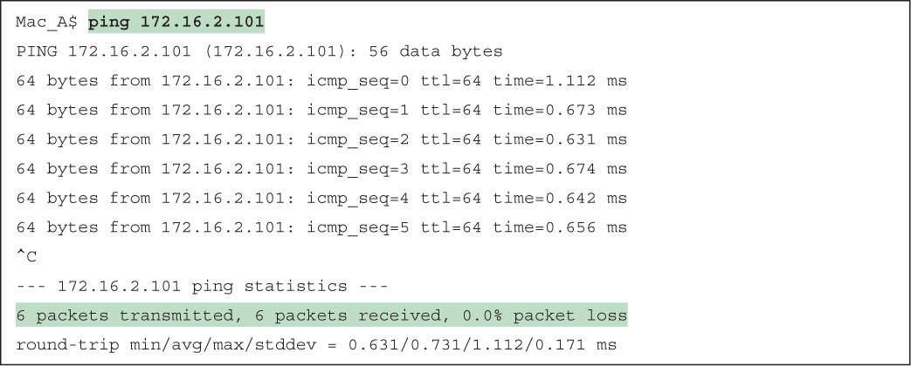</a>

<a href="#f0515-01a" id="code-f0515-01">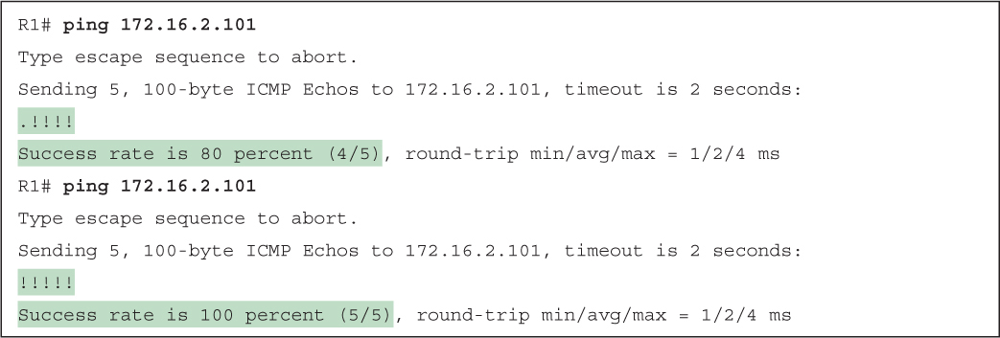</a>

<a href="#f0518-01a" id="code-f0518-01">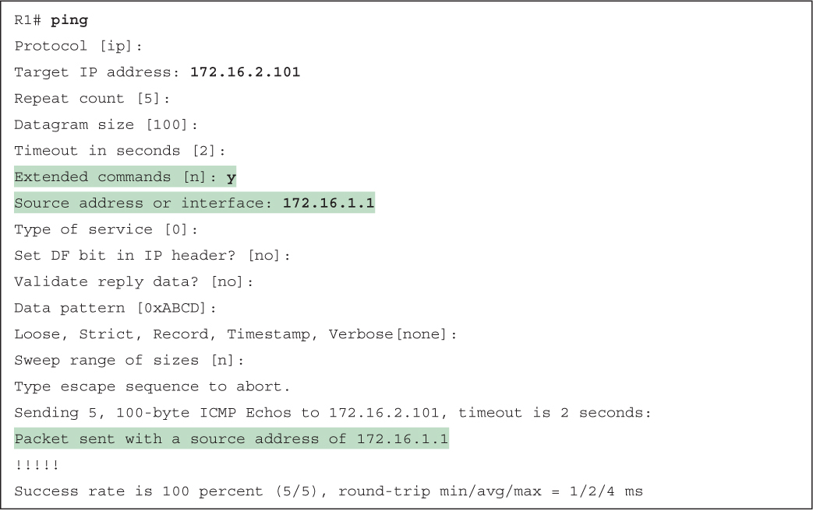</a>

<a href="#f0523-01a" id="code-f0523-01">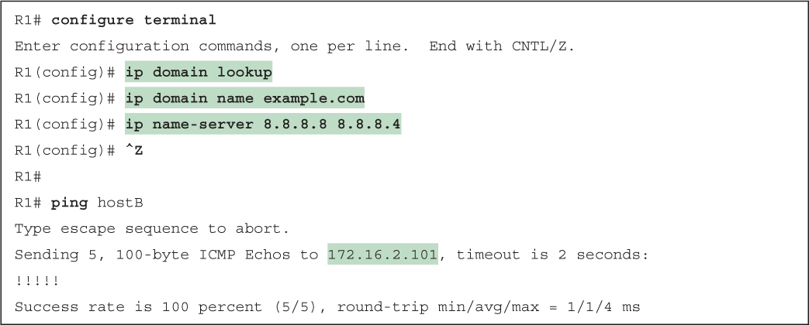</a>

<a href="#f0523-02a" id="code-f0523-02">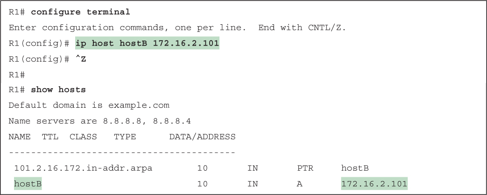</a>

<a href="#f0525-01a" id="code-f0525-01">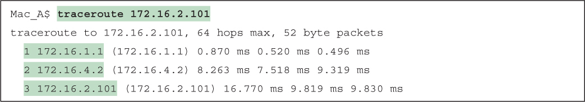</a>

<a href="#f0527-01a" id="code-f0527-01">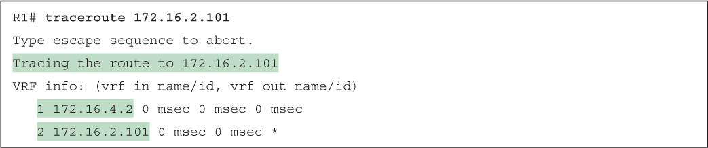</a>

<a href="#f0527-02a" id="code-f0527-02">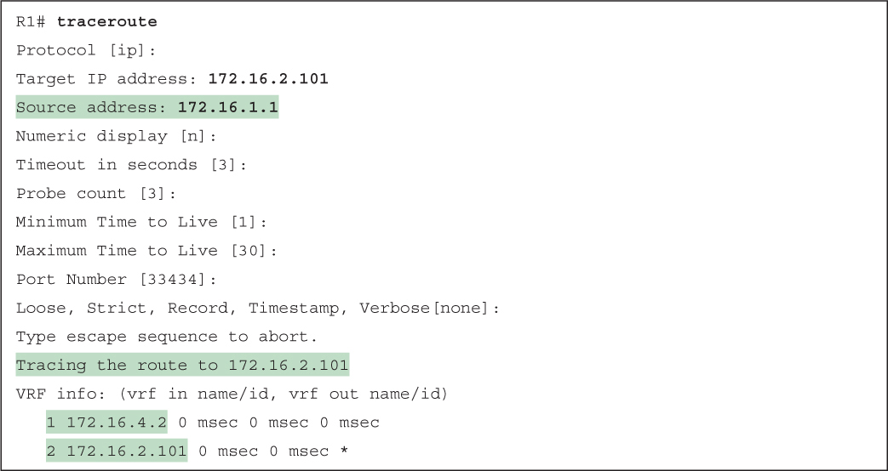</a>

<a href="#f0529-01a" id="code-f0529-01">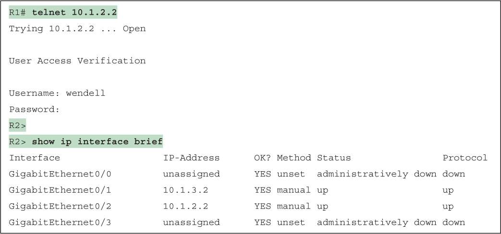</a>

<a href="#f0530-01a" id="code-f0530-01">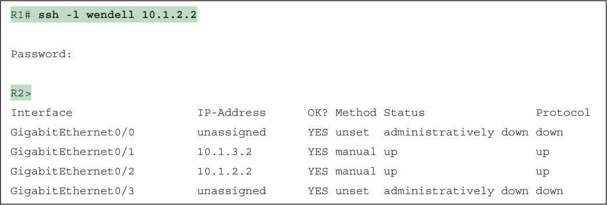</a>

</section>

</section>


<nav class="ccna-chapter-nav" aria-label="章节导航"><a href="v1-19.html">← 上一章</a><a href="v1-21.html">下一章 →</a></nav>
