
<a href="{{ '/subjects/CCNA/' | relative_url }}">← 返回 CCNA 目录</a>

第一卷 · OSPF

<nav class="ccna-chapter-nav" aria-label="章节导航"><a href="v1-20.html">← 上一章</a><a href="v1-22.html">下一章 →</a></nav>



<section data-epub-type="chapter">

<h2 class="h2" id="ch21">第 21 章</h2>

<h2 class="h2a">理解 OSPF 概念</h2>

本章涵盖以下考试主题：

3.0 IP 连接

3.2 确定路由器默认如何做出转发决策

3.2.b 管理距离

3.2.c 路由协议度量值

3.4 配置与验证单区域 OSPFv2

3.4.a 邻居邻接关系

3.4.b 点到点

3.4.c 广播（DR/BR 选择）

3.4.d 路由器 ID

每家企业都会在网络内部使用某种动态路由协议，使路由器协作学习通往所有子网的路由。但在 TCP/IP 成为所有计算机通用网络模型之前的几十年里，出现了多种可供企业选择的路由协议。因此，即使在今天，企业仍需从少量备选路由协议中作出选择。其中，Cisco 在 CCNA 200-301 V1.1 考试大纲中纳入了开放最短路径优先（OSPF）。

为了建立背景，本章首先研究不同的路由协议、它们相似的目标，以及实现上的差异。有了这些背景，其余部分将研究 OSPF 工作的基本概念。第二个主要部分深入介绍 OSPF 的基础：在每台路由器上运行 OSPF、成为邻居、交换路由相关数据，以及计算供 IP 路由表使用的 IP 路由。最后一个主要部分进一步探讨 OSPF 如何在内部使用网络链路及其状态的数据库来表示网络拓扑，即 OSPF 链路状态数据库（LSDB）。

<section>

<h3 class="h3" id="ch21lev1sec1">“这些知识我已经掌握了吗？”自测</h3>

如果你希望根据得分决定在本章投入多少时间，可以完成这组自测题（在此作答，或使用 PTP 软件）。各题答案的选项字母列在自测题之后的页面底部。书末和配套网站上的<a href="#ref-appc">附录 C</a>都包含答案及解析。你也可以在 PTP 测试软件中找到答案及解析。

<figure class="table" id="ch21tab01" tabindex="0">

<figcaption>

<strong>表 21-1</strong> “这些知识我已经掌握了吗？”基础主题小节与题目对应关系

</figcaption>

<table class="all">

<thead>

<tr>

<th class="th">
基础知识小节
</th>

<th class="th">
题目
</th>

</tr>

</thead>

<tbody>

<tr>

<td class="border">
比较动态路由协议的特性
</td>

<td class="border">
1–3
</td>

</tr>

<tr>

<td class="border">
OSPF 概念与运行过程
</td>

<td class="border">
4, 5
</td>

</tr>

<tr>

<td class="border">
OSPF 区域和 LSA
</td>

<td class="border">
6
</td>

</tr>

</tbody>

</table>

</figure>

<strong><a id="quess21_1" href="#ques21_1a">1</a>．</strong>以下哪种路由协议使用链路状态逻辑？

<ol class="lower-alpha">

<li>
RIPv1
</li>

<li>
RIPv2
</li>

<li>
EIGRP
</li>

<li>
OSPF
</li>

</ol>

<strong><a id="quess21_2" href="#ques21_2a">2</a>．</strong>以下哪些路由协议使用的度量值默认至少部分受链路带宽影响？（选择两个答案。）

<ol class="lower-alpha">

<li>
RIPv1
</li>

<li>
RIPv2
</li>

<li>
EIGRP
</li>

<li>
OSPF
</li>

</ol>

<strong><a id="quess21_3" href="#ques21_3a">3</a>．</strong>以下哪些内部路由协议支持 VLSM？（选择三个答案。）

<ol class="lower-alpha">

<li>
RIPv1
</li>

<li>
RIPv2
</li>

<li>
EIGRP
</li>

<li>
OSPF
</li>

</ol>

<strong><a id="quess21_4" href="#ques21_4a">4</a>．</strong>两台使用 OSPFv2 的路由器已成为邻居并交换了全部 LSA。因此，路由器 R1 的路由表现在列出了一些通过 OSPF 学到的路由。以下哪项最准确地描述了 R1 如何使用最近学到的 LSA，选择加入 IP 路由表的 IP 路由？

<ol class="lower-alpha">

<li>
R1 从每个 LSA 中复制一条路由到路由表。
</li>

<li>
R1 从某些类型的 LSA 中复制路由到路由表。
</li>

<li>
R1 根据 LSA 运行 SPF，计算路由。
</li>

<li>
R1 在选择要加入的路由时不使用 LSA。
</li>

</ol>

<strong><a id="quess21_5" href="#ques21_5a">5</a>．</strong>两个 OSPF 邻居完成拓扑信息交换后，预期处于以下哪种 OSPF 邻居状态？

<ol class="lower-alpha">

<li>
2-way
</li>

<li>
Full
</li>

<li>
Up/up
</li>

<li>
Final
</li>

</ol>

<strong><a id="quess21_6" href="#ques21_6a">6</a>．</strong>某公司拥有一个使用 OSPFv2 的中小型网络，包含 15 台路由器和 40 个子网。与多区域设计相比，以下哪项被认为是单区域设计的优势？

<ol class="lower-alpha">

<li>
降低大多数路由器的 CPU 处理开销。
</li>

<li>
降低因接口状态变化而运行 SPF 算法的频率。
</li>

<li>
使规划和运维更简单。
</li>

<li>
降低内存消耗。
</li>

</ol>

“这些知识我已经掌握了吗？”自测答案：

<strong><a id="ques21_1a" href="#ref-ques21_1">1</a></strong> D

<strong><a id="ques21_2a" href="#ref-ques21_2">2</a></strong> C, D

<strong><a id="ques21_3a" href="#ref-ques21_3">3</a></strong> B, C, D

<strong><a id="ques21_4a" href="#ref-ques21_4">4</a></strong> C

<strong><a id="ques21_5a" href="#ref-ques21_5">5</a></strong> B

<strong><a id="ques21_6a" href="#ref-ques21_6">6</a></strong> C

</section>

<section>

<h3 class="h3box" id="ch21lev1sec2">基础知识</h3>

</section>

<section>

<h3 class="h3" id="ch21lev1sec3">比较动态路由协议的特性</h3>

路由器通过三种方式向路由表加入 IP 路由：直连路由、静态路由，以及通过动态路由协议学到的路由。不过，在深入讨论之前，有必要定义几个相关术语，澄清对<em>路由协议</em>、<em>被路由协议</em>和<em>可路由协议</em>的误解。这些术语通常定义如下：

<ul class="sq">

<li>
<strong>路由协议：</strong>路由器为学习路由这一总体目的而使用的一组消息、规则和算法。该过程包括交换和分析路由信息。每台路由器选择到达每个子网的最佳路由（路径选择），最后将这些最佳路由加入 IP 路由表。例如 RIP、EIGRP、OSPF 和 BGP。
</li>

<li>
<strong>被路由协议和可路由协议：</strong>两者是同义词，指能够定义可由路由器路由（转发）的数据包的协议。路由器转发被路由协议定义的数据包。例如 IP 第 4 版（IPv4）和 IP 第 6 版（IPv6）。
</li>

</ul>

注意

<em>路径选择</em>一词有时指路由协议工作的一部分，即由路由协议选择最佳路由。

虽然路由协议（如 OSPF）不同于被路由协议（如 IP），但它们密切配合。路由过程负责转发 IP 数据包，但如果 IP 路由表中没有任何路由匹配数据包的目的地址，路由器就会丢弃该数据包。路由器需要路由协议来学习所有可能的路由，并将其加入路由表，使路由过程能够转发（路由）IP 等可路由协议的数据包。

<section>

<h4 class="h4" id="ch21lev2sec1">路由协议的功能</h4>

Cisco IOS 软件支持多种 IP 路由协议，它们执行相同的一般功能：

<ol class="number">

<li>
从相邻路由器学习 IP 子网的路由信息。

</li>

<li>
向相邻路由器通告 IP 子网的路由信息。
</li>

<li>
如果到达某个子网有多条可能的路由，则根据<a id="key_246" href="#ref-gloss_256">度量值</a>选择最佳路由。
</li>

<li>
如果网络拓扑发生变化，例如链路故障，则通过通告某些路由失效并选择当前新的最佳路由来响应。（该过程称为<a id="key_233" href="#ref-gloss_080">收敛</a>。）
</li>

</ol>

注意

相邻路由器连接在同一链路上，例如同一 WAN 链路或同一以太网 LAN。

<a href="#ch21fig01">图 21-1</a> 展示上述四项功能中的三项。图左下方的路由器 R1 必须选择到达图右下方 R2 所连子网的最佳路由。按照图中的步骤：

步骤 1。R2 向 R1 和 R3 通告通往右下方子网 172.16.3.0/24 的路由。

步骤 2。R3 从 R2 学到通往 172.16.3.0/24 的路由后，将该路由通告给 R1。

步骤 3。R1 必须在学到的两条通往子网 172.16.3.0/24 的路由中选择：来自 R2 的路由度量值为 1，来自 R3 的路由度量值为 2。R1 选择经过 R2、度量值较低的路由（功能 3）。

<figure class="image-c" id="ch21fig01">

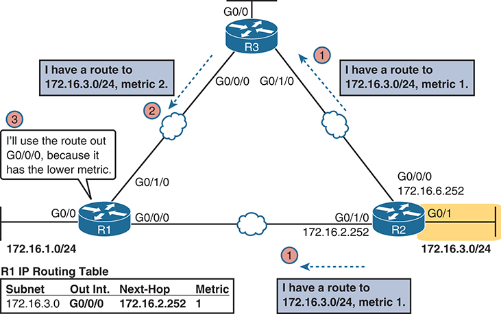

<figcaption>

<strong>图 21-1</strong> <em>路由协议四项基本功能中的三项</em>

<aside class="hidden" id="a21fig01">

网络示意图显示三台路由器 R1、R2 和 R3 以三角形互连。每台路由器都连接具有特定 IP 地址的子网。R1 通过 G0/0 接口连接子网 172.16.0/24，R2 通过 G0/1 接口连接子网 172.16.2/24，R3 分别通过 G0/0 和 G0/1 接口连接子网 172.16.3/24，两者度量值不同（2 和 1）。图中包含 R1 的路由表，显示子网 172.16.3.0、出接口 G0/0/0、下一跳 172.16.2.252，以及度量值 1。

</aside>

</figcaption>

</figure>

路由协议的另一项功能是<em>收敛</em>，它发生在拓扑变化时，也就是路由器或链路故障或恢复时。当某些情况变化，网络中可用的最佳路由也可能改变。收敛指所有路由器共同意识到变化、向其他所有路由器通告变化信息，并选择到达每个子网的当前最佳路由的过程。能够迅速收敛且不产生环路，是选择 IP 路由协议时最重要的考虑因素之一。

在<a href="#ch21fig01">图 21-1</a> 中，如果 R1 与 R2 之间的链路故障，就可能发生收敛。此时，R1 应停止使用通往子网 172.16.3.0/24 的旧路由（直接经过 R2），转而向 R3 发送数据包。

</section>

<section>

<h4 class="h4" id="ch21lev2sec2">内部与外部路由协议</h4>

IP 路由协议分为两大类：<a id="key_240" href="#ref-gloss_196">内部网关协议（IGP）</a>和<em>外部网关协议</em>（EGP）。定义如下：

<ul class="sq">

<li>
<strong>IGP：</strong>为在单个自治系统（AS）内部使用而设计的路由协议

</li>

<li>
<strong>EGP：</strong>为在不同自治系统之间使用而设计的路由协议
</li>

</ul>

注意

<em>IGP</em> 和 <em>EGP</em> 包含<em>网关</em>一词，是因为路由器以前称为网关。

这些定义使用了另一个新术语：<em>自治系统</em>（AS）。AS 是由单个组织实施管理控制的网络。例如，由一家公司建设并付费的网络很可能是一个 AS，由一个学校系统建设的网络也很可能是一个 AS。其他例子包括州政府或国家政府的大型部门，其中不同政府机构可能有能力建设自己的网络。每家 ISP 通常也是一个独立的 AS。

某些路由协议在设计上最适合单个 AS 内部使用，因此称为 IGP。相反，为不同自治系统中的路由器交换路由而设计的协议称为 EGP。目前，边界网关协议（BGP）是唯一的 EGP。

每个 AS 都可以分配一个编号，毫不意外地称为 <em>AS 编号</em>（ASN）。与公有 IP 地址一样，互联网号码分配机构（IANA，<a href="http://www.iana.org">www.iana.org</a>）控制全球 ASN 的分配权。它将权限委托给世界各地的其他组织，通常是负责分配公有 IP 地址的同一批组织。例如，在北美，美国互联网号码注册管理机构（ARIN，<a href="http://www.arin.net">www.arin.net</a>）分配公有 IP 地址范围和 ASN。

<a href="#ch21fig02">图 21-2</a> 展示全球互联网的一小部分。图中两家企业和三家 ISP 在自身网络内部使用 IGP（OSPF 和 EIGRP），在 ASN 之间使用 BGP。

<figure class="image-c" id="ch21fig02">

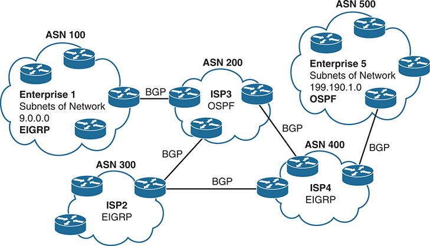

<figcaption>

<strong>图 21-2</strong> <em>比较 IGP 和 EGP 的使用位置</em>

<aside class="hidden" id="a21fig02">

示意图中，每个 ASN 都用带标签的云形表示。标为“Enterprise 1”的 ASN 100 使用 EIGRP，包含网络 9.0.0.0 的子网。标为“ISP3”的 ASN 200 使用 OSPF。标为“ISP2”的 ASN 300 和标为“ISP4”的 ASN 400 均使用 EIGRP。标为“Enterprise 5”的 ASN 500 使用 OSPF，包含网络 199.190.1.0 的子网。ASN 之间的连接标注“BGP”，表示所用协议。

</aside>

</figcaption>

</figure>

</section>

<section>

<h4 class="h4" id="ch21lev2sec3">比较 IGP</h4>

在深入 OSPF 细节之前，先将它与其他 IGP 选项进行比较会很有帮助。本节简要介绍这三种路由协议。

<section>

<h5 class="h5" id="ch21lev3sec1">IGP 路由协议算法</h5>

路由协议的底层算法决定它如何完成工作。<em>路由协议算法</em>指不同路由协议使用的逻辑和过程，用来解决学习所有路由、选择每个子网的最佳路由，以及响应互联网络变化而收敛的问题。IGP 路由协议算法主要有三个分支：

<ul class="sq">

<li>
<a id="key_236" href="#ref-gloss_106">距离矢量</a>（有时以创建者命名称为 Bellman-Ford）

</li>

<li>
高级距离矢量（有时称为平衡混合型）
</li>

<li>
<a id="key_242" href="#ref-gloss_237">链路状态</a>
</li>

</ul>

从历史来看，距离矢量协议最早发明，主要是在 20 世纪 80 年代初。路由信息协议（RIP）是首个广泛使用的 IP 距离矢量协议，Cisco 专有的内部网关路由协议（IGRP）稍后推出。

到 20 世纪 90 年代初，距离矢量协议相对缓慢的收敛速度及产生路由环路的可能性，推动人们开发采用新算法的替代路由协议。链路状态协议，特别是开放最短路径优先（OSPF）和集成中间系统到中间系统（IS-IS），解决了主要问题，但也有代价：需要路由器提供更多 CPU 和内存，并要求网络工程师进行更多规划。

注意

除非另有说明，本章所有 OSPF 均指 OSPF 第 2 版（OSPFv2）。

大约在 OSPF 推出的同时，Cisco 创建了名为增强型内部网关路由协议（EIGRP）的专有协议，它使用了早期 IGRP 的部分特性。EIGRP 解决了与链路状态路由协议相同的问题，但需要的规划更少，CPU／RAM 开销更低。随着时间推移，EIGRP 被归为一种独特的路由协议类型。不过，它使用的距离矢量特性多于链路状态特性，因此业界将其算法称为高级距离矢量协议或平衡混合型协议。

</section>

<section>

<h5 class="h5" id="ch21lev3sec2">度量值</h5>

路由协议通过选择度量值最低的路由，确定到达子网的最佳路由。例如，RIP 统计路由器与目的子网之间经过的路由器数量（跳数），如<a href="#ch21fig01">图 21-1</a> 所示。OSPF 则累加端到端路由中各接口的开销，而开销基于链路带宽。<a href="#ch21tab02">表 21-2</a> 列出最常见的 IP 路由协议及其度量值的部分细节。

<figure class="table" id="ch21tab02" tabindex="0">

<figcaption>

<strong>表 21-2</strong> IP IGP 的度量值

</figcaption>

<table class="all">

<thead>

<tr>

<th class="th">
IGP
</th>

<th class="th">
度量值
</th>

<th class="th">
说明
</th>

</tr>

</thead>

<tbody>

<tr>

<td class="border">
RIPv2
</td>

<td class="border">
跳数
</td>

<td class="border">
路由器与目的子网之间的路由器数量（跳数）
</td>

</tr>

<tr>

<td class="border">
OSPF
</td>

<td class="border">
开销
</td>

<td class="border">
路由中所有链路的全部接口开销之和，开销默认基于接口带宽
</td>

</tr>

<tr>

<td class="border">
EIGRP
</td>

<td class="border">
根据带宽和延迟计算
</td>

<td class="border">
根据路由中最慢的链路，以及该路由各接口关联的累计延迟进行计算
</td>

</tr>

</tbody>

</table>

</figure>

简单比较较旧 RIP 的度量值与 OSPF 的度量值，有助于理解 OSPF 和 EIGRP 为什么超越 RIP。<a href="#ch21fig03">图 21-3</a> 中，路由器 B 到网络左侧子网 10.1.1.0 有两条可能路由：一条较短，但经过非常慢的 1544 Kbps 串行链路；另一条较长，但经过两条千兆以太网 WAN 链路。

<figure class="image-c" id="ch21fig03">

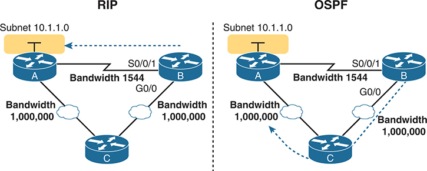

<figcaption>

<strong>图 21-3</strong> <em>比较 RIP 和 OSPF 的度量值</em>

<aside class="hidden" id="a21fig03">

示意图包含三台路由器 A、B 和 C。RIP 和 OSPF 都连接同一个子网 10.1.1.0。路由器 A 和 B 由标注带宽 1544 的线路连接，B 的接口标为 S0/0/1。A 和 B 还通过标注带宽 1,000,000 的以太网 WAN 连接另一台路由器 C。图中区别是，使用 RIP 时，B 将数据包直接发送给 A；使用 OSPF 时，B 通过 C 将数据包发送给 A。

</aside>

</figcaption>

</figure>

图左侧展示 RIP 在该网络中的结果。根据跳数，B 学到一条通过自身 S0/0/1 接口直接到 A 的一跳路由，也学到一条通过自身 G0/0 接口、经过 C 的两跳路由。B 选择跳数较少的路由，而这条路由恰好经过低速串行链路。

图右侧展示 OSPF 根据更合理的度量值作出的更优选择。为使 OSPF 作出正确选择，工程师可以使用基于正确接口带宽的默认设置，使其与实际链路速率相符，从而让 OSPF 选择更快的路由。（<strong>bandwidth</strong> 接口子命令不会更改接口实际物理速率，只是告诉 IOS 应假设接口使用什么速率。）

</section>

<section>

<h5 class="h5" id="ch21lev3sec3">IGP 的其他比较</h5>

路由协议可以根据许多特性进行比较，其中一些与当前 CCNA 考试有关，另一些无关。<a href="#ch21tab03">表 21-3</a> 再介绍几个要点，并汇总本书提到的比较项目以方便学习；表后附有一些说明。

<figure class="table" id="ch21tab03" tabindex="0">

<figcaption>

<strong>表 21-3</strong> 内部 IP 路由协议比较

</figcaption>

<table class="all">

<thead>

<tr>

<th class="th">
特性
</th>

<th class="th">
RIPv2
</th>

<th class="th">
EIGRP
</th>

<th class="th">
OSPF
</th>

</tr>

</thead>

<tbody>

<tr>

<td class="border">
无类／在更新中发送掩码／支持 VLSM
</td>

<td class="border">
是
</td>

<td class="border">
是
</td>

<td class="border">
是
</td>

</tr>

<tr>

<td class="border">
算法（DV、高级 DV、LS）
</td>

<td class="border">
DV
</td>

<td class="border">
高级 DV
</td>

<td class="border">
LS
</td>

</tr>

<tr>

<td class="border">
支持手动汇总
</td>

<td class="border">
是
</td>

<td class="border">
是
</td>

<td class="border">
是
</td>

</tr>

<tr>

<td class="border">
Cisco 专有
</td>

<td class="border">
否
</td>

<td class="border">
是<a id="tfn21_3" href="#tfn21_3a">*</a>
</td>

<td class="border">
否
</td>

</tr>

<tr>

<td class="border">
路由更新发送到组播 IP 地址
</td>

<td class="border">
是
</td>

<td class="border">
是
</td>

<td class="border">
是
</td>

</tr>

<tr>

<td class="border">
收敛
</td>

<td class="border">
慢
</td>

<td class="border">
快
</td>

<td class="border">
快
</td>

</tr>

<tr>

<td class="border">
使用的组播地址
</td>

<td class="border">
224.0.0.9
</td>

<td class="border">
224.0.0.10
</td>

<td class="border">
224.0.0.5, 224.0.0.6
</td>

</tr>

</tbody>

</table>

<a id="tfn21_3a" href="#tfn21_3">*</a> 虽然 Cisco 创建了 EIGRP，并将其作为专有协议保留多年，但 Cisco 在 2013 年选择以信息类 RFC 发布 EIGRP。这允许其他厂商实现 EIGRP，同时 Cisco 保留该协议的权利。

</figure>

关于表格首行，无类路由协议通过发送包含子网掩码的路由协议消息，支持可变长子网掩码（VLSM）和手动路由汇总。较旧的 RIPv1 和 IGRP 都是有类路由协议，不支持这些功能。

还请注意，较旧的路由协议（RIPv1、IGRP）向 IP 广播地址发送路由协议消息，而表中较新的协议都使用 IP 组播目的地址。组播使协议更高效，对子网内未运行该路由协议的设备造成的开销和问题也更少。

</section>

</section>

</section>

<section>

<h3 class="h3" id="ch21lev1sec4">OSPF 概念与运行过程</h3>

路由协议基本上通过交换信息，使路由器能够学习路由。路由器学习子网信息、通往这些子网的路由，以及反映各路由相对优劣的度量信息。随后，路由协议选择到达各子网的当前最佳路由，构建 IP 路由表。

OSPF 等链路状态协议在具体交换哪些信息，以及学到信息后如何处理方面，采用略有不同的方式。接下来第二个主要部分将范围缩小到链路状态协议，具体来说是 OSPFv2。

本节首先概述 OSPF 如何使用称为<a id="key_243" href="#ref-gloss_235">链路状态通告（LSA）</a>的数据结构交换网络信息。随后稍退一步，详细介绍 OSPF 工作的三个基本部分：OSPF 路由器如何使用<em>邻居</em>关系、如何与邻居交换 LSA，以及学到全部 LSA 后如何计算最佳路由。

<section>

<h4 class="h4" id="ch21lev2sec4">OSPF 概述</h4>

链路状态协议通过几个主要步骤构建 IP 路由。首先，路由器共同构建大量网络信息：路由器、链路、IP 地址、状态信息等。随后泛洪这些信息，使所有路由器知道相同的信息。此时，各路由器都能从自身角度计算到达所有子网的路由。

<section>

<h5 class="h5" id="ch21lev3sec4">拓扑信息和 LSA</h5>

使用链路状态路由协议的路由器，需要共同向其他所有路由器通告互联网络中几乎每个细节。当向所有路由器<em>泛洪</em>信息的过程结束时，互联网络中的每台路由器都掌握完全相同的网络信息。向每台路由器泛洪大量细节听起来工作量很大，与距离矢量协议相比，确实如此。

开放最短路径优先（OSPF）是最流行的链路状态 IP 路由协议，它通过 LSA 和<a id="key_244" href="#ref-gloss_236">链路状态数据库（LSDB）</a>组织拓扑信息。<a href="#ch21fig04">图 21-4</a> 展示这些概念。每个 LSA 是包含特定网络拓扑信息的数据结构，LSDB 则是路由器已知的所有 LSA 的集合。

<figure class="image-c" id="ch21fig04">

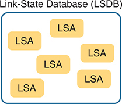

<figcaption>

<strong>图 21-4</strong> <em>LSA 与 LSDB 的关系</em>

<aside class="hidden" id="a21fig04">

大矩形表示链路状态数据库（LSDB），内部有六个较小的矩形，每个都标为 LSA，代表独立的链路状态通告，说明一个 LSDB 中包含多个 LSA。

</aside>

</figcaption>

</figure>

<a href="#ch21fig05">图 21-5</a> 展示泛洪过程的一般思路：R8 创建并泛洪自己的<em>路由器 LSA</em>。R8 的路由器 LSA 描述路由器自身，包括图右侧所示子网 172.16.3.0/24 的存在。（请注意，<a href="#ch21fig05">图 21-5</a> 仅展示 R8 路由器 LSA 中的一部分信息。）

<figure class="image-c" id="ch21fig05">

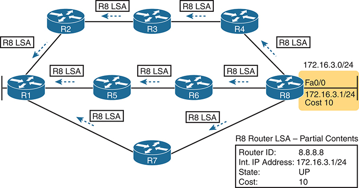

<figcaption>

<strong>图 21-5</strong> <em>使用链路状态路由协议泛洪 LSA</em>

<aside class="hidden" id="a21fig05">

图中以路由器 R8 为中心，它向其他所有路由器广播链路状态通告（LSA）。每个 LSA 用箭头表示，包含路由器 ID（8.8.8.8）、接口 IP 地址（172.16.3.1/24）、状态（UP）和开销（10）等关键信息。这些细节对于维持全网路由信息更新和同步至关重要。

</aside>

</figcaption>

</figure>

<a href="#ch21fig05">图 21-5</a> 展示基本泛洪过程：R8 发出自身的原始 LSA，其他路由器通过转发泛洪它，直到每台路由器都有一份副本。泛洪使每台路由器学到 LSA 内容，同时防止 LSA 循环传播。基本上，路由器在向下一个邻居发送 LSA 前会先通信，询问“你已经有这个 LSA 了吗？”，只有邻居尚未学到时才发送。

泛洪完成后，路由器偶尔会重新泛洪各 LSA。当某些信息变化时，例如链路启用或关闭，就会重新泛洪。路由器也会根据每个 LSA 独立的老化计时器重新泛洪，默认间隔为 30 分钟。

</section>

<section>

<h5 class="h5" id="ch21lev3sec5">应用 Dijkstra SPF 计算寻找最佳路由</h5>

链路状态泛洪使每台路由器的内存中都有完全相同的 LSDB 副本，但仅靠泛洪并不能让路由器知道应将哪些路由加入 IP 路由表。虽然 LSDB 信息极其详细且有用，但并未明确指出每台路由器到达目的地的最佳路由。

要构建路由，链路状态路由器必须进行一些数学计算。幸好你我不必掌握这些数学细节！所有链路状态协议都使用一种名为 Dijkstra <a id="key_250" href="#ref-gloss_363">最短路径优先（SPF）算法</a>的数学算法处理 LSDB。算法通过数学方式分析 LSDB，构建本地路由器应加入 IP 路由表的路由，其中列出子网号和掩码、出接口，以及下一跳路由器 IP 地址。

现在你已掌握主要概念，接下来几个主题将介绍 OSPF 路由器交换 LSA 和计算路由的三个主要阶段：

<strong>成为邻居：</strong>在连接同一数据链路的两台路由器之间建立关系，使相邻路由器能够交换 LSDB。

<strong>交换数据库：</strong>向邻居发送 LSA，使所有路由器学到相同 LSA 的过程。

<strong>加入最佳路由：</strong>每台路由器独立地针对本地 LSDB 副本运行 SPF，计算最佳路由，并将其加入 IPv4 路由表的过程。

</section>

</section>

<section>

<h4 class="h4" id="ch21lev2sec5">成为 OSPF 邻居</h4>

在本章学习的所有 OSPF 内容中，邻居概念与你如何在 Cisco 路由器上配置和排查 OSPF 的关系最密切。配置 OSPF，使路由器运行该协议并与其他路由器成为邻居。此后，OSPF 会在后台完成交换 LSA 和计算路由的其余工作，无需额外配置。本节讨论 OSPF 邻居的基本概念。

<section>

<h5 class="h5" id="ch21lev3sec6">OSPF 邻居基础</h5>

两台路由器必须满足一些兼容性要求才能成为邻居。首先，两者都必须使用 OSPF，且连接同一数据链路。连接同一 VLAN、同一串行链路或同一以太网 WAN 链路的路由器，都可以成为 OSPF 邻居。

此外，两台路由器必须发送声明某些 OSPF 设置的消息，且这些设置必须兼容。为此，路由器发送 OSPF Hello 消息，向潜在邻居介绍自己。假设双方参数兼容，就会形成 OSPF 邻居关系，并显示在 <strong>show ip ospf neighbor</strong> 命令输出中。

OSPF 邻居关系还让 OSPF 知道，某个邻居当前可能不适合用于路由数据包。假设 R1 与 R2 建立邻居关系、学习 LSA，并计算出经过对方转发的路由。几个月后，R1 发现与 R2 的邻居关系失效。该失效连接使 R1 作出响应：重新泛洪受故障链路影响的 LSA，并运行 SPF 重新计算自身路由。

最后，OSPF 邻居模型允许动态发现新路由器。这意味着向网络添加新路由器时，无需重新配置每台路由器。相反，OSPF 路由器监听新路由器的 Hello 消息并响应，尝试成为邻居并交换 LSDB。

</section>

<section>

<h5 class="h5" id="ch21lev3sec7">发现邻居并学习其路由器 ID</h5>

OSPF 邻居关系始于交换 <em>Hello</em> 消息，其中列出每台路由器的<a id="key_249" href="#ref-gloss_349">路由器 ID（RID）</a>。OSPF RID 是 32 位数字，因此大多数命令输出将其显示为点分十进制（DDN）。默认情况下，IOS 选择某个路由器接口的 IPv4 地址作为 OSPF RID。不过，也可以直接配置 RID，详见<a href="v1-22.html#ch22">第 22 章</a>“<a href="v1-22.html#ch22">实现基本 OSPF 功能</a>”中的“<a href="v1-22.html#ch22lev2sec5">配置 OSPF 路由器 ID</a>”一节。

路由器一旦选定 OSPF RID 且某些接口启动，就准备好发现 OSPF 邻居了。连接同一子网的 OSPF 路由器可以成为邻居。为发现其他运行 OSPF 的路由器，它向各接口发送组播 OSPF Hello 数据包，并希望收到连接这些接口的其他路由器发来的 Hello。<a href="#ch21fig06">图 21-6</a> 概述这一基本概念。

<figure class="image-c" id="ch21fig06">

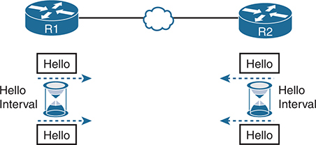

<figcaption>

<strong>图 21-6</strong> <em>OSPF Hello 数据包</em>

<aside class="hidden" id="a21fig06">

路由器 R1 和 R2 通过以太网 WAN 连接。每台路由器有一个标为“Hello Interval”的沙漏图标，表示发送 Hello 数据包的时间间隔。沙漏之间的双向箭头表示持续交换数据包，每个箭头旁均标注“Hello”。

</aside>

</figcaption>

</figure>

R1 和 R2 都向链路发送 Hello 消息，并根据各自 Hello 计时器设置以固定间隔持续发送。Hello 消息具有以下特征：

<ul class="sq">

<li>
Hello 消息紧随 IP 数据包首部之后，IP 协议类型为 89。
</li>

<li>
Hello 数据包发送到组播 IP 地址 224.0.0.5，该地址面向所有运行 OSPF 的路由器。
</li>

<li>
OSPF 路由器监听发往 IP 组播地址 224.0.0.5 的数据包，部分目的就是接收 Hello 并发现新邻居。
</li>

</ul>

进一步看，<a href="#ch21fig07">图 21-7</a> 展示 OSPF 邻居关系建立初期使用的几种邻居状态。中央是 Hello 消息，左右两侧是相应邻居状态。每台路由器都维护一个 OSPF 状态变量，表示它对该邻居的认知。

<figure class="image-c" id="ch21fig07">

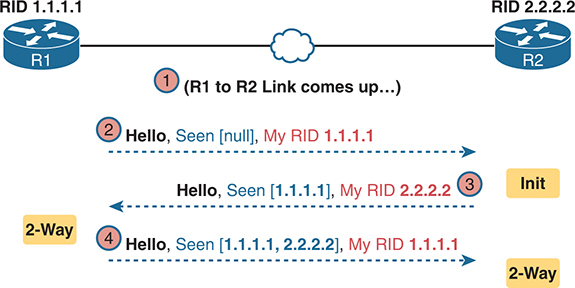

<figcaption>

<strong>图 21-7</strong> <em>早期邻居状态</em>

<aside class="hidden" id="a21fig07">

R1 和 R2 通过以太网 WAN 连接，路由器 ID（RID）分别为 1.1.1.1 和 2.2.2.2。步骤 1 中，两者之间的链路启动。步骤 2 中，R1 向 R2 发送 Hello，内容为“Hello，已看到 [null]，我的 RID 为 1.1.1.1”。R2 返回 Init 数据包，内容为“Hello，已看到 [1.1.1.1]，我的 RID 为 2.2.2.2”。步骤 3 中，两台路由器通过“Hello，已看到 [1.1.1.1, 2.2.2.2]，我的 RID 为 1.1.1.1”消息确认彼此 RID。

</aside>

</figcaption>

</figure>

按照图中步骤，最初链路关闭，因此路由器并不知道对方是 OSPF 邻居。两者没有关于对方邻居状态的信息，也不会在 <strong>show ip ospf neighbor</strong> 输出中列出对方。步骤 2 中，R1 发送第一个 Hello，R2 得知 R1 是一台 OSPF 路由器。此时，R2 将 R1 列为邻居，临时的起始状态为 init。

步骤 3 中，R2 返回 Hello，过程继续。该消息告诉 R1，R2 的存在，使 R1 经过 init 状态并迅速进入 2-way 状态。步骤 4 中，R2 收到 R1 的下一个 Hello，也能进入 2-way 状态。

<a id="key_229" href="#ref-gloss_006">2-way 状态</a>是一种特别重要的 OSPF 状态。此时，下列主要事实成立：

<ul class="sq">

<li>
路由器已收到邻居的 Hello，其中将自身 RID 列为邻居已看到的路由器。

</li>

<li>
路由器已检查 Hello 中的所有设置，认为潜在邻居通过了全部检查，两者可以成为邻居。
</li>

<li>
如果两台路由器彼此均达到 2-way 状态，它们就是邻居，并准备相互交换 LSDB。
</li>

</ul>

</section>

</section>

<section>

<h4 class="h4" id="ch21lev2sec6">邻居之间交换 LSDB</h4>

建立 OSPF 邻居关系的一个目的，就是允许两个邻居交换数据库。接下来介绍 OSPF 数据库交换的部分细节。

<section>

<h5 class="h5" id="ch21lev3sec8">与邻居完整交换 LSA</h5>

链路上的两台路由器达到 2-way 状态后，就可以立即进入数据库交换过程。该过程可能相当复杂，涉及多种 OSPF 消息和若干中间邻居状态。本章更关注其中几种消息，以及数据库交换完成时的最终状态：<a id="key_237" href="#ref-gloss_155">full 状态</a>。

两台路由器决定交换数据库后，并不会直接发送整个数据库的内容。首先，它们告诉对方各自数据库中的 LSA 列表，并非 LSA 的全部细节，只是列表。（可以把它想成核对清单。）随后，每台路由器检查自己已有的 LSA，仅向对方请求尚未知晓的 LSA。

例如，R1 可能通过 OSPF 数据库描述（DD）数据包，向 R2 发送列有十个 LSA 的清单。R2 检查自身 LSDB，发现已有其中六个，于是通过链路状态请求数据包，请求 R1 发送另外四个。

幸好，大多数 OSPFv2 工作并不要求详细掌握这些具体协议步骤。但有几个术语经常使用，应当记住。尤其是，在邻居间实际发送 LSA 的 OSPF 消息称为<a id="key_245" href="#ref-gloss_238">链路状态更新</a>（LSU）数据包。也就是说，LSU 中承载名为<em>链路状态通告（LSA）</em>的数据结构。LSA 不是数据包，而是存在于 LSDB 中、用于描述拓扑的数据结构。

<a href="#ch21fig08">图 21-8</a> 通过一个通用示例将部分术语和过程联系起来。它延续<a href="#ch21fig07">图 21-7</a> 的示例，<a href="#ch21fig08">图 21-8</a> 展示 R1 与 R2 之间的数据库交换过程。中央是协议消息，外侧表示过程不同阶段的邻居状态。特别关注两点：

<ul class="sq">

<li>
路由器在 LSU 数据包内交换 LSA。
</li>

<li>
完成后，路由器达到 full 状态，表示已完整交换 LSDB 内容。
</li>

</ul>

<figure class="image-c" id="ch21fig08">

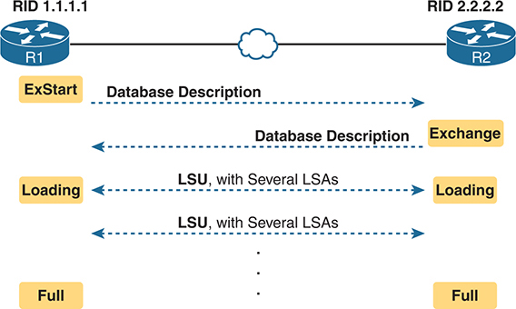

<figcaption>

<strong>图 21-8</strong> <em>数据库交换示例，最终达到 full 状态</em>

<aside class="hidden" id="a21fig08">

R1 和 R2 通过以太网 WAN 连接，路由器 ID（RID）分别为 1.1.1.1 和 2.2.2.2。过程从 ExStart 状态开始，由 R1 发起数据库描述；随后进入 Exchange 状态，由 R2 共享数据库描述。在 Loading 状态，两台路由器交换包含多个链路状态通告（LSA）的链路状态更新（LSU），更新彼此的数据库信息。过程在 Full 状态结束，表示交换完成。

</aside>

</figcaption>

</figure>

</section>

<section>

<h5 class="h5" id="ch21lev3sec9">维护邻居和 LSDB</h5>

两个邻居达到 full 状态后，就完成了相互交换 OSPF 信息的全部初始工作。不过，邻居仍需要持续执行一些小任务来维护关系。

首先，路由器使用 Hello 消息及两个相关计时器监视各邻居关系：<a id="key_239" href="#ref-gloss_167">Hello 间隔</a>和<a id="key_234" href="#ref-gloss_087">Dead 间隔</a>。路由器每隔一个 Hello 间隔向每个邻居发送 Hello，也期望按该间隔收到各邻居的 Hello。如果某邻居在整个 Dead 间隔内保持沉默（默认 Dead 间隔为 Hello 间隔的四倍），Hello 的缺失就表示该邻居已失效。

其次，路由器还必须响应拓扑变化，邻居在其中起关键作用。当某些情况变化时，一台或多台路由器会修改一个或多个 LSA，然后将变化的 LSA 泛洪给每个邻居，使邻居更新其 LSDB。

例如，假设 LAN 交换机断电，使路由器 G0/0 接口从 up/up 变为 down/down。该路由器更新一个 LSA，表明 G0/0 已关闭，然后将其发送给邻居，邻居再发送给自己的邻居，直到所有路由器再次拥有相同的 LSDB 副本。每台路由器的 LSDB 现在都反映出原路由器 G0/0 接口故障，因此各路由器将使用 SPF 重新计算受该接口故障影响的路由。

邻居执行的第三项维护任务是，即使网络完全稳定，也偶尔重新泛洪每个 LSA。默认情况下，创建 LSA 的路由器也负责每隔 30 分钟重新泛洪，即使没有任何变化。（请注意，各 LSA 都有基于创建时间的独立计时器，因此不会出现一次集中泛洪大量 LSA 导致网络过载的事件。）

为便于复习，以下列表汇总三项维护任务：

<ul class="sq">

<li>
根据 Hello 间隔发送 Hello，并在 Dead 间隔到期前监听 Hello，以维护邻居状态
</li>

<li>
向每个邻居泛洪任何发生变化的 LSA
</li>

<li>
在寿命到期时重新泛洪未变化的 LSA，默认间隔 30 分钟
</li>

</ul>

</section>

<section>

<h5 class="h5" id="ch21lev3sec10">在以太网链路上使用指定路由器</h5>

OSPF 根据逐接口设置的 <em>OSPF 网络类型</em>，在某些接口类型上表现不同。在以太网链路上，默认网络类型为 <em>broadcast</em>，使 OSPF 从同一子网的路由器中选出一台充当<a id="key_235" href="#ref-gloss_095">指定路由器（DR）</a>。DR 在数据库交换过程中起关键作用，其规则不同于点到点链路。

为了解这一点，先看<a href="#ch21fig09">图 21-9</a>。图中同一以太网 VLAN 上有五台 OSPFv2 路由器，它们选出一台 DR 和一台<a id="key_232" href="#ref-gloss_039">备用指定路由器（BDR）</a>。图中将 A 和 B 分别作为 DR 和 BDR，并无其他特别原因，只是因为 OSPF 网络类型为 broadcast 的子网会各有一台。

<figure class="image-c" id="ch21fig09">

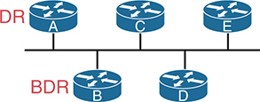

<figcaption>

<strong>图 21-9</strong> <em>路由器 A 和 B 当选 DR 和 BDR</em>

<aside class="hidden" id="a21fig09">

该网段中，路由器 A 当选指定路由器（DR），B 当选备用指定路由器（BDR）。所有路由器都连接在一条水平直线上，表示共享网段。

</aside>

</figcaption>

</figure>

以太网链路上的数据库交换，并不发生在同一 VLAN／子网中的每对路由器之间，而是发生在 DR 与其他各路由器之间，由 DR 确保所有其他路由器取得每个 LSA 的副本。换句话说，数据库交换沿<a href="#ch21fig10">图 21-10</a> 所示的数据流进行。

<figure class="image-c" id="ch21fig10">

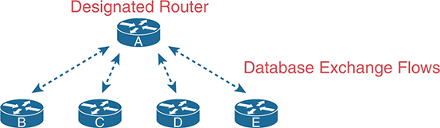

<figcaption>

<strong>图 21-10</strong> <em>以太网中与 DR 之间的数据库交换</em>

<aside class="hidden" id="a21fig10">

标为 A 的 DR 位于顶部中央，与下方呈半圆排列的 B、C、D、E 四台路由器连接。DR 与其他路由器的数据交换用双向箭头表示，代表双向数据库信息交换流。

</aside>

</figcaption>

</figure>

OSPF 定义 BDR 角色，使某台路由器能在 DR 故障时接替它。DR 故障后，BDR 接任 DR，另选一台路由器作为新的 BDR。

在同一链路允许连接两台以上路由器的网络中，DR／BDR 配合组播 IP 地址，使 OSPF LSDB 交换更高效。DR 可以使用组播地址 224.0.0.5 向子网内所有 OSPF 路由器发送数据包。IANA 专门为此将该地址保留为“All SPF Routers”组播地址。例如，在<a href="#ch21fig10">图 21-10</a> 中，DR 可以向所有 OSPF 路由器发送一组消息，而无需逐台发送。

同样，任何需要同时向 DR 和 BDR 发送消息的 OSPF 路由器，都可以将消息发送到“All SPF DRs”组播地址 224.0.0.6；BDR 接收这些消息，以随时准备接替 DR。因此，路由器只需发送一组消息，不必分别向 DR 和 BDR 各发一组，使交换更高效。

在路由器的 <strong>show</strong> 命令中，你会看到不少 DR 和 BDR 理论的体现。因为 DR 和 BDR 都与 LAN 内所有其他 OSPF 路由器完整交换数据库，它们与所有邻居都达到 full 状态。但既不是 DR 也不是 BDR 的路由器，OSPF 称为 <em>DROther</em>，彼此从不达到 full，因为它们不直接相互交换 LSDB。因此，在这些 DROther 上，<strong>show ip ospf neighbor</strong> 将某些邻居列为 2-way，并在正常运行期间持续保持该状态。

例如，<a href="#ch21fig10">图 21-10</a> 的以太网 LAN 中 OSPF 正常工作时，在路由器 C（DROther）上执行 <strong>show ip ospf neighbor</strong>，会看到：

<ul class="sq">

<li>
两个 full 状态的邻居（A 和 B，分别为 DR 和 BDR），称为<em>完全邻接邻居</em>
</li>

<li>
两个 2-way 状态的邻居（D 和 E，均为 DROther），称为<a id="key_248" href="#ref-gloss_267">邻居</a>
</li>

</ul>

OSPF 需要用不同术语描述全部邻居，以及其中达到 full 状态的子集。首先，同一链路上达到 2-way 状态的所有 OSPF 路由器，即发送 Hello 且参数匹配的路由器，称为<em>邻居</em>。其中邻居关系达到 full 状态的子集称为<em>邻接邻居</em>。此外，OSPFv2 的 RFC 2328 定义了<em>邻接邻居</em>的两个同义词以强调这一点：<a id="key_238" href="#ref-gloss_157">完全邻接</a>和<em>完全邻接邻居</em>。最后，前述术语指邻居本身，另有两个术语指关系：<em>邻居关系</em>泛指任何 OSPF 邻居关系，而<em>邻接关系</em>专指达到 full 状态的关系。<a href="#ch21tab04">表 21-4</a> 详细列出这些术语。

<figure class="table" id="ch21tab04" tabindex="0">

<figcaption>

<strong>表 21-4</strong> 稳定的 OSPF 邻居状态及其含义

</figcaption>

<table class="all">

<thead>

<tr>

<th class="th">
邻居状态
</th>

<th class="th">
邻居的称谓
</th>

<th class="th">
关系的称谓
</th>

</tr>

</thead>

<tbody>

<tr>

<td class="border">
2-way
</td>

<td class="border">
邻居
</td>

<td class="border">
邻居关系
</td>

</tr>

<tr>

<td class="border">
Full
</td>

<td class="border">
邻接邻居

完全邻接邻居
</td>

<td class="border">
邻接关系
</td>

</tr>

</tbody>

</table>

</figure>

</section>

</section>

<section>

<h4 class="h4" id="ch21lev2sec7">使用 SPF 计算最佳路由</h4>

OSPF LSA 包含有用信息，但不直接包含路由器应加入 IPv4 路由表的具体信息。也就是说，路由器无法直接从 LSDB 复制信息，作为 IPv4 路由表中的路由。每个 LSA 更像拼图的一块，拼完整后展示整个网络的拓扑图。因此，为知道应加入哪些路由，每台路由器都必须进行 SPF 计算，从自身角度选择最佳路由。然后将每条路由加入路由表，包含子网号和掩码、出接口，以及下一跳路由器 IP 地址。

虽然工程师无需掌握 SPF 数学计算细节，但需要知道如何预测 SPF 会选择哪些最佳路由。SPF 算法计算某子网的所有路由，也就是从路由器到目的子网的所有可能路径。如果存在多条路由，路由器比较度量值，选择最佳（最低）度量值的路由加入路由表。虽然 SPF 数学可能复杂，但工程师凭借网络图、路由器状态信息及简单加法，就能计算各路由度量值，预测 SPF 的选择。

SPF 识别出一条路由后，OSPF 按以下方式计算其度量值：

路由中所有出接口的 OSPF 接口开销之和。

<a href="#ch21fig11">图 21-11</a> 展示从 R1 到图底部子网 X（172.16.3.0/24）的三条可能路由。

<figure class="image-c" id="ch21fig11">

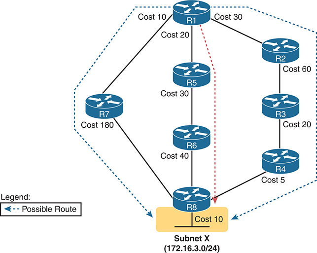

<figcaption>

<strong>图 21-11</strong> <em>用于寻找 R1 到 172.16.3.0/24 路由的 SPF 树</em>

<aside class="hidden" id="a21fig11">

示意图包含路由器 R1 至 R8，通过各自关联开销的线缆互连。R1 到 R7 的开销为 10，R7 到 R8 为 180，R1 到 R5 为 20，R5 到 R6 为 40，R6 到 R8 为 40，R1 到 R2 为 30，R2 到 R3 为 60，R3 到 R4 为 20，R4 到 R8 的开销未给出。虚线突出显示从 R1 经 R5、R6、R8 到子网 X（172.16.3.0/24）的最短路径。左下方图例说明，虚线表示可能路由。

</aside>

</figcaption>

</figure>

注意

OSPF 仅考虑每条路由中出接口的开销，不加入入接口开销。

<a href="#ch21tab05">表 21-5</a> 列出<a href="#ch21fig11">图 21-11</a> 中三条路由及累计开销，表明 R1 到 172.16.3.0/24 的最佳路由首先经过 R5。

<figure class="table" id="ch21tab05" tabindex="0">

<figcaption>

<strong>表 21-5</strong> 比较 R1 到 172.16.3.0/24 的三条备选路由

</figcaption>

<table class="all">

<thead>

<tr>

<th class="th">
路由
</th>

<th class="th">
在<a href="#ch21fig11">图 21-11</a> 中的位置
</th>

<th class="th">
累计开销
</th>

</tr>

</thead>

<tbody>

<tr>

<td class="border">
R1–R7–R8
</td>

<td class="border">
左侧
</td>

<td class="border">
10 + 180 + 10 = 200
</td>

</tr>

<tr>

<td class="border">
R1–R5–R6–R8
</td>

<td class="border">
中间
</td>

<td class="border">
20 + 30 + 40 + 10 = 100
</td>

</tr>

<tr>

<td class="border">
R1–R2–R3–R4–R8
</td>

<td class="border">
右侧
</td>

<td class="border">
30 + 60 + 20 + 5 + 10 = 125
</td>

</tr>

</tbody>

</table>

</figure>

SPF 算法分析 LSDB 后，R1 向路由表加入通往子网 172.16.3.0/24 的路由，下一跳路由器为 R5。

在实际 OSPF 网络中，工程师知道每个接口的 OSPF 开销后，也可以执行同样的过程。凭借网络图，工程师能够检查所有路由、累加开销，并预测每条路由的度量值。

</section>

</section>

<section>

<h3 class="h3" id="ch21lev1sec5">OSPF 区域和 LSA</h3>

在某些网络中，使用 OSPF 几乎无需考虑设计问题。只要在所有路由器上启用 OSPF，将所有接口放入同一区域（通常区域 0），就能工作！<a href="#ch21fig12">图 21-12</a> 展示这样的示例，包含 11 台路由器，所有接口都位于区域 0。

<figure class="image-c" id="ch21fig12">

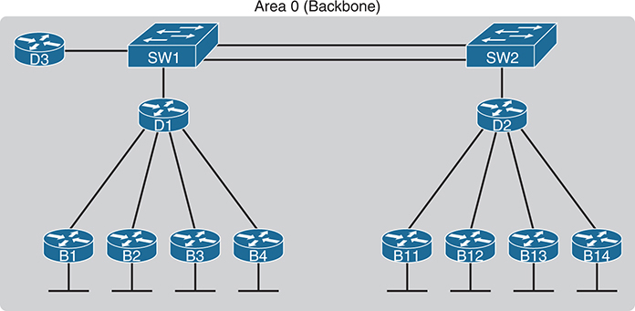

<figcaption>

<strong>图 21-12</strong> <em>单区域 OSPF</em>

<aside class="hidden" id="a21fig12">

网络中，路由器 D3 连接 SW1。交换机 SW1 和 SW2 互连，并分别连接路由器 D1 和 D2。D1 和 D2 又各连接四台路由器。连接 D1 的路由器为 B1、B2、B3、B4；连接 D2 的路由器为 B11、B12、B13、B14。

</aside>

</figcaption>

</figure>

单区域设计在中小型网络中效果很好。实际上，CCNA 200-301 V1.1 考试大纲明确提及<a id="key_251" href="#ref-gloss_364">单区域 OSPF</a>，而未包括<a id="key_247" href="#ref-gloss_259">多区域 OSPF</a>。不过，即使准备 CCNA，也值得思考区域的概念。接下来几页介绍 OSPF 区域设计如何工作，并进一步解释区域为什么能使大型 OSPF 网络运行得更好。

<section>

<h4 class="h4" id="ch21lev2sec8">OSPF 区域</h4>

OSPF 区域设计遵循几条基本规则。应用规则时，先准备一张清晰的互联网络图，包含路由器及所有接口。然后按以下方式为每个路由器接口选择区域：

<ul class="sq">

<li>
将连接同一子网的所有接口放在同一区域内。

</li>

<li>
区域应当连续。
</li>

<li>
某些路由器可以完全位于一个区域内部，所有接口都分配给该区域。
</li>

<li>
某些路由器可以是区域边界路由器（ABR），因为它们部分接口连接骨干区域，部分连接非骨干区域。
</li>

<li>
所有非骨干区域都必须有到达骨干区域（区域 0）的路径，即至少有一台 ABR 同时连接骨干区域和该非骨干区域。
</li>

</ul>

<a href="#ch21fig13">图 21-13</a> 展示一个示例。工程师从包含全部 11 台路由器及其链路的网络图开始。在左侧，他将四条 WAN 链路及分支路由器 B1 至 B4 所连 LAN 放入区域 1。同样，将通往分支 B11 至 B14 的链路及其 LAN 放入区域 2。两个区域都需要连接骨干区域 0，因此他将 D1 和 D2 的 LAN 接口与 D3 一起放入区域 0，构成骨干区域。

<figure class="image-c" id="ch21fig13">

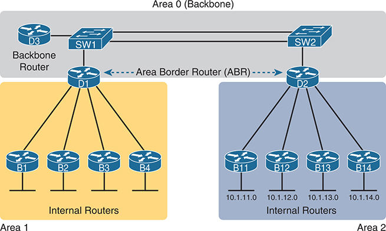

<figcaption>

<strong>图 21-13</strong> <em>D1 和 D2 作为 ABR 的三区域 OSPF</em>

<aside class="hidden" id="a21fig13">

网络划分为三个独立区域：区域 0（骨干）、区域 1 和区域 2。骨干区域中，两台交换机 SW1 和 SW2 连接骨干路由器 D3。ABR D1 和 D2 分别将骨干区域连接到区域 1 和 2。区域 1 包含 B1 至 B4 四台内部路由器，区域 2 包含 B11 至 B14 四台内部路由器，其对应 IP 地址为 10.1.11.0、10.1.12.0、10.1.13.0 和 10.1.14.0。

</aside>

</figcaption>

</figure>

图中还展示几个重要的 OSPF 区域设计术语。<a href="#ch21tab06">表 21-6</a> 汇总这些术语及其他相关术语的含义，尤其要关注图中出现的术语。

<figure class="table" id="ch21tab06" tabindex="0">

<figcaption>

<strong>表 21-6</strong> OSPF 设计术语

</figcaption>

<table class="all">

<thead>

<tr>

<th class="th">
术语
</th>

<th class="th">
说明
</th>

</tr>

</thead>

<tbody>

<tr>

<td class="border">
<a id="key_230" href="#ref-gloss_024">区域边界路由器（ABR）</a>
</td>

<td class="border">
接口同时连接骨干区域及至少一个其他区域的 OSPF 路由器
</td>

</tr>

<tr>

<td class="border">
<em>骨干路由器</em>
</td>

<td class="border">
连接骨干区域的路由器，包括 ABR
</td>

</tr>

<tr>

<td class="border">
<a id="key_241" href="#ref-gloss_199">内部路由器</a>
</td>

<td class="border">
位于一个区域内（非骨干区域）的路由器
</td>

</tr>

<tr>

<td class="border">
区域
</td>

<td class="border">
一组共享相同详细 LSDB 信息的路由器和链路，但不与其他区域的路由器共享这些细节，以提高效率
</td>

</tr>

<tr>

<td class="border">
<a id="key_231" href="#ref-gloss_037">骨干区域</a>
</td>

<td class="border">
所有其他区域必须连接的特殊 OSPF 区域，即区域 0
</td>

</tr>

<tr>

<td class="border">
区域内路由
</td>

<td class="border">
通往与该路由器位于同一区域的子网的路由
</td>

</tr>

<tr>

<td class="border">
区域间路由
</td>

<td class="border">
通往该路由器未所属区域中的子网的路由
</td>

</tr>

</tbody>

</table>

</figure>

</section>

<section>

<h4 class="h4" id="ch21lev2sec9">区域如何缩短 SPF 计算时间</h4>

<a href="#ch21fig13">图 21-13</a> 展示区域设计示例及部分术语，但没有体现区域的作用和优势。要理解区域如何减轻 SPF 工作量，需要了解区域设计如何改变区域内的 LSDB。

SPF 将大部分处理时间用于分析全部拓扑细节，即路由器及连接它们的链路。区域能减少 SPF 工作量，因为对于某个区域，LSDB 只列出该区域内的路由器和链路，如<a href="#ch21fig14">图 21-14</a> 左侧所示。

<figure class="image-c" id="ch21fig14">

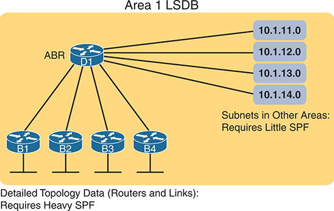

<figcaption>

<strong>图 21-14</strong> <em>区域 1 中较小 LSDB 的概念</em>

<aside class="hidden" id="a21fig14">

示意图顶部中央是区域边界路由器 D1，连接四台路由器 B1、B2、B3 和 B4。D1 右侧列出 IP 地址 10.1.11.0、10.1.12.0、10.1.13.0 和 10.1.14.0，代表其他区域的子网，只需少量 SPF（最短路径优先）计算。底部文字说明，详细拓扑数据（路由器和链路）需要大量 SPF 计算。

</aside>

</figcaption>

</figure>

虽然 LSDB 的拓扑信息减少，但仍需要知道所有区域的全部子网，使每台路由器都能为所有子网创建 IPv4 路由。因此，在区域设计中，OSPFv2 使用其他区域子网的简短汇总信息。这些汇总 LSA 不包含其他区域的拓扑信息，但每个汇总 LSA <em>确实</em>列出另一区域某子网的子网 ID 和掩码。汇总 LSA 完全不需要 SPF 处理；相反，这些子网看起来都像连接在 ABR 上（<a href="#ch21fig14">图 21-14</a> 中为 D1）。

对于大型网络，多区域在许多方面改善 OSPF 运行。以下汇总支持大型 OSPF 网络采用多区域的几个要点：

<ul class="sq">

<li>
路由器使用 SPF 算法处理较小的逐区域 LSDB，需要更少 CPU 周期，降低 CPU 开销并缩短收敛时间。
</li>

<li>
较小的逐区域 LSDB 所需内存更少。
</li>

<li>
网络变化，例如链路故障与恢复，只要求变化发生区域内的路由器进行 SPF 计算，减少必须重新运行 SPF 的路由器数量。
</li>

<li>
区域之间需要通告的信息更少，降低发送 LSA 所需的带宽。
</li>

</ul>

</section>

<section>

<h4 class="h4" id="ch21lev2sec10">（OSPFv2）链路状态通告</h4>

许多人初学 OSPF LSA 时会感到有些畏难。<strong>show ip ospf database</strong> 等命令的多种变体列出大量 LSDB 信息，其中许多数字看起来像某种代码，似乎有些杂乱。

不过，如果结合 OSPF 区域和区域设计来研究 LSA，几种最常见的 LSA 类型就容易理解得多。例如，考虑一个区域中的 LSDB：区域拓扑包含路由器及其间链路。事实上，OSPF 定义的前两种 LSA 正是为了描述这些细节：

<ul class="sq">

<li>
区域中每台路由器对应一个<em>路由器 LSA</em>
</li>

<li>
每个具有 DR 且 DR 至少有一个邻居的网络，对应一个<em>网络 LSA</em>
</li>

</ul>

接下来考虑其他区域中的子网。ABR 为某区域的每个子网创建汇总信息，通告到其他区域，基本上只有子网 ID 和掩码，构成第三种 LSA：

<ul class="sq">

<li>
其他区域中每个子网 ID 对应一个<em>汇总 LSA</em>
</li>

</ul>

接下来几页稍详细地讨论这三种 LSA；<a href="#ch21tab07">表 21-7</a> 汇总三者的部分信息，便于参考和学习。

<figure class="table" id="ch21tab07" tabindex="0">

<figcaption>

<strong>表 21-7</strong> 多区域 OSPF 设计中出现的三种 OSPFv2 LSA

</figcaption>

<table class="all">

<thead>

<tr>

<th class="th">
LSA 名称
</th>

<th class="th">
LSA 类型
</th>

<th class="th">
主要用途
</th>

<th class="th">
LSA 内容
</th>

</tr>

</thead>

<tbody>

<tr>

<td class="border">
路由器
</td>

<td class="border">
1
</td>

<td class="border">
描述路由器
</td>

<td class="border">
RID、接口、IP 地址／掩码、当前接口状态
</td>

</tr>

<tr>

<td class="border">
网络层
</td>

<td class="border">
2
</td>

<td class="border">
描述具有 DR 和 BDR 的网络
</td>

<td class="border">
DR 和 BDR 的 IP 地址、子网 ID、掩码
</td>

</tr>

<tr>

<td class="border">
汇总
</td>

<td class="border">
3
</td>

<td class="border">
描述另一区域中的子网
</td>

<td class="border">
子网 ID、掩码、通告该 LSA 的 ABR 的 RID
</td>

</tr>

</tbody>

</table>

</figure>

<section>

<h5 class="h5" id="ch21lev3sec11">路由器 LSA 构建大部分区域内拓扑</h5>

OSPF 需要各区域内部非常详细的拓扑信息。区域 X 内的路由器需要知道区域 X 拓扑的全部细节。为提供这些细节，路由器创建并泛洪描述区域内路由器和链路的路由器 LSA（类型 1）及网络 LSA（类型 2）。

路由器 LSA，也称类型 1 LSA，详细描述路由器。每个都列出路由器 RID、接口、IPv4 地址和掩码、接口状态，以及路由器通过各接口知道哪些邻居的相关信息。

要看具体实例，先查看<a href="#ch21fig15">图 21-15</a>，其中列出互联网络拓扑及子网。因为网络较小，工程师选择单区域设计，将所有接口放在骨干区域 0。

为该小型互联网络规划单区域设计后，LSDB 将包含四个路由器 LSA。每台路由器为自身创建一个路由器 LSA，以自身 RID 为 LSA 标识符。LSA 列出自身接口、IP 地址／掩码，以及指向邻居的指针。

四台路由器都有全部四个路由器 LSA 的副本后，SPF 就能通过数学分析创建模型。该模型很像<a href="#ch21fig16">图 21-16</a> 的概念图。请注意，图中每台路由器都标有明确的 RID。各路由器都有表示接口的指针，因为 LSA 标识邻居，SPF 能判断哪些接口连接哪些其他路由器。

<figure class="image-c" id="ch21fig15">

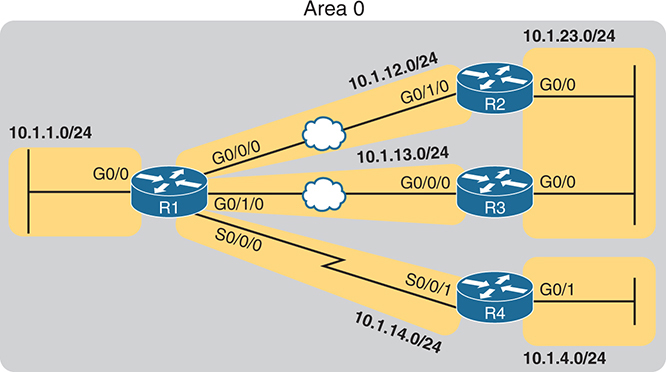

<figcaption>

<strong>图 21-15</strong> <em>包含六个 IPv4 子网的企业网络</em>

<aside class="hidden" id="a21fig15">

网络基础设施包含 R1 至 R4 四台路由器。R1 分别通过 G0/0 和 G0/0/0 接口连接子网 10.1.1.0/24 和 10.1.12.0/24。R2 分别通过 G0/1/0 和 G0/0 接口连接子网 10.1.12.0/24 和 10.1.23.0/24。R1 的 G0/1/0 连接 R3 的 G0/0/0，使用 R3 的 10.1.13.0/24。R1 使用 S0/0/0 连接 R4 的 S0/0/1，子网为 10.1.14.0/24；R4 的 G0/1 连接子网 10.1.4.0/24。

</aside>

</figcaption>

</figure>

<figure class="image-c" id="ch21fig16">

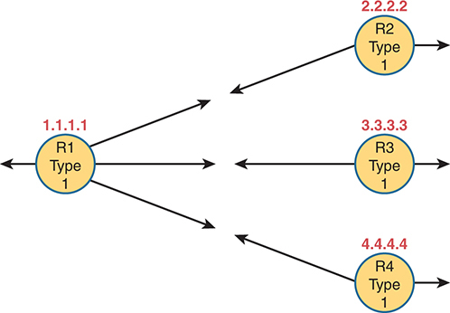

<figcaption>

<strong>图 21-16</strong> <em>假设采用单区域设计时的类型 1 LSA</em>

<aside class="hidden" id="a21fig16">

四台路由器 R1、R2、R3、R4 各用圆形表示，关联的特定 IP 地址分别为 1.1.1.1、2.2.2.2、3.3.3.3 和 4.4.4.4。标签表明所有路由器都是类型 1 LSA（链路状态通告）。R1 的一个箭头向左，另外三个分别指向 R2、R3 和 R4。R2、R3、R4 各有两个箭头，一个指向 R1，另一个向右。

</aside>

</figcaption>

</figure>

</section>

<section>

<h5 class="h5" id="ch21lev3sec12">网络 LSA 补全区域内拓扑</h5>

路由器 LSA 定义大部分区域内拓扑，网络 LSA 则定义其余部分。当 OSPF 在某子网选出 DR，<em>且</em>该 DR 至少有一个邻居时，OSPF 会将该子网视为网络数学模型中的另一个节点。为表示该网络，DR 为该网络（子网）创建并泛洪网络 LSA（类型 2）。

例如，前面的<a href="#ch21fig15">图 21-15</a> 中有一个以太网 LAN 和两个以太网 WAN。R2 与 R3 之间的以太网 LAN 会选出 DR，两台路由器也会成为邻居，因此当选 DR 的那台会创建网络 LSA。同样，R1 与 R2 通过以太网 WAN 连接，该链路上的 DR 会创建网络 LSA；R1 与 R3 之间以太网 WAN 链路上的 DR 也会创建网络 LSA。

<a href="#ch21fig17">图 21-17</a> 展示该设计中区域 0 的完整区域内 LSA。请注意，存在网络 LSA 时，路由器 LSA 会引用它们，使 SPF 进程能够将各部分连接起来。

<figure class="image-c" id="ch21fig17">

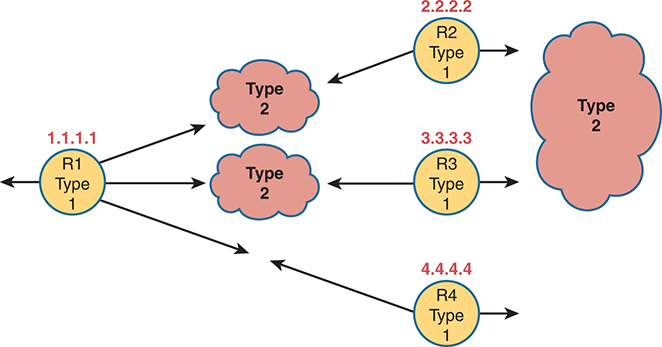

<figcaption>

<strong>图 21-17</strong> <em>假设采用单区域设计时，区域 0 的类型 1 和类型 2 LSA</em>

<aside class="hidden" id="a21fig17">

四台路由器 R1、R2、R3、R4 各用圆形表示，关联的特定 IP 地址分别为 1.1.1.1、2.2.2.2、3.3.3.3 和 4.4.4.4。标签表明所有路由器都是类型 1 LSA（链路状态通告）。R1 一个箭头向左，另外三个分别指向类型 2、类型 2 和 R4。R2 和 R3 各有两个箭头，分别指向左右的类型 2。R4 有两个箭头，一个指向 R1，另一个向右。

</aside>

</figcaption>

</figure>

最后请注意，该单区域设计示例完全没有汇总 LSA（类型 3）。这些 LSA 代表其他区域的子网，而本例没有其他区域。鉴于 CCNA 200-301 V1.1 考试大纲明确指向单区域 OSPF 设计，本节只展示区域内 LSA（类型 1 和 2）的细节。

</section>

</section>

</section>

</section>

<section class="ccna-source ccna-appendix" aria-label="答案解析与术语表">
<section data-epub-type="chapter">

<h2 class="h2" id="ref-appc">附录 C</h2>

<h2 class="h2a">“这些知识我已经掌握了吗？”自测题答案</h2>

<section>

<h3 class="h3" id="ref-appclev1sec21">第 21 章</h3>

<strong><a id="ref-ques21_1" href="#quess21_1">1</a>．</strong> D。RIP 的两个版本都使用距离矢量逻辑，而 EIGRP 使用另一种逻辑，称为高级距离矢量或平衡混合型。

<strong><a id="ref-ques21_2" href="#quess21_2">2</a>．</strong> C 和 D。RIP 的两个版本都使用相同的跳数度量值，均不受链路带宽影响。EIGRP 的度量值默认基于带宽和延迟计算。OSPF 的度量值是出接口开销之和，而这些开销默认基于接口带宽。

<strong><a id="ref-ques21_3" href="#quess21_3">3</a>．</strong> B、C 和 D。列出的路由协议中，只有较旧的 RIP 第 1 版（RIP-1）不支持可变长子网掩码（VLSM）。

<strong><a id="ref-ques21_4" href="#quess21_4">4</a>．</strong> C。LSA 包含可用于计算路由的拓扑信息，但不直接列出路由器应加入路由表的路由。本例中，R1 针对 LSA 运行名为最短路径优先（SPF）算法的计算，以确定应加入 IP 路由表的 IP 路由。

<strong><a id="ref-ques21_5" href="#quess21_5">5</a>．</strong> B。完成数据库交换的相邻 OSPF 路由器被视为完全邻接，并保持 full 邻居状态。up/up 和 final 根本不是 OSPF 状态。2-way 可以是中间状态，也可以是同一 VLAN 上某些路由器之间的稳定状态。

<strong><a id="ref-ques21_6" href="#quess21_6">6</a>．</strong> C。正确答案是使用单区域设计的一项优势。三个错误答案都是多区域设计的优势，这些理由在较大的互联网络中尤其重要。

</section>

</section>

<section id="ref-glossary"><h2 class="h2a">术语表</h2>
<strong>2-way 状态（2-way state）</strong> OSPF 的一种邻居状态，表示路由器已与邻居交换 Hello，且所有必需参数都匹配。

<strong>区域边界路由器（Area Border Router，ABR）</strong> 使用 OSPF 且接口分布于多个 OSPF 区域的路由器。

<strong>骨干区域（backbone area）</strong> OSPFv2 和 OSPFv3 多区域设计中的特殊区域，所有非骨干区域都必须连接该骨干区域，即区域 0。

<strong>备用指定路由器（backup designated router）</strong> 连接多路访问网络的 OSPF 路由器，监视指定路由器（DR）的工作，并在 DR 故障时接替其工作。

<strong>收敛（convergence）</strong> 路由协议响应网络变化所需的时间，期间移除失效路由、加入新的更优路由，使所有路由器的路由表包含当前最佳路由。

<strong>Dead 间隔（Dead Interval）</strong> OSPF 为每个邻居使用的计时器。如果在该计时器规定的时间内未收到某邻居的 Hello，路由器就认为邻居已失效。

<strong>指定路由器（designated router）</strong> OSPF 多路访问网络中在选举中获胜的路由器，负责管理简化的交换过程，使连接该网络的所有路由器交换 OSPF 拓扑信息。

<strong>距离矢量（distance vector）</strong> RIP 等某些内部路由协议行为背后的逻辑。距离矢量路由算法要求每台路由器在每次更新中发送整个路由表，但只发送给邻居。它容易产生路由环路，不过计算上比链路状态算法更简单。

<strong>full 状态（full state）</strong> OSPF 的一种邻居状态，表示两台路由器已交换各自 LSDB 的全部内容。

<strong>完全邻接（fully adjacent）</strong> OSPF 对邻居状态的一种描述，表示两个邻居已达到 full 状态。

<strong>Hello 间隔（Hello Interval）</strong> OSPF 和 EIGRP 的接口计时器，规定路由器发送 Hello 消息的频率。

<strong>内部网关协议（interior gateway protocol，IGP）</strong> 设计用于在单个自治系统内部交换路由信息的路由协议。

<strong>内部路由器（internal router）</strong> OSPF 中所有接口都位于同一非骨干区域的路由器。

<strong>链路状态通告（link-state advertisement，LSA）</strong> OSPF 中存放在 LSDB 内的数据结构名称，详细描述网络中的各种组件，包括路由器和链路（子网）。

<strong>链路状态数据库（link-state database，LSDB）</strong> OSPF 中路由器 RAM 内保存各种 LSA 的数据结构，所有 LSA 共同表示整个网络拓扑。

<strong>链路状态请求（Link-State Request）</strong> 用于请求相邻路由器发送某个特定 LSA 的 OSPF 数据包。

<strong>链路状态更新（Link-State Update）</strong> 用于向相邻路由器发送 LSA 的 OSPF 数据包。

<strong>度量值（metric）</strong> 路由协议算法使用的衡量单位，用于确定流量到达特定目的地的最佳路由。

<strong>多区域 OSPF（multiarea OSPF）</strong> OSPFv2 和 OSPFv3 中，在一个 OSPF 域（通常是一家公司）内使用多个区域的设计。

<strong>邻居（neighbor）</strong> 在路由协议中，某台路由器决定与之交换路由信息的另一台路由器。

<strong>路由器 ID（router ID，RID）</strong> EIGRP 和 OSPF 中，以点分十进制表示、唯一标识每台路由器的 32 位数字。

<strong>最短路径优先（SPF）算法（shortest path first algorithm）</strong> 链路状态路由协议用于分析 LSDB，并寻找从该路由器到每个子网的最低开销路由的算法名称。

<strong>单区域 OSPF（single-area OSPF）</strong> OSPFv2 和 OSPFv3 中，在一个 OSPF 域（通常是一家公司）内使用单个区域的设计。

</section>
</section>


<nav class="ccna-chapter-nav" aria-label="章节导航"><a href="v1-20.html">← 上一章</a><a href="v1-22.html">下一章 →</a></nav>
