
<a href="{{ '/subjects/CCNA/' | relative_url }}">← 返回 CCNA 目录</a>

第一卷 · OSPF

<nav class="ccna-chapter-nav" aria-label="章节导航"><a href="v1-21.html">← 上一章</a><a href="v1-23.html">下一章 →</a></nav>



<section data-epub-type="chapter">

<h2 class="h2" id="ch22">第 22 章</h2>

<h2 class="h2a">实现基本 OSPF 功能</h2>

本章涵盖以下考试主题：

3.0 IP 连接

3.2 确定路由器默认如何做出转发决策

3.2.b 管理距离

3.2.c 路由协议度量值

3.4 配置与验证单区域 OSPFv2

3.4.a 邻居邻接关系

3.4.b 点到点

3.4.c 广播（DR/BR 选择）

3.4.d 路由器 ID

如果依赖默认设置，OSPFv2 只需要少量配置命令。要使用 OSPF，只需在网络中计划使用的每个接口上启用它，OSPF 就会通过消息发现邻居，并经由这些邻居学习路由。OSPF 在后台执行许多任务，可以通过大量 OSPF <strong>show</strong> 命令了解细节。不过，对所有可选功能主要使用默认设置时，配置 OSPF 只需几条命令。本章将帮助你学习这些最低限度的设置。

本章第一个主要部分介绍使用 <strong>network</strong> 命令的传统 OSPFv2 配置，以及多种相关 <strong>show</strong> 命令。它教你让 OSPFv2 使用默认设置运行，并通过这些 <strong>show</strong> 命令确认协议确实正常工作。

第二个主要部分介绍另一种配置选项，称为 OSPF 接口模式，与第一部分展示的传统配置相对。它使用 <strong>ip ospf</strong> <em>process-id</em> <strong>area</strong> <em>area-number</em> 配置命令代替 <strong>network</strong>。

此外，第一个主要部分还详细介绍如何设置 OSPF 路由器 ID（RID）。虽然这是可选项，但配置可预测且稳定的 OSPF RID 能简化运维和故障排查，可能是最重要的可选 OSPF 设置。

<section>

<h3 class="h3" id="ch22lev1sec1">自测</h3>

如果想根据分数决定在本章投入多少时间，请完成测验（在此处作答，或使用 PTP 软件）。字母答案列在测验后页面的底部。<a href="#ref-appc">附录 C</a> 位于本书末尾及配套网站，包含答案和解析。PTP 测试软件中也提供答案与解析。

<figure class="table" id="ch22tab01" tabindex="0">

<figcaption>

<strong>表 22-1</strong> 基础主题小节与题目对应关系

</figcaption>

<table class="all">

<thead>

<tr>

<th class="th">
基础知识小节
</th>

<th class="th">
题目
</th>

</tr>

</thead>

<tbody>

<tr>

<td class="border">
使用 network 命令实现 OSPFv2
</td>

<td class="border">
1–4
</td>

</tr>

<tr>

<td class="border">
使用接口子命令实现 OSPFv2
</td>

<td class="border">
5, 6
</td>

</tr>

</tbody>

</table>

</figure>

<strong><a id="quess22_1" href="#ques22_1a">1</a>．</strong>在执行 <strong>router ospf 1</strong> 之后，以下哪条 <strong>network</strong> 命令会在 IP 地址为 10.1.1.1、10.1.100.1 和 10.1.120.1 的接口上启用 OSPF？

<ol class="lower-alpha">

<li>
<strong>network 10.0.0.0 0.0.0.0 area 0</strong>
</li>

<li>
<strong>network 10.0.0.0 0.255.255.255 area 0</strong>
</li>

<li>
<strong>network 10.0.0.0 0.0.0.255 area 0</strong>
</li>

<li>
<strong>network 10.0.0.0 0.0.255.255 area 0</strong>
</li>

</ol>

<strong><a id="quess22_2" href="#ques22_2a">2</a>．</strong>在执行 <strong>router ospf 1</strong> 之后，以下哪条 <strong>network</strong> 命令会指示路由器在 IP 地址为 10.1.1.1、10.1.100.1 和 10.1.120.1 的接口上开始使用 OSPF？

<ol class="lower-alpha">

<li>
<strong>network 10.1.0.0 0.0.255.255 area 0</strong>
</li>

<li>
<strong>network 10.0.0.0 0.255.255.0 area 0</strong>
</li>

<li>
<strong>network 10.1.1.0 0.x.1x.0 area 0</strong>
</li>

<li>
<strong>network 10.1.1.0 255.0.0.0 area 0</strong>
</li>

</ol>

<strong><a id="quess22_3" href="#ques22_3a">3</a>．</strong>以下哪些命令列出接口 serial 0/0 上的 OSPF 邻居？（选择两个答案。）

<ol class="lower-alpha">

<li>
<strong>show ip ospf neighbor</strong>
</li>

<li>
<strong>show ip ospf interface brief</strong>
</li>

<li>
<strong>show ip neighbor</strong>
</li>

<li>
<strong>show ip interface</strong>
</li>

<li>
<strong>show ip ospf neighbor serial 0/0</strong>
</li>

</ol>

<strong><a id="quess22_4" href="#ques22_4a">4</a>．</strong>路由器重新加载并选择新 OSPF 路由器 ID（RID）时，拥有以下正常工作的接口：loopback 1，IP 地址 10.8.8.8；loopback 2，地址 10.7.7.7；GigabitEthernet0/0/0，地址 10.9.9.9。OSPF 进程配置中没有 <strong>router-id</strong> 命令。路由器选择了哪个 RID？

<ol class="lower-alpha">

<li>
10.7.7.7
</li>

<li>
10.8.8.8
</li>

<li>
10.9.9.9
</li>

<li>
路由器无法选择 RID。
</li>

</ol>

<strong><a id="quess22_5" href="#ques22_5a">5</a>．</strong>工程师将 OSPFv2 从较传统的、在 OSPF 配置模式下使用 <strong>network</strong> 命令的配置，迁移为 OSPFv2 接口配置。在新配置中，以下哪个命令设置分配给接口的区域编号？

<ol class="lower-alpha">

<li>
接口配置模式下的 <strong>area</strong> 命令
</li>

<li>
接口配置模式下的 <strong>ip ospf</strong> 命令
</li>

<li>
接口配置模式下的 <strong>router ospf</strong> 命令
</li>

<li>
接口配置模式下的 <strong>network</strong> 命令
</li>

</ol>

<strong><a id="quess22_6" href="#ques22_6a">6</a>．</strong>某企业避免使用 OSPF <strong>network</strong> 命令，而倾向于通过 <strong>ip ospf</strong> <em>process-id</em> <strong>area</strong> <em>area-id</em> 接口子命令逐接口启用 OSPF。哪些 <strong>show</strong> 命令可以识别接口是否配置了 <strong>ip ospf</strong> <em>process-id</em> <strong>area</strong> <em>area-id</em> 子命令？（选择两个答案。）

<ol class="lower-alpha">

<li>
<strong>show ip ospf interface</strong> 命令
</li>

<li>
<strong>show ip ospf interface brief</strong> 命令
</li>

<li>
<strong>show ip ospf neighbor</strong> 命令
</li>

<li>
<strong>show ip protocols</strong> 命令
</li>

</ol>

自测答案：

<strong><a id="ques22_1a" href="#ref-ques22_1">1</a></strong> B

<strong><a id="ques22_2a" href="#ref-ques22_2">2</a></strong> A

<strong><a id="ques22_3a" href="#ref-ques22_3">3</a></strong> A, E

<strong><a id="ques22_4a" href="#ref-ques22_4">4</a></strong> B

<strong><a id="ques22_5a" href="#ref-ques22_5">5</a></strong> B

<strong><a id="ques22_6a" href="#ref-ques22_6">6</a></strong> A, D

</section>

<section>

<h3 class="h3box" id="ch22lev1sec2">基础知识</h3>

</section>

<section>

<h3 class="h3" id="ch22lev1sec3">使用 network 命令实现 OSPFv2</h3>

选定 OSPF 设计后（在大型 IP 互联网络中可能很复杂），配置可以简单到只需在各路由器接口上启用 OSPF，并将接口放入正确区域。本章第一个主要部分关注使用传统 OSPFv2 <strong>network</strong> 命令的必需配置，以及一个可选设置：如何设置 <a id="key_253" href="#ref-gloss_291">OSPF router-id</a>。此外，还介绍如何显示各种列表和表格，确认 OSPF 的工作情况。

为便于参考和学习，以下概述第一个主要部分介绍的配置步骤：

步骤 1。使用全局命令 <strong>router ospf</strong> <em>process-id</em>，进入特定 OSPF 进程的配置模式。

<figure class="figure1">

</figure>

步骤 2。（可选）通过以下方式配置 OSPF 路由器 ID：

<ol class="step-lower-alpha">

<li>
使用 <strong>router-id</strong> <em>id-value</em> 路由器子命令定义路由器 ID，或者
</li>

<li>
使用全局命令 <strong>interface loopback</strong> <em>number</em> 配合 <strong>ip address</strong> <em>address mask</em>，为环回接口配置 IP 地址（从所有正常工作的环回接口中选择最高 IP 地址），或者
</li>

<li>
依赖接口 IP 地址（从所有正常工作的非环回接口中选择最高 IP 地址）。
</li>

</ol>

步骤 3。使用一条或多条 <strong>network</strong> <em>ip-address wildcard-mask</em> <strong>area</strong> <em>area-id</em> 路由器子命令，在匹配所配地址及掩码的接口上启用 OSPFv2，并将接口上的 OSPF 归入指定区域。

<a href="#ch22fig01">图 22-1</a> 展示 OSPF 配置命令之间的关系：配置的一部分创建路由进程，然后间接在各接口上启用 OSPF。配置并不直接指定启用 OSPF 的接口名称，而要求 IOS 将 OSPF <strong>network</strong> 与接口 <strong>ip address</strong> 命令比较，应用一定逻辑。后面的示例会进一步讨论该逻辑。

<figure class="image-c" id="ch22fig01">

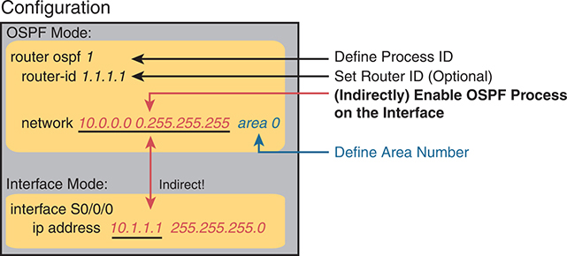

<figcaption>

<strong>图 22-1</strong> <em>使用 <strong>network</strong> 命令的 OSPFv2 配置结构</em>

<aside class="hidden" id="a22fig01">

示意图分为 OSPF 模式和接口模式。在 OSPF 模式中，“router ospf 1”定义进程 ID，“router-id 1.1.1.1”设置可选的路由器 ID，“network 10.0.0.0 255.255.255 area 0”定义区域编号。接口模式以间接关联的方式呈现，其中“interface S0/0/0”进入接口配置模式，“ip address 10.1.1.1 255.255.255.0”为接口分配 IP 地址。

</aside>

</figcaption>

</figure>

<section>

<h4 class="h4" id="ch22lev2sec1">OSPF 单区域配置</h4>

<a href="#ch22fig02">图 22-2</a> 展示本章大多数示例使用的网络。所有链路都位于区域 0，构成包含四台路由器的单区域设计。可以将 R1 视为中心站点的路由器，通过 WAN 链路连接各远程站点。R2 和 R3 可能位于同一个大型远程站点，该站点需要两条 WAN 链路和两台路由器提供 WAN 冗余，两台都连接本地 LAN。R4 则可能位于典型的较小远程站点，只需要一台路由器。

<figure class="image-c" id="ch22fig02">

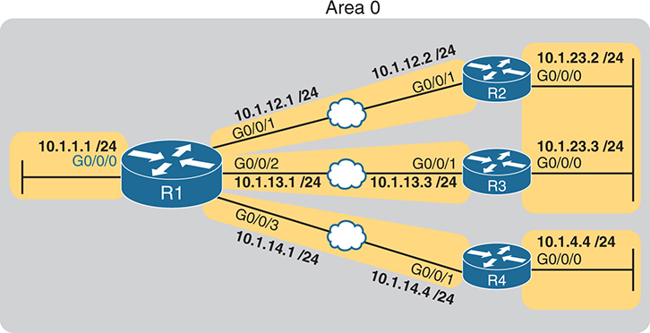

<figcaption>

<strong>图 22-2</strong> <em>OSPF 单区域配置的示例网络</em>

<aside class="hidden" id="a22fig02">

网络基础设施由 R1 至 R4 四台路由器组成。R1 的 G0/0/0 接口连接子网 10.1.1.1/24。R1 还在 G0/0/1 上使用子网 10.1.12.1/24，通过以太网 WAN 连接 R2 的 G0/0/1 及子网 10.1.12.2/24。R2 通过 G0/0/0 连接子网 10.1.23.2/24。此外，R1 的 G0/0/2 使用子网 10.1.13.1/24，通过以太网 WAN 连接 R3 的 G0/0/1 及子网 10.1.13.3/24。R3 通过 G0/0/0 连接子网 10.1.23.3/24。最后，R1 的 G0/0/3 使用子网 10.1.14.1/24，通过以太网 WAN 连接 R4 的 G0/0/1 及子网 10.1.14.4/24。R4 通过 G0/0/0 连接子网 10.1.4.4/24。

</aside>

</figcaption>

</figure>

在深入 OSPF 细节之前，<a href="#exa22_1">例 22-1</a> 展示路由器 R1 的 IPv4 编址配置。

<strong>例 22-1</strong> <em>R1 上的 IPv4 地址配置</em>

<a href="#code-f0566-01" id="f0566-01a">点击此处查看代码原图</a>

<pre class="pre-ex" tabindex="0"><code class="highlight">interface GigabitEthernet0/0/0
 ip address 10.1.1.1 255.255.255.0
!
interface GigabitEthernet0/0/1
 ip address 10.1.12.1 255.255.255.0
!
interface GigabitEthernet0/0/2
 ip address 10.1.13.1 255.255.255.0
!
interface GigabitEthernet0/0/3
 ip address 10.1.14.1 255.255.255.0</code></pre>

OSPF 配置从全局命令 <strong>router ospf</strong> <em>process-id</em> 开始，该命令进入 OSPF 配置模式，并设置 OSPF <em>process-id</em>。<em>process-id</em> 只需在本地路由器上唯一，并在该路由器的不同命令之间匹配。它不需要与相邻路由器或同一区域其他路由器的 <em>process-id</em> 一致。其值可以是 1 至 65,535 的任意整数。

其次，配置需要在 OSPF 模式下使用一条或多条 <strong>network</strong> 命令。它们指示路由器查找匹配 <strong>network</strong> 前两个参数的本地接口。然后，为每个匹配接口启用 OSPF、发现邻居、创建邻居关系，并将接口分配给 <strong>network</strong> 指定的区域。（区域可配置为整数或点分十进制，但本书习惯使用整数区域编号，范围为 0 至 4,294,967,295。）

<a href="#exa22_2">例 22-2</a> 展示<a href="#ch22fig02">图 22-2</a> 中 R1 的配置。<strong>router ospf 1</strong> 启用 OSPF 进程 1，单条 <strong>network</strong> 在图中所有接口上启用 OSPF。

<strong>例 22-2</strong> <em>在 R1 上使用一条 <strong>network</strong> 命令进行 OSPF 单区域配置</em>

<a href="#code-f0566-02" id="f0566-02a">点击此处查看代码原图</a>

<pre class="pre-ex" tabindex="0"><code class="highlight">router ospf 1
 network 10.0.0.0 0.255.255.255 area 0</code></pre>

对于<a href="#exa22_2">例 22-2</a> 中这条具体的 <strong>network</strong> 命令，所有匹配接口都分配到区域 0。不过，前两个参数，即 <em>ip_address</em> 和 <em>wildcard_mask</em> 的值 10.0.0.0 与 0.255.255.255，需要解释。本例中，它匹配 R1 图示的所有接口，下一主题说明原因。

</section>

<section>

<h4 class="h4" id="ch22lev2sec2">network 命令的通配符匹配</h4>

理解第一个示例中的传统 OSPFv2 配置，关键是理解 OSPF <strong>network</strong> 命令。它将命令中的第一个参数与本地路由器每个接口 IP 地址比较，尝试找出匹配。但 <strong>network</strong> 并非一定将整个参数值与接口完整 IPv4 地址比较；路由器可以根据通配符掩码，仅比较 <strong>network</strong> 中地址的部分八位组，具体如下：

<strong>通配符 0.0.0.0：</strong>比较全部四个八位组，也就是说，地址必须完全匹配。

<strong>通配符 0.0.0.255：</strong>只比较前三个八位组，比较时忽略最后一个。

<strong>通配符 0.0.255.255：</strong>只比较前两个八位组，比较时忽略最后两个。

<strong>通配符 0.255.255.255：</strong>只比较第一个八位组，比较时忽略最后三个。

<strong>通配符 255.255.255.255：</strong>不比较任何部分，表示所有地址都匹配该 <strong>network</strong> 命令。

基本上，通配符掩码某个八位组的十进制值为 0，指示 IOS 比较该处数值是否匹配；值为 255，则指示 IOS 在比较时忽略该八位组。

由于采用通配符掩码，<strong>network</strong> 命令提供许多灵活选项。例如，在 R1 上可以使用多种 <strong>network</strong> 命令，有的匹配全部接口，有的只匹配部分接口。<a href="#ch22tab02">表 22-2</a> 展示若干选项及说明。

<figure class="table" id="ch22tab02" tabindex="0">

<figcaption>

<strong>表 22-2</strong> R1 上的 OSPF <strong>network</strong> 命令示例及预期结果

</figcaption>

<table class="all">

<thead>

<tr>

<th class="th">
命令
</th>

<th class="th">
命令逻辑
</th>

<th class="th">
匹配接口
</th>

</tr>

</thead>

<tbody>

<tr>

<td class="border">
<strong>network 10.1.0.0 0.0.255.255</strong>
</td>

<td class="border">
匹配以 10.1 开头的地址
</td>

<td class="border">
G0/0/0

G0/0/1

G0/0/1

G0/0/2
</td>

</tr>

<tr>

<td class="border">
<strong>network 10.0.0.0 0.255.255.255</strong>
</td>

<td class="border">
匹配以 10 开头的地址
</td>

<td class="border">
G0/0/0

G0/0/1

G0/0/1

G0/0/2
</td>

</tr>

<tr>

<td class="border">
<strong>network 0.0.0.0 255.255.255.255</strong>
</td>

<td class="border">
匹配所有地址
</td>

<td class="border">
G0/0/0

G0/0/1

G0/0/1

G0/0/2
</td>

</tr>

<tr>

<td class="border">
<strong>network 10.1.13.0 0.0.0.255</strong>
</td>

<td class="border">
匹配以 10.1.13 开头的地址
</td>

<td class="border">
G0/0/2
</td>

</tr>

<tr>

<td class="border">
<strong>network 10.1.13.1 0.0.0.0</strong>
</td>

<td class="border">
匹配单个地址：10.1.13.1
</td>

<td class="border">
G0/0/2
</td>

</tr>

</tbody>

</table>

</figure>

通配符掩码为本地路由器提供匹配自身接口的规则。为展示不同选项，<a href="#exa22_3">例 22-3</a> 展示 R2、R3、R4 的配置，各自使用不同通配符掩码。请注意，三台路由器都在<a href="#ch22fig02">图 22-2</a> 所示的全部接口上启用 OSPF。

<strong>例 22-3</strong> <em>路由器 R2、R3 和 R4 上的 OSPF 配置</em>

<a href="#code-f0568-01" id="f0568-01a">点击此处查看代码原图</a>

<pre class="pre-ex" tabindex="0"><code class="highlight">! R2 configuration next - one <strong>network</strong> command enables OSPF on both interfaces
interface GigabitEthernet0/0/0
 ip address 10.1.23.2 255.255.255.0
!
interface GigabitEthernet0/0/1
 ip address 10.1.12.2 255.255.255.0
!
router ospf 1
 network 10.0.0.0 0.255.255.255 area 0</code></pre>

<pre class="pre-ex" tabindex="0"><code class="highlight">! R3 configuration next - One <strong>network</strong> command per interface
interface GigabitEthernet0/0/0
 ip address 10.1.23.3 255.255.255.0
!
interface GigabitEthernet0/0/1
 ip address 10.1.13.3 255.255.255.0
!
router ospf 1
 network 10.1.13.3 0.0.0.0 area 0
 network 10.1.23.3 0.0.0.0 area 0</code></pre>

<pre class="pre-ex" tabindex="0"><code class="highlight">! R4 configuration next - One <strong>network</strong> command per interface with wildcard 0.0.0.255
interface GigabitEthernet0/0/0
 ip address 10.1.4.4 255.255.255.0
!
interface GigabitEthernet0/0/1
 ip address 10.1.14.4 255.255.255.0
!
router ospf 1
 network 10.1.14.0 0.0.0.255 area 0
 network 10.1.4.0 0.0.0.255 area 0</code></pre>

最后请注意，OSPF 使用的通配符掩码逻辑与 Cisco IOS 访问控制列表定义的相同。《<em>CCNA 200-301 官方认证指南，第 2 卷</em>》第二版<a data-original-href="vol1_ch06.xhtml#ch06" data-unavailable="true" title="此内容不在当前提取范围内；请参阅原始 EPUB：vol1_ch06.xhtml#ch06">第 6 章</a>的“查找匹配子网的正确通配符掩码”一节，提供更多相关细节。

注意

如果 <strong>network</strong> 中通配符掩码某个八位组为 255，对应地址八位组应配置为 0。有意思的是，IOS 会接受违反此规则的 <strong>network</strong>，但在将其写入运行配置文件之前，会把对应地址八位组改为 0。例如，IOS 会将输入的 <strong>network 1.2.3.4 0.0.255.255</strong> 开头的命令，改为 <strong>network 1.2.0.0 0.0.255.255</strong>。

</section>

<section>

<h4 class="h4" id="ch22lev2sec3">验证 OSPF 运行</h4>

如<a href="v1-21.html#ch21">第 21 章</a>“<a href="v1-21.html#ch21">理解 OSPF 概念</a>”所述，OSPF 路由器通过三步，最终将 OSPF 学到的路由加入 IP 路由表。首先创建邻居关系，然后在邻居之间构建并泛洪 LSA，使同一区域每台路由器都拥有相同 LSDB 副本。最后，各路由器独立使用 SPF 算法计算自身 IP 路由，并加入路由表。接下来介绍如何显示各步骤的结果，从而确认 OSPF 是否正确工作。

<strong>show ip ospf neighbor</strong>、<strong>show ip ospf database</strong> 和 <strong>show ip route</strong> 分别显示与这三步对应的信息。<a href="#ch22fig03">图 22-3</a> 汇总验证 OSPF 时可用的这些命令及其他命令。

<figure class="image-c" id="ch22fig03">

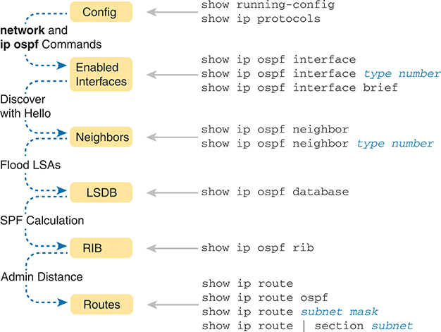

<figcaption>

<strong>图 22-3</strong> <em>OSPF 验证命令</em>

<aside class="hidden" id="a22fig03">

展示 OSPF 网络配置及运行的示意图。流程从“Config”开始，通过“network and ip ospf Commands”到“Enabled Interfaces”；再通过“Discover with Hello”连接“Neighbors”，通过“Flood LSAs”从“Neighbors”到“LSDB”；“LSDB”通过“SPF Calculation”连接“RIB”，“RIB”再通过“Admin Distance”连接“Routes”。虚线箭头表示步骤间的推进。

</aside>

</figcaption>

</figure>

许多工程师从 <strong>show ip ospf neighbor</strong> 输出开始验证 OSPF。例如，<a href="#exa22_4">例 22-4</a> 展示 R1 的输出，它应分别与 R2、R3、R4 各有一个邻居关系，<a href="#exa22_4">例 22-4</a> 列出了全部三个。

<strong>例 22-4</strong> <em><a href="#ch22fig02">图 22-2</a> 中 R1 的 OSPF 邻居</em>

<a href="#code-f0569-01" id="f0569-01a">点击此处查看代码原图</a>

<pre class="pre-ex" tabindex="0"><code class="highlight">R1# <strong>show ip ospf neighbor</strong>
Neighbor ID     Pri   State          Dead Time   Address       Interface
2.2.2.2           1   FULL/DR        00:00:37    10.1.12.2     GigabitEthernet0/0/1
3.3.3.3           1   FULL/DR        00:00:37    10.1.13.3     GigabitEthernet0/0/2
4.4.4.4           1   FULL/BDR       00:00:34    10.1.14.4     GigabitEthernet0/0/3</code></pre>

输出细节包含若干重要信息，对多数人来说，这里从右往左看最合适。例如，查看各列标题：

<strong>Interface：</strong>本地路由器连接邻居的接口。例如，列表中第一个邻居可通过 R1 的 G0/0/1 到达。

<strong>Address：</strong>邻居在该链路上的 IP 地址。第一个邻居是 R2，使用地址 10.1.12.2。

<strong>State：</strong>虽然存在许多可能状态，但就本章讨论的细节而言，此例中 FULL 是正确且完全正常工作的状态。

<strong>Neighbor ID：</strong>邻居的路由器 ID。

注意

<a href="#exa22_4">例 22-4</a> 至<a href="#exa22_8">例 22-8</a> 使用了此处未展示的配置，将 RID 设置为易于识别路由器的值，例如 R2 使用 2.2.2.2，R3 使用 3.3.3.3，依此类推。后面的“<a href="#ch22lev2sec5">配置 OSPF 路由器 ID</a>”一节将介绍设置方法。

OSPF 收敛完成后，路由器应列出每个邻居。在使用指定路由器（DR）的链路上，状态还会在斜杠 / 后列出邻居角色（DR、BDR 或 DROther）。因此，正常工作状态包括：

<strong>FULL/ -：</strong>邻居状态为 full，使用“-”而非字母表示该链路不使用 DR／BDR。

<strong>FULL/DR：</strong>邻居状态为 full，且邻居是 DR。

<strong>FULL/BDR：</strong>邻居状态为 full，且邻居是备用 DR（BDR）。

<strong>FULL/DROTHER：</strong>邻居状态为 full，且邻居既不是 DR 也不是 BDR。（这也意味着本地路由器是 DR 或 BDR，因为状态为 FULL。）

<strong>2WAY/DROTHER：</strong>邻居状态为 2-way，且邻居既不是 DR 也不是 BDR，即 DROther。（这也意味着本地路由器同样是 DROther，否则状态会达到 full。）

路由器的 OSPF 进程建立正常的邻居关系后，路由器直接或通过子网上的 DR 交换 LSDB 内容。<a href="#exa22_5">例 22-5</a> 展示 R1 的 LSDB。有意思的是，在单区域设计中，一旦所有邻居正常且全部 LSA 交换完毕，所有路由器的 LSDB 内容都相同。因此，无论在四台路由器中的哪台执行<a href="#exa22_5">例 22-5</a> 中的 <strong>show ip ospf database</strong>，都应列出完全相同的信息。

<strong>例 22-5</strong> <em><a href="#ch22fig02">图 22-2</a> 中 R1 的 OSPF 数据库</em>

<a href="#code-f0570-01" id="f0570-01a">点击此处查看代码原图</a>

<pre class="pre-ex" tabindex="0"><code class="highlight">R1# <strong>show ip ospf database</strong>

            OSPF Router with ID (1.1.1.1) (Process ID 1)

                 Router Link States (Area 0)
Link ID         ADV Router      Age         Seq#       Checksum Link count
1.1.1.1         1.1.1.1         431         0x8000008F 0x00DCCA 5
2.2.2.2         2.2.2.2         1167        0x8000007F 0x009DA1 2
3.3.3.3         3.3.3.3         441         0x80000005 0x002FB1 1
4.4.4.4         4.4.4.4         530         0x80000004 0x007F39 2

                Net Link States (Area 0)

Link ID         ADV Router      Age         Seq#       Checksum
10.1.12.2       2.2.2.2         1167        0x8000007C 0x00BBD5
10.1.13.3       3.3.3.3         453         0x80000001 0x00A161
10.1.14.1       4.4.4.4         745         0x8000007B 0x004449
10.1.23.3       3.3.3.3         8           0x80000001 0x00658F</code></pre>

就本书而言，无需关注该命令输出的具体细节。不过，为建立整体认识，请注意 LSDB 应为同一区域内每台路由器列出一个“Router Link State”（类型 1 路由器 LSA），因此按<a href="#ch22fig02">图 22-2</a> 的设计，输出列出四个类型 1 LSA。此外，在此设计全部采用默认设置时，路由器还会创建图示的四个类型 2 网络 LSA，分别对应存在 DR 且至少有两台路由器的子网，即三条 WAN 链路，以及 R2、R3 同时连接的 LAN。

接下来，<a href="#exa22_6">例 22-6</a> 使用 <strong>show ip route</strong> 展示 R4 的 IPv4 路由表。按当前配置，所有链路正常时，R4 对其中两个子网拥有直连路由，并应通过 OSPF 学到其他子网的路由。

<strong>例 22-6</strong> <em>OSPF 在<a href="#ch22fig02">图 22-2</a> 中 R4 上加入的 IPv4 路由</em>

<a href="#code-f0571-01" id="f0571-01a">点击此处查看代码原图</a>

<pre class="pre-ex" tabindex="0"><code class="highlight">R4# <strong>show ip route</strong>
Codes: L - local, C - connected, S - static, R - RIP, M - mobile, B - BGP
       D - EIGRP, EX - EIGRP external, O - OSPF, IA - OSPF inter area
       N1 - OSPF NSSA external type 1, N2 - OSPF NSSA external type 2
       E1 - OSPF external type 1, E2 - OSPF external type 2
! Additional legend lines omitted for brevity

Gateway of last resort is not set

      10.0.0.0/8 is variably subnetted, 9 subnets, 2 masks
O        10.1.1.0/24 [110/2] via 10.1.14.1, 00:27:24, GigabitEthernet0/0/1
C        10.1.4.0/24 is directly connected, GigabitEthernet0/0/0
L        10.1.4.4/32 is directly connected, GigabitEthernet0/0/0
O        10.1.12.0/24 [110/2] via 10.1.14.1, 00:27:24, GigabitEthernet0/0/1
O        10.1.13.0/24 [110/2] via 10.1.14.1, 00:25:15, GigabitEthernet0/0/1
C        10.1.14.0/24 is directly connected, GigabitEthernet0/0/1
L        10.1.14.4/32 is directly connected, GigabitEthernet0/0/1
O        10.1.23.0/24 [110/3] via 10.1.14.1, 00:27:24, GigabitEthernet0/0/1</code></pre>

在本书这类小型设计中检查路由器的 OSPF 时，可以先数出所有子网，再数出本地路由器直连的子网，就知道 OSPF 应学习其余子网的路由。随后使用 <strong>show ip route</strong>，统计直连路由和 OSPF 路由的数量，便能快速检查是否学到全部路由。

本例中，R4 有两个直连子网，图中总共有六个子网，因此应学习四条 OSPF 路由。然后查找左侧的“O”代码，它标识通过 OSPF 学到的路由。输出列出四条这样的 IP 路由：R1 所连 LAN 子网一条，R2 和 R3 共同连接的 LAN 子网一条，R1 到 R2 及 R1 到 R3 的 WAN 子网各一条。

接下来查看第一条路由，通往子网 10.1.1.0/24。它列出子网 ID 和掩码以标识子网，并在方括号内列出两个数字。第一个 110 是管理距离。本例所有 OSPF 路由都采用默认值 110（管理距离列表见<a href="v1-24.html#ch24">第 24 章</a>“<a href="v1-24.html#ch24">OSPF 邻居与路由选择</a>”中的<a href="v1-24.html#ch24tab04">表 24-4</a>）。第二个数字 2 是该路由的 OSPF 度量值。路由还列出转发指示：下一跳 IP 地址 10.1.14.1，以及 R4 的出接口 G0/0/1。

注意

<a href="v1-17.html#ch17">第 17 章</a>“<a href="v1-17.html#ch17">配置 IPv4 地址和静态路由</a>”中的“<a href="v1-17.html#ch17lev2sec9">浮动静态路由</a>”一节介绍了管理距离概念；<a href="v1-24.html#ch24">第 24 章</a>“<a href="v1-24.html#ch24lev2sec5">从相互竞争的来源学到多条路由</a>”一节会更深入地讨论。

</section>

<section>

<h4 class="h4" id="ch22lev2sec4">验证 OSPF 配置</h4>

能够熟练配置 OSPF 后，你很可能会像刚才讨论的那样，重点通过 <a id="key_252" href="#ref-gloss_289">OSPF 邻居</a>和 IP 路由表来验证。不过，如果 OSPF 没有立即正常工作，可能需要返回检查配置。可采用以下步骤：

<ul class="sq">

<li>
如果具有 enable 模式权限，使用 <strong>show running-config</strong> 检查配置。
</li>

<li>
如果只有用户模式权限，使用 <strong>show ip protocols</strong> 重现 OSPF 配置。
</li>

<li>
使用 <strong>show ip ospf interface [brief]</strong>，判断路由器是否根据配置在正确接口上启用了 OSPF。
</li>

</ul>

验证配置的最佳起点当然是 <strong>show running-config</strong>。不过，<strong>show ip protocols</strong> 会重复 OSPFv2 配置细节，而且不需要 enable 模式权限。<a href="#exa22_7">例 22-7</a> 展示 R3 上的这一用法。

<strong>例 22-7</strong> <em>R3 配置及 <strong>show ip protocols</strong> 命令</em>

<a href="#code-f0573-01" id="f0573-01a">点击此处查看代码原图</a>

<pre class="pre-ex" tabindex="0"><code class="highlight">R3# <strong>show running-config | section router ospf 1</strong>
router ospf 1
  network 10.1.13.3 0.0.0.0 area 0
  network 10.1.23.3 0.0.0.0 area 0
  router-id 3.3.3.3

R3# <strong>show ip protocols</strong>
*** IP Routing is NSF aware ***

Routing Protocol is "ospf 1"
  Outgoing update filter list for all interfaces is not set
  Incoming update filter list for all interfaces is not set
  Router ID 3.3.3.3
  Number of areas in this router is 1. 1 normal 0 stub 0 nssa
  Maximum path: 4
  Routing for Networks:
    10.1.13.3 0.0.0.0 area 0
    10.1.23.3 0.0.0.0 area 0
  Routing Information Sources:
    Gateway         Distance      Last Update
    1.1.1.1              110      02:05:26
    4.4.4.4              110      02:05:26
    2.2.2.2              110      01:51:16
  Distance: (default is 110)</code></pre>

高亮输出强调部分配置。第一条高亮行重复全局配置命令 <strong>router ospf 1</strong> 的参数。（第二项高亮指出路由器 ID，将在下一节讨论。）第三组高亮行以“Routing for Networks:”标题开始，随后两行很像配置的 <strong>network</strong> 参数。实际上，仔细将最后两条高亮行与示例顶部的 <strong>network</strong> 配置比较，会发现它们互相对应，只是 <strong>show</strong> 输出省略了 <em>network</em> 一词。例如：

配置：<strong>network 10.1.13.3 0.0.0.0 area 0</strong>

<strong>show</strong> 命令：<strong>10.1.13.3 0.0.0.0 area 0</strong>

IOS 解释 <strong>network</strong> 命令，选择运行 OSPF 的接口，因此实际选择可能与你预测的不同。要检查 IOS 选择的接口列表，使用 <strong>show ip ospf interface brief</strong>，它列出所有已启用 OSPF 处理的接口。出现 OSPF 邻居问题时，验证接口很有用，因为路由器必须先在接口上启用 OSPF，才会尝试在其上发现邻居。<a href="#exa22_8">例 22-8</a> 展示 R1 的示例。

<strong>例 22-8</strong> <em>R1 的 <strong>show ip ospf interface brief</strong> 命令</em>

<a href="#code-f0574-01" id="f0574-01a">点击此处查看代码原图</a>

<pre class="pre-ex" tabindex="0"><code class="highlight">R1# <strong>show ip ospf interface brief</strong>
Interface    PID   Area            IP Address/Mask    Cost  State Nbrs F/C
Gi0/0/0      1     0               10.1.1.1/24        1     DR    0/0
Gi0/0/1      1     0               10.1.12.1/24       1     BDR   1/1
Gi0/0/2      1     0               10.1.13.1/24       1     BDR   1/1
Gi0/0/3      1     0               10.1.14.1/24       1     DR    1/1</code></pre>

<strong>show ip ospf interface brief</strong> 为每个接口列出一行，展示启用了 OSPF 的全部接口。每行标识 OSPF 进程 ID（依据 <strong>router ospf</strong> <em>process-id</em> 命令）、区域、接口 IP 地址，以及通过各接口发现的邻居数量。

你可能经常使用<a href="#exa22_8">例 22-8</a> 中的命令，但 <strong>show ip ospf interface</strong>（不带 <strong>brief</strong>）提供更多逐接口 OSPF 设置细节。<a href="v1-23.html#ch23">第 23 章</a>“<a href="v1-23.html#ch23">实现可选的 OSPF 功能</a>”的<a href="v1-23.html#exa23_4">例 23-4</a> 展示该命令完整输出的示例。

</section>

<section>

<h4 class="h4" id="ch22lev2sec5">配置 OSPF 路由器 ID</h4>

虽然 OSPF 有许多其他可选功能，但大多数使用 OSPF 的企业网络都会选择配置每台路由器的 OSPF 路由器 ID。运行 OSPF 的路由器必须有 RID 才能正常工作。默认情况下，会选择一个接口 IP 地址作为 RID。不过，许多工程师倾向于指定各路由器 RID，使 <strong>show ip ospf neighbor</strong> 等命令显示更容易辨认的路由器 ID。

Cisco 路由器在重新加载并启动 OSPF 进程时，按以下过程选择 RID。请注意，一旦某一步找到可用值，就停止继续查找。

<ol class="number">

<li>
如果配置了 OSPF 子命令 <strong>router-id</strong> <em>rid</em>，就使用该值作为 RID。

</li>

<li>
如果环回接口配置了 IP 地址，且接口状态为 up，路由器就从这些环回接口中选择数值最高的 IP 地址。
</li>

<li>
路由器从接口状态码（第一个状态码）为 up 的所有其他接口中，选择数值最高的 IP 地址。（换句话说，up/down 接口也会被 OSPF 纳入 RID 选择范围。）
</li>

</ol>

第一和第三个条件应该容易理解：RID 要么显式配置，要么取自正常工作接口的 IP 地址。但本书尚未解释步骤 2 提到的<em>环回接口</em>概念。

环回接口是虚拟接口，可通过 <strong>interface loopback</strong> <em>interface-number</em> 配置，其中 <em>interface-number</em> 为整数。除非被管理性关闭，环回接口始终处于 up/up。例如，简单配置 <strong>interface loopback 0</strong>，再配置 <strong>ip address 2.2.2.2 255.255.255.0</strong>，就会创建环回接口并分配 IP 地址。因为不依赖任何硬件，只要 IOS 运行，它就可以保持 up/up，因此很适合作为 OSPF RID 的依据。

<a href="#exa22_9">例 22-9</a> 展示生成本章前面 <strong>show</strong> 输出之前，R1 和 R2 上已有的配置。R1 直接设置路由器 ID，而 R2 使用环回 IP 地址。随后<a href="#exa22_10">例 22-10</a> 展示 R1 的 <strong>show ip ospf</strong> 输出，标识其使用的 OSPF RID。

<strong>例 22-9</strong> <em>OSPF 路由器 ID 配置示例</em>

<a href="#code-f0575-01" id="f0575-01a">点击此处查看代码原图</a>

<pre class="pre-ex" tabindex="0"><code class="highlight">! R1 Configuration first
<strong>router ospf 1</strong>
 <strong>router-id 1.1.1.1</strong>
 <strong>network 10.1.0.0 0.0.255.255 area 0</strong></code></pre>

<pre class="pre-ex" tabindex="0"><code class="highlight">! R2 Configuration next
!
<strong>interface Loopback2</strong>
 <strong>ip address 2.2.2.2 255.255.255.255</strong></code></pre>

<strong>例 22-10</strong> <em>确认当前 OSPF 路由器 ID</em>

<a href="#code-f0575-02" id="f0575-02a">点击此处查看代码原图</a>

<pre class="pre-ex" tabindex="0"><code class="highlight">R1# <strong>show ip ospf</strong>
 Routing Process "ospf 1" with ID 1.1.1.1
! lines omitted for brevity</code></pre>

路由器需要稳定的 OSPF RID，因为任何 RID 变化都会使路由器关闭现有邻居关系，并移除通过这些邻居学到的全部路由。为保持稳定，路由器在首次初始化时选择 RID，即上电或执行 <strong>reload</strong> 时。因此，下次重新加载时，路由器会根据当时条件重新评估 RID 选择规则，RID 可能随之改变。

不过，路由器支持一种无需 <strong>reload</strong> 即可更新 RID 的情形，适合实验室测试：配置 OSPF <strong>router-id</strong> 子命令，再执行 <strong>clear ip ospf process</strong> EXEC 命令。

</section>

<section>

<h4 class="h4" id="ch22lev2sec6">实现多区域 OSPF</h4>

虽然当前 CCNA 200-301 V1.1 考试大纲只提单区域而未提多区域 OSPF，但只需再学习一个概念，就能知道如何配置多区域 OSPF。因此，本章用简短一页介绍。

例如，考虑<a href="#ch22fig04">图 22-4</a> 的多区域设计。它使用与前面<a href="#ch22fig02">图 22-2</a> 相同的路由器和 IP 地址，本章迄今所有示例均基于该图。不过，现在的设计有三个区域，而非<a href="#ch22fig02">图 22-2</a> 的单区域。

多区域路由器配置与单区域 OSPFv2 几乎相同。配置多区域 OSPF，只需要有效的区域设计（例如<a href="#ch22fig04">图 22-4</a>），并按设计将各路由器接口放入正确区域。例如，R4 的两个接口都连接区域 4 的链路，使 R4 成为内部路由器，因此 R4 上的所有 <strong>network</strong> 都指定区域 4。

<figure class="image-c" id="ch22fig04">

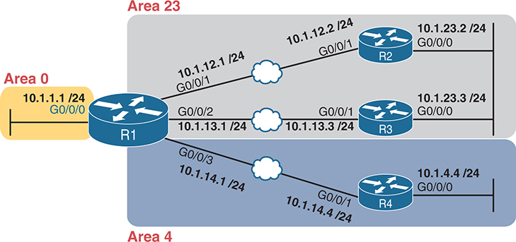

<figcaption>

<strong>图 22-4</strong> <em>多区域 OSPF 配置示例的区域设计</em>

<aside class="hidden" id="a22fig04">

示意图包含区域 0、区域 23 和区域 4。区域 0 中，R1 的 G0/0/0 接口 IP 地址为 10.1.1.1/24。R1 的 G0/0/1 地址为 10.1.12.1/24，通过以太网 WAN 连接区域 23 中 R2 的 G0/0/1，其地址为 10.1.12.2/24。R2 的 G0/0/0 地址为 10.1.23.2/24。R1 的 G0/0/2 地址为 10.1.13.1/24，通过以太网 WAN 连接区域 23 中 R3 的 G0/0/1，其地址为 10.1.13.3/24。R3 的 G0/0/0 地址为 10.1.23.3/24。R1 的 G0/0/3 地址为 10.1.14.1/24，通过以太网 WAN 连接区域 4 中 R4 的 G0/0/1，其地址为 10.1.14.4/24。R4 的 G0/0/0 地址为 10.1.4.4/24。

</aside>

</figcaption>

</figure>

<a href="#exa22_11">例 22-11</a> 展示 R1 的配置。为使配置清晰，<strong>network</strong> 使用通配符掩码 0.0.0.0，表示每条 <strong>network</strong> 只匹配单个接口。各接口被放入区域 0、23 或 4，与图对应。

<strong>例 22-11</strong> <em>R1 上将接口放入不同区域的 OSPF 配置</em>

<a href="#code-f0576-01" id="f0576-01a">点击此处查看代码原图</a>

<pre class="pre-ex" tabindex="0"><code class="highlight">router ospf 1
 network 10.1.1.1 0.0.0.0 area 0
 network 10.1.12.1 0.0.0.0 area 23
 network 10.1.13.1 0.0.0.0 area 23
 network 10.1.14.1 0.0.0.0 area 4</code></pre>

</section>

</section>

<section>

<h3 class="h3" id="ch22lev1sec4">使用接口子命令实现 OSPFv2</h3>

从 Cisco 路由器最早支持 OSPFv2 开始，配置就采用本章讨论的 OSPF <strong>network</strong> 命令。然而，这种风格可能令人困惑，而且确实需要一定解释。因此，Cisco 增加另一种 OSPFv2 配置选项，称为 OSPF 接口配置。

较新的接口式 OSPF 配置仍在接口上启用 OSPF，但直接通过 <strong>ip ospf</strong> 接口子命令完成。它不使用 <strong>network</strong> 的间接逻辑匹配接口，而是在各接口配置子命令，直接启用 OSPFv2。

<section>

<h4 class="h4" id="ch22lev2sec7">OSPF 接口配置示例</h4>

为展示 OSPF 接口配置的工作方式，本示例基本重复本章前面使用 <strong>network</strong> 的传统 OSPFv2 示例。因此，在查看接口配置之前，请先回顾<a href="#ch22fig02">图 22-2</a>、<a href="#exa22_2">例 22-2</a> 和<a href="#exa22_3">例 22-3</a> 的传统配置。

复习传统配置后，考虑以下清单，它详细说明如何将<a href="#exa22_2">例 22-2</a> 和<a href="#exa22_3">例 22-3</a> 的旧式配置转换为接口配置：

步骤 1。在 OSPF 配置模式下使用 <strong>no network</strong> <em>network-id</em> <strong>area</strong> <em>area-id</em> 子命令，移除 <strong>network</strong> 命令。

<figure class="figure1">

</figure>

步骤 2。在每个应运行 OSPF 的接口配置模式下，添加一条 <strong>ip ospf</strong> <em>process-id</em> <strong>area</strong> <em>area-id</em>，指定正确 OSPF 进程（<em>process-id</em>）和区域编号。

<a href="#ch22fig05">图 22-5</a> 再次展示本章最初示例及接下来接口配置示例共同采用的设计。

<figure class="image-c" id="ch22fig05">

<figcaption>

<strong>图 22-5</strong> <em>后续 OSPF 接口配置示例使用的区域设计</em>

<aside class="hidden" id="a22fig05">

网络基础设施由 R1 至 R4 四台路由器组成。R1 的 G0/0/0 接口连接子网 10.1.1.1/24。R1 还在 G0/0/1 上使用子网 10.1.12.1/24，通过以太网 WAN 连接 R2 的 G0/0/1 及子网 10.1.12.2/24。R2 通过 G0/0/0 连接子网 10.1.23.2/24。此外，R1 的 G0/0/2 使用子网 10.1.13.1/24，通过以太网 WAN 连接 R3 的 G0/0/1 及子网 10.1.13.3/24。R3 通过 G0/0/0 连接子网 10.1.23.3/24。最后，R1 的 G0/0/3 使用子网 10.1.14.1/24，通过以太网 WAN 连接 R4 的 G0/0/1 及子网 10.1.14.4/24。R4 通过 G0/0/0 连接子网 10.1.4.4/24。

</aside>

</figcaption>

</figure>

<a href="#exa22_2">例 22-2</a> 展示单条 <strong>network</strong>：<strong>network 10.0.0.0 0.255.255.255 area 0</strong>。<a href="#exa22_12">例 22-12</a> 遵循迁移清单，首先通过 <strong>no network 10.0.0.0 0.255.255.255 area 0</strong> 移除原配置。随后在 R1 每个接口上添加 <strong>ip ospf 1 area 0</strong>，在接口上启用 OSPF 进程 1，并将其放入区域 0。

<strong>例 22-12</strong> <em>迁移为 OSPF 接口子命令配置</em>

<a href="#code-f0577-01" id="f0577-01a">点击此处查看代码原图</a>

<pre class="pre-ex" tabindex="0"><code class="highlight">R1# <strong>configure terminal</strong>
Enter configuration commands, one per line.  End with CNTL/Z.
R1(config)# <strong>router ospf 1</strong>
R1(config-router)# <strong>no network 10.0.0.0 0.255.255.255 area 0</strong>
R1(config-router)#
*Apr  8 19:35:24.994: %OSPF-5-ADJCHG: Process 1, Nbr 2.2.2.2 on GigabitEthernet0/0/1
from FULL to DOWN, Neighbor Down: Interface down or detached
*Apr  8 19:35:24.994: %OSPF-5-ADJCHG: Process 1, Nbr 3.3.3.3 on GigabitEthernet0/0/2
from FULL to DOWN, Neighbor Down: Interface down or detached
*Apr  8 19:35:24.994: %OSPF-5-ADJCHG: Process 1, Nbr 4.4.4.4 on GigabitEthernet0/0/3
from FULL to DOWN, Neighbor Down: Interface down or detached
R1(config-router)# <strong>interface g0/0/0</strong>
R1(config-if)# <strong>ip ospf 1 area 0</strong>
R1(config-if)# <strong>interface g0/0/1</strong>
R1(config-if)# <strong>ip ospf 1 area 0</strong>
R1(config-if)#
*Apr  8 19:35:52.970: %OSPF-5-ADJCHG: Process 1, Nbr 2.2.2.2 on GigabitEthernet0/0/1 
from LOADING to FULL, Loading Done
R1(config-if)# <strong>interface g0/0/2</strong>
R1(config-if)# <strong>ip ospf 1 area 0</strong>
R1(config-if)#
*Apr  8 19:36:13.362: %OSPF-5-ADJCHG: Process 1, Nbr 3.3.3.3 on GigabitEthernet0/0/2
from LOADING to FULL, Loading Done
R1(config-if)# <strong>interface g0/0/3</strong>
R1(config-if)# <strong>ip ospf 1 area 0</strong>
R1(config-if)#
*Apr  8 19:37:05.398: %OSPF-5-ADJCHG: Process 1, Nbr 4.4.4.4 on GigabitEthernet0/0/3
from LOADING to FULL, Loading Done
R1(config-if)#</code></pre>

阅读示例时从上往下看，同时关注日志中邻居关系失效和恢复的细节。移除 network 命令会禁用 R1 所有接口的 OSPF，导致三个邻居关系全部失效。随后在 LAN 接口添加 <strong>ip ospf 1 area 0</strong>，启用 OSPF，但由于子网中没有其他 OSPF 路由器，不会形成邻居关系。接着，示例依次为各 WAN 链路添加同一命令，每次该链路上的 OSPF 邻居都会建立起来，如日志所示。

注意

路由器配置可能同时包含 <strong>network</strong> 路由器子命令和 <strong>ip ospf</strong> 接口子命令，在同一接口上启用 OSPF。如果它们指定不同区域编号，IOS 使用 <strong>ip ospf</strong> 接口子命令中的编号。此外，多条 <strong>network</strong> 也可能匹配同一接口，此时 IOS 使用它们在 OSPF 配置模式中出现的顺序。

</section>

<section>

<h4 class="h4" id="ch22lev2sec8">验证 OSPF 接口配置</h4>

无论使用新式还是旧式配置，OSPF 的工作方式都相同：区域设计相同，邻居关系建立方式相同，DR 和 BDR 协商方式也相同，等等。不过，如果仔细看，使用较新的 OSPFv2 配置时，某些 <strong>show</strong> 输出会有细微差异。

<strong>show ip protocols</strong> 重新列出大部分路由协议配置，因此使用接口配置与 <strong>network</strong> 时，确实会显示不同细节。使用 <strong>ip ospf</strong> 接口子命令时，输出列出“Interfaces Configured Explicitly”，如<a href="#exa22_13">例 22-13</a> 高亮所示。示例先展示 R1 使用接口配置时 <strong>show ip protocols</strong> 的相关部分，再展示 R1 使用 <strong>network</strong> 时的相同部分。

<strong>例 22-13</strong> <em>新旧 OSPFv2 配置在 <strong>show ip protocols</strong> 输出中的差异</em>

<a href="#code-f0579-01" id="f0579-01a">点击此处查看代码原图</a>

<pre class="pre-ex" tabindex="0"><code class="highlight">! First, with the new interface configuration
R1# <strong>show ip protocols</strong>
! … beginning lines omitted for brevity
  Routing for Networks:
  Routing on Interfaces Configured Explicitly (Area 0):
    GigabitEthernet0/0/0
    GigabitEthernet0/0/1
    GigabitEthernet0/0/2
    GigabitEthernet0/0/3
  Routing Information Sources:
    Gateway         Distance      Last Update
    4.4.4.4              110      00:09:30
    2.2.2.2              110      00:10:49
    3.3.3.3              110      05:20:07
  Distance: (default is 110)</code></pre>

<pre class="pre-ex" tabindex="0"><code class="highlight">! For comparison, the old results with the use of the OSPF <strong>network</strong> command
R1# <strong>show ip protocols</strong>
! … beginning lines omitted for brevity
  Routing for Networks:
    10.1.0.0 0.0.255.255 area 0
! … ending line omitted for brevity</code></pre>

<strong>show ip ospf interface</strong> [<em>interface</em>] 也有一小处输出差别。该命令列出已启用 OSPF 接口的设置细节，并细微地说明该接口通过旧式还是新式配置启用。<a href="#exa22_14">例 22-14</a> 同样先展示 R1 接口配置的输出，再展示如果仍使用旧式 <strong>network</strong> 时会出现的输出。

<strong>例 22-14</strong> <em>采用 OSPFv2 接口配置时 <strong>show ip ospf interface</strong> 输出的差异</em>

<a href="#code-f0579-02" id="f0579-02a">点击此处查看代码原图</a>

<pre class="pre-ex" tabindex="0"><code class="highlight">! First, with the new interface configuration
R1# <strong>show ip ospf interface g0/0/1</strong>
GigabitEthernet0/0/0 is up, line protocol is up
  Internet Address 10.1.12.1/24, Area 0, Attached via Interface Enable
! Lines omitted for brevity</code></pre>

<pre class="pre-ex" tabindex="0"><code class="highlight">! For comparison, the old results with the use of the OSPF <strong>network</strong> command
R1# <strong>show ip ospf interface g0/0/1</strong>
GigabitEthernet0/0/0 is up, line protocol is up
  Internet Address 10.1.12.1/24, Area 0, Attached via Network Statement
! … ending line omitted for brevity</code></pre>

除少数 <strong>show</strong> 命令的这些细微差别外，其余命令不会因配置风格而显示不同。例如，<strong>show ip ospf interface brief</strong> 不随配置方式变化，<strong>show ip ospf database</strong>、<strong>show ip ospf neighbor</strong> 和 <strong>show ip route</strong> 也一样。

</section>

</section>

</section>

<section class="ccna-source ccna-appendix" aria-label="答案解析与术语表">
<section data-epub-type="chapter">

<h2 class="h2" id="ref-appc">附录 C</h2>

<h2 class="h2a">自测题答案</h2>

<section>

<h3 class="h3" id="ref-appclev1sec22">第 22 章</h3>

<strong><a id="ref-ques22_1" href="#quess22_1">1</a>．</strong> B。<strong>network 10.0.0.0 0.255.255.255 area 0</strong> 匹配三个接口 IP 地址，因为它只比较第一个八位组 10，三者都匹配。

三个错误答案都无法匹配全部三个接口 IP 地址，因为每个都会比较至少一个与 <strong>network</strong> 中地址不匹配的八位组：

<strong>network 10.0.0.0 0.0.0.0</strong> 要求四个八位组完全匹配 10.0.0.0，因此不匹配任何接口。

<strong>network 10.0.0.0 0.0.0.255</strong> 要求前三个八位组（10.0.0）完全匹配，因此不匹配任何接口 IP 地址。

<strong>network 10.0.0.0 0.0.255.255</strong> 要求前两个八位组（10.0）完全匹配，因此不匹配任何接口 IP 地址。

<strong><a id="ref-ques22_2" href="#quess22_2">2</a>．</strong> A。<strong>network 10.1.0.0 0.0.255.255 area 0</strong> 命令匹配所有以 10.1 开头的 IP 地址，在所有接口上为区域 0 启用 OSPF。三个错误答案都无法匹配全部三个接口 IP 地址，因为它们各自至少比较一个与 <strong>network</strong> 命令中的地址不匹配的八位组：

<strong>network 10.0.0.0 0.255.255.0</strong> 忽略中间两个八位组，但会将第一个（10）和最后一个（0）八位组与接口地址比较。第一个八位组匹配，但第四个八位组不匹配任何地址。

<strong>networ</strong>k <strong>10.1.1.0 0.x.1x.0</strong> 不符合语法要求，因为通配符掩码中包含字母（x）。如果在配置模式下尝试输入，会被拒绝。

<strong>network 10.1.1.0 255.0.0.0</strong> 忽略第一个八位组，但将后三个八位组（1.1.0）与地址比较。没有任何地址以 1.1.0 结尾，因此没有地址匹配此命令。

<strong><a id="ref-ques22_3" href="#quess22_3">3</a>．</strong> A 和 E。三个错误答案中，有两个是真实的命令，只是不会列出 OSPF 邻居。<strong>show ip ospf interface brief</strong> 列出启用了 OSPF 的接口，但不列出邻居。<strong>show ip interface</strong> 列出接口的 IPv4 详细信息，但没有 OSPF 相关信息。另一个错误答案 <strong>show ip neighbor</strong> 不是有效的 IOS 命令。

<strong><a id="ref-ques22_4" href="#quess22_4">4</a>．</strong> B。选择 OSPF RID 时，首先检查 OSPF 进程配置中的 <strong>router-id</strong> 命令，但该路由器没有此命令。下一条规则考虑所有正常工作（up/up）的环回接口，OSPF 从中选择数值最大的 IP 地址。本例有两个这样的环回接口，其中环回接口 1 的地址为 10.8.8.8，数值最大。

<strong><a id="ref-ques22_5" href="#quess22_5">5</a>．</strong> B。使用 OSPFv2 接口配置模式时，配置与传统方式基本相同，只有少数例外。不再需要 <strong>network</strong> 路由器子命令，而是在每个需要启用 OSPF 的接口上配置 <strong>ip ospf</strong> <em>process-id</em> <strong>area</strong> <em>area-id</em> 接口子命令。此命令指定应在接口上启用的 OSPF 路由进程，以及 OSPFv2 区域。

<strong><a id="ref-ques22_6" href="#quess22_6">6</a>．</strong> A 和 D。许多 OSPF <strong>show</strong> 命令并不说明 OSPF 是通过接口子命令（<strong>ip ospf</strong> 接口子命令）还是路由器子命令（<strong>network</strong> 命令）启用的。<strong>show ip protocols</strong> 命令在“Routing on Interfaces Configured Explicitly”（在显式配置的接口上进行路由）标题下列出所有通过 <strong>ip ospf interface</strong> 子命令启用了 OSPF 的接口。此外，<strong>show ip ospf interface</strong> 命令会为每个接口列出多行输出，其中包含“Attached via Interface Enable”（通过接口启用方式关联）这一短语。虽然不在答案中，你也可以使用 <strong>show running-config</strong> 或 <strong>show startup-config</strong> 命令查看配置。

</section>

</section>

<section id="ref-glossary"><h2 class="h2a">术语表</h2>
<strong>OSPF 邻居（OSPF neighbor）</strong> 当本地路由器与同一子网上的另一台路由器都使用 OSPF，且采用适当的 OSPF 设置，从而选择相互交换路由信息时，本地路由器对该另一台路由器所持的关系状态。

<strong>OSPF 路由器 ID（OSPF router-id）</strong> OSPF 中用于唯一标识 OSPF 域内每台 OSPF 路由器的 32 位数字，通常采用点分十进制表示，也允许列为整数。

</section>
</section>

<section class="ccna-source ccna-appendix" aria-label="代码原图">
<section data-epub-type="chapter">

<a href="#f0566-01a" id="code-f0566-01">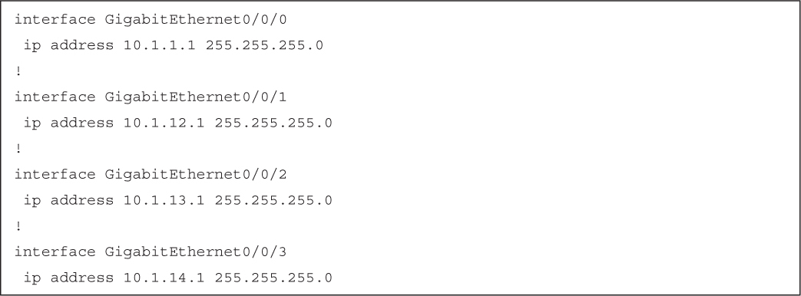</a>

<a href="#f0566-02a" id="code-f0566-02">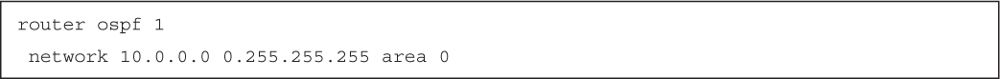</a>

<a href="#f0568-01a" id="code-f0568-01">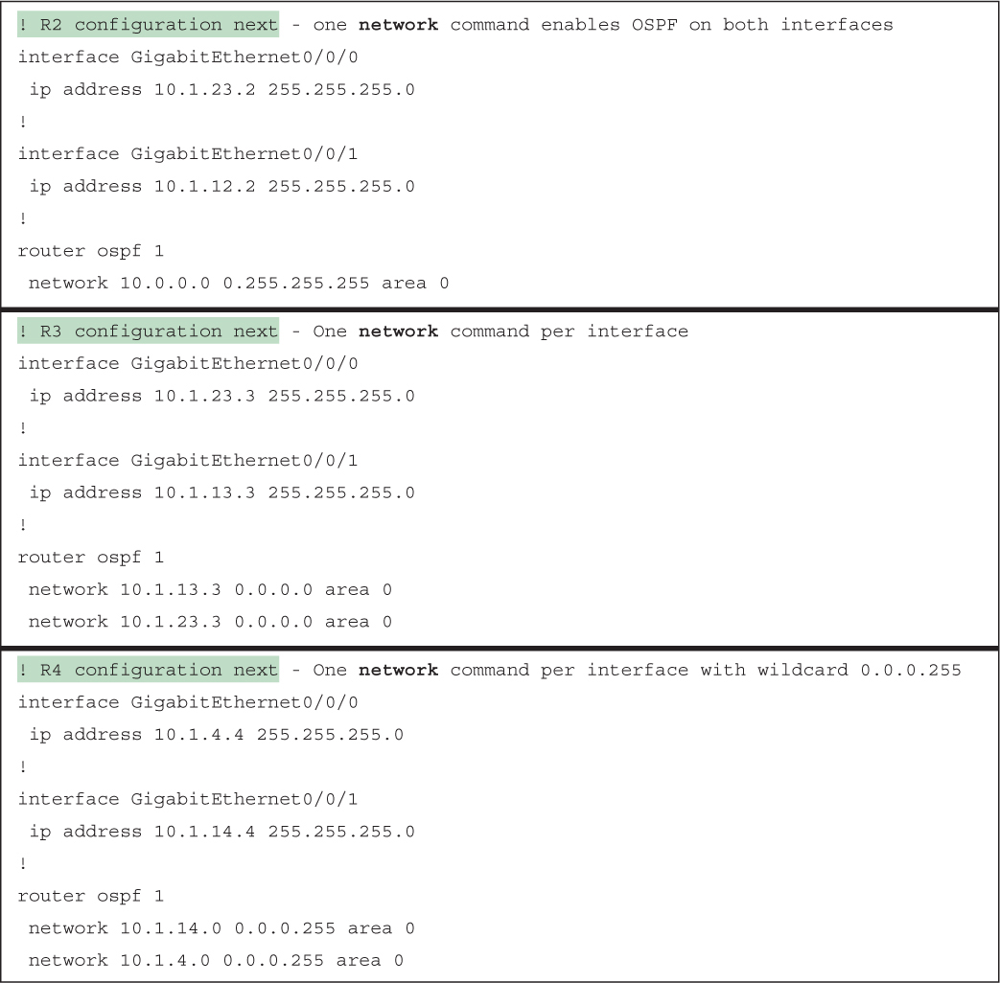</a>

<a href="#f0569-01a" id="code-f0569-01">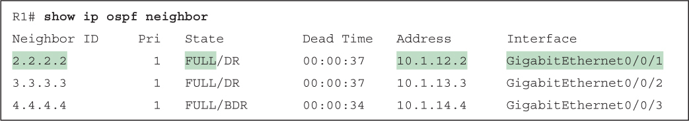</a>

<a href="#f0570-01a" id="code-f0570-01">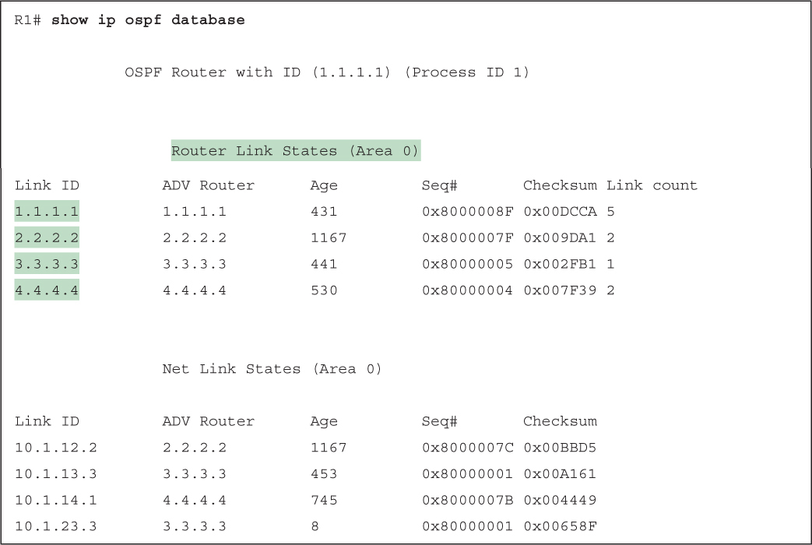</a>

<a href="#f0571-01a" id="code-f0571-01">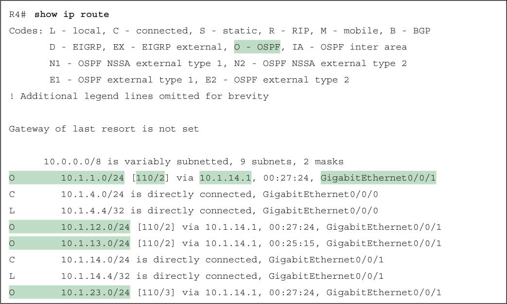</a>

<a href="#f0573-01a" id="code-f0573-01">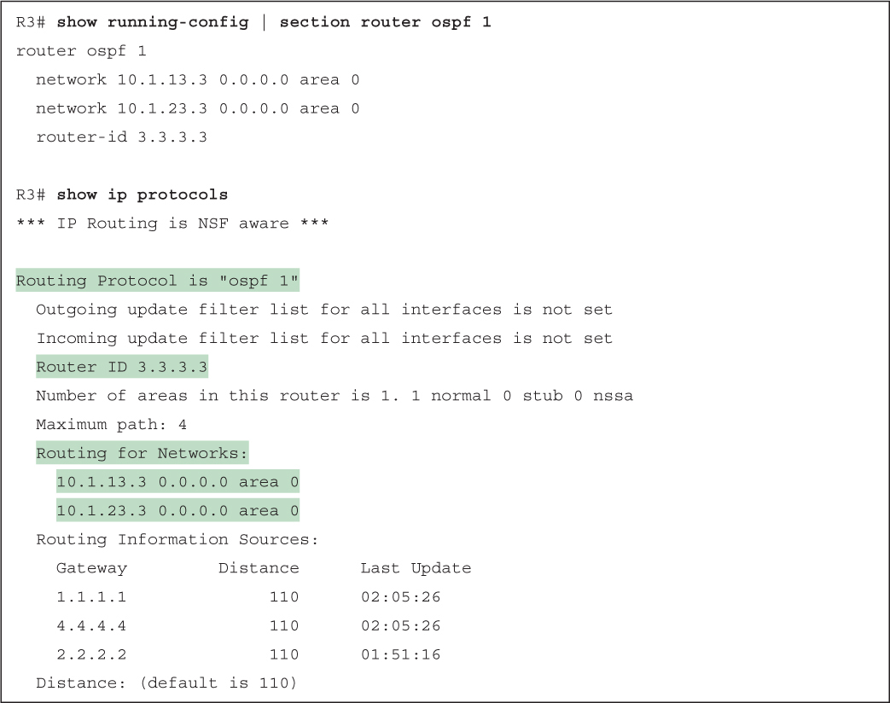</a>

<a href="#f0574-01a" id="code-f0574-01">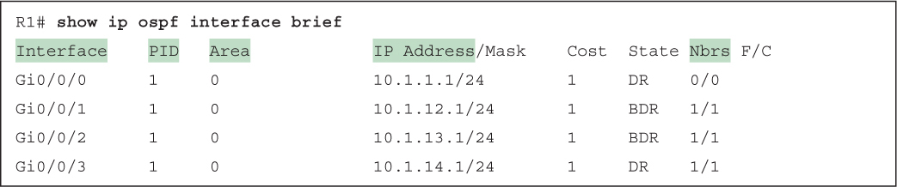</a>

<a href="#f0575-01a" id="code-f0575-01">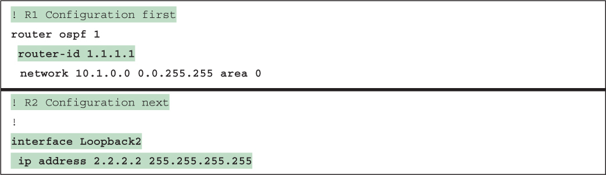</a>

<a href="#f0575-02a" id="code-f0575-02">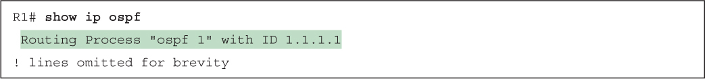</a>

<a href="#f0576-01a" id="code-f0576-01">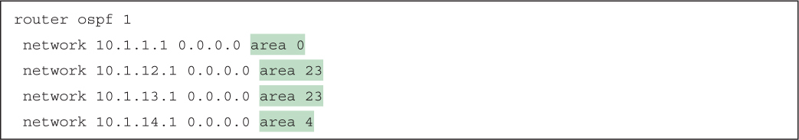</a>

<a href="#f0577-01a" id="code-f0577-01">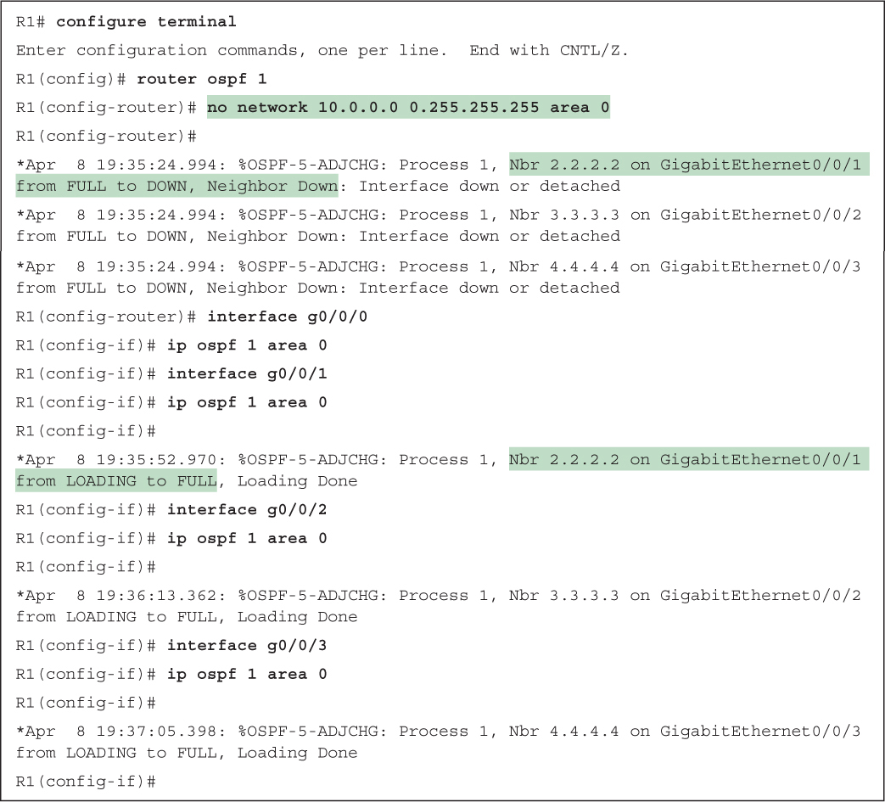</a>

<a href="#f0579-01a" id="code-f0579-01">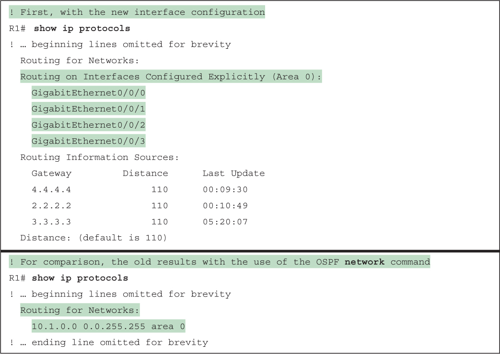</a>

<a href="#f0579-02a" id="code-f0579-02">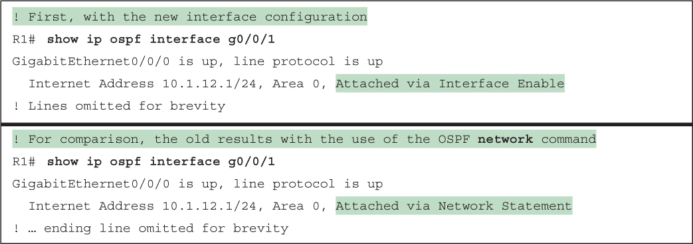</a>

</section>

</section>


<nav class="ccna-chapter-nav" aria-label="章节导航"><a href="v1-21.html">← 上一章</a><a href="v1-23.html">下一章 →</a></nav>
