
<a href="{{ '/subjects/CCNA/' | relative_url }}">← 返回 CCNA 目录</a>

第一卷 · OSPF

<nav class="ccna-chapter-nav" aria-label="章节导航"><a href="v1-22.html">← 上一章</a><a href="v1-24.html">下一章 →</a></nav>



<section data-epub-type="chapter">

<h2 class="h2" id="ch23">第 23 章</h2>

<h2 class="h2a">实现可选的 OSPF 功能</h2>

本章涵盖以下考试主题：

3.0 IP 连接

3.2 确定路由器默认如何做出转发决策

3.2.b 管理距离

3.2.c 路由协议度量值

3.4 配置与验证单区域 OSPFv2

3.4.a 邻居邻接关系

3.4.b 点到点

3.4.c 广播（DR/BR 选择）

3.4.d 路由器 ID

上一章介绍了如何配置使 OSPF 正常工作的核心设置。本章介绍多种可选的 OSPF 设置，选择这些设置有两个原因。第一，CCNA 考试主题直接提到或隐含涵盖了本章许多可选功能。第二，这些可选功能在生产网络中较为常用。

本章首先介绍 OSPF 网络类型。作为每个接口上的一项设置，OSPF 网络类型决定路由器是否尝试动态发现邻居，以及发现邻居后链路上的路由器是否使用指定路由器（DR）。本节还讨论如何通过 OSPF 优先级和路由器 ID（RID）影响 DR 选举结果。

最后一节讨论若干较小的可选 OSPF 配置主题，包括如何使用被动接口、如何修改 OSPF 开销（这会影响 OSPF 选择的路由），以及如何创建由 OSPF 通告的默认路由。

<section>

<h3 class="h3" id="ch23lev1sec1">“这些知识我已经掌握了吗？”自测</h3>

如果你希望根据得分决定在本章投入多少时间，可以完成这组自测题（在此作答，或使用 PTP 软件）。各题答案的选项字母列在自测题之后的页面底部。书末和配套网站上的<a href="#ref-appc">附录 C</a>都包含答案及解析。你也可以在 PTP 测试软件中找到答案及解析。

<figure class="table" id="ch23tab01" tabindex="0">

<figcaption>

<strong>表 23-1</strong> “这些知识我已经掌握了吗？”基础主题与问题对应关系

</figcaption>

<table class="all">

<thead>

<tr>

<th class="th">
基础知识小节
</th>

<th class="th">
题目
</th>

</tr>

</thead>

<tbody>

<tr>

<td class="border">
OSPF 网络类型
</td>

<td class="border">
1–4
</td>

</tr>

<tr>

<td class="border">
其他可选的 OSPFv2 功能
</td>

<td class="border">
5–6
</td>

</tr>

</tbody>

</table>

</figure>

<strong><a id="quess23_1" href="#ques23_1a">1</a>．</strong> 路由器 R1 和 R2 的路由器 ID 分别为 1.1.1.1 和 2.2.2.2，两者通过一条以太网 WAN 链路连接。如果使用所有默认 OSPF 设置，且 WAN 链路在两台路由器上同时初始化，以下哪些说法正确？（选择两个答案。）

<ol class="lower-alpha">

<li>
路由器 R1 将成为 DR。
</li>

<li>
路由器 R1 将动态发现路由器 R2 的存在。
</li>

<li>
路由器 R2 既不是 DR，也不是 BDR。
</li>

<li>
路由器 R1 的 <strong>show ip ospf neighbor</strong> 命令将列出 R2，其状态为“FULL/DR”。
</li>

</ol>

<strong><a id="quess23_2" href="#ques23_2a">2</a>．</strong> 路由器 R1 和 R2 的路由器 ID 分别为 1.1.1.1 和 2.2.2.2，两者通过一条以太网 WAN 链路连接。配置使用默认值，但将 R1 的接口优先级设为 11，并将两台路由器的 OSPF 网络类型改为 point-to-point。如果 WAN 链路在两台路由器上同时初始化，以下哪些说法正确？（选择两个答案。）

<ol class="lower-alpha">

<li>
路由器 R1 将成为 DR。
</li>

<li>
路由器 R1 将动态发现路由器 R2 的存在。
</li>

<li>
路由器 R2 既不是 DR，也不是 BDR。
</li>

<li>
路由器 R2 的 <strong>show ip ospf neighbor</strong> 命令将列出 R1，其状态为“FULL/DR”。
</li>

</ol>

<strong><a id="quess23_3" href="#ques23_3a">3</a>．</strong> 根据命令输出，路由器 R9 通过其 Gi0/0 接口与多少台路由器建立了完全邻接关系？

<a href="#code-f0585-01" id="f0585-01a">点击此处查看代码原图</a>

<pre class="quiz1" tabindex="0"><code>R9# <strong>show ip ospf interface brief</strong>

Interface    PID   Area      IP Address/Mask   Cost  State Nbrs F/C

Gi0/0        1     0         10.1.1.1/24       1     DROTH 2/5</code></pre>

<ol class="lower-alpha">

<li>
7
</li>

<li>
0
</li>

<li>
5
</li>

<li>
2
</li>

</ol>

<strong><a id="quess23_4" href="#ques23_4a">4</a>．</strong> 路由器 R1 和 R2 使用默认优先级设置并成为邻居，其中 R1 为 DR，R2 为 BDR。随后，工程师将 R2 接口的 OSPF 优先级配置为 100。哪些答案正确预测了 OSPF 邻居关系的变化？

<ol class="lower-alpha">

<li>
路由器 R2 将立即成为 DR。
</li>

<li>
路由器 R2 将在邻居关系失效后成为 DR。
</li>

<li>
路由器 R2 将立即停止承担 BDR 角色。
</li>

<li>
路由器 R2 将在四个 OSPF Hello 间隔后成为 DR。
</li>

</ol>

<strong><a id="quess23_5" href="#ques23_5a">5</a>．</strong> 使用 OSPFv2 时，路由器上的以下哪项配置不会影响路由器选择将哪条 IPv4 路由加入其 IPv4 路由表？

<ol class="lower-alpha">

<li>
<strong>auto-cost reference-bandwidth</strong>
</li>

<li>
<strong>delay</strong>
</li>

<li>
<strong>bandwidth</strong>
</li>

<li>
<strong>ip ospf cost</strong>
</li>

</ol>

<strong><a id="quess23_6" href="#ques23_6a">6</a>．</strong> 网络工程师在连接 OSPF 邻居 R1 和 R2 的接口下配置了 <strong>ip ospf hello-interval 15</strong> 子命令，但未使用 <strong>ip ospf dead-interval</strong> 子命令。后来，路由器 R1 的 OSPF 进程发生故障，但 R1 与 R2 之间的链路仍然正常工作。R2 在收到 R1 最后一个 Hello 报文多长时间后，认为与 R1 的邻居关系失效？

<ol class="lower-alpha">

<li>
10 秒
</li>

<li>
15 秒
</li>

<li>
40 秒
</li>

<li>
60 秒
</li>

</ol>

“这些知识我已经掌握了吗？”自测答案：

<strong><a id="ques23_1a" href="#ref-ques23_1">1</a></strong> B, D

<strong><a id="ques23_2a" href="#ref-ques23_2">2</a></strong> B, C

<strong><a id="ques23_3a" href="#ref-ques23_3">3</a></strong> D

<strong><a id="ques23_4a" href="#ref-ques23_4">4</a></strong> B

<strong><a id="ques23_5a" href="#ref-ques23_5">5</a></strong> B

<strong><a id="ques23_6a" href="#ref-ques23_6">6</a></strong> D

</section>

<section>

<h3 class="h3box" id="ch23lev1sec2">基础知识</h3>

</section>

<section>

<h3 class="h3" id="ch23lev1sec3">OSPF 网络类型</h3>

如果不仔细了解一些默认的 OSPF 设置，就可能完全误解 CCNA 200-301 V1.1 的两个考试主题。具体来说，以下考试主题指的是一项称为<em>网络类型（network type）</em>的逐接口 OSPF 设置，甚至直接列出了配置该设置所用的关键字：

3.4.b：<strong>point-to-point</strong>

3.4.c：<strong>broadcast</strong>（DR/BDR 选举）

OSPF 提供少量网络类型，作为每个已启用 OSPF 的接口上的设置。该设置告诉路由器是否动态发现 OSPF 邻居（相对于要求静态配置邻居路由器的 IP 地址），以及是否尝试在子网中使用指定路由器（DR）和备用指定路由器（BDR）。CCNA 考试主题涉及的两种 OSPF 网络类型都会使路由器动态发现邻居，但其中一种要求使用 DR，另一种则不使用。<a href="#ch23tab02">表 23-2</a> 总结了考试主题中提到的这两种 OSPF 网络类型的特点。

<figure class="table" id="ch23tab02" tabindex="0">

<figcaption>

<strong>表 23-2</strong> 两种 OSPF 网络类型及其关键行为

</figcaption>

<table class="all">

<thead>

<tr>

<th class="th">
网络类型关键字
</th>

<th class="th">
动态发现邻居
</th>

<th class="th">
使用 DR/BDR
</th>

</tr>

</thead>

<tbody>

<tr>

<td class="border">
<strong>broadcast</strong>
</td>

<td class="border">
是
</td>

<td class="border">
是
</td>

</tr>

<tr>

<td class="border">
<strong>point-to-point</strong>
</td>

<td class="border">
是
</td>

<td class="border">
否
</td>

</tr>

</tbody>

</table>

</figure>

本章第一大节的其余部分将分别探讨这两种类型。

<section>

<h4 class="h4" id="ch23lev2sec1">OSPF 广播网络类型</h4>

OSPF 在所有类型的以太网接口上默认使用<a id="key_254" href="#ref-gloss_054">广播网络类型（broadcast network type）</a>。请注意，<a href="v1-22.html#ch22">第 22 章</a>“<a href="v1-22.html#ch22">实现基本 OSPF 功能</a>”中示例的所有以太网接口都采用了这一默认设置。

为了详细说明 OSPF 广播网络类型的工作方式，本章首先采用一种不同于 <a href="v1-22.html#ch22">第 22 章</a> 示例的设计：使用单区域设计，将四台路由器连接到同一子网，如 <a href="#ch23fig01">图 23-1</a> 所示。所有链路都位于区域 0，因此这是一种单区域设计。

<figure class="image-c" id="ch23fig01">

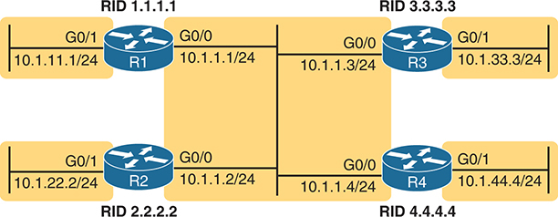

<figcaption>

<strong>图 23-1</strong> <em>本章使用的单区域设计</em>

<aside class="hidden" id="a23fig01">

网络设计中有四台路由器，标为 R1、R2、R3 和 R4，各有唯一的路由器 ID（RID）：R1 为 1.1.1.1，R2 为 2.2.2.2，R3 为 3.3.3.3，R4 为 4.4.4.4。路由器通过接口互连。R1 的子网 10.1.11.1/24 通过 G0/1 接口连接，子网 10.1.1.1/24 通过 G0/0 接口连接。R2 的子网 10.1.22.2/24 通过 G0/1 接口连接，子网 10.1.1.2/24 通过 G0/0 接口连接。R3 的子网 10.1.1.3/24 通过 G0/0 接口连接，子网 10.1.33.3/24 通过 G0/1 接口连接。R4 的子网 10.1.1.4/24 通过 G0/0 接口连接，子网 10.1.44.4/24 通过 G0/1 接口连接。

</aside>

</figcaption>

</figure>

为了了解 OSPF 在广播网络类型下如何工作，假设四台路由器都采用简单直接的 OSPF 接口配置，类似于 <a href="#exa23_1">例 23-1</a> 中的路由器 R1 配置。四台路由器的两个 GigabitEthernet 接口都默认使用 broadcast 网络类型。请注意，R2、R3 和 R4 的配置与 R1 相同，只是它们分别使用路由器 ID 2.2.2.2、3.3.3.3 和 4.4.4.4，并使用图中所示的 IP 地址。

<strong>例 23-1</strong> <em>与 <a href="#ch23fig01">图 23-1</a> 对应的 R1 OSPF 配置</em>

<a href="#code-f0587-01" id="f0587-01a">点击此处查看代码原图</a>

<pre class="pre-ex" tabindex="0"><code>router ospf 1

 router-id 1.1.1.1

!

interface gigabitEthernet0/0

 ip ospf 1 area 0

!

interface gigabitEthernet0/1

 ip ospf 1 area 0</code></pre>

这一简单设计为观察广播网络类型在各台路由器上的结果提供了很好的背景。每台路由器的两个接口（G0/0 和 G0/1）都使用广播网络类型，并执行以下操作：

<ul class="sq">

<li>
向组播地址 224.0.0.5（保留用于向子网中的所有 OSPF 路由器发送报文）发送 OSPF Hello 报文，尝试发现邻居。
</li>

<li>
尝试在每个子网上选举 DR 和 BDR。
</li>

<li>
在子网中没有其他路由器的接口（G0/1）上成为 DR。
</li>

<li>
在子网中还有另外三台路由器的接口（G0/0）上，成为 DR、BDR 或 DROther 路由器。
</li>

<li>
向 DR 或 BDR 发送 OSPF 消息时，将消息发送到所有 OSPF DR 的组播地址 224.0.0.6。
</li>

</ul>

<a href="#exa23_2">例 23-2</a> 使用 <strong>show ip ospf neighbor</strong> 命令展示了部分结果。请注意，R1 将 R2、R3 和 R4 列为邻居（根据其路由器 ID 2.2.2.2、3.3.3.3 和 4.4.4.4），这证实 R1 动态发现了其他路由器。此外，输出将 4.4.4.4 列为 DR，将 3.3.3.3 列为 BDR。

<strong>例 23-2</strong> <em>R1 的邻居列表</em>

<a href="#code-f0588-01" id="f0588-01a">点击此处查看代码原图</a>

<pre class="pre-ex" tabindex="0"><code>R1# <strong>show ip ospf neighbor</strong>

Neighbor ID     Pri   State           Dead Time   Address       Interface

2.2.2.2           1   2WAY/DROTHER    00:00:35    10.1.1.2      GigabitEthernet0/0

3.3.3.3           1   FULL/BDR        00:00:33    10.1.1.3      GigabitEthernet0/0

4.4.4.4           1   FULL/DR         00:00:35    10.1.1.4      GigabitEthernet0/0</code></pre>

<section>

<h5 class="h5" id="ch23lev3sec1">验证 broadcast 网络类型的运行情况</h5>

如 <a href="v1-21.html#ch21">第 21 章</a>“<a href="v1-21.html#ch21">理解 OSPF 概念</a>”的“<a href="v1-21.html#ch21lev3sec10">在以太网链路上使用指定路由器</a>”一节所述，链路上所有被发现的路由器都应成为邻居，并至少达到 <em>2-way</em> 状态。对于所有涉及 DR 和／或 BDR 的邻居关系，应进一步达到 <em>full</em> 状态。该节将<em>完全邻接（fully adjacent）</em>定义为专门指代达到 full 状态的邻居的术语。

<a href="#ch23fig01">图 23-1</a> 的设计在同一 LAN 上使用四台路由器，数量刚好足以使一对邻居关系保持在 2-way 状态，而不达到 full 状态，这是 OSPF 完全正常的运行方式。<a href="#ch23fig02">图 23-2</a> 展示了收集本章 <strong>show</strong> 命令输出时的状态：R4 为 DR，R3 为 BDR，R1 和 R2 为 DROther 路由器。

<figure class="image-c" id="ch23fig02">

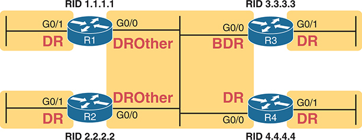

<figcaption>

<strong>图 23-2</strong> <em>网络中的 OSPF DR、BDR 和 DROther 角色</em>

<aside class="hidden" id="a23fig02">

示意图中有四台路由器，标为 R1、R2、R3 和 R4，各有唯一的路由器 ID（RID）：R1 为 1.1.1.1，R2 为 2.2.2.2，R3 为 3.3.3.3，R4 为 4.4.4.4。路由器通过 G0/0 和 G0/1 接口互连。图中标注了各台路由器的角色：R1 和 R2 在 G0/0 接口上均为 DROther，在 G0/1 接口上均为 DR；R3 在 G0/0 接口上为 BDR，在 G0/1 接口上为 DR；R4 的两个接口均为 DR。

</aside>

</figcaption>

</figure>

现在来看 <a href="#exa23_2">例 23-2</a> 中列出的 R1 邻居。R1 有三个邻居，都通过 G0/0 接口可达。不过，R1 的 <strong>show ip ospf neighbor</strong> 命令显示的是 R1 与邻居之间关系的状态：与路由器 2.2.2.2 的关系为 2-way。由于 R1 和 R2 当前都充当 DROther 路由器，也就是等待在 DR 或 BDR 发生故障时成为 BDR，因此两者的邻居关系保持在 2-way 状态。

最后再看一次 <a href="#exa23_2">例 23-2</a>。R1 自身是 DROther 路由器，有两对邻居关系达到 full 状态：R1 与 DR R4 的邻接关系，以及 R1 与 BDR R3 的邻接关系。但 R1 总共有三个邻居，都通过其 G0/0 接口可达。

下一个示例强调，R1 的 G0/0 接口上有三个邻居，其中只有两个是完全邻接的。<a href="#exa23_3">例 23-3</a> 中 <strong>show ip ospf interface brief</strong> 命令输出最右侧显示“2/3”，表示该接口有两个完全邻接的邻居，总共有三个邻居。此外，此命令的“State”列与 <strong>show ip ospf neighbor</strong> 命令不同，因为它列出本地路由器在接口上的角色：R1 的 G0/1 充当 DR，G0/0 充当 DROther 路由器。

<strong>例 23-3</strong> <em>路由器 R1 的 OSPF 接口：本地角色与邻居数量</em>

<a href="#code-f0589-01" id="f0589-01a">点击此处查看代码原图</a>

<pre class="pre-ex" tabindex="0"><code>R1# <strong>show ip ospf interface brief</strong>

Interface    PID   Area            IP Address/Mask    Cost  State Nbrs F/C

Gi0/1        1     0               10.1.11.1/24       1     DR    0/0

Gi0/0        1     0               10.1.1.1/24        1     DROTH 2/3</code></pre>

到目前为止，本主题利用以太网接口的默认设置，介绍了 OSPF 广播网络类型的作用。要查看该设置，可使用 <strong>show ip ospf interface</strong> 命令，如 <a href="#exa23_4">例 23-4</a> 所示。第一个突出显示的项目标识网络类型。不过，该命令输出还重述了 <a href="#exa23_2">例 23-2</a> 和 <a href="#exa23_3">例 23-3</a> 中 <strong>show ip ospf neighbor</strong> 与 <strong>show ip ospf interface brief</strong> 命令显示的许多信息，因此请仔细浏览整个 <a href="#exa23_4">例 23-4</a>，关注其他突出显示的内容，查看这些熟悉的项目。

<strong>例 23-4</strong> <em>显示 OSPF 广播网络类型</em>

<a href="#code-f0589-02" id="f0589-02a">点击此处查看代码原图</a>

<pre class="pre-ex" tabindex="0"><code>R1# <strong>show ip ospf interface g0/0</strong>

GigabitEthernet0/0 is up, line protocol is up

  Internet Address 10.1.1.1/24, Area 0, Attached via Interface Enable

  Process ID 1, Router ID 1.1.1.1, Network Type BROADCAST, Cost: 1

  Topology-MTID    Cost    Disabled    Shutdown      Topology Name

        0           1         no          no            Base

  Enabled by interface config, including secondary ip addresses

  Transmit Delay is 1 sec, State DROTHER, Priority 1

  Designated Router (ID) 4.4.4.4, Interface address 10.1.1.4

  Backup Designated router (ID) 3.3.3.3, Interface address 10.1.1.3

  Timer intervals configured, Hello 10, Dead 40, Wait 40, Retransmit 5

    oob-resync timeout 40

    Hello due in 00:00:00

  Supports Link-local Signaling (LLS)

  Cisco NSF helper support enabled

  IETF NSF helper support enabled

  Index 1/1/1, flood queue length 0

  Next 0x0(0)/0x0(0)/0x0(0)

  Last flood scan length is 0, maximum is 1

  Last flood scan time is 0 msec, maximum is 0 msec

  Neighbor Count is 3, Adjacent neighbor count is 2

    Adjacent with neighbor 3.3.3.3  (Backup Designated Router)

    Adjacent with neighbor 4.4.4.4  (Designated Router)

  Suppress hello for 0 neighbor(s)</code></pre>

虽然不需要专门配置以太网接口使用广播网络类型，这里仍说明其对应命令以供参考：IOS 在以太网接口上通过默认命令 <strong>ip ospf network broadcast</strong> 使用该设置。

</section>

<section>

<h5 class="h5" id="ch23lev3sec2">使用优先级和 RID 影响 DR/BDR 选举</h5>

有时，你可能希望影响 OSPF DR 选举。不过，在认定每种情况下都适合这样做之前，请注意：即使某台路由器和另一台路由器均正常运行，OSPF DR/BDR 选举规则也不能保证前者始终为 DR、后者始终为 BDR。DR 和 BDR 选出后，规则如下：

<ul class="sq">

<li>
如果 DR 发生故障，BDR 将成为 DR，并选举新的 BDR。
</li>

<li>
当更优的路由器加入子网时，不会抢占现有 DR 或 BDR 的角色。
</li>

</ul>

根据这些规则，虽然可以将路由器配置为选举 DR 时最优（优先级最高）的路由器，但这样做只是提高了它在某一时刻充当 DR 的概率。如果优先级最高的路由器发生故障，其他路由器将成为 DR 和 BDR；只有当前的 DR 和 BDR 发生故障并触发新的选举后，这台最优路由器才会再次成为 DR。

不过，在某些情况下，你可能希望影响 DR/BDR 选举。为此，可以使用以下设置，按优先顺序列出：

<ul class="sq">

<li>
<strong>最高的 OSPF 接口优先级：</strong> 选举中数值最高者胜出，取值范围为 0 到 255。（值为 0 会使路由器永远不能成为 DR。）

</li>

<li>
<strong>最高的 OSPF 路由器 ID：</strong> 如果优先级相同，选举将选择 OSPF RID 最大的路由器。
</li>

</ul>

例如，假设 <a href="#ch23fig01">图 23-1</a> 设计中的四台路由器同时尝试选举 DR 和 BDR，比如发生电力故障后，四台路由器都关闭又重新启动。此时不存在先前的 DR 或 BDR。它们全部参与选举，并且默认优先级均为 1，彼此相同（R1 的优先级可见 <a href="#exa23_4">例 23-4</a> 中的 <strong>show ip ospf interface</strong> 命令输出）。在这种情况下，R4 凭借数值最大的 RID 4.4.4.4 成为 DR，R3 凭借次大的 RID 3.3.3.3 成为 BDR。

要影响选举，可以设置各台路由器的 RID，使希望胜出的路由器具有最大的 RID。不过，许多网络选择 OSPF 路由器 ID 的目的是便于识别路由器，而不是让其数值大于邻居。因此，使用 <a id="key_258" href="#ref-gloss_290">OSPF 优先级（OSPF priority）</a> 设置更合理。例如，如果工程师希望 R1 成为 DR，可以添加 <a href="#exa23_5">例 23-5</a> 中的配置，将 R1 的接口优先级设为 99。

<strong>例 23-5</strong> <em>使用 OSPF 优先级影响 DR/BDR 选举</em>

<a href="#code-f0591-01" id="f0591-01a">点击此处查看代码原图</a>

<pre class="pre-ex" tabindex="0"><code>R1# <strong>configure terminal</strong>

Configuring from terminal, memory, or network [terminal]?

Enter configuration commands, one per line.  End with CNTL/Z.

R1(config)# <strong>interface g0/0</strong>

R1(config-if)# <strong>ip ospf priority 99</strong>

R1(config-if)# <strong>^Z</strong>

R1#

R1# <strong>show ip ospf interface g0/0 | include Priority</strong>

  Transmit Delay is 1 sec, State DROTHER, Priority 99

R1# <strong>show ip ospf neighbor</strong>

Neighbor ID     Pri   State           Dead Time   Address         Interface

2.2.2.2           1   2WAY/DROTHER    00:00:36    10.1.1.2        GigabitEthernet0/0

3.3.3.3           1   FULL/BDR        00:00:30    10.1.1.3        GigabitEthernet0/0

4.4.4.4           1   FULL/DR         00:00:37    10.1.1.4        GigabitEthernet0/0

R1# <strong>show ip ospf interface brief</strong>

Interface    PID   Area            IP Address/Mask    Cost  State Nbrs F/C

Gi0/1        1     0               10.1.11.1/24       1     DR    0/0

Gi0/0        1     0               10.1.1.1/24        1     DROTH 2/3</code></pre>

示例顶部显示 R1 的接口优先级现为 99，随后的 <strong>show ip ospf interface G0/0</strong> 命令确认了此设置。不过，最后两个命令证实 OSPF 不会抢占现有的 DR 或 BDR。请注意，<strong>show ip ospf neighbor</strong> 命令仍将 R4 的状态列为 DR，表示 R4 仍充当 DR，因此优先级更高的 R1 没有接管该角色。最后一条命令 <strong>show ip ospf interface brief</strong> 将 R1 的 State（角色）列为 DROTH。

为了展示完整过程并说明 R1 如何赢得 DR 选举，<a href="#exa23_6">例 23-6</a> 显示了使四台路由器之间的 LAN 交换机发生故障、强制进行一次自由选举后的结果。正如预期，R1 由于优先级更高而胜出，成为 DR，其余三台路由器的优先级相同。R4 凭借更大的 RID，在 R2、R3 和 R4 之间胜出，成为 BDR。

<strong>例 23-6</strong> <em>一次全新的 DR/BDR 选举结果</em>

<a href="#code-f0592-01" id="f0592-01a">点击此处查看代码原图</a>

<pre class="pre-ex" tabindex="0"><code>! Not shown: LAN fails, and then recovers, causing a new OSPF Election

R1# <strong>show ip ospf neighbor</strong>

Neighbor ID     Pri   State           Dead Time   Address         Interface

2.2.2.2           1   FULL/DROTHER    00:00:37    10.1.1.2        GigabitEthernet0/0

3.3.3.3           1   FULL/DROTHER    00:00:38    10.1.1.3        GigabitEthernet0/0

4.4.4.4           1   FULL/BDR        00:00:38    10.1.1.4        GigabitEthernet0/0

R1# <strong>show ip ospf interface brief</strong>

Interface    PID   Area            IP Address/Mask    Cost  State Nbrs F/C

Gi0/1        1     0               10.1.11.1/24       1     DR    0/0

Gi0/0        1     0               10.1.1.1/24        1     DR    3/3</code></pre>

注意

如果你已经开始将 OSPF DR 选举与 STP 选举作比较，请记住几个关键区别。首先，STP 遵循数值越小越优的逻辑，而 OSPF 则是数值越大越优。STP 选举允许抢占，例如，如果新交换机的桥 ID（BID）优于（小于）当前根交换机，新交换机就会成为根交换机。OSPF 不允许抢占，因此，即使新加入链路的路由器拥有最高优先级，也不会接管 DR 或 BDR 角色。它会在未来的选举中胜出，最终成为 DR。

</section>

</section>

<section>

<h4 class="h4" id="ch23lev2sec2">OSPF 点到点网络类型</h4>

CCNA 200-301 V1.1 考试大纲中提到的另一种 OSPF 网络类型 point-to-point，适用于本质上只有两台路由器的数据链路。例如，看看 <a href="#ch23fig03">图 23-3</a> 中的拓扑，路由器 R1 有三条 WAN 链路：两条以太网 WAN 链路和一条串行链路。

<figure class="image-c" id="ch23fig03">

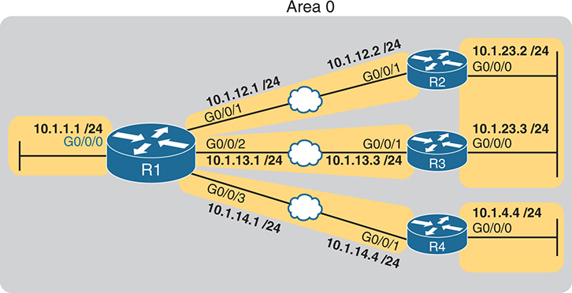

<figcaption>

<strong>图 23-3</strong> <em>后续示例使用的 OSPF 设计</em>

<aside class="hidden" id="a23fig03">

网络基础设施由 R1 至 R4 四台路由器组成。R1 的 G0/0/0 接口连接子网 10.1.1.1/24。R1 还在 G0/0/1 上使用子网 10.1.12.1/24，通过以太网 WAN 连接 R2 的 G0/0/1 及子网 10.1.12.2/24。R2 通过 G0/0/0 连接子网 10.1.23.2/24。此外，R1 的 G0/0/2 使用子网 10.1.13.1/24，通过以太网 WAN 连接 R3 的 G0/0/1 及子网 10.1.13.3/24。R3 通过 G0/0/0 连接子网 10.1.23.3/24。最后，R1 的 G0/0/3 使用子网 10.1.14.1/24，通过以太网 WAN 连接 R4 的 G0/0/1 及子网 10.1.14.4/24。R4 通过 G0/0/0 连接子网 10.1.4.4/24。

</aside>

</figcaption>

</figure>

首先，考虑较早期的串行链路（图中未使用）。路由器之间的串行链路不支持添加第三台路由器。链路上只有两个设备时，使用 DR/BDR 没有优势，反而会稍微增加收敛时间。将网络类型设为 point-to-point 告诉路由器不要在该链路上使用 DR/BDR，这对串行链路是合理的。实际上，IOS 在串行接口上的默认设置就是 <strong>ip ospf network point-to-point</strong>。

虽然如今网络中的串行链路可能不多，但仍存在其他点到点 WAN 拓扑，包括一些以太网 WAN 链路。本书使用的所有以太网 WAN 链路恰好都采用一种点到点以太网 WAN 服务，称为以太网专线服务（Ethernet Private Wire Service），或简称以太网线路（Ethernet Line，E-Line）。对于这种服务，服务提供商在连接到服务的两个设备（路由器）之间传送以太网帧，且仅限这两个设备。换言之，E-Line 在概念上是一种点到点服务。因此，与串行链路一样，只连接两台路由器的以太网 WAN 链路使用 DR/BDR 没有优势。所以，许多工程师更喜欢在实际上充当点到点链路的以太网 WAN 链路上使用 OSPF <a id="key_260" href="#ref-gloss_306">点到点网络类型（point-to-point network type）</a>。

<a href="#exa23_7">例 23-7</a> 展示了将 <a href="#ch23fig03">图 23-3</a> 中路由器 R1 的 G0/0/1 接口配置为使用 OSPF point-to-point 网络类型的过程。WAN 链路另一端的 R2，也需要在对应接口上使用相同的配置命令。

<strong>例 23-7</strong> <em>R1 的以太网 WAN 接口使用 OSPF 点到点网络类型</em>

<a href="#code-f0593-01" id="f0593-01a">点击此处查看代码原图</a>

<pre class="pre-ex" tabindex="0"><code>R1# <strong>configure terminal</strong>

Enter configuration commands, one per line.  End with CNTL/Z.

R1(config)# <strong>interface g0/0/1</strong>

R1(config-if)# <strong>ip ospf network point-to-point</strong>

R1(config-if)#

R1# <strong>show ip ospf interface g0/0/1</strong>

GigabitEthernet0/0/1 is up, line protocol is up

  Internet Address 10.1.12.1/24, Area 0, Attached via Interface Enable

  Process ID 1, Router ID 1.1.1.1, Network Type POINT_TO_POINT, Cost: 1

  Topology-MTID    Cost    Disabled    Shutdown      Topology Name

        0           4         no          no            Base

  Enabled by interface config, including secondary ip addresses

  Transmit Delay is 1 sec, State POINT_TO_POINT

  Timer intervals configured, Hello 10, Dead 40, Wait 40, Retransmit 5

    oob-resync timeout 40

    Hello due in 00:00:01

  Supports Link-local Signaling (LLS)

  Cisco NSF helper support enabled

  IETF NSF helper support enabled

  Index 1/3/3, flood queue length 0

  Next 0x0(0)/0x0(0)/0x0(0)

  Last flood scan length is 1, maximum is 3

  Last flood scan time is 0 msec, maximum is 0 msec

  Neighbor Count is 1, Adjacent neighbor count is 1

    Adjacent with neighbor 2.2.2.2

  Suppress hello for 0 neighbor(s)</code></pre>

请注意 <a href="#exa23_7">例 23-7</a> 中 <strong>show</strong> 命令突出显示的部分。前两处突出显示了网络类型。最后突出显示的两行指出，R1 在该接口上有一个邻居，输出表明它与该邻居已完全邻接。

<a href="#exa23_8">例 23-8</a> 通过另外两个命令确认其中一些信息，为本节作结。请注意，R1 的 <strong>show ip ospf neighbor</strong> 命令列出了路由器 R2（RID 2.2.2.2），状态为 full，但未标明 DR 或 BDR，而是显示 -。这个 - 提醒我们，该链路不使用 DR/BDR。第二个命令 <strong>show ip ospf interface brief</strong> 将状态（本地路由器的角色）显示为 P2P，即 point-to-point 的缩写；完全邻接的邻居数和邻居总数均为 1。

<strong>例 23-8</strong> <em>R1 的以太网 WAN 接口使用 OSPF 点到点网络类型</em>

<a href="#code-f0594-01" id="f0594-01a">点击此处查看代码原图</a>

<pre class="pre-ex" tabindex="0"><code>R1# <strong>show ip ospf neighbor</strong>

Neighbor ID     Pri   State           Dead Time   Address       Interface

2.2.2.2           0   FULL/  -        00:00:39    10.1.12.2     GigabitEthernet0/0/1

! lines omitted for brevity

R1# <strong>show ip ospf interface brief</strong>

Interface    PID   Area            IP Address/Mask    Cost  State Nbrs F/C

Gi0/0/1      1     0               10.1.12.1/24       4     P2P   1/1

! lines omitted for brevity</code></pre>

使用具有点到点链路行为的以太网 WAN 链路时，可考虑使用 OSPF point-to-point 网络类型，取代默认的 broadcast 类型。

</section>

</section>

<section>

<h3 class="h3" id="ch23lev1sec4">其他可选的 OSPFv2 功能</h3>

本章最后一大节讨论一些常用但可选的 OSPFv2 配置功能，按出现顺序列出如下：

<ul class="sq">

<li>
被动接口
</li>

<li>
默认路由
</li>

<li>
度量值
</li>

<li>
Hello 间隔与 Dead 间隔
</li>

</ul>

<section>

<h4 class="h4" id="ch23lev2sec3">OSPF 被动接口</h4>

接口启用 OSPF 后，路由器会尝试发现相邻的 OSPF 路由器，并建立邻居关系。为此，路由器会按固定时间间隔（称为 Hello 间隔）发送 OSPF Hello 消息，同时侦听潜在邻居发来的 Hello 消息。

有时，路由器不需要在某个接口上与邻居建立邻居关系。某条链路上往往没有其他路由器，因此路由器不必继续重复发送 OSPF Hello 消息。在这种情况下，工程师可以将接口设为被动接口，这意味着：

<ul class="sq">

<li>
OSPF 继续通告连接到该接口的子网。

</li>

<li>
OSPF 不再在该接口上发送 OSPF Hello 报文。
</li>

<li>
OSPF 不再处理该接口收到的任何 Hello 报文。
</li>

</ul>

在接口上启用 OSPF 后再将其设为被动接口，结果是 OSPF 仍会通告直连子网，但不会通过该接口建立邻居关系。

将接口配置为被动接口有两种方法。第一种是在路由器配置模式下，将以下命令加入 OSPF 进程配置：

<strong>passive-interface</strong> <em>type number</em>

另一种方法是修改默认设置，使所有接口默认都是被动接口，再为所有需要取消被动状态的接口添加 <strong>no passive-interface</strong> 命令：

<strong>passive-interface default</strong>

<strong>no passive-interface</strong> <em>type number</em>

例如，在 <a href="#ch23fig04">图 23-4</a> 的示例互连网络中，路由器 R1 通过 G0/0/0 接口连接到一个 LAN。该 LAN 上没有其他 OSPF 路由器，因此 R1 永远不会在此接口上发现 OSPF 邻居。<a href="#exa23_9">例 23-9</a> 展示了两种将 R1 的 G0/0/0 设为 OSPF 被动接口的配置方式。

<figure class="image-c" id="ch23fig04">

<figcaption>

<strong>图 23-4</strong> <em>后续示例使用的 OSPF 设计</em>

<aside class="hidden" id="a23fig04">

网络基础设施由 R1 至 R4 四台路由器组成。R1 的 G0/0/0 接口连接子网 10.1.1.1/24。R1 还在 G0/0/1 上使用子网 10.1.12.1/24，通过以太网 WAN 连接 R2 的 G0/0/1 及子网 10.1.12.2/24。R2 通过 G0/0/0 连接子网 10.1.23.2/24。此外，R1 的 G0/0/2 使用子网 10.1.13.1/24，通过以太网 WAN 连接 R3 的 G0/0/1 及子网 10.1.13.3/24。R3 通过 G0/0/0 连接子网 10.1.23.3/24。最后，R1 的 G0/0/3 使用子网 10.1.14.1/24，通过以太网 WAN 连接 R4 的 G0/0/1 及子网 10.1.14.4/24。R4 通过 G0/0/0 连接子网 10.1.4.4/24。

</aside>

</figcaption>

</figure>

<strong>例 23-9</strong> <em>在 <a href="#ch23fig04">图 23-4</a> 的 R1 上配置被动接口</em>

<a href="#code-f0596-01" id="f0596-01a">点击此处查看代码原图</a>

<pre class="pre-ex" tabindex="0"><code>! First, make each interface passive directly

<strong>router ospf 1</strong>

 <strong>passive-interface GigabitEthernet0/0/0</strong>

! Or, change the default to passive, and make the other interfaces not be passive

<strong>router ospf 1</strong>

 <strong>passive-interface default</strong>

 <strong>no passive-interface GigabitEthernet0/0/1</strong>

 <strong>no passive-interface GigabitEthernet0/0/2</strong>

 <strong>no passive-interface GigabitEthernet0/0/3</strong></code></pre>

在实际互连网络中，应使用所需命令最少的配置方式。例如，一台路由器有 20 个接口，其中 18 个需要设为 OSPF 被动接口，那么使用 <strong>passive-interface default</strong> 命令将默认状态改为被动，可以大幅减少配置命令。如果 20 个接口中只有两个需要设为被动接口，则应保留所有接口默认非被动的设置，以缩短配置。

有趣的是，OSPF 让使用 <strong>show</strong> 命令判断接口是否为被动接口稍有难度。<strong>show running-config</strong> 命令能直接列出配置，但如果无法进入 enable 模式来使用该命令，请记住以下两点：

<strong>show ip ospf interface brief</strong> 命令列出所有启用了 OSPF 的接口，包括<a id="key_259" href="#ref-gloss_300">被动接口（passive interfaces）</a>。

<strong>show ip ospf interface</strong> 命令为每个接口列出多行输出，其中有一行说明该接口是被动接口。

<a href="#exa23_10">例 23-10</a> 展示了路由器 R1 上这些命令的输出，所依据的是 <a href="#exa23_9">例 23-9</a> 上半部分的配置。请注意，被动接口 G0/0/0 出现在 <strong>show ip ospf interface brief</strong> 的输出中。

<strong>例 23-10</strong> <em>显示被动接口</em>

<a href="#code-f0596-02" id="f0596-02a">点击此处查看代码原图</a>

<pre class="pre-ex" tabindex="0"><code>R1# <strong>show ip ospf interface brief</strong>

Interface    PID   Area            IP Address/Mask    Cost  State Nbrs F/C

Gi0/0/0      1     0               10.1.1.1/24        1     DR    0/0

Gi0/0/1      1     0               10.1.12.1/24       1     BDR   1/1

Gi0/0/2      1     0               10.1.13.1/24       1     BDR   1/1

Gi0/0/3      1     0               10.1.14.1/24       1     DR    1/1

R1# <strong>show ip ospf interface</strong> <strong>g0/0/0</strong>

GigabitEthernet0/0/0 is up, line protocol is up

  Internet Address 10.1.1.1/24, Area 0, Attached via Network Statement

  Process ID 1, Router ID 1.1.1.1, Network Type BROADCAST, Cost: 1

  Topology-MTID    Cost    Disabled    Shutdown      Topology Name

        0           1         no          no            Base

  Transmit Delay is 1 sec, State DR, Priority 1

  Designated Router (ID) 1.1.1.1, Interface address 10.1.1.1

  No backup designated router on this network

  Timer intervals configured, Hello 10, Dead 40, Wait 40, Retransmit 5

    oob-resync timeout 40

    No Hellos (Passive interface)

! Lines omitted for brevity</code></pre>

</section>

<section>

<h4 class="h4" id="ch23lev2sec4">OSPF 默认路由</h4>

<a href="v1-17.html#ch17">第 17 章</a>“<a href="v1-17.html#ch17">配置 IPv4 地址和静态路由</a>”通过静态默认路由的示例，介绍了默认路由的一些用途和优点。出于完全相同的原因，网络也可以使用 OSPF 来通告默认路由。

使用路由协议通告默认路由的最典型场景，是企业连接互联网的场景。作为一种策略，企业工程师采用以下设计目标：

<ul class="sq">

<li>
所有路由器都学习公司内部子网的具体路由（非默认路由）；向这些目的地转发数据包时不需要默认路由。
</li>

<li>
一台路由器连接到互联网，并拥有一条指向互联网的默认路由。
</li>

<li>
所有路由器都应动态学习一条默认路由，用于所有发往互联网的流量，使所有目的地位于互联网的数据包都到达那台连接互联网的路由器。
</li>

</ul>

<a href="#ch23fig05">图 23-5</a> 展示了 OSPF 如何通告默认路由的思路及具体配置。本例中，公司通过路由器 R1 连接 ISP。R1 有一条静态默认路由（目的地址 0.0.0.0，掩码 0.0.0.0），下一跳地址为 ISP 路由器的地址。随后，使用 OSPF <strong>default-information originate</strong> 命令（步骤 2），使该路由器通过 OSPF 向远端路由器（B1 和 B2）通告默认路由。

<figure class="image-c" id="ch23fig05">

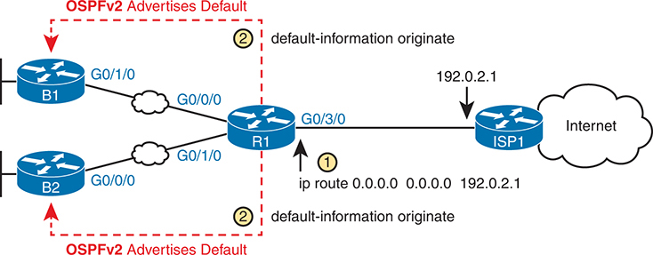

<figcaption>

<strong>图 23-5</strong> <em>使用 OSPF 创建并泛洪默认路由</em>

<aside class="hidden" id="a23fig05">

示意图中有四台路由器：B1、B2、R1 和 ISP1。B1 和 B2 均标注“OSPFv2 通告默认路由”，并分别通过 G0/1/0 和 G0/0/0 接口连接 R1。R1 分别通过 G0/0/0 和 G0/1/0 接口连接 B1 和 B2。R1 通过 G0/3/0 接口连接 ISP1，IP 地址为 192.0.2.1。ISP1 通过云图标表示互联网。图中标出了两个命令：G0/3/0 接口处的“ip route 0.0.0.0 0.0.0 192.02.1”和“default-information originate”，它们表示 OSPF 中用于创建和通告默认路由的命令。

</aside>

</figcaption>

</figure>

<a href="#ch23fig06">图 23-6</a> 展示了 <a href="#ch23fig05">图 23-5</a> 中 OSPF 通告所产生的默认路由。在最左侧，分支路由器均具有通过 OSPF 学到的、指向 R1 的默认路由。R1 自身也需要一条指向 ISP 路由器的默认路由，以便将所有发往互联网的流量转发给 ISP。

<figure class="image-c" id="ch23fig06">

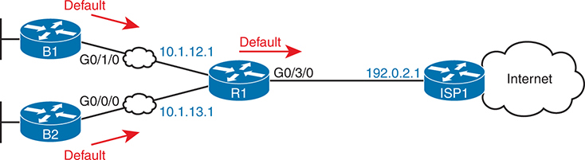

<figcaption>

<strong>图 23-6</strong> <em><strong>default-information originate</strong> 命令产生的默认路由</em>

<aside class="hidden" id="a23fig06">

示意图中有四台路由器：B1、B2、R1 和 ISP1。B1 和 B2 分别通过 G0/1/0 和 G0/0/0 接口连接 R1，IP 地址分别为 10.1.12.1 和 10.1.13.1。B1 和 B2 的默认路由均指向 R1。R1 通过 G0/3/0 接口连接 ISP1，IP 地址为 192.0.2.1。ISP1 通过云图标表示互联网。

</aside>

</figcaption>

</figure>

<a href="#exa23_11">例 23-11</a> 首先突出显示了 <a href="#ch23fig06">图 23-6</a> 中路由器 R1 上与默认路由有关的两条命令。该路由器有一条静态默认路由，指定 ISP 路由器为下一跳（192.0.2.1）。其 OSPF 进程下还配置了 <strong>default-information originate</strong> 命令，告诉路由器向其他 OSPF 路由器通告默认路由，但前提是路由器当前已有默认路由。

<strong>例 23-11</strong> <em>互联网边缘路由器 R1 上的相关 OSPF 配置</em>

<a href="#code-f0598-01" id="f0598-01a">点击此处查看代码原图</a>

<pre class="pre-ex" tabindex="0"><code>! Excerpt from a <strong>show running-config</strong> command on router R1

<strong>ip route 0.0.0.0 0.0.0.0 192.0.2.1</strong>

!

<strong>router ospf 1</strong>

  <strong>network 10.0.0.0 0.255.255.255 area 0</strong>

  <strong>router-id 1.1.1.1</strong>

  <strong>default-information originate</strong></code></pre>

<a href="#exa23_12">例 23-12</a> 展示了基于 <a href="#exa23_11">例 23-11</a> 配置的状态。首先，示例顶部确认 R1 拥有一条默认路由，也就是到 0.0.0.0/0 的路由。“Gateway of last resort”（最后选用网关）指的是路由器当前使用的默认路由，它指向下一跳 IP 地址 192.0.2.1，即 ISP 路由器的 IP 地址。

<strong>例 23-12</strong> <em>路由器 R1 和 B1 上的默认路由</em>

<a href="#code-f0598-02" id="f0598-02a">点击此处查看代码原图</a>

<pre class="pre-ex" tabindex="0"><code>! The next command is from Router R1. Note the static code for the default route

R1# <strong>show ip route static</strong>

Codes: L - local, C - connected, S - static, R - RIP, M - mobile, B - BGP

! Rest of the legend omitted for brevity

Gateway of last resort is 192.0.2.1 to network 0.0.0.0

S*     <strong>0.0.0.0/0</strong> [254/0] via <strong>192.0.2.1</strong></code></pre>

<pre class="pre-ex" tabindex="0"><code>! The next command is from router B1; notice the External route code for the default

B1# <strong>show ip route ospf</strong>

Codes: L - local, C - connected, S - static, R - RIP, M - mobile, B - BGP

       D - EIGRP, EX - EIGRP external, O - OSPF, IA - OSPF inter area

       N1 - OSPF NSSA external type 1, N2 - OSPF NSSA external type 2

       E1 - OSPF external type 1, E2 - OSPF external type 2

! Rest of the legend omitted for brevity

Gateway of last resort is 10.1.12.1 to network 0.0.0.0

O*E2   0.0.0.0/0 [110/1] via 10.1.12.1, 00:20:51, GigabitEthernet0/1/0

       10.0.0.0/8 is variably subnetted, 6 subnets, 2 masks

O         10.1.3.0/24 [110/3] via 10.1.12.1, 00:20:51, GigabitEthernet0/1/0

O         10.1.13.0/24 [110/2] via 10.1.12.1, 00:20:51, GigabitEthernet0/1/0</code></pre>

示例的下半部分展示了路由器 B1 通过 OSPF 学到的默认路由。B1 也列出了到 0.0.0.0/0 的路由。在此情况下，下一跳路由器为 10.1.12.1，即 R1 在 WAN 链路上的 IP 地址。最左侧的代码为 O*E2，表示这是一条通过 OSPF 学到的默认路由，具体而言是一条 OSPF 外部路由。B1 的最后选用网关设置使用这条通过 OSPF 学到的默认路由，下一跳为 10.1.12.1。

最后，OSPF 子命令 <strong>default-information originate</strong> 采用有条件的逻辑：只有已经存在其他默认路由时，才向 OSPF 通告默认路由。为命令添加 <strong>always</strong> 关键字（<strong>default-information originate always)</strong>，会告诉 OSPF 无论当前是否存在默认路由，都始终向 OSPF 通告默认路由。

</section>

<section>

<h4 class="h4" id="ch23lev2sec5">OSPF 度量值（开销）</h4>

<a href="v1-21.html#ch21">第 21 章</a> 的“<a href="v1-21.html#ch21lev2sec7">使用 SPF 计算最佳路由</a>”一节讨论了 SPF 如何计算每条路由的度量值，并为每个目的子网选择度量值最优的路由。OSPF 路由器可以通过以下三种配置方式改变 OSPF 接口开销，从而影响这一选择：

<ul class="sq">

<li>
直接使用接口子命令 <strong>ip ospf cost</strong> <em>x</em>。
</li>

<li>
使用每个接口的默认计算方式，并修改<a id="key_257" href="#ref-gloss_193">接口带宽（interface bandwidth）</a>设置，从而改变计算出的值。
</li>

<li>
使用每个接口的默认计算方式，并修改 OSPF <a id="key_261" href="#ref-gloss_328">参考带宽（reference bandwidth）</a>设置，从而改变计算出的值。
</li>

</ul>

<section>

<h5 class="h5" id="ch23lev3sec3">直接设置开销</h5>

直接设置开销只需要一条简单的配置命令，如 <a href="#exa23_13">例 23-13</a> 所示。示例设置了路由器 R1 两个接口的开销。本例使用 <a href="#ch23fig04">图 23-4</a> 的单区域拓扑，并在图中所有接口上启用 OSPF。随后的 <strong>show ip ospf interface brief</strong> 命令详细列出每个接口的开销。请注意，<strong>show</strong> 命令确认了这些开销设置。

<strong>例 23-13</strong> <em>确认 OSPF 接口开销</em>

<a href="#code-f0600-01" id="f0600-01a">点击此处查看代码原图</a>

<pre class="pre-ex" tabindex="0"><code>R1# <strong>conf t</strong>

Enter configuration commands, one per line.  End with CNTL/Z.

R1(config)# <strong>interface g0/0/1</strong>

R1(config-if)# <strong>ip ospf cost 4</strong>

R1(config-if)# <strong>interface g0/0/2</strong>

R1(config-if)# <strong>ip ospf cost 5</strong>

R1(config-if)# <strong>^Z</strong>

R1#

R1# <strong>show ip ospf interface brief</strong>

Interface    PID   Area            IP Address/Mask    Cost  State Nbrs F/C

Gi0/0/0      1     0               10.1.1.1/24        1     DR    0/0

Gi0/0/1      1     0               10.1.12.1/24       4     DR    1/1

Gi0/0/2      1     0               10.1.13.1/24       5     BDR   1/1

Gi0/0/3      1     0               10.1.14.1/24       1     DR    1/1</code></pre>

输出还显示其他 Gigabit 接口的开销为 1，这是所有速率超过 100 Mbps 的接口的默认 OSPF 开销。下一个主题讨论 IOS 如何确定默认开销值。

</section>

<section>

<h5 class="h5" id="ch23lev3sec4">根据接口带宽和参考带宽设置开销</h5>

路由器通过逐接口的 <em>bandwidth</em> 设置描述接口速率。请注意，接口带宽设置并不影响实际传输速率。接口带宽只是代表接口速率的一项可配置设置，可以将其配置为与实际传输速率相符，也可以不相符。为了支持这一逻辑，IOS 在可能的情况下将默认接口带宽设为与物理传输速率一致的值，同时也允许使用 <strong>bandwidth</strong> <em>speed</em> 接口子命令配置接口带宽。

OSPF（以及其他 IOS 功能）使用接口带宽作出决策；OSPF 在计算每个接口的默认 OSPF 开销时使用接口带宽。对于未配置 <strong>ip ospf cost</strong> 命令的接口，IOS 使用以下公式选择其 OSPF 开销。IOS 将接口带宽放在分母，将称为<em>参考带宽（reference bandwidth）</em>的 OSPF 设置放在分子：

参考带宽 / 接口带宽

请注意，虽然接口带宽和参考带宽都可以通过配置修改，但由于多个 IOS 功能使用接口带宽设置，应避免通过修改接口带宽来影响默认 OSPF 开销。

如今，大多数公司都会修改 IOS 默认的参考带宽设置。Cisco 在数十年前链路速度慢得多的时代选择了这一默认值（100 Mbps）。因此，使用默认值时，任何带宽为 100 Mbps 或更高的接口，计算出的 OSPF 开销都是 1。所以，依赖 OSPF 开销计算时，将参考带宽配置为高于网络中最快链路的速率会有所帮助。

要理解这一问题，请看 <a href="#ch23tab03">表 23-3</a>，其中列出了多种接口类型、各接口的默认带宽，以及采用默认 OSPF 参考带宽 100 Mbps（即 100,000 Kbps）时计算出的 OSPF 开销。（OSPF 在这些计算中向上取整，使 OSPF 接口开销的最低可能值为 1。）

<figure class="table" id="ch23tab03" tabindex="0">

<figcaption>

<strong>表 23-3</strong> 速率更高但 OSPF 开销相同的接口

</figcaption>

<table class="all">

<thead>

<tr>

<th class="th">
接口
</th>

<th class="th">
接口默认带宽（Kbps）
</th>

<th class="th">
公式（Kbps）
</th>

<th class="th">
OSPF 开销
</th>

</tr>

</thead>

<tbody>

<tr>

<td class="border">
串行接口
</td>

<td class="border">
1544 Kbps
</td>

<td class="border">
100,000 / 1544
</td>

<td class="border">
64
</td>

</tr>

<tr>

<td class="border">
以太网
</td>

<td class="border">
10,000 Kbps
</td>

<td class="border">
100,000 / 10,000
</td>

<td class="border">
10
</td>

</tr>

<tr>

<td class="border">
快速以太网
</td>

<td class="border">
100,000 Kbps
</td>

<td class="border">
100,000/100,000
</td>

<td class="border">
1
</td>

</tr>

<tr>

<td class="border">
千兆以太网
</td>

<td class="border">
1,000,000 Kbps
</td>

<td class="border">
100,000/1,000,000
</td>

<td class="border">
1
</td>

</tr>

<tr>

<td class="border">
10 吉比特以太网
</td>

<td class="border">
10,000,000 Kbps
</td>

<td class="border">
100,000/10,000,000
</td>

<td class="border">
1
</td>

</tr>

<tr>

<td class="border">
100 吉比特以太网
</td>

<td class="border">
100,000,000 Kbps
</td>

<td class="border">
100,000/100,000,000
</td>

<td class="border">
1
</td>

</tr>

</tbody>

</table>

</figure>

从表中可以看出，使用默认参考带宽时，从快速以太网的 100 Mbps 起，所有更快的接口都具有相同的默认 OSPF 开销。因此，OSPF 会认为 100 Mbps 链路与 10 Gbps 或 100 Gbps 链路的开销相同，这很可能不是合适的路由选择依据。

只需使用 <strong>auto-cost reference-bandwidth</strong> <em>speed</em> OSPF 模式子命令修改参考带宽，就仍可使用 OSPF 的默认开销计算方式（许多人也确实如此）。该命令以兆比特每秒（Mbps）为单位设置数值。参考带宽至少应等于网络中最快的链路速率，最好更高，以便将来添加更快的链路。

例如，一家企业最快的链路为 10 Gbps（10,000 Mbps），可以将所有路由器设为使用 <strong>auto-cost reference-bandwidth 10000</strong>，表示 10,000 Mbps，即 10 Gbps。这样，默认情况下 10 Gbps 链路的 OSPF 开销为 1，1 Gbps 链路的开销为 10，而 100 MBps 链路的开销为 100。

更好的做法是在同一家企业中，使用比网络中最快接口速率更高的参考带宽，为更高速率留出余地。例如，在最快链路为 10 Gbps 的同一家企业中，将参考带宽设为 40 Gbps 甚至 100 Gbps，以便将来升级到 40 Gbps 或 100 Gbps 链路。（例如，使用 <strong>auto-cost reference-bandwidth 100000</strong> 命令，表示 100,000 Mbps，即 100 Gbps。）这样，100 Gbps 链路的 OSPF 开销为 1，40 Gbps 链路为 2，10 Gbps 链路为 10，1 Gbps 链路为 100。

注意

Cisco 建议将企业网络中所有 OSPF 路由器的 OSPF 参考带宽设为相同值。

为便于学习，下面总结路由器设置 OSPF 接口开销的规则：

<ol class="number">

<li>
使用 <strong>ip ospf cost</strong> <em>x</em> 接口子命令显式设置开销，取值为 1 到 65,535（含两端）。

</li>

<li>
虽然应尽量避免，但也可以使用 <strong>bandwidth</strong> <em>speed</em> 命令修改接口带宽，其中 <em>speed</em> 的单位是千比特每秒（Kbps）。
</li>

<li>
使用路由器 OSPF 子命令 <strong>auto-cost reference-bandwidth</strong> <em>ref-bw</em> 修改参考带宽，单位为兆比特每秒（Mbps）。
</li>

</ol>

</section>

</section>

<section>

<h4 class="h4" id="ch23lev2sec6">OSPF Hello 间隔与 Dead 间隔</h4>

OSPF 在初始化邻居时，会利用 OSPF Hello 消息完成许多有趣的工作。如 <a href="v1-21.html#ch21">第 21 章</a>“<a href="v1-21.html#ch21lev3sec7">结识邻居并学习其路由器 ID</a>”一节所述，OSPF 路由器通过 Hello 消息宣告自己在链路上的存在，并将这些消息发送到所有 OSPF 路由器的组播地址 224.0.0.5。路由器也侦听潜在邻居发来的 Hello 消息。两台路由器相互收到 Hello 后，会检查其中公布的设置，如果兼容，就可以继续成为邻居。

本节来看故事的另一端：邻居关系失效时会发生什么。

首先，在邻居关系持续正常工作期间，路由器会按照逐接口的 <a id="key_256" href="#ref-gloss_167">Hello 间隔（Hello interval）</a>（也称为 <em>Hello 定时器</em>）定期发送 Hello 消息。Cisco IOS 在所有以太网接口上默认采用 10 秒的 Hello 间隔。为什么？当路由器不再收到某个邻居发来的 Hello 消息时，就认为邻居发生故障，并将该邻居关系置为 down。

判断邻居何时失效的过程，基于邻居会持续发来 Hello 消息的假设，并结合第二个定时器：<a id="key_255" href="#ref-gloss_087">Dead 间隔（Dead interval）</a>（也称为 <em>Dead 定时器</em>）。Dead 定时器告诉接口应等待多久，也就是路由器自收到一个 Hello 消息后，应等待多长时间才判定邻居失效。

<a href="#ch23fig07">图 23-7</a> 展示了这一交互过程，重点说明路由器 R1 发生故障时的情况，以及 R2 如何看待消息与定时器。本例中，R1 断电，但 R2 的以太网 WAN 链路保持 up，因为 R2 与以太网 WAN 服务之间的链路没有问题。使用默认的 10 秒 Hello 定时器和 40 秒 Dead 定时器，事件按带圆圈的步骤编号依次发生：

<ol class="number">

<li>
路由器 R2 与 R1 具有正常工作的邻居关系（full 状态）。
</li>

<li>
R1 照常发送一条 Hello 消息；R2 将 Dead 定时器重置为 40。
</li>

<li>
10 秒后，R1 再发送一条 Hello 消息；R2 将 Dead 定时器重置为 40。
</li>

<li>
R1 断电；R2 不再收到来自 R1 的 Hello 消息。
</li>

<li>
Dead 定时器倒计时至 0。
</li>

<li>
路由器 R2 将邻居 R1 的状态改为 down，并重新收敛。
</li>

</ol>

正常运行并使用默认设置时，Dead 定时器被重置为 40，倒计时至 30，再重置为 40，如此反复。不过，这个过程也意味着，你可能希望配置更短的 Dead 间隔，以提高路由器对故障的反应速度。

<a href="#exa23_14">例 23-14</a> 展示了设置 Hello 间隔和 Dead 间隔的简单接口子命令。示例基于 <a href="#ch23fig04">图 23-4</a> 的网络，展示了路由器 R1 上连接 R2、R3 和 R4 的三个 WAN 接口的配置。虽然未展示，但相邻路由器也必须配置相同的 Hello 和 Dead 定时器设置。

<figure class="image-c" id="ch23fig07">

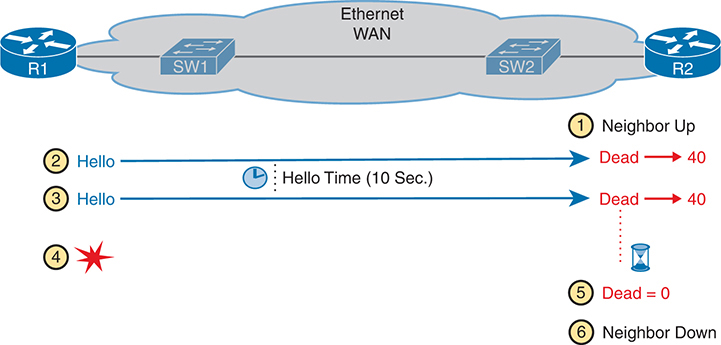

<figcaption>

<strong>图 23-7</strong> <em>示例：R2 使用 Hello 间隔与 Dead 间隔</em>

<aside class="hidden" id="a23fig07">

两台路由器 R1 和 R2 通过交换机 SW1、SW2 及以太网 WAN 连接，图中展示它们之间的网络过程。过程从邻居处于 Up 状态开始（步骤 1）。在此阶段，R1 向 R2 发送 Hello 消息，R2 将 Dead 定时器重置为 40。10 秒后，R1 再发送一条 Hello 消息，R2 再将 Dead 定时器重置为 40。步骤 4 用红色星号标出，表示 R1 断电。Dead 定时器计数到零（步骤 5），表示没有收到 Hello 报文。邻居变为 Down 状态（步骤 6）。

</aside>

</figcaption>

</figure>

<strong>例 23-14</strong> <em>配置 OSPF Hello 间隔与 Dead 间隔</em>

<a href="#code-f0603-01" id="f0603-01a">点击此处查看代码原图</a>

<pre class="pre-ex" tabindex="0"><code>R1# <strong>conf t</strong>

Enter configuration commands, one per line.  End with CNTL/Z.

! Link connected to router R2

R1(config)# <strong>interface g0/0/1</strong>

R1(config-if)# <strong>ip ospf hello-interval 5</strong>

! Link connected to router R3

R1(config)# <strong>interface g0/0/2</strong>

R1(config-if)# <strong>ip ospf dead-interval 20</strong>

! Link connected to router R4

R1(config)# <strong>interface g0/0/3</strong>

R1(config-if)# <strong>ip ospf hello-interval 5</strong>

R1(config-if)# <strong>ip ospf dead-interval 15</strong>

R1(config-if)# <strong>Ctl-z</strong>

R1#</code></pre>

<a href="#exa23_15">例 23-15</a> 确认了 <a href="#exa23_14">例 23-14</a> 中配置的设置，但接口 G0/0/1 有一点特别。IOS 在以太网接口上默认采用 10 秒 Hello 间隔，而 Dead 间隔默认是 Hello 间隔的四倍。对于 G0/0/1，由于只配置了 Hello 间隔，IOS 将默认 Dead 间隔设为 4 × Hello，也就是 20。其他两个接口则采用更容易预料的逻辑，概括如下，并在 <a href="#exa23_15">例 23-15</a> 的突出显示部分得到确认：

<ul class="sq">

<li>
G0/0/1：Hello = 5（已配置），Dead = 20（由 IOS 按 Hello 的 4 倍计算）
</li>

<li>
G0/0/2：Hello = 10（IOS 默认值），Dead = 20（已配置）
</li>

<li>
G0/0/3：Hello = 5，Dead = 15（两者均已配置）
</li>

</ul>

<strong>例 23-15</strong> <em>逐接口确认新的 OSPF Hello 间隔与 Dead 间隔</em>

<a href="#code-f0604-01" id="f0604-01a">点击此处查看代码原图</a>

<pre class="pre-ex" tabindex="0"><code>R1# <strong>show ip ospf interface g0/0/1 | include Hello</strong>

  Timer intervals configured, Hello 5, Dead 20, Wait 20, Retransmit 5

    Hello due in 00:00:02

R1# <strong>show ip ospf interface g0/0/2 | include Hello</strong>

  Timer intervals configured, Hello 10, Dead 20, Wait 20, Retransmit 5

    Hello due in 00:00:04

R1# <strong>show ip ospf interface g0/0/3 | include Hello</strong>

  Timer intervals configured, Hello 5, Dead 15, Wait 15, Retransmit 5

    Hello due in 00:00:03</code></pre>

IOS 允许我们对这两个设置作出不合理的配置选择。请注意以下几点：

<ul class="sq">

<li>
默认设置使 Dead 与 Hello 定时器的比例为 4:1。这一比例要求连续丢失四个 Hello 报文后，Dead 定时器才会到期。不论选择什么数值，都应考虑保持相同的 4:1 比例，或者至少采用 3:1 的比例。
</li>

<li>
两台相邻路由器必须使用相同的 Dead 和 Hello 定时器设置。不过，IOS 允许你为潜在邻居配置不同的设置，这会阻止它们成为邻居，因此务必确保设置一致。
</li>

<li>
IOS 允许你作出不合理的选择，将 Dead 间隔配置得小于 Hello 间隔。在这种情况下，路由器收到下一个 Hello 之前，Dead 间隔就已到期。邻居关系会在每个 Hello 间隔内反复失效和恢复。因此，应始终将 Dead 间隔设为大于 Hello 间隔。
</li>

</ul>

</section>

</section>

</section>

<section class="ccna-source ccna-appendix" aria-label="答案解析与术语表">
<section data-epub-type="chapter">

<h2 class="h2" id="ref-appc">附录 C</h2>

<h2 class="h2a">“这些知识我已经掌握了吗？”自测题答案</h2>

<section>

<h3 class="h3" id="ref-appclev1sec23">第 23 章</h3>

<strong><a id="ref-ques23_1" href="#quess23_1">1</a>．</strong> B 和 D。默认情况下，IOS 为以太网接口分配 broadcast OSPF 网络类型，OSPF 接口优先级为 1。因此，两台路由器都会尝试发现链路上的其他路由器（这说明了一个正确答案）。

广播网络类型意味着路由器还会尝试选举 DR 和 BDR。优先级相同时，路由器根据最大的路由器 ID（RID）选择 DR，因此 R2 成为 DR，R1 成为 BDR。这些事实说明了两个错误答案为什么不正确。另一个正确答案成立，是因为 <strong>show ip ospf neighbor</strong> 命令列出本地路由器的邻居关系状态（FULL）以及该邻居承担的角色（DR）；当 R2 充当 DR 时，R1 上会显示这样的输出。

<strong><a id="ref-ques23_2" href="#quess23_2">2</a>．</strong> B 和 C。首先，OSPF 点到点网络类型使两台路由器动态发现邻居，因此有一个答案正确。

其次，IOS 默认分配的 OSPF 接口优先级为 1，所以 R1 配置的优先级 11 在 DR/BDR 选举中会更优。不过，点到点网络类型使路由器不在该接口上使用 DR/BDR。因此，关于 R1 成为 DR 的答案不正确（因为根本没有 DR），而列出“FULL/DR”状态的答案也因同样的原因而不正确。不过，声称 R2 既不是 DR 也不是 BDR 的答案正确，因为不会选举 DR 或 BDR。

<strong><a id="ref-ques23_3" href="#quess23_3">3</a>．</strong> D。<strong>show ip ospf interface brief</strong> 命令在输出最右侧的“Nbrs F/C”标题下列出一对计数值。第一个数字代表完全邻接的邻居数量（本例为 2），第二个数字代表邻居总数。

<strong><a id="ref-ques23_4" href="#quess23_4">4</a>．</strong> B。OSPF 默认优先级为 1。配置为 100 后，R2 的优先级更高。不过，路由器只在选举新 DR 时使用优先级值，因此只要邻居关系稳定，就不会发生新的 DR 选举。所以，只有发生破坏当前邻居关系的故障后，才可能让优先级更高的 R2 成为 DR。其中两个答案给出了 R2 成为 DR 的其他时间点。另一个干扰项称 R2 将停止充当 BDR，事实并非如此。

<strong><a id="ref-ques23_5" href="#quess23_5">5</a>．</strong> B。SPF 将路由中所有出接口的 OSPF 接口开销相加，得到该路由的开销。接口开销可以直接设置（<strong>ip ospf cost</strong>），也可以由 IOS 根据参考带宽和接口带宽使用默认值。在所列答案中，只有 <strong>delay</strong> 设置不影响 OSPFv2 度量值计算。

<strong><a id="ref-ques23_6" href="#quess23_6">6</a>．</strong> D。接口子命令 <strong>ip ospf hello-interval 15</strong> 将 Hello 间隔设为 15。此外，如果没有显式配置 Dead 间隔，IOS 会将 Dead 间隔设为 Hello 间隔的 4 倍，本例为 60。题干描述的正是 Dead 间隔的计时方式与用途：在不再收到 Hello 后，等待多长时间才认为邻居发生故障。

</section>

</section>

<section id="ref-glossary"><h2 class="h2a">术语表</h2>
<strong>广播网络类型（broadcast network type）</strong> 一项 OSPF 接口设置，适用于有两台以上路由器的链路；采用此设置时，LSA 泛洪过程由选举出的指定路由器（DR）管理。

<strong>Dead 间隔（Dead Interval）</strong> OSPF 为每个邻居使用的计时器。如果在该计时器规定的时间内未收到某邻居的 Hello，路由器就认为邻居已失效。

<strong>Hello 间隔（Hello Interval）</strong> OSPF 和 EIGRP 的接口计时器，规定路由器发送 Hello 消息的频率。

<strong>接口带宽（interface bandwidth）</strong> 在 OSPF 中，计算接口默认 OSPF 开销度量值时的分子，该度量值按接口带宽除以参考带宽计算。

<strong>OSPF 优先级（OSPF priority）</strong> 一项 OSPF 接口设置，是指定路由器（DR）选举过程中的第一个比较依据，优先级最高的路由器接口赢得选举。

<strong>被动接口（passive interface）</strong> 对于路由协议而言，指已经在接口上启用该路由协议，但该路由协议不通过此接口向外发送路由协议消息的路由器接口。

<strong>点到点网络类型（point-to-point network type）</strong> 一项 OSPF 接口设置，适用于仅有两台路由器的点到点拓扑链路；采用此设置时，泛洪直接在路由器之间进行，不使用指定路由器（DR）。

<strong>参考带宽（reference bandwidth）</strong> 在 OSPF 中，为 OSPF 路由进程配置的一个值，OSPF 在计算接口默认 OSPF 开销度量值时使用它，该度量值按接口带宽除以参考带宽计算。

</section>
</section>

<section class="ccna-source ccna-appendix" aria-label="代码原图">
<section data-epub-type="chapter">

<a href="#f0585-01a" id="code-f0585-01">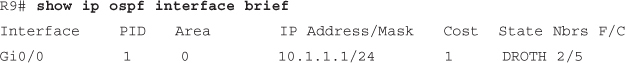</a>

<a href="#f0587-01a" id="code-f0587-01">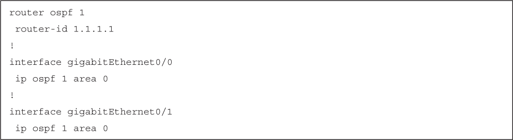</a>

<a href="#f0588-01a" id="code-f0588-01">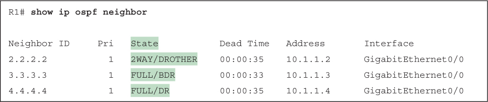</a>

<a href="#f0589-01a" id="code-f0589-01">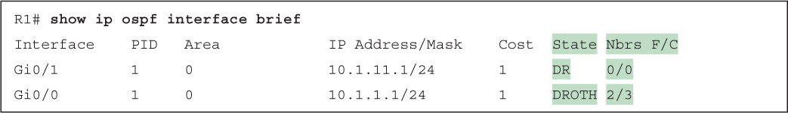</a>

<a href="#f0589-02a" id="code-f0589-02">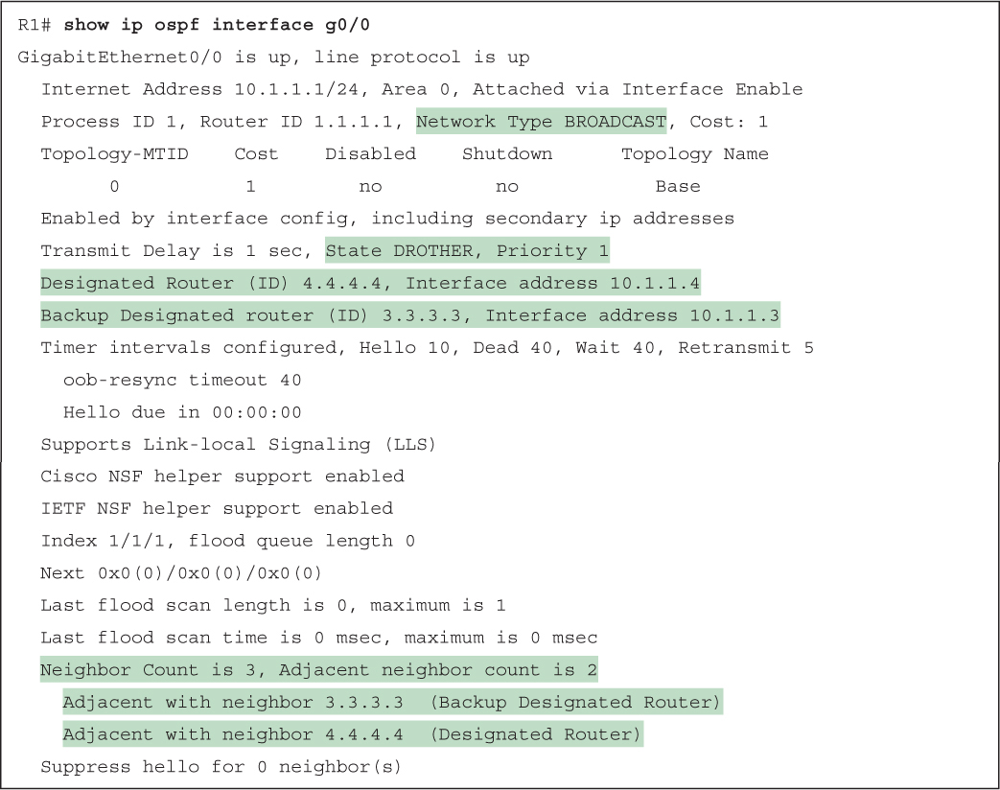</a>

<a href="#f0591-01a" id="code-f0591-01">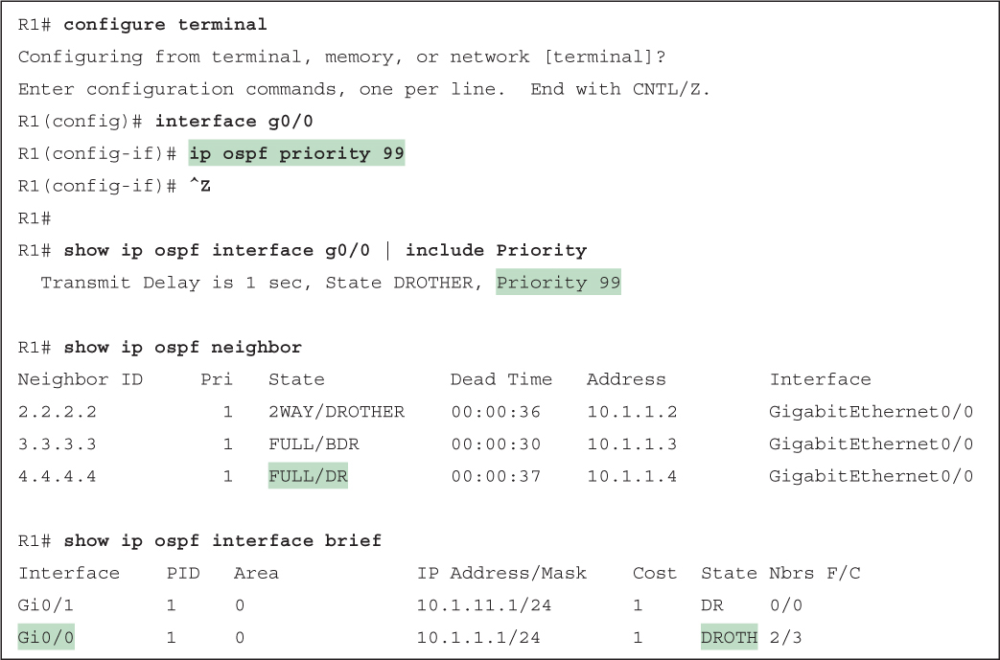</a>

<a href="#f0592-01a" id="code-f0592-01">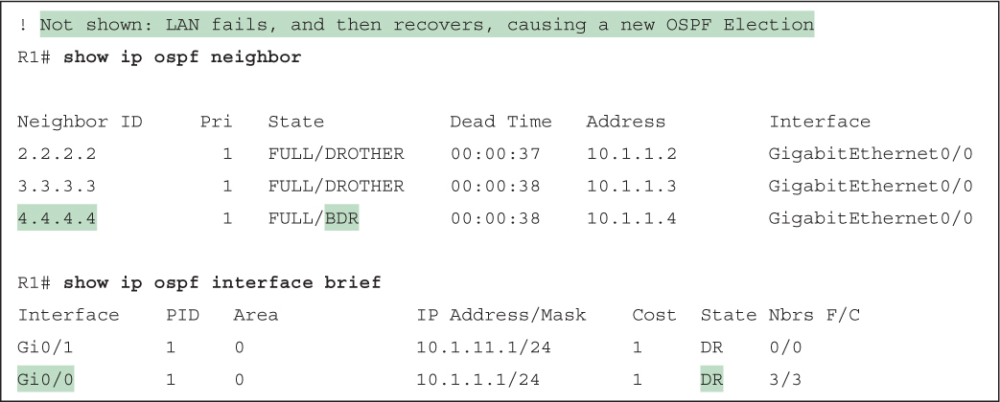</a>

<a href="#f0593-01a" id="code-f0593-01">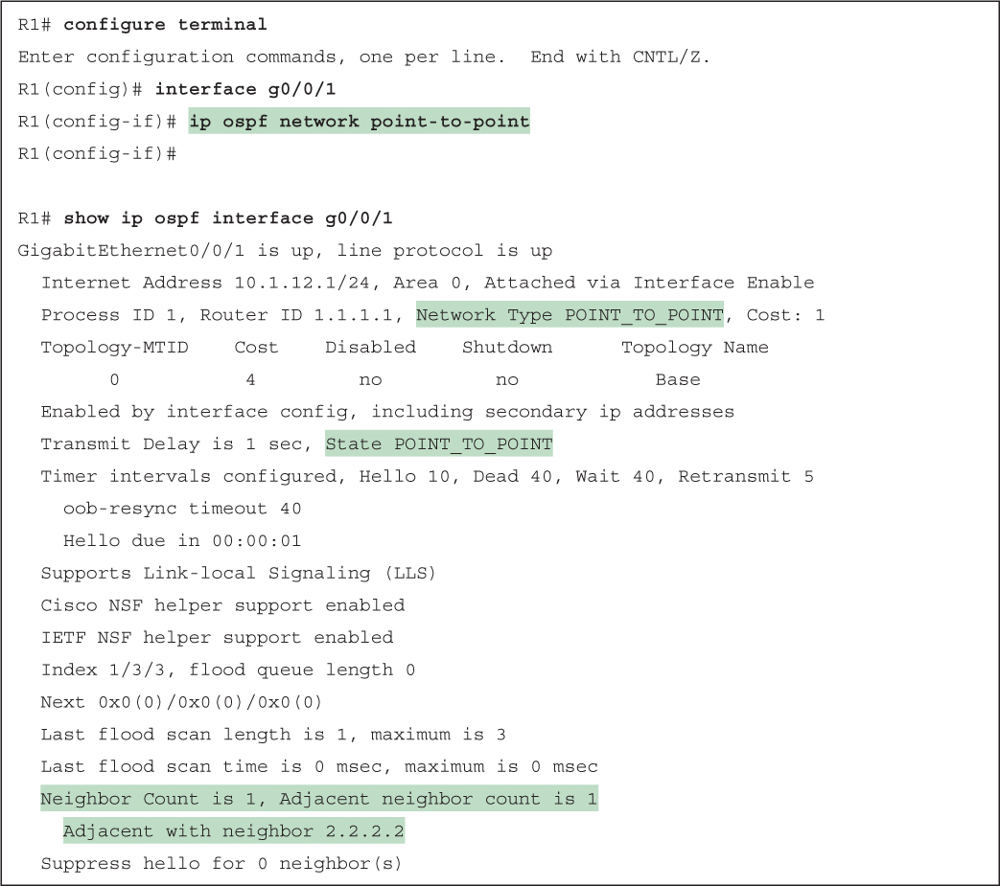</a>

<a href="#f0594-01a" id="code-f0594-01">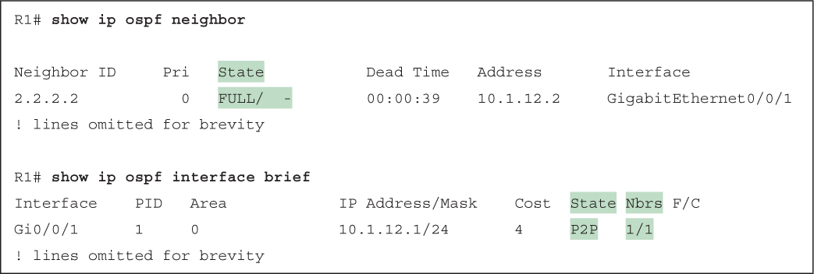</a>

<a href="#f0596-01a" id="code-f0596-01">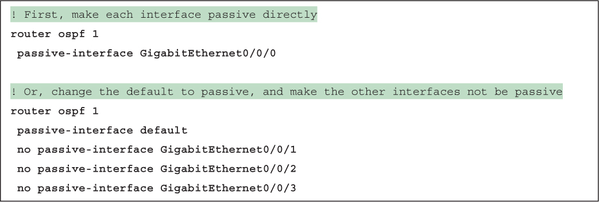</a>

<a href="#f0596-02a" id="code-f0596-02">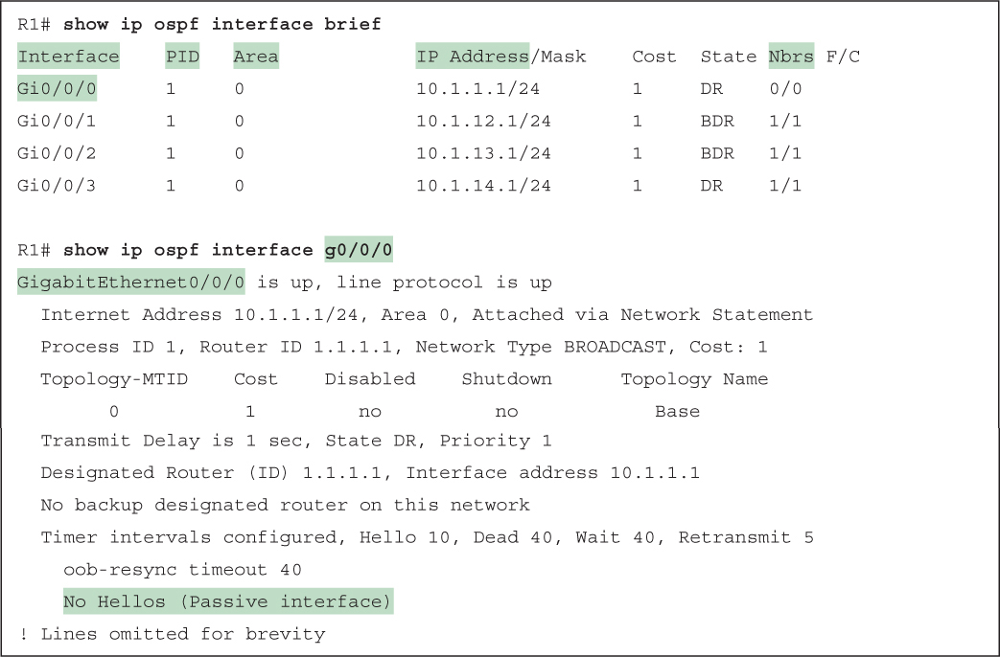</a>

<a href="#f0598-01a" id="code-f0598-01">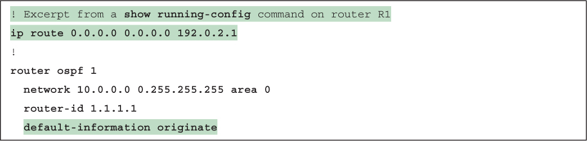</a>

<a href="#f0598-02a" id="code-f0598-02">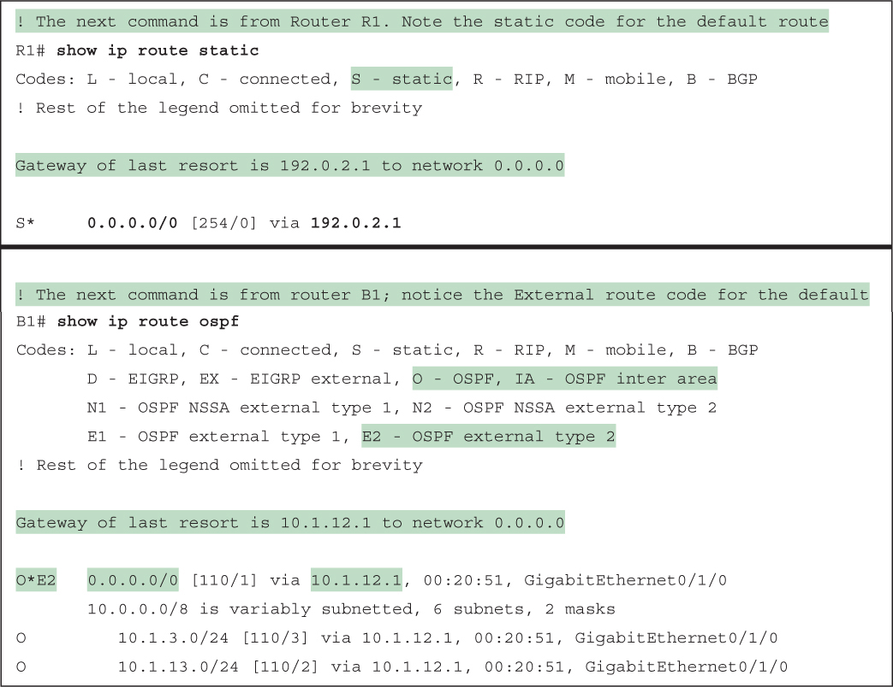</a>

<a href="#f0600-01a" id="code-f0600-01">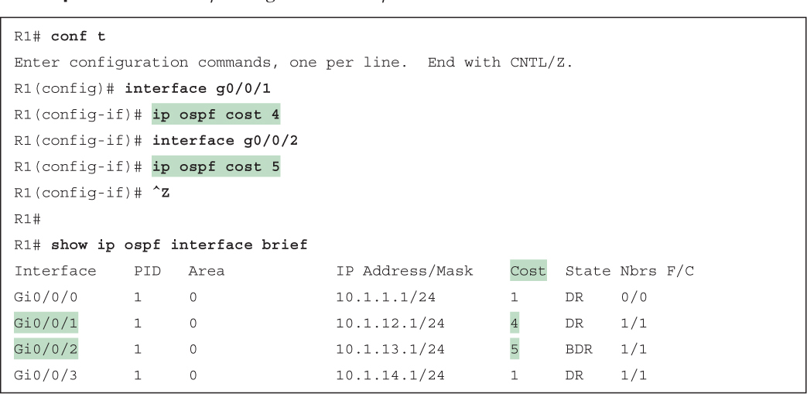</a>

<a href="#f0603-01a" id="code-f0603-01">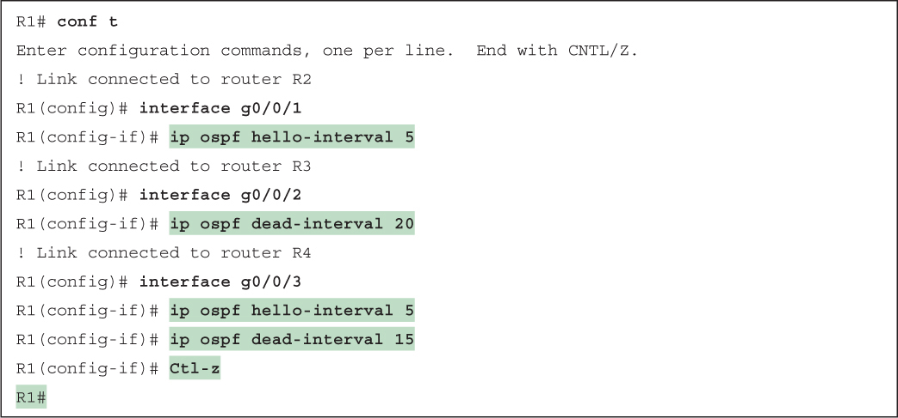</a>

<a href="#f0604-01a" id="code-f0604-01">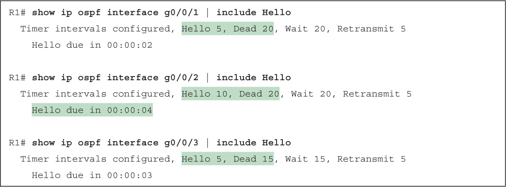</a>

</section>

</section>


<nav class="ccna-chapter-nav" aria-label="章节导航"><a href="v1-22.html">← 上一章</a><a href="v1-24.html">下一章 →</a></nav>
