
<a href="{{ '/subjects/CCNA/' | relative_url }}">← 返回 CCNA 目录</a>

第一卷 · OSPF

<nav class="ccna-chapter-nav" aria-label="章节导航"><a href="v1-23.html">← 上一章</a><a href="v1-25.html">下一章 →</a></nav>



<section data-epub-type="chapter">

<h2 class="h2" id="ch24">第 24 章</h2>

<h2 class="h2a">OSPF 邻居与路由选择</h2>

本章涵盖以下考试主题：

3.0 IP 连接

3.1 解读路由表的组成部分

3.1.e 管理距离

3.2 确定路由器默认如何做出转发决策

3.2.a 最长前缀匹配

3.2.b 管理距离

3.2.c 路由协议度量值

3.4 配置与验证单区域 OSPFv2

3.4.a 邻居邻接关系

3.4.b 点到点

3.4.c 广播（DR/BDR 选举）

3.4.d 路由器 ID

<a href="v1-21.html#ch21">第 21 章</a>“<a href="v1-21.html#ch21">理解 OSPF 概念</a>”和 <a href="v1-22.html#ch22">第 22 章</a>“<a href="v1-22.html#ch22">实现基本 OSPF 功能</a>”讨论了必需的 OSPF 配置设置和最常见的可选设置，以及用于展示 OSPF 在这些设置下如何工作的各种验证命令。本章继续介绍更多 OSPF 实现主题，既补充完善 OSPF 的讨论，也进一步聚焦于具体的 CCNA 200-301 考试主题。

第一大节重点介绍邻居及邻接关系，这也是另一个 OSPF 考试主题所涉及的内容。OSPF 路由器只有先成为邻居，才能相互交换 LSA。本节讨论可能阻止 OSPF 路由器成为邻居的各种 OSPF 功能，以及如何发现这些不良条件是否存在，即使你无法访问运行配置。

本章以“<a href="#ch24lev1sec4">路由选择</a>”一节结束，讨论 OSPF 逻辑和 IP 路由逻辑。这一节回答路由器应选择哪条路由的问题，重点关注存在多条路由的情况。正文讨论 OSPF 如何在相互竞争的路由之间作出选择，以及路由器如何将数据包的目的地址与 IP 路由表中已有的路由进行匹配。

<section>

<h3 class="h3" id="ch24lev1sec1">“这些知识我已经掌握了吗？”自测</h3>

如果你想根据得分决定应在本章投入多少时间，可以参加自测（使用此处的问题或 PTP 软件）。字母答案列在自测后面页面的底部。书末及配套网站上的 <a href="#ref-appc">附录 C</a> 包含答案和解析。你也可以在 PTP 测试软件中找到答案和解析。

<figure class="table" id="ch24tab01" tabindex="0">

<figcaption>

<strong>表 24-1</strong> “这些知识我已经掌握了吗？”基础主题与问题对应关系

</figcaption>

<table class="all">

<thead>

<tr>

<th class="th">
基础知识小节
</th>

<th class="th">
题目
</th>

</tr>

</thead>

<tbody>

<tr>

<td class="border">
OSPF 邻居关系
</td>

<td class="border">
1–3
</td>

</tr>

<tr>

<td class="border">
路由选择
</td>

<td class="border">
4–7
</td>

</tr>

</tbody>

</table>

</figure>

<strong><a id="quess24_1" href="#ques24_1a">1</a>．</strong> 工程师将路由器 R11 和 R12 连接到同一个以太网 LAN，并配置两者使用 OSPFv2。哪些答案描述的设置组合会阻止两台路由器成为 OSPF 邻居？（选择两个答案。）

<ol class="lower-alpha">

<li>
R11 的接口使用区域 11，而 R12 的接口使用区域 12。
</li>

<li>
R11 的 OSPF 进程使用进程 ID 11，而 R12 使用进程 ID 12。
</li>

<li>
R11 的接口使用 OSPF 优先级 11，而 R12 使用 OSPF 优先级 12。
</li>

<li>
R11 的接口使用 OSPF Hello 定时器值 11，而 R12 使用 12。
</li>

</ol>

<strong><a id="quess24_2" href="#ques24_2a">2</a>．</strong> 工程师将路由器 R13 和 R14 连接到同一个以太网 LAN，并配置两者使用 OSPFv2。哪些答案描述的设置组合会阻止两台路由器成为 OSPF 邻居？

<ol class="lower-alpha">

<li>
两台路由器的接口 IP 地址位于同一子网。
</li>

<li>
两台路由器的 OSPF 进程都使用进程 ID 13。
</li>

<li>
两台路由器的 OSPF 进程都使用路由器 ID 13.13.13.13。
</li>

<li>
两台路由器的接口都使用 40 的 OSPF Dead 间隔。
</li>

</ol>

<strong><a id="quess24_3" href="#ques24_3a">3</a>．</strong> 路由器 R15 一直在使用 OSPFv2 的网络中正常工作。随后，工程师在 R15 的 OSPF 配置模式下执行 <strong>shutdown</strong> 命令。以下哪种情况会发生？

<ol class="lower-alpha">

<li>
R15 从 IP 路由表中清除所有 OSPF 路由，但保持 LSDB 不变。
</li>

<li>
R15 清除 OSPF 路由和 LSDB，但保持 OSPF 邻居关系活动。
</li>

<li>
R15 保持现有 OSPF 邻居关系，但不接受新的 OSPF 邻居。
</li>

<li>
R15 保留所有 OSPF 配置，但停止所有 OSPF 活动（路由、LSDB、邻居）。
</li>

</ol>

<strong><a id="quess24_4" href="#ques24_4a">4</a>．</strong> 路由器 R1 使用 OSPF 学到三条到子网 10.1.1.0/24 的路由。它先计算出一条经过 R2、度量值为 15000 的路由，再计算出一条经过 R3、度量值为 15001 的路由，最后计算出一条经过 R4、度量值为 15000 的路由。假设所有可能影响答案的功能均采用默认配置设置，路由器会将哪些路由放入路由表？

<ol class="lower-alpha">

<li>
仅以 R2 为下一跳路由器的路由
</li>

<li>
两条度量值为 15000 的路由
</li>

<li>
到子网 10.1.1.0/24 的全部三条路由
</li>

<li>
仅以 R3 为下一跳路由器的路由
</li>

</ol>

<strong><a id="quess24_5" href="#ques24_5a">5</a>．</strong> 路由器 R2 同时运行 EIGRP 和 OSPF。它学到两条到子网 172.16.1.0/24 的 OSPF 路由，一条度量值为 1000，另一条为 2000。它还学到两条 EIGRP 路由，度量值分别为 1,000,000 和 2,000,000。如果所有可能影响答案的设置都使用默认值，路由器会将哪些路由放入 IP 路由表？

<ol class="lower-alpha">

<li>
度量值为 1000 的 OSPF 路由和度量值为 1,0000,000 的 EIGRP 路由
</li>

<li>
度量值为 2000 的 OSPF 路由和度量值为 2,0000,000 的 EIGRP 路由
</li>

<li>
仅度量值为 1000 的 OSPF 路由
</li>

<li>
仅度量值为 1,0000,000 的 EIGRP 路由
</li>

</ol>

<strong><a id="quess24_6" href="#ques24_6a">6</a>．</strong> 路由器 R3 收到一个目的 IP 地址为 172.20.89.100 的数据包。根据 <strong>show ip route</strong> 命令显示的路由，其中定义的多少个地址范围匹配该数据包的目的地址？

<a href="#code-f0610-01" id="f0610-01a">点击此处查看代码原图</a>

<pre class="quiz" tabindex="0"><code>R3# <strong>show ip route</strong>

Gateway of last resort is 172.20.15.5 to network 0.0.0.0

O*E2  0.0.0.0/0 [110/1] via 172.20.15.5, 00:04:56, GigabitEthernet0/1

      172.20.0.0/16 is variably subnetted, 12 subnets, 4 masks

S        172.20.90.9/32 [1/0] via 172.20.11.1

O IA     172.20.88.0/23 [110/3] via 172.20.12.2, 00:03:44, GigabitEthernet0/0/2

O IA     172.20.80.0/20 [110/3] via 172.20.13.3, 00:04:55, GigabitEthernet0/0/3

O IA     172.20.0.0/16 [110/6] via 172.20.14.4, 00:02:14, GigabitEthernet0/0/4</code></pre>

<ol class="lower-alpha">

<li>
1
</li>

<li>
2
</li>

<li>
3
</li>

<li>
4
</li>

<li>
5
</li>

</ol>

<strong><a id="quess24_7" href="#ques24_7a">7</a>．</strong> 路由器 R3 收到一个目的 IP 地址为 172.20.90.1 的数据包。R3 转发该数据包时使用哪个下一跳 IP 地址？

<a href="#code-f0610-02" id="f0610-02a">点击此处查看代码原图</a>

<pre class="quiz" tabindex="0"><code>R3# <strong>show ip route</strong>

Gateway of last resort is 172.20.15.5 to network 0.0.0.0

O*E2  0.0.0.0/0 [110/1] via 172.20.15.5, 00:04:56, GigabitEthernet0/1

      172.20.0.0/16 is variably subnetted, 12 subnets, 4 masks

S        172.20.90.9/32 [1/0] via 172.20.11.1

O IA     172.20.88.0/23 [110/3] via 172.20.12.2, 00:03:44, GigabitEthernet0/0/2

O IA     172.20.80.0/20 [110/3] via 172.20.13.3, 00:04:55, GigabitEthernet0/0/3

O IA     172.20.0.0/16 [110/6] via 172.20.14.4, 00:02:14, GigabitEthernet0/0/4</code></pre>

<ol class="lower-alpha">

<li>
172.20.11.1
</li>

<li>
172.20.12.2
</li>

<li>
172.20.13.3
</li>

<li>
172.20.14.4
</li>

<li>
172.20.15.5
</li>

</ol>

“这些知识我已经掌握了吗？”自测答案：

<strong><a id="ques24_1a" href="#ref-ques24_1">1</a></strong> A、D

<strong><a id="ques24_2a" href="#ref-ques24_2">2</a></strong> C

<strong><a id="ques24_3a" href="#ref-ques24_3">3</a></strong> D

<strong><a id="ques24_4a" href="#ref-ques24_4">4</a></strong> B

<strong><a id="ques24_5a" href="#ref-ques24_5">5</a></strong> D

<strong><a id="ques24_6a" href="#ref-ques24_6">6</a></strong> D

<strong><a id="ques24_7a" href="#ref-ques24_7">7</a></strong> C

</section>

<section>

<h3 class="h3box" id="ch24lev1sec2">基础知识</h3>

</section>

<section>

<h3 class="h3" id="ch24lev1sec3">OSPF 邻居关系</h3>

路由器的 OSPF 配置会在一组接口上启用 OSPF。随后，IOS 通过发送和侦听 OSPF Hello 消息，尝试发现这些接口上的其他邻居。不过，即使相互发现，两台路由器也未必能成为邻居。它们交换的 Hello 中列出了若干设置，这些设置的值必须兼容。本章第二大节将探讨这些原因。

<section>

<h4 class="h4" id="ch24lev2sec1">OSPF 邻居要求</h4>

OSPF 路由器收到新邻居发来的 Hello 后，路由协议会检查 Hello 中的信息，并与本地路由器自身的设置比较。如果设置匹配，就没有问题；否则，路由器不会成为邻居。由于没有正式术语统称路由协议所考虑的这些项目，本书将其简称为<em>邻居要求（neighbor requirements）</em>。<a href="#ch24tab02">表 24-2</a> 列出 OSPF 的邻居要求，表后对其中各项问题作了说明。

<figure class="table" id="ch24tab02" tabindex="0">

<figcaption>

<strong>表 24-2</strong> OSPF 邻居要求

</figcaption>

<table class="all">

<thead>

<tr>

<th class="th">
要求
</th>

<th class="th">
OSPF 是否要求
</th>

<th class="th">
不符合时邻居是否缺失
</th>

</tr>

</thead>

<tbody>

<tr>

<td class="border-g">
接口必须处于 up/up 状态。
</td>

<td class="border-g">
是
</td>

<td class="border-g">
是
</td>

</tr>

<tr>

<td class="border-g">
访问控制列表（ACL）不得过滤路由协议消息。
</td>

<td class="border-g">
是
</td>

<td class="border-g">
是
</td>

</tr>

<tr>

<td class="border">
接口必须位于同一子网。
</td>

<td class="border">
是
</td>

<td class="border">
是
</td>

</tr>

<tr>

<td class="border">
邻居必须通过路由协议邻居身份验证（如果已配置）。
</td>

<td class="border">
是
</td>

<td class="border">
是
</td>

</tr>

<tr>

<td class="border">
Hello 和 Dead 定时器必须匹配。
</td>

<td class="border">
是
</td>

<td class="border">
是
</td>

</tr>

<tr>

<td class="border">
路由器 ID（RID）必须唯一。
</td>

<td class="border">
是
</td>

<td class="border">
是
</td>

</tr>

<tr>

<td class="border">
邻居必须位于同一区域。
</td>

<td class="border">
是
</td>

<td class="border">
是
</td>

</tr>

<tr>

<td class="border">
OSPF 进程不得关闭。
</td>

<td class="border">
是
</td>

<td class="border">
是
</td>

</tr>

<tr>

<td class="border">
不得在接口上关闭 OSPF。
</td>

<td class="border">
是
</td>

<td class="border">
是
</td>

</tr>

<tr>

<td class="border-g">
相邻接口必须使用相同的 MTU 设置。
</td>

<td class="border-g">
是
</td>

<td class="border-g">
否
</td>

</tr>

<tr>

<td class="border-g">
相邻接口必须使用相同的 OSPF 网络类型。
</td>

<td class="border-g">
是
</td>

<td class="border-g">
否
</td>

</tr>

<tr>

<td class="border-g">
相邻接口不能都使用优先级 0。
</td>

<td class="border-g">
是
</td>

<td class="border-g">
否
</td>

</tr>

</tbody>

</table>

</figure>

首先，来看最右侧两列的含义。“OSPF 是否要求”列表示，要使邻居关系正常工作，该项目必须正确。“不符合时邻居是否缺失”这一最后列标题，表示在类似 <strong>show ip ospf neighbor</strong> 的命令所显示的 OSPF 邻居列表中，邻居是否会缺失（“是”）。

该表分为三部分。第一部分列出非 OSPF 配置，第二部分列出 OSPF 配置；这些问题都会阻止建立 OSPF 邻居关系。第三部分列出的设置允许建立 OSPF 邻居关系，但会产生其他相关问题，阻止将正确的 OSPF 路由加入 IP 路由表。

作为参考，<a href="#ch24tab03">表 24-3</a> 再次列出了 <a href="#ch24tab02">表 24-2</a> 中的部分要求，以及查找相关设置最有用的命令。

<figure class="table" id="ch24tab03" tabindex="0">

<figcaption>

<strong>表 24-3</strong> OSPF 邻居要求及最适用的 <strong>show</strong>／<strong>debug</strong> 命令

</figcaption>

<table class="all">

<thead>

<tr>

<th class="th">
要求
</th>

<th class="th">
最适用的 show 命令
</th>

</tr>

</thead>

<tbody>

<tr>

<td class="border">
Hello 和 Dead 定时器必须匹配。
</td>

<td class="border">
<strong>show ip ospf interface</strong>
</td>

</tr>

<tr>

<td class="border">
邻居必须位于同一区域。
</td>

<td class="border">
<strong>show ip ospf interface brief</strong>
</td>

</tr>

<tr>

<td class="border">
RID 必须唯一。
</td>

<td class="border">
<strong>show ip ospf</strong>
</td>

</tr>

<tr>

<td class="border">
邻居必须通过所配置的邻居身份验证。
</td>

<td class="border">
<strong>show ip ospf interface</strong>
</td>

</tr>

<tr>

<td class="border">
OSPF 进程不得关闭。
</td>

<td class="border">
<strong>show ip ospf, show ip ospf interface</strong>
</td>

</tr>

</tbody>

</table>

</figure>

本节其余部分将更详细地讨论 <a href="#ch24tab03">表 24-3</a> 中的若干项目。

注意

人们有时误以为会导致问题的一项配置，是 <strong>router ospf</strong> <em>process-id</em> 命令定义的进程 ID。相邻路由器可以使用相同或不同的进程 ID 值，都不会影响它们是否能成为 OSPF 邻居。

</section>

<section>

<h4 class="h4" id="ch24lev2sec2">阻止建立邻接关系的问题</h4>

接下来的几页使用 <a href="#ch24fig01">图 24-1</a> 的拓扑作为示例，讨论 <a href="#ch24tab02">表 24-2</a> 中的三个邻居问题。R1 最初具有全部正确配置，如 <a href="#exa24_1">例 24-1</a> 所列。不过，后续示例会在 R2、R3 和 R4 上引入以下配置错误：

<ul class="sq">

<li>
R2 被重新配置，将两个 LAN 接口都放入区域 1，而其他三台路由器的 G0/0 接口仍在区域 0。
</li>

<li>
R3 被重新配置为使用与 R1 相同的 RID（1.1.1.1）。
</li>

<li>
R4 的 G0/0 接口被重新配置为使用 5/20 的 Hello/Dead 定时器，而不是 R1、R2 和 R3 所用的默认值 10/40。
</li>

</ul>

<figure class="image-c" id="ch24fig01">

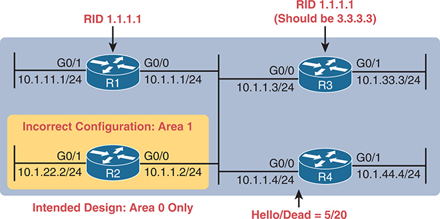

<figcaption>

<strong>图 24-1</strong> <em>阻止中心 LAN 上建立 OSPF 邻居关系的问题汇总</em>

<aside class="hidden" id="a24fig01">

网络设计包含四台路由器 R1、R2、R3 和 R4。R1 和 R3 具有唯一的路由器 ID（RID）：R1 的 RID 为 1.1.1.1，R3 的 RID 为 1.1.1.1（应为 3.3.3.3）。路由器通过接口互连。R1 的 G0/1 接口连接子网 10.1.11.1/24，G0/0 接口连接子网 10.1.1.1/24。R2 的 G0/1 接口连接子网 10.1.22.2/24，G0/0 接口连接子网 10.1.1.2/24，标注为“错误配置：区域 1；预期设计：仅区域 0”。R3 的 G0/0 接口连接子网 10.1.1.3/24，G0/1 接口连接子网 10.1.33.3/24。R4 的 G0/0 接口连接子网 10.1.1.4/24，并标有 Hello／Dead 为 5／20，G0/1 接口连接子网 10.1.44.4/24。 译注：原书这段隐藏说明与实际图 3-2 不符。图中是两栋建筑内的 R1、R2 及各自的局域网，以两个方向的双绞线电路示意跨越 1000 英里的租用线路，没有 OSPF 邻居配置。

</aside>

</figcaption>

</figure>

<strong>例 24-1</strong> <em>没有配置问题的路由器 R1 配置</em>

<a href="#code-f0613-01" id="f0613-01a">点击此处查看代码原图</a>

<pre class="pre-ex" tabindex="0"><code>router ospf 1

 router-id 1.1.1.1

!

 interface gigabitEthernet0/0

 ip address 10.1.1.1 255.255.255.0

 ip ospf 1 area 0

!

interface gigabitEthernet0/1

 ip address 10.1.11.1 255.255.255.0

 ip ospf 1 area 0</code></pre>

<section>

<h5 class="h5" id="ch24lev3sec1">发现区域不匹配</h5>

要制造区域不匹配，就需要在某台路由器上将接口配置到与设计不符的区域。<a href="#ch24fig01">图 24-1</a> 展示了在 R2 上故意制造这一错误的做法：将其两个接口放入区域 1，而不是区域 0。<a href="#exa24_2">例 24-2</a> 展示了该配置，语法正确（因此路由器接受配置），但区域号错误。

<strong>例 24-2</strong> <em>将应属于区域 0 的 R2 接口设为区域 1</em>

<a href="#code-f0613-02" id="f0613-02a">点击此处查看代码原图</a>

<pre class="pre-ex" tabindex="0"><code>router ospf 1

 router-id 2.2.2.2

!

interface gigabitEthernet0/0

 ip address 10.1.1.2 255.255.255.0

 ip ospf 1 area 1

!

interface gigabitEthernet0/1

 ip address 10.1.22.2 255.255.255.0

 ip ospf 1 area 1</code></pre>

存在区域不匹配错误时，<strong>show ip ospf neighbor</strong> 命令不会列出该邻居。由于在 OSPF 邻居表中看不到它，要排查此问题，就需要查找潜在相邻路由器上各接口的区域配置。方法如下：

<ul class="sq">

<li>
检查 <strong>show running-config</strong> 输出，查找：

<ul class="sq-i">

<li>
<strong>ip ospf</strong> <em>process-id</em> <strong>area</strong> <em>area-number</em> 接口子命令
</li>

<li>
OSPF 配置模式下的 <strong>network</strong> 命令
</li>

</ul></li>

<li>
使用 <strong>show ip ospf interface</strong> [<strong>brief</strong>] 命令列出区域号
</li>

</ul>

</section>

<section>

<h5 class="h5" id="ch24lev3sec2">发现重复的 OSPF 路由器 ID</h5>

接下来，<a href="#exa24_3">例 24-3</a> 展示了 R1 和 R3 都尝试使用 RID 1.1.1.1 的情况。由于 RID 重复，两台路由器都不会在 <strong>show ip ospf neighbor</strong> 命令输出中列出对方。有趣的是，两台路由器都会针对 R1 与 R3 之间重复的 OSPF RID 自动生成日志消息；<a href="#exa24_3">例 24-3</a> 的末尾展示了其中一条。对于考试，只需在 R3 和 R1 上分别使用 <strong>show ip ospf</strong> 命令，即可轻松列出各自的 RID，并发现两者使用相同的值。

<strong>例 24-3</strong> <em>比较 R1 和 R3 的 OSPF 路由器 ID</em>

<a href="#code-f0614-01" id="f0614-01a">点击此处查看代码原图</a>

<pre class="pre-ex" tabindex="0"><code>! Next, on R3: R3 lists the RID of 1.1.1.1

!

R3# <strong>show ip ospf</strong>

Routing Process "ospf 1" with ID 1.1.1.1

Start time: 00:00:37.136, Time elapsed: 02:20:37.200

! lines omitted for brevity</code></pre>

<pre class="pre-ex" tabindex="0"><code>! Back to R1: R1 also uses RID 1.1.1.1

R1# <strong>show ip ospf</strong>

Routing Process "ospf 1" with ID 1.1.1.1

Start time: 00:01:51.864, Time elapsed: 12:13:50.904

! lines omitted for brevity

*May 29 00:01:25.679: %OSPF-4-DUP_RTRID_NBR: OSPF detected duplicate router-id

1.1.1.1 from 10.1.1.3 on interface GigabitEthernet0/0</code></pre>

首先，关注问题本身：RID 重复。两台路由器的 <strong>show ip ospf</strong> 命令第一行，很快就显示出重复使用 1.1.1.1 的情况。假设 R1 应使用 1.1.1.1，而 R3 应使用其他 RID（例如 3.3.3.3），那么解决方法是修改 R3 的 RID 并重启 OSPF 进程。为此，使用 OSPF 子命令 <strong>router-id 3.3.3.3</strong> 和 EXEC 模式命令 <strong>clear ip ospf process</strong>。（只有通过命令或重载重启进程后，OSPF 才会开始使用新的 RID 值。）此时，两台路由器应重新成为邻居，并出现在 <strong>show ip ospf neighbor</strong> 命令的输出中。

注意

在某些情况下，不同区域中的路由器可以使用相同 RID，而不会导致 OSPF 问题。不过，为稳妥起见，应在整个 OSPF 域内（也就是企业中所有使用 OSPF 的路由器之间）使用唯一的 OSPF RID。

</section>

<section>

<h5 class="h5" id="ch24lev3sec3">发现 OSPF Hello 和 Dead 定时器不匹配</h5>

首先，回顾前面章节的内容：

<ul class="sq">

<li>
<strong>Hello 间隔／定时器：</strong> 逐接口的定时器，告诉路由器应多久在接口上发送一次 OSPF Hello 消息。
</li>

<li>
<strong>Dead 间隔／定时器：</strong> 逐接口的定时器，告诉路由器在没有收到邻居 Hello 的情况下，应等待多长时间才认为邻居发生故障。（默认是 Hello 定时器的四倍。）
</li>

</ul>

接着，考虑 R4 上制造的问题：它被配置为使用不同的 Hello 和 Dead 定时器值（分别为 5 和 20），而 R1、R2、R3 使用默认值（分别为 10 和 40）。Hello 或 Dead 间隔不匹配，会阻止 R4 与其他三台 OSPF 路由器中的任何一台成为邻居。路由器在 Hello 消息中列出自己的 Hello 和 Dead 间隔设置，如果数值不匹配，就选择不成为邻居。因此，本例中没有任何路由器能与 R4 成为邻居。

<a href="#exa24_4">例 24-4</a> 展示了发现不匹配最简单的方法：在 R1 和 R4 上都使用 <strong>show ip ospf interface</strong> 命令。该命令列出每个接口的 Hello 和 Dead 定时器，如示例中突出显示的内容。请注意，R1 使用 10 和 40（Hello 和 Dead），而 R4 使用 5 和 20。

<strong>例 24-4</strong> <em>发现不匹配的 Hello/Dead 定时器</em>

<a href="#code-f0615-01" id="f0615-01a">点击此处查看代码原图</a>

<pre class="pre-ex" tabindex="0"><code>R1# <strong>show ip ospf interface G0/0</strong>

GigabitEthernet0/0 is up, line protocol is up

  Internet Address 10.1.1.1/24, Area 0, Attached via Network Statement

  Process ID 1, Router ID 1.1.1.1, Network Type BROADCAST, Cost: 1

  Topology-MTID  Cost  Disabled  Shutdown   Topology Name

        0         1       no        no         Base

  Transmit Delay is 1 sec, State DR, Priority 1

  Designated Router (ID) 1.1.1.1, Interface address 10.1.1.1

  No backup designated router on this network

  Timer intervals configured, Hello 10, Dead 40, Wait 40, Retransmit 5

! lines omitted for brevity</code></pre>

<pre class="pre-ex" tabindex="0"><code>! Moving on to R4 next

!

R4# <strong>show ip ospf interface Gi0/0</strong>

GigabitEthernet0/0 is up, line protocol is up

   Internet Address 10.1.1.4/24, Area 0, Attached via Network Statement

   Process ID 4, Router ID 10.1.44.4, Network Type BROADCAST, Cost: 1

  Topology-MTID  Cost  Disabled  Shutdown   Topology Name

        0         1       no        no         Base

  Transmit Delay is 1 sec, State DR, Priority 1

  Transmit Delay is 1 sec, State DR, Priority 1

  Designated Router (ID) 10.1.44.4, Interface address 10.1.1.4

  No backup designated router on this network

  Timer intervals configured, Hello 5, Dead 20, Wait 20, Retransmit 5

! lines omitted for brevity</code></pre>

</section>

<section>

<h5 class="h5" id="ch24lev3sec4">关闭 OSPF 进程</h5>

类似于通过管理操作禁用和启用接口，IOS 也允许分别通过路由器模式子命令 <strong>shutdown</strong> 和 <strong>no shutdown</strong> 禁用和启用 OSPFv2 路由协议进程。关闭路由协议进程时，IOS 会执行以下操作：

<ul class="sq">

<li>
关闭所有邻居关系，并清空 OSPF 邻居表。
</li>

<li>
清空 LSDB。
</li>

<li>
从 IP 路由表中清除所有通过 OSPF 学到的路由。
</li>

</ul>

与此同时，关闭 OSPF 仍会保留一些重要的 OSPF 信息，具体包括：

<ul class="sq">

<li>
IOS 保留所有 OSPF 配置。
</li>

<li>
IOS 仍在 OSPF 接口列表（<strong>show ip ospf interface</strong>）中列出所有启用了 OSPF 的接口，但状态为 DOWN。
</li>

</ul>

关闭 OSPF 路由协议进程，可让网络工程师停止在该路由器上使用这一协议，而无须删除所有配置。进程关闭后，<strong>show ip ospf interface</strong> [<strong>brief</strong>] 命令和 <strong>show ip ospf</strong> 命令仍应列出一些输出，而其他命令则不列出任何内容。

<a href="#exa24_5">例 24-5</a> 展示了 <a href="#ch24fig02">图 24-2</a> 中路由器 R5 上的示例。R5 不同于前面示例使用的路由器，但在示例开始时，它有两个 OSPF 邻居 R2 和 R3，路由器 ID 分别为 2.2.2.2 和 3.3.3.3。示例展示了关闭 OSPF 进程、邻居关系失效，以及两条关键 OSPF <strong>show</strong> 命令的输出：<strong>show ip ospf neighbor</strong> 和 <strong>show ip ospf interface brief</strong>。

<figure class="image-c" id="ch24fig02">

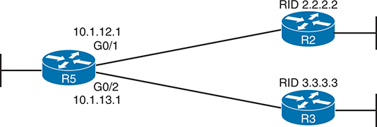

<figcaption>

<strong>图 24-2</strong> <em>用于演示关闭 OSPF 进程的示例网络</em>

<aside class="hidden" id="a24fig02">

网络由三台路由器 R5、R2 和 R3 组成。R5 同时连接 R2 和 R3，其中通过 IP 地址 10.1.12.1 和 G0/1 接口连接 R2，通过 IP 地址 10.1.13.1 和 G0/2 接口连接 R3。相连的两台路由器各有唯一的路由器 ID（RID）：R2 的 RID 为 2.2.2，R3 的 RID 为 3.3.3.3。 译注：原书这段隐藏说明与实际图 3-1 不符。图中是 PC1 和 PC2 所在的两个以太网局域网，通过 R1、R2 及一条租用线路广域网相连，没有 OSPF 或 R5。

</aside>

</figcaption>

</figure>

<strong>例 24-5</strong> <em>关闭 OSPF 进程及由此产生的邻居状态</em>

<a href="#code-f0616-01" id="f0616-01a">点击此处查看代码原图</a>

<pre class="pre-ex" tabindex="0"><code>R5# <strong>show ip ospf neighbor</strong>

Neighbor ID    Pri   State        Dead Time    Address         Interface

2.2.2.2          1   FULL/DR      00:00:35     10.1.12.2       GigabitEthernet0/1

3.3.3.3          1   FULL/DR      00:00:33     10.1.13.3       GigabitEthernet0/2

R5# <strong>configure terminal</strong>

Enter configuration commands, one per line. End with CNTL/Z.

R5(config)# <strong>router ospf 1</strong>

R5(config-router)# <strong>shutdown</strong>

R5(config-router)# <strong>^Z</strong>

*Mar 23 12:43:30.634: %OSPF-5-ADJCHG: Process 1, Nbr 2.2.2.2 on GigabitEthernet0/1

from FULL to DOWN, Neighbor Down: Interface down or detached

*Mar 23 12:43:30.635: %OSPF-5-ADJCHG: Process 1, Nbr 3.3.3.3 on GigabitEthernet0/2

from FULL to DOWN, Neighbor Down: Interface down or detached

R5# <strong>show ip ospf interface brief</strong>

Interface    PID    Area        IP Address/Mask   Cost  State Nbrs F/C

Gi0/1        1      0           10.1.12.1/24      1     DOWN  0/0

Gi0/2        1      0           10.1.13.1/24      1     DOWN  0/0

R5# <strong>show ip ospf</strong>

 Routing Process “ospf 1” with ID 5.5.5.5

 Start time: 5d23h, Time elapsed: 1d04h

 Routing Process is shutdown

! lines omitted for brevity

R5# <strong>show ip ospf neighbor</strong>

R5#

R5# <strong>show ip ospf database</strong>

            OSPF Router with ID (3.3.3.3) (Process ID 1)

R5#</code></pre>

首先，在 <strong>shutdown</strong> 之前，<strong>show ip ospf neighbor</strong> 命令列出两个邻居；在 <strong>shutdown</strong> 之后，相同命令不再列出任何邻居。其次，<strong>show ip ospf interface brief</strong> 命令列出本地路由器上启用了 OSPF 的接口，但状态为 DOWN，这里指的是本地路由器的状态。此外，<strong>show ip ospf</strong> 命令明确说明 OSPF 进程处于关闭状态，而 <strong>show ip ospf database</strong> 命令只输出标题行，没有任何 LSA。

</section>

<section>

<h5 class="h5" id="ch24lev3sec5">在接口上关闭 OSPF</h5>

IOS 还支持在接口上禁用 OSPF，而无须删除任何 OSPF 配置。该功能的目的与路由器配置模式下的 <strong>shutdown</strong> 命令相同：停止 OSPF，同时保留其配置。不过，在接口上关闭 OSPF，只会停止该接口上的所有 OSPF 操作，而不会停止整台路由器上的所有 OSPF 操作。

要在接口上关闭 OSPF，使用 <strong>ip ospf shutdown</strong> 接口子命令；要重新启用，使用 <strong>no ip ospf shutdown</strong> 命令。使用 <strong>ip ospf shutdown</strong> 后，路由器会发生以下变化：

<ul class="sq">

<li>
路由器停止在该接口上发送 Hello，使现有 OSPF 邻居关系超时。
</li>

<li>
邻居关系失效会触发 OSPF 重新收敛，从而删除所有将该接口用作出接口的路由。
</li>

<li>
路由器也停止通告被关闭链路上的子网。
</li>

</ul>

如果这些行为听起来很熟悉，那是因为该功能与 OSPF 被动接口非常相似，只是在关闭状态下，OSPF 还会停止通告直连子网。

有趣的是，使用 <strong>ip ospf shutdown</strong> 接口子命令，也不会改变某些接口相关命令的显示。例如，在 G0/0/0 接口配置 <strong>ip ospf shutdown</strong> 后，<strong>show ip ospf interface</strong> 和 <strong>show ip ospf interface brief</strong> 命令仍会在接口列表中显示 G0/0/0。

</section>

</section>

<section>

<h4 class="h4" id="ch24lev2sec3">允许建立邻居关系但阻止形成 IP 路由的问题</h4>

一些配置不匹配会阻止学习 OSPF 路由，但仍允许路由器成为邻居，如 <a href="#ch24tab02">表 24-2</a> 的最后一部分所述。这些问题是：

<ul class="sq">

<li>
MTU 设置不匹配

</li>

<li>
OSPF 网络类型不匹配
</li>

<li>
两个邻居均使用 OSPF 优先级 0
</li>

</ul>

接下来的几页将解释这些问题，并通过示例展示这三种错误配置及其对应的 <strong>show</strong> 命令输出。

<section>

<h5 class="h5" id="ch24lev3sec6">MTU 设置不匹配</h5>

最大传输单元（MTU）大小是一项逐接口设置，供路由器的第 3 层转发逻辑使用，用于定义路由器可通过各接口转发的最大网络层数据包。接口的 IPv4 MTU 大小规定路由器可通过该接口转发的最大 IPv4 数据包；类似地，IPv6 MTU 大小规定最大的 IPv6 数据包。

路由器通常使用默认的 1500 字节 IP MTU，也允许设置该值。<strong>ip mtu</strong> <em>size</em> 接口子命令定义 IPv4 MTU，<strong>ipv6 mtu</strong> <em>size</em> 命令为 IPv6 数据包设置对应值。

也可以使用 <strong>mtu</strong> <em>size</em> 接口子命令同时设置 IPv4 和 IPv6 的 MTU 大小。如果接口上没有 <strong>ip mtu</strong> <em>size</em> 命令，它就设置 IPv4 的 MTU；如果没有 <strong>ipv6 mtu</strong> <em>size</em> 命令，它就设置 IPv6 的 MTU。

IPv4 MTU 设置不同时，两台 OSPFv2 路由器可以成为 OSPF 邻居，但无法完成正常的 OSPF 数据库交换；它们会到达其他中间邻居状态，随后失效并变为 down。随着时间推移，两者会反复成为邻居、尝试交换 LSDB、失败，再退回 down 状态。

</section>

<section>

<h5 class="h5" id="ch24lev3sec7">OSPF 网络类型不匹配</h5>

在 <a href="v1-23.html#ch23">第 23 章</a>“<a href="v1-23.html#ch23">实现可选的 OSPF 功能</a>”的“<a href="v1-23.html#ch23lev1sec3">OSPF 网络类型</a>”一节中，你了解了使用 DR/BDR 的 OSPF 广播网络类型，以及不使用 DR/BDR 的 OSPF 点到点网络类型。有趣的是，如果错误配置网络类型，使一台路由器使用 broadcast，另一台使用 point-to-point，两者仍会成为邻居并达到 full 状态。它们会稳定地保持 full 状态，说明已交换 LSDB；不过，两台路由器都无法使用基于从对方学到的 LSA 所形成的路由。

不添加这些路由的原因，与 LSA 的细节以及使用或不使用 DR 如何改变 LSA 有关。基本上，两台路由器期望 LSA 中具有不同的细节，SPF 算法在计算路由时发现这些差异，却无法消解它们。

</section>

<section>

<h5 class="h5" id="ch24lev3sec8">两个邻居均使用 OSPF 优先级 0</h5>

使用广播网络类型时，OSPF 接口优先级可用来影响哪台路由器赢得 DR 或 BDR 选举。优先级最高的路由器胜出，默认值为 1，允许的十进制取值范围为 0 到 255。

优先级 0 是一种特殊情况，表示路由器不会充当 DR 或 BDR。例如，在多台路由器共享同一子网的拓扑中，可以让某些路由器使用优先级 0，实际效果是拒绝成为 DR 或 BDR，从而使网络运行更可预测。

如果作出不合理的配置选择，让子网上的所有路由器都使用优先级 0，就会产生问题。此时，子网必须有一台 DR，却没有任何路由器愿意承担该角色。路由器照常使用 Hello 相互发现，彼此列为邻居，并达到 2WAY 状态。但是，由于没有路由器充当 DR，数据库交换过程就在此停止。典型症状是邻居稳定地处于 2WAY/DROTHER 状态。

</section>

<section>

<h5 class="h5" id="ch24lev3sec9">存在 OSPF 邻居但没有路由的示例</h5>

<a href="#ch24fig03">图 24-3</a> 展示了后续示例使用的路由器拓扑。本例中，R1 采用不合理的配置选择，导致前几页讨论的问题。具体如下：

<strong>R1 G0/0/1：</strong> 使用 point-to-point 网络类型；R2 使用默认的 broadcast 设置。

<strong>R1 G0/0/2：</strong> 使用 1600 的 IPv4 MTU；R3 使用默认值 1500。

<strong>R1 G0/0/3：</strong> R1 和 R4 都使用 OSPF 优先级 0。

<figure class="image-c" id="ch24fig03">

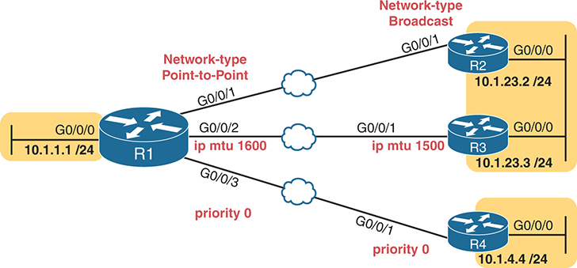

<figcaption>

<strong>图 24-3</strong> <em>OSPF 配置错误：已建立邻居关系，但未学到路由</em>

<aside class="hidden" id="a24fig03">

网络基础设施由四台路由器 R1 至 R4 组成。R1 的 G0/0/0 接口连接到子网 10.1.1.1/24。R1 的 G0/0/1 接口（网络类型 Point-to-Point）通过以太网 WAN 连接 R2 的 G0/0/1 接口（网络类型 Broadcast）。R2 通过 G0/0/0 接口连接子网 10.1.23.2/24。另外，R1 的 G0/0/2 接口（ip mtu 1600）通过以太网 WAN 连接 R3 的 G0/0/1 接口（ip mtu 1500）。R3 通过 G0/0/0 接口连接子网 10.1.23.3/24。最后，R1 的 G0/0/3 接口（priority 0）通过以太网 WAN 连接 R4 的 G0/0/1 接口（priority 0）。R4 通过 G0/0/0 接口连接子网 10.1.4.4/24。

</aside>

</figcaption>

</figure>

首先，<a href="#exa24_6">例 24-6</a> 展示了导致图中问题的 R1 配置。R2、R3 和 R4 对这些参数都使用默认配置，只有 R4 例外，它也需要 <strong>ip ospf priority 0</strong> 接口子命令。示例仅显示相关配置。

<a href="#exa24_7">例 24-7</a> 展示了结果。首先注意，R2、R3 和 R4 使用的 OSPF RID 分别为 2.2.2.2、3.3.3.3 和 4.4.4.4。示例首先在邻居关系达到各自最佳状态时执行 <strong>show ip ospf neighbor</strong> 命令。

<strong>例 24-6</strong> <em>与 <a href="#ch24fig03">图 24-3</a> 对应的 OSPF 配置设置</em>

<a href="#code-f0620-01" id="f0620-01a">点击此处查看代码原图</a>

<pre class="pre-ex" tabindex="0"><code>R1# <strong>show running-config interface g0/0/1</strong>

! Neighboring router R2 defaults to network type broadcast

interface GigabitEthernet0/0/1

 ip address 10.1.12.1 255.255.255.0

 ip ospf network point-to-point

 ip ospf 1 area 0

R1# <strong>show running-config interface g0/0/2</strong>

! Neighboring router R3 defaults to IP MTU 1500

interface GigabitEthernet0/0/2

 ip address 10.1.13.1 255.255.255.0

 ip mtu 1600

 ip ospf 1 area 0

R1# <strong>show running-config interface g0/0/3</strong>

! Neighboring router R4 is also configured for OSPF priority 0

interface GigabitEthernet0/0/3

 ip address 10.1.14.1 255.255.255.0

 ip ospf priority 0

 ip ospf 1 area 0</code></pre>

<strong>例 24-7</strong> <em>路由器 R1 上产生的 OSPF 邻居关系</em>

<a href="#code-f0620-02" id="f0620-02a">点击此处查看代码原图</a>

<pre class="pre-ex" tabindex="0"><code>R1# <strong>show ip ospf neighbor</strong>

Neighbor ID     Pri   State           Dead Time   Address      Interface

4.4.4.4           0   2WAY/DROTHER    00:00:38    10.1.14.4    GigabitEthernet0/0/3

3.3.3.3           0   EXCHANGE/DROTHER00:00:38    10.1.13.3    GigabitEthernet0/0/2

2.2.2.2           0   FULL/  -        00:00:39    10.1.12.2    GigabitEthernet0/0/1

R1#

*Nov  2 21:38:34.046: %OSPF-5-ADJCHG: Process 1, Nbr 3.3.3.3 on GigabitEthernet0/0/2

from EXCHANGE to DOWN, Neighbor Down: Too many retransmissions

R1# <strong>show ip ospf neighbor</strong>

Neighbor ID     Pri   State           Dead Time   Address      Interface

4.4.4.4           0   2WAY/DROTHER    00:00:31    10.1.14.4    GigabitEthernet0/0/3

3.3.3.3           0   DOWN/DROTHER       -        10.1.13.3    GigabitEthernet0/0/2

2.2.2.2           0   FULL/  -        00:00:34    10.1.12.2    GigabitEthernet0/0/1</code></pre>

本例中，R1 与 R3（3.3.3.3）的邻居关系在不同状态之间循环。示例中间显示了有关该邻居关系如何失效的消息，末尾则显示邻居 3.3.3.3 现处于 DOWN 状态。随着时间推移，该邻居关系会不断重复尝试。

请注意，这三对邻居关系都没有产生任何 IP 路由。本例中，R1 上的 <strong>show ip route ospf</strong> 命令列出的路由数为零。

</section>

</section>

</section>

<section>

<h3 class="h3" id="ch24lev1sec4">路由选择</h3>

OSPF 计算到某个子网的路由时，路由之间的竞争可能简单明了。路由器可能只为子网计算出一条路由，随后使用它；也可能计算出多条到达该子网的路由，于是找出度量值（开销）最低的路由，将其放入 IP 路由表。

不过，在 OSPF 内部和外部还会出现其他情况，需要更深入理解路由器所用的逻辑。本章最后一大节讨论三个主题，引导我们思考：

<ol class="number">

<li>
一台路由器如何在到同一子网的多条等价 OSPF 路由之间作出选择。
</li>

<li>
一台路由器如何在由不同路由协议学到的、到同一子网的多条路由之间作出选择。
</li>

<li>
转发数据包时，路由器如何匹配路由表中的路由，尤其是数据包的目的地址匹配多条路由时。
</li>

</ol>

<section>

<h4 class="h4" id="ch24lev2sec4">OSPF 等价多路径路由</h4>

考虑一台 OSPF 路由器为某个目的子网计算的路由。如果到该子网有多条路由，而其中一条的度量值最低，那么 OSPF 的逻辑很简单：将该路由加入 IP 路由表。但是，如果到同一子网的多条路由具有相同的度量值，路由器就采用不同的逻辑：将多条<a id="key_264" href="#ref-gloss_125">等价路由（equal-cost routes）</a>放入路由表。

IOS 根据 <strong>router ospf</strong> 下的 <strong>maximum-paths</strong> <em>number</em> 子命令，限制每个目的子网同时存在的等价 OSPF 路由数量。默认值随路由器平台而异，常见的默认设置是同时保留四条路由。

例如，考虑最近的 <a href="#ch24fig03">图 24-3</a>，但修复所有配置错误，使所有路由器都学到所有子网的路由。R1 到 R4 所连接的子网 10.1.4.0/24 只有一条可能路由。不过，R1 到子网 10.1.23.0/24 有两条可能路由：一条经过邻居 R2，另一条经过邻居 R3。如果所有 GigabitEthernet 接口的 OSPF 开销都为 10，那么 R1 到子网 10.1.23.0/24 的两条路由开销都为 20。<a href="#exa24_8">例 24-8</a> 通过列出 R1 上通过 OSPF 学到的路由，展示了这一结果。

请再仔细观察输出的最后两行。注意，输出没有重复列出子网 ID 和掩码，只列出一次，最后一行的对应位置留空。这种格式有助于识别同一子网有多条路由的情况。此外，方括号中的第二个数字是度量值，两条路由均为 20，确认它们的度量值（开销）相同。

<strong>例 24-8</strong> <em><a href="#ch24fig03">图 24-3</a> 中路由器 R1 上的 OSPF 路由</em>

<a href="#code-f0622-01" id="f0622-01a">点击此处查看代码原图</a>

<pre class="pre-ex" tabindex="0"><code>R1# <strong>show ip route ospf</strong>

! Legend omitted for brevity

Gateway of last resort is not set

      10.0.0.0/8 is variably subnetted, 14 subnets, 2 masks

O        10.1.4.0/24 [110/20] via 10.1.14.4, 00:00:17, GigabitEthernet0/0/3

O        10.1.23.0/24 [110/20] via 10.1.13.3, 00:00:20, GigabitEthernet0/0/2

                      [110/20] via 10.1.12.2, 00:00:23, GigabitEthernet0/0/1</code></pre>

现在，把注意力从将路由放入路由表的逻辑转向数据包转发。对于到子网 10.1.23.0/24 的两条路由，R1 应使用哪一条？它应如何利用这两条等价路由？路由器可以逐包进行负载均衡，但由于几个原因，这不是好的选择。默认情况下，路由器按各个目的地址进行负载均衡：发往某个目的 IP 地址的数据包走一条路由，发往另一个目的地址的数据包走另一条路由，依此类推。基于目的地址的负载均衡可显著降低路由器开销，并避免逐包负载均衡引发的某些问题。

注意

本节介绍的逻辑通常称为<a id="key_263" href="#ref-gloss_124">等价多路径（equal-cost multipath，ECMP）</a>。

</section>

<section>

<h4 class="h4" id="ch24lev2sec5">从相互竞争的来源学到多条路由</h4>

典型的企业路由器首先根据接口 IP 地址学习直连路由。这些路由恰好是到达相应子网的最佳路由，因为子网直接连接到路由器。此外，每台企业路由器使用一种路由协议（例如 OSPF）动态学习其他所有路由。

不过，在一些合理场景中，路由器学习路由的来源不止直连路由和一种路由协议。例如，某些路由器还具有静态路由，如 <a href="v1-17.html#ch17">第 17 章</a>“<a href="v1-17.html#ch17">配置 IPv4 地址和静态路由</a>”所述。路由器配置可能定义一条到某个子网的静态路由，同时 IGP 也学到一条到同一子网的路由。哪条更好？在其他情况下，一台路由器可能同时运行 OSPF 和 BGP。如果两者都学到同一子网的路由，哪条更好？或者路由器可能使用多个 IGP，例如同时使用 OSPF 和 EIGRP。两者同样可能学到同一子网的路由，从而引出相同的问题。

注意

要认为两条路由通向同一子网，它们必须具有相同的子网 ID 和子网掩码。

在这些情况下，路由协议度量值无法帮助路由器在相互竞争的路由之间作出选择。例如，EIGRP 通常采用数百万或数十亿的度量值，而 OSPF 则使用数百或数千。此外，直连路由和静态路由没有度量值。因此，此时度量值无法帮助路由器选择最佳路由，IOS 需要另一种方法在不同来源的路由之间作出选择。

当 IOS 必须在使用不同路由协议学到的路由之间选择时，会使用称为<a id="key_262" href="#ref-gloss_216">管理距离（administrative distance）</a>的概念。管理距离（AD）是一个数字，表示在单台路由器上整个路由协议的可信程度。数值越小，路由协议越优或越可信。例如，RIP 的默认管理距离为 120，OSPF 为 110，EIGRP 为 90。同时使用 OSPF 和 EIGRP 时，路由器会相信 EIGRP 路由而不是 OSPF 路由（至少默认如此）。管理距离值在单台路由器上配置，不与其他路由器交换。<a href="#ch24tab04">表 24-4</a> 列出了各种路由信息来源及其默认管理距离。

<figure class="table" id="ch24tab04" tabindex="0">

<figcaption>

<strong>表 24-4</strong> 默认管理距离

</figcaption>

<table class="all">

<thead>

<tr>

<th class="th">
路由类型
</th>

<th class="th">
管理距离
</th>

</tr>

</thead>

<tbody>

<tr>

<td class="border">
直连
</td>

<td class="border">
0
</td>

</tr>

<tr>

<td class="border">
静态
</td>

<td class="border">
1
</td>

</tr>

<tr>

<td class="border">
BGP（外部路由 [eBGP]）
</td>

<td class="border">
20
</td>

</tr>

<tr>

<td class="border">
EIGRP（内部路由）
</td>

<td class="border">
90
</td>

</tr>

<tr>

<td class="border">
OSPF
</td>

<td class="border">
110
</td>

</tr>

<tr>

<td class="border">
IS-IS
</td>

<td class="border">
115
</td>

</tr>

<tr>

<td class="border">
RIP
</td>

<td class="border">
120
</td>

</tr>

<tr>

<td class="border">
EIGRP（外部路由）
</td>

<td class="border">
170
</td>

</tr>

<tr>

<td class="border">
BGP（内部路由 [iBGP]）
</td>

<td class="border">
200
</td>

</tr>

<tr>

<td class="border">
DHCP 默认路由
</td>

<td class="border">
254
</td>

</tr>

<tr>

<td class="border">
不可用
</td>

<td class="border">
255
</td>

</tr>

</tbody>

</table>

</figure>

注意

<strong>show ip route</strong> 命令在方括号中的两个数字中，将第一个列为该路由的管理距离，第二个列为度量值。

<a href="#ch24fig04">图 24-4</a> 展示了各路由进程内部可能发生的情况，以及优先选择 EIGRP 路由而不是 OSPF 路由的过程。左侧显示 OSPF 学到三条到子网 10.1.1.0/24 的路由，EIGRP 则学到两条到同一子网的路由。每种路由协议选择度量值最低的路由，作为自己提供的最佳路由。不过，还要经过一个额外的逻辑步骤，比较路由的管理距离（AD）。使用默认设置时，路由器会为子网 10.1.1.0/24 选择 EIGRP（AD 90）路由，而不是 OSPF（AD 110）路由。

你可能会疑惑，为什么要使用不止一种路由协议。一种典型情况是两家公司合并成一家公司，如 <a href="#ch24fig05">图 24-5</a> 所示。左侧的公司 A 使用 EIGRP，地址来自私有网络 10.0.0.0；右侧的公司 B 使用 OSPF，地址来自私有网络 172.16.0.0。连接两个网络的第一步，是网络工程师在 A1 与 B1 之间、A2 与 B2 之间安装新的 WAN 链路，如图所示。

<figure class="image-c" id="ch24fig04">

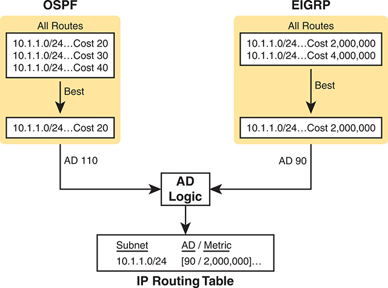

<figcaption>

<strong>图 24-4</strong> <em>逻辑：在 OSPF 与 EIGRP 之间选择 AD 最低的路由</em>

<aside class="hidden" id="a24fig04">

左侧的 OSPF 协议 AD 为 110，有三条带 IP 地址的路由，开销分别为 20、30 和 40，其中开销 20 的路由被选为最佳路由。右侧的 EIGRP 协议 AD 为 90，有两条带 IP 地址的路由，开销分别为 2,000,000 和 4,000,000，其中开销 2,000,000 的路由被选为最佳路由。中央的 AD 逻辑比较这两条最佳路由，并为 IP 路由表选择 EIGRP 路由。

</aside>

</figcaption>

</figure>

接下来，路由器需要学习两家公司的路由。左侧的 EIGRP 路由器需要学习右侧 OSPF 已知的公司 B 路由，反之亦然。为此，网络人员使用称为<em>路由重分发（route redistribution）</em>的功能，让<em>少量路由器同时运行两种路由协议</em>。在这些路由器内部执行重分发（从一种协议获取路由并通告给另一种协议）：获取 OSPF 路由，通过 EIGRP 通告这些子网，反方向也一样。

<figure class="image-c" id="ch24fig05">

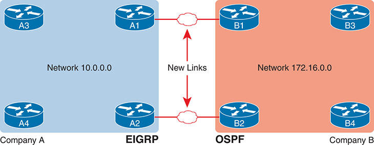

<figcaption>

<strong>图 24-5</strong> <em>第一步：在公司 A 和 B 的现有路由器之间添加 WAN 链路</em>

<aside class="hidden" id="a24fig05">

公司 A 使用 EIGRP 协议，其网络标为 10.0.0.0，包含路由器 A1 至 A4。公司 B 使用 OSPF 协议，其网络标为 172.16.0.0，包含路由器 B1 至 B4。新的 WAN 链路表示在公司 A 的 A2 与公司 B 的 B2 之间，以及公司 A 的 A1 与公司 B 的 B1 之间建立了连接。

</aside>

</figcaption>

</figure>

<a href="#ch24fig06">图 24-6</a> 展示了更新后的场景，由 A1 和 A2 执行路由重分发。大多数路由器仍只运行 OSPF 或只运行 EIGRP；本例中，B1、B2、B3 和 B4 继续仅使用 OSPF，A3 和 A4 仅使用 EIGRP。不过，A1 和 A2 上的重分发过程会通告路由，使所有路由器都学到网络 10.0.0.0 和 172.16.0.0 内所有子网的路由。

<figure class="image-c" id="ch24fig06">

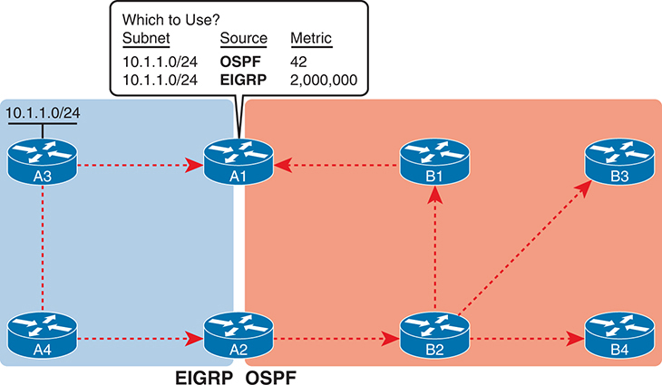

<figcaption>

<strong>图 24-6</strong> <em>示例：路由器 A1 学到一条到子网 10.1.1.0/24 的 EIGRP 路由和一条 OSPF 路由</em>

<aside class="hidden" id="a24fig06">

示意图分为两部分：一部分标为“EIGRP”，包含路由器 A1、A2、A3（IP 地址 10.1.1.0/24）和 A4；另一部分标为“OSPF”，包含路由器 B1、B2、B3 和 B4。A1 位于两部分之间，图中展示它从两个网络学习路由。A1 旁有一张题为“使用哪条？”的表，比较了到达子网 10.1.1.0/24 的 OSPF 度量值（42）和 EIGRP 度量值（2,000,000）。

</aside>

</figcaption>

</figure>

图中使用虚线表示有关子网 10.1.1.0/24 的路由信息传播过程。首先看左侧，原公司 A 的四台 EIGRP 路由器都通过 EIGRP 学到到子网 10.1.1.0/24 的路由。接着，沿图底部的虚线观察，A2 将到 10.1.1.0/24 的路由重分发到 OSPF。所有 OSPF 路由器都通过 OSPF 学到到 10.1.1.0/24 的路由。现在 A1 既有通过 EIGRP 学到的到子网 10.1.1.0/24 的路由，又有通过 OSPF 学到的另一条路由，这就构成了一个必须使用管理距离的实际场景。

注意

CCNP Enterprise 认证讨论路由重分发的概念和配置，而 CCNA V1.1 考试大纲不包含这些内容。这里提到它，只是为了展示路由器需要使用管理距离的一个现实场景。

注意

<a href="v1-17.html#ch17">第 17 章</a> 的“<a href="v1-17.html#ch17lev2sec9">浮动静态路由</a>”一节讨论了路由器利用 AD 选择路由的另一个示例。如果不记得细节，请花一点时间回顾该节。

</section>

<section>

<h4 class="h4" id="ch24lev2sec6">使用最长前缀匹配进行 IP 转发</h4>

本章最后几页关注路由器如何将数据包的目的 IP 地址与路由表中已有的某条路由匹配。这一过程有几个名称，如 <em>IP 路由</em>、<em>转发</em>或<em>数据平面</em>。无论叫什么，都应关注其逻辑。

路由器的 IP 路由过程要求它将每个数据包的目的 IP 地址与自身 IP 路由表中的现有内容比较。很多时候，只有一条路由匹配某个目的地址。当只有一条路由匹配数据包目的地时，操作很明确：根据该路由列出的详细信息转发数据包。

某些情况下，到完全相同的子网存在多条路由，也就是子网和掩码完全相同。前面的“<a href="#ch24lev2sec4">OSPF 等价多路径路由</a>”一节讨论了 OSPF 如何选择将这些多条路由加入路由表，以及路由器如何对匹配这些路由的数据包进行负载均衡。

本节讨论另一种情况：一组路由列出不同子网，而这些子网的地址范围重叠。此时，某些数据包的目的地址会匹配 IP 路由表中的多条路由。例如，一条路由可能列出子网 10.1.0.0/16，另一条列出 10.1.1.0/25，还有一条列出 10.1.1.1/32。每个子网的地址范围都包含 10.1.1.1，因此，发往 IP 地址 10.1.1.1 的数据包会匹配这些全部路由。

许多正常的路由器功能都可能让路由表中出现这些重叠的路由，包括：

<ul class="sq">

<li>
静态路由（包括主机路由）
</li>

<li>
路由自动汇总
</li>

<li>
手动路由汇总
</li>

<li>
默认路由
</li>

</ul>

在这种情况下，路由器按以下方式选择最佳路由：

当某个目的 IP 地址匹配路由器 IPv4 路由表中的多条路由，且这些路由列出的是不同子网而不是相同子网（子网 ID 和掩码不同）时，路由器使用<a id="key_265" href="#ref-gloss_246">最长前缀匹配（longest prefix match）</a>逻辑，匹配最具体的路由，也就是掩码前缀长度最长的路由。

<section>

<h5 class="h5" id="ch24lev3sec10">使用子网计算技能预测最佳路由选择</h5>

预测路由器使用哪条路由的一种方法，是结合子网划分技能与 <strong>show ip route</strong> 命令的输出。为了展示其工作方式，接下来的示例使用 <a href="#ch24fig07">图 24-7</a> 中 R1 学到的几条重叠路由。<a href="#exa24_9">例 24-9</a> 关注匹配 PC D 的 IP 地址（172.16.10.4）的路由，该地址匹配 R1 上的四条路由。

<figure class="image-c" id="ch24fig07">

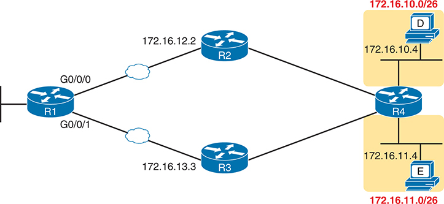

<figcaption>

<strong>图 24-7</strong> <em><a href="#exa24_9">例 24-9</a> 使用的拓扑、接口和下一跳地址</em>

<aside class="hidden" id="a24fig07">

网络拓扑中有四台路由器 R1、R2、R3 和 R4。R1 分别通过 G0/0/0 接口（IP 地址 172.16.12.2）和 G0/0/1 接口（IP 地址 172.16.13.3）连接 R2 和 R3。R2 和 R3 连接到 R4，R4 又连接到两个标为主机 D 和 E 的额外下一跳地址，其 IP 地址分别为 172.16.10.4/26 和 172 .16 .11 .4/26。

</aside>

</figcaption>

</figure>

<strong>例 24-9</strong> <em>包含重叠路由的 <strong>show ip route</strong> 命令输出</em>

<a href="#code-f0627-01" id="f0627-01a">点击此处查看代码原图</a>

<pre class="pre-ex" tabindex="0"><code>R1# <strong>show ip route</strong>

Codes: L - local, C - connected, S - static, R - RIP, M - mobile, B - BGP

       D - EIGRP, EX - EIGRP external, O - OSPF, IA - OSPF inter area

       N1 - OSPF NSSA external type 1, N2 - OSPF NSSA external type 2

       E1 - OSPF external type 1, E2 - OSPF external type 2

       i - IS-IS, su - IS-IS summary, L1 - IS-IS level-1, L2 - IS-IS level-2

       ia - IS-IS inter area, * - candidate default, U - per-user static route

       o - ODR, P - periodic downloaded static route, H - NHRP, l - LISP

       + - replicated route, % - next hop override

Gateway of last resort is 172.16.13.3 to network 0.0.0.0

O*E2  0.0.0.0/0 [110/1] via 172.16.13.3, 00:04:56, GigabitEthernet0/1

      172.16.0.0/16 is variably subnetted, 12 subnets, 4 masks

S        172.16.10.4/32 [1/0] via 172.16.12.2

O IA     172.16.10.0/26 [110/3] via 172.16.13.3, 00:04:56, GigabitEthernet0/0/1

O IA     172.16.10.0/23 [110/6] via 172.16.12.2, 00:04:56, GigabitEthernet0/0/0

O IA     172.16.11.0/26 [110/3] via 172.16.13.3, 00:04:56, GigabitEthernet0/0/1

! Non-overlapping routes omitted for brevity</code></pre>

在考试或实际工作中，你需要查看每条路由的子网 ID 和掩码，并计算出各子网的地址范围。<a href="#ch24tab05">表 24-5</a> 给出计算结果，以免数学计算影响你理解概念。表中列出的所有子网都匹配目的地址 172.16.10.4（PC D）。

<figure class="table" id="ch24tab05" tabindex="0">

<figcaption>

<strong>表 24-5</strong> <a href="#exa24_9">例 24-9</a> 中各子网的地址范围分析

</figcaption>

<table class="all">

<thead>

<tr>

<th class="th">
路由的子网／前缀
</th>

<th class="th">
地址范围
</th>

<th class="th">
下一跳
</th>

</tr>

</thead>

<tbody>

<tr>

<td class="border">
172.16.10.4/32
</td>

<td class="border">
172.16.10.4（仅此一个地址）
</td>

<td class="border">
172.16.12.2（R2）
</td>

</tr>

<tr>

<td class="border">
172.16.10.0/26
</td>

<td class="border">
172.16.10.0–172.16.10.63
</td>

<td class="border">
172.16.13.3（R3）
</td>

</tr>

<tr>

<td class="border">
172.16.10.0/23
</td>

<td class="border">
172.16.10.0–172.16.11.255
</td>

<td class="border">
172.16.12.2（R2）
</td>

</tr>

<tr>

<td class="border">
0.0.0.0/0
</td>

<td class="border">
0.0.0.0–255.255.255.255（所有地址）
</td>

<td class="border">
172.16.13.3（R3）
</td>

</tr>

</tbody>

</table>

</figure>

注意

列为 0.0.0.0/0 的路由就是默认路由。

逐步分析这一逻辑，注意数据包目的地址 172.16.10.4 匹配 <a href="#exa24_9">例 24-9</a> 中突出显示的所有路由（这些路由也列在 <a href="#ch24tab05">表 24-5</a> 中）。各前缀长度（掩码）从 /0 到 /32 不等。最长前缀（最大的 /P 值，表示最佳、最具体的路由）为 /32。因此，发往 172.16.10.4 的数据包使用到 172.16.10.4/32 的路由，而不是其他路由。

再思考几个示例会有帮助。下列项目给出其他目的地址，并解释路由器为什么匹配 <a href="#exa24_9">例 24-9</a> 中的某条具体路由。

<strong>172.16.10.4：</strong> PC D。匹配全部四条突出显示的路由；最长前缀为 /32，即到路由器 172.16.10.4/32 的路由。

<strong>172.16.10.1：</strong> PC D 所在子网中的另一个主机。此目的地址匹配默认路由（前缀长度 0）以及前缀长度为 /23 和 /26 的路由。R1 使用子网 172.16.10.0/26 的 /26 路由。

<strong>172.16.10.100：</strong> 根据 <a href="#ch24tab05">表 24-5</a>，该地址位于 /23 路由的地址范围内，并且一如既往地匹配默认路由。R1 使用子网 172.16.10.0/23 的路由，前缀长度为 /23。

<strong>172.16.12.1：</strong> 仅匹配前缀长度为 /0 的默认路由。

</section>

<section>

<h5 class="h5" id="ch24lev3sec11">使用 show ip route <em>address</em> 查找最佳路由</h5>

确定路由器所用路由的第二种方法，不需要任何子网计算技能。直接使用 <strong>show ip route</strong> <em>address</em> 命令，并以数据包的目的 IP 地址作为命令的最后一个参数。路由器会列出向该地址转发数据包时使用的路由。

例如，<a href="#exa24_10">例 24-10</a> 列出了在 <a href="#exa24_9">例 24-9</a> 所用的同一台路由器上执行 <strong>show ip route 172.16.10.1</strong> 命令的输出。第一行突出显示的输出列出匹配的路由：到 172.16.10.0/26 的路由。其余输出列出该路由的详细信息，包括出接口 GigabitEthernet0/0/1 和下一跳路由器 172.16.13.3。

<strong>例 24-10</strong> <em>包含重叠路由的 <strong>show ip route</strong> 命令输出</em>

<a href="#code-f0628-01" id="f0628-01a">点击此处查看代码原图</a>

<pre class="pre-ex" tabindex="0"><code>R1# <strong>show ip route 172.16.10.1</strong>

Routing entry for 172.16.10.0/26

  Known via "ospf 1", distance 110, metric 3, type inter area

  Last update from 172.16.13.3 on GigabitEthernet0/0/1, 00:44:09 ago

  Routing Descriptor Blocks:

  * 172.16.13.3, from 3.3.3.3, 00:44:09 ago, via GigabitEthernet0/0/1

      Route metric is 3, traffic share count is 1</code></pre>

当然，在考试中回答实验题时，应使用此命令，因为它可以直接告诉你路由器会如何选择，而不需要自行进行子网计算。

</section>

<section>

<h5 class="h5" id="ch24lev3sec12">解读 IP 路由表</h5>

在连续三个介绍 IP 与 IP 路由的部分结束之际、转入 <a data-original-href="vol1_part07.xhtml#part07" data-unavailable="true" title="此内容不在当前提取范围内；请参阅原始 EPUB：vol1_part07.xhtml#part07">第七部分</a>“<a data-original-href="vol1_part07.xhtml#part07" data-unavailable="true" title="此内容不在当前提取范围内；请参阅原始 EPUB：vol1_part07.xhtml#part07">IP 版本 6</a>”之前，最后这个主题回顾贯穿讨论的最关键路由器命令：<strong>show ip route</strong>。你已经通过许多示例了解了该命令输出的各个组成部分。本章最后的主题将这些概念集中整理，便于参考和学习。

<a href="#ch24fig08">图 24-8</a> 展示了一份 <strong>show ip route</strong> 命令的示例输出。图中为输出的各个部分编号，便于查阅；<a href="#ch24tab06">表 24-6</a> 描述各编号对应的输出。

<figure class="image-c" id="ch24fig08">

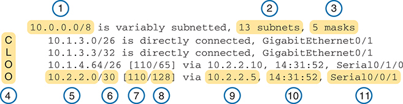

<figcaption>

<strong>图 24-8</strong> <em><strong>show ip route</strong> 命令输出参考</em>

<aside class="hidden" id="a24fig08">

输出显示 IP 地址“10.0.0.0/8”采用可变子网划分，有 13 个子网和 5 种掩码。它还显示“10.1.3.0/26”直接连接到 GigabitEthernet0/1，“10.1.3.3/32”也直接连接到 GigabitEthernet0/1。输出指出，“10.1.4.64/26”的度量值为 [110/65]，通过另一个 IP 地址路由，时间戳为“14:31:52”，连接接口为 Serial0/1/0。最后，“10.2.2.0/30”的度量值为 [110/128]，通过另一个 IP 地址路由，时间戳为“14:31:52”，连接接口为 Serial0/0/1。左侧显示图例代码 C、L、O、O。

</aside>

</figcaption>

</figure>

<figure class="table" id="ch24tab06" tabindex="0">

<figcaption>

<strong>表 24-6</strong> <strong>show ip route</strong> 命令输出说明（参见 <a href="#ch24fig08">图 24-8</a>）

</figcaption>

<table class="all">

<thead>

<tr>

<th class="th">
项目
</th>

<th class="th">
含义
</th>

<th class="th">
图中的值
</th>

<th class="th">
说明
</th>

</tr>

</thead>

<tbody>

<tr>

<td class="border">
1
</td>

<td class="border">
分类网络
</td>

<td class="border">
10.0.0.0/8
</td>

<td class="border">
路由表按分类网络组织。这一行是分类网络 10.0.0.0 的标题行，列出 A 类网络的默认掩码（/8）。
</td>

</tr>

<tr>

<td class="border">
2
</td>

<td class="border">
子网数量
</td>

<td class="border">
13 个子网
</td>

<td class="border">
此路由器从所有来源获知的、属于该分类网络子网的路由数量，包括本地路由，也就是匹配路由器各接口 IP 地址的 /32 路由。
</td>

</tr>

<tr>

<td class="border">
3
</td>

<td class="border">
掩码数量
</td>

<td class="border">
5 种掩码
</td>

<td class="border">
此路由器已知的、属于该分类网络的全部路由所使用的不同掩码数量。
</td>

</tr>

<tr>

<td class="border">
4
</td>

<td class="border">
图例代码
</td>

<td class="border">
C、L、O
</td>

<td class="border">
用于标识路由信息来源的简短代码。<em>O</em> 表示 OSPF，<em>D</em> 表示 EIGRP，<em>C</em> 表示直连，<em>S</em> 表示静态，<em>L</em> 表示本地。（图例示例参见 <a href="#exa24_11">例 24-11</a>。）
</td>

</tr>

<tr>

<td class="border">
5
</td>

<td class="border">
前缀（子网 ID）
</td>

<td class="border">
10.2.2.0
</td>

<td class="border">
这条具体路由的子网号。
</td>

</tr>

<tr>

<td class="border">
6
</td>

<td class="border">
前缀长度（掩码）
</td>

<td class="border">
/30
</td>

<td class="border">
与该子网一起使用的前缀掩码。
</td>

</tr>

<tr>

<td class="border">
7
</td>

<td class="border">
管理距离
</td>

<td class="border">
110
</td>

<td class="border">
如果路由器从多个路由信息来源学到所列子网的路由，就会使用管理距离（AD）最低的来源。
</td>

</tr>

<tr>

<td class="border">
8
</td>

<td class="border">
度量值
</td>

<td class="border">
128
</td>

<td class="border">
该路由的度量值。
</td>

</tr>

<tr>

<td class="border">
9
</td>

<td class="border">
下一跳路由器
</td>

<td class="border">
10.2.2.5
</td>

<td class="border">
对于匹配该路由的数据包，这是数据包应转发到的下一台路由器的 IP 地址。
</td>

</tr>

<tr>

<td class="border">
10
</td>

<td class="border">
定时器
</td>

<td class="border">
14:31:52
</td>

<td class="border">
对于 OSPF 和 EIGRP 路由，这是自首次学到该路由以来经过的时间。
</td>

</tr>

<tr>

<td class="border">
11
</td>

<td class="border">
出接口
</td>

<td class="border">
Serial0/0/1
</td>

<td class="border">
对于匹配该路由的数据包，这是应将数据包转发出去的接口。
</td>

</tr>

</tbody>

</table>

</figure>

你还应熟练掌握 <strong>show ip route</strong> 命令输出开头图例中最常见的代码。<a href="#exa24_11">例 24-11</a> 以最后一个示例结束本章，展示了图例，但没有列出任何路由。请努力记住突出显示的代码。

<strong>例 24-11</strong> <em><strong>show ip route</strong>——最常见的图例代码</em>

<a href="#code-f0630-01" id="f0630-01a">点击此处查看代码原图</a>

<pre class="pre-ex" tabindex="0"><code>R1# <strong>show ip route</strong>

Codes: L - local, C - connected, S - static, R - RIP, M - mobile, B - BGP

       D - EIGRP, EX - EIGRP external, O - OSPF, IA - OSPF inter area

       N1 - OSPF NSSA external type 1, N2 - OSPF NSSA external type 2

       E1 - OSPF external type 1, E2 - OSPF external type 2, m - OMP

       n - NAT, Ni - NAT inside, No - NAT outside, Nd - NAT DIA

       i - IS-IS, su - IS-IS summary, L1 - IS-IS level-1, L2 - IS-IS level-2

       ia - IS-IS inter area, * - candidate default, U - per-user static route

       H - NHRP, G - NHRP registered, g - NHRP registration summary

       o - ODR, P - periodic downloaded static route, l - LISP

       a - application route

       + - replicated route, % - next hop override, p - overrides from PfR

       &amp; - replicated local route overrides by connected

! Lines omitted for brevity</code></pre>

</section>

</section>

</section>

</section>

<section class="ccna-source ccna-appendix" aria-label="答案解析与术语表">
<section data-epub-type="chapter">

<h2 class="h2" id="ref-appc">附录 C</h2>

<h2 class="h2a">“这些知识我已经掌握了吗？”自测题答案</h2>

<section>

<h3 class="h3" id="ref-appclev1sec24">第 24 章</h3>

<strong><a id="ref-ques24_1" href="#quess24_1">1</a>．</strong> A 和 D。根据题意，正确答案应描述会阻止建立邻居关系的场景。一个正确答案提到潜在 OSPF 邻居使用两个不同的 OSPF 区域；要成为邻居，两台路由器必须使用相同的区域号。另一个正确答案提到使用两个不同的 Hello 定时器，这种不匹配会使两台路由器相互拒绝，无法成为邻居。

两个错误答案列出的场景不会导致问题，因此不符合题意。一个提到 OSPF 进程 ID 不匹配；两台路由器要成为邻居，并不要求 OSPF 进程 ID 相同。另一个错误答案（也就是不会造成问题的场景）提到使用两个不同的优先级值。优先级值让 OSPF 在选举 DR/BDR 时能够优先选择某台路由器，因此该设置本来就允许在不同路由器上采用不同的值，不会造成问题。

<strong><a id="ref-ques24_2" href="#quess24_2">2</a>．</strong> C。根据题意，正确答案应描述会阻止建立邻居关系的场景。所有答案列出的都是两台路由器上相同或相近的设置值。其中，两台路由器使用完全相同的 OSPF 路由器 ID（RID）会阻止它们成为邻居，因此这一答案正确。

对于错误答案，两台路由器必须具有相同的 Dead 间隔，所以都使用 40 不会导致问题。两台路由器可以使用任意 OSPF 进程 ID（相同或不同都无关紧要），因此对应答案错误。最后，两台路由器的 IP 地址必须位于同一子网，所以这一场景同样不会阻止 R13 和 R14 成为邻居。

<strong><a id="ref-ques24_3" href="#quess24_3">3</a>．</strong> D。OSPF <strong>shutdown</strong> 命令告诉 OSPF 进程停止运行，包括从 IP 路由表中删除所有通过 OSPF 学到的路由、清空路由器的 LSDB，以及关闭现有 OSPF 邻居关系。实际上，它使 OSPF 在路由器上停止工作，但保留配置，因此在 OSPF 配置模式下执行 <strong>no shutdown</strong>，即可让路由器重新开始使用 OSPF，无须更改配置。

<strong><a id="ref-ques24_4" href="#quess24_4">4</a>．</strong> B。OSPF 使用等价多路径功能：当它计算出到同一子网的多条路由，且这些路由并列具有最低度量值时，就将多条路由放入路由表。IOS 根据路由器上的 <strong>maximum-paths</strong> 设置限制每个目的子网的此类路由数量，该值通常默认为 6。路由器不会使用度量值为 15001 的路由，因为它比另外两条度量值为 15000 的路由更差。

<strong><a id="ref-ques24_5" href="#quess24_5">5</a>．</strong> D。在一种路由协议内部，协议根据度量值选择最佳路由。因此，OSPF 选择度量值为 1000 的路由，EIGRP 选择度量值为 1,000,000 的路由。随后，路由器必须根据管理距离在这两个路由协议来源之间选择。使用默认设置时，EIGRP 的管理距离为 90，优于 OSPF 的 110。因此，路由器将最佳 EIGRP 路由放入路由表，也就是通过 EIGRP 学到的、度量值为 1,000,000 的路由。

<strong><a id="ref-ques24_6" href="#quess24_6">6</a>．</strong> D。各路由定义的 IP 地址范围如下：

<ul class="sq1">

<li>
172.20.90.9/32：仅 172.20.90.9
</li>

<li>
172.20.88.0/23: 172.20.88.0–172.20.89.255
</li>

<li>
172.20.80.0/20: 172.20.80.0–172.20.95.255
</li>

<li>
172.20.0.0/16: 172.20.0.0–172.20.255.255
</li>

<li>
0.0.0.0/0: 0.0.0.0–255.255.255.255
</li>

</ul>

根据这些范围，发往地址 172.20.89.100 的数据包匹配列表中除第一条外的所有路由。

<strong><a id="ref-ques24_7" href="#quess24_7">7</a>．</strong> C。各路由定义的 IP 地址范围如下：

<ul class="sq1">

<li>
172.20.90.9/32：仅 172.20.90.9
</li>

<li>
172.20.88.0/23: 172.20.88.0–172.20.89.255
</li>

<li>
172.20.80.0/20: 172.20.80.0–172.20.95.255
</li>

<li>
172.20.0.0/16: 172.20.0.0–172.20.255.255
</li>

<li>
0.0.0.0/0: 0.0.0.0–255.255.255.255
</li>

</ul>

根据这些范围，发往地址 172.20.90.1 的数据包匹配列表中最后三条路由。其中，路由器会使用最具体的路由，也就是前缀位数最多的路由。因此，路由器使用前缀长度为 /20 的路由，其下一跳地址为 172.20.13.3。

</section>

</section>

<section id="ref-glossary"><h2 class="h2a">术语表</h2>
<strong>等价多路径（equal-cost multipath，ECMP）</strong> 一个术语，描述路由器到同一子网拥有多条度量值（开销）相同的路由时所采用的转发逻辑。

<strong>等价路由（equal-cost route）</strong> 路由协议计算到某个子网的所有可能路由时，其中多条路由具有相同度量值（开销）的情况。

<strong>IPv6 管理距离（IPv6 administrative distance）</strong> 在 Cisco 路由器中，当到同一子网的多条 IPv6 路由由不同路由协议学到时，供路由器在这些路由之间作出选择的一种机制。管理距离越小，路由信息来源越优。

<strong>最长前缀匹配（longest prefix match）</strong> 当路由器的 IP 路由表中有多条路由匹配数据包的目的地址时，选择其中掩码最长（掩码中二进制 1 的数量最多）的匹配路由。

</section>
</section>

<section class="ccna-source ccna-appendix" aria-label="代码原图">
<section data-epub-type="chapter">

<a href="#f0610-02a" id="code-f0610-02">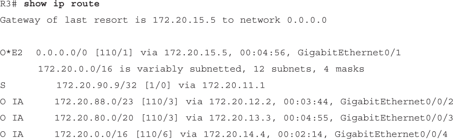</a>

<a href="#f0613-01a" id="code-f0613-01">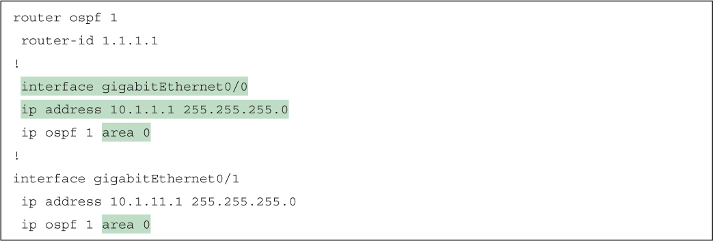</a>

<a href="#f0613-02a" id="code-f0613-02">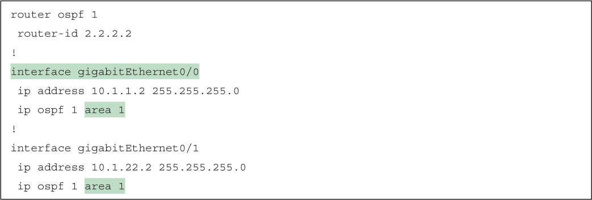</a>

<a href="#f0614-01a" id="code-f0614-01">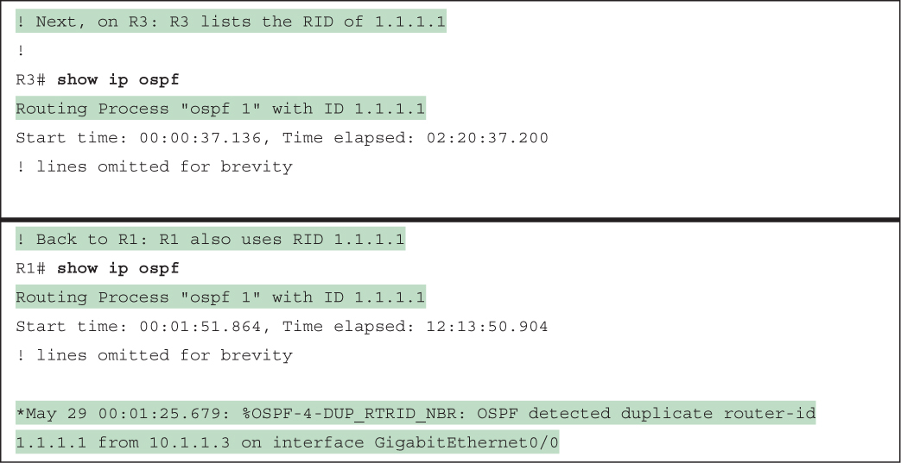</a>

<a href="#f0615-01a" id="code-f0615-01">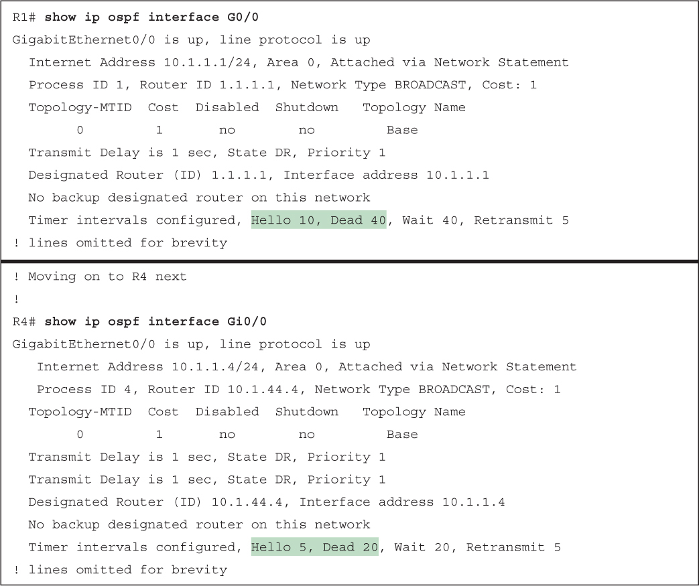</a>

<a href="#f0616-01a" id="code-f0616-01">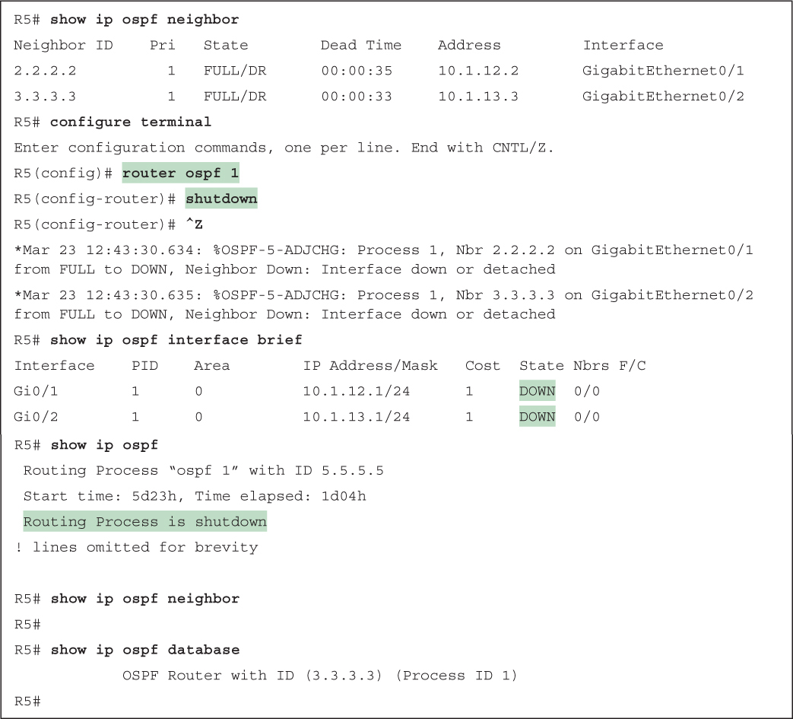</a>

<a href="#f0620-01a" id="code-f0620-01">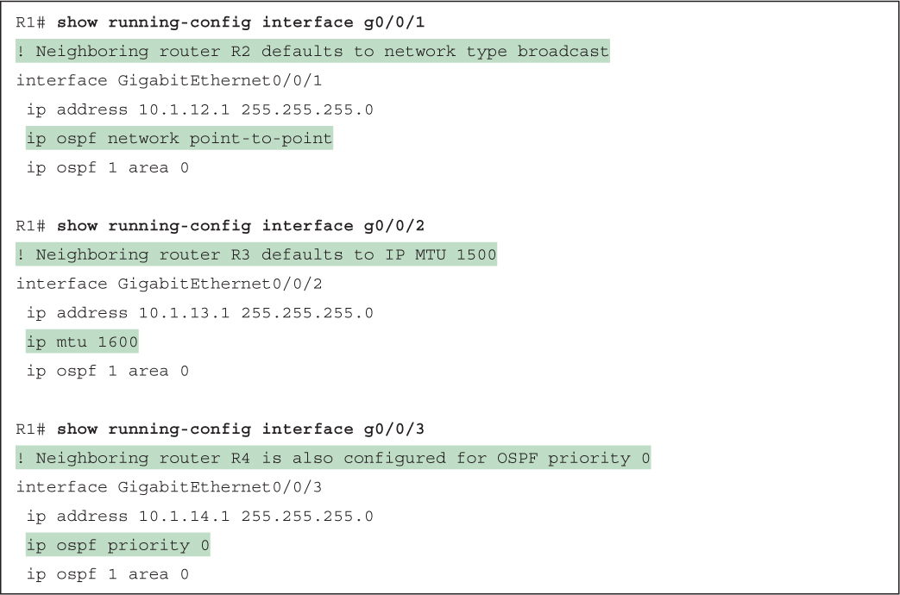</a>

<a href="#f0620-02a" id="code-f0620-02">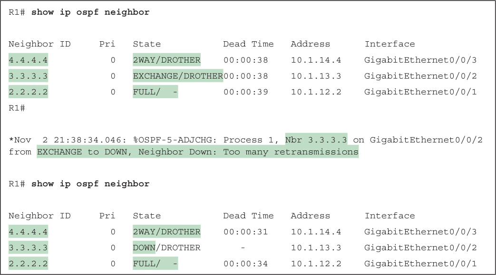</a>

<a href="#f0622-01a" id="code-f0622-01">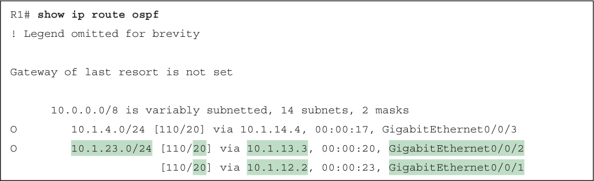</a>

<a href="#f0627-01a" id="code-f0627-01">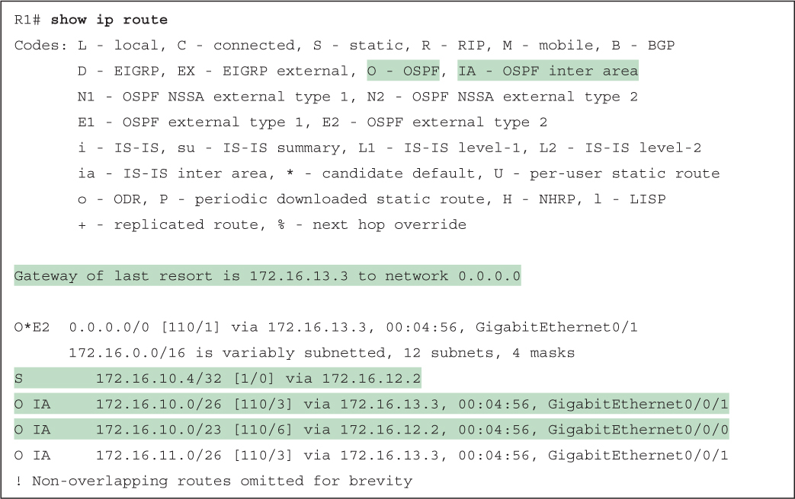</a>

<a href="#f0628-01a" id="code-f0628-01">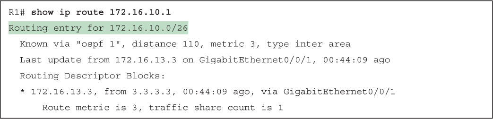</a>

<a href="#f0630-01a" id="code-f0630-01">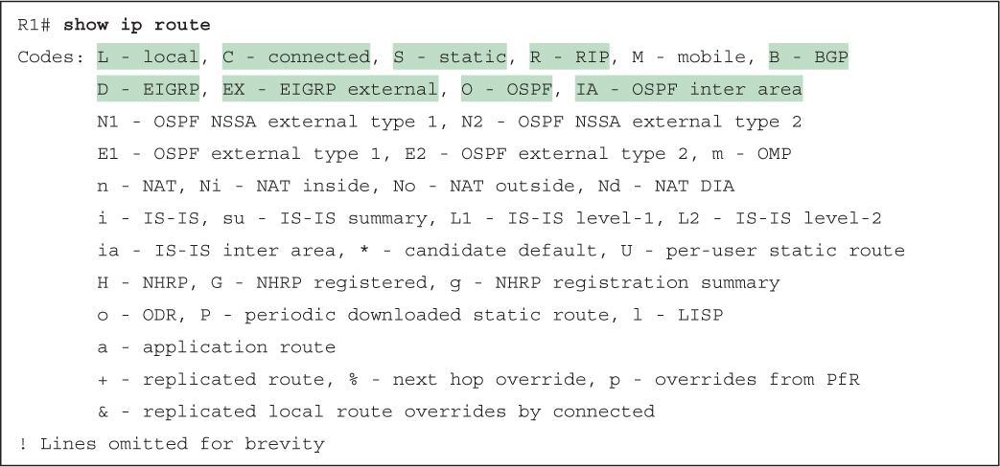</a>

</section>

</section>


<nav class="ccna-chapter-nav" aria-label="章节导航"><a href="v1-23.html">← 上一章</a><a href="v1-25.html">下一章 →</a></nav>
