
<a href="{{ '/subjects/CCNA/' | relative_url }}">← 返回 CCNA 目录</a>

第一卷 · IP 版本 6

<nav class="ccna-chapter-nav" aria-label="章节导航"><a href="v1-24.html">← 上一章</a><a href="v1-26.html">下一章 →</a></nav>



<section data-epub-type="chapter">

<h2 class="h2" id="ch25">第 25 章</h2>

<h2 class="h2a">IP 版本 6 基础</h2>

本章涵盖以下考试主题：

1.0 网络基础

1.8 配置并验证 IPv6 编址和前缀

1.9 描述 IPv6 地址类型

IPv4 一直是 TCP/IP 和互联网发展过程中稳定且非常有用的组成部分。在互联网漫长历史的大部分时间里，以及大多数使用 TCP/IP 的企业网络中，IPv4 都是定义编址和路由的核心协议。不过，虽然 IPv4 有许多优点，它也存在一些不足，因此需要一种替代协议：IP 版本 6（IPv6）。

IPv6 定义的总体功能与 IPv4 相同，但实现方法不同。例如，IPv4 和 IPv6 都定义了编址、将较大地址组划分为较小地址组的子网划分概念、用于构成 IPv4 或 IPv6 数据包的首部，以及路由这些数据包的规则。同时，IPv6 对细节的处理有所不同，例如使用 128 位 IPv6 地址，而不是 32 位 IPv4 地址。

本章重点介绍网络层的核心功能：编址和路由。第一节讨论整体概念，第二节介绍如何书写和输入 IPv6 地址的具体细节。

<section>

<h3 class="h3" id="ch25lev1sec1">“这些知识我已经掌握了吗？”自测</h3>

如果你希望根据得分决定在本章投入多少时间，可以完成这组自测题（在此作答，或使用 PTP 软件）。各题答案的选项字母列在自测题之后的页面底部。书末和配套网站上的<a href="#ref-appc">附录 C</a>都包含答案及解析。你也可以在 PTP 测试软件中找到答案及解析。

<figure class="table" id="ch25tab01" tabindex="0">

<figcaption>

<strong>表 25-1</strong> “这些知识我已经掌握了吗？”基础主题与问题对应关系

</figcaption>

<table class="all">

<thead>

<tr>

<th class="th">
基础知识小节
</th>

<th class="th">
题目
</th>

</tr>

</thead>

<tbody>

<tr>

<td class="border">
IPv6 简介
</td>

<td class="border">
1–2
</td>

</tr>

<tr>

<td class="border">
IPv6 地址格式与约定
</td>

<td class="border">
3–6
</td>

</tr>

</tbody>

</table>

</figure>

<strong><a id="quess25_1" href="#ques25_1a">1</a>．</strong> 以下哪项是 IPv4 地址耗尽问题的短期解决方案？

<ol class="lower-alpha">

<li>
IP 版本 6
</li>

<li>
IP 版本 5
</li>

<li>
NAT/PAT
</li>

<li>
ARP
</li>

</ol>

<strong><a id="quess25_2" href="#ques25_2a">2</a>．</strong> 路由器收到一个包含 IPv6 数据包的以太网帧，随后决定通过一条以太网 WAN 链路路由该数据包。关于路由器如何转发 IPv6 数据包，哪项说法正确？

<ol class="lower-alpha">

<li>
路由器丢弃收到的帧的以太网数据链路层首部和尾部。
</li>

<li>
路由器根据数据包的源 IPv6 地址作出转发决策。
</li>

<li>
路由器保留传入帧的以太网首部，将整个帧封装在新的 IPv6 数据包中，再通过出站以太网 WAN 链路发送。
</li>

<li>
路由器选择向何处转发数据包时使用 IPv4 路由表。
</li>

</ol>

<strong><a id="quess25_3" href="#ques25_3a">3</a>．</strong> 以下哪项是 FE80:0000:0000:0000:0100:0000:0000:0123 最短的有效缩写？

<ol class="lower-alpha">

<li>
FE80::100::123
</li>

<li>
FE8::1::123
</li>

<li>
FE80::100:0:0:0:123:4567
</li>

<li>
FE80::100:0:0:123
</li>

</ol>

<strong><a id="quess25_4" href="#ques25_4a">4</a>．</strong> 以下哪项是 2000:0300:0040:0005:6000:0700:0080:0009 最短的有效缩写？

<ol class="lower-alpha">

<li>
2:3:4:5:6:7:8:9
</li>

<li>
2000:300:40:5:6000:700:80:9
</li>

<li>
2000:300:4:5:6000:700:8:9
</li>

<li>
2000:3:4:5:6:7:8:9
</li>

</ol>

<strong><a id="quess25_5" href="#ques25_5a">5</a>．</strong> 以下哪项是 IPv6 地址 2001:DB8::200:28 的完整展开形式？

<ol class="lower-alpha">

<li>
2001:0DB8:0000:0000:0000:0000:0200:0028
</li>

<li>
2001:0DB8::0200:0028
</li>

<li>
2001:0DB8:0:0:0:0:0200:0028
</li>

<li>
2001:0DB8:0000:0000:0000:0000:200:0028
</li>

</ol>

<strong><a id="quess25_6" href="#ques25_6a">6</a>．</strong> 假设掩码为 /64，以下哪项是地址 2000:0000:0000:0005:6000:0700:0080:0009 正确的缩写子网前缀？

<ol class="lower-alpha">

<li>
2000::5::/64
</li>

<li>
2000::5:0:0:0:0/64
</li>

<li>
2000:0:0:5::/64
</li>

<li>
2000:0:0:5:0:0:0:0/64
</li>

</ol>

“这些知识我已经掌握了吗？”自测答案：

<strong><a id="ques25_1a" href="#ref-ques25_1">1</a></strong> C

<strong><a id="ques25_2a" href="#ref-ques25_2">2</a></strong> A

<strong><a id="ques25_3a" href="#ref-ques25_3">3</a></strong> D

<strong><a id="ques25_4a" href="#ref-ques25_4">4</a></strong> B

<strong><a id="ques25_5a" href="#ref-ques25_5">5</a></strong> A

<strong><a id="ques25_6a" href="#ref-ques25_6">6</a></strong> C

</section>

<section>

<h3 class="h3box" id="ch25lev1sec2">基础知识</h3>

</section>

<section>

<h3 class="h3" id="ch25lev1sec3">IPv6 简介</h3>

<a id="key_267" href="#ref-gloss_211">IP 版本 6（IPv6）</a> 是 IP 版本 4（IPv4）的替代协议。为此，网络可以逐步迁移，同时使用两种协议，由 IPv6 克服那些促使人们寻求 IPv4 替代协议的部分问题。

遗憾的是，这段介绍提出的问题比解答的更多。为什么需要替换 IPv4？如果需要替换，什么时候会发生，进展会很快吗？当企业或互联网用 IPv6 替换 IPv4 时，究竟会发生什么？类似问题还有很多。

虽然本章作为入门章节，无法详述 IPv4 最终需要被 IPv6 替换的所有原因，但将 TCP/IP 网络迁移到 IPv6 最清楚、最明显的原因是增长。IPv4 使用 32 位地址，总计有几十亿个地址。有趣的是，看起来如此庞大的地址数量仍然太少。IPv6 将地址长度增加到 128 位。作为对比，IPv6 提供的地址数量是 IPv4 的 10,000,000,000,000,000,000,000,000,000 倍以上。IPv4 提供略少于 10<em>10</em> 个地址，而 IPv6 提供略少于 10<em>38</em> 个地址。

IPv6 使用不同大小的地址字段以及一些不同的编址规则，这意味着许多其他协议和功能也必须改变。例如，IPv4 路由，也就是数据包转发过程，依赖对 IPv4 地址的理解。为支持 IPv6 路由，路由器必须理解 IPv6 地址和路由。要动态学习 IPv6 子网的路由，路由协议必须支持这些不同的 IPv6 编址规则，包括 IPv6 如何创建子网的规则。因此，从 IPv4 迁移到 IPv6 远不止更改一个协议（IP），而是会影响许多协议。

本章第一节讨论从 IPv4 转向 IPv6 的一些原因，以及因此必须改变的协议。

<section>

<h4 class="h4" id="ch25lev2sec1">IPv6 出现的历史原因</h4>

在过去 50 多年里，互联网从萌芽阶段发展成为对世界影响巨大的事物。它最初通过大学研究发展，从 20 世纪 60 年代末互联网的 ARPANET 起点，延续到 70 年代。80 年代，互联网继续快速增长，推动力仍主要来自研究以及参与研究的大学。

到 20 世纪 90 年代初，互联网允许商业用途，进一步加快了增长。后来，家庭固定互联网接入变得普遍，接着智能手机等移动设备广泛使用互联网。如今，物联网（IoT）推动互联网增长，为各行业增加各种能够通过 IP 网络通信的设备。<a href="#ch25fig01">图 25-1</a> 展示了其中一些主要里程碑及大致时间。

<figure class="image-c" id="ch25fig01">

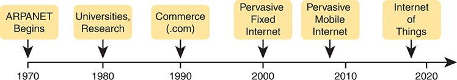

<figcaption>

<strong>图 25-1</strong> <em>互联网发展中的一些重大事件</em>

<aside class="hidden" id="a25fig01">

时间线从 1970 年 ARPANET 的诞生开始。到 1980 年，大学和研究机构的参与扩大了互联网的覆盖范围和能力。1990 年，商业（.com）出现在互联网中。2000 年标志着固定互联网的普及，2010 年的转变则是移动互联网的普及。最后，到 2020 年，图中标出了物联网。

</aside>

</figcaption>

</figure>

互联网在相当长时期内的惊人增长，为公有 IPv4 地址带来了一个大问题：全球地址即将用尽。以一个里程碑为例，2011 年，互联网号码分配机构（IANA）将最后五个 /8 地址块（大小与 A 类网络相同）分别分配给五个区域互联网注册机构（RIR）。此时，IANA 已没有更多公有 IPv4 地址可分配给 RIR。RIR 无法再从 IANA 获得新的公有地址分配，但仍可从剩余的公有地址空间中继续分配地址块。

在 2010 年代，五个 RIR 最终都分配完了各自的公有地址空间。例如，2015 年末，ARIN（北美）宣布其地址储备已经耗尽。所有 RIR 都制定了应对 IPv4 地址耗尽的计划，它们要么已经没有 IPv4 地址空间，要么采用维护计划回收未使用的 IPv4 地址并重新分配。

这些事件意义重大，因为这一天终于到来：新公司尝试连接互联网时，已不能再仅使用 IPv4 而忽略 IPv6。它们唯一的选择将是 IPv6，因为 IPv4 已没有剩余的公有地址。

注意

你可以在 ARIN 的 IPv4 地址耗尽网站上跟踪它在互联网历史上这场有趣转变中的进展：<a href="https://www.arin.net/resources/guide/ipv4/">https://www.arin.net/resources/guide/ipv4/</a>。也可以在 <a href="http://ipv4.potaroo.net">http://ipv4.potaroo.net</a> 查看汇总报告。

虽然媒体理所当然地高度关注 IPv4 地址耗尽，但关心互联网的人从 20 世纪 80 年代末就知道这一潜在问题。这个通常称为 <a id="key_268" href="#ref-gloss_213">IPv4 地址耗尽（IPv4 address exhaustion）</a>的问题，甚至可能让互联网在 90 年代的高速增长戛然而止！必须采取措施。

IETF 提出了几种延长 IPv4 地址使用寿命的短期解决方案，以及一个长期解决方案：IPv6。不过，网络地址转换（NAT）和无类别域间路由（CIDR）等其他工具，帮助 IPv4 又延续了几十年。IPv6 提供了更持久的解决方案：用新的 IPv6 首部和 IPv6 地址替代 IPv4。其地址大小支持极其庞大的地址数量，有望为未来几代人解决地址短缺问题。<a href="#ch25fig02">图 25-2</a> 展示了 IPv4 地址耗尽过程中的一些主要时间节点。

第一节的其余部分将比较 IPv6 与 IPv4，重点关注两种协议的共同功能。具体而言，将比较协议本身（包括地址）、路由、路由协议以及其他相关主题。

<figure class="image-c" id="ch25fig02">

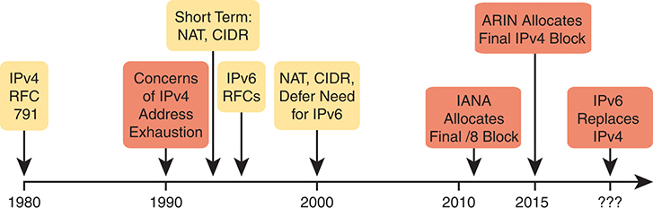

<figcaption>

<strong>图 25-2</strong> <em>IPv4 地址耗尽及短期、长期解决方案的时间线</em>

<aside class="hidden" id="a25fig02">

时间线从 1980 年“IPv4 RFC 791”的确立开始。到 1990 年，出现了对“IPv4 地址耗尽”的担忧。此后，引入“NAT”和“CIDR”等短期解决方案以缓解问题，同时制定“IPv6 RFC”。2000 年标注为“NAT、CIDR 推迟了对 IPv6 的需求”。2010 年以后是“IANA 分配最后的 /8 地址块”。到 2015 年是“ARIN 分配最后的 IPv4 地址块”。时间线延伸到一个未确定的日期，预期届时“IPv6 替代 IPv4”，表示协议迁移。

</aside>

</figcaption>

</figure>

注意

你可能会疑惑，为什么下一版 IP 不叫 IP 版本 5。此前曾有创建新版 IP 的尝试，编号为版本 5。IPv5 未能推进到标准阶段。不过，为避免问题，由于某些文档已经使用版本 5 这个编号，下一次更新 IP 的尝试就被编号为版本 6。

</section>

<section>

<h4 class="h4" id="ch25lev2sec2">IPv6 协议</h4>

核心 IPv6 协议的主要目的与 IPv4 协议相同。RFC 8200 定义的核心 IPv6 协议规定了数据包概念、数据包地址，以及主机和路由器的角色。这些规则让设备能够转发源自主机、途经多台路由器的数据包，使其到达正确的目的主机。（IPv4 早在 RFC 791 中就为 IPv4 定义了相同概念。）

不过，由于 IPv6 影响 TCP/IP 网络中许多其他功能，需要更多 RFC 来定义 IPv6 的细节。一些 RFC 定义如何从 IPv4 迁移到 IPv6，另一些则定义熟悉协议的新版本，或用新协议替代旧协议。例如：

<strong>旧版 OSPF 版本 2 升级为 OSPF 版本 3：</strong> 较早的开放最短路径优先（OSPF）版本 2 适用于 IPv4，但不适用于 IPv6，因此创建了新版 <a id="key_269" href="#ref-gloss_293">OSPF 版本 3（OSPFv3）</a> 来支持 IPv6。（注：OSPFv3 后来又升级为可同时通告 IPv4 和 IPv6 路由。）

<strong>ICMP 升级为 ICMP 版本 6：</strong> 互联网控制消息协议（ICMP）与 IPv4 配合良好，但需要修改才能支持 IPv6。新名称为 ICMPv6。

<strong>ARP 被邻居发现协议取代：</strong> 对于 IPv4，地址解析协议（ARP）发现邻居使用的 MAC 地址。IPv6 用功能更广泛的邻居发现协议（NDP）替代 ARP。

注意

大量互联网 RFC 定义了 IPv6。最近在 <a href="https://www.rfc-editor.org">https://www.rfc-editor.org</a> 搜索“IPv6”，得到超过 550 篇这样的 RFC。

虽然广义的 <em>IPv6</em> 一词包含许多协议，但名为 IPv6 的这一具体协议定义了新的 128 位 IPv6 地址。当然，以二进制书写这些地址会很麻烦，它们甚至可能超出一张纸的宽度！IPv6 定义了更短的十六进制格式，最多需要 32 个十六进制数字（每个十六进制数字表示 4 位），并提供了缩写十六进制地址的方法。

例如，以下都是 IPv6 地址，每个地址的十六进制数字不超过 32 个。

<a href="#code-f0643-01" id="f0643-01a">点击此处查看代码原图</a>

<pre class="pre" tabindex="0"><code>2345:1111:2222:3333:4444:5555:6666:AAAA

2000:1:2:3:4:5:6:A

FE80::1</code></pre>

接下来的“<a href="#ch25lev1sec4">IPv6 地址格式与约定</a>”一节将详细讨论 IPv6 地址的表示方法，包括如何合法缩写十六进制地址值。

与 IPv4 一样，IPv6 定义了首部，其中有存放源地址和目的地址的字段。与 IPv4 相比，IPv6 首部除了扩大地址字段，还作了一些其他改动。不过，虽然 IPv6 首部比 IPv4 首部更大，它实际上却更简单，这是有意的设计。<a href="#ch25fig03">图 25-3</a> 展示了 IPv6 首部中必需的 40 字节部分。

<figure class="image-c" id="ch25fig03">

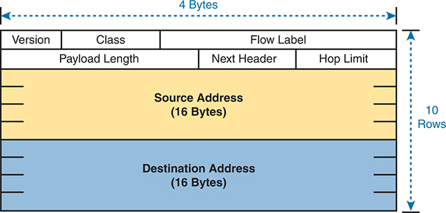

<figcaption>

<strong>图 25-3</strong> <em>IPv6 首部</em>

<aside class="hidden" id="a25fig03">

示意图分为多个字段，宽 4 字节，共 10 行。首部以“Version”（版本）字段开头，后面依次是“Class”（类别）和“Flow Label”（流标签）。随后是“Payload Length”（有效载荷长度）、“Next Header”（下一个首部）和“Hop Limit”（跳数限制）。首部中间为“Source Address”（源地址），占 16 字节。类似地，底部的“Destination Address”（目的地址）也占 16 字节。

</aside>

</figcaption>

</figure>

</section>

<section>

<h4 class="h4" id="ch25lev2sec3">IPv6 路由</h4>

与 IPv6 的许多功能一样，从总体上看，IPv6 路由与 IPv4 路由相同，只有考察具体细节才能看清差异。暂时保持概括性讨论，IPv6 与 IPv4 以相同方式使用以下概念：

<ul class="sq">

<li>
终端用户设备要能够构造 IPv6 数据包并通过接口发送，就需要在该接口上具有 IPv6 地址。

</li>

<li>
终端用户主机需要知道默认路由器的 IPv6 地址；如果目的主机位于不同子网，主机就将 IPv6 数据包发送给该默认路由器。
</li>

<li>
IPv6 路由器在路由每个 IPv6 数据包时，对其解封装并重新封装。
</li>

<li>
IPv6 路由器将数据包的目的 IPv6 地址与自身的 IPv6 路由表比较，作出路由决策；匹配路由列出下一步向何处发送 IPv6 数据包的指引。
</li>

</ul>

注意

将上述列表中每一处 IPv6 替换为 IPv4，所有说法对 IPv4 也同样成立。

接下来的几幅图通过示例展示这些概念。首先，<a href="#ch25fig04">图 25-4</a> 展示了主机上的几个设置。主机 PC1 的地址为 2345::1，也知道其默认网关为 2345::2。（这两个值都是真实 IPv6 地址的有效缩写。）要将 IPv6 数据包发送给另一个 IPv6 子网中的主机 PC2，PC1 会创建 IPv6 数据包，并将其发送给自己的默认网关 R1。

<figure class="image-c" id="ch25fig04">

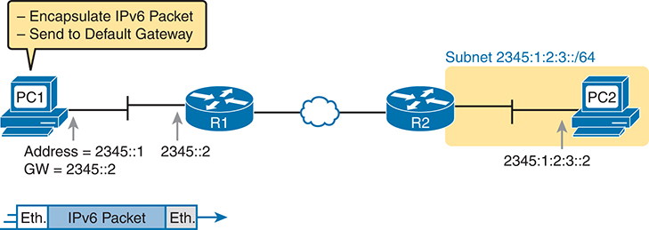

<figcaption>

<strong>图 25-4</strong> <em>IPv6 主机构造并发送 IPv6 数据包</em>

<aside class="hidden" id="a25fig04">

主机 PC1 的地址为 2345::1，默认网关为 2345::2。它封装 IPv6 数据包并发送给默认网关，即地址为 2345::2 的路由器 R1。数据包经 WAN 线路到达子网 2345:1:2:3::/64 中的路由器 R2，最后到达目的主机 PC2，其地址为 2345:1:2:3::2。

</aside>

</figcaption>

</figure>

路由器 R1 转发这个 IPv6 数据包时需要完成许多小任务，但现在先关注与封装有关的工作。如 <a href="#ch25fig05">图 25-5</a> 的步骤 1 所示，R1 收到传入的数据链路层帧，从帧内部提取（解封装）IPv6 数据包，并丢弃原数据链路层首部和尾部。步骤 2 中，R1 确定应将 IPv6 数据包转发给 R2 后，为数据包添加正确的出站数据链路层首部和尾部，完成封装。

<figure class="image-c" id="ch25fig05">

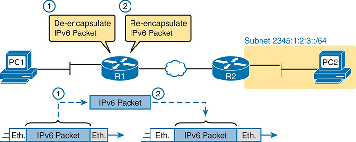

<figcaption>

<strong>图 25-5</strong> <em>IPv6 路由器在路由 IPv6 时执行常规封装任务</em>

<aside class="hidden" id="a25fig05">

过程从主机 PC1 向路由器 R1 发送 IPv6 数据包开始。R1 收到数据包后，先解封装，再重新封装，然后通过以太网 WAN 发送给 R2。R2 连接到子网 2345:1:2:3::/64，将数据包转发到最终目的主机 PC2。

</aside>

</figcaption>

</figure>

当 R1 这样的路由器从数据链路层帧中解封装出数据包时，还必须确定帧中包含哪种数据包。为此，路由器查看数据链路层首部中的协议类型字段，它标识帧内的数据包类型。如今，大多数数据链路层帧承载 IPv4 或 IPv6 数据包。

要路由 IPv6 数据包，路由器必须使用 IPv6 路由表，而不是 IPv4 路由表。路由器查看数据包的目的 IPv6 地址，并将其与当前 IPv6 路由表比较，再根据匹配 IPv6 路由中的转发指令转发数据包。<a href="#ch25fig06">图 25-6</a> 展示了整体过程。

<figure class="image-c" id="ch25fig06">

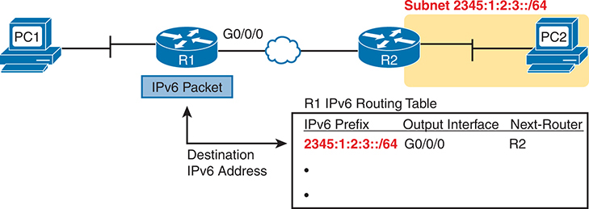

<figcaption>

<strong>图 25-6</strong> <em>将 IPv6 数据包与 R1 的 IPv6 路由表比较</em>

<aside class="hidden" id="a25fig06">

示意图展示了由两台主机 PC1、PC2，两台路由器 R1、R2，以及一个 IPv6 数据包组成的网络。PC1 连接 R1，由 R1 接收 IPv6 数据包。数据包的目的 IPv6 地址与 R1 路由表中的 IPv6 前缀进行比较。标为“R1 IPv6 路由表”的表包含“IPv6 前缀”“出接口”和“下一台路由器”列。一条表项显示，对于前缀“2345:1:2:3::/64”，出接口为“G0/0/0”，下一台路由器为“R2”。R2 在子网“2345:1:2:3::/64”中连接 PC2。

</aside>

</figcaption>

</figure>

请再次注意，这一过程与 IPv4 类似，只是 IPv6 数据包列出 IPv6 地址，IPv6 路由表列出 IPv6 子网（称为子网<em>前缀</em>）的路由信息。

最后，在大多数企业网络中，路由器会同时路由 IPv4 和 IPv6 数据包。也就是说，公司不会决定采用 IPv6 后，就在某个周末深夜关闭所有 IPv4，并在每台设备上启用 IPv6。IPv6 允许逐步迁移，在此期间，部分或全部路由器同时转发 IPv4 和 IPv6 数据包。（同时运行 IPv4 与 IPv6 的迁移策略称为<em>双栈（dual stack）</em>。）你只需在现有 IPv4 路由配置的基础上，额外配置路由器以路由 IPv6 数据包。

</section>

<section>

<h4 class="h4" id="ch25lev2sec4">IPv6 路由协议</h4>

IPv6 路由器需要学习所有可能的 IPv6 子网前缀的路由。与 IPv4 一样，IPv6 路由器使用路由协议，其名称熟悉，总体功能也熟悉。

最初，没有任何 IPv4 路由协议能用于通告 IPv6 路由。它们都需要更新消息、协议和规则，以支持 IPv6。随着时间推移，路由信息协议（RIP）、开放最短路径优先（OSPF）、增强型内部网关路由协议（EIGRP）和边界网关协议（BGP）都经过更新，支持了 IPv6。<a href="#ch25tab02">表 25-2</a> 列出这些路由协议的名称及简要说明。

<figure class="table" id="ch25tab02" tabindex="0">

<figcaption>

<strong>表 25-2</strong> IPv6 路由协议

</figcaption>

<table class="all">

<thead>

<tr>

<th class="th">
路由协议
</th>

<th class="th">
定义方
</th>

<th class="th">
说明
</th>

</tr>

</thead>

<tbody>

<tr>

<td class="border">
RIPng（下一代 RIP）
</td>

<td class="border">
RFC
</td>

<td class="border">
“下一代”取自电视剧《<em>星际旅行：下一代</em>》的名称。
</td>

</tr>

<tr>

<td class="border">
<em>OSPFv3</em>（OSPF 版本 3）
</td>

<td class="border">
RFC
</td>

<td class="border">
你在 IPv4 中使用的 OSPF 实际上是 OSPF 版本 2，因此支持 IPv6 的新版本称为 OSPFv3。
</td>

</tr>

<tr>

<td class="border">
<a id="key_266" href="#ref-gloss_118">EIGRPv6（用于 IPv6 的 EIGRP）</a>
</td>

<td class="border">
Cisco
</td>

<td class="border">
Cisco 拥有 EIGRP 协议的权利，但目前也以信息性 RFC 的形式发布 EIGRP。
</td>

</tr>

<tr>

<td class="border">
MP BGP-4（多协议 BGP 版本 4）
</td>

<td class="border">
RFC
</td>

<td class="border">
BGP 版本 4 在创建时就被设计为高度可扩展；IPv6 支持正是通过 MP BGP-4 这一增强功能加入 BGP 版本 4 的。
</td>

</tr>

</tbody>

</table>

</figure>

此外，这些路由协议遵循与 IPv4 对应协议相同的内部网关协议（IGP）和外部网关协议（EGP）约定。RIPng、EIGRPv6 和 OSPFv3 充当内部网关协议，在企业内部通告 IPv6 路由。

从这些介绍可以看出，IPv6 使用了与 IPv4 相同的许多总体概念。两者都定义含源地址和目的地址的首部，都定义数据包路由，路由过程在转发数据包时会丢弃旧的数据链路层首部和尾部。路由器也采用相同的总体过程作出路由决策，将数据包的目的 IP 地址与路由表比较。

IPv4 与 IPv6 的主要差异围绕更大的 IPv6 地址展开。下一个主题将开始介绍这些 IPv6 地址的具体细节。

</section>

</section>

<section>

<h3 class="h3" id="ch25lev1sec4">IPv6 地址格式与约定</h3>

CCNA 考试要求具备处理 IPv4 地址的一些基本技能。例如，你需要能够解读 172.21.73.14 这样的 IPv4 地址，使用 /25 这样的前缀式掩码，并理解它与某个具体 IPv4 地址配合时的含义。你还需要能够根据地址和掩码（如 172.21.73.14/25）求出子网 ID。

本章第二大节讨论 IPv6 地址中的相同概念，具体包括：

<ul class="sq">

<li>
如何书写和解读未缩写的 32 位十六进制数字 IPv6 地址
</li>

<li>
如何缩写 IPv6 地址，以及如何解读缩写后的地址
</li>

<li>
如何解读 IPv6 前缀长度（子网掩码）
</li>

<li>
如何根据地址和前缀长度掩码求出 IPv6 子网前缀 ID
</li>

</ul>

这些任务最大的难点在于数字本身非常庞大。好在求子网 ID 的计算，对 IPv4 来说往往颇有挑战，对 IPv6 却更容易，至少本书讨论的深度如此。

<section>

<h4 class="h4" id="ch25lev2sec5">表示完整（未缩写）的 IPv6 地址</h4>

IPv6 使用方便的十六进制格式表示地址。为了便于阅读，IPv6 将地址写成八组，每组四个十六进制数字，组间用冒号分隔。例如：

<a href="#code-f0646-01" id="f0646-01a">点击此处查看代码原图</a>

<pre class="pre" tabindex="0"><code>2340:1111:AAAA:0001:1234:5678:9ABC:1234</code></pre>

注意

为方便起见，本书使用<a id="key_271" href="#ref-gloss_323">四位组（quartet）</a>一词表示一组四个十六进制数字，每个 IPv6 地址有八个四位组。请注意，IPv6 RFC 没有定义对应术语。

IPv6 地址也有二进制形式，但好在多数情况下不需要查看。不过，需要时，从十六进制转换为二进制相对容易，只需将每个十六进制数字替换为 <a href="#ch25tab03">表 25-3</a> 所列的对应 4 位二进制值。

<figure class="table" id="ch25tab03" tabindex="0">

<figcaption>

<strong>表 25-3</strong> 十六进制与二进制转换表

</figcaption>

<table class="all">

<thead>

<tr>

<th class="th">
十六进制
</th>

<th class="th">
二进制
</th>

<th class="th">
十六进制
</th>

<th class="th">
二进制
</th>

</tr>

</thead>

<tbody>

<tr>

<td class="border">
0
</td>

<td class="border">
0000
</td>

<td class="border">
8
</td>

<td class="border">
1000
</td>

</tr>

<tr>

<td class="border">
1
</td>

<td class="border">
0001
</td>

<td class="border">
9
</td>

<td class="border">
1001
</td>

</tr>

<tr>

<td class="border">
2
</td>

<td class="border">
0010
</td>

<td class="border">
A 类
</td>

<td class="border">
1010
</td>

</tr>

<tr>

<td class="border">
3
</td>

<td class="border">
0011
</td>

<td class="border">
B 类
</td>

<td class="border">
1011
</td>

</tr>

<tr>

<td class="border">
4
</td>

<td class="border">
0100
</td>

<td class="border">
C 类
</td>

<td class="border">
1100
</td>

</tr>

<tr>

<td class="border">
5
</td>

<td class="border">
0101
</td>

<td class="border">
D
</td>

<td class="border">
1101
</td>

</tr>

<tr>

<td class="border">
6
</td>

<td class="border">
0110
</td>

<td class="border">
E
</td>

<td class="border">
1110
</td>

</tr>

<tr>

<td class="border">
7
</td>

<td class="border">
0111
</td>

<td class="border">
F
</td>

<td class="border">
1111
</td>

</tr>

</tbody>

</table>

</figure>

</section>

<section>

<h4 class="h4" id="ch25lev2sec6">缩写和展开 IPv6 地址</h4>

IPv6 还定义了缩短书写或输入地址的方法。为什么？虽然使用 32 位十六进制数比使用 128 位二进制数方便得多，但 32 个十六进制数字对于记忆、在命令输出中识别和在命令行输入而言，仍然很多。IPv6 地址缩写规则可缩短这些数字。

即使你输入地址的全部 32 个十六进制数字，计算机和路由器也会使用最短缩写。因此，即便你更愿意使用较长的完整 IPv6 地址，也需要能够解读路由器或主机列出的缩写地址。本节先介绍地址缩写，再介绍地址展开。

<section>

<h5 class="h5" id="ch25lev3sec1">缩写 IPv6 地址</h5>

两条基本规则允许你或计算机缩短 IPv6 地址：

<ol class="number">

<li>
在每个由四个十六进制数字组成的四位组内，删除左侧三个位置中最多三个前导 0。（注意：这一步中，0000 四位组会留下一个 0。）

</li>

<li>
将最长的一段连续两个或更多 0000 四位组替换为双冒号。缩写 :: 表示“两个或更多全 0 四位组”。不过，一个地址中只能使用一次这种替换，用于最长的连续 0000 四位组序列；若并列最长，则替换第一段。
</li>

</ol>

例如，考虑以下 IPv6 地址。粗体数字表示可以缩写的数字。

<a href="#code-f0647-01" id="f0647-01a">点击此处查看代码原图</a>

<pre class="pre" tabindex="0"><code>2100:<strong>0000</strong>:<strong>0000</strong>:<strong>000</strong>1:<strong>0000</strong>:<strong>0000</strong>:<strong>0000</strong>:<strong>00</strong>56</code></pre>

应用第一条规则时，独立查看全部八个四位组，分别删除所有前导 0。注意，其中五个四位组有四个 0，因此只删除三个前导二进制 0，留下以下值：

<pre class="pre" tabindex="0"><code>2100:0:0:1:0:0:0:56</code></pre>

虽然这种缩写有效，但仍可使用第二条规则进一步缩写。本例中，有两处包含连续多个仅有一个 0 的四位组。选择最长的一段，用 :: 替换，得到最短的合法缩写：

<pre class="pre" tabindex="0"><code>2100:0:0:1::56</code></pre>

虽然 2100:0:0:1::56 确实是最短缩写，但本例也便于看清缩写 IPv6 地址时最常见的两个错误。首先，绝不能删除四位组中的尾随 0（位于右侧的 0）。本例中，第一个四位组 2100 完全不能缩短，因为两个 0 位于末尾。因此，下面这个第一个四位组仅以 FE 开头的地址，不是原 IPv6 地址的正确缩写：

<pre class="pre" tabindex="0"><code>21:0:0:1::56</code></pre>

第二个常见错误是将两段 0000 四位组都替换为双冒号。例如，以下缩写对于本主题给出的原始 IPv6 地址是不正确的：

<pre class="pre" tabindex="0"><code>2100::1::56</code></pre>

这种缩写不正确的原因是，要还原完整地址时，无法确定应在每个 :: 处代入多少个全 0 四位组。

</section>

<section>

<h5 class="h5" id="ch25lev3sec2">展开缩写后的 IPv6 地址</h5>

要将 IPv6 地址展开为完整的 32 位十六进制数，可使用两条类似规则，它们基本上逆转了前两条规则的逻辑：

<ol class="number">

<li>
根据需要，在每个四位组前补 0，直到该组有四个十六进制数字。

</li>

<li>
如果存在双冒号（::），先统计当前显示的四位组数量，总数应小于 8。用多个 0000 四位组替换 ::，使总数达到八个。
</li>

</ol>

熟悉这些地址及缩写的最佳方法是亲自练习。<a href="#ch25tab04">表 25-4</a> 列出一些练习，左侧是完整的 32 位十六进制 IPv6 地址，右侧是最佳缩写。表中给出完整地址或缩写地址，你需要补出另一种形式。答案位于章末“<a href="#ref-ch25lev1sec9">前面练习题的答案</a>”一节。

<figure class="table" id="ch25tab04" tabindex="0">

<figcaption>

<strong>表 25-4</strong> IPv6 地址缩写与展开练习

</figcaption>

<table class="all">

<thead>

<tr>

<th class="th">
完整形式
</th>

<th class="th">
缩写
</th>

</tr>

</thead>

<tbody>

<tr>

<td class="border">
<code>2340:0000:0010:0100:1000:ABCD:0101:1010</code>
</td>

<td class="border">

</td>

</tr>

<tr>

<td class="border">

</td>

<td class="border">
<code>30A0:ABCD:EF12:3456:ABC:B0B0:9999:9009</code>
</td>

</tr>

<tr>

<td class="border">
<code>2222:3333:4444:5555:0000:0000:6060:0707</code>
</td>

<td class="border">

</td>

</tr>

<tr>

<td class="border">

</td>

<td class="border">
<code>3210::</code>
</td>

</tr>

<tr>

<td class="border">
<code>210F:0000:0000:0000:CCCC:0000:0000:000D</code>
</td>

<td class="border">

</td>

</tr>

<tr>

<td class="border">
 
</td>

<td class="border">
<code>34BA:B:B::20</code>
</td>

</tr>

<tr>

<td class="border">
<code>FE80:0000:0000:0000:DEAD:BEFF:FEEF:CAFE</code>
</td>

<td class="border">

</td>

</tr>

<tr>

<td class="border">

</td>

<td class="border">
<code>FE80::FACE:BAFF:FEBE:CAFE</code>
</td>

</tr>

</tbody>

</table>

</figure>

</section>

</section>

<section>

<h4 class="h4" id="ch25lev2sec7">表示地址的前缀长度</h4>

IPv6 使用与 IPv4 子网掩码类似的掩码概念，称为<a id="key_270" href="#ref-gloss_313">前缀长度（prefix length）</a>。类似于 IPv4 前缀式掩码，IPv6 前缀长度写成 / 后接一个十进制数（IPv6 没有对应的点分十进制掩码）。前缀长度规定，某个子网前缀内的所有地址，其左侧多少位具有相同的值。如果概括为“前缀／长度”，那么子网前缀中的所有地址，在长度所指定的起始位数内，都以相同的值开头。

在文档中书写 IPv6 地址和前缀长度时，为便于阅读，可以在 / 前留一个空格，也可以不留。不过，Cisco 设备上的命令通常不允许在 / 前后加空格。

<a href="#code-f0649-01" id="f0649-01a">点击此处查看代码原图</a>

<pre class="pre" tabindex="0"><code>2222:1111:0:1:A:B:C:D/64

2222:1111:0:1:A:B:C:D /64</code></pre>

最后，前缀长度表示位数，因此 IPv6 的合法取值范围为 0 到 128，含两端。

</section>

<section>

<h4 class="h4" id="ch25lev2sec8">计算 IPv6 子网前缀（子网 ID）</h4>

对于 IPv4，可以根据 IP 地址及其子网掩码计算子网 ID。对于 IPv6 子网划分，也可以根据 IPv6 地址及其前缀长度，计算与子网 ID 对应的 <em>IPv6</em> <a id="key_272" href="#ref-gloss_391">子网前缀（subnet prefix）</a>。

与不同的 IPv4 子网掩码类似，一些 IPv6 前缀长度使求子网前缀的计算很容易，另一些则更难。本节介绍较简单的情况，主要是因为 IPv6 地址空间足够大，让大家都能选择使计算更容易的前缀长度。

</section>

<section>

<h4 class="h4" id="ch25lev2sec9">求 IPv6 子网前缀</h4>

在 IPv6 中，子网前缀表示一组 IPv6 地址。目前，本节只关注如何计算代表该子网前缀的数值。<a href="v1-26.html#ch26">第 26 章</a>“<a href="v1-26.html#ch26">IPv6 编址与子网划分</a>”将进一步解释这些数字的实际含义。

每个 IPv6 子网前缀，或者简称子网，都有一个表示该地址组的数字。许多人沿用 IPv4 的术语，将其称为子网号或子网 ID。与 IPv4 一样，可以根据 IPv6 地址及前缀长度，使用相同的总体规则求子网前缀。如果前缀长度为 /P，规则如下：

<ol class="number">

<li>
复制前 P 位。

</li>

<li>
将其余位改为 0。
</li>

</ol>

如果前缀长度恰好是 4 的倍数，就不必按二进制位思考，而可以按十六进制数字思考。前缀长度是 4 的倍数，意味着每个十六进制数字要么被复制，要么被改为十六进制 0。例如，/44 前缀长度对应 11 个十六进制数字，/48 对应 12 个，依此类推。为说明完整，如果前缀长度确实是 4 的倍数，过程就变为：

<ol class="number">

<li>
将前缀长度（以位为单位）除以 4，确定子网前缀包含的十六进制数字数量。
</li>

<li>
复制第一步确定的属于子网前缀的十六进制数字。
</li>

<li>
将其余十六进制数字改为 0。
</li>

</ol>

<a href="#ch25fig07">图 25-7</a> 展示了前缀长度为 64 的示例。步骤 1 根据 /64 计算得出子网前缀含 16 个十六进制数字。步骤 2 复制 IPv6 地址的前 16 个数字，步骤 3 将其余数字记为十六进制 0。

<figure class="image-c" id="ch25fig07">

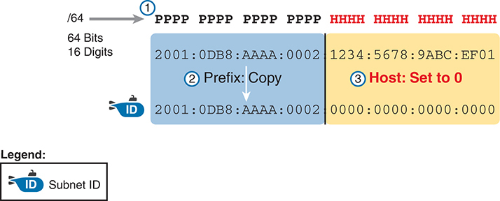

<figcaption>

<strong>图 25-7</strong> <em>根据地址／长度创建 IPv6 子网前缀</em>

<aside class="hidden" id="a25fig07">

过程从一个 64 位、16 个数字的 IPv6 地址（2001:0DB8:AAAA:0002:1234:5678:9ABC:EF01）开始。地址分为两部分：前缀（用 P 表示）和主机位（用 H 表示）。第一步复制地址前缀（2001:0DB8:AAAA:0002），该部分被突出显示并标为“复制前缀”。第二步将地址的主机部分（1234:5678:9ABC:EF01）置零，得到子网 ID 2001:0DB8:AAAA:0002:0000:0000:0000:0000。

</aside>

</figcaption>

</figure>

求出 IPv6 子网前缀后，还应能使用与 IPv6 地址缩写相同的规则对它进行缩写。不过，要特别注意子网前缀的末尾，因为它通常有多个全 0 八位组，因此缩写通常以双冒号（::）结束。

例如，考虑下面分配给 LAN 上某台主机的 IPv6 地址：

<a href="#code-f0650-01" id="f0650-01a">点击此处查看代码原图</a>

<pre class="pre" tabindex="0"><code>2000:1234:5678:9ABC:1234:5678:9ABC:1111/64</code></pre>

本例给出的 IPv6 地址本身无法缩写。将地址的最后 64 位（16 个数字）置零后，可计算出以下子网前缀：

<a href="#code-f0650-02" id="f0650-02a">点击此处查看代码原图</a>

<pre class="pre" tabindex="0"><code>2000:1234:5678:9ABC:<strong>0000:0000:0000:0000</strong>/64</code></pre>

此值末尾有四个全 0 四位组，因此可以缩写为：

<pre class="pre" tabindex="0"><code>2000:1234:5678:9ABC::/64</code></pre>

要提高计算熟练度，请花时间完成 <a href="#ch25tab05">表 25-5</a> 中的子网前缀练习。答案位于章末“<a href="#ref-ch25lev1sec9" data-original-href="vol1_pref10.xhtml#pref10">前面练习题的答案</a>”一节。

<figure class="table" id="ch25tab05" tabindex="0">

<figcaption>

<strong>表 25-5</strong> 根据地址／长度求 IPv6 子网前缀

</figcaption>

<table class="all">

<thead>

<tr>

<th class="th">
地址／长度
</th>

<th class="th">
子网前缀
</th>

</tr>

</thead>

<tbody>

<tr>

<td class="border">
<code>2340:0:10:100:1000:ABCD:101:1010/64</code>
</td>

<td class="border">

</td>

</tr>

<tr>

<td class="border">
<code>30A0:ABCD:EF12:3456:ABC:B0B0:9999:9009/64</code>
</td>

<td class="border">

</td>

</tr>

<tr>

<td class="border">
<code>2222:3333:4444:5555::6060:707/64</code>
</td>

<td class="border">

</td>

</tr>

<tr>

<td class="border">
<code>3210::ABCD:101:1010/64</code>
</td>

<td class="border">

</td>

</tr>

<tr>

<td class="border">
<code>210F::CCCC:B0B0:9999:9009/64</code>
</td>

<td class="border">

</td>

</tr>

<tr>

<td class="border">
<code>34BA:B:B:0:5555:0:6060:707/64</code>
</td>

<td class="border">

</td>

</tr>

<tr>

<td class="border">
<code>3124::DEAD:CAFE:FF:FE00:1/64</code>
</td>

<td class="border">

</td>

</tr>

<tr>

<td class="border">
<code>2BCD::FACE:BEFF:FEBE:CAFE/64</code>
</td>

<td class="border">

</td>

</tr>

</tbody>

</table>

</figure>

</section>

<section>

<h4 class="h4" id="ch25lev2sec10">处理更难的 IPv6 前缀长度</h4>

<a href="v1-26.html#ch26">第 26 章</a> 将进一步介绍 IPv6 子网划分，它比 IPv4 子网划分容易学习得多。IPv6 子网划分较简单的原因之一，是包括 RFC 4291《IPv6 编址体系结构》在内的多篇 RFC 建议，所有已部署子网都使用 /64 前缀长度。

在制定企业子网划分计划时，有时也需要处理短于 /64 的前缀长度。为此，本章最后一个主题提供其他较短前缀长度的练习，采用较简单的、前缀长度为 4 的倍数的情况。

例如，考虑以下 IPv6 地址和前缀长度：

<a href="#code-f0651-01" id="f0651-01a">点击此处查看代码原图</a>

<pre class="pre" tabindex="0"><code>2000:1234:5678:9ABC:1234:5678:9ABC:1111/56</code></pre>

由于本例使用 /56 前缀长度，子网前缀包括地址的前 56 位，也就是前 14 个完整十六进制数字。其余十六进制数字置零，得到以下子网前缀：

<a href="#code-f0651-02" id="f0651-02a">点击此处查看代码原图</a>

<pre class="pre" tabindex="0"><code>2000:1234:5678:9A<strong>00</strong>:<strong>0000:0000:0000:0000</strong>/56</code></pre>

此值末尾有四个全 0 四位组，可以缩写如下：

<pre class="pre" tabindex="0"><code>2000:1234:5678:9A<strong>00</strong>::/56</code></pre>

本例展示了一个容易出错的地方。有时，人们看到 /56，认为它表示前 14 个十六进制数字，这是正确的。但随后他们复制前 14 个数字，再添加双冒号，写成如下形式：

<pre class="pre" tabindex="0"><code>2000:1234:5678:<strong>9A</strong>::/56</code></pre>

这种缩写不正确，因为它删除了第四个四位组末尾的“00”。如果以后展开这个错误缩写，开头会变为 2000:1234:5678:009A，而不是 2000:1234:5678:9A00。因此，当边界不在四位组边缘时，缩写要格外小心。

再次强调，多练习会有所帮助。<a href="#ch25tab06">表 25-6</a> 使用前缀长度为 4 的倍数、但不落在四位组边界上的示例，提供额外练习。答案位于章末“<a href="#ref-ch25lev1sec9">前面练习题的答案</a>”一节。

<figure class="table" id="ch25tab06" tabindex="0">

<figcaption>

<strong>表 25-6</strong> 根据地址／长度求 IPv6 子网前缀

</figcaption>

<table class="all">

<thead>

<tr>

<th class="th">
地址／长度
</th>

<th class="th">
子网前缀
</th>

</tr>

</thead>

<tbody>

<tr>

<td class="border">
<code>34BA:B:B:0:5555:0:6060:707/48</code>
</td>

<td class="border">

</td>

</tr>

<tr>

<td class="border">
<code>3124:1:20:DEAD:CAFE:FF:FE00:1/48</code>
</td>

<td class="border">

</td>

</tr>

<tr>

<td class="border">
<code>2BCD::FACE:BEFF:FEBE:CAFE/48</code>
</td>

<td class="border">

</td>

</tr>

<tr>

<td class="border">
<code>3FED:F:E0:D00:FACE:BAFF:FE00:0/48</code>
</td>

<td class="border">

</td>

</tr>

<tr>

<td class="border">
<code>210F:A:B:C:CCCC:B0B0:9999:9009/40</code>
</td>

<td class="border">

</td>

</tr>

<tr>

<td class="border">
<code>34BA:B:B:0:5555:0:6060:707/36</code>
</td>

<td class="border">

</td>

</tr>

<tr>

<td class="border">
<code>3124::DEAD:CAFE:FF:FE00:1/60</code>
</td>

<td class="border">

</td>

</tr>

<tr>

<td class="border">
<code>2BCD::FACE:1:BEFF:FEBE:CAFE/56</code>
</td>

<td class="border">

</td>

</tr>

</tbody>

</table>

</figure>

</section>

</section>

</section>

<section class="ccna-source ccna-appendix" aria-label="答案解析与术语表">
<section data-epub-type="chapter">

<h2 class="h2" id="ref-appc">附录 C</h2>

<h2 class="h2a">“这些知识我已经掌握了吗？”自测题答案</h2>

<section>

<h3 class="h3" id="ref-appclev1sec25">第 25 章</h3>

<strong><a id="ref-ques25_1" href="#quess25_1">1</a>．</strong> C。NAT，具体而言是允许多台主机使用私有 IPv4 地址、同时由单个公有 IPv4 地址支持的 PAT 功能，是 IPv4 地址耗尽问题的一种短期解决方案。IP 版本 5 曾作为实验性协议短暂存在，与 IPv4 地址耗尽无关。IPv6 直接解决 IPv4 地址耗尽问题，但它是长期解决方案。ARP 不影响所使用的 IPv4 地址数量。

<strong><a id="ref-ques25_2" href="#quess25_2">2</a>．</strong> A。路由器路由 IPv6 数据包时使用与 IPv4 数据包相同的步骤。它根据 IPv6 首部中的地址，将目的 IPv6 地址与自身 IPv6 路由表比较，完成路由。因此，路由器丢弃传入帧的数据链路层首部和尾部，留下 IPv6 数据包。它将首部中的目的地址（而不是源地址）与 IPv6 路由表（而不是 IPv4 路由表）比较，再根据匹配路由转发数据包。

<strong><a id="ref-ques25_3" href="#quess25_3">3</a>．</strong> D。按本书步骤，第一步删除每个四位组中最多三个前导 0，留下 FE80:0:0:0:100:0:0:123。此值有两段连续的全 0 四位组；将最长的一段替换为 ::，得到 FE80::100:0:0:123。

<strong><a id="ref-ques25_4" href="#quess25_4">4</a>．</strong> B。本题有多个容易引发常见错误的四位组，即错误删除十六进制四位组中的尾随 0。只能删除前导 0，不能删除尾随 0。许多四位组都有位于右侧的尾随 0，务必不要删除。

<strong><a id="ref-ques25_5" href="#quess25_5">5</a>．</strong> A。IPv6 地址的完整展开形式必须有 32 个数字，而只有一个答案具有 32 个十六进制数字。本例原值显示了四个四位组和一个 ::，因此用四个 0000 四位组替换 ::，使总数达到八组。随后，对不足四个数字的每个四位组补充前导 0，使每组都具有四个十六进制数字。

<strong><a id="ref-ques25_6" href="#quess25_6">6</a>．</strong> C。/64 前缀长度意味着地址最后 64 位，也就是最后 16 个数字，应全部置零。这样得到完整子网前缀 2000:0000:0000:0005:0000:0000:0000:0000。最后四个四位组全为 0，是最长且最适合用 :: 替换的一段。再删除其他四位组的前导 0，答案为 2000:0:0:5::/64。

</section>

</section>

<section id="ref-glossary"><h2 class="h2a">术语表</h2>
<strong>EIGRP 版本 6（EIGRP version 6）</strong> 支持 IPv6 而不支持 IPv4 的 EIGRP 路由协议版本。

<strong>IP 版本 6（IP version 6）</strong> RFC 2460 及许多其他 RFC 定义的较新版互联网协议，其创建动机是避免 IPv4 地址耗尽问题。

<strong>IPv4 地址耗尽（IPv4 address exhaustion）</strong> 从 20 世纪 80 年代至今，可用于构建互联网的公有 IPv4 地址不断被消耗的过程，人们预期全球可用的 IPv4 地址最终会用尽。

<strong>OSPF 版本 3（OSPF version 3）</strong> 最初仅支持 IPv6、不支持 IPv4 的 OSPF 路由协议版本，现在通过地址族配置也支持 IPv4。

<strong>前缀长度（prefix length）</strong> 在 IPv6 中，IPv6 前缀包含的位数。

<strong>四位组（quartet）</strong> 本书使用、而其他参考资料不使用的术语，指 IPv6 地址中的一组四个十六进制数字。

<strong>子网前缀（subnet prefix）</strong> 表示 IPv6 子网的数字所用的术语。

</section>
<section>

<h3 class="h3" id="ref-ch25lev1sec9">前面练习题的答案</h3>

本章在不同位置安排了练习题。答案位于 <a href="#ref-ch25tab09">表 25-9</a>、<a href="#ref-ch25tab10">表 25-10</a> 和 <a href="#ref-ch25tab11">表 25-11</a>。

<figure class="table" id="ref-ch25tab09" tabindex="0">

<figcaption>

<strong>表 25-9</strong> 前面 <a href="#ch25tab04">表 25-4</a> 中问题的答案

</figcaption>

<table class="all">

<thead>

<tr>

<th class="th">
完整形式
</th>

<th class="th">
缩写
</th>

</tr>

</thead>

<tbody>

<tr>

<td class="border">
<code>2340:0000:0010:0100:1000:ABCD:0101:1010</code>
</td>

<td class="border">
<code>2340:0:10:100:1000:ABCD:101:1010</code>
</td>

</tr>

<tr>

<td class="border">
<code>30A0:ABCD:EF12:3456:0ABC:B0B0:9999:9009</code>
</td>

<td class="border">
<code>30A0:ABCD:EF12:3456:ABC:B0B0:9999:9009</code>
</td>

</tr>

<tr>

<td class="border">
<code>2222:3333:4444:5555:0000:0000:6060:0707</code>
</td>

<td class="border">
<code>2222:3333:4444:5555::6060:707</code>
</td>

</tr>

<tr>

<td class="border">
<code>3210:0000:0000:0000:0000:0000:0000:0000</code>
</td>

<td class="border">
<code>3210::</code>
</td>

</tr>

<tr>

<td class="border">
<code>210F:0000:0000:0000:CCCC:0000:0000:000D</code>
</td>

<td class="border">
<code>210F::CCCC:0:0:D</code>
</td>

</tr>

<tr>

<td class="border">
<code>34BA:000B:000B:0000:0000:0000:0000:0020</code>
</td>

<td class="border">
<code>34BA:B:B::20</code>
</td>

</tr>

<tr>

<td class="border">
<code>FE80:0000:0000:0000:DEAD:BEFF:FEEF:CAFE</code>
</td>

<td class="border">
<code>FE80::DEAD:BEFF:FEEF:CAFE</code>
</td>

</tr>

<tr>

<td class="border">
<code>FE80:0000:0000:0000:FACE:BAFF:FEBE:CAFE</code>
</td>

<td class="border">
<code>FE80::FACE:BAFF:FEBE:CAFE</code>
</td>

</tr>

</tbody>

</table>

</figure>

<figure class="table" id="ref-ch25tab10" tabindex="0">

<figcaption>

<strong>表 25-10</strong> 前面 <a href="#ch25tab05">表 25-5</a> 中问题的答案

</figcaption>

<table class="all">

<thead>

<tr>

<th class="th">
地址／长度
</th>

<th class="th">
子网前缀
</th>

</tr>

</thead>

<tbody>

<tr>

<td class="border">
<code>2340:0:10:100:1000:ABCD:101:1010/64</code>
</td>

<td class="border">
<code>2340:0:10:100::/64</code>
</td>

</tr>

<tr>

<td class="border">
<code>30A0:ABCD:EF12:3456:ABC:B0B0:9999:9009/64</code>
</td>

<td class="border">
<code>30A0:ABCD:EF12:3456::/64</code>
</td>

</tr>

<tr>

<td class="border">
<code>2222:3333:4444:5555::6060:707/64</code>
</td>

<td class="border">
<code>2222:3333:4444:5555::/64</code>
</td>

</tr>

<tr>

<td class="border">
<code>3210::ABCD:101:1010/64</code>
</td>

<td class="border">
<code>3210::/64</code>
</td>

</tr>

<tr>

<td class="border">
<code>210F::CCCC:B0B0:9999:9009/64</code>
</td>

<td class="border">
<code>210F::/64</code>
</td>

</tr>

<tr>

<td class="border">
<code>34BA:B:B:0:5555:0:6060:707/64</code>
</td>

<td class="border">
<code>34BA:B:B::/64</code>
</td>

</tr>

<tr>

<td class="border">
<code>3124::DEAD:CAFE:FF:FE00:1/64</code>
</td>

<td class="border">
<code>3124:0:0:DEAD::/64</code>
</td>

</tr>

<tr>

<td class="border">
<code>2BCD::FACE:BEFF:FEBE:CAFE/64</code>
</td>

<td class="border">
<code>2BCD::/64</code>
</td>

</tr>

</tbody>

</table>

</figure>

<figure class="table" id="ref-ch25tab11" tabindex="0">

<figcaption>

<strong>表 25-11</strong> 前面 <a href="#ch25tab06">表 25-6</a> 中问题的答案

</figcaption>

<table class="all">

<thead>

<tr>

<th class="th">
地址／长度
</th>

<th class="th">
子网前缀
</th>

</tr>

</thead>

<tbody>

<tr>

<td class="border">
<code>34BA:B:B:0:5555:0:6060:707/48</code>
</td>

<td class="border">
<code>34BA:B:B::/48</code>
</td>

</tr>

<tr>

<td class="border">
<code>3124:1:20:DEAD:CAFE:FF:FE00:1/48</code>
</td>

<td class="border">
<code>3124:1:20::/48</code>
</td>

</tr>

<tr>

<td class="border">
<code>2BCD::FACE:BEFF:FEBE:CAFE/48</code>
</td>

<td class="border">
<code>2BCD::/48</code>
</td>

</tr>

<tr>

<td class="border">
<code>3FED:F:E0:D00:FACE:BAFF:FE00:0/48</code>
</td>

<td class="border">
<code>3FED:F:E0::/48</code>
</td>

</tr>

<tr>

<td class="border">
<code>210F:A:B:C:CCCC:B0B0:9999:9009/40</code>
</td>

<td class="border">
<code>210F:A::/40</code>
</td>

</tr>

<tr>

<td class="border">
<code>34BA:B:B:0:5555:0:6060:707/36</code>
</td>

<td class="border">
<code>34BA:B::/36</code>
</td>

</tr>

<tr>

<td class="border">
<code>3124::DEAD:CAFE:FF:FE00:1/60</code>
</td>

<td class="border">
<code>3124:0:0:DEA0::/60</code>
</td>

</tr>

<tr>

<td class="border">
<code>2BCD::FACE:1:BEFF:FEBE:CAFE/56</code>
</td>

<td class="border">
<code>2BCD:0:0:FA00::/56</code>
</td>

</tr>

</tbody>

</table>

</figure>

</section>

</section>

<section class="ccna-source ccna-appendix" aria-label="代码原图">
<section data-epub-type="chapter">

<a href="#f0643-01a" id="code-f0643-01">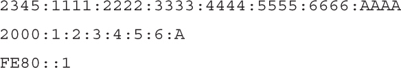</a>

<a href="#f0646-01a" id="code-f0646-01">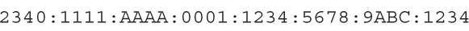</a>

<a href="#f0647-01a" id="code-f0647-01">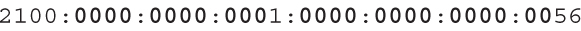</a>

<a href="#f0649-01a" id="code-f0649-01">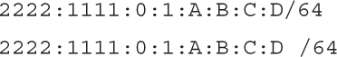</a>

<a href="#f0650-01a" id="code-f0650-01">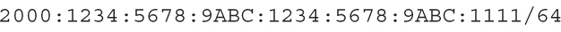</a>

<a href="#f0650-02a" id="code-f0650-02">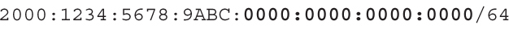</a>

<a href="#f0651-01a" id="code-f0651-01">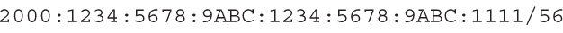</a>

<a href="#f0651-02a" id="code-f0651-02">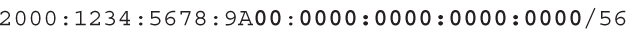</a>

</section>

</section>


<nav class="ccna-chapter-nav" aria-label="章节导航"><a href="v1-24.html">← 上一章</a><a href="v1-26.html">下一章 →</a></nav>
