
<a href="{{ '/subjects/CCNA/' | relative_url }}">← 返回 CCNA 目录</a>

第一卷 · IP 版本 6

<nav class="ccna-chapter-nav" aria-label="章节导航"><a href="v1-25.html">← 上一章</a><a href="v1-27.html">下一章 →</a></nav>



<section data-epub-type="chapter">

<h2 class="h2" id="ch26">第 26 章</h2>

<h2 class="h2a">IPv6 编址与子网划分</h2>

本章涵盖以下考试主题：

1.0 网络基础

1.8 配置并验证 IPv6 编址和前缀

1.9 描述 IPv6 地址类型

1.9.a 单播（全球、唯一本地和链路本地）

互联网号码分配机构（IANA）分配公有 IPv6 地址的过程，与 IPv4 使用 CIDR 地址块的方式很相似。IANA 先将部分 IPv6 地址空间定义为单播，其他部分定义为组播。大多数单播地址空间用作公有地址，少量空间保留用于特定目的。IANA 与 RIR 使用任意有效前缀长度定义并分配公有地址块，常见大小为 /32 到 /48。

本章有两个主要部分。第一部分介绍用作公有 IPv6 地址的<a id="key_274" href="#ref-gloss_161">全球单播地址（global unicast addresses）</a>，也讨论比 IPv4 简单得多的 IPv6 子网划分。第二部分介绍用作私有 IPv6 地址的<a id="key_280" href="#ref-gloss_423">唯一本地地址（unique local addresses）</a>。

<section>

<h3 class="h3" id="ch26lev1sec1">自测</h3>

如果你希望根据得分决定在本章投入多少时间，可以完成这组自测题（在此作答，或使用 PTP 软件）。各题答案的选项字母列在自测题之后的页面底部。书末和配套网站上的<a href="#ref-appc">附录 C</a>都包含答案及解析。你也可以在 PTP 测试软件中找到答案及解析。

<figure class="table" id="ch26tab01" tabindex="0">

<figcaption>

<strong>表 26-1</strong> 基础主题与问题对应关系

</figcaption>

<table class="all">

<thead>

<tr>

<th class="th">
基础知识小节
</th>

<th class="th">
题目
</th>

</tr>

</thead>

<tbody>

<tr>

<td class="border">
全球单播编址概念
</td>

<td class="border">
1–4
</td>

</tr>

<tr>

<td class="border">
唯一本地单播地址
</td>

<td class="border">
5
</td>

</tr>

</tbody>

</table>

</figure>

<strong><a id="quess26_1" href="#ques26_1a">1</a>．</strong> 根据开头几个十六进制数字，以下哪个 IPv6 地址看起来是唯一本地单播地址？

<ol class="lower-alpha">

<li>
3123:1:3:5::1
</li>

<li>
FE80::1234:56FF:FE78:9ABC
</li>

<li>
FDAD::1
</li>

<li>
FF00::5
</li>

</ol>

<strong><a id="quess26_2" href="#ques26_2a">2</a>．</strong> 根据开头几个十六进制数字，以下哪个 IPv6 地址看起来是全球单播地址？

<ol class="lower-alpha">

<li>
3123:1:3:5::1
</li>

<li>
FE80::1234:56FF:FE78:9ABC
</li>

<li>
FDAD::1
</li>

<li>
FF00::5
</li>

</ol>

<strong><a id="quess26_3" href="#ques26_3a">3</a>．</strong> 工程师划分 IPv6 地址块时，画图将地址结构分成三部分。与三部分的 IPv4 地址结构相比，IPv6 地址结构的哪一部分最类似于 IPv4 地址的网络部分？

<ol class="lower-alpha">

<li>
子网 ID
</li>

<li>
接口 ID
</li>

<li>
网络 ID
</li>

<li>
全球路由前缀
</li>

<li>
子网路由器任播
</li>

</ol>

<strong><a id="quess26_4" href="#ques26_4a">4</a>．</strong> 工程师划分 IPv6 地址块时，画图将地址结构分成三部分。假设所有子网使用相同的 /64 前缀长度，以下哪项给出了地址最右侧字段的名称？

<ol class="lower-alpha">

<li>
子网 ID
</li>

<li>
接口 ID
</li>

<li>
网络 ID
</li>

<li>
全球路由前缀
</li>

<li>
子网路由器任播
</li>

</ol>

<strong><a id="quess26_5" href="#ques26_5a">5</a>．</strong> 对于 IPv6 地址 FD00:1234:5678:9ABC:DEF1:2345:6789:ABCD，地址的哪一部分被视为唯一本地地址的全球 ID？

<ol class="lower-alpha">

<li>
没有；该地址没有全球 ID。
</li>

<li>
00:1234:5678:9ABC
</li>

<li>
DEF1:2345:6789:ABCD
</li>

<li>
00:1234:5678
</li>

<li>
FD00
</li>

</ol>

自测答案：

<strong><a id="ques26_1a" href="#ref-ques26_1">1</a></strong> C

<strong><a id="ques26_2a" href="#ref-ques26_2">2</a></strong> A

<strong><a id="ques26_3a" href="#ref-ques26_3">3</a></strong> D

<strong><a id="ques26_4a" href="#ref-ques26_4">4</a></strong> B

<strong><a id="ques26_5a" href="#ref-ques26_5">5</a></strong> D

</section>

<section>

<h3 class="h3box" id="ch26lev1sec2">基础知识</h3>

</section>

<section>

<h3 class="h3" id="ch26lev1sec3">全球单播编址概念</h3>

本章第一大节关注一种单播 IPv6 地址：全球单播地址。实际上，这类地址背后的许多总体概念和过程遵循公有 IPv4 地址的最初设计意图。因此，本节先回顾一些 IPv4 概念，再详细说明企业如何使用全球单播地址。

第一节还讨论 IPv6 子网划分，以及获取一块全球单播地址并为企业创建子网的完整过程。这个过程从全球唯一的全球路由前缀开始，创建 IPv6 子网，再从各子网内分配 IPv6 地址，与 IPv4 非常相似。

<section>

<h4 class="h4" id="ch26lev2sec1">公有和私有 IPv6 地址</h4>

全球 IPv4 地址的最初规划，要求为每个连接互联网的组织分配一个唯一的公有 IPv4 网络。各组织随后划分该网络并从中分配地址，使每个组织的每台主机都使用全世界唯一的 IPv4 地址。遗憾的是，当所有公司、组织和家庭都希望连接互联网时，IPv4 地址空间不足以实现这一计划，因此负责 IPv4 编址的人修改了规划。

作为修订规划的一部分，20 世纪 90 年代，企业开始使用 RFC 1918 定义的私有 IPv4 地址范围，并配合网络地址转换（NAT）。采用 NAT 和私有 IPv4 地址，使一个组织的所有主机访问互联网时，可以共享少量全球唯一的公有 IPv4 地址。

IPv6 也提供公有和私有单播编址两种类似选择，首先是作为公有 IPv6 地址空间的<em>全球单播</em>地址。与公有 IPv4 地址类似，IPv6 全球单播地址依赖管理分配过程，为每家企业分配唯一的 IPv6 地址块。企业随后划分该地址块，仅使用块内地址，因此每家企业使用的地址也在全球范围内唯一。

第二种选择是 IPv6 <em>唯一本地</em>地址，其作用类似于 IPv4 私有地址。不计划连接互联网的企业，以及计划使用 IPv6 NAT 的企业，都可使用唯一本地地址。在 IPv4 中，组织只需从 RFC 1918 的私有网络中选取数字。在 IPv6 中，则参考 RFC 4193，它建议使用随机过程选择唯一本地前缀。与 IPv4 私有网络一样，采用 IPv6 唯一本地地址（ULA）的组织若要连接互联网，需要少量公有 IPv6 地址并使用 NAT。

下列项目总结全球单播地址与唯一本地地址的比较：

<strong>全球单播地址（GUA）：</strong> 作用类似于公有 IPv4 地址。需要 IPv6 地址的组织申请注册 IPv6 地址块，以全球路由前缀的形式获得分配。此后，只有该组织使用该地址块内部的地址，也就是以所分配前缀开头的地址。

<strong>唯一本地地址（ULA）：</strong> 作用有些类似于私有 IPv4 地址，可能有多个组织使用完全相同的地址，且无须向任何号码管理机构注册。

第一大节其余部分将更详细地介绍全球单播地址，第二大节则介绍唯一本地地址。

</section>

<section>

<h4 class="h4" id="ch26lev2sec2">IPv6 全球路由前缀</h4>

IPv6 全球单播地址（GUA）让 IPv6 的工作方式更接近 IPv4 互联网的最初设计。每个组织申请一块其他组织不能使用的 IPv6 地址，再将它细分为称为<em>子网</em>的更小地址块。最后，工程师从正确的子网中选择一个地址，分配给主机使用。

这块保留给一家企业使用的 IPv6 地址，称为<a id="key_273" href="#ref-gloss_160">全球路由前缀（global routing prefix）</a>。每个希望连接互联网并使用 IPv6 GUA 的组织，都应申请并获得一个全球路由前缀。作为对比，可以将它视为公有 IPv4 地址范围中的 A、B 或 C 类网络号，或将其看作公有 CIDR 地址块。

<em>全球路由前缀</em>这一术语，一开始可能不会让你想到一块 IPv6 地址。它表达的含义是：互联网路由器可以用一条路由指向该地址块中的所有地址，而无须为其中更小的部分保留路由。例如，<a href="#ch26fig01">图 26-1</a> 展示三家企业各有不同的 IPv6 全球路由前缀；右侧位于互联网中的 R4，为每个全球路由前缀各保留一条 IPv6 路由。

<figure class="image-c" id="ch26fig01">

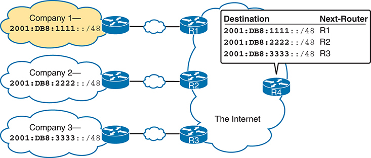

<figcaption>

<strong>图 26-1</strong> <em>三个全球路由前缀，每个前缀对应一条路由</em>

<aside class="hidden" id="a26fig01">

公司 1 标注前缀“2001:DB8:1111::/48”，通过以太网 WAN 连接 R1。公司 2 的前缀为“2001:DB8:2222::/48”，通过以太网 WAN 连接 R2。公司 3 的前缀为“2001:DB8:3333::/48”，通过以太网 WAN 连接 R3。三台路由器相互连接，并将数据路由到标为“互联网”的 R4。右侧的“目的地”和“下一台路由器”两列，列出各公司的全球路由前缀及对应路由器。

</aside>

</figcaption>

</figure>

图中三个全球路由前缀各定义一个 GUA 范围，分别保留给三家企业。以 2001:DB8:1111::/48 为例，前缀长度 48 恰好等于 12*4。下面第一种说法从更直接的二进制角度解释“2001:DB8:1111::/48”，第二种则给出更容易理解的十六进制角度：

前 48 位等于 2001:DB8:1111:: 前 48 位的地址

前 12 个十六进制数字等于 2001:DB8:1111:: 前 12 个十六进制数字的地址

地址分配过程将这些 IPv6 地址专门留给这一家企业使用，就像 IPv4 中的公有网络或 CIDR 地址块一样。企业内部的所有 IPv6 地址都应以全球路由前缀中的这些起始位开头。其他企业不应使用具有相同前缀的 IPv6 地址。好在 IPv6 空间充足，足以让所有企业都获得拥有大量地址的全球路由前缀。

IPv6 和 IPv4 地址分配过程依赖相同的组织：IANA（以及 ICANN）、区域互联网注册机构（RIR）和 ISP。例如，虚构的 Company1 获得了一个全球路由前缀。该前缀表示“前 12 个十六进制数字为 2001:0DB8:1111 的所有地址”，写作 2001:0DB8:1111::/48。获得这一分配需要经过 <a href="#ch26fig02">图 26-2</a> 所示过程。

<figure class="image-c" id="ch26fig02">

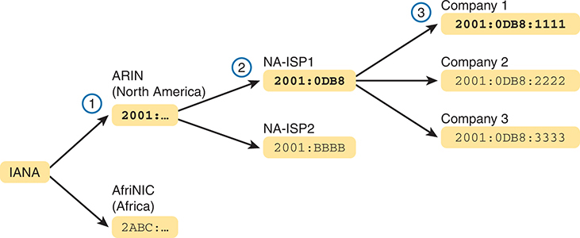

<figcaption>

<strong>图 26-2</strong> <em>IANA、RIR 与 ISP 进行前缀分配</em>

<aside class="hidden" id="a26fig02">

IANA 将前缀“2001:”分配给 ARIN（北美），将“2ABC:”分配给 AfriNIC（非洲）。ARIN 进一步将“2001:0DB8”分配给 NA-ISP1，将“2001:BBBB”分配给 NA-ISP2。随后，NA-ISP1 将具体前缀“2001:0DB8:1111”分配给公司 1，“2001:0DB8:2222”分配给公司 2，“2001:0DB8:3333”分配给公司 3。

</aside>

</figcaption>

</figure>

图中事件按从左到右的顺序发生，也就是说，最左侧的事件必须先发生。按图中从左到右的流程：

<ol class="number">

<li>
<strong>IANA 将前缀 2001::/16 分配给 ARIN：</strong> ARIN（北美的 RIR）向 IANA 申请一大块地址。在这个虚构示例中，IANA 将“所有以 2001 开头的地址”，即 2001::/16，分配给 ARIN。
</li>

<li>
<strong>ARIN 将前缀 2001:0DB8::/32 分配给 NA-ISP1：</strong> 虚构的北美 ISP NA-ISP1 向 ARIN 申请新的 IPv6 前缀。ARIN 从自己的 2001::/16 中取出一个子集，即以 32 位（8 个十六进制数字）2001:0DB8 开头的所有地址，分配给该 ISP。
</li>

<li>
<strong>NA-ISP1 将 2001:0DB8:1111::/48 分配给公司 1：</strong> 公司 1 决定开始支持 IPv6，因此向其 ISP NA-ISP1 申请一块 GUA。NA-ISP1 将其地址块中的一“小”部分分配给公司 1，本例是以 48 位（12 个十六进制数字）2001:0DB8:1111 开头的地址，即 2001:0DB8:1111::/48。
</li>

</ol>

注意

如果暂时不计划通过 IPv6 连接互联网，只想进行实验，就不必申请分配 IPv6 全球路由前缀。可以自行编造 IPv6 地址并配置设备，或使用本章后面讨论的唯一本地地址。

</section>

<section>

<h4 class="h4" id="ch26lev2sec3">全球单播地址的范围</h4>

全球单播地址占 IPv6 地址空间的大部分。不过，与 IPv4 不同，IPv6 地址所属类别的规则被有意设计得更加灵活，不像 IPv4 的 A、B、C、D、E 类规则那样固定。

IANA 将所有以十六进制 2 或 3 开头的 IPv6 地址分配为全球单播地址。前缀 2000::/3 正式定义了这一范围，表示前三位（由 /3 前缀长度决定）与 2000:: 前三位匹配的所有地址。进一步解释如下：

<ul class="sq">

<li>
第一个十六进制数字 2 对应二进制 0010。
</li>

<li>
/3 表示与所列前缀具有相同前三位的所有地址，本例为二进制 001。
</li>

<li>
前三位为 001 的十六进制值只有 2 和 3，没有其他值。
</li>

<li>
因此，前缀 2000::/3 表示所有以十六进制 2 或 3 开头的地址。
</li>

</ul>

如果需要，IANA 可以逐步将 GUA 范围扩展到 2000::/3 之外。奠定 IPv6 编址基础的 RFC 4291《IPv6 编址体系结构》，将所有没有另行保留的地址都留给 GUA 地址空间。不过，根据当前政策，IANA 仅从 2000::/3 范围分配全球单播地址。

注意

作为对比，如果将 2000::/3 GUA 地址空间全部按 /48 前缀分配给组织，可提供超过 30 万亿个 /48 全球路由前缀，每个前缀又允许 65,536 个子网。IANA 可能永远不会耗尽 2000::/3 GUA 地址空间。

<a href="#ch26tab02">表 26-2</a> 列出本书讨论的地址前缀及其用途。

<figure class="table" id="ch26tab02" tabindex="0">

<figcaption>

<strong>表 26-2</strong> 部分 IPv6 地址类型及其起始十六进制数字

</figcaption>

<table class="all">

<thead>

<tr>

<th class="th">
地址类型
</th>

<th class="th">
起始十六进制数字
</th>

</tr>

</thead>

<tbody>

<tr>

<td class="border">
全球单播
</td>

<td class="border">
2 或 3
</td>

</tr>

<tr>

<td class="border">
唯一本地
</td>

<td class="border">
FD
</td>

</tr>

<tr>

<td class="border">
组播
</td>

<td class="border">
FF
</td>

</tr>

<tr>

<td class="border">
链路本地
</td>

<td class="border">
FE80
</td>

</tr>

</tbody>

</table>

</figure>

</section>

<section>

<h4 class="h4" id="ch26lev2sec4">使用全球单播地址进行 IPv6 子网划分</h4>

企业获得一块保留的 GUA，也就是全球路由前缀后，需要将这个大地址块划分为子网。

IPv6 地址的子网划分总体上与 IPv4 类似，但大部分计算更简单（太好了！）。许多 IPv6 RFC 规定，网络中部署的所有子网，也就是在终端和路由器上配置的子网，都使用 /64 前缀长度。所有子网采用 /64，使 IPv6 子网计算像所有 IPv4 子网都使用 /24 掩码一样简单。此外，动态 IPv6 地址分配过程在 /64 前缀长度下也工作得更好。因此，在实践中以及本书中，都应预期 IPv6 设计使用 /64 子网前缀。

本节通过 /64 前缀长度的示例，逐步介绍 IPv6 子网划分的不同部分。讨论将定义哪些地址应属于同一子网、哪些需要属于不同子网的规则，还将介绍如何分析全球路由前缀及其长度，求出所有 IPv6 子网前缀及每个子网内的地址。

注意

如果对 IPv4 子网划分概念有些模糊，可以重读 <a href="v1-11.html#ch11">第 11 章</a>“<a href="v1-11.html#ch11">IPv4 子网划分的不同视角</a>”，其中讨论了 IPv4 子网划分概念。

<section>

<h5 class="h5" id="ch26lev3sec1">确定哪些位置需要 IPv6 子网</h5>

首先，IPv6 与 IPv4 对哪些位置需要子网采用相同概念：每个 VLAN 一个子网，每条点到点 WAN 连接（串行或以太网）一个子网。<a href="#ch26fig03">图 26-3</a> 以公司 1 的小型企业互连网络展示这一思路。公司 1 有两个 LAN，通过点到点以太网 WAN 链路连接两个站点，另外还有一条连接 ISP 的以太网 WAN 链路。使用与 IPv4 相同的逻辑，公司 1 需要四个 IPv6 子网。

<figure class="image-c" id="ch26fig03">

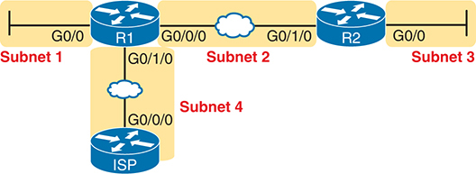

<figcaption>

<strong>图 26-3</strong> <em>IPv6 子网的位置</em>

<aside class="hidden" id="a26fig03">

网络配置包含两台路由器 R1、R2，一个互联网服务提供商（ISP）和四个子网。R1 通过 G0/0 接口及 WAN 线路连接子网 1，通过 G0/1/0 接口连接 ISP，ISP 则通过 G0/0/0 端口连接子网 4。R1 的 G0/0/0 接口通过 WAN 线路连接 R2 的 G0/1/0 接口。R2 通过 G0/0 端口连接子网 3。两台路由器通过各自的 G0/0/0 端口互连，子网 2 位于两者之间，经 R2 的 G0/1/0 端口连接。

</aside>

</figcaption>

</figure>

</section>

<section>

<h5 class="h5" id="ch26lev3sec2">IPv6 全球单播地址子网划分的机制</h5>

要理解如何划分一大块 IPv6 地址，需要了解 IPv6 使用的一些原理和机制。将 IPv6 与 IPv4 中相似的概念作比较，有助于掌握这些细节。

在 IPv4 中，未进行子网划分时，地址有网络部分和主机部分两部分。A、B、C 类规则定义网络部分长度，32 位 IPv4 地址的其余部分构成主机部分，如 <a href="#ch26fig04">图 26-4</a> 所示。

<figure class="image-c" id="ch26fig04">

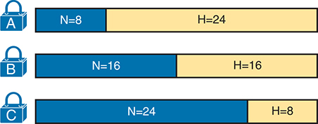

<figcaption>

<strong>图 26-4</strong> <em>未划分子网的 IPv4 网络的分类视图</em>

<aside class="hidden" id="a26fig04">

图中展示 A、B、C 三类 IPv4 网络。每类由横条表示，分为 N（网络）和 H（主机）两部分，注明各自位数。A 类网络部分为 8 位、主机部分为 24 位；B 类两部分各为 16 位；C 类网络部分较长，为 24 位，主机部分仅为 8 位。每类还标有锁图标，表示各自的类别。

</aside>

</figcaption>

</figure>

要划分 IPv4 A、B 或 C 类网络，企业网络工程师需要作出一些选择。从概念上看，工程师在中间增加子网字段、缩短主机字段，将地址看作三部分。（许多人将其称为“借用主机位”。）网络部分的大小仍由 A、B、C 类规则固定，而子网与主机部分的边界可根据所选子网掩码灵活变化。<a href="#ch26fig05">图 26-5</a> 展示了一个已划分子网的 B 类网络的字段名称及概念。

<figure class="image-c" id="ch26fig05">

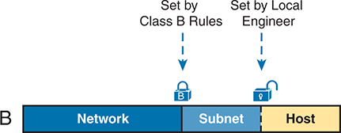

<figcaption>

<strong>图 26-5</strong> <em>已划分子网的 IPv4 网络的分类视图及字段名称</em>

<aside class="hidden" id="a26fig05">

网络分成“网络”“子网”和“主机”三部分。“网络”部分根据 B 类规则设定，“子网”和“主机”部分由本地工程师配置，图中用两个锁图标表示这些设置。

</aside>

</figcaption>

</figure>

首先，比较 <a href="#ch26fig06">图 26-6</a> 和 <a href="#ch26fig05">图 26-5</a>，理解 IPv6 的总体思路。IPv6 全球路由前缀（RIR 或 ISP 分配的前缀／长度）对应 IPv4 地址结构中的网络部分。IPv6 子网 ID 对应 IPv4 子网字段。IPv6 地址右侧正式称为<a id="key_275" href="#ref-gloss_194">接口 ID（interface ID）</a>，即接口标识符的缩写，也简称 <em>IID</em>，对应 IPv4 主机字段。

<figure class="image-c" id="ch26fig06">

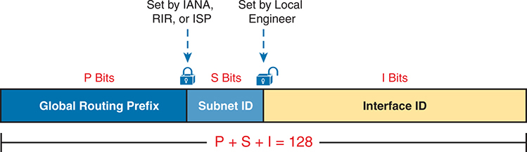

<figcaption>

<strong>图 26-6</strong> <em>已划分子网的 IPv6 全球单播地址结构</em>

<aside class="hidden" id="a26fig06">

地址分为“全球路由前缀”“子网 ID”和“接口 ID”三部分。全球路由前缀由 IANA、RIR 或 ISP 设定，包含 P 位。子网 ID 由本地工程师决定，包含 S 位。接口 ID 包含 I 位。底部公式“P + S + I = 128”表示三部分位数之和。

</aside>

</figcaption>

</figure>

现在关注 IPv6 全球路由前缀及其长度。IPv6 与 IPv4 不同，没有地址类别概念，因此没有预设规则决定全球路由前缀的长度。企业向 ISP、RIR 或其他有权分配全球路由前缀的组织申请时，得到的分配同时包含前缀及其长度。获得全球路由前缀及长度后，长度通常不会随时间改变，而是固定下来。（全球路由前缀长度通常在 /32 到 /48 之间，也可能长达 /56。）

接下来，查看 <a href="#ch26fig06">图 26-6</a> 右侧的接口 ID（IID）字段。多篇 RFC（包括 RFC 4291《IPv6 编址体系结构》）规定 IID 应长 64 位。64 位 IID 能与 IPv6 的动态地址分配方法良好配合。

最后，查看 <a href="#ch26fig06">图 26-6</a> 的子网 ID 字段。该字段提供了给 IPv6 子网编号的位置。其长度取决于全球路由前缀长度和接口 ID 长度。假设采用典型的 64 位 IID，子网 ID 字段通常为 64–P 位，其中 P 为全球路由前缀长度。

例如，考虑具体的全球单播 IPv6 地址 2001:0DB8:1111:0001:0000:0000:0000:0001 的结构，如 <a href="#ch26fig07">图 26-7</a> 所示。本例中：

<ul class="sq">

<li>
企业获得分配的全球路由前缀为 2001:0DB8:1111/48。

</li>

<li>
企业采用常见的 64 位接口 ID，子网前缀长度为 /64。
</li>

<li>
企业的子网字段为 16 位，允许 2<em>16</em> 个 IPv6 子网。
</li>

</ul>

<figure class="image-c" id="ch26fig07">

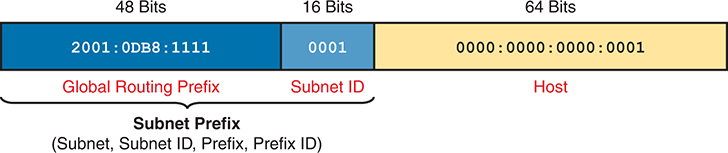

<figcaption>

<strong>图 26-7</strong> <em>公司 1 示例的地址结构</em>

<aside class="hidden" id="a26fig07">

地址分为“全球路由前缀”“子网 ID”和“主机”三部分。全球路由前缀长 48 位，值为“2001:0DB8:1111”；子网 ID 长 16 位，值为“0001”；主机部分长 64 位，值为“0000:0000:0000:0001”。横条下方的标签“子网前缀（子网、子网 ID、前缀、前缀 ID）”表示全球路由前缀与子网 ID 的组合。

</aside>

</figcaption>

</figure>

<a href="#ch26fig07">图 26-7</a> 的示例加上一点计算，说明了许多企业接受 64 位 IID 建议的一个原因。采用这种结构，公司 1 可以支持 2<em>16</em> 个子网（65,536 个），很少有企业需要如此多的子网。不过，RIR 和 ISP 在批准更大的公有 IPv6 地址块时可以很慷慨，因此即使 65,536 个子网已足够，企业仍可能申请并获得更短的全球路由前缀，如 /32 或 /40。这会提供更多子网（分别为 2<em>32</em> 和 2<em>24</em> 个），除了满足子网数量需求，还为子网设计和编号规划带来许多可能性。

接口 ID 有 64 位时，每个子网可容纳的主机数远远超过所需。采用 64 位 IID 的动机是支持各种 RFC，特别是与动态 IPv6 地址分配有关的 RFC，包括 DHCP 和 SLAAC。

</section>

<section>

<h5 class="h5" id="ch26lev3sec3">列出 IPv6 子网前缀（子网 ID）</h5>

在 Cisco 路由器上使用 IPv6 时，经常需要处理代表子网的数字。IPv6 中会用到以下术语：

<a id="key_277" href="#ref-gloss_391">子网前缀（subnet prefix）</a><strong>：</strong> 表示子网的数字的正式术语，包含 <a href="#ch26fig07">图 26-7</a> 中的全球路由前缀和子网 ID。

<a id="key_276" href="#ref-gloss_387">子网 ID 或前缀 ID</a><strong>：</strong> 作为子网前缀同义词使用的非正式术语。

虽然<em>子网前缀</em>一词来自 RFC，但由于<em>子网 ID</em> 在 IPv4 中的历史，人们往往更习惯使用后者。不过，需要注意可能产生的误解：子网 ID 的正式含义是 <a href="#ch26fig07">图 26-7</a> 中地址结构的中间部分，但也可能被当作子网前缀的同义词。

<a href="v1-25.html#ch25">第 25 章</a>“<a href="v1-25.html#ch25">IP 版本 6 基础</a>”已经讨论如何根据 IPv6 地址及前缀长度求子网前缀。无论是全球单播地址，还是本章后面讨论的唯一本地地址，计算方法都相同。回顾一个示例，<a href="#ch26fig07">图 26-7</a> 中地址的子网前缀为：

<pre class="pre" tabindex="0"><code class="highlight">2001:DB8:1111:1::/64</code></pre>

</section>

<section>

<h5 class="h5" id="ch26lev3sec4">列出所有 IPv6 子网</h5>

对于 IPv4，如果所有子网使用同一个掩码，就可据此求出 A、B 或 C 类网络的所有子网。相同思路适用于 IPv6，而 /64 前缀长度意味着无须二进制计算即可找出全部子网。

要找出所有子网 ID，只需找出能放入三部分 IPv6 地址的子网 ID 部分的所有唯一值，如 <a href="#ch26fig06">图 26-6</a> 和 <a href="#ch26fig07">图 26-7</a> 所示，基本规则如下：

<ul class="sq">

<li>
所有子网 ID 都以全球路由前缀开头。
</li>

<li>
在子网字段中使用不同的值标识各子网。
</li>

<li>
所有子网 ID 的接口 ID 部分均为全 0。
</li>

</ul>

以 <a href="#ch26fig07">图 26-7</a> 的 IPv6 设计为例，考虑全部子网 ID。首先，所有子网使用常见的 /64 前缀长度。企业的全球路由前缀为 2001:0DB8:1111::/48，定义了所有子网 ID 的前 12 个十六进制数字。所有可能的 IPv6 子网前缀列表，涵盖子网 ID 字段内的全部二进制组合，本例中该字段是第四个四位组。同时，用 :: 表示最后四个 0000 四位组。<a href="#ch26fig08">图 26-8</a> 展示了这一列表的开头。

<figure class="image-c" id="ch26fig08">

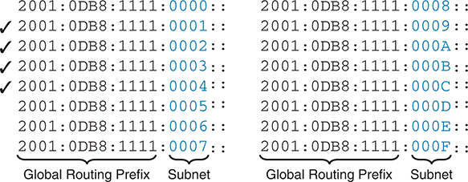

<figcaption>

<strong>图 26-8</strong> <em>本例中采用 16 位子网字段时的前 16 个可能子网</em>

<aside class="hidden" id="a26fig08">

对于子网字段为 16 位的 IPv6 地址，前 16 个可能子网均以相同的全球路由前缀“2001:0DB8:1111:”开头，后接变化的子网字段，十六进制值从“0000:”到“0009:”，再从“000A:”到“000F:”。第二至第五个 IPv6 地址前有勾选标记。

</aside>

</figcaption>

</figure>

本例允许 65,536 个子网，因此显然不会列出全部可能子网。不过，第四个四位组内的所有十六进制组合都允许使用。

注意

每个 IPv6 子网 ID，更正式地称为<a id="key_278" href="#ref-gloss_392">子网路由器任播地址（subnet router anycast address）</a>，都被保留，不应作为任何主机的 IPv6 地址使用。

</section>

<section>

<h5 class="h5" id="ch26lev3sec5">为互连网络拓扑分配子网</h5>

工程师根据子网设计列出所有可能的子网 ID 后，下一步是为每条需要 IPv6 子网的链路选择子网 ID。与 IPv4 一样，每个 VLAN、每条串行链路、每条以太网 WAN 链路以及许多其他数据链路实例都需要一个 IPv6 子网。

<a href="#ch26fig09">图 26-9</a> 再次以公司 1 为例，采用 <a href="#ch26fig08">图 26-8</a> 中旁边有勾选标记的四个子网。勾选只是提醒不要在其他位置重复使用这四个子网。

<figure class="image-c" id="ch26fig09">

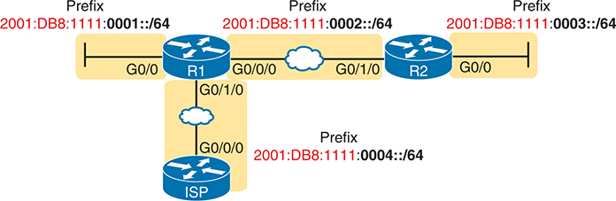

<figcaption>

<strong>图 26-9</strong> <em>全球路由前缀为 2001:0DB8:1111::/48 的公司 1 的子网</em>

<aside class="hidden" id="a26fig09">

网络包含 R1 和 R2 两台路由器，各自通过接口连接不同网段。各连接代表不同子网，标有对应 IPv6 地址前缀：2001:DB8:1111:0001::/64、2001:DB8:1111:0002::/64 和 2001:DB8:11111:0003::/64。第一个子网通过 G0/0 连接 R1；第二个子网位于 R1 与 R2 之间，分别通过 G0/0/0 和 G0/1/0 连接；第三个子网通过 G0/0 连接 R2。前缀为 2001:DB8:11111:0004::/64 的 ISP，通过以太网 WAN，从 G0/0/0 接口连接到 R1 的 G0/1/0 接口。

</aside>

</figcaption>

</figure>

</section>

</section>

<section>

<h4 class="h4" id="ch26lev2sec5">为子网中的主机分配地址</h4>

工程师规划好各位置使用的 IPv6 子网后，就可以规划并实施各个 IPv6 地址。每个地址必须唯一，不能有其他主机接口使用相同 IPv6 地址。同时，主机不能使用子网 ID 本身。

为接口分配 IPv6 地址的过程与 IPv4 类似。可以静态配置地址、前缀长度、默认路由器和域名系统（DNS）的 IPv6 地址。也可以让主机通过动态主机配置协议（DHCP），或 IPv6 内置的无状态地址自动配置（SLAAC）机制，动态学习这些相同设置。<a href="v1-28.html#ch28">第 28 章</a>“<a href="v1-28.html#ch28">在主机上实现 IPv6 编址</a>”将更深入地讨论 IPv6 地址分配。

例如，<a href="#ch26fig10">图 26-10</a> 展示了根据 <a href="#ch26fig09">图 26-9</a> 的子网选择，为路由器接口选取的一些静态 IP 地址。每个接口的接口 ID 都采用较小且便于记忆的数字。

<figure class="image-c" id="ch26fig10">

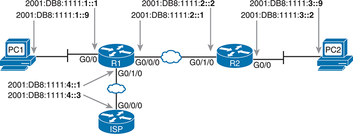

<figcaption>

<strong>图 26-10</strong> <em>基于 <a href="#ch26fig09">图 26-9</a> 子网设计的静态 IPv6 地址示例</em>

<aside class="hidden" id="a26fig10">

网络中有主机 PC1、PC2，路由器 R1、R2，以及一个 ISP。PC1 通过 G0/0 接口连接 R1，IPv6 地址从 2001:DB8:1111:1::1 到 ::9。R1 通过 G0/1/0 到 G0/0/0 的接口连接 ISP，IPv6 地址从 2001:DB8:111:4::1 到 ::3。R1 和 R2 分别通过 G0/0/0 与 G0/1/0 互连，IPv6 地址从 2001:DB8:111:2::1 到 ::2。PC2 通过 G0/0 接口连接 R2，IPv6 地址从 2001:DB8:111:3::2 到 ::9。

</aside>

</figcaption>

</figure>

本章将如何配置 IPv6 地址的细节留到 <a href="v1-27.html#ch27">第 27 章</a>“<a href="v1-27.html#ch27">在路由器上实现 IPv6 编址</a>”介绍。

</section>

</section>

<section>

<h3 class="h3" id="ch26lev1sec4">唯一本地单播地址</h3>

唯一本地地址（ULA）充当私有 IPv6 单播地址。它们与全球单播地址有许多相似之处，尤其在子网划分方面。最大的差异在于数值本身（ULA 以十六进制 FD 开头）和管理过程：ULA 前缀不向任何号码管理机构注册，并且可由多个组织使用。

虽然网络工程师创建唯一本地地址时不经过注册或分配过程，但地址仍需遵循以下规则：

<ul class="sq">

<li>
前两个十六进制数字使用 FD。

</li>

<li>
选择一个唯一的 40 位全球 ID。
</li>

<li>
将全球 ID 追加到 FD 后，形成 48 位前缀，作为所有地址的前缀。
</li>

<li>
将接下来的 16 位用作子网字段。
</li>

<li>
注意，这种结构留下了便于使用的 64 位接口 ID 字段。
</li>

</ul>

<a href="#ch26fig11">图 26-11</a> 展示了这些唯一本地单播地址的格式。

<figure class="image-c" id="ch26fig11">

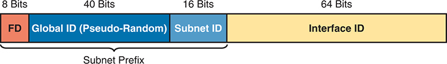

<figcaption>

<strong>图 26-11</strong> <em>IPv6 唯一本地单播地址格式</em>

<aside class="hidden" id="a26fig11">

格式图是一条分成四段的横条，每段代表 IPv6 地址的不同组成部分。第一段分配 8 位，标为“FD”；相邻一段分配 40 位，标为“全球 ID（伪随机）”；第三段分配 16 位，是“子网 ID”；最后一段分配 64 位，是“接口 ID”。前三段下方共同标为“子网前缀”。

</aside>

</figcaption>

</figure>

注意

严格来说，IANA 保留的 ULA 地址范围是前缀 FC00::/7，而不是 FD00::/8。FC00::/7 包括所有以十六进制 FC 和 FD 开头的地址。不过，ULA 的 RFC 4193 还要求将第八位置为 1，这意味着所有 ULA 的前两个十六进制数字都是 FD。

<section>

<h4 class="h4" id="ch26lev2sec6">使用唯一本地 IPv6 地址进行子网划分</h4>

假设从 48 位全球路由前缀开始，ULA 的子网划分方式与 GUA 相同。区别在于，GUA 的全球路由前缀及长度必须由外部分配，而 ULA 的前缀由你在本地创建，长度为 /48。

要选择 48 位（12 个十六进制数字）的 ULA 前缀，先以 FD 开头，再通过随机数过程选择十个十六进制数字。按照 ULA RFC，应使用规定的伪随机算法确定全球 ID。在实验室练习时，可以直接编造一个数字。例如，假设选取十位十六进制值 00 0001 0001，再在前面加 FD，整个前缀就是 FD00:0001:0001::/48，缩写后为 FD00:1:1::/48。

创建子网时，与前面使用 48 位全球路由前缀的示例一样，将整个第四个四位组作为子网 ID 字段，如 <a href="#ch26fig11">图 26-11</a> 所示。

<a href="#ch26fig12">图 26-12</a> 展示了使用唯一本地地址的子网规划示例。它重复使用前面 <a href="#ch26fig09">图 26-9</a> 的拓扑，后者展示了全球单播前缀的子网划分。本例为第四个四位组的子网字段采用完全相同的数字，只将 48 位全球单播前缀替换为新的唯一本地前缀 FD00:1:1。

<figure class="image-c" id="ch26fig12">

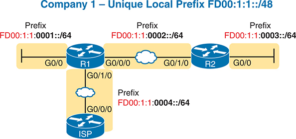

<figcaption>

<strong>图 26-12</strong> <em>使用唯一本地地址进行子网划分</em>

<aside class="hidden" id="a26fig12">

网络包含 R1 和 R2 两台路由器，各自通过接口连接不同网段。各连接代表不同子网，标有对应 IPv6 地址前缀：FD00:1:1:0001::/64、FD00:1:1:0002::/64 和 FD00:1:1:0003::/64。第一个子网通过 G0/0 接口连接 R1；第二个子网通过以太网 WAN 连接 R1 的 G0/0/0 与 R2 的 G0/1/0；第三个子网通过 G0/0 接口连接 R2。前缀为 FD00:1:1:0004::/64 的 ISP，通过以太网 WAN，从 G0/0/0 接口连接到 R1 的 G0/1/0 接口。

</aside>

</figcaption>

</figure>

</section>

<section>

<h4 class="h4" id="ch26lev2sec7">对全球唯一的本地地址的需求</h4>

<a href="#ch26fig12">图 26-12</a> 的示例使用易于记忆的前缀 FD00:1:1::/48。作者在此编造了一个容易记忆的全球 ID。你会为自己的企业选择什么全球 ID？会选择无法通过缩写来缩短的数字吗？如果必须从以下列表中为企业的 ULA 选择 IPv6 前缀，你会选哪一个？

<ul class="sq">

<li>
<code>FDE9:81BE:A059::/48</code>
</li>

<li>
<code>FDF0:E1D2:C3B4::/48</code>
</li>

<li>
<code>FD00:1:1::/48</code>
</li>

</ul>

如果可以自由选择，多数人会选易于记忆、输入简短的前缀，如 FD00:1:1::/48。在实验室或用于测试的小网络中，编造一个容易使用的数字是合理的。不过，在真实企业网络中，不应随意选择自己喜欢的全球 ID，而应遵守 ULA 规则，使 ULA 在全世界唯一，即使不向 ISP 或 RIR 注册前缀。

RFC 4193 强调选择全球 ID 时，应使其在统计上不太可能被其他企业使用。每家企业都具有唯一全球 ID 的结果是什么？这会让所有 <a id="key_279" href="#ref-gloss_419">ULA 全球 ID（ULA global IDs）</a> 在全球范围内唯一。因此，如果计划在真实网络中使用 ULA，应采用 RFC 4193 所列的随机数生成逻辑创建前缀。

尽量使用唯一前缀，而不是让大家都用相同的易记前缀，一个主要原因是为企业将来合并或收购其他公司做好准备。如今，在 IPv4 中，很大比例的企业使用私有网络 10.0.0.0。合并网络时，双方都使用 10.0.0.0，会比使用不同私有 IPv4 网络带来更多困难。采用 IPv6 ULA 时，如果两家企业都正确地随机选择前缀，就极有可能使用完全不同的前缀，使合并简单得多。不过，那些看似图省事、选择 FD00:1:1 这类易记前缀的企业，在与同样选择该前缀的另一家公司合并时，需要付出额外工作的风险会大幅增加。

</section>

</section>

</section>

<section class="ccna-source ccna-appendix" aria-label="答案解析与术语表">
<section data-epub-type="chapter">

<h2 class="h2" id="ref-appc">附录 C</h2>

<h2 class="h2a">自测题答案</h2>

<section>

<h3 class="h3" id="ref-appclev1sec26">第 26 章</h3>

<strong><a id="ref-ques26_1" href="#quess26_1">1</a>．</strong> C。唯一本地地址的前两个数字为 FD。

<strong><a id="ref-ques26_2" href="#quess26_2">2</a>．</strong> A。全球单播地址以十六进制 2 或 3 开头。

<strong><a id="ref-ques26_3" href="#quess26_3">3</a>．</strong> D。全球路由前缀定义由号码管理机构分配给组织的地址块，用前缀值和前缀长度表示。在前缀长度规定的位数内，全球路由前缀构成企业 IPv6 地址的起始部分。类似地，企业使用公有 IPv4 地址块时，所有地址在网络部分具有相同值，该部分也是 IPv4 地址的起始部分。

<strong><a id="ref-ques26_4" href="#quess26_4">4</a>．</strong> B。划分全球单播地址块，并为所有子网使用统一前缀长度时，地址被分为三部分：全球路由前缀、子网 ID 和接口 ID。

<strong><a id="ref-ques26_5" href="#quess26_5">5</a>．</strong> D。唯一本地地址以两位十六进制前缀 FD 开头，后接十位十六进制全球 ID。

</section>

</section>

<section id="ref-glossary"><h2 class="h2a">术语表</h2>
<strong>全球路由前缀（global routing prefix）</strong> 定义由全球单播地址构成的 IPv6 地址块的前缀，分配给一个组织，使该组织获得一块全球唯一的 IPv6 地址用于其网络。

<strong>全球单播地址（global unicast address）</strong> 一种从公有、全球唯一的 IP 地址范围中分配的单播 IPv6 地址，通过 IANA/ICANN、其成员机构及其他注册机构或 ISP 注册。

<strong>接口 ID（Interface ID）</strong> IPv6 地址结构最末端（最右侧）的部分，通常长 64 位。

<strong>子网 ID（前缀 ID）</strong> <em>参见</em><a href="#ref-gloss_389">子网号</a>。

<strong>子网号</strong> 在 IPv4 中，代表某个子网全部地址的点分十进制数。从数值上说，它是子网数值范围中的最小值，已被保留，不能由主机用作单播 IP 地址。

<strong>子网前缀（subnet prefix）</strong> 表示 IPv6 子网的数字所用的术语。

<strong>子网路由器任播地址（subnet router anycast address）</strong> 每个 IPv6 子网中的特殊任播地址，保留给路由器使用，以便将数据包发送给子网上的任意一台路由器。其数值与该子网的子网 ID 相同。

<strong>ULA 全球 ID（ULA global ID）</strong> 一个组织的唯一本地地址（ULA）采用 /48 前缀，由前 8 位固定的十六进制 FD，以及十位十六进制数字（40 位）的全球 ID 构成；全球 ID 应由伪随机算法生成。

<strong>唯一本地地址（unique local address）</strong> 一种旨在替代 IPv4 私有地址的 IPv6 单播地址。

</section>
</section>


<nav class="ccna-chapter-nav" aria-label="章节导航"><a href="v1-25.html">← 上一章</a><a href="v1-27.html">下一章 →</a></nav>
