
<a href="{{ '/subjects/CCNA/' | relative_url }}">← 返回 CCNA 目录</a>

第一卷 · IP 版本 6

<nav class="ccna-chapter-nav" aria-label="章节导航"><a href="v1-26.html">← 上一章</a><a href="v1-28.html">下一章 →</a></nav>



<section data-epub-type="chapter">

<h2 class="h2" id="ch27">第 27 章</h2>

<h2 class="h2a">在路由器上实现 IPv6 编址</h2>

本章涵盖以下考试主题：

1.0 网络基础

1.8 配置并验证 IPv6 编址和前缀

1.9 描述 IPv6 地址类型

1.9.a 单播（全球、唯一本地和链路本地）

1.9.b 任播

1.9.c 组播

1.9.d 修改后的 EUI-64

在 IPv4 编址中，服务器和路由器等设备通常使用预先定义的静态 IPv4 地址。终端用户设备并不在意地址偶尔变化，通常通过 DHCP 动态学习 IPv4 地址。IPv6 采用相同方法：由 IT 团队管理的服务器、路由器和其他设备往往使用预定义 IPv6 地址，终端用户设备则使用动态学习的 IPv6 地址。

本章重点介绍路由器上的 IPv6 地址配置，下一章关注终端用户设备。本章先介绍较直观、与 IPv4 功能相对应的 IPv6 编址配置，展示如何为接口配置 IPv6 地址，并通过 <strong>show</strong> 命令查看配置。后半章介绍相对于 IPv4 新增的 IPv6 编址概念，展示路由器执行不同任务时使用的其他 IPv6 地址。

<section>

<h3 class="h3" id="ch27lev1sec1">自测</h3>

如果你希望根据得分决定在本章投入多少时间，可以完成这组自测题（在此作答，或使用 PTP 软件）。各题答案的选项字母列在自测题之后的页面底部。书末和配套网站上的<a href="#ref-appc">附录 C</a>都包含答案及解析。你也可以在 PTP 测试软件中找到答案及解析。

<figure class="table" id="ch27tab01" tabindex="0">

<figcaption>

<strong>表 27-1</strong> 基础主题与问题对应关系

</figcaption>

<table class="all">

<thead>

<tr>

<th class="th">
基础知识小节
</th>

<th class="th">
题目
</th>

</tr>

</thead>

<tbody>

<tr>

<td class="border">
在路由器上实现单播 IPv6 地址
</td>

<td class="border">
1–4
</td>

</tr>

<tr>

<td class="border">
路由器使用的特殊地址
</td>

<td class="border">
5–8
</td>

</tr>

</tbody>

</table>

</figure>

<strong><a id="quess27_1" href="#ques27_1a">1</a>．</strong> 路由器 R1 有一个名为 Gigabit Ethernet 0/1 的接口，其 MAC 地址设为 0200.0001.000A。在 R1 的 Gigabit Ethernet 0/1 配置模式下添加以下哪条命令，可为该接口赋予单播 IPv6 地址 2001:1:1:1:1:200:1:A，前缀长度为 /64？

<ol class="lower-alpha">

<li>
<strong>ipv6 address 2001:1:1:1:1:200:1:A/64</strong>
</li>

<li>
<strong>ipv6 address 2001:1:1:1:1:200:1:A/64 eui-64</strong>
</li>

<li>
<strong>ipv6 address 2001:1:1:1:1:200:1:A  /64 eui-64</strong>
</li>

<li>
<strong>ipv6 address 2001:1:1:1:1:200:1:A  /64</strong>
</li>

<li>
其他答案都不正确。
</li>

</ol>

<strong><a id="quess27_2" href="#ques27_2a">2</a>．</strong> 路由器 R1 有一个名为 Gigabit Ethernet 0/1 的接口，其 MAC 地址设为 5055.4444.3333。该接口配置了 <strong>ipv6 address 2000:1:1:1::/64 eui-64</strong> 子命令。接口将使用哪个单播地址？

<ol class="lower-alpha">

<li>
2000:1:1:1:52FF:FE55:4444:3333
</li>

<li>
2000:1:1:1:5255:44FF:FE44:3333
</li>

<li>
2000:1:1:1:5255:4444:33FF:FE33
</li>

<li>
2000:1:1:1:200:FF:FE00:0
</li>

</ol>

<strong><a id="quess27_3" href="#ques27_3a">3</a>．</strong> R1 当前支持 IPv4，在所有接口上接收和发送路由数据包。现在必须迁移 R1 的配置以支持双栈，同时路由 IPv4 和 IPv6。在路由器支持路由 IPv6 数据包之前，必须执行哪些任务？（选择两个答案。）

<ol class="lower-alpha">

<li>
使用 <strong>ipv6 address</strong> 接口子命令，在每个接口上启用 IPv6。
</li>

<li>
使用 <strong>ip versions 4 6</strong> 全局命令启用对两个版本的支持。
</li>

<li>
使用 <strong>ipv6 unicast-routing</strong> 全局命令启用 IPv6 路由。
</li>

<li>
使用 <strong>ip routing dual-stack</strong> 全局命令迁移到双栈路由。
</li>

</ol>

<strong><a id="quess27_4" href="#ques27_4a">4</a>．</strong> 路由器在 G0/0/0 接口上配置了 <strong>ipv6 address</strong> 接口子命令，以下哪些命令可以显示路由器根据地址／前缀长度计算出的 IPv6 前缀？（选择两个答案。）

<ol class="lower-alpha">

<li>
<strong>show ipv6 address</strong>
</li>

<li>
<strong>show ipv6 route connected</strong>
</li>

<li>
<strong>show ipv6 interface brief</strong>
</li>

<li>
<strong>show ipv6 interface g0/0/0</strong>
</li>

</ol>

<strong><a id="quess27_5" href="#ques27_5a">5</a>．</strong> R1 有一个名为 Gigabit Ethernet 0/1 的接口，其 MAC 地址设为 0200.0001.000A。随后为该接口配置 <strong>ipv6 address 2001:1:1:1:200:FF:FE01:B/64</strong> 接口子命令，没有配置其他 <strong>ipv6 address</strong> 命令。以下哪个答案列出了该接口使用的链路本地地址？

<ol class="lower-alpha">

<li>
FE80::FF:FE01:A
</li>

<li>
FE80::FF:FE01:B
</li>

<li>
FE80::200:FF:FE01:A
</li>

<li>
FE80::200:FF:FE01:B
</li>

</ol>

<strong><a id="quess27_6" href="#ques27_6a">6</a>．</strong> 以下哪个组播地址被定义为仅向本地链路上的 IPv6 路由器发送数据包的地址？

<ol class="lower-alpha">

<li>
FF02::1
</li>

<li>
FF02::2
</li>

<li>
FF02::5
</li>

<li>
FF02::A
</li>

</ol>

<strong><a id="quess27_7" href="#ques27_7a">7</a>．</strong> 主机 C 必须将数据包转发给默认网关 2001:db8:1:1::1234:5678，但邻居表中还没有该地址的表项。主机 C 会向哪个被请求节点组播地址发送 NDP 邻居请求（NS）？

<ol class="lower-alpha">

<li>
FF02::1:ff34:5678
</li>

<li>
FF02::1:ff12:3456
</li>

<li>
FF02::1ff:1234:5678
</li>

<li>
FF02::1ff:34:5678
</li>

</ol>

<strong><a id="quess27_8" href="#ques27_8a">8</a>．</strong> 路由器在 G0/0/1 上使用 <strong>ipv6 enable</strong> 子命令，在 G0/0/2 上使用 <strong>ipv6 address autoconfig</strong> 命令，在 G0/0/3 上使用 <strong>ipv6 address 2002:db8:1:1::1/64</strong> 命令。命令均成功执行，按照各自的正常行为动态或静态创建预期地址。关于各接口的链路本地地址（LLA），哪些答案正确？（选择两个答案。）

<ol class="lower-alpha">

<li>
G0/0/1 没有 LLA。
</li>

<li>
G0/0/1 有 LLA。
</li>

<li>
G0/0/2 具有 LLA 和全球单播地址，且两者接口 ID 相同。
</li>

<li>
G0/0/3 有全球单播地址，但没有 LLA。
</li>

</ol>

自测答案：

<strong><a id="ques27_1a" href="#ref-ques27_1">1</a></strong> A

<strong><a id="ques27_2a" href="#ref-ques27_2">2</a></strong> B

<strong><a id="ques27_3a" href="#ref-ques27_3">3</a></strong> A、C

<strong><a id="ques27_4a" href="#ref-ques27_4">4</a></strong> B、D

<strong><a id="ques27_5a" href="#ref-ques27_5">5</a></strong> A

<strong><a id="ques27_6a" href="#ref-ques27_6">6</a></strong> B

<strong><a id="ques27_7a" href="#ref-ques27_7">7</a></strong> A

<strong><a id="ques27_8a" href="#ref-ques27_8">8</a></strong> B、C

</section>

<section>

<h3 class="h3box" id="ch27lev1sec2">基础知识</h3>

</section>

<section>

<h3 class="h3" id="ch27lev1sec3">在路由器上实现单播 IPv6 地址</h3>

每家企业都以一种或多种协议模型或协议栈构建企业网络。网络发展的早期，企业使用来自不同厂商的一种或多种协议栈，如 <a href="#ch27fig01">图 27-1</a> 左侧所示。随着时间推移，企业加入了基于 IPv4 的 TCP/IP，最终完全迁移到 TCP/IP，仅使用这一种协议栈。

IPv6 可能有一天会完全替代 IPv4；不过，在漫长的迁移阶段，大多数企业会在主机和路由器上同时运行 IPv4 和 IPv6，实际上像过去一样使用多个协议栈。随着时间推移，主机会越来越多地使用 IPv6，直到某一天可能关闭 IPv4，仅运行 IPv6，如 <a href="#ch27fig02">图 27-2</a> 所示。

<figure class="image-c" id="ch27fig01">

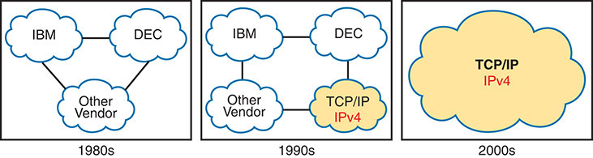

<figcaption>

<strong>图 27-1</strong> <em>企业网络迁移到仅使用 TCP/IP 协议栈（IPv4）</em>

<aside class="hidden" id="a27fig01">

在 20 世纪 80 年代，图中一个网络云连接“IBM”“DEC”和“其他厂商”三个标签。90 年代，网络云连接“IBM”“DEC”“其他厂商”和“TCP/IP IPv4”四个标签。到 2000 年代，图示简化为一个标有“TCP/IP IPv4”的大云，象征企业网络已完全迁移到该协议。

</aside>

</figcaption>

</figure>

<figure class="image-c" id="ch27fig02">

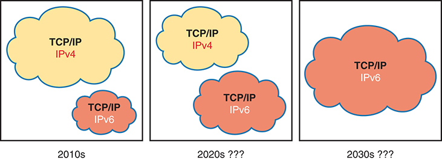

<figcaption>

<strong>图 27-2</strong> <em>长期通过双栈（IPv4 和 IPv6）迁移的一种可能路径</em>

<aside class="hidden" id="a27fig02">

在 2010 年代，图中有两个网络云，分别代表 TCP/IP IPv4 和 TCP/IP IPv6。到 2020 年代，两个版本仍然存在，但带有问号，表示不确定性。到 2030 年代，图中较大的云代表 TCP/IP IPv6，暗示它可能占据主导地位。

</aside>

</figcaption>

</figure>

使用<a id="key_284" href="#ref-gloss_114">双栈（dual stacks）</a>，即同时运行 IPv4 和 IPv6，对今天的企业网络很合理。为此，在路由器接口上配置 IPv6 地址，使其路由 IPv6 数据包，并通过路由协议通告 IPv6 路由，同时继续使用 IPv4 地址和路由协议完成同样的工作。主机和服务器上也同时实施 IPv4 和 IPv6。主机采用新的方法决定何时使用哪种版本，并优先选择 IPv6。

双栈策略运行良好，而 IPv6 的配置模型与 IPv4 非常相似。为此，本章第一大节介绍如何在路由器上配置和验证单播 IPv6 地址。

<section>

<h4 class="h4" id="ch27lev2sec1">静态单播地址配置</h4>

Cisco 路由器提供两种静态配置 IPv6 地址的方式。一种是配置完整的 128 位地址和标准 /64 前缀长度；另一种是配置 64 位前缀，让路由器推导地址的后半部分，即接口 ID（IID）。接下来的几页展示这两种方式。

<section>

<h5 class="h5" id="ch27lev3sec1">配置完整的 128 位地址</h5>

要静态配置完整的 128 位单播地址，无论全球单播地址（GUA）还是唯一本地地址（ULA），使用 <strong>ipv6 address</strong> <em>address</em>/<em>prefix-length</em> 接口子命令。该命令接受缩写或完整地址，后接斜杠和前缀长度，中间不能有空格。<a href="#exa27_1">例 27-1</a> 和 <a href="#exa27_2">例 27-2</a> 分别展示 <a href="#ch27fig03">图 27-3</a> 中 R1 和 R2 的 IPv6 GUA 配置。

<figure class="image-c" id="ch27fig03">

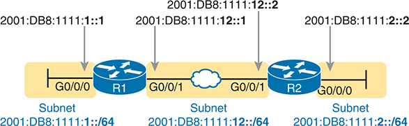

<figcaption>

<strong>图 27-3</strong> <em>将配置到 Cisco 路由器接口上的 128 位 IPv6 地址示例</em>

<aside class="hidden" id="a27fig03">

R1 和 R2 各有 G0/0/0 与 G0/0/1 两个接口。R1 的 G0/0/0 配置 IPv6 地址“2001:DB8:1111:1::1”，G0/0/1 配置“2001:DB8:111:12::1”。R2 的 G0/0/0 配置“2001:DB8:111:2::2”，G0/0/1 配置“2001:DB8:111:12::2”。两台路由器通过以太网 WAN 相连。图中三个子网连接路由器，分别标有相应的 IPv6 地址。

</aside>

</figcaption>

</figure>

<strong>例 27-1</strong> <em>在 R1 上配置静态 IPv6 地址</em>

<a href="#code-f0672-01" id="f0672-01a">点击此处查看代码原图</a>

<pre class="pre-ex" tabindex="0"><code class="highlight">ipv6 unicast-routing
!
interface GigabitEthernet0/0/0
 ipv6 address 2001:DB8:1111:1::1/64
!
! Below, note the expanded address. IOS will abbreviate the address for you.
interface GigabitEthernet0/0/1
 ipv6 address 2001:0db8:1111:0012:0000:0000:0000:0001/64</code></pre>

<strong>例 27-2</strong> <em>在 R2 上配置静态 IPv6 地址</em>

<a href="#code-f0672-02" id="f0672-02a">点击此处查看代码原图</a>

<pre class="pre-ex" tabindex="0"><code class="highlight">ipv6 unicast-routing
!
interface GigabitEthernet0/0/0
 ipv6 address 2001:DB8:1111:2::2/64
!
interface GigabitEthernet0/0/1
 ipv6 address 2001:db8:1111:12::2/64 </code></pre>

注意

<a href="#exa27_1">例 27-1</a> 中的 R1 配置展示了实际输入的命令。一条 <strong>ipv6 address</strong> 命令采用大写十六进制数字的缩写地址，另一条采用小写十六进制数字的完整地址。IOS 接受两条命令，但随后会将它们改为使用大写十六进制数字的缩写形式。

</section>

<section>

<h5 class="h5" id="ch27lev3sec2">启用 IPv6 路由</h5>

有趣的是，Cisco 路由器默认启用 IPv4 路由，却不启用 IPv6 路由。全局命令 <strong>ip routing</strong>（默认设置）启用 IPv4 数据包路由。要路由 IPv6 数据包，还必须配置 <strong>ipv6 unicast-routing</strong> 全局命令。

如果忘记配置 <strong>ipv6 unicast-routing</strong> 全局命令，路由器仍会接受 <strong>ipv6 address</strong> 接口子命令。此时，路由器充当 IPv6 主机，可以发送自己生成的 IPv6 数据包。但是，只有配置了 <strong>ipv6 unicast-routing</strong> 全局命令后，它才会路由 IPv6 数据包，也就是转发从接口收到的 IPv6 数据包。

</section>

<section>

<h5 class="h5" id="ch27lev3sec3">验证 IPv6 地址配置</h5>

IPv6 使用许多在语法上模仿 IPv4 <strong>show</strong> 命令的 <strong>show</strong> 命令。例如：

<ul class="sq">

<li>
<strong>show ipv6 interface brief</strong> 提供接口 IPv6 地址信息，但不提供前缀长度信息，类似于 IPv4 的 <strong>show ip interface brief</strong> 命令。
</li>

<li>
<strong>show ipv6 interface</strong> 提供 IPv6 接口设置的详细信息，很像 IPv4 的 <strong>show ip interface</strong> 命令。
</li>

</ul>

最常用命令中一个显著差异是，<strong>show interfaces</strong> 仍然列出 IPv4 地址和掩码，却不提供任何 IPv6 信息。因此，要查看 IPv6 接口地址，请使用以 <strong>show ipv6</strong> 开头的命令。<a href="#exa27_3">例 27-3</a> 列出 R1 的几个示例，后面给出说明。

<strong>例 27-3</strong> <em>验证路由器 R1 上的静态 IPv6 地址</em>

<a href="#code-f0673-01" id="f0673-01a">点击此处查看代码原图</a>

<pre class="pre-ex" tabindex="0"><code class="highlight">! The first interface is in subnet 1
R1# <strong>show ipv6 interface GigabitEthernet 0/0/0</strong>
GigabitEthernet0/0/0 is up, line protocol is up
  IPv6 is enabled, link-local address is FE80::11FF:FE11:1111
  No Virtual link-local address(es):
  Global unicast address(es):
    2001:DB8:1111:1::1, subnet is 2001:DB8:1111:1::/64 
  Joined group address(es):
    FF02::1
    FF02::2
    FF02::1:FF00:1
    FF02::1:FF11:1111
  MTU is 1500 bytes
  ICMP error messages limited to one every 100 milliseconds
  ICMP redirects are enabled
  ICMP unreachables are sent
  ND DAD is enabled, number of DAD attempts: 1
  ND reachable time is 30000 milliseconds (using 30000)
  ND advertised reachable time is 0 (unspecified)
  ND advertised retransmit interval is 0 (unspecified)
  ND router advertisements are sent every 200 seconds
  ND router advertisements live for 1800 seconds
  ND advertised default router preference is Medium
  Hosts use stateless autoconfig for addresses.

R1# <strong>show ipv6 interface brief</strong>
GigabitEthernet0/0/0     [up/up]
    FE80::11FF:FE11:1111
    2001:DB8:1111:1::1
GigabitEthernet0/0/1     [up/up]
    FE80::32F7:DFF:FE29:8568
    2001:DB8:1111:12::1
GigabitEthernet0/0/2     [administratively down/down]
    unassigned
GigabitEthernet0/0/3     [administratively down/down]
    unassigned</code></pre>

首先看示例顶部的 <strong>show ipv6 interface</strong> 输出，它列出 G0/0/0 接口，仅显示该接口的信息。输出列出配置的 IPv6 地址、前缀长度，以及路由器根据该地址计算出的 IPv6 子网 2001:DB8:1111:1::/64。

示例最后，<strong>show ipv6 interface brief</strong> 列出 IPv6 地址，不列出前缀长度或前缀。注意，这条命令还会列出所有接口，无论是否配置了 IPv6 地址。

与 IPv4 一样，路由器根据 IPv6 地址配置向 IPv6 路由表添加直连路由。接口正常工作（up/up）时保留这些路由，接口 down 时删除它们，同样与 IPv4 一致。<a href="#exa27_4">例 27-4</a> 展示了 <a href="#ch27fig03">图 27-3</a> 中 R1 的 IPv6 直连路由。

<strong>例 27-4</strong> <em>显示路由器 R1 上的 IPv6 直连路由</em>

<a href="#code-f0674-01" id="f0674-01a">点击此处查看代码原图</a>

<pre class="pre-ex" tabindex="0"><code class="highlight">R1# <strong>show ipv6 route connected</strong>
IPv6 Routing Table - default - 5 entries
Codes: C - Connected, L - Local, S - Static, U - Per-user Static route
       B - BGP, R - RIP, H - NHRP, I1 - ISIS L1
       I2 - ISIS L2, IA - ISIS interarea, IS - ISIS summary, D - EIGRP
       EX - EIGRP external, ND - ND Default, NDp - ND Prefix, DCE - Destination
       NDr - Redirect, O - OSPF Intra, OI - OSPF Inter, OE1 - OSPF ext 1
       OE2 - OSPF ext 2, ON1 - OSPF NSSA ext 1, ON2 - OSPF NSSA ext 2
       a - Application, m – OMP
C   2001:DB8:1111:1::/64 [0/0]
     via GigabitEthernet0/0/0, directly connected
C   2001:DB8:1111:12::/64 [0/0]
     via GigabitEthernet0/0/1, directly connected</code></pre>

</section>

<section>

<h5 class="h5" id="ch27lev3sec4">使用修改后的 EUI-64 生成唯一接口 ID</h5>

IOS 支持两种配置永久、稳定的路由器 IPv6 接口地址的方法。<a href="#exa27_1">例 27-1</a> 和 <a href="#exa27_2">例 27-2</a> 展示第一种方法，即配置完整的 128 位地址。第二种使用相同的 <strong>ipv6 address</strong> 命令，但只为接口配置 64 位 IPv6 前缀，让路由器自动生成唯一 IID。

第二种方法使用称为<em>修改后的 EUI-64</em>（扩展唯一标识符），或简称 <a id="key_285" href="#ref-gloss_139">EUI-64</a> 的规则来生成地址后半部分。使用时，在命令末尾添加 <strong>eui-64</strong> 关键字，路由器随后按以下 EUI-64 规则创建地址的 IID 部分：

<ol class="number">

<li>
将 6 字节（12 个十六进制数字）的 MAC 地址分成两半，每半六个十六进制数字。

</li>

<li>
在两半之间插入 FFFE，使接口 ID 达到 16 个十六进制数字（64 位）。
</li>

<li>
将 IID 的第七位取反。
</li>

</ol>

<a href="#ch27fig04">图 27-4</a> 直观展示修改后的 EUI-64 过程。

<figure class="image-c" id="ch27fig04">

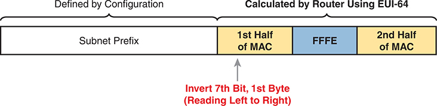

<figcaption>

<strong>图 27-4</strong> <em>包含接口 ID 和 EUI-64 的 IPv6 地址格式</em>

<aside class="hidden" id="a27fig04">

横条分为“由配置定义”和“由路由器使用 EUI-64 计算”两大部分。前者包含一个标为“子网前缀”的部分；后者进一步分为“MAC 前半部分”“FFFE”和“MAC 后半部分”，共同组成接口 ID。一个标为“将第一个字节的第七位取反（从左向右读）”的操作指向“MAC 前半部分”。

</aside>

</figcaption>

</figure>

注意

你可以在配套网站本章的“本章复习”部分找到关于 EUI-64 过程的视频。

虽然这个过程看起来有点复杂，但它确实有效。稍加练习，你就能快速发现 IPv6 地址 IID 中间的 FFFE，再轻松找出对应接口 MAC 地址的两半。不过，你也需要能够自己计算，以预测接口上采用修改后 EUI-64 格式的 IPv6 地址。

考虑 <a href="#ch27fig05">图 27-5</a> 左右两个不同示例。两者都展示了除第七位取反之外的所有步骤。都从 MAC 地址开始，将其分成两半（步骤 2），第三步在中间插入 FFFE，第四步按 IPv6 约定每四个十六进制数字插入一个冒号。

<figure class="image-c" id="ch27fig05">

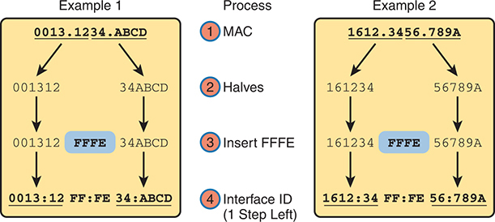

<figcaption>

<strong>图 27-5</strong> <em>EUI-64 接口 ID 过程的两个部分示例</em>

<aside class="hidden" id="a27fig05">

示例 1 将 MAC 地址“0013.1234.ABCD”分为“001312”和“34ABCD”两半，然后在中间插入“FFFE”，得到“0013:12FF:FE34:ABCD”。类似地，示例 2 将“1612.3456.789A”分为“161234”和“56789A”，插入“FFFE”后得到接口 ID“1612:34FF:FE56:789A”。

</aside>

</figcaption>

</figure>

要完成修改后的 EUI-64 过程，需要将第七位取反。按照 <a href="#ch27fig06">图 27-6</a>，将第一个字节（前两个十六进制数字）转换为二进制，再将八位中的第七位取反：0 变 1，1 变 0。最后将这八位转回两个十六进制数字。

<figure class="image-c" id="ch27fig06">

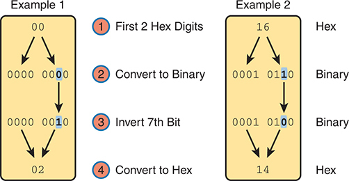

<figcaption>

<strong>图 27-6</strong> <em>将 EUI-64 接口 ID 字段的第七位取反</em>

<aside class="hidden" id="a27fig06">

第一个示例将十六进制“00”转换为二进制“0000 0000”，第七位取反后变为“0000 0010”，再转回十六进制“02”。第二个示例对十六进制“16”执行类似过程，转换为“0001 0110”，第七位取反后为“0001 0100”，再转回十六进制“14”。步骤包括初始十六进制数字、对应二进制值、第七位取反，以及取反后的最终十六进制结果。

</aside>

</figcaption>

</figure>

注意

如果不记得如何进行十六进制与二进制转换，请花一点时间复习。记住 0 到 F 共 16 个十六进制数字及对应二进制值后，转换会很容易。如果还没有熟记，请查看 <a data-original-href="vol1_appa.xhtml#appa" data-unavailable="true" title="此内容不在当前提取范围内；请参阅原始 EPUB：vol1_appa.xhtml#appa">附录 A</a>“<a data-original-href="vol1_appa.xhtml#appa" data-unavailable="true" title="此内容不在当前提取范围内；请参阅原始 EPUB：vol1_appa.xhtml#appa">数值参考表</a>”中的 <a data-original-href="vol1_appa.xhtml#appatab02" data-unavailable="true" title="此内容不在当前提取范围内；请参阅原始 EPUB：vol1_appa.xhtml#appatab02">表 A-2</a>。

如果偏好十进制捷径，只需少量记忆，就可完成位翻转计算，无须进行十六进制与二进制转换。首先注意，对于十六进制 IPv6 地址，第七位取反会翻转某一个十六进制数字所代表四位中的第三位。十六进制数字只有 16 种，可以记住各数字第三位取反后的结果，并利用 <a href="#ch27fig07">图 27-7</a> 快速记忆。为掌握概念，可按以下指示重复画图几次，随手取一张草稿纸即可：

步骤 1． 写下十六进制 0 到 F，但按图左侧的方式排列，并按图留出间距。（无须画箭头或写“A Little Space”文字，它们只是操作提示。）

步骤 2． 画线连接相邻的十六进制数字对。

<figure class="image-c" id="ch27fig07">

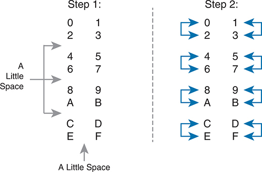

<figcaption>

<strong>图 27-7</strong> <em>帮助记忆位取反捷径的助记方法</em>

<aside class="hidden" id="a27fig07">

步骤 1 展示四行字符：第一行为“0”至“3”，第二行为“4”至“7”，第三行为“8”“9”“A”“B”，第四行为“C”至“F”。左侧箭头指向各行，并标有“留一点空隙”，表示行间分隔。步骤 2 重复步骤 1 的布局，并用箭头表示每行内的元素交换了位置。

</aside>

</figcaption>

</figure>

将第七位取反时，先记住它位于第二个十六进制数字中，再参考 <a href="#ch27fig07">图 27-7</a> 右侧（或你自己画的版本），按数字对改变第二个十六进制数字。也就是 0 变 2、2 变 0，1 变 3、3 变 1，4 变 6、6 变 4，依此类推。因此，考试时如果能在草稿板上按 <a href="#ch27fig07">图 27-7</a> 的模式排列十六进制数字，就可避免二进制与十六进制转换。选择你更熟悉的方法即可。

和往常一样，熟悉这些修改后 EUI-64 IID 的最佳方法，是亲自做一些计算。<a href="#ch27tab02">表 27-2</a> 列出练习，第一列为 64 位 IPv6 前缀，第二列为 MAC 地址。你的任务是按修改后的 EUI-64 规则计算完整（未缩写）的 IPv6 地址。答案位于章末“<a href="#ref-ch27lev1sec10">前面练习题的答案</a>”一节。

<figure class="table" id="ch27tab02" tabindex="0">

<figcaption>

<strong>表 27-2</strong> IPv6 EUI-64 地址创建练习

</figcaption>

<table class="all">

<thead>

<tr>

<th class="th">
前缀
</th>

<th class="th">
MAC 地址
</th>

<th class="th">
未缩写的 IPv6 地址
</th>

</tr>

</thead>

<tbody>

<tr>

<td class="border">
<code>2001:DB8:1:1::/64</code>
</td>

<td class="border">
<code>0013.ABAB.1001</code>
</td>

<td class="border">

</td>

</tr>

<tr>

<td class="border">
<code>2001:DB8:1:1::/64</code>
</td>

<td class="border">
<code>AA13.ABAB.1001</code>
</td>

<td class="border">

</td>

</tr>

<tr>

<td class="border">
<code>2001:DB8:1:1::/64</code>
</td>

<td class="border">
<code>000C.BEEF.CAFE</code>
</td>

<td class="border">

</td>

</tr>

<tr>

<td class="border">
<code>2001:DB8:1:1::/64</code>
</td>

<td class="border">
<code>B80C.BEEF.CAFE</code>
</td>

<td class="border">

</td>

</tr>

<tr>

<td class="border">
<code>2001:DB8:FE:FE::/64</code>
</td>

<td class="border">
<code>0C0C.ABAC.CABA</code>
</td>

<td class="border">

</td>

</tr>

<tr>

<td class="border">
<code>2001:DB8:FE:FE::/64</code>
</td>

<td class="border">
<code>0A0C.ABAC.CABA</code>
</td>

<td class="border">

</td>

</tr>

</tbody>

</table>

</figure>

<strong>ipv6 address</strong> <em>prefix/prefix-length</em> <strong>eui-64</strong> 接口子命令与前面的 <strong>ipv6 address</strong> 示例有两个关键差异。首先，<strong>eui-64</strong> 关键字告诉路由器按修改后的 EUI-64 规则构建 IID。其次，命令应列出前缀而不是地址，因为 IID 由路由器计算。

<a href="#exa27_5">例 27-5</a> 将前面 <a href="#exa27_1">例 27-1</a> 的 R1 改为使用 EUI-64 生成接口 IID。它采用与前例相同的子网前缀，基于 <a href="#ch27fig03">图 27-3</a>。

<strong>例 27-5</strong> <em>使用 EUI-64 配置 R1 的 IPv6 接口</em>

<a href="#code-f0677-01" id="f0677-01a">点击此处查看代码原图</a>

<pre class="pre-ex" tabindex="0"><code class="highlight"><strong>ipv6 unicast-routing</strong>
!
! The <strong>ipv6 address</strong> command below lists a prefix, not the full address
<strong>interface GigabitEthernet0/0/0</strong>
 <strong>mac-address 0200.1111.1111</strong>
 <strong>ipv6 address</strong> <strong>2001:DB8:1111:1::/64 eui-64</strong>
!
<strong>interface GigabitEthernet0/0/1</strong>
 <strong>ipv6 address</strong> <strong>2001:DB8:1111:12::/64 eui-64</strong>

R1# <strong>show ipv6 interface brief</strong>
GigabitEthernet0/0/0   [up/up]
    FE80::11FF:FE11:1111

    2001:DB8:1111:1:0:11FF:FE11:1111
GigabitEthernet0/0/1   [up/up]
    FE80::32F7:DFF:FE29:8568
    2001:DB8:1111:12:32F7:DFF:FE29:8568
GigabitEthernet0/0/2   [administratively down/down]
    unassigned
GigabitEthernet0/0/3   [administratively down/down]
    unassigned</code></pre>

本例中，G0/0/1 使用通用 MAC 地址，即烧录地址，而 G0/0/0 使用配置的 MAC 地址。按上述方法计算：

<code>G0/0/0 – MAC 0200.1111.1111</code> – 接口 ID <code>0000.11FF.FE11.1111</code>

<code>G0/0/1 – MAC 30F7.0D29.8568</code> – 接口 ID <code>32F7.0DFF.FE29.8568</code>

另外，对于串行接口等没有 MAC 地址的接口，路由器会使用自身具有 MAC 地址的、编号最低的接口的 MAC 地址。

注意

使用修改后的 EUI-64 时，<strong>ipv6 address</strong> 命令应列出前缀，而不是完整的 128 位 IPv6 地址。不过，假设误输入完整地址并仍使用 <strong>eui-64</strong> 关键字，IOS 会接受命令，但在放入运行配置文件前，将地址转换为匹配前缀。例如，IOS 会将 <strong>ipv6 address 2000:1:1:1::1/64 eui-64</strong> 转换为 <strong>ipv6 address 2000:1:1:1::/64 eui-64</strong>。

</section>

<section>

<h5 class="h5" id="ch27lev3sec5">IPv6 地址属性</h5>

IOS 为某些 IPv6 地址定义一组属性，在 <strong>show ipv6 interface</strong> 等命令输出中用简短的大写代码显示，但不出现在 <strong>show ipv6 interface brief</strong> 输出中。最常见的属性包括：

<strong>EUI：</strong> 路由器使用修改后的 EUI-64 生成了该地址。

<strong>TEN：</strong> 暂定（Tentative）。路由器执行重复地址检测（DAD）期间出现的临时属性。

<strong>CAL：</strong> 具有时限（Calendared）。地址具有规定的生存期，包括有效生存期和首选生存期，通常在使用 DHCP 和 SLAAC 时列出。

<strong>PRE：</strong> 首选（Preferred）。接口使用基于时间、具有时限的地址时，优先使用的地址，通常在使用 DHCP 和 SLAAC 时列出。

<a href="#exa27_6">例 27-6</a> 使用前例中 R1 的 G0/0/0 接口，展示连续两次执行 <strong>show ipv6 interface g0/0/0</strong>。第一次在 <a href="#exa27_5">例 27-5</a> 的接口配置完成后立即执行，此时路由器尚未完成 DAD（通常只需几秒），因此输出同时列出 TEN 和 EUI 属性。随后再次执行时，DAD 已完成，不再列出 TEN，但仍列出 EUI，确认该地址由路由器通过 EUI-64 推导。（<a href="v1-28.html#ch28">第 28 章</a>“<a href="v1-28.html#ch28">在主机上实现 IPv6 编址</a>”的“<a href="v1-28.html#ch28lev2sec4">使用 NDP NS 和 NA 发现重复地址</a>”一节解释 DAD。）

<strong>例 27-6</strong> <em><strong>show interfaces</strong> 中的 IPv6 地址属性示例</em>

<a href="#code-f0679-01" id="f0679-01a">点击此处查看代码原图</a>

<pre class="pre-ex" tabindex="0"><code class="highlight">R1# <strong>show interfaces g0/0/0</strong>
GigabitEthernet0/0/0 is up, line protocol is up
  IPv6 is enabled, link-local address is FE80::11FF:FE11:1111
  No Virtual link-local address(es):
  Global unicast address(es):
    2001:DB8:1111:1:0:11FF:FE11:1111, subnet is 2001:DB8:1111:1::/64 [EUI/TEN]
! Lines omitted for brevity
! Next command gathered seconds later...
R1# <strong>show interfaces g0/0/0</strong>
GigabitEthernet0/0/0 is up, line protocol is up
  IPv6 is enabled, link-local address is FE80::11FF:FE11:1111
  No Virtual link-local address(es):
  Global unicast address(es):
    2001:DB8:1111:1:0:11FF:FE11:1111, subnet is 2001:DB8:1111:1::/64 [EUI]
! Lines omitted for brevity</code></pre>

</section>

</section>

<section>

<h4 class="h4" id="ch27lev2sec2">动态单播地址配置</h4>

大多数情况下，网络工程师会静态配置路由器接口的 IPv6 地址，使地址在工程师修改配置前保持不变。不过，路由器也可以动态学习 IPv6 地址。这对通过电缆调制解调器或光纤互联网等某些接入技术连接互联网的路由器可能很有用。

Cisco 路由器支持两种让接口动态学习所用 IPv6 地址的方式：

<ul class="sq">

<li>
有状态 DHCP
</li>

<li>
无状态地址自动配置（SLAAC）
</li>

</ul>

两种方法都使用熟悉的 <strong>ipv6 address</strong> 命令。当然，都不配置实际 IPv6 地址，而是配置一个关键字，告诉路由器采用哪种动态方法学习地址。<a href="#exa27_7">例 27-7</a> 展示配置，其中一个接口使用有状态 DHCP，另一个使用 SLAAC。

<strong>例 27-7</strong> <em>让路由器通过 DHCP 和 SLAAC 学习 IPv6 地址的配置</em>

<a href="#code-f0679-02" id="f0679-02a">点击此处查看代码原图</a>

<pre class="pre-ex" tabindex="0"><code class="highlight">! This interface uses DHCP to learn its IPv6 address
interface GigabitEthernet0/0/0
 ipv6 address dhcp
!
! This interface uses SLAAC to learn its IPv6 address
interface GigabitEthernet0/0/1
 ipv6 address autoconfig</code></pre>

终端通常使用一种动态方法学习 IPv6 地址及相关设置。<a href="v1-28.html#ch28">第 28 章</a>“<a href="v1-28.html#ch28">在主机上实现 IPv6 地址</a>”讨论 DHCP 和 SLAAC 的具体细节。

</section>

</section>

<section>

<h3 class="h3" id="ch27lev1sec4">路由器使用的特殊地址</h3>

路由器上的 IPv6 配置从本章前半部分介绍的简单步骤开始。配置 <strong>ipv6 unicast-routing</strong> 全局命令启用 IPv6 路由功能后，为接口添加单播 IPv6 地址会使路由器：

<ul class="sq">

<li>
为接口赋予单播 IPv6 地址。

</li>

<li>
启用该接口进出方向的 IPv6 数据包路由。
</li>

<li>
定义该接口所连接的 IPv6 前缀（子网）。
</li>

<li>
在接口处于 up/up 状态时，将该前缀的 IPv6 直连路由加入 IPv6 路由表。
</li>

</ul>

注意

实际上，再看一次这个列表就会发现，在路由器接口上配置 IPv4 地址时，也会发生相同的事情。

虽然列表中的 IPv6 功能与 IPv4 对应功能很相似，但 IPv6 还有一些 IPv4 中没有的额外功能。这些功能常常使用其他 IPv6 地址，其中许多是组播地址。本章第二大节介绍路由器上出现的额外 IPv6 地址，并简述其用途。

<section>

<h4 class="h4" id="ch27lev2sec3">链路本地地址</h4>

IPv6 使用<a id="key_288" href="#ref-gloss_232">链路本地地址（link-local addresses，LLA）</a>作为一种特殊的单播 IPv6 地址。每个支持 IPv6 的接口都必须有 LLA。少数重要的 IPv6 协议使用 LLA 收发数据包，协助完成邻居发现和地址发现等辅助功能，有时甚至在设备拥有 GUA 或 ULA 之前就使用。下一个主题先介绍 IPv6 如何使用 LLA，再介绍路由器如何创建它们。

<section>

<h5 class="h5" id="ch27lev3sec6">链路本地地址概念</h5>

LLA 让每个支持 IPv6 的设备，在动态学到或被配置可路由的 GUA 或 ULA 之前，就能在本地链路上收发单播数据包。虽然主机可以通过 LLA 在单个子网上收发应用数据，但 LLA 的目的并非支持普通应用数据，而是支持某些需要一个可用地址的 IPv6 辅助协议。

对于那些在主机获得正常单播地址分配前就需要发送数据包的协议，IPv6 设计者希望提供比 IPv4 更好的选择。例如，IPv4 主机通过 DHCP 租用地址前，需要在 IP 数据包内发送 DHCP 消息。为此，IPv4 定义了特殊地址 0.0.0.0 和 255.255.255.255。IPv6 设计者寻求更好的方法，LLA 在一些情况下提供了解决方案。

主机会自行生成 LLA，随后用它在本地链路上收发 IPv6 数据包。所有使用 IPv6 的接口都必须有 LLA，设备可在没有外部帮助的情况下动态创建。创建后，主机通过重复地址检测（DAD）确认没有其他主机使用相同 LLA。如果唯一，就继续使用；如果 DAD 发现其他主机已使用，新主机就选择不同的 LLA。一些 IPv6 协议依赖主机 LLA 作为协议消息的源地址，包括替代 IPv4 ARP 的邻居发现协议（NDP）和动态主机配置协议（DHCP）。

LLA 还会出现在一个令人意外的位置：IPv6 路由中的下一跳 IPv6 地址，如 <a href="#ch27fig08">图 27-8</a> 所示。对于路由协议学到的路由，<strong>show ipv6 route</strong> 命令列出邻居路由器的 LLA，而不是 GUA 或 ULA。主机的默认路由器设置也引用路由器的 LLA。

<figure class="image-c" id="ch27fig08">

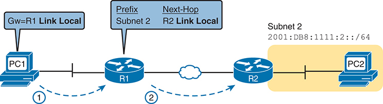

<figcaption>

<strong>图 27-8</strong> <em>IPv6 使用链路本地地址作为下一跳地址</em>

<aside class="hidden" id="a27fig08">

网络包含主机 PC1、PC2 和路由器 R1、R2。PC1 连接 R1，箭头标为“1”，上方标签为“网关 = R1 的链路本地地址”。R1 通过 WAN 线路连接 R2，标为“2”，上方标签为“前缀：子网 2”和“下一跳：R2 的链路本地地址”。最后，R2 连接 PC2，标注“子网 2：2001:DB8:1111:2::/64”，表示 IPv6 地址。

</aside>

</figcaption>

</figure>

下面总结链路本地地址的一些关键事实：

<strong>单播（不是组播）：</strong> LLA 代表单台主机，发往链路本地地址的数据包应仅由这一台 IPv6 主机处理。

<strong>转发范围仅限本地链路：</strong> 发往链路本地地址的数据包不会离开本地数据链路，因为路由器不转发目的地址为链路本地地址的数据包。

<strong>自动生成：</strong> 每个 IPv6 主机接口和路由器接口都能自动创建自己的链路本地地址，解决主机在动态学到全球单播地址前的一些初始化问题。

<strong>常见用途：</strong> 链路本地地址用于某些局限于一个子网的辅助协议，也用作 IPv6 路由的下一跳地址。

</section>

<section>

<h5 class="h5" id="ch27lev3sec7">在路由器上创建链路本地地址</h5>

默认情况下，路由器会为每个启用了 IPv6 的接口自行分配 LLA。为此，它将地址前半部分设为 FE80:0000:0000:0000，如 <a href="#ch27fig09">图 27-9</a> 左侧所示，再按修改后的 EUI-64 规则创建 IID（可回顾前面的“<a href="#ch27lev3sec4">使用修改后的 EUI-64 生成唯一接口 ID</a>”一节）。因此，路由器的完整 LLA 应当唯一，因为输入 EUI-64 过程的 MAC 地址应当唯一。

<figure class="image-c" id="ch27fig09">

<figcaption>

<strong>图 27-9</strong> <em>链路本地地址格式</em>

<aside class="hidden" id="a27fig09">

地址分为两个主要部分，每部分 64 位。左侧显示固定前缀“FE80”和三组零，右侧标为“接口 ID：EUI-64”。两部分共同构成完整的 IPv6 链路本地地址。

</aside>

</figcaption>

</figure>

实际使用中，LLA 以 FE80 开头，但 RFC 4291 正式保留的前缀是 FE80::/10，包括以 FE8、FE9、FEA 或 FEB 开头的地址。不过，同一 RFC 也规定前 64 位应为 FE80:0000:0000:0000，因此实际 LLA 以 FE80:0000:0000:0000 开头。

路由器自动生成接口 LLA 时，不会创建对应的配置命令。要查看 LLA，无须使用 <strong>show running-config</strong>，而应使用同样会列出单播 IPv6 地址的常用命令 <strong>show ipv6 interface</strong> 和 <strong>show ipv6 interface brief</strong>。<a href="#exa27_8">例 27-8</a> 展示了刚按 <a href="#exa27_5">例 27-5</a> 完成配置的 R1，其中 <strong>ipv6 address</strong> 命令使用 <strong>eui-64</strong> 关键字。

<strong>例 27-8</strong> <em>比较链路本地地址与 EUI 生成的单播地址</em>

<a href="#code-f0682-01" id="f0682-01a">点击此处查看代码原图</a>

<pre class="pre-ex" tabindex="0"><code class="highlight">R1# <strong>show ipv6 interface brief</strong>
GigabitEthernet0/0/0   [up/up]
    FE80::11FF:FE11:1111
    2001:DB8:1111:1:0:11FF:FE11:1111
GigabitEthernet0/0/1   [up/up]
    FE80::32F7:DFF:FE29:8568
    2001:DB8:1111:12:32F7:DFF:FE29:8568
GigabitEthernet0/0/2   [administratively down/down]
    unassigned
GigabitEthernet0/0/3   [administratively down/down]
    unassigned</code></pre>

首先查看示例中突出显示的两对表项。对于具有全球单播地址的两个接口 G0/0/0 和 G0/0/1，输出列出各自 GUA，本例恰好以 2001 开头。同时，输出也列出每个接口以 FE80 开头的 LLA。

接着关注 G0/0/0 下的两个地址，仔细观察可见其 IID 值相同。由于 GUA 配置采用 <strong>ipv6 address 2001:DB8:1111:1::/64 eui-64</strong>，路由器用修改后的 EUI-64 逻辑生成 GUA 和 LLA 的 IID。对两个地址，路由器都使用接口 MAC 地址 0200.1111.1111，计算出的 IID 为 0000:11FF:FE11:1111（未缩写）。缩写后，R1 在 G0/0/0 上的 LLA 为 FE80::11FF:FE11:1111。

注意

虽然 Cisco 路由器使用修改后的 EUI-64 方法生成 LLA 的 IID，但大多数终端用户设备操作系统并不这样做。为减少安全暴露，它们随机分配 IPv6 地址 IID。关注主机 IPv6 地址分配的 <a href="v1-28.html#ch28">第 28 章</a> 提供更多细节和示例。

Cisco IOS 也允许直接配置接口 LLA，并优先使用配置的 LLA，规则如下：

<ul class="sq">

<li>
<strong>ipv6 address</strong> <em>address</em> <strong>link-local</strong> 接口子命令配置 LLA；此时，路由器不会按 EUI-64 规则创建 LLA。
</li>

<li>
如果未配置，IOS 按 EUI-64 规则计算 LLA。
</li>

</ul>

</section>

<section>

<h5 class="h5" id="ch27lev3sec8">在接口仅有链路本地地址时路由 IPv6</h5>

到目前为止，本章展示了 <strong>ipv6 address</strong> 命令的四种变体，用于配置可路由地址（GUA 和 ULA）。回顾如下：

<strong>ipv6 address</strong> <em>address/prefix-length</em>：静态配置完整的可路由地址和前缀长度。

<strong>ipv6 address</strong> <em>prefix/prefix-length</em> <strong>eui-64</strong>：静态配置前缀及长度，由路由器按 EUI-64 规则计算 IID。

<strong>ipv6 address dhcp</strong>：使用 DHCP 动态学习地址和前缀长度。

<strong>ipv6 address autoconfig</strong>：动态学习前缀及长度，由路由器按 EUI-64 规则计算 IID（SLAAC）。

为补全列表，现在介绍 <strong>ipv6 enable</strong> 接口子命令。它启用接口的 IPv6 处理，并使路由器自行分配 LLA，但不为接口提供可路由的 GUA 或 ULA 地址。

只有理解某些链路，尤其是 WAN 链路，并不需要 GUA 或 ULA，才能理解 <strong>ipv6 enable</strong> 的用途。以 <a href="#ch27fig10">图 27-10</a> 为背景，考虑 PC1 和 PC2 等主机发送数据包的目的地。PC1 向 PC2 发送 IPv6 数据包时，数据包包含 PC1 与 PC2 的 IPv6 地址，从不包含 WAN 链路的 IPv6 地址。主机不需要知道路由器的 WAN 接口地址。（相同逻辑也适用于 IPv4。）

<figure class="image-c" id="ch27fig10">

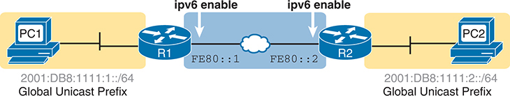

<figcaption>

<strong>图 27-10</strong> <em><strong>ipv6 enable</strong> 命令的典型用途</em>

<aside class="hidden" id="a27fig10">

网络包含主机 PC1、PC2 和路由器 R1、R2。PC1 连接 R1，全球单播前缀为 2001:DB8:1111:1::/64；PC2 连接 R2，前缀为 2001:DB8:1111:2::/64。两台路由器均启用 IPv6，地址分别为 FE80::1 和 FE80::2，并通过以太网 WAN 互连。

</aside>

</figcaption>

</figure>

此外，要让路由正常工作，路由器在 WAN 链路上不需要 GUA 或 ULA，只需要 LLA。例如，IPv6 路由协议动态构建路由时使用 LLA 作为下一跳地址。另外，如 <a href="v1-29.html#ch29">第 29 章</a>“<a href="v1-29.html#ch29">实现 IPv6 路由</a>”所述，静态路由也可使用 LLA 作为下一跳地址。

因此，IPv6 路由可在仅使用 LLA、没有 GUA 或 ULA 的 WAN 链路上工作，甚至不必为每条 WAN 链路分配 IPv6 子网前缀。配置 WAN 接口时，使用 <strong>ipv6 enable</strong> 启用 IPv6，并为每个接口生成链路本地 IPv6 地址。

使用时，只需在 WAN 链路两端接口上都配置 <strong>ipv6 enable</strong> 命令。

</section>

</section>

<section>

<h4 class="h4" id="ch27lev2sec4">IPv6 组播地址</h4>

IPv6 为多种目的使用组播地址。与 IPv4 一样，它包含可供组播应用使用的一段地址范围，并采用许多与 IPv4 组播相同的基本概念。例如，IANA 将 FF30::/12（所有以 FF3 开头的 IPv6 地址）定义为组播应用使用的地址范围。

此外，不同 IPv6 RFC 还为特定用途保留组播地址。例如，OSPFv3 分别使用 FF02::5 和 FF02::6 作为所有 OSPF 路由器和所有 DR 路由器的组播地址，类似于 OSPFv2 使用 IPv4 地址 224.0.0.5 和 224.0.0.6。IANA 和各 RFC 使用<em>知名组播地址（well-known multicast address）</em>一词指这些保留的预定义组播地址，并为其保留 FF00::/12（所有以 FF0 开头的 IPv6 地址）范围。

下一节关注知名的永久 IPv6 组播地址。第一类是<a id="key_289" href="#ref-gloss_233">链路本地组播地址（link-local multicast addresses）</a>，作用域将其限制在单条链路内。另一类是为每台主机计算的特殊辅助组播地址，称为<a id="key_293" href="#ref-gloss_368">被请求节点组播地址（solicited-node multicast address）</a>。

<section>

<h5 class="h5" id="ch27lev3sec9">知名组播地址</h5>

停下来回想本书迄今讨论的一些控制平面协议。部分 IPv4 控制平面协议使用 IPv4 广播，数据包目的地址为 255.255.255.255（本地子网所有主机的地址）或子网广播地址（该特定子网所有主机的地址）。发送方将数据包封装在以太网广播帧内，发往以太网广播地址 FFFF.FFFF.FFFF。

虽然这种方式有用，但 IPv4 广播加 LAN 广播要求 VLAN 中的每台主机都处理广播帧，即使只有另一个设备需要关注该消息。LAN 交换机将广播转发到同一 VLAN 中的每个端口，因此每次广播的副本都会到达子网中的每台主机。每台主机必须先处理帧、再处理数据包、读取消息类型等，然后才能决定忽略。例如，IPv4 ARP 请求同时是 IPv4 和 LAN 广播，主机必须处理消息的以太网及 ARP 细节，才能决定是否回复。

IPv6 使用第 3 层组播地址来代替第 3 层和第 2 层广播，进而使以太网帧使用以太网组播地址。LAN 交换机可利用早已成熟的组播优化功能，仅向愿意接收副本的主机转发组播帧，不向不感兴趣的主机转发。因此，IPv6 协议更高效，也减少了对主机不必要的打扰。

例如，OSPFv3 使用 IPv6 组播地址 FF02::5 和 FF02::6。子网上的 OSPFv3 路由器在接口初始化 OSPF 时，会发送消息，登记自己希望接收发往这两个地址的数据包。但主机不会登记接收这些数据包的意愿。LAN 交换机观察组播注册消息，记住哪些端口连接的主机希望接收发往各组播地址的数据包。收到发往这些组播地址的帧时，交换机仅将其转发给已预先注册的 OSPFv3 路由器，不转发给其他主机或路由器。

所有 IPv6 组播地址都可受益于组播优化。<a href="#ch27tab03">表 27-3</a> 列出最常见的知名 IPv6 组播地址，以供参考。

<figure class="table" id="ch27tab03" tabindex="0">

<figcaption>

<strong>表 27-3</strong> 主要 IPv6 本地作用域组播地址

</figcaption>

<table class="all">

<thead>

<tr>

<th class="th">
简称
</th>

<th class="th">
组播地址
</th>

<th class="th">
含义
</th>

<th class="th">
IPv4 对应地址
</th>

</tr>

</thead>

<tbody>

<tr>

<td class="border">
<a id="key_281" href="#ref-gloss_019">所有节点（All-nodes）</a>
</td>

<td class="border">
FF02::1
</td>

<td class="border">
所有节点（链路上所有使用 IPv6 的接口）
</td>

<td class="border">
224.0.0.1
</td>

</tr>

<tr>

<td class="border">
<a id="key_282" href="#ref-gloss_020">所有路由器（All-routers）</a>
</td>

<td class="border">
FF02::2
</td>

<td class="border">
所有路由器（链路上所有 IPv6 路由器接口）
</td>

<td class="border">
224.0.0.2
</td>

</tr>

<tr>

<td class="border">
所有 OSPF、所有 OSPF DR
</td>

<td class="border">
FF02::5, FF02::6
</td>

<td class="border">
分别表示所有 OSPF 路由器和所有 OSPF 指定路由器
</td>

<td class="border">
224.0.0.5, 224.0.0.6
</td>

</tr>

<tr>

<td class="border">
RIPng 路由器
</td>

<td class="border">
FF02::9
</td>

<td class="border">
所有 RIPng 路由器
</td>

<td class="border">
224.0.0.9
</td>

</tr>

<tr>

<td class="border">
EIGRPv6 路由器
</td>

<td class="border">
FF02::A
</td>

<td class="border">
所有使用用于 IPv6 的 EIGRP（EIGRPv6）的路由器
</td>

<td class="border">
224.0.0.10
</td>

</tr>

<tr>

<td class="border">
DHCP 中继代理
</td>

<td class="border">
FF02::1:2
</td>

<td class="border">
所有充当 DHCPv6 中继代理的路由器
</td>

<td class="border">
无
</td>

</tr>

</tbody>

</table>

</figure>

注意

在互联网搜索“IPv6 Multicast Address Space Registry”，可以找到 IANA 列出所有保留值及定义各地址用途的 RFC 的页面。

<a href="#exa27_9">例 27-9</a> 再次展示 <strong>show ipv6 interface</strong> 输出，说明 R1 在 G0/0/0 上使用的组播地址。本例突出显示所有节点地址 FF02::1、所有路由器地址 FF02::2，以及两个 OSPFv3 地址 FF02::5 和 FF02::6。以“Joined group address(es)”（已加入的组地址）为标题的突出显示部分，列出路由器在该接口上加入的组播地址。

<strong>例 27-9</strong> <em>验证路由器 R1 上的静态 IPv6 地址</em>

<a href="#code-f0685-01" id="f0685-01a">点击此处查看代码原图</a>

<pre class="pre-ex" tabindex="0"><code class="highlight">R1# <strong>show ipv6 interface GigabitEthernet 0/0/0</strong>
GigabitEthernet0/0/0 is up, line protocol is up
  IPv6 is enabled, link-local address is FE80::11FF:FE11:1111
  No Virtual link-local address(es):
  Global unicast address(es):
    2001:DB8:1111:1::1, subnet is 2001:DB8:1111:1::/64
  Joined group address(es):
    FF02::1
    FF02::2

    FF02::5
    FF02::6
    FF02::1:FF00:1
    FF02::1:FF11:1111
 ! Lines omitted for brevity</code></pre>

</section>

<section>

<h5 class="h5" id="ch27lev3sec10">组播地址作用域</h5>

IPv6 RFC 4291 定义单播和组播编址的细节，包括 <a id="key_287" href="#ref-gloss_215">IPv6 地址作用域（IPv6 address scope）</a>概念。每种作用域定义不同的规则，决定路由器是否应转发数据包，以及应将其转发多远。

例如，LLA 作为一种单播 IPv6 地址，具有<a id="key_290" href="#ref-gloss_234">链路本地作用域（link-local scope）</a>。“链路本地”的定义规定，发往链路本地单播地址的数据包应留在该链路上，不被任何路由器转发。

RFC 4291 对作用域的大部分讨论适用于组播地址，使用<em>组播作用域（multicast scope）</em>一词。该 RFC 规定，组播地址的第四个数字标识作用域，如 <a href="#ch27tab04">表 27-4</a> 所示。

<figure class="table" id="ch27tab04" tabindex="0">

<figcaption>

<strong>表 27-4</strong> IPv6 组播作用域术语

</figcaption>

<table class="all">

<thead>

<tr>

<th class="th">
作用域名称
</th>

<th class="th">
第四个十六进制数字
</th>

<th class="th">
作用域的定义方式
</th>

<th class="th">
含义
</th>

</tr>

</thead>

<tbody>

<tr>

<td class="border">
<a id="key_286" href="#ref-gloss_195">接口本地（Interface-Local）</a>
</td>

<td class="border">
1
</td>

<td class="border">
由设备推导
</td>

<td class="border">
数据包留在设备内部，可用于向同一主机上运行的服务发送内部数据包。
</td>

</tr>

<tr>

<td class="border">
链路本地
</td>

<td class="border">
2
</td>

<td class="border">
由设备推导
</td>

<td class="border">
创建数据包的主机可以将其发送到链路上，但任何路由器都不转发它。
</td>

</tr>

<tr>

<td class="border">
<a id="key_292" href="#ref-gloss_366">站点本地（Site-Local）</a>
</td>

<td class="border">
5
</td>

<td class="border">
由路由器配置定义
</td>

<td class="border">
预期范围大于链路本地，因此路由器会转发，但必须小于组织本地；通常用于限制数据包不跨越 WAN 链路。
</td>

</tr>

<tr>

<td class="border">
<a id="key_291" href="#ref-gloss_286">组织本地（Organization-Local）</a>
</td>

<td class="border">
8
</td>

<td class="border">
由路由器配置定义
</td>

<td class="border">
预期范围较广，可能覆盖整个公司或组织，必须大于站点本地。
</td>

</tr>

<tr>

<td class="border">
全局
</td>

<td class="border">
E
</td>

<td class="border">
无边界
</td>

<td class="border">
没有边界。
</td>

</tr>

</tbody>

</table>

</figure>

进一步拆解这些概念，发往链路本地作用域组播地址的数据包应留在本地链路，即本地子网中。主机知道可以处理收到的链路本地数据包，路由器也一样。但根据作用域，路由器知道不能将其路由到其他子网。组织本地作用域的数据包应在组织内部路由，不能发往互联网或跨越连接其他公司的链路。（路由器能自行判断某些作用域的边界，例如链路本地；但其他作用域，例如组织本地，则需要配置才能知道边界。）

从数据包可流动的位置比较这些作用域，第四个十六进制数字越大，作用域允许数据包被转发到离发送主机越远的位置。<a href="#ch27tab04">表 27-4</a> 从上到下展示这一变化，<a href="#ch27fig11">图 27-11</a> 则以链路本地、站点本地和组织本地三种作用域为例。图中，站点本地消息不跨越 WAN，组织本地消息不通过互联网链路离开组织。

<figure class="image-c" id="ch27fig11">

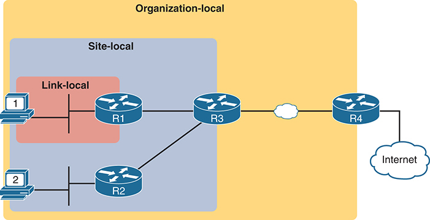

<figcaption>

<strong>图 27-11</strong> <em>IPv6 组播作用域</em>

<aside class="hidden" id="a27fig11">

示意图分为链路本地、站点本地和组织本地三部分。链路本地范围包含 R1、R2，R1 连接主机 1，R2 连接主机 2。站点本地范围包含链路本地范围，并扩展到 R3。组织本地范围包含图中所有元素，通过以太网 WAN 与 R4 相连。R4 直接连接互联网。

</aside>

</figcaption>

</figure>

最后，<em>链路本地</em>在 IPv6 中有几种常见用法，容易混淆。以下说明可澄清不同含义：

<strong>链路本地地址：</strong> 以 FE80 开头、具有链路本地作用域的单播 IPv6 地址。设备自行创建 LLA。用于比较时，更完整的说法是<em>链路本地单播地址</em>。

<strong>链路本地组播地址：</strong> 以 FF02 开头的 IPv6 地址，是设备应用链路本地作用域的保留组播地址。

<strong>链路本地作用域：</strong> 指作用域本身，而非地址。该作用域规定，路由器不应转发发送到此作用域地址的数据包。

</section>

<section>

<h5 class="h5" id="ch27lev3sec11">被请求节点组播地址</h5>

如 <a href="v1-28.html#ch28">第 28 章</a> 所述，IPv6 邻居发现协议（NDP）替代 IPv4 ARP。与 IPv4 ARP 相比，NDP 改进了 MAC 地址发现过程：第一台主机尚不知道第二台主机的 MAC 地址时，就能通过发送 IPv6 组播数据包与它通信。该过程使用与单播 IPv6 地址对应的被请求节点组播地址。

<a href="#ch27fig12">图 27-12</a> 展示如何确定单播地址对应的被请求节点组播地址。首先使用 <a href="#ch27fig12">图 27-12</a> 所示预定义的 /104 前缀（26 个十六进制数字）。换言之，所有被请求节点组播地址都以缩写的 FF02::1:FF 开头。再将单播地址的最后六个十六进制数字复制到被请求节点地址的最后 24 位。

<figure class="image-c" id="ch27fig12">

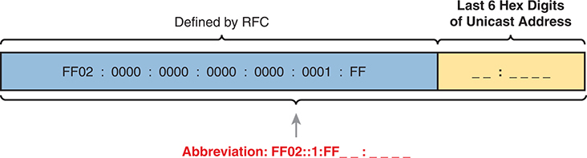

<figcaption>

<strong>图 27-12</strong> <em>被请求节点组播地址格式</em>

<aside class="hidden" id="a27fig12">

横条分为“由 RFC 定义”和“单播地址的最后六个十六进制数字”两部分。前者包含较长的十六进制地址“FF02:0000:0000:0000:0000:0001:FF”，下方给出缩写“FF02::1:FF”。后者表示单播地址的最后六个十六进制数字，图中留空。

</aside>

</figcaption>

</figure>

注意，主机或路由器会为接口上的每个单播地址（GUA、ULA 和 LLA）计算并使用对应的被请求节点组播地址，然后注册接收发往该地址的组播消息。<a href="#exa27_10">例 27-10</a> 中，路由器接口的 GUA 为 2001:DB8:1111:1::1/64，LLA 为 FE80::11FF:FE11:1111。（前面 <a href="#exa27_1">例 27-1</a> 和 <a href="#exa27_3">例 27-3</a> 已出现这些地址。）因此，该接口具有两个被请求节点组播地址，显示在输出末尾。

<strong>例 27-10</strong> <em>验证路由器 R1 上的静态 IPv6 地址</em>

<a href="#code-f0688-01" id="f0688-01a">点击此处查看代码原图</a>

<pre class="pre-ex" tabindex="0"><code class="highlight">R1# <strong>show ipv6 interface GigabitEthernet 0/0/0</strong>
GigabitEthernet0/0/0 is up, line protocol is up
  IPv6 is enabled, link-local address is FE80::11FF:FE11:1111
  No Virtual link-local address(es):
  Global unicast address(es):
    2001:DB8:1111:1::1, subnet is 2001:DB8:1111:1::/64
  Joined group address(es):
    FF02::1
    FF02::2
    FF02::5
    FF02::1:FF00:1
    FF02::1:FF11:1111
 ! Lines omitted for brevity</code></pre>

本例中，R1 展开后的 GUA 最后六个十六进制数字为 00:0001，因此完整的被请求节点组播地址为 FF02:0000:0000:0000:0000:0001:FF00:0001。该值以 <a href="#ch27fig12">图 27-12</a> 的 26 个十六进制数字前缀开头，后接 00:0001。链路本地地址 FE80::11FF:FE11:1111 对应的被请求节点组播地址以 11:1111 结尾，如示例最后一行所示。

</section>

</section>

<section>

<h4 class="h4" id="ch27lev2sec5">未指定地址和环回地址</h4>

所有 IPv6 主机都可使用另外两个特殊地址：

<ul class="sq">

<li>
未指定 IPv6 地址 ::，即全 0。

</li>

<li>
环回 IPv6 地址 ::1，即 127 个二进制 0 后接一个 1。
</li>

</ul>

未指定地址很少使用，主机尚未学到可用单播地址时可以使用它。它只能作为源地址，并且只在主机还没有 LLA 或其他单播地址可用时使用。

IPv6 环回地址为每台 IPv6 主机提供测试协议栈的方法。与 IPv4 环回地址 127.0.0.1 一样，发往 ::1 的数据包不会离开主机，而是沿协议栈向下交给 IPv6，再向上交回本地主机的应用程序。

</section>

<section>

<h4 class="h4" id="ch27lev2sec6">任播地址</h4>

假设路由器需要共同实现某项服务。这项服务由多台路由器提供时效果最好，而不是只由一台提供。但使用服务的主机只需联系最近的服务实例，网络希望对主机隐藏这些细节。主机只要向一个 IPv6 地址发送数据包，路由器就会将其转发给支持该服务、也就是支持该目的 IPv6 地址的最近路由器。

IPv6 <a id="key_283" href="#ref-gloss_022">任播地址（anycast addresses）</a>正好提供这一功能。名称中的 <em>any（任意）</em>表示可以使用该服务的任意实例。<a href="#ch27fig13">图 27-13</a> 通过两个主要步骤展示这一总体概念：

步骤 1． 两台路由器配置完全相同的 IPv6 地址，并指定为任播地址，以支持某项服务。

步骤 2． 此后，任何路由器收到发往该任播地址的数据包时，其他路由器只需将其路由到支持该地址的最近路由器。

<figure class="image-c" id="ch27fig13">

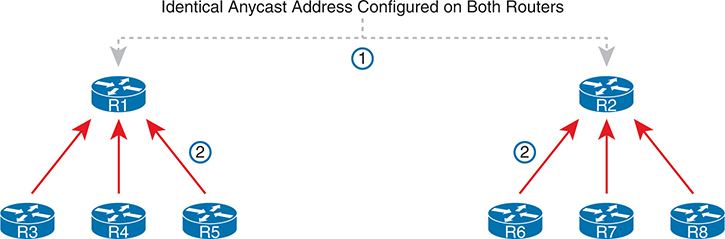

<figcaption>

<strong>图 27-13</strong> <em>IPv6 任播地址</em>

<aside class="hidden" id="a27fig13">

图中在 R1 和 R2 上配置相同的任播地址。每台路由器各连接另外三台路由器，R1 连接 R3 至 R5，R2 连接 R6 至 R8，箭头表示数据流或连接。标为“1”的虚线连接 R1 和 R2，表示共享任播地址，数字“2”标在这些连接旁。

</aside>

</figcaption>

</figure>

要让任播过程工作，实现任播地址的路由器必须先完成配置，再通告该地址的路由。这些地址并非来自特殊保留范围，而是来自单播地址范围。通常将地址配置为 /128 前缀，使路由器通告到该任播地址的主机路由。此后，路由协议像通告其他 IPv6 路由一样通告它，其他路由器无法区分。

<a href="#exa27_11">例 27-11</a> 展示一台路由器的示例配置。实际地址 2001:1:1:2::99 看起来与其他单播地址相同，但 <strong>ipv6 address</strong> 命令采用了不同的 <strong>anycast</strong> 关键字，告诉本地路由器该地址具有任播的特殊用途。最后，<strong>show ipv6 interface</strong> 会将其标识为任播地址，而 <strong>show ipv6 interface brief</strong> 不会。

<strong>例 27-11</strong> <em>配置和验证 IPv6 任播地址</em>

<a href="#code-f0690-01" id="f0690-01a">点击此处查看代码原图</a>

<pre class="pre-ex" tabindex="0"><code class="highlight">R1# <strong>configure terminal</strong>
Enter configuration commands, one per line. End with CNTL/Z.
R1(config)# <strong>interface gigabitEthernet 0/0/0</strong>
R1(config-if)# <strong>ipv6 address 2001:1:1:1::1/64</strong>
R1(config-if)# <strong>ipv6 address 2001:1:1:2::99/128 anycast</strong>
R1(config-if)# <strong>^Z</strong>
R1#

R1# <strong>show ipv6 interface g0/0/0</strong>
GigabitEthernet0/0/0 is up, line protocol is up
    IPv6 is enabled, link-local address is FE80::11FF:FE11:1111
    No Virtual link-local address(es):
    Global unicast address(es):
       2001:1:1:1::1, subnet is 2001:1:1:1::/64
       2001:1:1:2::99, subnet is 2001:1:1:2::99/128 [ANY]
 ! Lines omitted for brevity
R1# <strong>show ipv6 interface brief g0/0/0</strong>
GigabitEthernet0/0/0 [up/up]
     FE80::11FF:FE11:1111
     2001:1:1:1::1
     2001:1:1:2::99 </code></pre>

注意

<a id="key_294" href="#ref-gloss_392">子网路由器任播地址（subnet-router anycast address）</a>与刚才讨论的任播地址是不同概念。<em>子网路由器任播地址</em>是每个子网中的一个特殊任播地址，保留供路由器使用，以便将数据包发送给子网上的任意路由器。其值等于子网 ID，也就是前缀值与其他地址相同，接口 ID 全部为二进制 0。

</section>

<section>

<h4 class="h4" id="ch27lev2sec7">IPv6 编址配置汇总</h4>

本章介绍了各种 IPv6 地址类型，也展示了如何在接口上启用 IPv6。许多实现会在每个路由器 LAN 接口上使用 <strong>ipv6 address</strong>，在 WAN 接口上使用相同命令或 <strong>ipv6 enable</strong>。为便于备考，<a href="#ch27tab05">表 27-5</a> 将各种命令及其自动生成的 IPv6 地址集中汇总，供复习和学习。

<figure class="table" id="ch27tab05" tabindex="0">

<figcaption>

<strong>表 27-5</strong> IPv6 地址类型及创建命令汇总

</figcaption>

<table class="all">

<thead>

<tr>

<th class="th">
类型
</th>

<th class="th">
前缀／地址说明
</th>

<th class="th">
通过哪个接口子命令启用
</th>

</tr>

</thead>

<tbody>

<tr>

<td class="border">
全球单播
</td>

<td class="border">
多种前缀
</td>

<td class="border">
<strong>ipv6 address</strong> <em>address/prefix-length</em>

<strong>ipv6 address</strong> <em>prefix/prefix-length</em> <strong>eui-64</strong>
</td>

</tr>

<tr>

<td class="border">
唯一本地
</td>

<td class="border">
FD00::/8
</td>

<td class="border">
<strong>ipv6 address</strong> <em>address/prefix-length</em>

<strong>ipv6 address</strong> <em>prefix/prefix-length</em> <strong>eui-64</strong>
</td>

</tr>

<tr>

<td class="border">
链路本地
</td>

<td class="border">
FE80::/10
</td>

<td class="border">
<strong>ipv6 address</strong> <em>address</em> <strong>link-local</strong>

由所有 <strong>ipv6 address</strong> 命令自动生成

由 <strong>ipv6 enable</strong> 命令自动生成
</td>

</tr>

<tr>

<td class="border">
所有主机组播
</td>

<td class="border">
FF02::1
</td>

<td class="border">
由所有 <strong>ipv6 address</strong> 命令自动生成
</td>

</tr>

<tr>

<td class="border">
所有路由器组播
</td>

<td class="border">
FF02::2
</td>

<td class="border">
由所有 <strong>ipv6 address</strong> 命令自动生成
</td>

</tr>

<tr>

<td class="border">
路由协议组播
</td>

<td class="border">
多种地址
</td>

<td class="border">
在接口上启用对应路由协议时添加到接口
</td>

</tr>

<tr>

<td class="border">
被请求节点组播
</td>

<td class="border">
FF02::1:FF /104
</td>

<td class="border">
由所有 <strong>ipv6 address</strong> 命令自动生成
</td>

</tr>

</tbody>

</table>

</figure>

</section>

</section>

</section>

<section class="ccna-source ccna-appendix" aria-label="答案解析与术语表">
<section data-epub-type="chapter">

<h2 class="h2" id="ref-appc">附录 C</h2>

<h2 class="h2a">自测题答案</h2>

<section>

<h3 class="h3" id="ref-appclev1sec27">第 27 章</h3>

<strong><a id="ref-ques27_1" href="#quess27_1">1</a>．</strong> A。正确答案列出与题目完全相同的 IPv6 地址，前缀长度为 /64，语法中没有空格。另一个错误答案除了在地址与前缀长度之间留了空格外完全相同，但空格使语法错误。两个包含 <strong>eui-64</strong> 参数的答案列出地址而不是前缀；正确用法应列出前缀。不过，即使这两个错误答案使用所示地址的前缀 2001:1:1:1::，EUI-64 过程也不会产生题目给出的 IPv6 地址。

<strong><a id="ref-ques27_2" href="#quess27_2">2</a>．</strong> B。使用 <strong>eui-64</strong> 参数时，路由器根据 MAC 地址计算 IPv6 地址的接口 ID。从 5055.4444.3333 开始，在中间插入 FF FE，得到 5055.44FF.FE44.3333，然后将第一个字节的第七位取反。具体来说，十六进制 50 转为二进制 0101 0000，改变第七位后为 0101 0010，再转回十六进制 52。最终接口 ID 为 5255:44FF:FE44:3333。错误答案只是列出了不同值。

<strong><a id="ref-ques27_3" href="#quess27_3">3</a>．</strong> A 和 C。四个答案中，两个正确答案给出 Cisco 路由器支持 IPv6 所需的最小配置：启用 IPv6 路由（<strong>ipv6 unicast-routing</strong>），并在各接口上启用 IPv6，通常是为每个接口添加单播地址（<strong>ipv6 address…</strong>）。两个错误答案列出的命令不存在。

<strong><a id="ref-ques27_4" href="#quess27_4">4</a>．</strong> B 和 D。<strong>show ipv6 route connected</strong> 列出所有已知直连路由，每条都包含路由的前缀／长度。<strong>show ipv6 interface g0/0/0</strong> 列出接口地址，以及根据配置的地址／长度计算出的前缀／长度。

对于错误答案，<strong>show ipv6 interface brief</strong> 列出接口地址，但不列出直连子网的前缀／长度。<strong>show ipv6 address</strong> 命令不存在，尝试输入会被作为无效命令拒绝。

<strong><a id="ref-ques27_5" href="#quess27_5">5</a>．</strong> A。配置了全球单播地址的 <strong>ipv6 address</strong> 命令，但没有通过 <strong>ipv6 address</strong> 配置链路本地地址时，路由器会根据接口 MAC 地址和 EUI-64 规则计算 LLA，不使用全球单播 IPv6 地址进行计算。

链路本地地址的前半部分为 FE80:0000:0000:0000。路由器用 MAC 地址 0200.0001.000A，在中间插入 FF FE 得到 0200.00FF.FE01.000A，再翻转第七位得到 0000.00FF.FE01.000A，从而计算后半部分。

<strong><a id="ref-ques27_6" href="#quess27_6">6</a>．</strong> B。FF02::1 供链路上所有 IPv6 主机使用，FF02::5 供所有 OSPFv3 路由器使用，FF02::A 供所有 EIGRPv6 路由器使用。FF02::2 用于向链路上所有 IPv6 路由器发送数据包。

<strong><a id="ref-ques27_7" href="#quess27_7">7</a>．</strong> A。路由器根据单播地址 2001:db8:1:1::1234:5678，将 NDP NS 消息发送到对应的被请求节点组播地址。创建该地址时，取最后六个十六进制数字（本例为 34:5678），在前面加 FF02::1:FF，正确答案为 FF02::1:FF34:5678。其他答案是相似值，但不符合正确的被请求节点地址规则。

<strong><a id="ref-ques27_8" href="#quess27_8">8</a>．</strong> B 和 C。首先，对于 G0/0/1，<strong>ipv6 enable</strong> 命令启用 IPv6，并按 EUI-64 规则生成接口 ID，创建 LLA。这说明了一个正确答案和一个错误答案。

接着，对于 G0/0/2 和 <strong>ipv6 autoconfig</strong> 命令，命令通过 SLAAC 启用 IPv6。因此，它按 EUI-64 规则生成 LLA，并通过 SLAAC 生成可路由的单播地址，接口 ID 同样使用 EUI-64 规则。因此，G0/0/2 的 LLA 和全球单播地址具有相同的接口 ID。

最后，对于 G0/0/3 和 <strong>ipv6 address</strong> 子命令，每个支持 IPv6 的接口都必须具有 LLA。路由器会再次使用 EUI-64，自行分配该接口 LLA 的接口 ID 部分。

</section>

</section>

<section id="ref-glossary"><h2 class="h2a">术语表</h2>
<strong>所有节点组播地址（all-nodes multicast address）</strong> 特定的 IPv6 组播地址 FF02::1，具有链路本地作用域，用于向链路上所有支持 IPv6 的设备发送数据包。

<strong>所有路由器组播地址（all-routers multicast address）</strong> 特定的 IPv6 组播地址 FF02::2，具有链路本地作用域，用于向本地链路上所有充当 IPv6 路由器的设备发送数据包。

<strong>任播地址（anycast address）</strong> 由网络不同位置的两台或多台主机共享的地址。按设计，路由器将数据包转发给最近的服务器，让客户端与最近的服务实例通信，而无须关心具体是哪台服务器。

<strong>双栈（dual stack）</strong> 主机或路由器同时运行 IPv4 与 IPv6 的工作模式。

<strong>EUI-64</strong> 字面含义是长 64 位的扩展唯一标识符标准。具体到 IPv6，它是一组生成 64 位标识符的规则，用作 IPv6 地址的接口 ID：从 48 位 MAC 地址开始，在中间插入十六进制 FFFE，并将第七位取反。

<strong>接口本地作用域（interface-local scope）</strong> IPv6 中的一种概念，发送到此作用域地址的数据包不应实际离开接口，而应留在发送主机内部。

<strong>IPv6 地址作用域（IPv6 address scope）</strong> IPv6 网络中主机和路由器应将 IPv6 数据包转发多远的概念，包括接口本地、链路本地、站点本地和组织本地作用域。

<strong>链路本地地址（link-local address，LLA）</strong> 以 FE80 开头的单播 IPv6 地址，用于每个启用了 IPv6 的接口，通过应用链路本地作用域在所连链路内发送数据包。

<strong>链路本地组播地址（link-local multicast address）</strong> 以 FF02 开头的组播 IPv6 地址，第四个数字 2 将作用域标识为链路本地，设备对其应用链路本地作用域。

<strong>链路本地作用域（link-local scope）</strong> 在 IPv6 组播中，指组播数据包可流经的网络部分（作用范围）；链路本地表示数据包留在其起源子网中。

<strong>组织本地作用域（Organization-local scope）</strong> IPv6 中的一种概念，发送到此作用域地址的数据包应由组织内部路由器转发，但不应跨越连接其他组织或互联网的链路。

<strong>站点本地作用域（site-local scope）</strong> IPv6 中的一种概念，发送到此作用域地址的数据包应由路由器转发，但不应通过 WAN 链路转发到其他站点。

<strong>被请求节点组播地址（solicited-node multicast address）</strong> 一种具有链路本地作用域的 IPv6 组播地址，用于向子网中单播 IPv6 地址最后六个十六进制数字相同的所有主机发送数据包，以 FF02::1:FF00:0/104 开头。

<strong>子网路由器任播地址（subnet router anycast address）</strong> 每个 IPv6 子网中的特殊任播地址，保留给路由器使用，以便将数据包发送给子网上的任意一台路由器。其数值与该子网的子网 ID 相同。

</section>
<section>

<h3 class="h3" id="ref-ch27lev1sec10">前面练习题的答案</h3>

本章前面的 <a href="#ch27tab02">表 27-2</a> 列出几个需要按 EUI-64 规则计算 IPv6 地址的练习。<a href="#ref-ch27tab10">表 27-10</a> 列出这些问题的答案。

<figure class="table" id="ref-ch27tab10" tabindex="0">

<figcaption>

<strong>表 27-10</strong> IPv6 EUI-64 地址创建练习的答案

</figcaption>

<table class="all">

<thead>

<tr>

<th class="th">
前缀
</th>

<th class="th">
MAC 地址
</th>

<th class="th">
未缩写的 IPv6 地址
</th>

</tr>

</thead>

<tbody>

<tr>

<td class="border">
<code>2001:DB8:1:1::/64</code>
</td>

<td class="border">
<code>0013.ABAB.1001</code>
</td>

<td class="border">
<code>2001:0DB8:0001:0001:0213:ABFF:FEAB:1001</code>
</td>

</tr>

<tr>

<td class="border">
<code>2001:DB8:1:1::/64</code>
</td>

<td class="border">
<code>AA13.ABAB.1001</code>
</td>

<td class="border">
<code>2001:0DB8:0001:0001:A813:ABFF:FEAB:1001</code>
</td>

</tr>

<tr>

<td class="border">
<code>2001:DB8:1:1::/64</code>
</td>

<td class="border">
<code>000C.BEEF.CAFE</code>
</td>

<td class="border">
<code>2001:0DB8:0001:0001:020C:BEFF:FEEF:CAFE</code>
</td>

</tr>

<tr>

<td class="border">
<code>2001:DB8:1:1::/64</code>
</td>

<td class="border">
<code>B80C.BEEF.CAFE</code>
</td>

<td class="border">
<code>2001:0DB8:0001:0001:BA0C:BEFF:FEEF:CAFE</code>
</td>

</tr>

<tr>

<td class="border">
<code>2001:DB8:FE:FE::/64</code>
</td>

<td class="border">
<code>0C0C.ABAC.CABA</code>
</td>

<td class="border">
<code>2001:0DB8:00FE:00FE:0E0C:ABFF:FEAC:CABA</code>
</td>

</tr>

<tr>

<td class="border">
<code>2001:DB8:FE:FE::/64</code>
</td>

<td class="border">
<code>0A0C.ABAC.CABA</code>
</td>

<td class="border">
<code>2001:0DB8:00FE:00FE:080C:ABFF:FEAC:CABA</code>
</td>

</tr>

</tbody>

</table>

</figure>

</section>

</section>

<section class="ccna-source ccna-appendix" aria-label="代码原图">
<section data-epub-type="chapter">

<a href="#f0672-01a" id="code-f0672-01">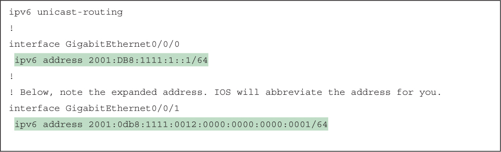</a>

<a href="#f0672-02a" id="code-f0672-02">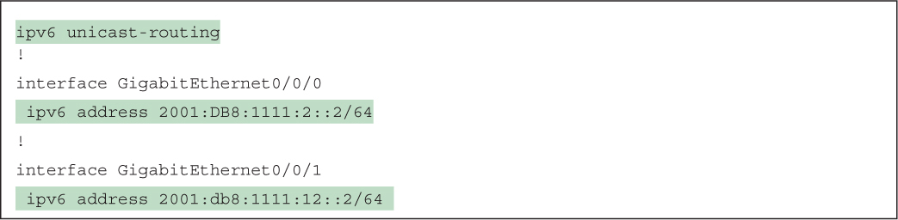</a>

<a href="#f0673-01a" id="code-f0673-01">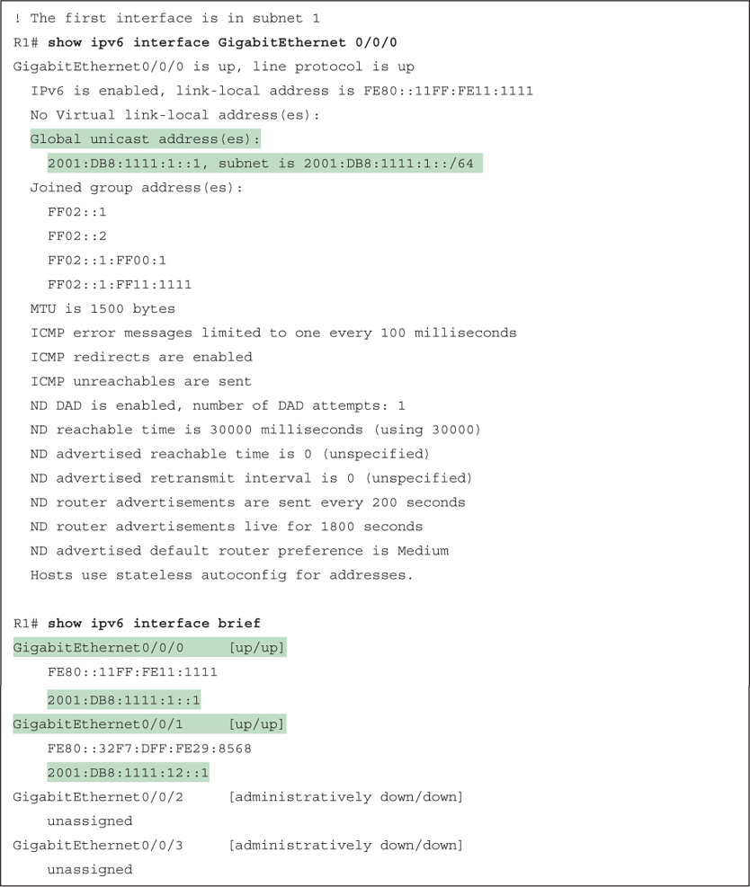</a>

<a href="#f0674-01a" id="code-f0674-01">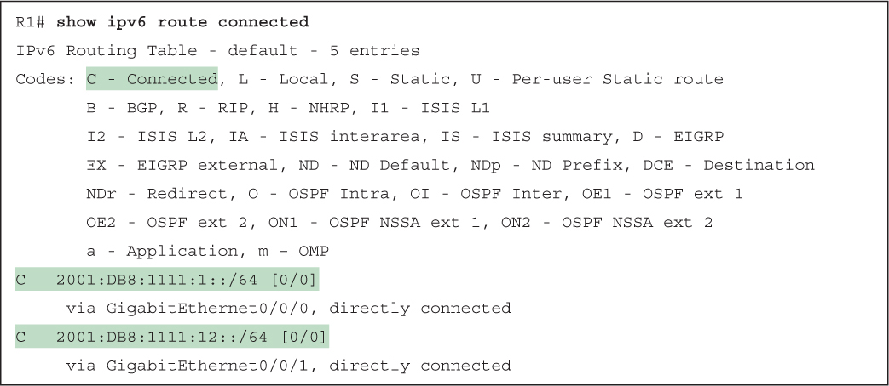</a>

<a href="#f0677-01a" id="code-f0677-01">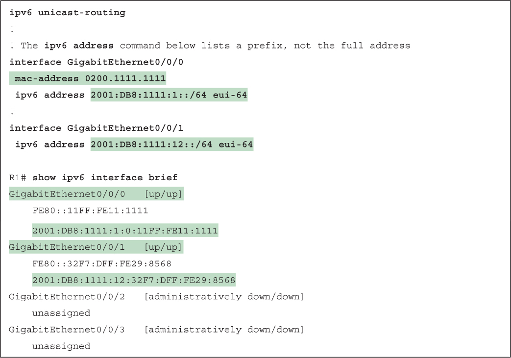</a>

<a href="#f0679-01a" id="code-f0679-01">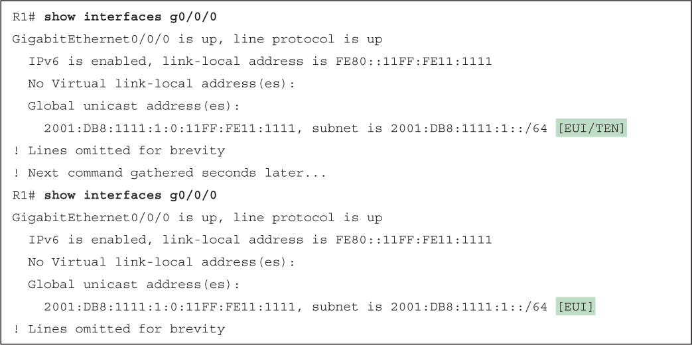</a>

<a href="#f0679-02a" id="code-f0679-02">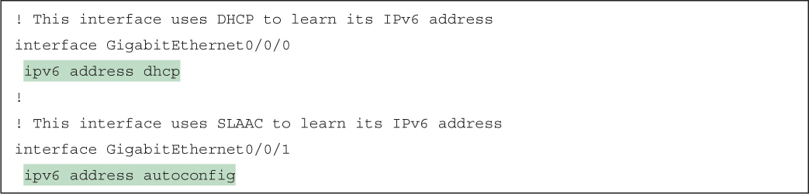</a>

<a href="#f0682-01a" id="code-f0682-01">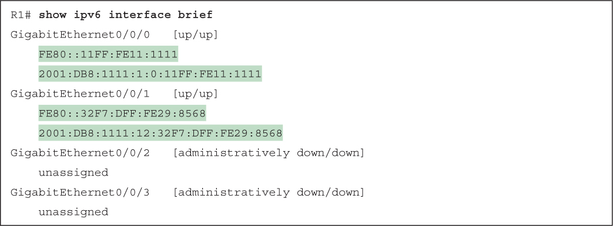</a>

<a href="#f0685-01a" id="code-f0685-01">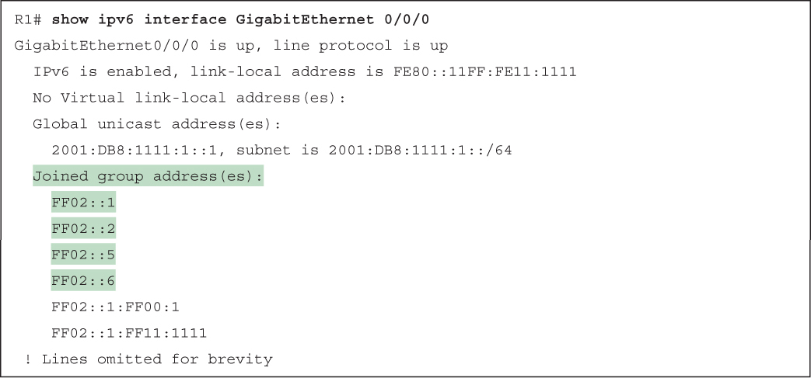</a>

<a href="#f0688-01a" id="code-f0688-01">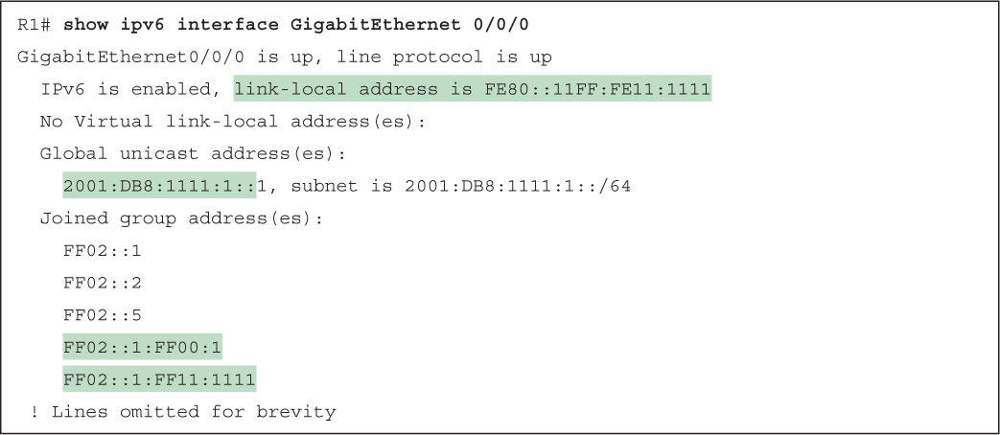</a>

<a href="#f0690-01a" id="code-f0690-01">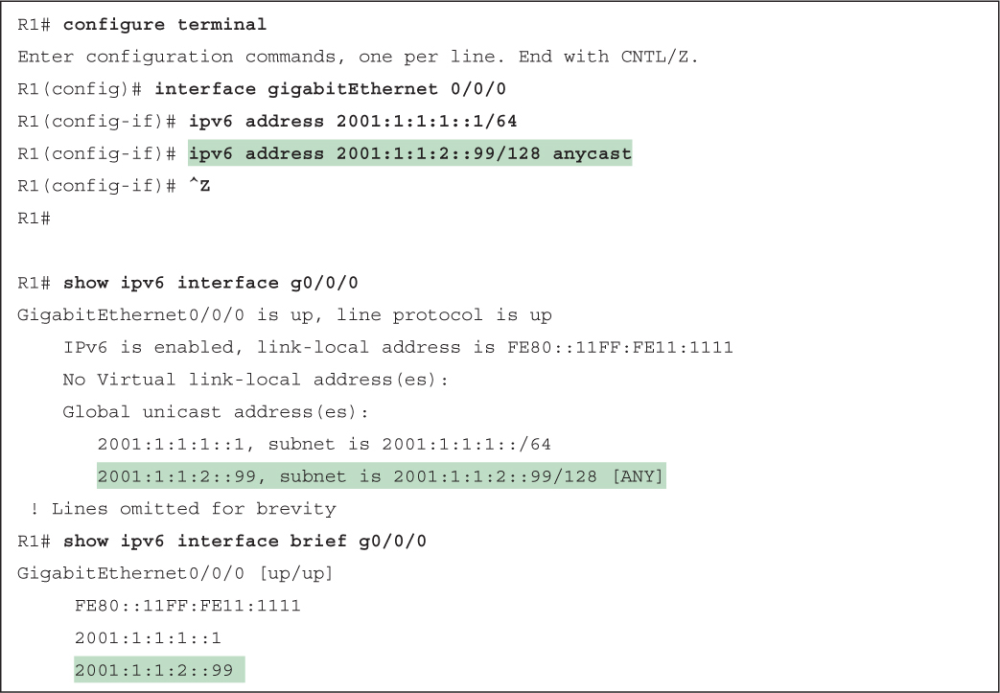</a>

</section>

</section>


<nav class="ccna-chapter-nav" aria-label="章节导航"><a href="v1-26.html">← 上一章</a><a href="v1-28.html">下一章 →</a></nav>
