
<a href="{{ '/subjects/CCNA/' | relative_url }}">← 返回 CCNA 目录</a>

第一卷 · IP 版本 6

<nav class="ccna-chapter-nav" aria-label="章节导航"><a href="v1-27.html">← 上一章</a><a href="v1-29.html">下一章 →</a></nav>



<section data-epub-type="chapter">

<h2 class="h2" id="ch28">第 28 章</h2>

<h2 class="h2a">在主机上实现 IPv6 编址</h2>

本章涵盖以下考试主题：

1.0 网络基础

1.8 配置并验证 IPv6 编址和前缀

1.9 描述 IPv6 地址类型

1.9.a 单播（全球、唯一本地和链路本地）

1.9.d 修改后的 EUI-64

IPv6 主机在许多方面与 IPv4 主机相似，采用相近的概念、协议，甚至为相同目的使用相似或相同的命令。同时，IPv6 有时也采用不同于 IPv4 的方法，用新协议或新命令提供不同解决方案。例如：

<ul class="sq">

<li>
与 IPv4 一样，IPv6 主机使用单播地址、前缀长度（掩码）、默认路由器和 DNS 服务器。
</li>

<li>
与 IPv4 一样，IPv6 使用协议动态学习同一基于 LAN 的子网内其他主机的 MAC 地址。
</li>

<li>
与 IPv4 不同，IPv6 主机使用邻居发现协议（NDP）完成许多功能，包括 IPv4 ARP 所完成的功能。
</li>

<li>
与 IPv4 一样，IPv6 主机可使用 DHCP 学习四项主要 IPv6 设置。
</li>

<li>
与 IPv4 不同，IPv6 还支持 DHCP 之外的动态地址分配过程，称为无状态地址自动配置（SLAAC）。
</li>

</ul>

本章关注主机的四项主要 IPv6 设置：地址、前缀长度、默认路由器地址和 DNS 服务器地址。不过，为理解主机如何动态学习这些地址，第一大节先专门介绍在多个 IPv6 过程中起关键作用的 NDP。中间部分介绍主机如何通过 DHCP 和 SLAAC 动态学习 IPv6 设置。最后一大节介绍验证主机 IPv6 设置的工具，其中许多使用与 IPv4 相同的命令。

<section>

<h3 class="h3" id="ch28lev1sec1">“这些知识我已经掌握了吗？”自测</h3>

如果你想根据得分决定应在本章投入多少时间，可以参加自测（使用此处的问题或 PTP 软件）。字母答案列在自测后面页面的底部。书末及配套网站上的 <a href="#ref-appc">附录 C</a> 包含答案和解析。你也可以在 PTP 测试软件中找到答案和解析。

<figure class="table" id="ch28tab01" tabindex="0">

<figcaption>

<strong>表 28-1</strong> “这些知识我已经掌握了吗？”基础主题与问题对应关系

</figcaption>

<table class="all">

<thead>

<tr>

<th class="th">
基础知识小节
</th>

<th class="th">
题目
</th>

</tr>

</thead>

<tbody>

<tr>

<td class="border">
邻居发现协议
</td>

<td class="border">
1–4
</td>

</tr>

<tr>

<td class="border">
动态配置主机 IPv6 设置
</td>

<td class="border">
5–7
</td>

</tr>

<tr>

<td class="border">
主机 IPv6 编址故障排查
</td>

<td class="border">
8
</td>

</tr>

</tbody>

</table>

</figure>

<strong><a id="quess28_1" href="#ques28_1a">1</a>．</strong> PC1、PC2 和路由器 R1 都连接到同一 VLAN 和 IPv6 子网。PC1 想向 PC2 发送第一个 IPv6 数据包。PC1 将使用哪种协议消息开始发现 PC2 的 MAC 地址？

<ol class="lower-alpha">

<li>
ARP 请求
</li>

<li>
NDP NS
</li>

<li>
NDP RS
</li>

<li>
SLAAC NS
</li>

</ol>

<strong><a id="quess28_2" href="#ques28_2a">2</a>．</strong> 路由器在 NDP 路由器通告（RA）消息中提供以下哪些信息？（选择两个答案。）

<ol class="lower-alpha">

<li>
路由器 IPv6 地址
</li>

<li>
路由器主机名
</li>

<li>
链路上的 IPv6 前缀
</li>

<li>
DHCP 服务器的 IPv6 地址
</li>

</ol>

<strong><a id="quess28_3" href="#ques28_3a">3</a>．</strong> 三台路由器 R1、R2 和 R3 连接到同一 VLAN 和 IPv6 子网，均已使用 NDP RA 消息回应各种 NDP RS 消息。哪个答案最准确地描述 R1 上 <strong>show ipv6 neighbors</strong> 命令输出中保存的 NDP 信息类型？

<ol class="lower-alpha">

<li>
IPv6 邻居（路由器和主机）及其 MAC 地址，但不标明哪些是路由器
</li>

<li>
IPv6 邻居（路由器和主机）及其 MAC 地址，并标明哪些是路由器
</li>

<li>
仅 IPv6 路由器，不包含非路由器信息，也没有 MAC 地址信息
</li>

<li>
仅 IPv6 路由器，不包含非路由器信息，但有 MAC 地址信息
</li>

</ol>

<strong><a id="quess28_4" href="#ques28_4a">4</a>．</strong> PC1 和 R1 连接到同一 VLAN 和 IPv6 子网。PC1 用户 ping 位于远端站点的主机 IPv6 地址，数据包会经过 PC1 的默认路由器 R1。PC1 的全部 IPv6 设置均动态学得。以下哪项列出的协议或消息，可能被 PC1 用来学习默认路由器应使用的 IPv6 地址？

<ol class="lower-alpha">

<li>
EUI-64
</li>

<li>
NDP NS
</li>

<li>
DAD
</li>

<li>
NDP RS
</li>

</ol>

<strong><a id="quess28_5" href="#ques28_5a">5</a>．</strong> 主机 PC1 使用无状态地址自动配置（SLAAC）动态学习 IPv6 设置。PC1 的哪项设置最可能从无状态 DHCPv6 服务器学得？

<ol class="lower-alpha">

<li>
主机地址
</li>

<li>
前缀长度
</li>

<li>
默认路由器地址
</li>

<li>
DNS 服务器地址
</li>

</ol>

<strong><a id="quess28_6" href="#ques28_6a">6</a>．</strong> 主机 PC1 使用无状态地址自动配置（SLAAC）动态学习 IPv6 设置。将主机单播地址视为子网前缀和接口 ID 两部分。哪些答案列出了 SLAAC 学习或构造主机地址接口 ID 部分的方法？（选择两个答案。）

<ol class="lower-alpha">

<li>
从 DHCPv6 服务器学习
</li>

<li>
主机按 EUI-64 规则构造
</li>

<li>
通过 NDP RS/RA 消息从路由器学习
</li>

<li>
主机使用随机值构造
</li>

</ol>

<strong><a id="quess28_7" href="#ques28_7a">7</a>．</strong> 某 IPv6 主机配置为使用 DHCP 租用 IPv6 地址。DHCPv6 服务器不在同一链路，而位于另一站点。哪个答案描述了客户端和路由器用于在客户端与服务器之间传递 DHCPv6 消息的机制？

<ol class="lower-alpha">

<li>
客户端将 DHCPv6 Solicit 消息发送到组播地址 FF02:1:2。
</li>

<li>
客户端将 DHCPv6 Solicit 消息发送到广播地址 FFFF:FFFF:FFFF:FFFF:FFFF:FFFF:FFFF:FFFF。
</li>

<li>
客户端必须使用 NDP 消息从本地路由器学习 DHCPv6 服务器的单播地址。
</li>

<li>
路由器使用 IPv6 组播路由，将 Solicit 消息不作修改地转发给 DHCPv6 服务器。
</li>

</ol>

<strong><a id="quess28_8" href="#ques28_8a">8</a>．</strong> 网络中所有路由器的接口都配置了全球单播地址（GUA）。LAN 上 PC1 的用户针对远端主机地址执行 <strong>traceroute</strong> 命令。命令成功，列出四行 IPv6 地址。哪个答案最准确地描述 <strong>traceroute</strong> 输出中的地址，以及对链路本地地址（LLA）和 GUA 的使用情况？

<ol class="lower-alpha">

<li>
所有行都列出 LLA，没有 GUA。
</li>

<li>
第一行列出的地址与 PC1 的默认路由相匹配。
</li>

<li>
所有行都列出 GUA，没有 LLA。
</li>

<li>
最后一行列出路径中最后一台路由器的 GUA。
</li>

</ol>

“这些知识我已经掌握了吗？”自测答案：

<strong><a id="ques28_1a" href="#ref-ques28_1">1</a></strong> B

<strong><a id="ques28_2a" href="#ref-ques28_2">2</a></strong> A, C

<strong><a id="ques28_3a" href="#ref-ques28_3">3</a></strong> A

<strong><a id="ques28_4a" href="#ref-ques28_4">4</a></strong> D

<strong><a id="ques28_5a" href="#ref-ques28_5">5</a></strong> D

<strong><a id="ques28_6a" href="#ref-ques28_6">6</a></strong> B、D

<strong><a id="ques28_7a" href="#ref-ques28_7">7</a></strong> A

<strong><a id="ques28_8a" href="#ref-ques28_8">8</a></strong> C

</section>

<section>

<h3 class="h3box" id="ch28lev1sec2">基础知识</h3>

</section>

<section>

<h3 class="h3" id="ch28lev1sec3">邻居发现协议</h3>

IPv4 和 IPv6 都通过互联网控制消息协议（ICMP）定义了多种控制与管理功能。为在 IPv6 中支持类似功能，互联网社区创建了 ICMPv6，定义适用于 IPv6 的协议。（为了便于比较，IPv4 使用的 ICMP 通常称为 ICMPv4。）

<a id="key_298" href="#ref-gloss_269">邻居发现协议（NDP）</a> 是 ICMPv6 的一部分，由 RFC 4861 定义，在每个 IPv6 网络中提供多项重要功能。其中，NDP 定义了与 IPv4 ARP 功能相对应的 IPv6 功能。它的部分功能如下：

<strong>发现邻居的 MAC 地址：</strong> 基于 IPv6 LAN 的主机需要学习同一子网中其他主机的 MAC 地址。NDP 取代 IPv4 的 ARP，提供替代 ARP 请求和应答的消息。

<strong>发现路由器：</strong> 主机学习同一子网中可用 IPv6 路由器的 IPv6 地址。

<a id="key_303" href="#ref-gloss_312">发现前缀</a><strong>：</strong> 主机学习路由器期望在链路上使用的 IPv6 子网前缀和前缀长度。

<a id="key_295" href="#ref-gloss_116">重复地址检测（DAD）</a><strong>：</strong> 主机在使用某个 IPv6 地址之前，利用 NDP 执行重复地址检测，确保其他主机没有使用相同的 IPv6 地址，然后才尝试使用该地址。

接下来几页将解释这些功能。

<section>

<h4 class="h4" id="ch28lev2sec1">使用 NDP NS 和 NA 发现邻居的链路地址</h4>

NDP 使用<em>邻居请求（NS）</em>和<em>邻居通告（NA）</em>消息取代 IPv4 ARP。NS 类似于 IPv4 ARP 请求，要求具有特定单播 IPv6 地址的主机发回应答。NA 消息类似于 IPv4 ARP 应答，列出该主机的 MAC 地址。以下列表概述了它们的功能：

<a id="key_299" href="#ref-gloss_270">邻居请求（NS）</a><strong>：</strong> 此消息要求具有特定 IPv6 地址（目标地址）的主机回复一条列出其 MAC 地址的 NA 消息。

<a id="key_297" href="#ref-gloss_268">邻居通告（NA）</a><strong>：</strong> 此消息列出发送方的 IPv6 地址和 MAC 地址。它可以作为 NS 消息的应答发送；此时，数据包发往最初发送 NS 消息的主机的 IPv6 单播地址。主机也可以主动发送 NA，通告自己的 IPv6 地址和 MAC 地址；此时，消息发往所有 IPv6 主机的本地作用域组播地址 FF02::1。

注意

在 NDP 中，<em>邻居</em>一词指同一数据链路上的主机，例如位于同一个 VLAN 中的主机。

<a href="#ch28fig01">图 28-1</a> 展示了主机 PC1 如何利用 NS 消息学习另一台主机的 MAC 地址。NS 消息列出一个目标 IPv6 单播地址，其含义相当于询问：“你的链路地址是什么？”在本例中，NA 消息发回最初提出请求的主机，并列出该链路地址。

在此例的步骤 1 中，PC1 发送请求来查找 PC2 的 MAC 地址。PC1 首先查询其 NDP 邻居表，它相当于 IPv4 ARP 缓存，但没有找到 IPv6 地址 2001:DB8:1111:1::22 对应的 MAC 地址。因此，在步骤 1 中，PC1 向目标发送 NDP NS 消息。

<figure class="image-c" id="ch28fig01">

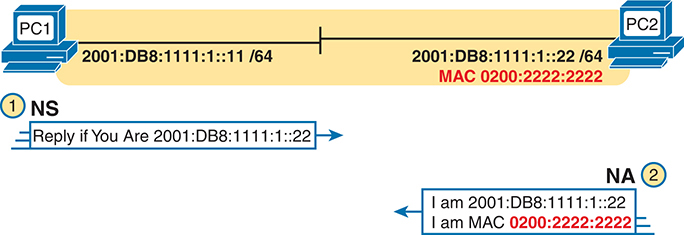

<figcaption>

<strong>图 28-1</strong> <em>利用 NDP NS/NA 过程查找邻居链路地址的示例</em>

<aside class="hidden" id="a28fig01">

示意图展示了两台计算机 PC1 和 PC2 之间的通信。PC1 的 IP 地址为 2001:DB8:1111:1::11/64，它向 PC2 发送邻居请求（NS）消息，询问“如果你是 2001:DB8:1111:1::22，请回复”。PC2 的 IP 地址为 2001:DB8:1111:1::22/64，MAC 地址为 0200:2222:2222；它回复邻居通告（NA）消息，确认“我是 2001:DB8:1111:1::22，我的 MAC 地址是 0200:2222:2222”。

</aside>

</figcaption>

</figure>

这里顺便说明，NDP NS 消息使用目标的被请求节点组播地址作为目的 IPv6 地址，本例中即 PC2 的被请求节点组播地址 FF02::1:FF00:22。然后，PC1 将 IPv6 数据包封装进以组播以太网地址为目的地址的帧。如果该公司的网络工程师还启用了 MLD Snooping 组播优化功能，交换机就只会把组播 NS 消息转发给此前已登记接收发往该特定组播地址的数据包的主机。链路上的其他主机根本不会看到这条 NS 消息。如果 LAN 交换机未实现 MLD，它们仍会泛洪该帧，使其到达预期目的地。

在步骤 2 中，PC2 对收到的 NS 消息作出响应，发回一条列出 PC2 MAC 地址的 NA 消息。PC1 将 PC2 的 MAC 地址记录在自己的 NDP 邻居表中。

<a href="#exa28_1">例 28-1</a> 基于<a href="#ch28fig02">图 28-2</a>，展示了路由器 R1 上的 <a id="key_296" href="#ref-gloss_219">IPv6 邻居表</a>。在此例中，R1 已学习到路由器 R2 和 R3 的 MAC 地址，并将它们与各自的 LLA 关联。R1 也学习到了 PC A 的 LLA、GUA 以及对应的 MAC 地址。（要将输出与图对应起来，请特别注意输出最右侧的接口列。）

<figure class="image-c" id="ch28fig02">

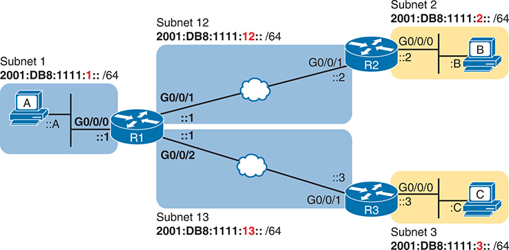

<figcaption>

<strong>图 28-2</strong> <em>带有 IPv6 地址的示例网络</em>

<aside class="hidden" id="a28fig02">

主机 A 位于子网 1（2001:DB8:1111:1:: /64），图标旁标有 ::A，它通过 R1 向主机 B 发送数据包。R1 的接口为 G0/0/0，图标旁标有 ::1。R1 使用子网 12（2001:DB8:1111:12:: /64）上的接口 G0/0/1、地址 ::1，经以太网 WAN 将数据包交给 R2 的接口 G0/0/1、地址 ::2。R2 通过接口 G0/0/0 将数据包交给子网 2（2001:DB8:1111:2:: /64）中的主机 B，主机 B 图标旁标有 :B。主机 A 还通过 R1 向主机 C 发送数据包，R1 的接口为 G0/0/0，图标旁标有 ::1。R1 使用子网 13（2001:DB8:1111:13:: /64）上的接口 G0/0/2、地址 ::1，经以太网 WAN 将数据包交给 R3 的接口 G0/0/1、地址 ::3。R3 通过接口 G0/0/0、地址 ::3 将数据包交给子网 3（2001:DB8:1111:3:: /64）中的主机 C，主机 C 图标旁标有 :C。

</aside>

</figcaption>

</figure>

<strong>例 28-1</strong> <em>路由器 R1 上的 IPv6 邻居表</em>

<a href="#code-f0701-01" id="f0701-01a">点击此处查看代码原图</a>

<pre class="pre-ex" tabindex="0"><code>R1# <strong>show ipv6 neighbors</strong>

IPv6 Address                              Age Link-layer Addr State Interface

2001:DB8:1111:1::a                          0 0200.aaaa.aaaa  REACH Gi0/0/0

2001:DB8:1111:1:9EA:93AC:F7CE:D39F          0 3c8c.f8eb.710d  REACH Gi0/0/0

2001:DB8:1111:1:706A:5FDF:AA40:E576        16 3c8c.f8eb.710d  STALE Gi0/0/0

2001:DB8:1111:1:70D0:AE1F:4786:907D         0 80fa.5b04.de8b  STALE Gi0/0/0

2001:DB8:1111:1:7C6B:7B02:DB5C:873F        16 3c8c.f8eb.710d  STALE Gi0/0/0

2001:DB8:1111:1:90A1:C742:1B11:6F10         0 00e0.4c68.1f26  STALE Gi0/0/0

2001:DB8:1111:1:BD2C:9AA4:83E2:6D8F        16 3c8c.f8eb.710d  STALE Gi0/0/0

FE80::AAAA:AAAA                             0 0200.aaaa.aaaa  REACH Gi0/0/0

FE80::184C:56F9:FD3B:D6E7                   0 00e0.4c68.1f26  REACH Gi0/0/0

FE80::552D:E285:4347:BDED                   0 80fa.5b04.de8b  DELAY Gi0/0/0

FE80::706A:5FDF:AA40:E576                   0 3c8c.f8eb.710d  REACH Gi0/0/0

FE80::FF:FE01:2                             0 2436.dadf.9281  REACH Gi0/0/1

FE80::72EA:1AFF:FE9A:D301                   0 70ea.1a9a.d301  REACH Gi0/0/2</code></pre>

注意

要查看主机的 NDP 邻居表，请使用以下命令：Windows：<strong>netsh interface ipv6 show neighbors</strong>；Linux：<strong>ip -6 neighbor show</strong>；macOS：<strong>ndp -an</strong>。

<a href="#exa28_2">例 28-2</a> 展示了某台 Windows 主机邻居表的部分输出，该主机与<a href="#ch28fig02">图 28-2</a> 中的 PC A 和路由器 R1 位于同一 IPv6 子网。开头的输出展示了分层输入网络 Shell 命令 <strong>netsh interface ipv6 show neighbors</strong> 的过程（这样后续执行更多 <strong>netsh</strong> 命令会方便得多）。突出显示的条目列出 R1 的 G0/0/0 链路本地地址（LLA）和 MAC 地址。此外，该行最右侧突出显示的文字指出，此条目代表一台路由器。输出还列出了几个被请求节点组播地址。

<strong>例 28-2</strong> <em>使用 <strong>netsh interface ipv6 show neighbors</strong> 命令查看 Windows 邻居表的示例</em>

<a href="#code-f0701-02" id="f0701-02a">点击此处查看代码原图</a>

<pre class="pre-ex" tabindex="0"><code>C:\Users\Wendell&gt; <strong>netsh</strong>

netsh&gt; <strong>interface ipv6</strong>

netsh interface ipv6&gt; <strong>show neighbors</strong>

Interface 7: En0

Internet Address                              Physical Address   Type

--------------------------------------------  -----------------  -----------

fe80::11ff:fe11:1111                          02-00-11-11-11-11  Reachable (Router)

ff02::1                                       33-33-00-00-00-01  Permanent

ff02::2                                       33-33-00-00-00-02  Permanent

ff02::1:ff11:1111                             33-33-ff-11-11-11  Permanent

! Lines omitted for brevity

! Next line shows a Powershell command

PS C:\Users\Wendell&gt; <strong>get-NetNeighbor -AddressFamily IPv6</strong>

ifIndex IPAddress                     LinkLayerAddress      State       PolicyStore

------- ---------                     ----------------      -----       -----------

49      ff02::1:ff11:1111             33-33-FF-11-11-11     Permanent   ActiveStore

49      fe80::11ff:fe11:1111          02-00-11-11-11-11     Reachable   ActiveStore

49      ff02::2                       33-33-00-00-00-02     Permanent   ActiveStore

49      ff02::1                       33-33-00-00-00-01     Permanent   ActiveStore

! Lines omitted for brevity</code></pre>

示例最后给出了与 <strong>netsh interface ipv6 show neighbor</strong> 命令等效的 PowerShell 命令：<strong>get-NetNeighbor -AddressFamily IPv6</strong>。后一个命令列出相同的信息。请注意，Microsoft 更倾向于使用 PowerShell 命令，而非 netshell 等旧式命令。

</section>

<section>

<h4 class="h4" id="ch28lev2sec2">使用 NDP RS 和 RA 发现路由器</h4>

IPv4 主机使用 IPv4 默认网关或默认路由器这一概念。当主机需要向本地子网以外的某个 IPv4 子网发送数据包时，它会将 IPv4 数据包发送给默认路由器，期望路由器能够将数据包路由到目的地。请注意，IPv4 主机要么静态设置默认网关的 IP 地址，要么从名为动态主机配置协议（DHCP）服务器的服务器学习该地址。

IPv6 采用相同的默认网关概念，但使用 NDP 改进了这一过程。IPv6 主机通过 NDP 动态发现链路上的所有 IPv6 路由器，了解哪些路由器可以作为默认路由器。NDP 定义了两种消息，使任何主机都可以发现子网中的所有路由器：

<a id="key_305" href="#ref-gloss_352">路由器请求（RS）</a><strong>：</strong> 主机向“所有 IPv6 路由器”的本地作用域组播地址 FF02::2 发送此消息，请求链路上的所有路由器标识自身。

<a id="key_304" href="#ref-gloss_348">路由器通告（RA）</a><strong>：</strong> 路由器发送此消息来响应 RS 消息，列出许多信息，包括路由器的链路本地 IPv6 地址。消息发往发送 RS 的主机的单播地址。路由器也会定期主动发送 RA 消息，这些消息并非响应 RS，而是向链路上的所有主机通告同样的信息。路由器将主动发送的 RA 消息发往所有 IPv6 主机的本地作用域组播地址 FF02::1。

例如，<a href="#ch28fig03">图 28-3</a> 展示了主机 PC A 如何学习 R1 的 LLA。过程很简单：PC A 先发出请求，然后 R1 回复。

IPv6 不使用广播，而是使用组播来提高相对于 IPv4 的效率。在这里，RS 消息发往所有路由器组播地址（FF02::2），以便所有路由器都能收到该消息。它具有 IPv4 广播的积极效果，同时避免了广播的负面影响。在这种情况下，只有 IPv6 路由器会花费 CPU 周期处理 RS 消息，IPv6 主机会忽略该消息。

<figure class="image-c" id="ch28fig03">

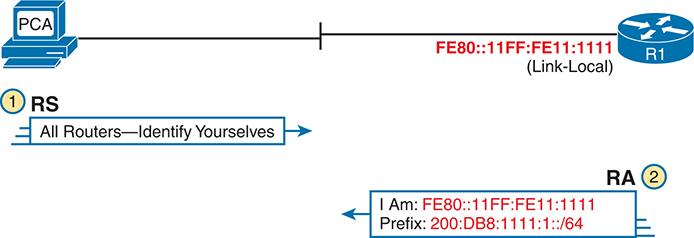

<figcaption>

<strong>图 28-3</strong> <em>使用 NDP RS/RA 过程查找默认路由器的示例</em>

<aside class="hidden" id="a28fig03">

此过程展示了左侧的 PC A 向右侧路由器 R1 发送路由器请求（RS）消息，消息标注为“所有路由器——请标识自身”。路由器 R1 的 IPv6 链路本地地址为 FE80::11FF:FE11:1111。R1 响应 RS，发回路由器通告（RA）消息，内容为“我是：FE80::11FF:FE11:1111；前缀：200:DB8:1111:1::/64”。

</aside>

</figcaption>

</figure>

通过 <strong>show ipv6 routers</strong> 命令，路由器可以列出通过 NDP RA 消息学习到的所有相邻路由器。例如，考虑前面的<a href="#ch28fig02">图 28-2</a> 所示拓扑。连接 R1 G0/0/0 的 LAN 上没有路由器（图的左侧），但 R1 应能在其 WAN 链路上学习到 R2 和 R3。<a href="#exa28_3">例 28-3</a> 展示了输出，其中突出显示了发送 NDP RA 消息的路由器的 LLA、接收该消息的 R1 本地接口，以及相邻路由器通告的<a id="key_300" href="#ref-gloss_285">在链前缀</a>。

<strong>例 28-3</strong> <em>使用 <strong>show ipv6 routers</strong> 命令列出所有路由器</em>

<a href="#code-f0703-01" id="f0703-01a">点击此处查看代码原图</a>

<pre class="pre-ex" tabindex="0"><code>R1# <strong>show ipv6 routers</strong>

Router FE80::FF:FE01:2 on GigabitEthernet0/0/1, last update 2 min

  Hops 64, Lifetime 1800 sec, AddrFlag=0, OtherFlag=0, MTU=1500

  HomeAgentFlag=0, Preference=Medium

  Reachable time 0 (unspecified), Retransmit time 0 (unspecified)

  Prefix 2001:DB8:1111:12::/64 onlink autoconfig

    Valid lifetime 2592000, preferred lifetime 604800

Router FE80::72EA:1AFF:FE9A:D301 on GigabitEthernet0/0/2, last update 0 min

  Hops 64, Lifetime 1800 sec, AddrFlag=0, OtherFlag=0, MTU=1500

  HomeAgentFlag=0, Preference=Medium

  Reachable time 0 (unspecified), Retransmit time 0 (unspecified)

  Prefix 2001:DB8:1111:13::/64 onlink autoconfig

    Valid lifetime 2592000, preferred lifetime 604800</code></pre>

注意

要查看主机学习到的路由器，请使用以下命令：Windows：<strong>netsh interface ipv6 show neighbors</strong>；Linux：<strong>ip -6 neighbor</strong>；macOS：<strong>ndp -rn</strong>。

</section>

<section>

<h4 class="h4" id="ch28lev2sec3">使用 NDP RS 和 RA 发现前缀</h4>

NDP RA 消息除了标识链路上的路由器，还会列出链路所用的 IPv6 前缀和前缀长度。因此，主机会动态学习链路上应当存在的子网。例如，<a href="#ch28fig03">图 28-3</a> 展示了一次 RS/RA 交换。图右下角的 RA 不仅显示路由器使用链路本地地址（LLA）标识自身，还列出一个在链前缀 2001:db8:1111:1::/64。

IPv6 主机和 IPv4 主机一样使用路由表，但构建路由的方式不同。IPv4 主机会为每个在链子网建立一条路由，子网由主机的 IPv4 地址和掩码计算得出。IPv6 主机也为每个在链子网建立路由，但不进行计算，而是依赖路由器发送的 RA 消息所通告的前缀。路由器可以通告多个在链前缀，列出子网前缀和前缀长度；主机据此将这些子网中的目的地视为在链目的地。此外，主机还利用 NDP RA 消息中列出的信息建立默认路由。概括而言，IPv6 主机会根据 RA 消息建立以下两种重要路由：

<ul class="sq">

<li>
为通过路由器的 NDP RA 消息学习到的每个在链前缀及其长度建立一条路由。这些在链路由允许主机直接将数据包转发给在链目的地，无须经过路由器。

</li>

<li>
建立一条默认路由，下一跳路由器地址为 NDP RA 消息中标识的路由器 LLA。默认路由允许主机将发往链路之外的数据包转发给链路上的路由器。
</li>

</ul>

<a href="#exa28_4">例 28-4</a> 展示了与<a href="#ch28fig03">图 28-3</a> 中 PC A 位于同一子网的两台主机的部分输出，前半部分来自 macOS，后半部分来自 Windows PC。两个命令都显示主机路由表中的默认路由条目和一个在链前缀条目。示例突出显示了每个命令中的默认路由、下一跳地址（“gateway”）和在链前缀 2001:db8:1111:1::/64。

<strong>例 28-4</strong> <em>使用 <strong>netstat -rn</strong> 命令查看 macOS 主机路由表的示例</em>

<a href="#code-f0704-01" id="f0704-01a">点击此处查看代码原图</a>

<pre class="pre-ex" tabindex="0"><code>Mac% <strong>netstat -rnf inet6</strong>

default                       fe80::11ff:fe11:1111%en8        UGcg           en8

2001:db8:1111:1::/64          link#20                         UC             en8

fe80::11ff:fe11:1111%en8      2:0:11:11:11:11                 UHLWIir        en8

! Lines omitted for brevity</code></pre>

<pre class="pre-ex" tabindex="0"><code>Windows PC&gt; <strong>netsh</strong>

netsh&gt; <strong>interface ipv6</strong>

netsh interface ipv6&gt; <strong>show route</strong>

Publish  Type      Met   Prefix                    Idx  Gateway/Interface Name

-------  --------  ---   ------------------------  ---  ------------------------

No       Manual    256   ::/0                      49   fe80::11ff:fe11:1111

No       Manual    256   2001:db8:1111:1::/64      49   Ethernet 6

! Lines omitted for brevity</code></pre>

仔细比较 macOS 和 Windows 的输出，会发现一些差异。不过，两台主机都使用了 R1 发来的 RA 消息中的信息。特别是，macOS 使用单词 <em>default</em> 表示默认路由，而 Windows 使用其数值等价形式 ::/0，这个数字用于表示所有 IPv6 地址。两者都将路由器的 LLA 而非 GUA 列为下一跳地址。

</section>

<section>

<h4 class="h4" id="ch28lev2sec4">使用 NDP NS 和 NA 发现重复地址</h4>

IPv6 主机在开始使用单播地址之前，会执行重复地址检测（DAD）过程，确保该链路上没有其他节点已在使用此地址。主机在首次使用地址时，以及主机接口每次初始化时，都会执行 DAD。无论采用静态地址配置还是任何一种动态地址配置方式，主机都会使用 DAD。如果执行 DAD 时发现另一台主机已经使用该地址，第一台主机就不会使用此地址，直到问题得到解决。

<em>DAD</em> 是功能的名称，该功能使用 NDP NS 和 NA 消息。主机针对自己的 IPv6 地址发送 NS 消息。其他主机不应使用这个地址，因此不应有其他主机回复 NDP NA。但是，如果另一台主机已经使用此地址，它就会回复 NA，表明存在地址重复使用的情况。

<a href="#ch28fig04">图 28-4</a> 展示了一个 DAD 示例。PC1 初始化并执行 DAD 检查，但 PC2 已经使用相同的地址。图中展示了以下步骤：

<ol class="number">

<li>
PC1 在使用地址 2001:DB8:1111:1::11 之前，必须执行 DAD。
</li>

<li>
PC1 发送 NS 消息，将自己准备使用的地址（2001:DB8:1111:1::11）列为目标。
</li>

<li>
PC2 收到针对其当前所用地址的 NS，因此发回 NA。
</li>

<li>
PC1 收到针对自身 IPv6 地址的 NA 消息后，意识到存在重复地址。
</li>

</ol>

<figure class="image-c" id="ch28fig04">

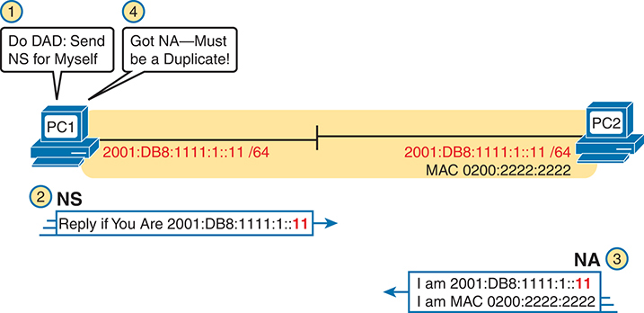

<figcaption>

<strong>图 28-4</strong> <em>通过 NDP NS/NA 进行重复地址检测（DAD）的示例</em>

<aside class="hidden" id="a28fig04">

此过程展示了左侧 PC1，标注为“执行 DAD：针对自己发送 NS”。它为自己发送 NS（邻居请求），发起过程，消息内容为“如果你是 2001:DB8:1111:1::11，请回复”。右侧 PC2 拥有相同的 IP 地址，MAC 地址为 0200:2222:2222；它回复 NA（邻居通告）消息，确认“我是 2001:DB8:1111:1::11，我的 MAC 地址是 0200:2222:2222”。最后，PC1 收到 NA 并识别出重复地址，PC1 上方的文字表示“收到 NA——一定有重复地址！”

</aside>

</figcaption>

</figure>

</section>

<section>

<h4 class="h4" id="ch28lev2sec5">NDP 小结</h4>

本章介绍了 NDP 执行的许多重要功能中的一部分。学习这里讨论的四项 NDP 功能时，可以参考<a href="#ch28tab02">表 28-2</a>。

<figure class="table" id="ch28tab02" tabindex="0">

<figcaption>

<strong>表 28-2</strong> NDP 功能小结

</figcaption>

<table class="all">

<thead>

<tr>

<th class="th">
功能
</th>

<th class="th">
协议消息
</th>

<th class="th">
信息发现方
</th>

<th class="th">
信息提供方
</th>

<th class="th">
提供的信息
</th>

</tr>

</thead>

<tbody>

<tr>

<td class="border">
路由器发现
</td>

<td class="border">
RS 和 RA
</td>

<td class="border">
任意 IPv6 主机
</td>

<td class="border">
任意 IPv6 路由器
</td>

<td class="border">
路由器的链路本地 IPv6 地址
</td>

</tr>

<tr>

<td class="border">
前缀／长度发现
</td>

<td class="border">
RS 和 RA
</td>

<td class="border">
任意 IPv6 主机
</td>

<td class="border">
任意 IPv6 路由器
</td>

<td class="border">
本地链路所用的前缀及对应的前缀长度
</td>

</tr>

<tr>

<td class="border">
邻居发现
</td>

<td class="border">
NS 和 NA
</td>

<td class="border">
任意 IPv6 主机
</td>

<td class="border">
任意 IPv6 主机
</td>

<td class="border">
邻居使用的链路层地址（例如 MAC 地址）
</td>

</tr>

<tr>

<td class="border">
重复地址检测
</td>

<td class="border">
NS 和 NA
</td>

<td class="border">
任意 IPv6 主机
</td>

<td class="border">
任意 IPv6 主机
</td>

<td class="border">
简单确认某个单播地址是否已经被使用
</td>

</tr>

</tbody>

</table>

</figure>

</section>

</section>

<section>

<h3 class="h3" id="ch28lev1sec4">动态配置主机的 IPv6 设置</h3>

动态主机配置协议（DHCP）在动态分配 IPv4 地址方面表现良好。当 IPv6 协议的设计者寻找动态分配主机地址的解决方案时，为 IPv6 创建新的 DHCP 协议十分合理。如今，DHCP 版本 6（DHCPv6）的 RFC 8415 定义了一种动态分配 IPv6 地址的方法。

不过，IPv6 的设计者还希望有另一种分配 IPv6 地址的方法。DHCPv4 使用服务器，需要预先配置各子网使用的地址池。这种模式在某些情况下很有效，但采用 DHCPv4 模式也要求服务器掌握所有地址租约，并保存每台主机（客户端）及其地址的相关信息（称为状态信息）。

IPv6 的设计者提供了两种动态地址分配方法：

<ul class="sq">

<li>
<strong>DHCPv6（有状态 DHCPv6）：</strong> 这种方法使用 DHCP 服务器，采用与 DHCPv4 相同的有状态模式。
</li>

<li>
<strong>无状态地址自动配置（SLAAC）：</strong> 客户端自行分配其 IPv6 地址。这种方法无须预先配置地址池，也不需要服务器保存有关客户端的状态信息。
</li>

</ul>

本章接下来的这一主要部分先介绍有状态 DHCPv6，再介绍 SLAAC。

<section>

<h4 class="h4" id="ch28lev2sec6">使用有状态 DHCP</h4>

DHCPv6 使用与 IPv4 DHCP 相同的总体概念，让 IPv6 主机能够学习主机的 IPv6 配置设置。主机与 DHCP 服务器交换消息。服务器为主机提供配置信息，包括 IPv6 地址租约和 DNS 服务器地址信息。

更具体地说，有状态 DHCPv6 在许多总体方面都与更为熟悉的 IPv4 DHCP 类似，如下所示：

<ul class="sq">

<li>
LAN 上的 DHCP 客户端发送仅在本地 LAN 内传递的消息，希望找到 DHCP 服务器。

</li>

<li>
如果 DHCP 服务器与客户端位于同一 LAN，客户端和服务器可以直接交换 DHCP 消息，无须路由器协助。
</li>

<li>
如果 DHCP 服务器与客户端位于不同链路，客户端和服务器就依靠路由器转发 DHCP 消息。
</li>

<li>
将消息从一条链路转发给远程子网中服务器的路由器，必须配置为 DHCP 中继代理，并知晓 DHCP 服务器的 IPv6 地址。
</li>

<li>
服务器的配置列出各子网的地址池，服务器从中分配地址。
</li>

<li>
服务器从客户端所在子网的地址池中，向客户端提供一个 IP 地址租约；租约具有设定的有效期（通常为数天或数周）。
</li>

<li>
服务器跟踪状态信息，具体包括客户端标识符（通常基于 MAC 地址）以及当前租给该客户端的地址。
</li>

</ul>

DHCPv6 定义了两个分支：<a id="key_306" href="#ref-gloss_374">有状态 DHCPv6</a> 和<a id="key_308" href="#ref-gloss_376">无状态 DHCPv6</a>。有状态 DHCPv6 更接近 DHCPv4 模式，尤其体现在上述列表的最后一项。有状态 DHCPv6 服务器跟踪哪个客户端租用了哪个 IPv6 地址的信息；服务器知晓特定客户端相关信息，这些信息称为状态信息，因此该 DHCP 服务器是有状态 DHCP 服务器。

无状态 DHCP 服务器不向客户端租用地址，因此不会跟踪任何针对单个客户端的信息。后面的“<a href="#ch28lev2sec7">使用无状态地址自动配置</a>”一节将讨论，在公司决定使用 SLAAC 时，无状态 DHCPv6 服务器如何发挥重要作用。

<section>

<h5 class="h5" id="ch28lev3sec1">有状态 DHCPv6 与 DHCPv4 的差异</h5>

虽然有状态 DHCPv6 与 DHCPv4 有许多相似之处，但许多细节也不同。<a href="#ch28fig05">图 28-5</a> 展示了这些差异：有状态 DHCPv6 提供地址和 DNS 服务器列表。但是，主机已经依赖 NDP RA 消息来学习默认路由器地址和要使用的前缀长度，这些信息足以构建默认路由和在链路由。因此，有状态 DHCPv6 服务器不提供默认路由器地址或前缀长度。

DHCPv6 还更新了协议消息，使用 IPv6 数据包代替 IPv4 数据包，并采用新的消息和字段。例如，<a href="#ch28fig06">图 28-6</a> 展示了 DHCPv6 消息的名称，它们取代 DHCPv4 的 Discover、Offer、Request 和 Acknowledgment（DORA）消息。DHCPv6 使用的消息则是 Solicit、Advertise、Request 和 Reply（SARR）。

<figure class="image-c" id="ch28fig05">

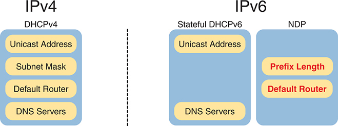

<figcaption>

<strong>图 28-5</strong> <em>使用有状态 DHCP 时各项 IPv6 设置的来源</em>

<aside class="hidden" id="a28fig05">

图中的列包括 IPv4 下的 DHCPv4，以及 IPv6 下的有状态 DHCPv6 和 NDP。DHCPv4 列中的行分别表示单播地址、子网掩码、默认路由器和 DNS 服务器。有状态 DHCPv6 列中的行包括单播地址和 DNS 服务器。NDP 列中的行用于配置前缀长度和默认路由器。

</aside>

</figcaption>

</figure>

<figure class="image-c" id="ch28fig06">

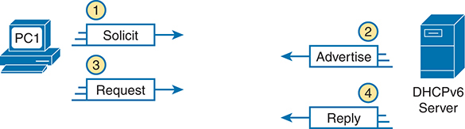

<figcaption>

<strong>图 28-6</strong> <em>客户端与服务器之间的四种有状态 DHCPv6 消息</em>

<aside class="hidden" id="a28fig06">

过程从步骤 1 开始：客户端发送 Solicit 消息，请求 IPv6 地址。随后是步骤 2：服务器回复 Advertise 消息，提供可用前缀。在步骤 3 中，客户端发送 Request 消息，指定自己偏好的前缀。最后是步骤 4：服务器回复 Reply 消息，传达客户端的 IPv6 地址配置参数。

</aside>

</figcaption>

</figure>

这四种 DHCPv6 消息分为两对，整体流程与对应的 DHCPv4 消息相同。Solicit 和 Advertise 消息完成以下过程：客户端查找 DHCPv6 服务器的 IPv6 地址（Solicit 消息），服务器通告一个可供客户端使用的地址及其他配置设置（Advertise 消息）。Request 和 Reply 消息使客户端能够请求租用该地址，服务器则在 Reply 消息中确认租约。（注意，有状态 DHCPv6 支持快速提交选项，只需 Solicit 和 Reply 消息即可完成租约。）

</section>

<section>

<h5 class="h5" id="ch28lev3sec2">DHCPv6 中继代理</h5>

对于选择使用有状态 DHCPv6 的企业，DHCP 服务器通常位于中心站点，距离许多使用该 DHCPv6 服务器的客户端很远。在这种情况下，各站点的本地路由器必须充当 DHCP 中继代理。

DHCPv6 中继的工作概念与 DHCPv4 中继相同，后者已在<a href="v1-19.html#ch19">第 19 章</a>“<a href="v1-19.html#ch19">主机的 IP 编址</a>”中的“<a href="v1-19.html#ch19lev3sec4">配置 DHCP 中继</a>”一节讨论。客户端发送的消息通常具有链路本地作用域，因此路由器不会转发该数据包。启用 DHCPv6 中继后，路由器会更改源 IP 地址和目的 IP 地址，再将数据包转发给 DHCP 服务器。服务器发送应答时，应答发往路由器（中继代理）上的一个地址。路由器再次更改数据包中的地址，以便正确交付给客户端。

查看 DHCPv6 消息所使用的一些 IPv6 地址时，IPv6 的差异会更加明显，例如用于开始 DHCPv6 交互的 Solicit 消息。如<a href="#ch28fig07">图 28-7</a> 所示，客户端在 Solicit 消息中使用以下地址：

<strong>源地址为链路本地地址：</strong> 客户端将自身的链路本地地址用作数据包的源地址。

<strong>目的地址为“所有 DHCP 代理”地址 FF02::1:2：</strong> 客户端将 Solicit 消息发送到链路本地作用域组播地址 FF02::1:2。只有 DHCP 服务器和充当 DHCP 中继代理的路由器监听这些数据包。

由于目的地址是链路本地作用域组播地址，主机发送的 Solicit 消息只会在本地 LAN 上传递。<a href="#ch28fig07">图 28-7</a> 展示了作为 DHCPv6 中继代理的 R1 如何协助主机 A 等 DHCPv6 客户端，将 DHCPv6 数据包交付给 DHCPv6 服务器。

<figure class="image-c" id="ch28fig07">

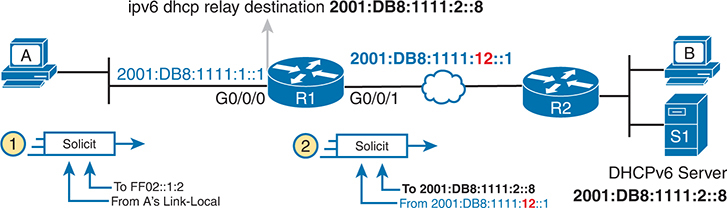

<figcaption>

<strong>图 28-7</strong> <em>DHCPv6 中继代理与 DHCP IPv6 地址</em>

<aside class="hidden" id="a28fig07">

图中有具有 G0/0/0 和 G0/0/1 接口的路由器 R1、交换机 S1，以及位于子网 2001:DB8:1111:2::/64 的 DHCPv6 服务器，其 IPv6 地址为 2001:DB8:1111:2::8。图中还标有 IPv6 地址 2001:DB8:1111:12::1 和链路本地地址 A。图中概述的 DHCPv6 中继过程如下：子网 2001:DB8:1111:1::/64 上的 DHCPv6 客户端向 FF02::1:2 所有路由器组播地址发送 DHCPv6 请求消息。路由器 R1 收到 DHCPv6 请求消息后，使用 DHCPv6 中继消息将其转发给地址为 2001:DB8:1111:2::8 的 DHCPv6 服务器，源地址为路由器 R1 的 G0/0/1 接口的链路本地地址。DHCPv6 服务器处理该中继消息，并向路由器 R1 回复 DHCPv6 通告消息。路由器 R1 再将 DHCPv6 通告消息转发给子网 2001:DB8:1111:1::/64 上的 DHCPv6 客户端。

</aside>

</figcaption>

</figure>

图中的步骤 1 展示了 DHCPv6 Solicit 消息；由于目的组播地址 FF02::1:2 具有链路本地作用域，这条消息原本只会停留在该链路上。步骤 2 展示路由器 R1 上的 DHCP 中继代理所执行的操作。路由器 R1 将目的 IPv6 地址更改为所配置的 DHCP 服务器地址（2001:DB8:1111:2::8）。DHCP 中继代理还将源 IPv6 地址设置为其出接口（G0/0/1）的地址，这一点与 DHCPv4 中继代理略有不同。然后 R1 将 Solicit 消息转发给服务器。

继续图示之后的过程，服务器发送一条应答，具体而言是一条 DHCPv6 Advertise 消息。与 Solicit 消息相比，该消息将所用的 IPv6 地址反向使用，因此 Advertise 消息的目的地址为 2001:DB8:1111:12::1。路由器 R1 中的中继代理将目的地址转换成主机 A 的 LLA，并从朝向客户端的接口转发该数据包。

<a href="#exa28_5">例 28-5</a> 展示了<a href="#ch28fig06">图 28-6</a> 中 R1 的 DHCPv6 中继代理配置。示例上半部分展示接口子命令 <strong>ipv6 dhcp relay</strong>，其中指定 DHCPv6 服务器的 IPv6 地址。图的下半部分展示 <strong>show ipv6 interface</strong> 命令的输出，确认 R1 现在正在监听发往所有 DHCP 代理组播地址 FF02::1:2 的组播。

<strong>例 28-5</strong> <em>配置路由器 R1 以支持远程 DHCPv6 服务器</em>

<a href="#code-f0709-01" id="f0709-01a">点击此处查看代码原图</a>

<pre class="pre-ex" tabindex="0"><code><strong>interface GigabitEthernet0/0/0</strong>

 <strong>ipv6 dhcp relay destination 2001:DB8:1111:2::8</strong>

R1# <strong>show ipv6 interface g0/0/0</strong>

GigabitEthernet0/0/0 is up, line protocol is up

  IPv6 is enabled, link-local address is FE80::11FF:FE11:1111

  No Virtual link-local address(es):

  Global unicast address(es):

    2001:DB8:1111:1::1, subnet is 2001:DB8:1111:1::/64

  Joined group address(es):

    FF02::1

    FF02::2

    FF02::5

    FF02::6

    FF02::1:2

    FF02::1:FF00:1

    FF02::1:FF11:1111

! Lines omitted for brevity</code></pre>

顺便注意，在“Joined group address(es)”标题下列出的组播地址中，前五个是众所周知的组播地址（FF02::1、FF02::2、FF02::5、FF02::6 和 FF02::1:2），另外还有两个以 FF02::1:FF 开头的被请求节点组播地址。

</section>

</section>

<section>

<h4 class="h4" id="ch28lev2sec7">使用无状态地址自动配置</h4>

大多数公司广泛使用 DHCPv4；基于同样的原因，使用有状态 DHCPv6 也很合理。不过，有状态 DHCP 过程确实存在一些不足。需要有人配置、维护和管理 DHCP 服务器。配置中包括每个子网的 IP 地址范围。随后，当主机（客户端）租用地址时，服务器会记录哪个客户端正在使用哪个地址。这些功能运行良好，掌握 DHCP 服务器中的信息也很有价值；但是，对有状态 DHCP 服务器的依赖需要 IT 人员投入一定的思考和精力。

IPv6 的<a id="key_307" href="#ref-gloss_375">无状态地址自动配置（SLAAC）</a> 提供了另一种动态分配 IPv6 地址的方法，无须有状态服务器。换言之，SLAAC 不要求服务器分配或租出 IPv6 地址，不要求 IT 人员预先为每个子网配置地址池，也不要求服务器跟踪哪个设备使用哪个 IPv6 地址的状态信息。

<em>SLAAC</em> 这个术语既指主机学习某一项 IPv6 设置（其 IPv6 地址）的特定环节，也指学习全部四项关键主机 IPv6 设置（地址、前缀长度、默认路由器和 DNS 服务器地址列表）的整个过程。接下来的主题先考察 SLAAC 执行的与 IPv6 地址有关的任务，然后讨论用于获得四项主机设置的完整 SLAAC 过程，该过程还会使用 NDP 和无状态 DHCP。

<section>

<h5 class="h5" id="ch28lev3sec3">使用 SLAAC 构建 IPv6 地址</h5>

使用 SLAAC 时，主机不租用其 IPv6 地址，而是从附近的路由器学习地址的一部分，即前缀，然后自行生成 IPv6 地址的其余部分。具体而言，使用 SLAAC 选择 IPv6 地址的主机会执行以下步骤：

<ol class="number">

<li>
利用 NDP RS/RA 消息，从任意路由器学习链路使用的 IPv6 前缀。
</li>

<li>
自行生成接口 ID（IID）值，接在刚刚学习到的 IPv6 前缀之后，从而选择自己的 IPv6 地址。
</li>

<li>
在使用该地址之前，利用 DAD 确保其他主机尚未使用相同的地址。
</li>

</ol>

<a href="#ch28fig08">图 28-8</a> 描述前两个步骤，并指出主机补全地址最常用的两种方式。主机可以使用<a href="v1-27.html#ch27">第 27 章</a>“<a href="v1-27.html#ch27">在路由器上实现 IPv6 编址</a>”的“<a href="v1-27.html#ch27lev3sec4">使用修改后的 EUI-64 生成唯一接口 ID</a>”一节讨论的修改后的 EUI-64 规则，也可以使用随机数。

<figure class="image-c" id="ch28fig08">

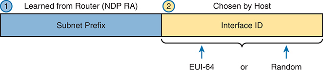

<figcaption>

<strong>图 28-8</strong> <em>使用 SLAAC 形成主机的 IPv6 地址</em>

<aside class="hidden" id="a28fig08">

图由两个主要部分组成：“从路由器学习（NDP RA）”和“由主机选择”。在“从路由器学习”部分，主机地址来源于子网前缀。在“由主机选择”部分，主机地址使用标注为接口 ID 的随机接口标识符生成，其方式标注为 EUI-64 或随机生成。

</aside>

</figcaption>

</figure>

</section>

<section>

<h5 class="h5" id="ch28lev3sec4">将 SLAAC 与无状态 DHCP 结合使用</h5>

如<a href="#ch28fig09">图 28-9</a> 所示，使用 SLAAC 时，主机通过三种工具获取四项 IPv6 设置。SLAAC 本身只关注 IPv6 地址。然后，主机使用 NDP 消息学习前缀长度和链路上默认路由器的 IPv6 地址。最后，主机使用无状态 DHCP 学习 DNS 服务器的 IPv6 地址。

<figure class="image-c" id="ch28fig09">

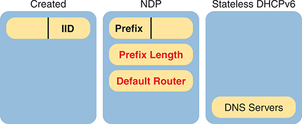

<figcaption>

<strong>图 28-9</strong> <em>使用 SLAAC 时各项 IPv6 设置的来源</em>

<aside class="hidden" id="a28fig09">

图中的列标为“创建”“NDP”和“无状态 DHCPv6”。“创建”列中的行表示 IID。NDP 列中的行在前缀下配置前缀长度和默认路由器。无状态 DHCPv6 列中的行包括 DNS 服务器。

</aside>

</figcaption>

</figure>

当 SLAAC 使用 DHCP 提供 DNS 服务器列表时，服务器实现的是无状态 DHCP。采用无状态 DHCPv6 时，DHCPv6 服务器具有以下特点：

<ul class="sq">

<li>
只需要简单配置，具体而言就是一份简短的 DNS 服务器地址列表。
</li>

<li>
无须针对各子网配置：不需要子网列表、每个子网的地址池、每个子网的排除地址列表，也不需要每个子网的前缀长度。
</li>

<li>
无须跟踪 DHCP 租约的状态信息，也就是哪些设备租用了哪个 IPv6 地址，因为服务器不会向任何客户端租出地址。
</li>

</ul>

<a href="#ch28tab03">表 28-3</a> 总结了有状态 DHCP 与无状态 DHCP 的主要比较点。

<figure class="table" id="ch28tab03" tabindex="0">

<figcaption>

<strong>表 28-3</strong> 无状态与有状态 DHCPv6 服务的比较

</figcaption>

<table class="all">

<thead>

<tr>

<th class="th">
特性
</th>

<th class="th">
有状态 DHCP
</th>

<th class="th">
无状态 DHCP
</th>

</tr>

</thead>

<tbody>

<tr>

<td class="border">
记住客户端的 IPv6 地址（状态信息）
</td>

<td class="border">
是
</td>

<td class="border">
否
</td>

</tr>

<tr>

<td class="border">
将 IPv6 地址租给客户端
</td>

<td class="border">
是
</td>

<td class="border">
否
</td>

</tr>

<tr>

<td class="border">
提供 DNS 服务器地址列表
</td>

<td class="border">
是
</td>

<td class="border">
是
</td>

</tr>

<tr>

<td class="border">
通常与 SLAAC 配合使用
</td>

<td class="border">
否
</td>

<td class="border">
是
</td>

</tr>

</tbody>

</table>

</figure>

</section>

<section>

<h5 class="h5" id="ch28lev3sec5">将 SLAAC 与基于 RA 的 DNS 服务器配置结合使用</h5>

SLAAC 最初依靠无状态 DHCP 服务器提供 DNS 服务器列表。IPv6 现在支持另一种传递 DNS 服务器列表的方式，称为基于 RA 的 DNS 配置，从而不再需要无状态 DHCP 服务器。

采用基于 RA 的 DNS 服务器（RDNSS）配置时，需要在每个路由器接口上配置 DNS 服务器列表。然后，路由器在发送每条 NDP RA 消息时，都会在其 NDP RA（路由器通告）消息中提供 DNS 列表。因此，RDNSS 配置使所有客户端 IPv6 设置仅通过路由器配置即可自动分配，完全不需要 DHCP 服务器。不过请注意，这也要求在所有支持 IPv6 的路由器上配置 DNS 服务器列表，因此集中式无状态 DHCPv6 服务器在管理上可能更为实用。

</section>

</section>

<section>

<h4 class="h4" id="ch28lev2sec8">永久与临时 SLAAC 地址</h4>

实际使用中，主机会利用 SLAAC 生成多个单播地址，具体而言是一个<a id="key_301" href="#ref-gloss_303">永久 IPv6 地址</a>，以及随时间推移而生成的一系列<a id="key_309" href="#ref-gloss_406">临时 IPv6 地址</a>。永久地址会一直保持不变。如果该主机作为服务器运行，它将使用永久地址处理所有传入连接。通常还会在 DNS 服务器中为该地址添加 DNS 条目，以便客户端轻松连接。

主机为客户端应用程序使用临时地址。例如，当你打开 Web 浏览器标签页并连接网站时，主机会使用临时地址而非永久地址进行连接。

使用临时地址可提高主机的安全性，以 RFC 8981 为中心的一系列相关 RFC 对此有详细说明。攻击者可以通过各种攻击收集主机发送的信息和数据包。如果一段时间内捕获的数据包始终使用相同地址，攻击者就更容易关联这些信息，寻找访问主机或使其无法获得服务的方法。频繁更改地址，可以避免攻击者通过数据分析获得攻击主机的优势。

主机在创建地址时，会为所有通过 SLAAC 创建的地址分配<a id="key_302" href="#ref-gloss_310">首选生存期</a>和<a id="key_310" href="#ref-gloss_429">有效生存期</a>设置。每个临时地址会依次经历首选、有效和弃用阶段。在首选阶段，主机使用该地址建立新连接。首选生存期到期后，地址变为有效状态。主机可以继续将有效地址用于现有连接，但不能用于新连接。有效生存期到期后，主机认为该地址已弃用，不再使用它。<a href="#ch28fig10">图 28-10</a> 展示了这些概念。

<figure class="image-c" id="ch28fig10">

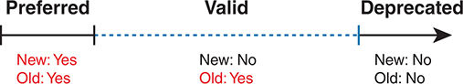

<figcaption>

<strong>图 28-10</strong> <em>一个临时地址的 SLAAC 首选生存期和有效生存期</em>

<aside class="hidden" id="a28fig10">

时间线中的首选生存期标为“新：是”和“旧：是”，表示建议新旧客户端都使用这一时段。有效生存期标为“新：否”和“旧：是”。弃用生存期标为“新：否”和“旧：否”。

</aside>

</figcaption>

</figure>

临时地址的首选生存期和有效生存期设置得较短。典型设置可能是首选生存期 24 小时，有效生存期一周。在这种情况下，每隔 24 小时，主机就需要一个新的临时地址，因为上一个临时地址已从首选状态转为有效状态。基本而言，主机在任何时刻都需要一个处于首选生存期状态的临时地址。<a href="#ch28fig11">图 28-11</a> 展示了这个概念：三个连续临时地址的时间线依次出现，每个比前一个晚 24 小时。在任何时刻，主机都有一个尚有剩余首选生存期的临时地址，因此可以使用新的首选地址建立新的应用程序连接。

<figure class="image-c" id="ch28fig11">

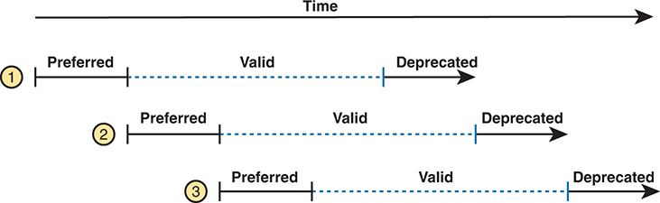

<figcaption>

<strong>图 28-11</strong> <em>创建新的临时地址，确保有一个地址尚有剩余首选生存期</em>

<aside class="hidden" id="a28fig11">

标注为“时间”的时间线分为编号 1、2、3 的三行，以“首选”“有效”和“弃用”三个部分展示地址状态随时间的变化。“首选”部分用实线表示，代表临时地址的建议使用生存期。“有效”部分用虚线表示，说明此生存期不再建议用于新客户端，但旧客户端仍可使用。“弃用”部分是一条向右延伸的实线（或右箭头），表示任何客户端都不应在此生存期使用该地址。

</aside>

</figcaption>

</figure>

可使用以下主机命令查看永久地址和临时地址：

macOS：<strong>ifconfig en0 inet 6</strong> 或 <strong>ifconfig -aL inet6</strong>

Linux：<strong>ip -6 address</strong>

Windows：<strong>ipconfig /all</strong> 或 <strong>netsh interface ipv6 show address</strong>（Windows netshell）

Windows：<strong>Get-NetIPConfiguration -Detailed</strong>（Windows PowerShell）

<a href="#exa28_6">例 28-6</a> 展示 Windows 上 <strong>netsh interface ipv6 show address</strong> 命令的输出。示例截取了唯一一个工作中的无线 LAN 接口的部分输出。输出显示了用于传入连接的永久（公共）地址，其有效生存期和首选生存期均为无限。它还显示当前临时地址，首选生存期略短于 24 小时，有效生存期略短于一周。此外，请检查地址的 IID 中是否存在 ff:fe；同样，没有这一字符串就表明主机没有使用 EUI-64，而是生成了随机 IID。

<strong>例 28-6</strong> <em>使用 <strong>netsh interface ipv6 show address</strong> 命令查看 Windows SLAAC 地址</em>

<a href="#code-f0714-01" id="f0714-01a">点击此处查看代码原图</a>

<pre class="pre-ex" tabindex="0"><code>C:\Users\Wendell&gt; <strong>netsh</strong>

netsh&gt; <strong>interface ipv6</strong>

netsh interface ipv6&gt; <strong>show address</strong>

Interface 7: Wi-Fi

Addr Type  DAD State   Valid Life Pref. Life Address

---------  ----------- ---------- ---------- ------------------------

Temporary  Preferred  6d23h57m58s   23h49m3s 2001:db8:1111:1:c1cd:7a44:45a5:58f1

Public     Preferred     infinite   infinite 2001:db8:1111:1:f1f5:5cbb:f395:6c51

Other      Preferred     infinite   infinite fe80::f1f5:5cbb:f395:6c51%7</code></pre>

注意，后面的<a href="#exa28_7">例 28-7</a> 展示了 macOS 上类似命令的示例。

</section>

</section>

<section>

<h3 class="h3" id="ch28lev1sec5">主机 IPv6 编址故障排除</h3>

本章的第三个也是最后一个主要部分，考察几条用于验证和排查主机 IPv6 编址配置的命令。具体而言，本节先检查主机的 IPv6 设置，然后介绍测试主机能否发送数据包的常用命令：<strong>ping</strong> 和 <strong>traceroute</strong>。

请注意，本节列出了一些不同主机操作系统上的命令；但本章及其他章节并不试图展示每种操作系统上每条网络命令的所有变体。主机命令示例的目的，是巩固本章前面介绍的概念。

<section>

<h4 class="h4" id="ch28lev2sec9">从主机验证 IPv6 连通性</h4>

大多数终端用户操作系统都支持通过图形用户界面方便地查看 IPv6 设置。在某些情况下，全部四项关键 IPv6 主机设置都显示在同一窗口中；而在其他情况下，查看所有设置可能需要切换多个窗口，或同一窗口中的多个标签页。接下来的几页首先介绍如何查找主机使用的 IPv6 地址，然后说明如何使用 <strong>ping</strong> 和 <strong>traceroute</strong> 命令测试连通性。

<section>

<h5 class="h5" id="ch28lev3sec6">查找 IPv6 接口地址的主机命令</h5>

例如，<a href="#ch28fig12">图 28-12</a> 展示了列出三项 IPv6 主机设置的 macOS 窗口。唯一缺少的 DNS 服务器设置位于另一个标签页中（可在图像顶部附近看到）。

花一点时间查看<a href="#ch28fig12">图 28-12</a> 的细节。图像上部显示 IPv4 设置。窗口下半部分显示 IPv6 设置为“Automatically”（自动）学习，意味着主机会使用有状态 DHCP 或 SLAAC。在此例中，主机使用 SLAAC，在同一个 2001:DB8:1111:1::/64 子网内为自己分配两个 IPv6 地址。不过，图形界面没有区分永久地址和临时地址，也未显示生存期。

<figure class="image-c" id="ch28fig12">

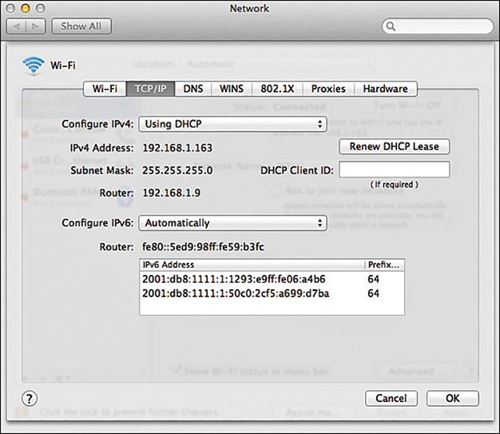

<figcaption>

<strong>图 28-12</strong> <em>macOS 上动态地址分配的三项 IPv6 设置</em>

<aside class="hidden" id="a28fig12">

TCP/IP 标签页下可见配置 IPv4 和 IPv6 的选项。IPv4 设置包括“Configure IPv4”“IPv4 address”“Subnet Mask”和“Router”。IPv6 设置包括“Configure IPv6”，下方表格显示 IPv6 地址和前缀。此外，右侧显示 DHCP 客户端 ID，以及续租 DHCP 租约的选项。

</aside>

</figcaption>

</figure>

主机支持一系列命令，可用于查找地址的更多细节，包括生存期。例如，前面的<a href="#exa28_6">例 28-6</a> 展示了 Windows 的 <strong>netsh interface ipv6 show address</strong> 命令，而 Linux 使用 <strong>show -6 address</strong> 命令。<a href="#exa28_7">例 28-7</a> 使用两个命令展示了 macOS 上的这些具体信息。第一个命令 <strong>ifconfig en8</strong> 列出一个特定接口上的以太网、IPv4 和 IPv6 详细信息，该接口内部编号为以太网 8，即 en8。此命令还标识首选地址（使用关键字 <em>secured</em>）和临时地址，如示例上半部分突出显示的内容所示。

<strong>例 28-7</strong> <em>Mac 上的 <strong>ifconfig</strong> 命令示例</em>

<a href="#code-f0715-01" id="f0715-01a">点击此处查看代码原图</a>

<pre class="pre-ex" tabindex="0"><code>Mac% <strong>ifconfig en8</strong>

en8: flags=8863&lt;UP,BROADCAST,SMART,RUNNING,SIMPLEX,MULTICAST&gt; mtu 1500

       options=6467&lt;RXCSUM,TXCSUM,VLAN_MTU,TSO4,TSO6,CHANNEL_IO,PARTIAL_

CSUM,ZEROINVERT_CSUM&gt;

        ether 00:e0:4c:68:1f:26

        inet6 fe80::184c:56f9:fd3b:d6e7%en8 prefixlen 64 secured scopeid 0x14

        inet6 2001:db8:1111:1:106a:dd3e:8e22:a6fb prefixlen 64 autoconf secured

        inet6 2001:db8:1111:1:ec69:15f9:b4fc:fe2c prefixlen 64 autoconf temporary 

        inet 192.168.1.120 netmask 0xffffffff broadcast 192.168.1.120

        nd6 options=201&lt;PERFORMNUD,DAD&gt;

        media: autoselect (1000baseT &lt;full-duplex&gt;)

        status: active

Mac% <strong>ifconfig -aL inet6</strong>

! Only interface en8 shown for brevity

en8: flags=8863&lt;UP,BROADCAST,SMART,RUNNING,SIMPLEX,MULTICAST&gt; mtu 1500

     options=6467&lt;RXCSUM,TXCSUM,VLAN_MTU,TSO4,TSO6,CHANNEL_IO,PARTIAL_

CSUM,ZEROINVERT_CSUM&gt;

     inet6 fe80::8ad:f140:a952:9a46%en8 prefixlen 64 secured scopeid 0xc

     inet6 2001:db8:1111:1:106a:dd3e:8e22:a6fb prefixlen 64 autoconf secured 

pltime 604654 vltime 2591854

     inet6 2001:db8:1111:1:a968:a6d9:7fbf:38a6 prefixlen 64 autoconf temporary 

pltime 85782 vltime 604654

     nd6 options=201&lt;PERFORMNUD,DAD&gt;</code></pre>

输出下半部分展示如何使用 <strong>ifconfig -aL inet6</strong> 命令查找每个地址的首选生存期（pltime）和有效生存期（vltime）。输出还列出单词 <em>autoconf</em>，暗示主机使用了 SLAAC。输出还将一个地址标识为永久地址（secured），另一个标识为临时地址。最后，请注意，通过 SLAAC 获得的地址似乎使用随机接口 ID，因为接口 ID 中间不存在字符串 ff:fe。

</section>

<section>

<h5 class="h5" id="ch28lev3sec7">使用 ping 和 traceroute 测试 IPv6 连通性</h5>

<strong>ping</strong> 和 <strong>traceroute</strong> 命令对 IPv4 和 IPv6 都是出色的连通性测试工具。一些操作系统，尤其是 Microsoft Windows 各版本以及 Cisco 路由器和交换机，允许使用与 IPv4 相同的 <strong>ping</strong> 和 <strong>traceroute</strong> 命令。其他一些操作系统则需要不同的命令，例如 macOS 和 Linux 使用的 <strong>ping6</strong> 和 <strong>traceroute6</strong>。（后面的示例会展示这两种变体。）

对于 <strong>ping</strong> 和 <strong>traceroute</strong> 命令的输出，多数了解这些命令在 IPv4 中用法的人，无须指导就能在 IPv6 中使用它们。除了列出 IPv6 地址这一明显差异外，输出与 IPv4 对应命令相比基本不变。为了便于比较，后面的示例使用<a href="#ch28fig13">图 28-13</a> 所示的互联网络。

<figure class="image-c" id="ch28fig13">

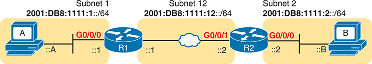

<figcaption>

<strong>图 28-13</strong> <em>用于 <strong>ping</strong> 和 <strong>traceroute</strong> 示例的 IPv6 互联网络</em>

<aside class="hidden" id="a28fig13">

图中展示三个子网，前缀长度均为 /64：子网 1（2001:DB8:1111:1::/64）、子网 12（2001:DB8:1111:12::/64）和子网 2（2001:DB8:1111:2::/64）。两台路由器 R1 和 R2 连接这些子网。路由器 A 使用接口 G0/0/0，路由器 R1 通过 G0/0/0 连接子网 1，通过 G0/0/1 连接路由器 R2。路由器 R2 通过 G0/0/0 连接路由器 R1，通过 G0/0/1 连接子网 2。

</aside>

</figcaption>

</figure>

<a href="#exa28_8">例 28-8</a> 展示了在 Linux 主机 PC1 上执行的三个 <strong>ping6</strong> 命令。（Linux 对 IPv6 使用 <strong>ping6</strong> 和 <strong>traceroute6</strong> 命令。）前两个命令展示 IPv6 ping，第一个 ping R1 的 LAN IPv6 地址，第二个由 PC1 ping PC B 的 IPv6 地址。最后一个命令展示 IPv4 ping，以供比较。

<strong>例 28-8</strong> <em>从 PC1 针对 R1 和 PC2 执行 <strong>ping6</strong> 命令</em>

<a href="#code-f0717-01" id="f0717-01a">点击此处查看代码原图</a>

<pre class="pre-ex" tabindex="0"><code>! An IPv6 ping, PC A pings R1’s address in the same subnet

Linux_A:$ <strong>ping6 2001:db8:1111:1::1</strong>

PING 2001:db8:1111:1::1 (2001:db8:1111:1::1) 56 data bytes

64 bytes from 2001:db8:1111:1::1: icmp_seq=1 ttl=64 time=1.26 ms

64 bytes from 2001:db8:1111:1::1: icmp_seq=2 ttl=64 time=1.15 ms

^C

--- 2001:db8:1111:1::1 ping statistics ---

2 packets transmitted, 2 received, 0% packet loss, time 1001 ms

rtt min/avg/max/mdev = 1.156/1.210/1.263/0.062 ms

! An IPv6 ping next, ping of PC B from PC A

Linux_A:$ <strong>ping6 2001:db8:1111:2::b</strong>

PING 2001:db8:1111:2::b (2001:db8:1111:2::b) 56 data bytes

64 bytes from 2001:db8:1111:2::b: icmp_seq=1 ttl=64 time=2.33 ms

64 bytes from 2001:db8:1111:2::b: icmp_seq=2 ttl=64 time=2.59 ms

64 bytes from 2001:db8:1111:2::b: icmp_seq=3 ttl=64 time=2.03 ms

^C

--- 2001:db8:1111:2::b ping statistics ---

3 packets transmitted, 3 received, 0% packet loss, time 2003 ms

rtt min/avg/max/mdev = 2.039/2.321/2.591/0.225 ms

! An IPv4 ping next, for comparison - ping of PC B from PC A

Linux_A:$ <strong>ping 10.1.2.22</strong>

PING 10.1.3.22 (10.1.2.22) 56 data bytes

64 bytes from 10.1.2.22: icmp_seq=1 ttl=64 time=2.45 ms

64 bytes from 10.1.2.22: icmp_seq=2 ttl=64 time=2.55 ms

64 bytes from 10.1.2.22: icmp_seq=3 ttl=64 time=2.14 ms

^C

--- 10.1.3.22 ping statistics ---

3 packets transmitted, 3 received, 0% packet loss, time 2014 ms

rtt min/avg/max/mdev = 2.04/2.318/2.604/0.224 ms</code></pre>

<a href="#exa28_9">例 28-9</a> 展示在 PC A 上执行 <strong>traceroute6</strong> 命令，查找通往 PC B 的路径。除了列出 IPv6 地址这一明显差异外，输出风格与大多数 IPv4 <strong>traceroute</strong> 命令相同。注意，输出依次列出 R1 的 G0/0/0 IPv6 地址、R2 的 G0/0/1 IPv6 地址，最后以 PC B 的地址结束。

<strong>例 28-9</strong> <em>从 PC1 针对 PC2 执行 <strong>traceroute6</strong> 命令</em>

<a href="#code-f0717-02" id="f0717-02a">点击此处查看代码原图</a>

<pre class="pre-ex" tabindex="0"><code>Linux_A:$ <strong>traceroute6 2001:db8:1111:2::b</strong>

traceroute to 2001:db8:1111:2::b (2001:db8:1111:2::b) from 2001:db8:1111:1::a,

   30 hops max, 24 byte packets

1  2001:db8:1111:1::1 (2001:db8:1111:1::1)  0.794 ms  0.648 ms  0.604 ms

2  2001:db8:1111:12::2 (2001:db8:1111:12::2)  1.606 ms  1.49 ms  1.497 ms

3  2001:db8:1111:2::b (2001:db8:1111:2::b)  2.038 ms  1.911 ms  1.899 ms</code></pre>

注意

<strong>traceroute/traceroute6</strong> 命令通过 ICMPv6 超时消息学习地址。这一机制使命令输出列出各台路由器和目的主机的 GUA。

</section>

</section>

<section>

<h4 class="h4" id="ch28lev2sec10">从附近的路由器验证主机连通性</h4>

在路由器的 IPv6 验证命令方面，一些 IPv6 功能使用与 IPv4 相同的命令，但另一些会以“ipv6”替换“ip”。在某些情况下，尤其是针对 IPv4 中不存在或变化较大的功能，路由器支持全新的命令。本节介绍几条可用于验证 IPv6 主机连通性的路由器命令，其中既有旧命令，也有 IPv6 的新命令。

首先，在连通性测试方面，Cisco 路由器和交换机支持 <strong>ping</strong> 和 <strong>traceroute</strong> 命令，它们对 IPv6 提供的基本功能与 IPv4 相同。这些命令的标准版本既接受 IPv4 地址，也接受 IPv6 地址作为输入。对于扩展版本，第一个提示问题会询问协议。只需输入 <strong>ipv6</strong>，而不使用默认的 <strong>ip</strong>，然后回答其余问题即可。

当然，示例有助于理解，尤其是扩展命令。<a href="#exa28_10">例 28-10</a> 首先展示从 R1 到<a href="#ch28fig13">图 28-13</a> 中 PC B 的扩展 IPv6 <strong>ping</strong>，使用 R1 的 G0/0/0 接口作为数据包源。第二个命令展示从 R1 到 PC B 的标准 IPv6 <strong>traceroute</strong>。

<strong>例 28-10</strong> <em>从路由器 R1 执行 IPv6 扩展 <strong>ping</strong> 和标准 <strong>traceroute</strong></em>

<a href="#code-f0718-01" id="f0718-01a">点击此处查看代码原图</a>

<pre class="pre-ex" tabindex="0"><code>R1# <strong>ping</strong>

Protocol [ip]: ipv6

Target IPv6 address: 2001:db8:1111:2::b

Repeat count [5]:

Datagram size [100]:

Timeout in seconds [2]:

Extended commands? [no]: <strong>yes</strong>

Source address or interface: <strong>GigabitEthernet0/0/0</strong>

UDP protocol? [no]:

Verbose? [no]:

Precedence [0]:

DSCP [0]:

Include hop by hop option? [no]:

Include destination option? [no]:

Sweep range of sizes? [no]:

Type escape sequence to abort.

Sending 5, 100-byte ICMP Echos to 2001:DB8:1111:2::b, timeout is 2 seconds:

Packet sent with a source address of 2001:DB8:1111:1::1

!!!!!

Success rate is 100 percent (5/5), round-trip min/avg/max = 0/1/4 ms

R1# <strong>traceroute 2001:db8:1111:2::b</strong>

Type escape sequence to abort.

Tracing the route to 2001:DB8:1111:2::b

  1 2001:DB8:1111:12::2 4 msec 0 msec 0 msec

  2 2001:DB8:1111:2::b 0 msec 4 msec 0 msec</code></pre>

从路由器验证主机设置的另一种方法，是查看路由器的 NDP 邻居表。所有 IPv6 主机，包括路由器，都维护 IPv6 邻居表，列出所有相邻 IPv6 地址及对应的 MAC 地址。

验证相邻主机是否会响应的一种方法，是判断当路由器向它发送 NDP NS（用于发现主机的 MAC 地址）时，它是否会发回 NDP NA。为此，路由器可以清空邻居表（<strong>clear ipv6 neighbor</strong>），然后 ping 某个已连接接口上的主机。路由器首先需要发送 NDP NS，主机则必须发回 NDP NA。如果路由器的邻居表显示该主机的 MAC 地址，就说明主机刚刚回复了 NDP NA。<a href="#exa28_11">例 28-11</a> 使用 <strong>show ipv6 neighbors</strong> 命令，展示<a href="#ch28fig13">图 28-13</a> 中路由器 R2 的 IPv6 邻居表示例。

<strong>例 28-11</strong> <em>路由器 R2 上的 <strong>show ipv6 neighbors</strong> 命令</em>

<a href="#code-f0719-01" id="f0719-01a">点击此处查看代码原图</a>

<pre class="pre-ex" tabindex="0"><code>R2# <strong>show ipv6 neighbors</strong>

IPv6 Address                              Age Link-layer Addr State Interface

2001:DB8:1111:2::B                          0 0200.bbbb.bbbb  STALE Gi0/0/0

FE80::BBFF:FEBB:BBBB                        0 0200.bbbb.bbbb  STALE Gi0/0/0

FE80::FF:FE01:1                             0 2436.dadf.5681  REACH Gi0/0/1</code></pre>

最后，路由器还可以列出 LAN 子网上可用路由器的信息，这会影响主机可获得的连通性。回顾一下，路由器发送 NDP RA 消息，以通告其愿意在特定 LAN 子网上充当 IPv6 路由器。Cisco 路由器会监听其他路由器的 RA 消息，通常接收到的是其他路由器向 FF02::1 所有 IPv6 主机组播地址主动发送的 RA 消息。<strong>show ipv6 routers</strong> 命令列出其他路由器，但不包括本地路由器。有关 <strong>show ipv6 routers</strong> 命令输出的示例，请参阅前面的<a href="#exa28_3">例 28-3</a>。

</section>

</section>

</section>

<section class="ccna-source ccna-appendix" aria-label="答案解析与术语表">
<section data-epub-type="chapter">

<h2 class="h2" id="ref-appc">附录 C</h2>

<h2 class="h2a">“这些知识我已经掌握了吗？”自测题答案</h2>

<section>

<h3 class="h3" id="ref-appclev1sec28">第 28 章</h3>

<strong><a id="ref-ques28_1" href="#quess28_1">1</a>．</strong> B。PC1 需要发现 PC2 的 MAC 地址。与 IPv4 不同，IPv6 不使用 ARP，而是使用 NDP。具体而言，PC1 使用 NDP 邻居请求（NS）消息，请求 PC2 发回 NDP 邻居通告（NA）。SLAAC 与地址分配有关，与发现邻居的 MAC 地址无关。

<strong><a id="ref-ques28_2" href="#quess28_2">2</a>．</strong> A 和 C。NDP RA 列出路由器 IPv6 地址、链路上已知的 IPv6 前缀及相应的前缀长度。错误答案列出的恰好是 NDP RA 消息中不包含的信息。

<strong><a id="ref-ques28_3" href="#quess28_3">3</a>．</strong> A。<strong>show ipv6 neighbors</strong> 命令列出邻居（路由器和主机）的全部 IPv6 地址及其对应的 MAC 地址。它不会标明哪些是路由器，这一信息由 <strong>show ipv6 routers</strong> 命令提供。

<strong><a id="ref-ques28_4" href="#quess28_4">4</a>．</strong> D。对于唯一的正确答案，主机可以发送 NDP 路由器请求（RS）消息，要求所有路由器标识自身，路由器则发回 NDP 路由器通告（RA）消息。对于错误答案，PC1 确实使用 NDP 邻居请求（NS），但并非用于学习默认路由器的 IPv6 地址。DAD 是使用 NDP NS 和 NA 消息的一项功能，但其功能不包括发现默认路由器地址。最后，EUI-64 并不定义协议或消息，而是定义用作 IPv6 IID 的 64 位值的一种约定。

<strong><a id="ref-ques28_5" href="#quess28_5">5</a>．</strong> D。SLAAC 使主机能够自行选择单播地址。主机还通过 NDP 学习前缀长度以及所有默认路由器的地址，然后使用无状态 DHCP 学习 DNS 服务器的地址。

<strong><a id="ref-ques28_6" href="#quess28_6">6</a>．</strong> B 和 D。使用 SLAAC 时，主机通过 NDP RS/RA 消息从路由器学习子网前缀，然后自行构建地址的其余部分（接口 ID）。主机可以随机生成接口 ID，也可以使用修改后的 EUI-64 规则。主机不从其他设备学习接口 ID，这有助于使过程保持无状态，因为不需要其他设备为主机分配完整地址。

<strong><a id="ref-ques28_7" href="#quess28_7">7</a>．</strong> A。DHCPv6 协议对发往 DHCPv6 服务器的消息使用众所周知的组播地址，具体是 FF02::1:2。但是，由于此组播地址具有链路本地作用域，这些消息会留在本地 LAN 上。连接该 LAN 的路由器必须实现 DHCPv6 中继代理功能，才能将数据包的 FF02::1:2 组播目的地址替换为 DHCPv6 服务器的单播地址。随后，路由器使用正常的单播路由转发数据包。

对于另外两个错误答案，请注意，IPv6 根本不使用广播地址。例如，答案中全为 F 的地址并非 IPv6 广播地址，因为 IPv6 中不存在这样的地址。此外，也没有利用 NDP 学习 DHCPv6 服务器单播地址的机制。

<strong><a id="ref-ques28_8" href="#quess28_8">8</a>．</strong> C。主机和路由器上的 IPv6 路由通常使用下一跳设备的 LLA。例如，PC1 的默认路由会引用路由器的 LLA，而非 GUA。<strong>traceroute</strong> 命令依赖这些路由。但是，帮助 <strong>traceroute</strong> 命令进行识别的 NDP 消息，会表明各路由器如何标识可路由的单播地址，例如全球单播地址。因此，<strong>traceroute</strong> 命令在输出中只列出 GUA。这些事实确定了正确答案，并排除了两个错误答案。一个答案提到了 <strong>traceroute</strong> 输出的最后一行；由于命令成功执行，该行列出的是目的主机的 IPv6 地址，而非最后一台路由器的地址。

</section>

</section>

<section id="ref-glossary"><h2 class="h2a">术语表</h2>
<strong>重复地址检测（DAD）</strong> IPv6 中的术语，指主机在使用某个单播地址之前，先检查其他主机是否正在使用该地址的过程。

<strong>IPv6 邻居表</strong> IPv6 中与 ARP 表相对应的表。该表列出同一链路上其他主机的 IPv6 地址及对应的 MAC 地址，这些信息通常通过邻居发现协议（NDP）学习。

<strong>邻居通告（NA）</strong> IPv6 邻居发现协议（NDP）定义的一种消息，用于向其他邻居声明主机的 MAC 地址。有时作为此前收到的 NDP 邻居请求（NS）消息的响应发送。

<strong>邻居发现协议（NDP）</strong> IPv6 协议族中的一种协议，用于发现和交换同一子网内设备（邻居）的信息。特别是，它取代了 IPv4 ARP 协议。

<strong>邻居请求（NS）</strong> IPv6 邻居发现协议（NDP）定义的一种消息，用于请求邻居回复邻居通告，其中列出该邻居的 MAC 地址。

<strong>在链前缀</strong> 路由器在 NDP 路由器通告（RA）消息中通告的 IPv6 子网前缀，用于向链路上的主机标识被视为存在于本地链路上的子网。

<strong>永久 IPv6 地址</strong> 使用 IPv6 SLAAC 时，主机会创建一个首选生存期和有效生存期均为无限的地址，使其成为永久地址。主机监听发往其所运行服务的传入连接时，会使用该地址。

<strong>首选生存期</strong> 在 IPv6 地址语境中，应用于 SLAAC 创建地址的计时器，定义地址处于首选状态的时长，即主机会使用该地址处理新的和现有的应用程序流。

<strong>前缀发现</strong> IPv6 邻居发现协议（NDP）的一项功能，具体而言属于路由器通告（RA）消息的一部分；路由器通过该消息提供本地链路上存在的 IPv6 子网前缀及前缀长度列表。

<strong>路由器通告（RA）</strong> IPv6 邻居发现协议（NDP）定义的一种消息，路由器用它通告自己愿意在链路上充当 IPv6 路由器。这些消息可以作为此前收到的 NDP 路由器请求（RS）消息的响应发送。

<strong>路由器请求（RS）</strong> IPv6 邻居发现协议（NDP）定义的一种消息，用于请求链路上的路由器回复，以标识路由器并提供其他配置设置（前缀和前缀长度）。

<strong>有状态 DHCPv6</strong> IPv6 中用于与无状态 DHCP 相区别的术语。有状态 DHCP 跟踪哪些客户端被分配了哪些 IPv6 地址（状态信息）。

<strong>无状态地址自动配置（SLAAC）</strong> IPv6 的一项功能，允许在不需要有状态 DHCP 服务器的情况下，为主机或路由器分配 IPv6 单播地址。

<strong>无状态 DHCPv6</strong> IPv6 中用于与有状态 DHCP 相区别的术语。无状态 DHCP 服务器不会将 IPv6 地址租给客户端，而是提供其他有用的信息，例如 DNS 服务器 IP 地址，但无须跟踪有关客户端的信息（状态信息）。

<strong>临时 IPv6 地址</strong> 使用 IPv6 SLAAC 时，主机会创建一个首选生存期和有效生存期相对较短的地址，两者通常均为数天，使其成为临时地址。主机将临时地址用于向外发起的应用程序连接。

<strong>有效生存期</strong> 在 IPv6 地址语境中，应用于 SLAAC 创建地址的计时器，定义地址保持有效的时长，即主机可以继续使用该地址支持现有的应用程序流。

</section>
</section>

<section class="ccna-source ccna-appendix" aria-label="代码原图">
<section data-epub-type="chapter">

<a href="#f0701-01a" id="code-f0701-01">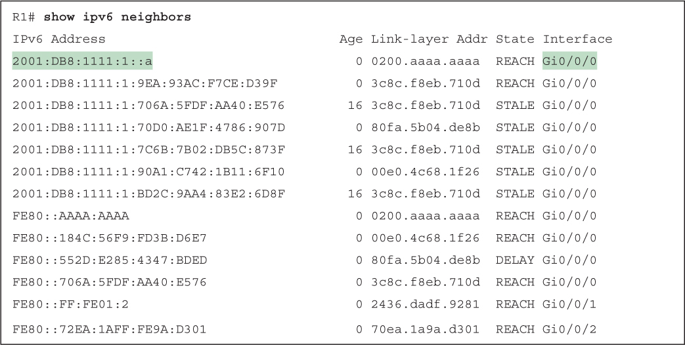</a>

<a href="#f0701-02a" id="code-f0701-02">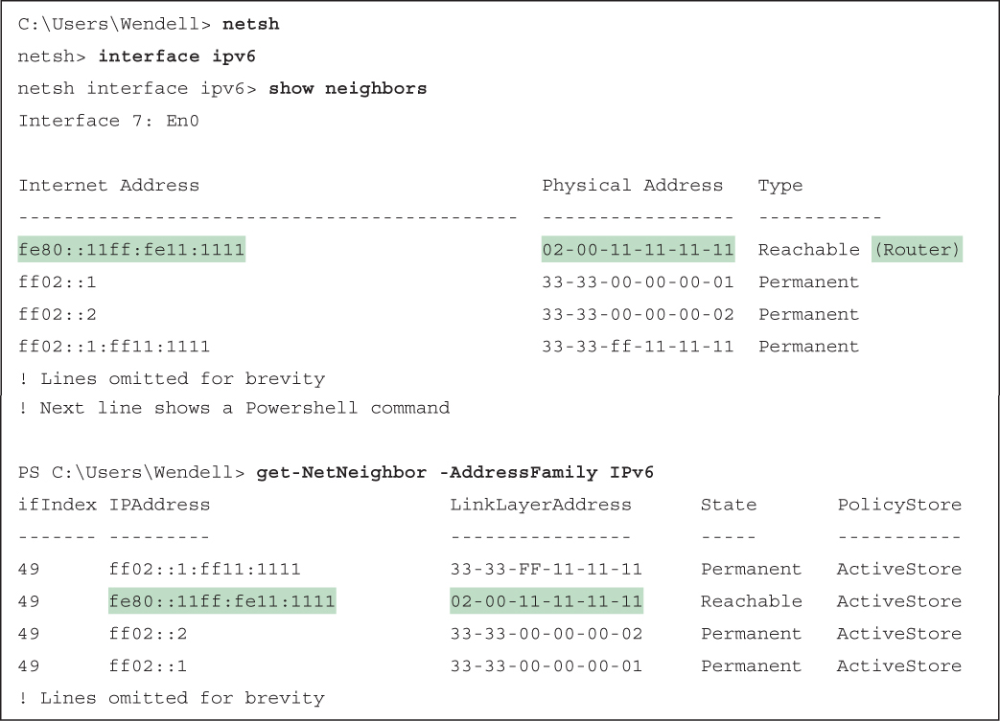</a>

<a href="#f0703-01a" id="code-f0703-01">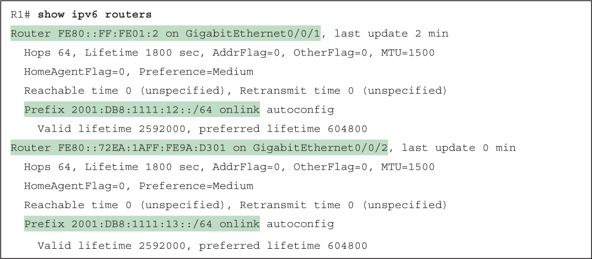</a>

<a href="#f0704-01a" id="code-f0704-01">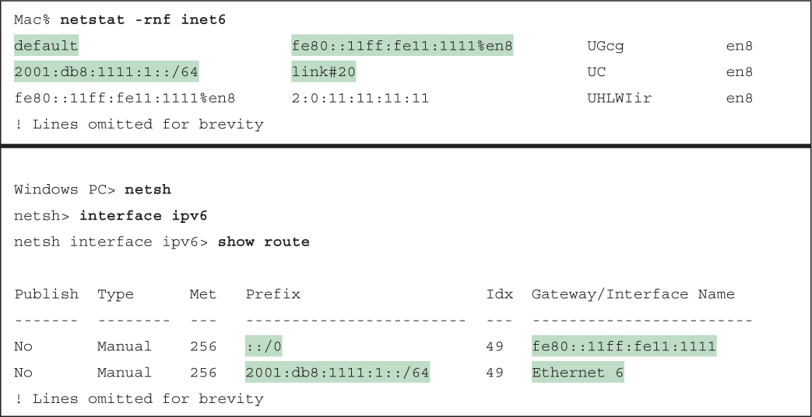</a>

<a href="#f0709-01a" id="code-f0709-01">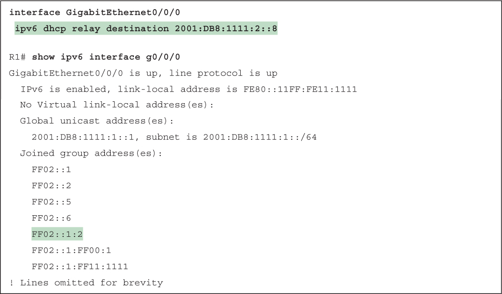</a>

<a href="#f0714-01a" id="code-f0714-01">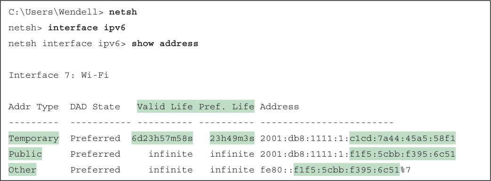</a>

<a href="#f0715-01a" id="code-f0715-01">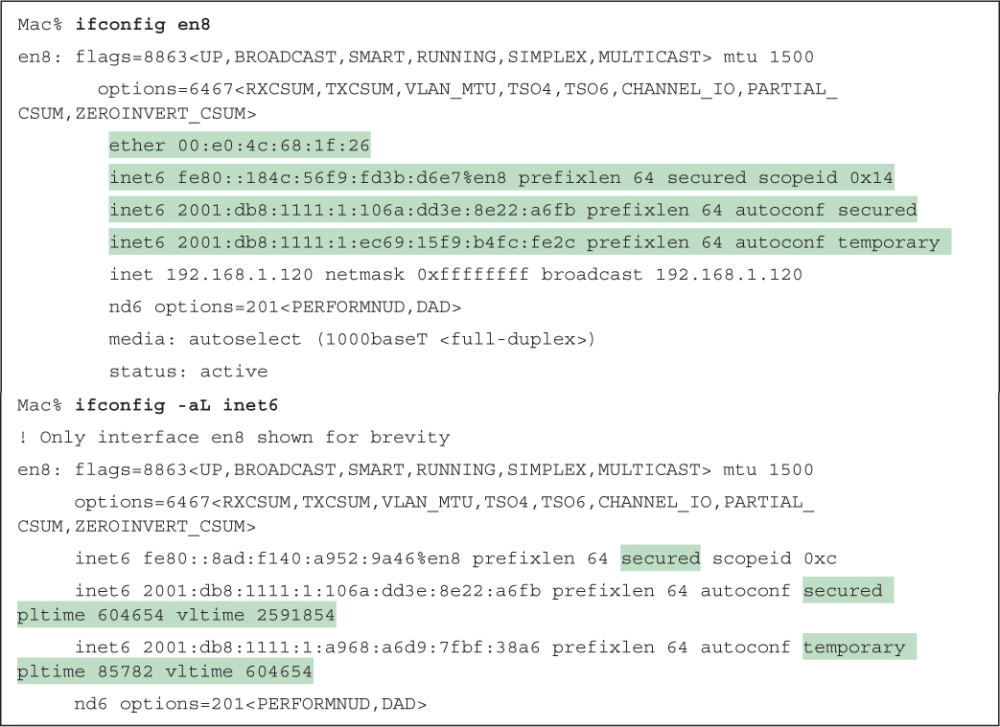</a>

<a href="#f0717-01a" id="code-f0717-01">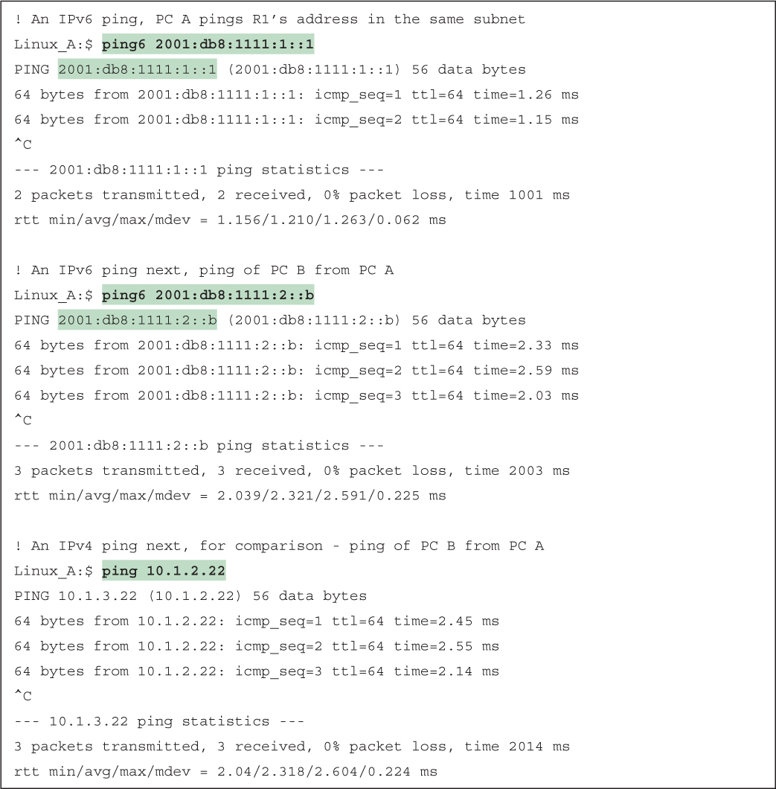</a>

<a href="#f0717-02a" id="code-f0717-02">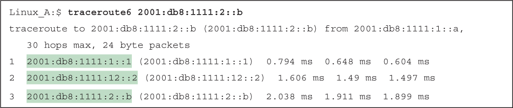</a>

<a href="#f0718-01a" id="code-f0718-01">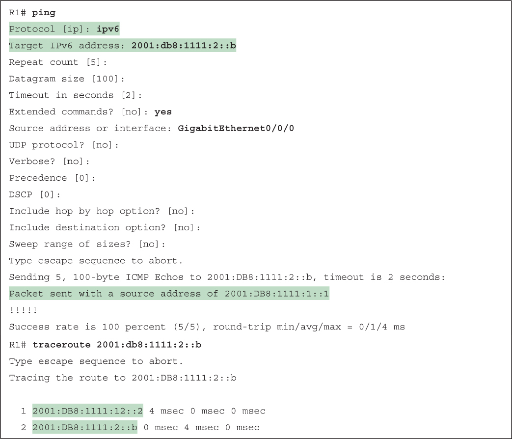</a>

<a href="#f0719-01a" id="code-f0719-01">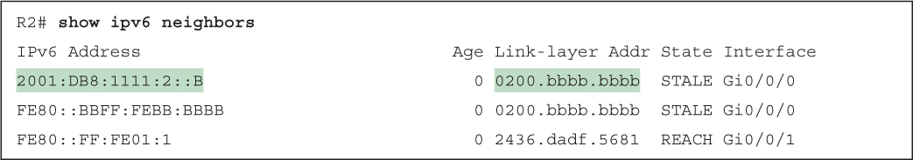</a>

</section>

</section>


<nav class="ccna-chapter-nav" aria-label="章节导航"><a href="v1-27.html">← 上一章</a><a href="v1-29.html">下一章 →</a></nav>
