
<a href="{{ '/subjects/CCNA/' | relative_url }}">← 返回 CCNA 目录</a>

第一卷 · IP 版本 6

<nav class="ccna-chapter-nav" aria-label="章节导航"><a href="v1-28.html">← 上一章</a><a href="v2-01.html">下一章 →</a></nav>



<section data-epub-type="chapter">

<h2 class="h2" id="ch29">第 29 章</h2>

<h2 class="h2a">实现 IPv6 路由</h2>

本章涵盖以下考试主题：

3.0 IP 连接

3.1 解读路由表的组成部分

3.1.a 路由协议代码

3.1.b 前缀

3.1.c 网络掩码

3.1.d 下一跳

3.1.e 管理距离

3.3 配置和验证 IPv4 与 IPv6 静态路由

3.3.a 默认路由

3.3.b 网络路由

3.3.c 主机路由

3.3.d 浮动静态路由

本书<a href="#part07">第七部分</a>的最后一章通过考察四个主要主题，完成对 IPv6 内容的介绍。第一部分介绍 IPv6 直连路由和<a id="key_314" href="#ref-gloss_243">本地路由</a>，即路由器在配置 IPv6 地址后添加到路由表中的路由。第二个主要部分讨论静态网络路由，也就是通过 <strong>ipv6 route</strong> 命令配置、以 IPv6 前缀（子网）为目的地的路由。第三个主要部分考察其他 IPv6 静态路由主题，包括默认路由、主机路由和浮动静态路由，并说明所有静态 IPv6 路由的故障排除注意事项。最后一个简短部分讨论用于排查 IPv6 静态路由的几种工具与技巧。

<section>

<h3 class="h3" id="ch29lev1sec1">自测</h3>

如果你希望根据得分决定在本章投入多少时间，可以完成这组自测题（在此作答，或使用 PTP 软件）。各题答案的选项字母列在自测题之后的页面底部。书末和配套网站上的<a href="#ref-appc">附录 C</a>都包含答案及解析。你也可以在 PTP 测试软件中找到答案及解析。

<figure class="table" id="ch29tab01" tabindex="0">

<figcaption>

<strong>表 29-1</strong> 基础主题章节与题目对应表

</figcaption>

<table class="all">

<thead>

<tr>

<th class="th">
基础知识小节
</th>

<th class="th">
题目
</th>

</tr>

</thead>

<tbody>

<tr>

<td class="border">
IPv6 直连路由和本地路由
</td>

<td class="border">
1、2
</td>

</tr>

<tr>

<td class="border">
IPv6 静态网络路由
</td>

<td class="border">
3, 4
</td>

</tr>

<tr>

<td class="border">
IPv6 静态默认路由、主机路由和浮动静态路由
</td>

<td class="border">
5, 6
</td>

</tr>

<tr>

<td class="border">
IPv6 静态路由故障排除
</td>

<td class="border">
7
</td>

</tr>

</tbody>

</table>

</figure>

第 1、3、4 题请参照下图。

<figure class="image-c">

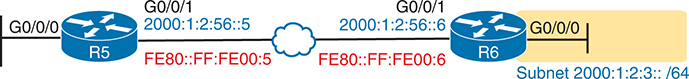

<figcaption>

<aside class="hidden" id="a29fig00">

路由器 R5 配有 G0/0/0 和 G0/0/1 接口。接口 G0/0/0 连接子网地址为 2000:1:2:3::/64 的网络，而 G0/0/1 连接子网地址为 FE80:FF:FE00:5 的网络。路由器 R6 也有 G0/0/0 和 G0/0/1 两个接口。G0/0/0 与 R5 的 G0/0/1 连接同一网络，G0/0/1 则关联子网地址为 2000:1:2:56::/64 的网络。

</aside>

</figcaption>

</figure>

<strong><a id="quess29_1" href="#ques29_1a">1</a>．</strong> 图中的路由器 R6 在其 G0/0/0 接口上配置了 <strong>ipv6 address 2000:1:2:3::1/64</strong> 命令。路由器还创建链路本地地址 FE80::FF:FE00:1。所有路由器接口都处于 up/up 状态。R6 会将以下哪些路由添加到其 IPv6 路由表中？（选择两个答案。）

<ol class="lower-alpha">

<li>
通往 2000:1:2:3::/64 的路由
</li>

<li>
通往 FE80::FF:FE00:1/64 的路由
</li>

<li>
通往 2000:1:2:3::1/128 的路由
</li>

<li>
通往 FE80::FF:FE00:1/128 的路由
</li>

</ol>

<strong><a id="quess29_2" href="#ques29_2a">2</a>．</strong> 某路由器在其 G0/0/0 接口上配置了 <strong>ipv6 address 3111:1:1:1::1/64</strong> 命令，在 G0/0/1 接口上配置了 <strong>ipv6 address 3222:2:2:2::1/64</strong>。两个接口都处于 up/up 状态。你预期在 <strong>show ipv6 route connected</strong> 命令的输出中看到以下哪些路由？（选择两个答案。）

<ol class="lower-alpha">

<li>
通往 3111:1:1:1::/64 的路由
</li>

<li>
通往 3111:1:1:1::1/64 的路由
</li>

<li>
通往 3222:2:2:2::/64 的路由
</li>

<li>
通往 3222:2:2:2::2/128 的路由
</li>

</ol>

<strong><a id="quess29_3" href="#ques29_3a">3</a>．</strong> 工程师需要在图中的路由器 R5 上添加一条通往前缀 2000:1:2:3::/64 的静态 IPv6 路由。以下哪些 <strong>ipv6 route</strong> 命令能够为该子网前缀生成有效的 IPv6 路由？（选择两个答案。）

<ol class="lower-alpha">

<li>
<strong>ipv6 route 2000:1:2:3::/64 G0/0/1 2000:1:2:56::6</strong>
</li>

<li>
<strong>ipv6 route 2000:1:2:3::/64 2000:1:2:56::6</strong>
</li>

<li>
<strong>ipv6 route 2000:1:2:3::/64 G0/0/1</strong> 2001:1:2:56::5
</li>

<li>
<strong>ipv6 route 2000:1:2:3::/64 G0/0/1</strong>
</li>

</ol>

<strong><a id="quess29_4" href="#ques29_4a">4</a>．</strong> 工程师需要在图中的路由器 R5 上添加一条通往前缀 2000:1:2:3::/64 的静态 IPv6 路由。以下哪个答案给出了路由器 R5 上通往该子网的有效静态 IPv6 路由？

<ol class="lower-alpha">

<li>
<strong>ipv6 route 2000:1:2:3::/64 2000:1:2:56::5</strong>
</li>

<li>
<strong>ipv6 route 2000:1:2:3::/64 2000:1:2:56::6</strong>
</li>

<li>
<strong>ipv6 route 2000:1:2:3::/64 FE80::FF:FE00:5</strong>
</li>

<li>
<strong>ipv6 route 2000:1:2:3::/64 FE80::FF:FE00:6</strong>
</li>

</ol>

<strong><a id="quess29_5" href="#ques29_5a">5</a>．</strong> 显示 IPv6 静态默认路由时，<strong>show ipv6 route</strong> 命令如何表示默认目的地这一概念？

<ol class="lower-alpha">

<li>
在路由列表正上方使用短语“Gateway of Last Resort”。
</li>

<li>
在该路由所在行使用前缀值 ::/0。
</li>

<li>
在该路由所在行使用前缀值 ::/128。
</li>

<li>
在该路由所在行使用前缀值 2000::/3。
</li>

<li>
在该路由所在行使用关键字“default”。
</li>

</ol>

<strong><a id="quess29_6" href="#ques29_6a">6</a>．</strong> 路由器 R1 已具有可用的 IPv6 配置，因此通过 OSPF 学习到了通往子网 2001:db8:1:2::/64 的路由。该路由列出的出接口是一条以太网 WAN 链路。随后，工程师在两台路由器上安装蜂窝接口作为 WAN 备份。作为配置的一部分，工程师配置了 <strong>ipv6 route 2001:db8:1:2::/64 cellular0/2/0 200</strong> 命令。路由器会如何响应？

<ol class="lower-alpha">

<li>
由于已经存在通往相同前缀的 OSPF 路由，拒绝 <strong>ipv6 route</strong> 命令。
</li>

<li>
将 <strong>ipv6 route</strong> 命令接受到配置中，但不向路由表添加路由。
</li>

<li>
将 <strong>ipv6 route</strong> 命令接受到配置中，并将该路由添加到路由表，但保留路由表中通过 OSPF 学习的路由。
</li>

<li>
将 <strong>ipv6 route</strong> 命令接受到配置中，将该路由添加到路由表，并删除路由表中通过 OSPF 学习的路由。
</li>

</ol>

<strong><a id="quess29_7" href="#ques29_7a">7</a>．</strong> 工程师在路由器 R1 的配置模式下输入 <strong>ipv6 route 2001:DB8:8:8::/64 2001:DB8:9:9::9 129</strong> 命令并按 Enter。稍后，<strong>show ipv6 route</strong> 命令没有列出任何通往子网 2001:DB8:8:8::/64 的路由。以下哪种情况可能导致该路由未出现在 IPv6 路由表中？

<ol class="lower-alpha">

<li>
命令使用了不被允许的下一跳全球单播地址，因此路由器无法添加路由。
</li>

<li>
命令必须包含出接口参数，因此 IOS 拒绝了 <strong>ipv6 route</strong> 命令。
</li>

<li>
路由器没有任何与下一跳地址 2001:DB8:9:9::9 匹配的路由。
</li>

<li>
已经存在一条通往 2001:DB8:8:8::/64、管理距离为 110 的路由。
</li>

</ol>

自测答案：

<strong><a id="ques29_1a" href="#ref-ques29_1">1</a></strong> A、C

<strong><a id="ques29_2a" href="#ref-ques29_2">2</a></strong> A, C

<strong><a id="ques29_3a" href="#ref-ques29_3">3</a></strong> A、B

<strong><a id="ques29_4a" href="#ref-ques29_4">4</a></strong> B

<strong><a id="ques29_5a" href="#ref-ques29_5">5</a></strong> B

<strong><a id="ques29_6a" href="#ref-ques29_6">6</a></strong> B

<strong><a id="ques29_7a" href="#ref-ques29_7">7</a></strong> C

</section>

<section>

<h3 class="h3box" id="ch29lev1sec2">基础知识</h3>

</section>

<section>

<h3 class="h3" id="ch29lev1sec3">IPv6 直连路由和本地路由</h3>

Cisco 路由器会出于多种原因向其 IPv6 路由表添加 IPv6 路由。读到这里，许多读者应该已经能猜到这些原因，部分是因为其逻辑与路由器用于 IPv4 的逻辑相同。具体而言，路由器根据以下情况添加 IPv6 路由：

<ul class="sq">

<li>
在工作中的接口上配置 IPv6 地址（直连路由和本地路由）。

</li>

<li>
直接配置静态路由（静态路由）。
</li>

<li>
在共享同一数据链路的路由器上配置 OSPFv3 等路由协议（动态路由）。
</li>

</ul>

本章前两节考察前两个主题，IPv6 路由协议则在 CCNP Enterprise 考试中讨论。

此外，先回顾前几章的几个重要缩写：GUA 指全球单播地址，这是企业路由器接口上最常配置的可路由单播地址。唯一本地地址（ULA）用作私有地址。最后，路由经常使用相邻路由器的链路本地地址（LLA）；这种单播地址存在于每个路由器和主机接口上，可用于在本地链路上传送数据包。

<section>

<h4 class="h4" id="ch29lev2sec1">直连路由和本地路由的规则</h4>

路由器根据接口配置和状态添加、删除 IPv6 直连路由和 <a id="key_313" href="#ref-gloss_218">IPv6 本地路由</a>。首先，路由器查找 <strong>ipv6 address</strong> 命令，检查各接口上配置的单播地址。然后，如果接口正在工作，也就是 <strong>show interfaces</strong> 命令输出中显示“line status is up, protocol status is up”，路由器就同时添加一条直连路由和一条本地路由。

注意

路由器不会为链路本地地址创建 IPv6 直连路由或本地路由。

直连路由和本地路由遵循与 IPv4 相同的总体逻辑。直连路由代表连接到接口的子网，而本地路由是一条主机路由，仅对应接口上配置的特定 IPv6 地址。

例如，某路由器的一个工作接口配置了 <strong>ipv6 address 2000:1:1:1::1/64</strong> 命令。路由器会根据此地址和前缀长度计算子网 ID，并在路由表中放入一条通往该子网（2000:1:1:1::/64）的直连路由。路由器还会取出所列的 IPv6 地址，为它创建前缀长度为 /128 的本地路由。（IPv4 的本地路由使用 /32 前缀长度，而 IPv6 使用 /128，表示“恰好这一个地址”。）

为便于复习和学习，以下列表总结了路由器根据接口 IPv6 单播地址配置创建路由的规则：

<ol class="number">

<li>
路由器根据接口上通过 <strong>ipv6 address</strong> 命令配置的每个单播 IPv6 地址，按以下方式创建 IPv6 路由：

<ol class="lower-alpha-n">

<li>
路由器为该子网创建一条路由（直连路由）。
</li>

<li>
路由器为自身的 IPv6 地址创建一条前缀长度为 /128 的本地路由。
</li>

</ol></li>

<li>
路由器不会根据接口关联的链路本地地址创建路由。
</li>

<li>
如果接口发生故障，路由器会删除该接口的直连路由和本地路由；当接口恢复工作（up/up）状态时，路由器会重新添加这些路由。
</li>

</ol>

</section>

<section>

<h4 class="h4" id="ch29lev2sec2">IPv6 直连路由示例</h4>

虽然 IPv6 直连路由和本地路由的概念与 IPv4 路由十分相似，但查看一些示例仍然很有帮助。为了展示路由示例，<a href="#ch29fig01">图 29-1</a> 详细给出了本章使用的一个示例互联网络，并标注了 IPv6 子网 ID。接下来的示例重点介绍路由器 R1 上的直连路由和本地路由。

<figure class="image-c" id="ch29fig01">

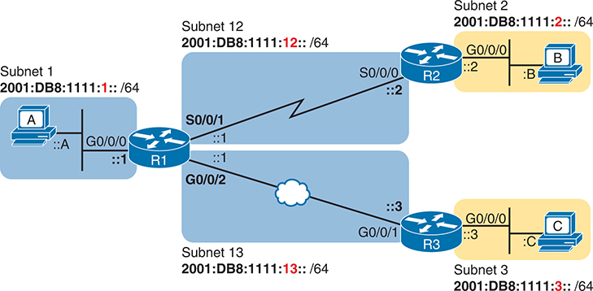

<figcaption>

<strong>图 29-1</strong> <em>用于展示直连路由和本地路由的示例网络</em>

<aside class="hidden" id="a29fig01">

网络由标为 R1、R2 和 R3 的三台路由器组成。每台路由器有两个用于连接多个设备的千兆以太网接口。路由器 1 和路由器 2 上还标有 S0/0/0 和 S0/0/1 串行接口，用于点到点连接。网络进一步划分为标注为子网 1、子网 2、子网 3、子网 12 和子网 13 的四个子网。每个子网都通过接口连接路由器。图中还给出每个子网的子网掩码 /64。子网掩码用于区分 IP 地址的网络部分和主机部分。

</aside>

</figcaption>

</figure>

为说明<a href="#ch29fig01">图 29-1</a> 中的标注，请注意图中显示了 IPv6 前缀（子网），并使用简写表示接口 IPv6 地址。在各接口附近，图中只显示接口地址的接口 ID 缩写部分。例如，R1 的 G0/0/0 接口地址以子网 ID 值 2001:DB8:1111:1 开头，再加上 ::1，得到 2001:DB8:1111:1::1。

现在来看直连路由示例。首先考虑<a href="#ch29fig01">图 29-1</a> 中路由器 R1 的配置，如<a href="#exa29_1">例 29-1</a> 所示。R1 的 <strong>show running-config</strong> 命令输出节选显示三个正在工作的接口。同时注意，没有任何静态路由或路由协议配置。

<strong>例 29-1</strong> <em>路由器 R1 上的 IPv6 编址配置</em>

<a href="#code-f0726-01" id="f0726-01a">点击此处查看代码原图</a>

<pre class="pre-ex" tabindex="0"><code>ipv6 unicast-routing

!

! Unused interfaces omitted

!

interface GigabitEthernet0/0/0

 ipv6 address 2001:DB8:1111:1::1/64

!

interface Serial0/0/1

 ipv6 address 2001:db8:1111:12::1/64

!

interface GigabitEthernet0/0/2

 ipv6 address 2001:db8:1111:13::1/64</code></pre>

根据<a href="#ch29fig01">图 29-1</a> 和<a href="#exa29_1">例 29-1</a>，R1 应当有三条 IPv6 直连路由，如<a href="#exa29_2">例 29-2</a> 中突出显示的内容所示。

<strong>例 29-2</strong> <em>添加静态路由或路由协议之前路由器 R1 上的路由</em>

<a href="#code-f0727-01" id="f0727-01a">点击此处查看代码原图</a>

<pre class="pre-ex" tabindex="0"><code>R1# <strong>show ipv6 route</strong>

IPv6 Routing Table - default - 7 entries

Codes: C - Connected, L - Local, S - Static, U - Per-user Static route

       B - BGP, HA - Home Agent, MR - Mobile Router, R - RIP

       H - NHRP, I1 - ISIS L1, I2 - ISIS L2, IA - ISIS interarea

       IS - ISIS summary, D - EIGRP, EX - EIGRP external, NM - NEMO

       ND - ND Default, NDp - ND Prefix, DCE - Destination, NDr - Redirect

       RL - RPL, O - OSPF Intra, OI - OSPF Inter, OE1 - OSPF ext 1

       OE2 - OSPF ext 2, ON1 - OSPF NSSA ext 1, ON2 - OSPF NSSA ext 2

       la - LISP alt, lr - LISP site-registrations, ld - LISP dyn-eid

       lA - LISP away, a - Application

C   2001:DB8:1111:1::/64 [0/0]

     via GigabitEthernet0/0/0, directly connected

L   2001:DB8:1111:1::1/128 [0/0]

     via GigabitEthernet0/0/0, receive

C   2001:DB8:1111:12::/64 [0/0]

     via Serial0/0/1, directly connected

L   2001:DB8:1111:12::1/128 [0/0]

     via Serial0/0/1, receive

C   2001:DB8:1111:13::/64 [0/0]

     via GigabitEthernet0/0/2, directly connected

L   2001:DB8:1111:13::1/128 [0/0]

     via GigabitEthernet0/0/2, receive

L   FF00::/8 [0/0]

     via Null0, receive</code></pre>

三条突出显示的路由都呈现相同类型的基本信息，因此讨论时重点看第一对突出显示的行，它详细描述通往子网 2001:DB8:1111:1::/64 的直连路由。这两行说明：该路由是“directly connected”直连路由；接口 ID 为 GigabitEthernet0/0/0；前缀／长度为 2001:DB8:1111:1::/64。最左侧的代码字母“C”根据上面的图例标识该路由为直连路由。还要注意，方括号中的数字与 IPv4 <strong>show ip route</strong> 命令中的含义相同：第一个数字表示管理距离，第二个数字表示度量值。

</section>

<section>

<h4 class="h4" id="ch29lev2sec3">IPv6 本地路由示例</h4>

继续同一个示例，R1 上应当存在三条本地路由，对应与直连路由相同的三个接口。情况确实如此，此外还有一条用于其他用途的本地路由。<a href="#exa29_3">例 29-3</a> 只展示 <strong>show ipv6 route local</strong> 命令列出的本地路由，并突出显示一条特定的本地路由以供讨论。

<strong>例 29-3</strong> <em>路由器 R1 上的 IPv6 本地路由</em>

<a href="#code-f0728-01" id="f0728-01a">点击此处查看代码原图</a>

<pre class="pre-ex" tabindex="0"><code>R1# <strong>show ipv6 route local</strong>

! Legend omitted for brevity

L  2001:DB8:1111:1::1/128 [0/0]

    via GigabitEthernet0/0/0, receive

L  2001:DB8:1111:4::1/128 [0/0]

    via Serial0/0/1, receive

L  2001:DB8:1111:5::1/128 [0/0]

    via GigabitEthernet0/0/2, receive

L  FF00::/8 [0/0]

    via Null0, receive</code></pre>

对于突出显示的本地路由，请关注几个简单事实。首先，回看<a href="#exa29_1">例 29-1</a> 中 R1 的配置，注意其 G0/0/0 接口上的 IPv6 地址。这条本地路由列出的地址与之完全相同。还要注意 /128 前缀长度，这意味着该路由只匹配发往该地址（2001:DB8:1111:1::1）的数据包，不匹配其他地址。

注意

<strong>show ipv6 route local</strong> 命令显示所有 IPv6 本地路由，而 <strong>show ipv6 route connected</strong> 命令显示所有直连路由。

</section>

</section>

<section>

<h3 class="h3" id="ch29lev1sec4">IPv6 静态网络路由</h3>

IPv6 静态路由需要通过 <strong>ipv6 route</strong> 命令直接配置。简单来说，有人配置该命令后，路由器会将命令中的详细信息放入 IPv6 路由表的一条路由中。

在 CCNA 考试主题所提到的各种静态路由（网络、主机、默认和浮动静态）中，IPv6 网络路由是最常见的一种。根据定义，网络路由基于所列出的前缀和前缀长度，定义通往某子网中各地址的路由。<strong>ipv6 route</strong> 全局命令还通过列出出接口或下一跳路由器地址，给出本路由器应如何朝该目的前缀转发数据包的转发指令。

<a href="#ch29fig02">图 29-2</a> 展示用于网络路由的单条 <strong>ipv6 route</strong> 命令背后的总体概念。图中展示了路由器 R1 上通往右侧子网（子网 2，即 2001:DB8:1111:2::/64）的静态路由概念。命令以 <strong>ipv6 route 2001:DB8:1111:2::/64</strong> 开头，定义目的子网。命令的其余部分定义转发指令，可以是出接口（S0/0/1）、下一跳 IPv6 地址，或两者同时列出。

理解 IPv6 静态网络路由的主要概念后，接下来几页将带你逐一学习一系列示例。具体而言，这些示例先介绍使用出接口配置静态路由，再介绍使用下一跳 GUA，最后介绍使用下一跳 LLA。

<figure class="image-c" id="ch29fig02">

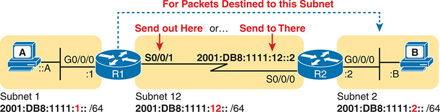

<figcaption>

<strong>图 29-2</strong> <em>IPv6 静态路由命令（ipv6 route）背后的逻辑</em>

<aside class="hidden" id="a29fig02">

路由器 R1 有 G0/0/0 和 S0/0/1 接口。G0/0/0 连接标为子网 1 的网络，子网地址为 2000:DB8:1111:1::/64；S0/0/1 连接子网 12，子网地址为 2000:DB8:1111:12::/64。路由器 R2 有 S0/0/0 和 G0/0/0 接口。S0/0/0 与 R1 的 S0/0/1 连接同一网络，G0/0/0 则关联子网 2，子网地址为 2000:DB8:1111:2::/64。示意图还包含以下标注：R1 朝向子网 2 标有“对于发往此子网的数据包”，接口 S0/0/1 标为“从这里发出”，接口 S0/0/0 标为“发送到那里”。

</aside>

</figcaption>

</figure>

<section>

<h4 class="h4" id="ch29lev2sec4">使用出接口的静态网络路由</h4>

第一个 IPv6 静态路由示例使用出接口选项。回顾一下，无论是 IPv4 还是 IPv6 静态路由，当命令引用某个接口时，该接口都是本地接口，也就是添加此命令的路由器上的接口。在此例中，如<a href="#ch29fig02">图 29-2</a> 所示，R1 的 <strong>ipv6 route</strong> 命令会使用接口 S0/0/1，如<a href="#exa29_4">例 29-4</a> 所示。

<strong>例 29-4</strong> <em>路由器 R1 上的静态 IPv6 路由</em>

<a href="#code-f0729-01" id="f0729-01a">点击此处查看代码原图</a>

<pre class="pre-ex" tabindex="0"><code>! Static route on router R1

R1(config)# <strong>ipv6 route 2001:db8:1111:2::/64</strong> <strong>S0/0/1</strong></code></pre>

如果要支持所有主机之间的数据包传输，例如图中的 PC A 和 PC B，就需要在每台路由器上为每个远程子网配置静态路由。例如，为支持主机 A 与 B 之间的流量，R1 现在已经准备就绪。主机 A 会将其所有 IPv6 数据包转发给默认路由器 R1，R1 现在能够将发往主机 B 所在子网的数据包从自己的 S0/0/1 接口路由到下一跳 R2。但是，路由器 R2 还没有匹配主机 A 所在子网（2001:DB8:1111:1::/64）中地址的路由，因此完整的静态路由解决方案还需要更多路由。

<a href="#exa29_5">例 29-5</a> 通过为路由器 R2 添加一条通往子网 1（2001:DB8:1111:1::/64）的静态路由，解决这一问题。添加该路由后，主机 A 和 B 应当能够相互 ping 通。

<strong>例 29-5</strong> <em>路由器 R2 上的静态 IPv6 路由</em>

<a href="#code-f0729-02" id="f0729-02a">点击此处查看代码原图</a>

<pre class="pre-ex" tabindex="0"><code>! Static route on router R2

R2(config)# <strong>ipv6 route 2001:db8:1111:1::/64</strong> <strong>s0/0/0</strong></code></pre>

有许多方式可以验证静态路由是否存在，并测试主机能否使用该路由。<strong>ping</strong> 和 <strong>traceroute</strong> 可以测试连通性。在路由器命令行中，<strong>show ipv6 route</strong> 命令会列出所有 IPv6 路由。也可以使用输出更简短、只列出静态路由的 <strong>show ipv6 route static</strong> 命令；<a href="#exa29_6">例 29-6</a> 展示了省略图例后的输出。

<strong>例 29-6</strong> <em>仅验证 R1 上的静态路由</em>

<a href="#code-f0730-01" id="f0730-01a">点击此处查看代码原图</a>

<pre class="pre-ex" tabindex="0"><code>R1# <strong>show ipv6 route static</strong>

! Legend omitted for brevity

S   2001:DB8:1111:2::/64 [1/0]

     via Serial0/0/1, directly connected</code></pre>

此命令列出 R1 上唯一一条静态路由的许多信息。首先，左侧列中的代码“S”确实将该路由标识为静态路由。（不过，后面的短语“directly connected”可能使你误以为它是直连路由；应以代码“S”为准。）注意，前缀（2001:DB8:1111:2::/64）与配置（<a href="#exa29_4">例 29-4</a>）一致，出接口（S0/0/1）也一致。

处理 IPv6 路由时，你经常会想知道，对于给定目的地址，路由器会匹配哪条路由。查看完整的 IPv6 路由表时，你应当能够分析这一问题；但如果是在回答考试中的实验题，也可以使用命令直接查出具体路由，如<a href="#exa29_7">例 29-7</a> 所示。例如，如果主机 A 向主机 B（2001:DB8:1111:2::B）发送 IPv6 数据包，R1 是否会使用这条静态路由？结果是会，<strong>show ipv6 route 2001:DB8:1111:2::B</strong> 命令确认了这一点。该命令要求路由器列出向那个特定地址转发数据包时会使用的路由。

<strong>例 29-7</strong> <em>显示 R1 向主机 B 转发时使用的路由</em>

<a href="#code-f0730-02" id="f0730-02a">点击此处查看代码原图</a>

<pre class="pre-ex" tabindex="0"><code>R1# <strong>show ipv6 route 2001:db8:1111:2::b</strong>

Routing entry for 2001:DB8:1111:2::/64

  Known via "static", distance 1, metric 0

  Route count is 1/1, share count 0

  Routing paths:

    directly connected via Serial0/0/1

      Last updated 00:01:29 ago</code></pre>

注意

只有串行接口支持在 <strong>ipv6 route</strong> 命令中仅以出接口作为转发指令，以太网接口不支持。对于以太网接口，路由器会接受命令，但无法使用该路由转发数据包。有关这种情况以及静态 IPv6 路由其他问题的更多细节，请参阅后面的“<a href="#ch29lev1sec6">IPv6 静态路由故障排除</a>”一节。

</section>

<section>

<h4 class="h4" id="ch29lev2sec5">使用下一跳 IPv6 地址的静态网络路由</h4>

IPv6 静态路由命令可以只使用下一跳路由器地址，也可以同时使用下一跳路由器地址和出接口。请注意，这些选项适用于从任何类型接口转发数据包的路由，包括以太网和串行链路，但后面的示例使用以太网 WAN 链路。

有趣的是，IPv6 支持将邻居的 GUA、ULA 或 LLA 用作下一跳 IPv6 地址。以下列表给出了可用组合，<a href="#ch29fig03">图 29-3</a> 则从 R1 的角度，描述以 R3 为下一跳路由器的路由逻辑：

<ul class="sq">

<li>
仅指定下一跳 GUA 或 ULA。
</li>

<li>
指定下一跳 GUA 或 ULA 以及出接口。
</li>

<li>
指定下一跳 LLA 以及出接口。
</li>

</ul>

<figure class="image-c" id="ch29fig03">

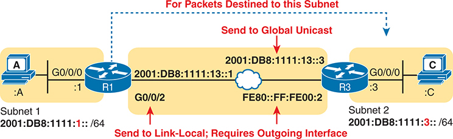

<figcaption>

<strong>图 29-3</strong> <em>使用 GUA 或 LLA 作为静态 IPv6 路由的下一跳地址</em>

<aside class="hidden" id="a29fig03">

路由器 R1 有 G0/0/0 和 G0/0/2 接口。G0/0/0 连接标为子网 1 的网络，子网地址为 2000:DB8:1111:1::/64；G0/0/2 连接子网地址 2000:DB8:1111:13::1。路由器 R3 有 G0/0/0 接口，FE80::FF:FE00:2 与 R1 的 G0/0/2 连接同一网络，而 G0/0/0 关联子网 2，子网地址为 2000:DB8:1111:3::/64。示意图包含以下标注：R1 朝向子网 2 标有“对于发往此子网的数据包”，接口 G0/0/2 标为“发送到链路本地地址”，子网地址 2000:DB8:1111:3::3 标为“发送到全球单播地址”。

</aside>

</figcaption>

</figure>

接下来几页将逐一介绍示例，先使用 GUA，再使用 LLA 作为下一跳路由器地址。

<section>

<h5 class="h5" id="ch29lev3sec1">使用下一跳 GUA 的静态网络路由示例</h5>

在<a href="#exa29_8">例 29-8</a> 中，R1 按照<a href="#ch29fig03">图 29-3</a> 添加一条引用邻居 R3 GUA 的静态路由。命令列出位于路由器 R3 另一侧的子网 3（2001:DB8:1111:3::/64）。随后，该路由将 R3 的 GUA（以 13::3 结尾）列为下一跳地址，这是 R1 与 R3 共享子网上的 GUA。

<strong>例 29-8</strong> <em>使用全球单播地址的静态 IPv6 路由</em>

<a href="#code-f0731-01" id="f0731-01a">点击此处查看代码原图</a>

<pre class="pre-ex" tabindex="0"><code>!

R1(config)# <strong>ipv6 route 2001:db8:1111:3::/64 2001:DB8:1111:13::3</strong></code></pre>

<a href="#exa29_9">例 29-9</a> 的前两个命令列出<a href="#exa29_8">例 29-8</a> 所配置静态路由的详细信息。第一个命令列出路由器 R1 上的所有静态路由，目前只有<a href="#exa29_8">例 29-8</a> 中的那一条。第二个命令 <strong>show ipv6 route 2001:DB8:1111:3::33</strong> 要求 R1 标识向命令所列地址转发数据包时会使用的路由（图中的主机 C 使用地址 <strong>2001:DB8:1111:3::33</strong>）。输出详细描述刚刚配置的静态路由，证明 R1 向该主机转发数据包时会使用这条新路由。

<strong>例 29-9</strong> <em>验证指向下一跳全球单播地址的静态路由</em>

<a href="#code-f0731-02" id="f0731-02a">点击此处查看代码原图</a>

<pre class="pre-ex" tabindex="0"><code>R1# <strong>show ipv6 route static</strong>

! Legend omitted for brevity

S   2001:DB8:1111:3::/64 [1/0]

     via 2001:DB8:1111:13::3

R1# <strong>show ipv6 route 2001:db8:1111:3::33</strong>

Routing entry for 2001:DB8:1111:3::/64

  Known via "static", distance 1, metric 0

  Route count is 1/1, share count 0

  Routing paths:

    2001:DB8:1111:13::3

      Route metric is 0, traffic share count is 1

      Last updated 00:07:43 ago</code></pre>

有趣的是，<a href="#exa29_8">例 29-8</a> 中的 <strong>ipv6 route 2001:db8:1111:3::/64 2001:db8:1111:13::3</strong> 命令能够工作，但你可能会疑惑：命令没有列出出接口，路由器如何知道使用哪个接口？路由器确实需要确定出接口，因此它使用迭代过程，查找通往下一跳 GUA 的路由。第一次迭代发生在路由器将数据包的目的地址与静态路由匹配时。第二次迭代发生在路由器查找向第一条路由中的下一跳地址转发数据包所需路由时。第二次迭代匹配到本地路由器和下一跳路由器共同连接的子网路由，在此例中即连接 R1 G0/0/2 的子网前缀 2001.db8:1111:13::/64。

<a href="#exa29_10">例 29-10</a> 展示了通过迭代查找确定出接口的一些说明。第一个命令列出路由器 R1 所使用的、匹配下一跳 GUA 2002:db8:1111:13::3 的直连路由，即通往前缀 2001:db8:1111:13::/64 的路由。而 <strong>show ipv6 static detail</strong> 命令显示路由器迭代路由查找的结果，将 G0/0/2 列为出接口。它还列出代码 *，表示路由器已经将该路由添加到路由信息库（RIB），这里指 IPv6 路由表。

<strong>例 29-10</strong> <em>理解用于查找出接口的迭代查找</em>

<a href="#code-f0732-01" id="f0732-01a">点击此处查看代码原图</a>

<pre class="pre-ex" tabindex="0"><code>R1# <strong>show ipv6 route connected</strong>

! Lines omitted to reveal route to the subnet between R1 and R3

C   2001:DB8:1111:13::/64 [0/0]

     via GigabitEthernet0/0/2, directly connected

R1# <strong>show ipv6 static detail</strong>

IPv6 Static routes Table - default

Codes: * - installed in RIB, u/m - Unicast/Multicast only

Codes for []: P - permanent I - Inactive permanent

       U - Per-user Static route

       N - ND Static route

       M - MIP Static route

       P - DHCP-PD Static route

       R - RHI Static route

       V - VxLan Static route

*   2001:DB8:1111:3::/64 via 2001:DB8:1111:13::3, distance 1

     Resolves to 1 paths (max depth 1)

     via GigabitEthernet0/0/2</code></pre>

也可以配置同时指定下一跳 GUA 和出接口的静态 IPv6 路由，有时称为完全指定路由。这样，路由器就不需要执行迭代路由查找。<a href="#exa29_11">例 29-11</a> 正是这样的情况：它将<a href="#exa29_8">例 29-8</a> 中的静态路由替换为同时列出下一跳 GUA 和出接口 G0/0/2 的路由。示例最后确认，IPv6 路由表中的该路由列出了下一跳 GUA 和出接口。

<strong>例 29-11</strong> <em>同时指定出接口和 GUA 的另一种 IPv6 静态路由</em>

<a href="#code-f0733-01" id="f0733-01a">点击此处查看代码原图</a>

<pre class="pre-ex" tabindex="0"><code>R1# <strong>show running-config | include ipv6 route</strong>

ipv6 route 2001:DB8:1111:3::/64 GigabitEthernet0/0/2 2001:DB8:1111:13::3

R1# <strong>show ipv6 route | section 2001:DB8:1111:3::/64</strong>

S   2001:DB8:1111:3::/64 [1/0]

     via 2001:DB8:1111:13::3, GigabitEthernet0/0/2

R1# <strong>show ipv6 static detail</strong>

! Legend omitted

*   2001:DB8:1111:3::/64 via 2001:DB8:1111:13::3, GigabitEthernet0/0/2, distance 1</code></pre>

</section>

<section>

<h5 class="h5" id="ch29lev3sec2">使用下一跳 LLA 的静态网络路由示例</h5>

引用邻居 LLA 的静态路由，工作方式与前面两种形式略有相似。首先，<strong>ipv6 route</strong> 命令引用下一跳地址，也就是 LLA；不过，命令还必须引用本路由器的本地出接口。为什么两者都需要？<strong>ipv6 route</strong> 命令不能只引用 LLA 下一跳地址，因为用于 GUA 的迭代路由查找对 LLA 不起作用。没有通往 LLA 的路由，因此路由器无法仅使用 LLA 作为静态路由的转发指令。也就是说，使用 LLA 时，还需要配置出接口。

<a href="#ch29fig04">图 29-4</a> 描述了同时使用 LLA 和出接口的逻辑，用它替换<a href="#exa29_8">例 29-8</a> 中配置并在<a href="#exa29_9">例 29-9</a> 和<a href="#exa29_10">例 29-10</a> 中解释的静态路由。在此例中，R1 的配置引用 R1 的出接口以及路由器 R2 的 LLA。图中还展示了路由器 R1 所需的全局配置命令。

<figure class="image-c" id="ch29fig04">

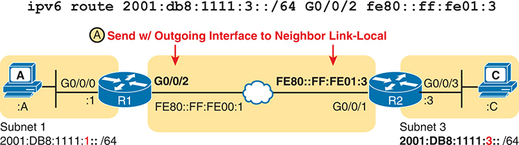

<figcaption>

<strong>图 29-4</strong> <em>在 IPv6 静态路由中使用 LLA 和出接口的示例</em>

<aside class="hidden" id="a29fig04">

节点 A 通过接口 G0/0/0 连接路由器 R1。R1 通过 G0/0/2，经过云形符号表示的外部网络连接 R2。R2 通过 G0/0/3 连接节点 C。节点 A 和 C 分别属于不同子网：IPv6 地址为 2001:DB8:1111:1::/64 的子网 1，以及 IPv6 地址为 2001:DB8:1111:3::/64 的子网 3。示意图还包含一条 IPv6 路由命令，其中的 IP 地址、子网掩码、出接口以及邻居链路本地地址表示数据流向。

</aside>

</figcaption>

</figure>

<a href="#exa29_12">例 29-12</a> 展示路由器 R1 上基于 LLA 的静态路由配置，过程中故意出现了一些错误。第一次尝试 <strong>ipv6 route</strong> 命令时省略出接口，因此 IOS 拒绝该命令。第二次尝试先使用向上箭头调出命令，再将出接口 G0/0/2 添加到命令末尾，但这种语法不正确。接口 ID 应当<em>位于地址之前</em>。最后一条 <strong>ipv6 route</strong> 命令展示了正确语法，IOS 接受了该命令。

<strong>例 29-12</strong> <em>使用 LLA 的静态 IPv6 网络路由</em>

<a href="#code-f0734-01" id="f0734-01a">点击此处查看代码原图</a>

<pre class="pre-ex" tabindex="0"><code>R1# <strong>configure terminal</strong>

Enter configuration commands, one per line.  End with CNTL/Z.

R1(config)# <strong>ipv6 route 2001:db8:1111:3::/64 fe80::ff:fe01:3</strong>

% Interface has to be specified for a link-local nexthop

R1(config)# <strong>ipv6 route 2001:db8:1111:3::/64 fe80::ff:fe00:2 g0/0/2</strong>

                                                           ^

% Invalid input detected at '^' marker.

R1(config)# <strong>ipv6 route 2001:db8:1111:3::/64</strong> <strong>g0/0/2 fe80::ff:fe01:3</strong>

R1(config)#<strong>^Z</strong></code></pre>

<a href="#exa29_13">例 29-13</a> 重复使用<a href="#exa29_9">例 29-9</a> 中的 <strong>show ipv6 route static</strong> 和 <strong>show ipv6 route 2001:DB8:1111:3::33</strong> 命令，验证<a href="#exa29_12">例 29-12</a> 的配置。注意，这两个命令的输出与前面的示例略有不同。由于新的配置命令同时列出下一跳地址和出接口，<a href="#exa29_13">例 29-13</a> 中的 <strong>show</strong> 命令也同时列出下一跳 LLA 和出接口。如果回看<a href="#exa29_9">例 29-9</a>，则会发现那里只列出了下一跳地址。

<strong>例 29-13</strong> <em>验证指向下一跳链路本地地址的静态路由</em>

<a href="#code-f0734-02" id="f0734-02a">点击此处查看代码原图</a>

<pre class="pre-ex" tabindex="0"><code>R1# <strong>show ipv6 route static</strong>

! Legend omitted for brevity

S   2001:DB8:1111:3::/64 [1/0]

      via FE80::FF:FE00:2, GigabitEthernet0/0/2

R1# <strong>show ipv6 route 2001:db8:1111:3::33</strong>

Routing entry for 2001:DB8:1111:3::/64

  Known via "static", distance 1, metric 0

  Route count is 1/1, share count 0

  Routing paths:

    FE80::FF:FE00:2, GigabitEthernet0/0/2

      Route metric is 0, traffic share count is 1

      Last updated 00:01:01 ago</code></pre>

总之，IPv6 静态网络路由列出前缀／前缀长度以及转发指令。转发指令允许使用各种单播地址类型，包括 GUA、ULA，甚至 LLA。不过，可以在转发指令中使用哪些选项，仍存在一些限制。<a href="#ch29tab02">表 29-2</a> 总结了这些选项。

<figure class="table" id="ch29tab02" tabindex="0">

<figcaption>

<strong>表 29-2</strong> IPv6 网络路由配置汇总表

</figcaption>

<table class="all">

<thead>

<tr>

<th class="th">
转发指令
</th>

<th class="th">
串行接口
</th>

<th class="th">
以太网
</th>

</tr>

</thead>

<tbody>

<tr>

<td class="border">
仅接口
</td>

<td class="border">
是
</td>

<td class="border">
否<em><a id="tfn29_2" href="#tfn29_2a">*</a></em>
</td>

</tr>

<tr>

<td class="border">
仅 GUA/ULA
</td>

<td class="border">
是
</td>

<td class="border">
是
</td>

</tr>

<tr>

<td class="border">
接口加 GUA/ULA
</td>

<td class="border">
是
</td>

<td class="border">
是
</td>

</tr>

<tr>

<td class="border">
接口加 LLA
</td>

<td class="border">
是
</td>

<td class="border">
是
</td>

</tr>

<tr>

<td class="border">
仅 LLA
</td>

<td class="border">
否
</td>

<td class="border">
否
</td>

</tr>

</tbody>

</table>

<em><a id="tfn29_2a" href="#tfn29_2">*</a></em> 可以配置仅指定出站以太网接口而不指定下一跳地址的 <strong>ipv6 route</strong> 命令，但该路由不会转发数据包。

</figure>

</section>

</section>

</section>

<section>

<h3 class="h3" id="ch29lev1sec5">IPv6 静态默认路由、主机路由和浮动静态路由</h3>

如果你一直按顺序阅读本书，以下主题应该比较容易理解。工程师使用 IPv6 默认路由、主机路由和浮动静态路由的目的，与对应的 IPv4 路由相同。唯一的区别在于 IPv6 下一跳地址和出接口的配置组合，而你刚刚已经在本章学习了这一主题。希望接下来几页的大部分内容既能复习 IPv4 默认、主机和浮动静态路由的概念，也能提供有帮助的 IPv6 路由示例。

<section>

<h4 class="h4" id="ch29lev2sec6">IPv6 静态默认路由</h4>

与 IPv4 类似，IPv6 支持默认路由概念。当 IPv6 数据包不匹配其他任何 IPv6 路由时，默认路由告诉路由器如何处理它。当没有路由匹配数据包的目的地址时，路由器的转发逻辑很直接：

<ul class="sq">

<li>
如果没有默认路由，路由器丢弃 IPv6 数据包。
</li>

<li>
如果有默认路由，路由器根据默认路由转发 IPv6 数据包。
</li>

</ul>

默认路由在某些网络设计中很有用。例如，某企业网络设计在每个分支机构只使用一台路由器，并为每个分支提供一条 WAN 链路，那么分支路由器就只有一条可能的路径来转发数据包。在大型网络中使用路由协议时，分支路由器可能学到数千条路由，但这些路由全都通过同一条 WAN 链路转发数据包。

分支路由器可以使用默认路由来代替路由协议，将所有流量转发到网络核心。<a href="#ch29fig05">图 29-5</a> 正是这样的示例，右侧是两台示例分支路由器，左侧是核心站点路由器，虚线表示默认路由。

配置静态默认路由时，使用特定值 ::/0 标识该路由为默认路由。整个前缀只有双冒号（::），没有其他数字，表示全 0 前缀；/0 前缀长度表示初始位中无需任何位匹配即可属于同一组。因此，::/0 是“所有 IPv6 地址”的缩写。这与 IPv4 的约定相对应：在 <strong>show</strong> 命令输出中以 0.0.0.0/0 表示默认路由，在 <strong>ip route</strong> 命令中则以 0.0.0.0 0.0.0.0 表示。

<figure class="image-c" id="ch29fig05">

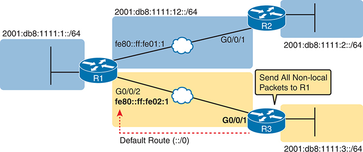

<figcaption>

<strong>图 29-5</strong> <em>在分支路由器上使用静态默认路由</em>

<aside class="hidden" id="a29fig05">

分支路由器 R2 和 R3 通过各自的 G0/0/1 接口连接路由器 R1。路由器 R1 有一条指向 2001:DB8:1111:1::/64 的默认路由。R2 和 R3 上配置静态路由，将所有非本地数据包发送给路由器 R1。R2 的静态路由通过 G0/0/1 指向 2001:DB8:1111:1::/64，R3 的静态路由也通过 G0/0/1 指向 2001:DB8:1111:1::/64。

</aside>

</figcaption>

</figure>

要配置静态默认路由，使用 ::/0 作为目的地，其余部分按正常方式配置 <strong>ipv6 route</strong> 命令，转发指令遵循本章前面讨论的相同约定。<a href="#exa29_14">例 29-14</a> 展示了<a href="#ch29fig05">图 29-5</a> 中路由器 R3 上的一条静态默认路由示例。配置使用下一跳 LLA，因此还需要指定出接口。

<strong>例 29-14</strong> <em>分支路由器 R3 的静态默认路由</em>

<a href="#code-f0736-01" id="f0736-01a">点击此处查看代码原图</a>

<pre class="pre-ex" tabindex="0"><code>! Forward out R3's G0/0/1 local interface to R1's G0/0/2 LLA FE80::FF:FE02:1.

R3(config)# <strong>ipv6 route ::/0 g0/0/1 fe80::ff:fe02:1</strong></code></pre>

与 IPv4 默认路由相比，Cisco IOS 对 IPv6 默认路由的表示更简单。例如，<strong>show ipv6 route</strong> 命令输出不会像 IPv4 那样列出“Gateway of Last Resort”，而是将默认路由目的地列为 ::/0，与 <strong>ipv6 route</strong> 配置命令相同。<a href="#exa29_15">例 29-15</a> 展示路由器 R3 的路由表，其中只有默认路由，以及两个工作接口预期存在的直连路由和本地路由。示例底部的 <strong>show ipv6 route ::/0</strong> 命令输出显示默认路由的更多细节，包括确认所配置的前缀 ::/0、下一跳 LLA 和出接口。

<strong>例 29-15</strong> <em>路由器 R3 的静态默认路由（使用出接口）</em>

<a href="#code-f0737-01" id="f0737-01a">点击此处查看代码原图</a>

<pre class="pre-ex" tabindex="0"><code>R3# <strong>show ipv6 route</strong>

IPv6 Routing Table - default - 6 entries

Codes: C - Connected, L - Local, S - Static, U - Per-user Static route

       B - BGP, R - RIP, H - NHRP, I1 - ISIS L1

       I2 - ISIS L2, IA - ISIS interarea, IS - ISIS summary, D - EIGRP

       EX - EIGRP external, ND - ND Default, NDp - ND Prefix, DCE - Destination

       NDr - Redirect, O - OSPF Intra, OI - OSPF Inter, OE1 - OSPF ext 1

       OE2 - OSPF ext 2, ON1 - OSPF NSSA ext 1, ON2 - OSPF NSSA ext 2

       a - Application, m - OMP

S   ::/0 [1/0]

     via FE80::FF:FE02:1, GigabitEthernet0/0/1

C   2001:DB8:1111:3::/64 [0/0]

     via GigabitEthernet0/0/0, directly connected

L   2001:DB8:1111:3::3/128 [0/0]

     via GigabitEthernet0/0/0, receive

C   2001:DB8:1111:13::/64 [0/0]

     via GigabitEthernet0/0/1, directly connected

L   2001:DB8:1111:13::3/128 [0/0]

     via GigabitEthernet0/0/1, receive

L   FF00::/8 [0/0]

     via Null0, receive

R3# <strong>show ipv6 route ::/0</strong>

Routing entry for ::/0

  Known via "static", distance 1, metric 0

  Route count is 1/1, share count 0

  Routing paths:

    FE80::FF:FE02:1, GigabitEthernet0/0/1

      Route metric is 0, traffic share count is 1

      Last updated 00:04:04 ago</code></pre>

</section>

<section>

<h4 class="h4" id="ch29lev2sec7">IPv6 静态主机路由</h4>

IPv4 和 IPv6 都允许定义静态主机路由，也就是通往单个主机 IP 地址的路由。IPv4 的此类路由使用 /32 掩码，在 <strong>ip route</strong> 命令中标识单个 IPv4 地址；IPv6 则使用 /128 掩码，在 <strong>ipv6 route</strong> 命令中标识单个主机。

语法方面，<a id="key_312" href="#ref-gloss_217">IPv6 主机路由</a> 的转发指令遵循与 IPv6 网络路由相同的规则。唯一的区别是配置一个完整的 128 位地址以及 /128 前缀长度，使该路由只匹配单个 IPv6 地址。

实际网络中，你可能永远不需要使用主机路由；但使用它的动机通常是某种业务需求，要求通过不同于路由协议所选路径的路由向某台主机转发数据包。<a href="#ch29fig06">图 29-6</a> 展示了这样的示例。通往该子网所有主机的路由经过拓扑下半部分；但出于业务原因，你可能需要将发往主机 D 的流量经由上方路径、通过路由器 R2 转发，这就需要一条主机路由。

<a href="#exa29_16">例 29-16</a> 展示基于<a href="#ch29fig06">图 29-6</a> 的配置：通往主机 D 的主机路由以 R2 为下一跳路由器，通往主机 D 所在子网的静态网络路由则以 R3 为下一跳路由器。

<figure class="image-c" id="ch29fig06">

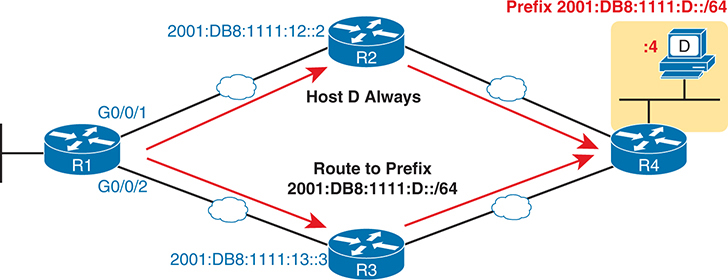

<figcaption>

<strong>图 29-6</strong> <em>IPv6 主机路由的示例拓扑</em>

<aside class="hidden" id="a29fig06">

图中以主机 D 展示主机路由，它用于将流量路由到网络中的特定主机。拓扑包含 R1、R2、R3 和 R4 四台路由器，通过隧道互联。这些隧道将 IPv6 数据包封装在 IPv4 数据包中。路由器 R1 有一条通往主机 D 所在前缀 2001:DB8:1111:D::/64 的路由。该路由将流量引向路由器 R4，R4 充当到达主机 D 的下一跳路由器。路由器 R4 有一个连接主机 D 的接口，配置了 IPv6 地址 2001:DB8:1111:13:3，发往主机 D 的流量被引向该接口。

</aside>

</figcaption>

</figure>

<strong>例 29-16</strong> <em>R1 上通往主机 D 的静态 IPv6 主机路由</em>

<a href="#code-f0738-01" id="f0738-01a">点击此处查看代码原图</a>

<pre class="pre-ex" tabindex="0"><code>! The first command shows the host route, and the second shows the network route.

! Both use next-hop GUA and outgoing interface for clarity.

R1# <strong>configure terminal</strong>

Enter configuration commands, one per line.  End with CNTL/Z.

R1(config)# <strong>ipv6 route</strong> <strong>2001:db8:1111:d::4/128</strong> <strong>g0/0/1 2001:db8:1111:12::2</strong>

R1(config)# <strong>ipv6 route</strong> <strong>2001:db8:1111:d::/64</strong> <strong>g0/0/2 2001:db8:1111:13::3</strong>

R1(config)#<strong>^Z</strong>

R1#</code></pre>

添加 IPv6 主机路由通常会造成路由重叠，本例就是如此。在选择放入 IPv6 路由表的路由时，路由器始终尝试为每个前缀（子网）将最佳路由放入 IP 路由表。此规则适用于由前缀和前缀长度的每一种组合定义的各个子网前缀。在此例中，两条静态路由的前缀长度不同，因此两条路由都会被放入路由表，如<a href="#exa29_17">例 29-17</a> 第一个命令的输出所示。

<strong>例 29-17</strong> <em>通往主机 D 的 IPv6 主机路由及与其重叠的网络路由</em>

<a href="#code-f0738-02" id="f0738-02a">点击此处查看代码原图</a>

<pre class="pre-ex" tabindex="0"><code>R1# <strong>show ipv6 route static</strong>

! Legend omitted

S   2001:DB8:1111:D::/64 [1/0]

     via 2001:DB8:1111:13::3, GigabitEthernet0/0/2

S   2001:DB8:1111:D::4/128 [1/0]

     via 2001:DB8:1111:12::2, GigabitEthernet0/0/1

R1# <strong>show ipv6 route 2001:db8:1111:d::4</strong>

Routing entry for 2001:DB8:1111:D::4/128

  Known via "static", distance 1, metric 0

  Route count is 1/1, share count 0

  Routing paths:

    2001:DB8:1111:12::2, GigabitEthernet0/0/1

      Route metric is 0, traffic share count is 1

      Last updated 00:02:28 ago

R1# <strong>show ipv6 route 2001:db8:1111:d::3</strong>

Routing entry for 2001:DB8:1111:D::/64

  Known via "static", distance 1, metric 0

  Route count is 1/1, share count 0

  Routing paths:

    2001:DB8:1111:13::3, GigabitEthernet0/0/2

      Route metric is 0, traffic share count is 1

      Last updated 00:00:43 ago</code></pre>

与 IPv4 路由一样，IPv6 使用最长匹配逻辑，将数据包与 IPv6 路由表匹配。发往主机 D 地址的数据包同时匹配<a href="#exa29_16">例 29-16</a> 配置的两条路由，但路由器选择前缀更长的 /128 主机路由，也就是前缀长度对应更多二进制 1 的路由。换言之，当匹配多条路由时，路由器会使用定义最具体地址集合的路由。

<a href="#exa29_17">例 29-17</a> 中最后两个 <strong>show</strong> 命令演示了路由器 R1 的匹配逻辑。<strong>show ipv6 route 2001:db8:1111:d::4</strong> 命令询问路由器：对于发往主机 D 地址的数据包，会使用哪条路由进行匹配？输出描述了 /128 主机路由，下一跳地址为 R2 的 GUA。相反，最后一个命令列出与主机 D 同一子网中的另一个 IPv6 地址，因此 R1 不会匹配主机路由，而是匹配网络路由，列出出接口 G0/0/2，并以 R3 的 GUA 作为下一跳地址。

</section>

<section>

<h4 class="h4" id="ch29lev2sec8">IPv6 浮动静态路由</h4>

浮动静态路由是 CCNA 考试主题中提到的四种具体静态路由类型的最后一种。IPv4 和 IPv6 浮动静态路由的总体概念相同，因此本节只作简要介绍。有关概念的更多细节，请参阅<a href="v1-17.html#ch17">第 17 章</a>“<a href="v1-17.html#ch17">配置 IPv4 地址和静态路由</a>”中的“<a href="v1-17.html#ch17lev2sec9">浮动静态路由</a>”一节。

浮动静态路由使路由器能够通过交换式 WAN 连接，例如蜂窝接口，引导流量，但仅在通常使用的 WAN 链路发生故障时如此。例如，在<a href="#ch29fig07">图 29-7</a> 中，以太网 WAN 链路通常会连续工作数月。OSPF 使用该链路学习 IPv6 路由。在此期间，蜂窝接口保持未使用状态，两台路由器之间没有蜂窝呼叫或链路，也没有使用蜂窝接口的 IPv6 路由。

浮动静态路由提供了一种将数据包引向蜂窝链路的方法，从而触发电话呼叫，在两台路由器之间建立链路，但只有在使用主链路的路由失效时才会这样做。为此，需要配置一条使用蜂窝接口的静态路由，路由器将其保存在配置中。不过，由于已经存在通过 OSPF 学习到的、前缀／长度完全相同的路由，路由器不会将该静态路由添加到路由表。一旦主路由失效，路由器便将浮动静态路由添加到路由表，将流量引向蜂窝链路。在这种场景下，蜂窝链路和浮动静态路由仅在主链路中断期间使用。

<figure class="image-c" id="ch29fig07">

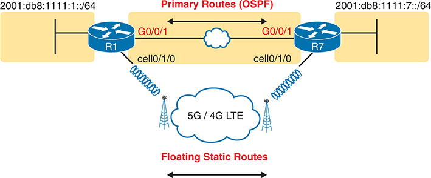

<figcaption>

<strong>图 29-7</strong> <em>使用通往关键子网 2001:DB8:1111:7::/64 的浮动静态路由</em>

<aside class="hidden" id="a29fig07">

示意图展示两台路由器 R1 和 R7，通过使用 OSPF 的主路由连接。该连接的 IP 地址分别为 R1 的 2001:db8:1111:1::/64 和 R7 的 2001:db8:1111:7::/64。一条浮动静态路由通过 5G／4G LTE 云连接两台路由器。涉及的接口标注如下：R1 的 G0/0/1 连接 OSPF，cell 0/1/0 连接浮动静态路由；R7 的 G0/0/1 连接 OSPF，cell 0/1/0 连接浮动静态路由。

</aside>

</figcaption>

</figure>

对于通往同一前缀／长度的路由，路由器依靠每条路由的 <a id="key_311" href="#ref-gloss_216">IPv6 管理距离</a>（AD）参数，在不同路由信息来源（例如 OSPF、EIGRP 或静态路由）之间进行判断。例如，在<a href="#ch29fig07">图 29-7</a> 中，R1 上通过 OSPF 学习到的通往前缀 2001:db8:1111:7::/64 的路由，默认 AD 为 110。静态路由的默认 AD 为 1，因此 R1 通常会优先选择用 <strong>ipv6 route 2001:db8:1111:7::/64 cell0/1/0</strong> 命令配置的静态路由，而非通往同一子网、AD 为 110 的 OSPF 路由，并用静态路由替换 OSPF 路由。

浮动静态路由通过使用比通常所用路由更高（更差）的 AD 设置，使自身暂时不进入路由表。在刚才的示例中，将静态路由的 AD 设置为高于 OSPF 的 110，例如使用 <strong>ipv6 route 2001:db8:1111:7::/64 cell0/1/0 130</strong> 命令，路由器 R1 就会优先选择 AD 为 110 的 OSPF 路由，而非 AD 为 130 的静态路由。

可以使用常见的 <strong>show</strong> 命令，查找路由表中某条路由的 AD。例如，<strong>show ipv6 route</strong> 命令将每条路由的管理距离列为方括号中两个数字的第一个，第二个数字是度量值。此外，<strong>show ipv6 route</strong> <em>prefix/length</em> 等命令会给出某一条具体路由的详细信息；此命令直接以“distance”列出 AD。

<a href="#ch29tab03">表 29-3</a> 列出各种默认 IPv6 AD 值。这些默认值与本书<a href="v1-24.html#ch24tab04">表 24-4</a> 中的 IPv4 默认 AD 设置相同。与<a href="v1-24.html#ch24tab04">表 24-4</a> 相比，此表增加了 NDP 条目（它不适用于 IPv4），并删除了基于 IPv4 DHCP 的默认路由（AD 254），因为 IPv6 不通过 DHCP 通告默认路由。

<figure class="table" id="ch29tab03" tabindex="0">

<figcaption>

<strong>表 29-3</strong> 默认 IPv6 管理距离

</figcaption>

<table class="all">

<thead>

<tr>

<th class="th">
路由类型
</th>

<th class="th">
管理距离
</th>

</tr>

</thead>

<tbody>

<tr>

<td class="border">
直连
</td>

<td class="border">
0
</td>

</tr>

<tr>

<td class="border">
静态
</td>

<td class="border">
1
</td>

</tr>

<tr>

<td class="border">
NDP 默认路由
</td>

<td class="border">
2
</td>

</tr>

<tr>

<td class="border">
BGP（外部路由 [eBGP]）
</td>

<td class="border">
20
</td>

</tr>

<tr>

<td class="border">
EIGRP（内部路由）
</td>

<td class="border">
90
</td>

</tr>

<tr>

<td class="border">
IGRP
</td>

<td class="border">
100
</td>

</tr>

<tr>

<td class="border">
OSPF
</td>

<td class="border">
110
</td>

</tr>

<tr>

<td class="border">
IS-IS
</td>

<td class="border">
115
</td>

</tr>

<tr>

<td class="border">
RIP
</td>

<td class="border">
120
</td>

</tr>

<tr>

<td class="border">
EIGRP（外部路由）
</td>

<td class="border">
170
</td>

</tr>

<tr>

<td class="border">
BGP（内部路由 [iBGP]）
</td>

<td class="border">
200
</td>

</tr>

<tr>

<td class="border">
不可用
</td>

<td class="border">
255
</td>

</tr>

</tbody>

</table>

</figure>

</section>

</section>

<section>

<h3 class="h3" id="ch29lev1sec6">IPv6 静态路由故障排除</h3>

IPv6 静态路由具有与<a href="v1-17.html#ch17">第 17 章</a> 讨论的 IPv4 静态路由相同的潜在问题和错误。不过，IPv6 静态路由确实存在一些小差异。本章静态路由内容的最后一部分考察 IPv6 静态路由故障排除，复习许多同样适用于 IPv4 静态路由的排障规则，同时重点关注 IPv6 特有的细节。

这一主题从两个角度划分静态路由故障排除：一是路由器已将路由添加到路由表，但路由无法工作；二是路由器未将路由添加到路由表。

<section>

<h4 class="h4" id="ch29lev2sec9">排查 IPv6 路由表中已经出现的错误静态路由</h4>

静态路由的正确程度取决于 <strong>ipv6 route</strong> 命令中输入的内容。IOS 当然会检查命令语法，但无法判断你是否在静态路由中选错了出接口、下一跳地址或前缀／前缀长度。如果参数通过语法检查，IOS 就会将 <strong>ipv6 route</strong> 命令放入 running-config 文件。然后，如果不存在其他问题（将在下一标题下讨论），IOS 会将路由放入 IP 路由表，即使该路由可能因参数选择不当而无法工作。

例如，引用下一跳地址的静态路由，应当列出连接两台路由器的子网上另一台路由器的地址。假设路由器 R1 在该子网上使用地址 2001:1:1:1::1，R2 使用 2001:1:1:1::2。R1 的 <strong>ipv6 route</strong> 命令应该引用 R2 的 2001:1:1:1::2 地址，但没有任何机制阻止误配为 R1 自身的 2001:1:1:1::1，或该子网中除 2001:1:1:1::/64 以外的任何其他地址。R1 会允许该命令，并将路由添加到 IPv6 路由表，但该路由不可能正确转发数据包。

如果考试题中包含静态路由，而且你在 <strong>show ipv6 route</strong> 输出中看到了它们，请记住，这些路由可能具有错误参数。在脑中检查以下问题清单，以确认配置正确、发现常见错误，并确保每个相关问题的答案都是“是”。

步骤 1。 <strong>前缀／长度：</strong> <strong>ipv6 route</strong> 命令是否引用了正确的子网 ID（前缀）和掩码（前缀长度）？

步骤 2。 <strong>下一跳 LLA：</strong> 如果配置下一跳 LLA：

<ol class="step-lower-alpha">

<li>
命令是否还包含出接口？
</li>

<li>
根据拓扑，出接口是否为正确接口（位于配置该命令的路由器上）？
</li>

<li>
所配置的 LLA 是否属于与所列出接口位于同一链路的相邻路由器？
</li>

</ol>

步骤 3。 <strong>仅下一跳 GUA/ULA：</strong> 如果配置下一跳 GUA 或 ULA，但没有出接口：

<ol class="step-lower-alpha">

<li>
所配置的 GUA/ULA 是否引用邻居的地址，具体而言，是否为邻居用于连接本地路由器的接口地址？
</li>

<li>
本地路由器是否有一条匹配下一跳 GUA/ULA 的工作路由？（通常是直连路由。）
</li>

</ol>

步骤 4。 <strong>仅出接口：</strong> 如果配置出接口，但没有下一跳地址：

<ol class="step-lower-alpha">

<li>
出接口是否为串行接口，也就是在 <strong>ipv6 route</strong> 命令中不同时配置下一跳地址时，唯一能够工作的接口类型？
</li>

<li>
根据拓扑，出接口是否为正确接口（位于配置该命令的路由器上）？
</li>

</ol>

前面的排障清单逐一检查了各种情况：IOS 会接受静态 IPv6 路由配置，但由于参数不符合实际情况，路由无法工作。查看几个示例会很有帮助。<a href="#ch29fig08">图 29-8</a> 展示这些示例所用的网络；所有示例都关注添加到 R1、通往最右侧子网的路由（注意，该网络使用的 IPv6 地址与前面的图不同）。

<figure class="image-c" id="ch29fig08">

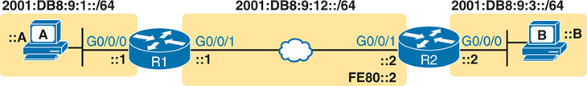

<figcaption>

<strong>图 29-8</strong> <em>错误 IPv6 路由示例的示例拓扑</em>

<aside class="hidden" id="a29fig08">

网络示意图中有 R1 和 R2 两台路由器，通过各自的 G0/0/1 接口连接。R1 通过 G0/0/0 连接标为 A 的设备，R2 通过 G0/0/0 连接标为 B 的设备。R1 与 A 之间的连接标有 IPv6 地址 2001:DB8:9:1::/64，R2 与 B 之间的连接标有 2001:DB8:9:3::/64，R1 与 R2 之间的连接标有 2001:DB8:9:12::/64 和 FE80::2。

</aside>

</figcaption>

</figure>

<a href="#exa29_18">例 29-18</a> 展示了几条 <strong>ipv6 route</strong> 命令。对于所示命令，IOS 拒绝示例中的第二条命令（步骤 2A），但接受其他命令并将其路由添加到路由表。然而，被接受命令中的路由都存在某种问题，无法按设计工作。查看每条配置命令末尾的简短注释，了解它为何不正确；示例后面的列表提供更多细节。

<strong>例 29-18</strong> <em>语法正确但思路错误的 <strong>ipv6 route</strong> 命令</em>

<a href="#code-f0742-01" id="f0742-01a">点击此处查看代码原图</a>

<pre class="pre-ex" tabindex="0"><code><strong>ipv6 route</strong> <strong>2001:DB8:9:33</strong><strong>::/64 2001:DB8:9:12::2</strong> ! Step 1: Wrong prefix

<strong>ipv6 route 2001:DB8:9:3::/</strong><strong>64 FE80::2</strong>           ! Step 2A: Missing outgoing interface

<strong>ipv6 route 2001:DB8:9:3::/64</strong> <strong>G0/0/0</strong> <strong>FE80::2</strong>    ! Step 2B: Wrong interface on R1

<strong>ipv6 route 2001:DB8:9:3::/64 G0/0/1</strong> <strong>FE80::1</strong>    ! Step 2C: Wrong neighbor link local

<strong>ipv6 route 2001:DB8:9:3::/64</strong> <strong>2001:DB8:9:12::3</strong>  ! Step 3A: Wrong neighbor address

<strong>ipv6 route 2001:DB8:9:3::/64</strong> <strong>G0/0/1</strong>            ! Step 4A: Also needs next-hop</code></pre>

步骤 1。 前缀（2001:DB8:9:33::）的第四个四位十六进制组存在输入错误，将 3 写成了 33。IOS 接受该命令，于是有了一条通往不存在子网的路由。

步骤 2A。 命令使用正确的 LLA 作为下一跳地址，但没有包含任何出接口。IOS 拒绝该命令。

步骤 2B。 命令使用 R1–R2 链路上 R2 的正确 LLA（图中的 FE80::2），但使用了错误的 R1 本地接口 G0/0/0。（更多细节见下一个示例。）

步骤 2C。 图中 R2 的 G0/0/1 使用链路本地地址 FE80::2，但命令使用了 R1 的 LLA：FE80::1。

步骤 3A。 图中间的子网为 2001:DB8:9:12::/64，R1 使用 ::1 地址，R2 使用 ::2。此命令使用该子网中以 ::3 结尾的下一跳地址，两台路由器均未使用这一地址。

步骤 4A。 命令只列出出接口 G0/0/1（正确接口），但没有下一跳地址。只有串行接口才能使用这种语法并使路由正常工作。由于这里使用以太网出接口，路由器需要在命令中指定下一跳地址。

本节的关键是认识到，IPv6 路由表中的路由可能因参数选择不当而错误。路由出现在 IPv6 路由表中，尤其是静态路由，并不意味着它就是正确的。

</section>

<section>

<h4 class="h4" id="ch29lev2sec10">静态路由未出现在 IPv6 路由表中</h4>

前面几页关注的是已出现在 IPv6 路由表中，但参数错误的 IPv6 静态路由。下一页则考察参数正确，但 IOS 没有将其放入 IPv6 路由表的路由。

当你将 <strong>ipv6 route</strong> 命令添加到配置中且语法正确时，IOS 还会执行第二个步骤，决定是否将该路由添加到 IPv6 路由表。添加路由之前，IOS 会执行以下检查；请注意，它对 IPv4 静态路由也使用相同类型的逻辑：

<ul class="sq">

<li>
对于列出出接口的 <strong>ipv6 route</strong> 命令，该接口必须处于 up/up 状态。

</li>

<li>
对于列出 GUA 或 ULA（即不是 LLA）的 <strong>ipv6 route</strong> 命令，本地路由器必须有一条能够到达该下一跳地址的路由。
</li>

<li>
如果存在另一条前缀／前缀长度完全相同的 IPv6 路由，静态路由的管理距离必须比竞争路由更好，也就是更低。
</li>

</ul>

注意，即使没有进行任何配置，前两项也可能发生变化。例如，随着接口故障与恢复，接口状态会变化，IPv6 直连路由会从 IPv6 路由表中消失并重新出现。依赖这些接口和路由的静态路由，会根据当前状态被添加到 IPv6 路由表或从中删除。

</section>

</section>

</section>

<section class="ccna-source ccna-appendix" aria-label="答案解析与术语表">
<section data-epub-type="chapter">

<h2 class="h2" id="ref-appc">附录 C</h2>

<h2 class="h2a">自测题答案</h2>

<section>

<h3 class="h3" id="ref-appclev1sec29">第 29 章</h3>

<strong><a id="ref-ques29_1" href="#quess29_1">1</a>．</strong> A 和 C。当工作中的接口配置了 IPv6 地址时，路由器会为 <strong>ipv6 address</strong> 命令所隐含的前缀（子网）添加直连路由，还会根据单播地址添加一条前缀长度为 /128 的本地路由。路由器不会根据链路本地地址添加路由。

<strong><a id="ref-ques29_2" href="#quess29_2">2</a>．</strong> A 和 C。两个正确答案给出两个直连子网的正确子网 ID（子网前缀）和前缀长度：3111:1:1:1::/64 与 3222:2:2:2::/64。使用 /128 前缀长度的答案会出现在本地路由中，但 <strong>show ipv6 route connected</strong> 命令不列出本地路由。另一个错误答案列出了完整 IPv6 地址及 /64 前缀长度，而不是前缀 ID。

<strong><a id="ref-ques29_3" href="#quess29_3">3</a>．</strong> A 和 B。所有答案都列出相同的目的子网前缀（2000:1:2:3::/64），即路由器 R1 右侧 LAN 的子网前缀。差异在于每条路由的转发指令。

对于同时列出出接口 G0/0/1 和下一跳地址的两条命令，它们都引用了路由器 R5 上的正确出接口。其中一条引用了错误的下一跳地址，即 R1 自身的全球单播地址（GUA）；而正确命令列出的是相邻路由器 R6 的 GUA，以 :6 结尾。

对于仅列出出接口的错误答案，虽然接口正确，而且路由器会将其加入路由表，但路由无法工作。引用出站以太网接口的 IPv6 静态路由还必须列出下一跳地址，路由器才有足够信息转发数据包。

对于仅列出下一跳 GUA 的正确答案，它给出了正确 GUA：R5 与 R6 之间链路上 R6 的 GUA，以 :6 结尾。

<strong><a id="ref-ques29_4" href="#quess29_4">4</a>．</strong> B。四个答案都是使用下一跳路由器 IPv6 地址的命令示例。

两个错误答案列出了 R5 WAN 接口的下一跳地址，一个是全球单播地址，一个是链路本地地址。路由器 R1 上正确的下一跳地址引用应当指向路由器 R6 上的地址。

对于列出路由器 R6 地址的两个答案，列出 R6 全球单播地址（2001:1:2:56::6）的答案正确。列出 R6 链路本地地址的命令还需要指定 R5 的出接口，因此路由器会拒绝列出 FE80::FF:FE00:6 的那个答案中的命令。

<strong><a id="ref-ques29_5" href="#quess29_5">5</a>．</strong> B。与 <strong>show ip route</strong> 命令不同，<strong>show ipv6 route</strong> 命令不会指定最后求助网关。它像列出其他 IPv6 路由一样列出默认路由，但使用特殊前缀／长度 ::/0，该值匹配所有可能的 IPv6 地址。

对于其他错误答案，前缀 ::/128 匹配的是全 0 主机地址，而不是所有地址。匹配前缀 2000::/3 的路由会匹配所有全球单播地址，但不会匹配全部 IPv6 地址，因此它不是默认路由。

<strong><a id="ref-ques29_6" href="#quess29_6">6</a>．</strong> B。题目中的 <strong>ipv6 route</strong> 命令语法正确，因此路由器至少会将它接受到配置中。注意，命令末尾使用管理距离（AD）设置，值为 200。因此，R1 将此路由视为浮动静态路由，因为其 AD 值 200 大于默认的 OSPF AD 值 110。于是，R1 根据更好（更低）的 AD，继续使用较优的 OSPF 路由，不会将该静态路由添加到路由表。

<strong><a id="ref-ques29_7" href="#quess29_7">7</a>．</strong> C。题目询问什么情况可能导致所述现象。用户输入命令并按 Enter，但题目没有说明路由器是否接受了命令。题目还告诉我们，IPv6 路由表没有列出通往前缀／长度 2001:DB8:8:8::/64 的任何路由。因此，需要考察各答案，判断是否有某个答案会导致这个前缀没有任何路由出现。

使用下一跳全球单播地址时，如果路由器有一条能够到达该下一跳地址的工作路由，而且不存在通往完全相同子网、管理距离更低的更优路由，IOS 就会将新的静态路由添加到 IPv6 路由表。因此，正确答案指出了该路由不出现的一个原因。

提到存在管理距离为 110 的更优路由的答案，确实是静态路由不出现的有效原因。不过，题目说明路由表中没有出现该子网的任何路由，因此显然不存在这条竞争路由。

另外两个错误答案提到了 <strong>ipv6 route</strong> 命令。此命令可以使用链路本地下一跳地址，但并非必须如此，这说明其中一个答案的说法不正确。对于另一个答案，当使用全球单播地址作为下一跳时，命令不要求同时指定出接口参数，因此该答案也不正确。

</section>

</section>

<section id="ref-glossary"><h2 class="h2a">术语表</h2>
<strong>IPv6 管理距离（IPv6 administrative distance）</strong> 在 Cisco 路由器中，当到同一子网的多条 IPv6 路由由不同路由协议学到时，供路由器在这些路由之间作出选择的一种机制。管理距离越小，路由信息来源越优。

<strong>IPv6 主机路由</strong> 使用 /128 掩码的路由，由于该掩码，它表示通往单个主机 IPv6 地址的路由。

<strong>IPv6 本地路由</strong> 为路由器接口 IP 地址添加到 IPv6 路由器路由表中的路由，使用 /128 掩码；由于此掩码，它表示仅通往该路由器 IPv4 地址的路由。

<strong>本地路由</strong> 为路由器接口 IP 地址添加到 IPv4 路由器路由表中的路由，使用 /32 掩码；由于此掩码，它表示仅通往该路由器 IPv4 地址的路由。

</section>
</section>

<section class="ccna-source ccna-appendix" aria-label="代码原图">
<section data-epub-type="chapter">

<a href="#f0726-01a" id="code-f0726-01">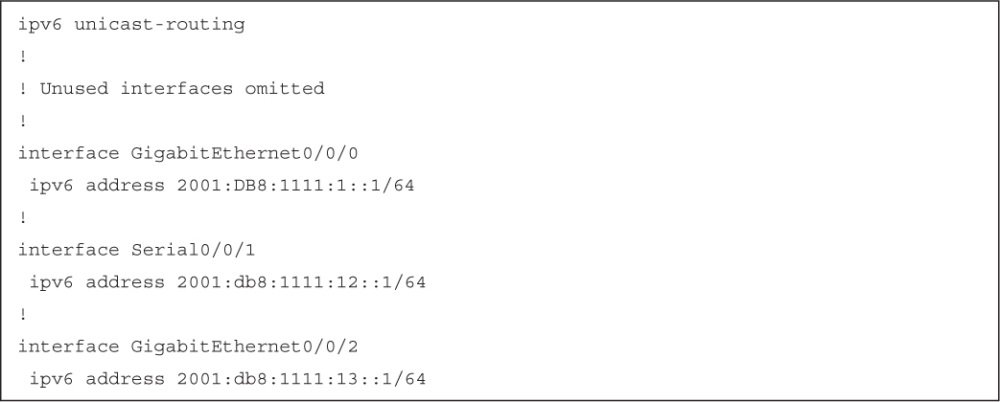</a>

<a href="#f0727-01a" id="code-f0727-01">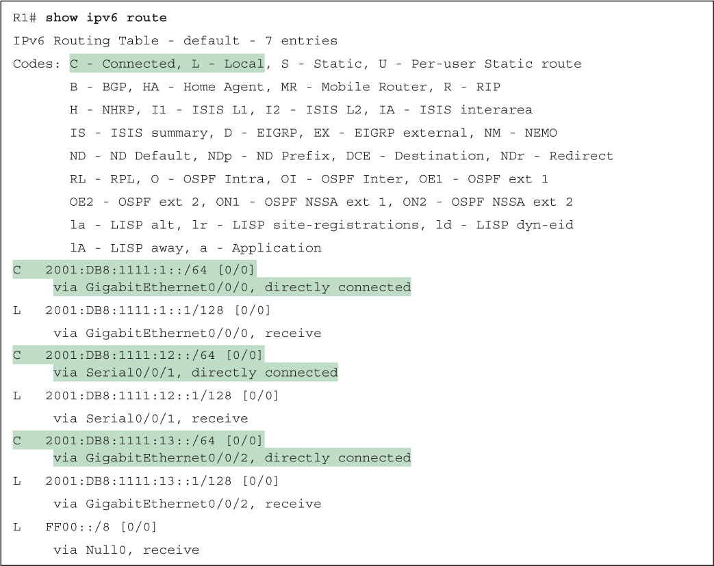</a>

<a href="#f0728-01a" id="code-f0728-01">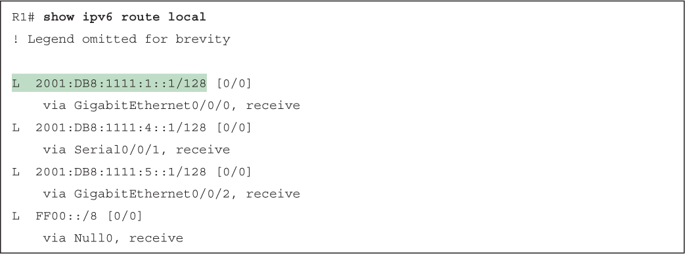</a>

<a href="#f0729-01a" id="code-f0729-01">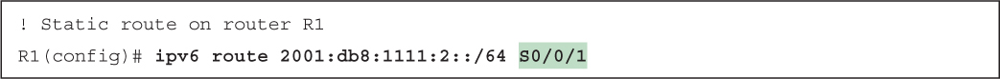</a>

<a href="#f0729-02a" id="code-f0729-02">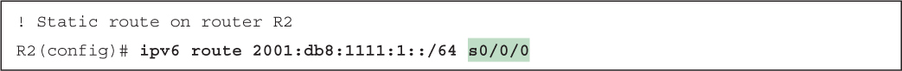</a>

<a href="#f0730-01a" id="code-f0730-01">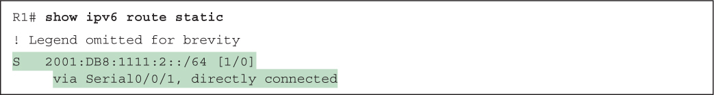</a>

<a href="#f0730-02a" id="code-f0730-02">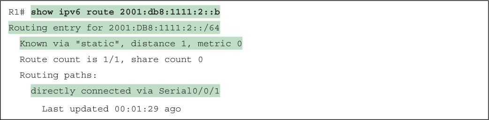</a>

<a href="#f0731-02a" id="code-f0731-02">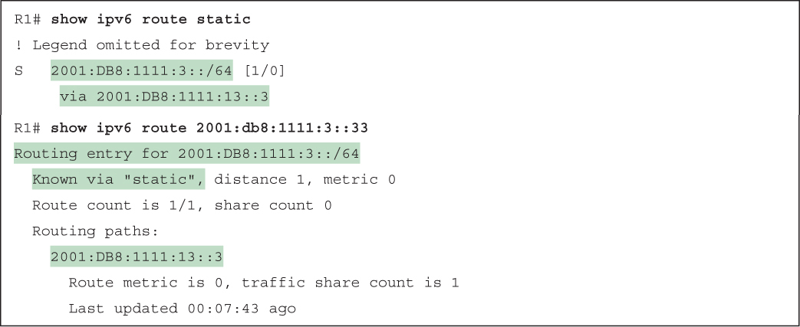</a>

<a href="#f0732-01a" id="code-f0732-01">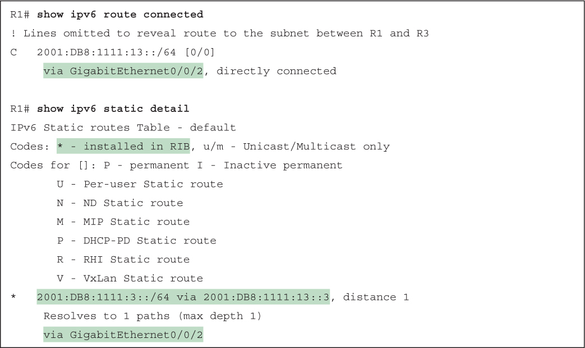</a>

<a href="#f0733-01a" id="code-f0733-01">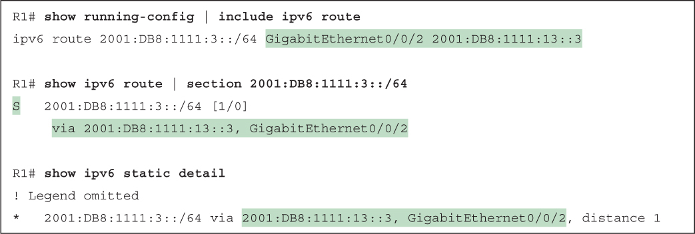</a>

<a href="#f0734-01a" id="code-f0734-01">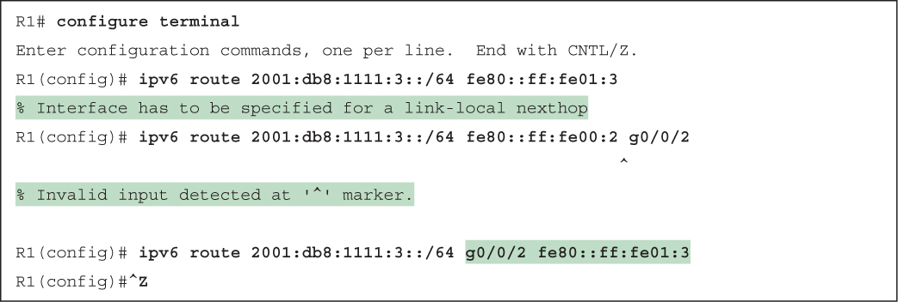</a>

<a href="#f0734-02a" id="code-f0734-02">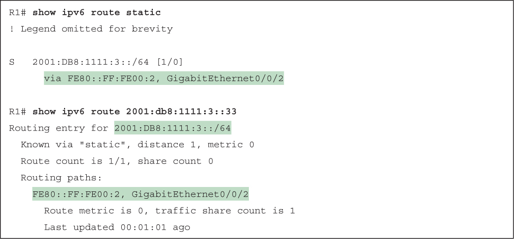</a>

<a href="#f0736-01a" id="code-f0736-01">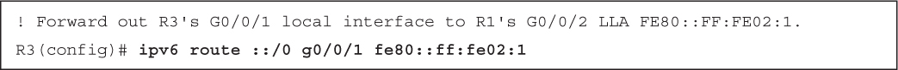</a>

<a href="#f0737-01a" id="code-f0737-01">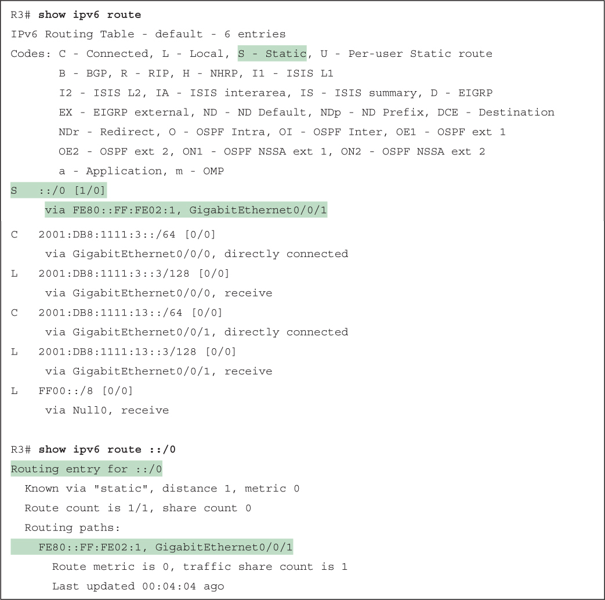</a>

<a href="#f0738-01a" id="code-f0738-01">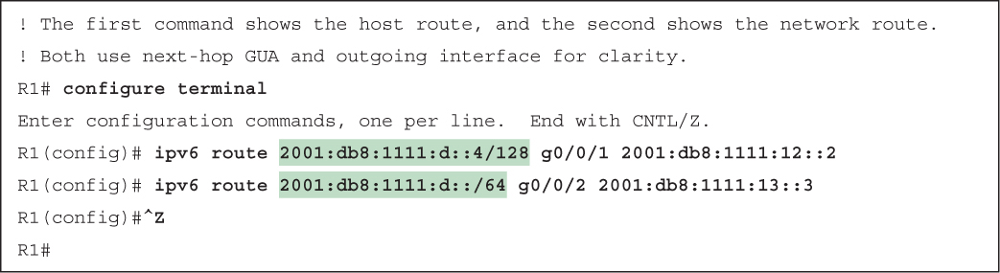</a>

<a href="#f0738-02a" id="code-f0738-02">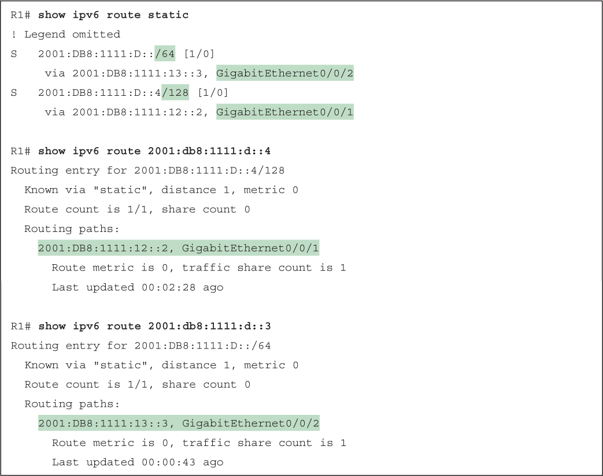</a>

<a href="#f0742-01a" id="code-f0742-01">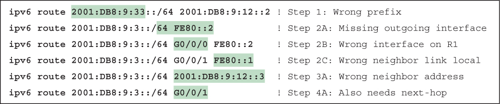</a>

</section>

</section>


<nav class="ccna-chapter-nav" aria-label="章节导航"><a href="v1-28.html">← 上一章</a><a href="v2-01.html">下一章 →</a></nav>
