
<a href="{{ '/subjects/CCNA/' | relative_url }}">← 返回 CCNA 目录</a>

第二卷 · 无线局域网

<nav class="ccna-chapter-nav" aria-label="章节导航"><a href="v1-29.html">← 上一章</a><a href="v2-02.html">下一章 →</a></nav>



<section data-epub-type="chapter">

<h2 class="h2" id="ch01">第 1 章</h2>

<h2 class="h2a">无线网络基础</h2>

本章涵盖以下考试主题：

1.0 网络基础

1.1 解释网络组件的角色和功能

1.1.d 接入点

1.11 描述无线原理

1.11.a 不重叠的 Wi-Fi 信道

1.11.b SSID

1.11.c 射频

无线通信通常涉及两台设备之间的数据交换。无线 LAN 则更进一步，许多设备可以共同参与并共享介质来交换数据。无线 LAN 必须通过射频（RF）发射信号，才能将数据从一台设备传送到另一台设备。发射机和接收机可以固定在不变的位置，也可以是移动的，能够自由移动。本章介绍可用于控制无线介质访问并在设备之间提供数据交换的拓扑。

<section>

<h3 class="h3" id="ch01lev1sec1">自测</h3>

如果你希望根据得分决定在本章投入多少时间，可以完成这组自测题（在此作答，或使用 PTP 软件）。各题答案的选项字母列在自测题之后的页面底部。书末和配套网站上的<a href="#ref-appc">附录 C</a>都包含答案及解析。你也可以在 PTP 测试软件中找到答案及解析。

<figure class="table" id="ch01tab01" tabindex="0">

<figcaption>

<strong>表 1-1</strong> 自测：基础知识小节与题目对应关系

</figcaption>

<table class="all">

<tbody>

<tr>

<th class="th">
基础知识小节
</th>

<th class="th">
题目
</th>

</tr>

<tr>

<td class="border">
比较有线网络与无线网络
</td>

<td class="border">
1
</td>

</tr>

<tr>

<td class="border">
无线 LAN 拓扑
</td>

<td class="border">
2–4
</td>

</tr>

<tr>

<td class="border">
其他无线拓扑
</td>

<td class="border">
5, 6
</td>

</tr>

<tr>

<td class="border">
无线频段与信道
</td>

<td class="border">
7, 8
</td>

</tr>

</tbody>

</table>

</figure>

<strong><a id="quess1_1" href="#ques1_1a">1</a>．</strong> 有线以太网和 Wi-Fi 分别基于哪两项 IEEE 标准？

<ol class="lower-alpha">

<li>
802.1, 802.3
</li>

<li>
802.3, 802.1
</li>

<li>
802.3, 802.11
</li>

<li>
802.11, 802.3
</li>

</ol>

<strong><a id="quess1_2" href="#ques1_2a">2</a>．</strong> 使用无线 LAN 的设备必须工作在以下哪种模式？

<ol class="lower-alpha">

<li>
轮询访问
</li>

<li>
半双工
</li>

<li>
全双工
</li>

<li>
以上答案均不正确
</li>

</ol>

<strong><a id="quess1_3" href="#ques1_3a">3</a>．</strong> 某接入点被设置为在办公室内提供无线覆盖。形成的独立网络在 802.11 中的正确术语是以下哪一个？

<ol class="lower-alpha">

<li>
BSA
</li>

<li>
BSD
</li>

<li>
BSS
</li>

<li>
IBSS
</li>

</ol>

<strong><a id="quess1_4" href="#ques1_4a">4</a>．</strong> 以下哪一项用于唯一标识 AP 及其与关联无线客户端共同维持的基本服务集？

<ol class="lower-alpha">

<li>
SSID
</li>

<li>
BSSID
</li>

<li>
以太网 MAC 地址
</li>

<li>
无线电 MAC 地址
</li>

</ol>

<strong><a id="quess1_5" href="#ques1_5a">5</a>．</strong> 以下哪一项可用于为不具备无线功能的设备提供无线连接？

<ol class="lower-alpha">

<li>
无线中继器
</li>

<li>
工作组网桥
</li>

<li>
透明网桥
</li>

<li>
自适应网桥
</li>

</ol>

<strong><a id="quess1_6" href="#ques1_6a">6</a>．</strong> Cisco 室外网状网络不需要以下哪一项？

<ol class="lower-alpha">

<li>
BSS 功能
</li>

<li>
连接每个 AP 的以太网布线
</li>

<li>
工作组网桥
</li>

<li>
回程网络
</li>

</ol>

<strong><a id="quess1_7" href="#ques1_7a">7</a>．</strong> 以下哪些是 Wi-Fi 常用的频段？（选择两个答案。）

<ol class="lower-alpha">

<li>
2.5 KHz
</li>

<li>
2.5 MHz
</li>

<li>
5 MHz
</li>

<li>
2.5 GHz
</li>

<li>
5 GHz
</li>

</ol>

<strong><a id="quess1_8" href="#ques1_8a">8</a>．</strong> 以下哪些被视为不重叠的信道？（选择两个答案。）

<ol class="lower-alpha">

<li>
2.4 GHz 频段中的信道 1、2 和 3
</li>

<li>
2.4 GHz 频段中的信道 1、5 和 10
</li>

<li>
2.4 GHz 频段中的信道 1、6 和 11
</li>

<li>
5 GHz 频段中的信道 40、44 和 48
</li>

</ol>

自测答案：

<strong><a id="ques1_1a" href="#ref-ques1_1">1</a></strong> C

<strong><a id="ques1_2a" href="#ref-ques1_2">2</a></strong> B

<strong><a id="ques1_3a" href="#ref-ques1_3">3</a></strong> C

<strong><a id="ques1_4a" href="#ref-ques1_4">4</a></strong> B

<strong><a id="ques1_5a" href="#ref-ques1_5">5</a></strong> B

<strong><a id="ques1_6a" href="#ref-ques1_6">6</a></strong> B

<strong><a id="ques1_7a" href="#ref-ques1_7">7</a></strong> D、E

<strong><a id="ques1_8a" href="#ref-ques1_8">8</a></strong> C、D

</section>

<section>

<h3 class="h3box" id="ch01lev1sec2">基础知识</h3>

</section>

<section>

<h3 class="h3" id="ch01lev1sec3">比较有线网络与无线网络</h3>

在有线网络中，需要相互通信的任意两台设备都必须通过一根线连接。（这是显而易见的！）这根“线”中可能包含从一端连续延伸到另一端的金属线芯或光纤材料。在线缆上传输的数据受到线缆物理特性的约束。实际上，IEEE 802.3 系列标准不仅规定设备如何连接以及如何通过线缆发送和接收数据，还对以太网线缆本身制定了严格的规范。

有线连接经过严格约束的工程设计，可能阻碍成功通信的变量很少。就连线芯的类型和尺寸、线芯在一定距离内相互绞合的次数，以及线缆的最大长度，都必须符合标准。

因此，有线网络本质上是一种有边界的介质：数据必须沿着两台设备之间电线或线缆所经过的路径传播。如果线缆绕过转角或盘成线圈，用于承载数据的电信号也必须绕过转角或沿着线圈传播。由于只有两台设备可以连接到一根线缆上，也只有这两台设备可以发送数据。更好的是，两台设备可以同时向对方传输数据，因为它们各自都有一条通往对方的专用直接路径，前提是线缆内部有足够的线芯分别用于两个方向。

有线网络也存在一些不足。设备通过线缆连接时，既不容易移动，也无法移动很远。设备在连接有线网络之前，必须具有与线缆末端兼容的连接器。随着设备越来越小、移动性越来越强，将它们连接到线缆上就变得不切实际。

顾名思义，无线网络消除了被电线或线缆束缚的需要。便利性和移动性成为首要优势，用户可以在保持网络连接的同时随意移动。用户可以携带许多不同的无线设备，而且经常如此；这些设备都能轻松、无缝地连接网络。

无线数据必须在自由空间中传播，没有线缆的约束与保护。在自由空间环境中，许多变量都会影响数据及其交付。为尽量减少这些变量，无线工程设计必须关注两件事：

<ul class="sq">

<li>
无线设备必须遵循共同的标准（IEEE 802.11）。
</li>

<li>
预期使用无线设备的区域必须有无线覆盖。
</li>

</ul>

准备 CCNA 200-301 考试时，请记住，该考试更侧重从功能角度考察无线技术。射频特性、天线性能等更深入的主题，属于 Implementing Cisco Enterprise Network Core Technologies ENCOR 300-401 考试的范围。

</section>

<section>

<h3 class="h3" id="ch01lev1sec4">无线 LAN 拓扑</h3>

无线通信利用射频信号在自由空间中进行。信号由一台设备，即发射机，发送给另一台设备，即接收机。如<a href="#ch01fig01">图 1-1</a> 所示，只要两台设备调谐到相同频率（或信道），并使用相同的方式在彼此之间承载数据，发射机就可以随时与接收机联系。这听起来很简单，但实际上并不实用。

<figure class="image-c" id="ch01fig01">

<figcaption>

<strong>图 1-1</strong> <em>单向通信</em>

</figcaption>

</figure>

要充分利用无线通信，数据应当能够沿<em>两个</em>方向传输，如<a href="#ch01fig02">图 1-2</a> 所示。有时设备 A 需要向设备 B 发送数据，而在其他时候，设备 B 也希望轮到自己发送。

<figure class="image-c" id="ch01fig02">

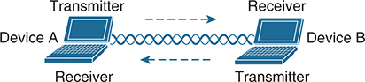

<figcaption>

<strong>图 1-2</strong> <em>双向通信</em>

</figcaption>

</figure>

由于两台设备使用相同信道，前一句中的两个短语就变得至关重要：<em>轮流</em>和<em>在其他时候发送</em>。在无线通信中，如果同时接收到多个信号，它们可能相互干扰。随着无线设备数量增加，发生干扰的可能性也会增大。例如，<a href="#ch01fig03">图 1-3</a> 展示了四台调谐到同一信道的设备，以及其中一部分或全部同时发送时可能发生的情况。

<figure class="image-c" id="ch01fig03">

<figcaption>

<strong>图 1-3</strong> <em>同时发送造成的干扰</em>

</figcaption>

</figure>

这些关于等待轮次和避免干扰的讨论，可能让你想起传统的非交换式以太网 LAN，其中多台主机连接到共享介质并共享带宽。为有效使用介质，所有主机都必须工作在半双工模式，尽量避免与正在进行的其他传输发生冲突。其结果是，在共享介质上没有任何主机能够同时发送和接收。

无线 LAN 也是如此。由于多台主机可以共享同一信道，它们也共享任一时刻的“空口时间”，也就是对该信道的访问权。因此，为使通信保持有序，在任何给定时刻都应该只有一台设备发送。基于 802.11 标准的设备在争用信道时，必须先确认信道空闲且可用，然后才能发送任何内容。

注意

IEEE 802.11 WLAN 始终是半双工的，因为站点之间的传输使用相同的频率或信道。任何时刻只能有一个站点发送，否则就会发生冲突。要实现全双工模式，站点必须在一个频率上发送，同时在另一个频率上接收，这很像全双工以太网链路的工作方式。虽然这种操作确实可行且实用，但 802.11 标准不允许全双工操作。该标准的一些修订确实提供了让多台设备同时在同一信道上发送的方法，但这超出了本书范围。

在最基本的层面上，无线介质本身没有内在的组织形式，也无法天然控制能够发送和接收帧的设备数量。任何具有无线网络适配器的设备都可以随时开机并尝试通信。无线网络至少应该有一种方法，确保使用某个信道的每台设备都能支持一组共同参数。此外，还应该能够控制哪些设备和用户可以使用无线介质，以及使用什么方法保护无线传输。

<section>

<h4 class="h4" id="ch01lev2sec1">基本服务集</h4>

解决办法是将每个无线服务区域组织为围绕固定设备形成的封闭移动设备组；设备在参与之前，必须先通告自身能力，再获得加入许可。802.11 标准将其称为<a id="key_005" href="#ref-gloss_052">基本服务集（BSS）</a>。每个 BSS 的核心都是一个无线<a id="key_001" href="#ref-gloss_021">接入点（AP）</a>，如<a href="#ch01fig04">图 1-4</a> 所示。AP 工作在<a id="key_014" href="#ref-gloss_173">基础设施模式</a>，意味着它提供构成无线网络基础设施所需的服务。AP 还会在单个无线信道上建立 BSS。AP 与 BSS 成员必须使用相同信道，才能正常通信。

由于 BSS 的运行依赖 AP，BSS 的范围由 AP 信号可用的区域决定。这称为<em>基本服务区域</em>（BSA）或<a id="key_008" href="#ref-gloss_062">蜂窝覆盖区</a>。在<a href="#ch01fig04">图 1-4</a> 中，覆盖区显示为以 AP 为中心的简单圆形阴影区域。覆盖区也可能具有其他形状，具体取决于连接 AP 的天线以及可能影响 AP 信号的物理环境。

AP 是每台希望使用 BSS 的设备的单一联系点。它通过定期发送 802.11 <a id="key_007" href="#ref-gloss_054">信标</a>帧，通告 BSS 的存在，使设备能够发现并尝试加入。信标帧包含一个称为<a id="key_023" href="#ref-gloss_303">服务集标识符（SSID）</a> 的文本字符串，用于标识 BSS。信标通常每秒广播约十次，间隔 100 ms，并包含 BSS 内使用的数据速率以及所需的厂商特定信息。如果 AP 支持多个 SSID，就会为每个 SSID 分别广播信标。

回顾一下，有线以太网设备各自拥有唯一的 MAC 地址，以便通过二层网络将帧从源发送到目的地。无线设备同样必须有唯一的 MAC 地址，才能在二层通过空中介质发送无线帧。当 AP 发送无线帧时，它使用基于自身无线电 MAC 地址的<a id="key_006" href="#ref-gloss_053">基本服务集标识符（BSSID）</a>。

<figure class="image-c" id="ch01fig04">

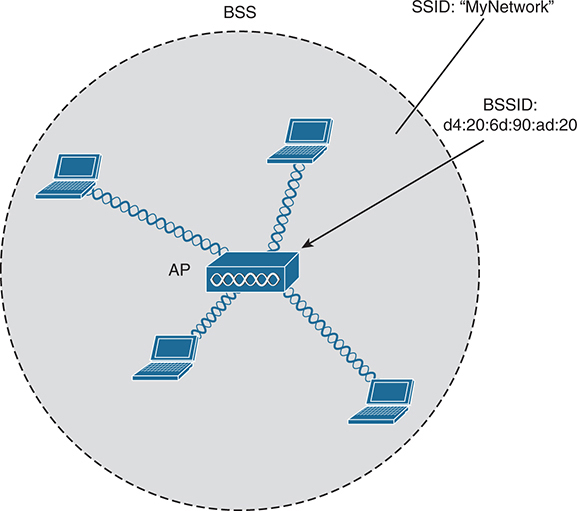

<figcaption>

<aside class="hidden" id="a01fig04">

这张表示 802.11 基本服务集（BSS）网络的图展示一个中心接入点 AP，其 BSSID 标为 d4:20:6d:90:ad:20，并连接四台不同的笔记本设备。连接以交叉波形表示，说明在标为“SSID: My Network”的网络中进行无线通信。整个网络被一个大圆圈包围，象征该 BSS 的覆盖区域。

</aside>

<strong>图 1-4</strong> <em>802.11 基本服务集</em>

</figcaption>

</figure>

提示

可以把 BSSID 看作机器可读的名称标签，用于唯一标识 BSS 的代表，也就是 AP；而 SSID 则是人类可读、但不唯一的名称标签，用于标识无线服务。

无线设备可以通过监听接收到的信标，了解范围内的 BSS。这种操作称为<a id="key_017" href="#ref-gloss_244">被动扫描</a>。设备也可以主动发送 802.11 <a id="key_019" href="#ref-gloss_269">探测请求</a>帧，发现范围内的 SSID。AP 可以发送包含大部分信标信息的探测响应帧来回答请求。

加入 BSS 成为成员称为<em>关联</em>。无线设备必须向 AP 发送 802.11 <a id="key_003" href="#ref-gloss_044">关联请求</a>帧，AP 必须发送<em>关联响应</em>帧来批准或拒绝请求。一旦关联成功，设备就成为该 BSS 的客户端，也就是 802.11 <a id="key_024" href="#ref-gloss_336">站点（STA）</a>。

接下来会怎样？只要无线客户端仍然关联着 BSS，大部分进出客户端的通信都必须<em>经过</em> AP，如<a href="#ch01fig05">图 1-5</a> 所示。当使用 BSSID 作为源地址或目的地址时，数据帧就可以被中继到 AP 或从 AP 中继出去。

你可能会疑惑，为什么所有客户端流量都必须经过 AP？为什么两个客户端不能直接向对方发送数据帧，绕过中间设备？如果允许客户端直接通信，组织和管理 BSS 的整个理念就失去了意义。先通过 AP 发送数据，可以让 BSS 保持稳定并处于控制之下。

<figure class="image-c" id="ch01fig05">

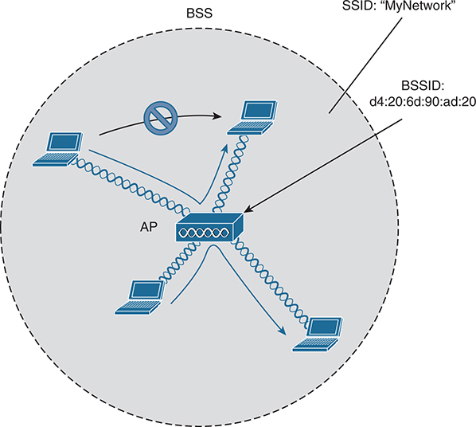

<figcaption>

<aside class="hidden" id="a01fig05">

这张基本服务集（BSS）网络图展示一个中心接入点 AP，其 BSSID 标为 d4:20:6d:90:ad:20，并连接四台不同的笔记本设备。连接以交叉波形表示，说明在标为“SSID: My Network”的网络中进行无线通信。整个网络被一个大圆圈包围，象征 BSS 的覆盖区域。AP 上方的禁止标志表示无线信号的全向特性，箭头显示方向。

</aside>

<strong>图 1-5</strong> <em>BSS 内部的流量流向</em>

</figcaption>

</figure>

提示

虽然数据帧应当经过 AP，但请记住，同一区域内监听相同信道的其他设备也能听到这些传输。毕竟，无线帧并不被限制在连接设备与 AP 的线缆中，而是在空中自由传播，范围内的任何人都可以接收。如果帧未加密，任何人都可以检查其内容。只有帧中的 BSSID 值表明预期发送方或接收方是该 AP。

</section>

<section>

<h4 class="h4" id="ch01lev2sec2">分布系统</h4>

注意，BSS 包含单个 AP，并没有明确连接到普通以太网。在这种情况下，AP 及其关联客户端组成一个独立网络。不过，AP 作为 BSS 核心的作用并不止于管理 BSS；无线客户端迟早需要与不属于该 BSS 的其他设备通信。幸运的是，AP 同时具有无线和有线能力，因此也可以上联到以太网。802.11 标准将上游有线以太网称为无线 BSS 的<a id="key_010" href="#ref-gloss_120">分布系统（DS）</a>，如<a href="#ch01fig06">图 1-6</a> 所示。

可以把 AP 看作转换网桥：来自两种不同介质（802.11 无线和 802.3 有线）的帧先被转换，再在二层桥接。简单来说，AP 负责将虚拟局域网（VLAN）映射到 SSID。在<a href="#ch01fig06">图 1-6</a> 中，AP 将 VLAN 10 映射到使用 SSID“MyNetwork”的无线 LAN。关联“MyNetwork”SSID 的客户端，看起来就像连接到了 VLAN 10。

<figure class="image-c" id="ch01fig06">

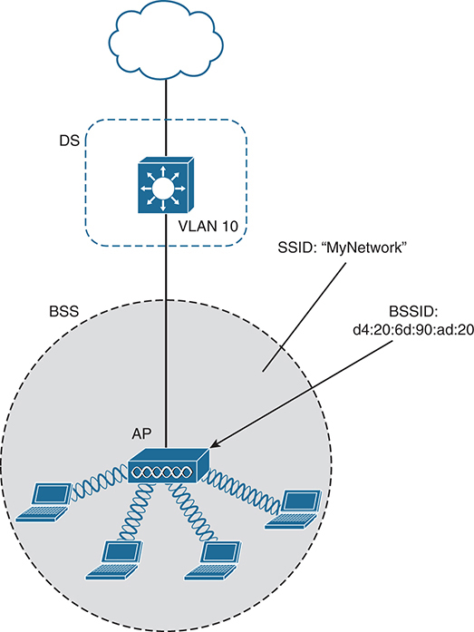

<figcaption>

<aside class="hidden" id="a01fig06">

图顶部的网络云通过 VLAN 10 连接接入点，标为“DS”的虚线矩形围绕 VLAN 10。下半部分是基本服务集（BSS）网络，中心 AP 的 BSSID 标为 d4:20:6d:90:ad:20，并连接四台不同的笔记本设备。连接用交叉波形表示，说明在标为“SSID: My Network”的网络中进行无线通信。整个网络被一个大圆圈包围，象征 BSS 的覆盖区域。

</aside>

<strong>图 1-6</strong> <em>支持 BSS 的分布系统</em>

</figcaption>

</figure>

这个概念可以扩展为将多个 VLAN 映射到多个 SSID。为此，AP 必须通过承载这些 VLAN 的中继链路连接交换机。在<a href="#ch01fig07">图 1-7</a> 中，VLAN 10、20 和 30 通过 DS 以中继方式连接 AP。AP 使用 802.1Q 标签，将 VLAN 编号映射到相应 SSID。例如，VLAN 10 映射到 SSID“MyNetwork”，VLAN 20 映射到“YourNetwork”，VLAN 30 映射到“Guest”。

实际上，当 AP 使用多个 SSID 时，它是在空中通过同一信道将 VLAN 以中继方式传送给无线客户端。客户端必须使用配置 AP 时映射到相应 VLAN 的正确 SSID。此时，AP 看起来像多个逻辑 AP，每个 BSS 对应一个，并且各有唯一的 BSSID。对于 Cisco AP，通常通过为每个 SSID 递增无线电 MAC 地址的最后一位来实现这一点。

<figure class="image-c" id="ch01fig07">

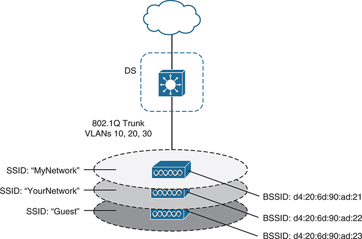

<figcaption>

<aside class="hidden" id="a01fig07">

图顶部的网络云通过三层交换机连接接入点，标注为“802.1Q Trunk VLANs 10, 20, and 30”，标为“DS”的虚线矩形围绕三层交换机。下半部分是三个基本服务集（BSS）网络，中心接入点标示不同的 SSID：My Network、Your Network 和 Guest。每个 SSID 层分别对应 BSSID d4:20:6d:90:ad:21、d4:20:6d:90:ad:22 和 d4:20:6d:90:ad:23。

</aside>

<strong>图 1-7</strong> <em>在一个 AP 上支持多个 SSID</em>

</figcaption>

</figure>

虽然 AP 可以通告并支持多个逻辑无线网络，但每个 SSID 都覆盖相同的地理区域。原因在于，AP 对它支持的每个 SSID 都使用相同的发射机、接收机、天线和信道。不过，要注意一个误区：多个 SSID 可能让人产生容量扩大了的错觉。即使无线客户端被分配到多个 SSID，它们仍必须共享同一 AP 的硬件，并在同一信道上争用空口时间。

</section>

<section>

<h4 class="h4" id="ch01lev2sec3">扩展服务集</h4>

通常，一个 AP 无法覆盖客户端可能出现的整个区域。例如，你可能需要在企业、酒店、医院或其他大型建筑的一整层提供无线覆盖。要覆盖比单个 AP 覆盖区更大的区域，只需增加 AP，并将它们分布在不同位置。

当 AP 部署在不同地理位置时，可以通过交换基础设施将它们全部互联。802.11 标准称之为<a id="key_011" href="#ref-gloss_138">扩展服务集（ESS）</a>，如<a href="#ch01fig08">图 1-8</a> 所示。

其目的是让多个 AP 协同工作，使客户端感受到一致且无缝的无线服务。理想情况下，在某个 AP 上定义的所有 SSID，也都应在 ESS 中的其他 AP 上定义；否则，客户端每次进入另一个 AP 的覆盖区时都需要重新配置，会非常繁琐、不便。

注意，<a href="#ch01fig08">图 1-8</a> 中每个覆盖区都有唯一的 BSSID，但两个覆盖区共享同一个 SSID。无论客户端位于 ESS 中何处，SSID 都保持相同，但客户端始终能区分不同 AP。在整个 ESS 中保持一致的 SSID，称为<a id="key_012" href="#ref-gloss_139">扩展服务集标识符（ESSID）</a>。

<figure class="image-c" id="ch01fig08">

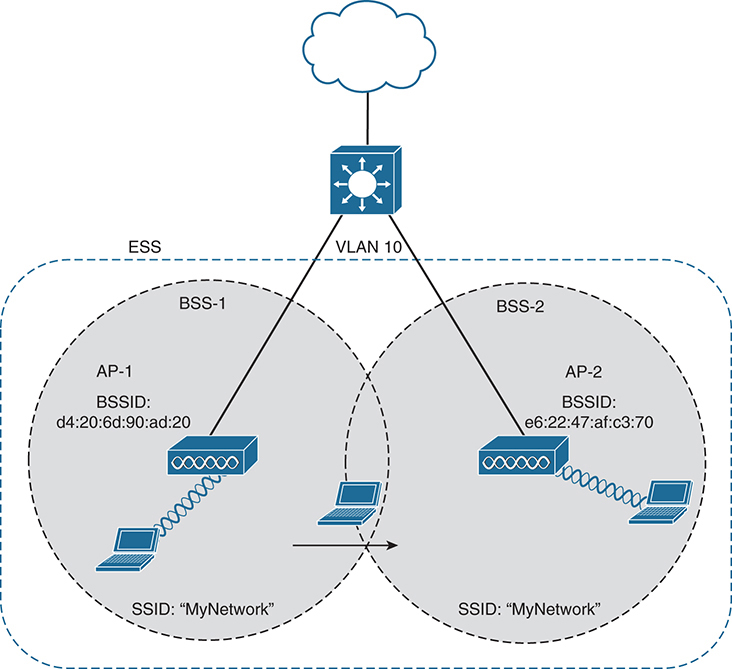

<figcaption>

<aside class="hidden" id="a01fig08">

图中的 ESS 包含两个基本服务集 BSS 1 和 BSS 2，各有自己的接入点 AP 1、AP 2，以及无线连接的笔记本设备。AP 1 属于 BSS 1，BSSID 为 d4:20:6d:90:ad:20，广播名为“My Network”的 SSID。AP 2 属于 BSS 2，BSSID 为 e6:22:47:af:c3:70，也广播名为“My Network”的 SSID。两个 BSS 在中间重叠，为覆盖范围内的设备提供无缝连接。顶部还有连接 VLAN 10 的网络云。

</aside>

<strong>图 1-8</strong> <em>通过 802.11 扩展服务集扩大无线覆盖</em>

</figcaption>

</figure>

在 ESS 中，无线客户端位于某个 AP 附近时，只能关联一个 AP。如果客户端之后移动到其他位置，可以向附近的新 AP 发送<a id="key_020" href="#ref-gloss_283">重新关联请求</a>帧，将关联转移到该 AP。该 AP 会发回重新关联响应帧。

从一个 AP 转移到另一个 AP 称为<a id="key_022" href="#ref-gloss_293">漫游</a>。请记住，每个 AP 都在自己的信道上提供 BSS，以防止 AP 之间相互干扰。客户端从一个 AP 漫游到另一个 AP 时，必须扫描可用信道，找到要漫游到的新 AP 及其 BSS。实际上，客户端既是在 BSS 之间漫游，也是在信道之间漫游。

</section>

<section>

<h4 class="h4" id="ch01lev2sec4">独立基本服务集</h4>

通常，无线网络依靠 AP 来提供组织、控制和可扩展性。但在临时场景下，这有时不可行或不方便。例如，两个人想在会议上交换电子文档，却可能找不到可用的 BSS，或者希望避免在生产网络上进行身份验证。此外，许多个人打印机能够以无线方式打印文档，而不依赖常规 BSS 或 AP。

802.11 标准允许两个或更多无线客户端直接相互通信，无须其他网络连接方式。这称为 <a id="key_002" href="#ref-gloss_028">ad hoc 无线网络</a>，或<a id="key_013" href="#ref-gloss_170">独立基本服务集（IBSS）</a>，如<a href="#ch01fig09">图 1-9</a> 所示。要使这种连接工作，其中一台设备必须率先通告网络名称和必要的无线电参数，就像 AP 一样。随后，其他设备可以按需加入。IBSS 旨在以临时、分布式方式组织，因此当设备数量超过八到十台时，可扩展性并不好。

<figure class="image-c" id="ch01fig09">

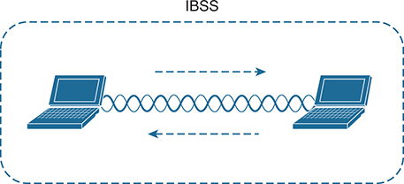

<figcaption>

<strong>图 1-9</strong> <em>802.11 独立基本服务集</em>

</figcaption>

</figure>

</section>

</section>

<section>

<h3 class="h3" id="ch01lev1sec5">其他无线拓扑</h3>

当普通 BSS 无法提供所需功能时，可以将无线 AP 配置为在非基础设施模式下运行。以下各节介绍最常见的模式。

<section>

<h4 class="h4" id="ch01lev2sec5">中继器</h4>

通常，无线网络中的每个 AP 都有一条返回 DS 或交换基础设施的有线连接。要将无线覆盖扩展到普通 AP 覆盖区之外，可以添加更多 AP 及其有线连接。在某些场景下，由于线缆距离过长、无法支持以太网通信，不能为新 AP 铺设有线连接。

在这种情况下，可以添加一个配置为<em>中继器模式</em>的 AP。无线<a id="key_021" href="#ref-gloss_288">中继器</a>接收信号，并在以自身为中心的新覆盖区内重复或重新发送该信号。其思路是将中继器放在离 AP 较远的位置，同时仍处于 AP 和远端客户端的范围内，如<a href="#ch01fig10">图 1-10</a> 所示。

如果中继器只有一组发射机和接收机，就必须工作在 AP 所用的同一信道。这样可能发生以下情况：AP 的信号被中继器接收并重新发送，随后又被 AP 接收到，导致有效吞吐量减半，因为信道忙碌的时间变成原来的两倍。为解决这一问题，一些中继器可以使用两组发射机和接收机，将原始信号与重复信号隔离在不同信道。一组专门处理 AP 覆盖区中的信号，另一组专门处理中继器自身覆盖区中的信号。

<figure class="image-c" id="ch01fig10">

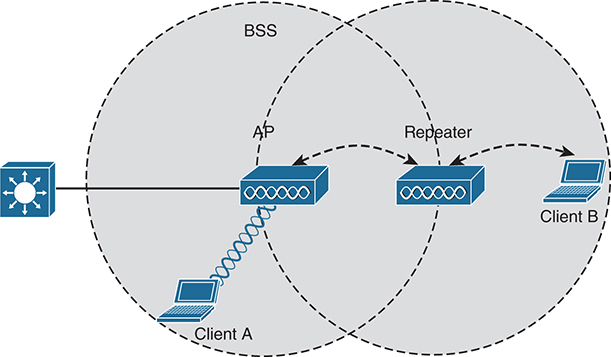

<figcaption>

<aside class="hidden" id="a01fig10">

图中两个圆圈表示 BSS 的范围。左侧圆圈标为“BSS”，其中有连接三层交换机的接入点，以及标为“Client A”的笔记本设备。右侧圆圈标为“Repeater”，表示接入点扩展后的范围，包含另一台标为“Client B”的笔记本设备。箭头表示无线中继器扩展接入点范围，让客户端 B 能够在接入点直接覆盖范围之外连接网络。

</aside>

<strong>图 1-10</strong> <em>使用无线中继器扩展 AP 的范围</em>

</figcaption>

</figure>

</section>

<section>

<h4 class="h4" id="ch01lev2sec6">工作组网桥</h4>

假设某台设备支持有线以太网链路，却无法进行无线连接。例如，一些移动医疗设备可能在设计时只配备了有线连接。虽然可以在需要时将设备插入以太网接口，但无线连接会实用得多。可以使用<a id="key_025" href="#ref-gloss_379">工作组网桥（WGB）</a>，将该设备的有线网络适配器连接到无线网络。

WGB 不提供用于无线服务的 BSS，而是成为某个 BSS 的无线客户端。实际上，WGB 充当没有无线功能设备的外置无线网络适配器。在<a href="#ch01fig11">图 1-11</a> 中，AP 提供 BSS；客户端 A 是普通无线客户端，而客户端 B 通过 WGB 与 AP 关联。

<figure class="image-c" id="ch01fig11">

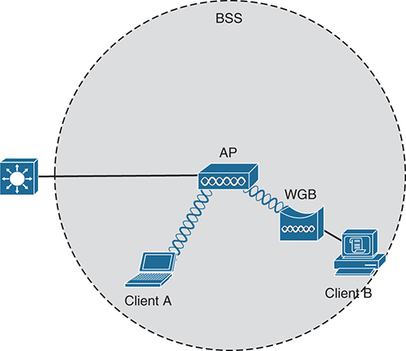

<figcaption>

<aside class="hidden" id="a01fig11">

图中的虚线圆圈表示基本服务集 BSS，中心接入点 AP 以无线方式连接标为“Client A”的笔记本设备和工作组网桥 WGB。WGB 通过线缆连接标为“Client B”的 PC。接入点还连接一台位于 BSS 范围之外的三层交换机。

</aside>

<strong>图 1-11</strong> <em>不具备无线功能的设备通过工作组网桥连接</em>

</figcaption>

</figure>

你可能遇到两种<em>工作组网桥</em>：

<ul class="sq">

<li>
<strong>通用工作组网桥（uWGB）：</strong> 可将单台有线设备桥接到无线网络。
</li>

<li>
<strong>工作组网桥（WGB）：</strong> Cisco 专有的实现，允许将多台有线设备桥接到无线网络。
</li>

</ul>

</section>

<section>

<h4 class="h4" id="ch01lev2sec7">室外网桥</h4>

可以将 AP 配置为网桥，通过一条长距离无线链路将一个 LAN 连接到另一个 LAN。室外桥接链路通常用于建筑物之间或城市之间的连接。

如果需要桥接两个地点的 LAN，可以使用<a id="key_018" href="#ref-gloss_253">点到点桥接</a>链路。无线链路两端各需要一个配置为网桥模式的 AP。网桥通常使用专用天线，将信号集中到一个方向，也就是链路远端 AP 天线的方向。这种配置可以最大化链路距离，如<a href="#ch01fig12">图 1-12</a> 所示。

<figure class="image-c" id="ch01fig12">

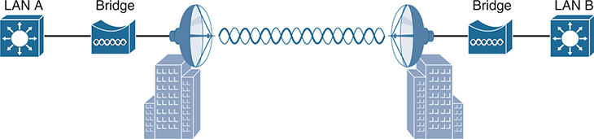

<figcaption>

<aside class="hidden" id="a01fig12">

图中标为 LAN A 和 LAN B 的两个局域网通过两台网桥连接。这些网桥连接到商业建筑顶部的塔架，表示它们之间的无线连接。

</aside>

<strong>图 1-12</strong> <em>点到点室外网桥</em>

</figcaption>

</figure>

有时需要将多个站点的 LAN 桥接在一起。点到多点桥接链路允许将中心站点桥接到其他多个站点。中心站点的网桥连接全向天线，信号在各个方向均匀发送，从而同时到达其他站点。其他各站点的网桥可以连接指向中心站点的定向天线。<a href="#ch01fig13">图 1-13</a> 展示了点到多点场景。

<figure class="image-c" id="ch01fig13">

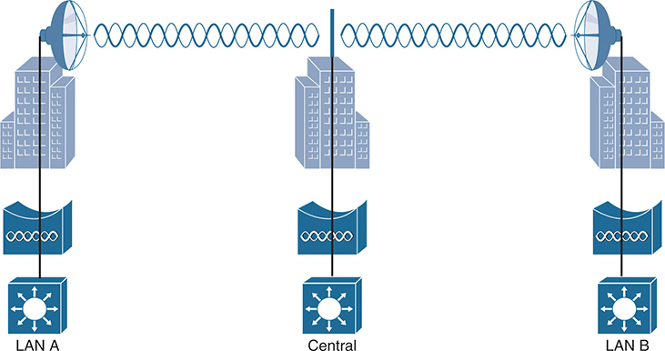

<figcaption>

<aside class="hidden" id="a01fig13">

图中有一个标为“Central”的中心站点，其三层交换机通过桥接链路连接商业站点。左侧和右侧分别是标为“LAN A”和“LAN B”的另外两个站点。每个站点都画有通过桥接链路连接商业站点的三层交换机，顶部的定向天线表示朝向中心站点的无线连接。

</aside>

<strong>图 1-13</strong> <em>点到多点室外网桥</em>

</figcaption>

</figure>

</section>

<section>

<h4 class="h4" id="ch01lev2sec8">网状网络</h4>

要在非常大的区域提供无线覆盖，为每个所需 AP 铺设以太网线缆并不总是可行。可以改用多个配置为网状模式的 AP。在网状拓扑中，无线流量利用另一条无线信道，以菊花链方式在 AP 之间桥接。

网状 AP 可以使用双无线电：一个使用某一频率范围内的信道，另一个使用不同频率范围。每个网状 AP 通常在一个信道上维持 BSS，供无线客户端关联。随后，客户端流量通常通过其他信道在 AP 之间桥接，形成回程网络。在<a id="key_015" href="#ref-gloss_208">网状网络</a>的边缘，回程流量被桥接到有线 LAN 基础设施。<a href="#ch01fig14">图 1-14</a> 展示典型的网状网络。使用 Cisco AP，可以在室内或室外构建网状网络。网状网络运行自己的动态路由协议，以确定回程流量穿过各网状 AP 的最佳路径。

<figure class="image-c" id="ch01fig14">

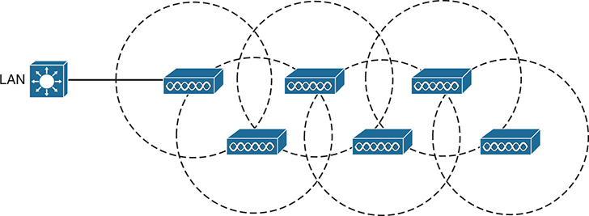

<figcaption>

<strong>图 1-14</strong> <em>典型无线网状网络</em>

</figcaption>

</figure>

</section>

</section>

<section>

<h3 class="h3" id="ch01lev1sec6">无线频段与信道</h3>

无线信号中的电磁波可以从多个方面进行测量和描述。一个基本属性是波的频率，也就是信号在一秒内振荡或完成一次完整正负周期的次数。在一秒内完成一个完整周期称为一赫兹（Hz）。Wi-Fi 信号使用的频率每秒振荡超过十亿次，即一吉赫兹（GHz）。

无线 LAN 通信使用的三个主要频率范围之一位于 2.400 至 2.4835 GHz 之间。它通常称为 <em>2.4 GHz</em> <a id="key_004" href="#ref-gloss_001">频段</a>，尽管它并未覆盖 2.4 至 2.5 GHz 的整个范围。使用频段名称比说出所包含的具体频率范围方便得多。另一个无线 LAN 频率范围通常称为 <em>5 GHz 频段</em>，因为它位于 5.150 至 5.825 GHz 之间。5 GHz 频段实际包含四个较小、彼此独立的频段，未来还可能增加更多小频段。6 GHz 频段位于 5.925 至 7.125 GHz 之间，也被分成四个较小频段。

为保持有序和兼容，频段通常被划分为多个不同的<a id="key_009" href="#ref-gloss_229">信道</a>。每个信道以信道编号标识，并分配到特定频率。只要信道由国家或国际标准组织定义，就能在各地一致地使用。<a href="#ch01fig15">图 1-15</a> 和<a href="#ch01fig16">图 1-16</a> 分别展示 2.4 GHz 与 5 GHz 频段的信道布局。

<figure class="image-c" id="ch01fig15">

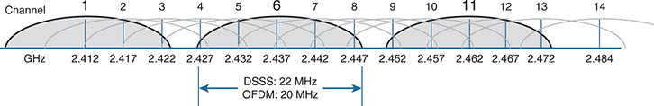

<figcaption>

<aside class="hidden" id="a01fig15">

图中的水平线上等间隔标注信道 1 至 14，下方标注对应频率，范围从 2.412 GHz 到 2.484 GHz。线条上方重叠的弧线表示各信道的范围，显示信道从中心频率向相邻信道延伸。图中还标注两种调制方式：带宽为 22 MHz 的 DSSS 和带宽为 20 MHz 的 OFDM。它们大约位于 2.427 至 2.447 GHz 的频率值下方，展示各自跨越多个频率的带宽。

</aside>

<strong>图 1-15</strong> <em>2.4 GHz 频段的信道布局</em>

</figcaption>

</figure>

<figure class="image-c" id="ch01fig16">

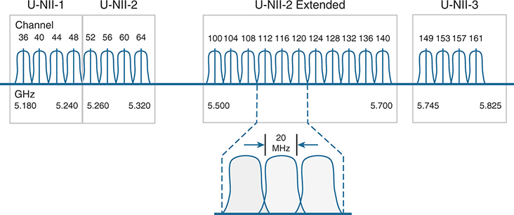

<figcaption>

<aside class="hidden" id="a01fig16">

图中的水平线上等间隔标注信道 36 至 161，下方标注对应频率，范围从 5.180 GHz 到 5.825 GHz。线条上方一系列波浪形结构象征信号振荡，峰值表示各个信道，分为 UNII 1、UNII 2、UNII 2 Extended 和 UNII 3 四部分，代表无线 LAN 通信所用 5 GHz 频段的不同部分。图中插入的细节图放大展示单个信道，强调其 20 MHz 宽度，这是 5 GHz 频段中 Wi-Fi 信道的标准宽度。

</aside>

<strong>图 1-16</strong> <em>5 GHz 频段的信道布局</em>

</figcaption>

</figure>

你可能以为 AP 可以使用任意信道编号，而不会影响使用其他信道编号的 AP。对于 5 GHz 频段，确实如此，因为分配给每个信道的频率范围不会侵入或重叠其他信道的频率。换言之，5 GHz 频段由<a id="key_016" href="#ref-gloss_229">不重叠信道</a>组成。注意<a href="#ch01fig16">图 1-16</a> 中有效信道编号并非逐一递增，而是每次增加 4。这意味着中间的信道编号，例如 37、38 和 39，无效或未被使用。6 GHz 频段的信道也采用类似编号方式。

2.4 GHz 频段则<em>并非</em>如此。每个信道都太宽，无法避免与相邻较低或较高编号的信道重叠。实际上，每个信道都覆盖了分配给超过四个连续信道的频率范围！比较<a href="#ch01fig15">图 1-15</a> 中的信道间距宽度与以信道 1、6 和 11 为中心的任一阴影信号的宽度。避免相邻信道重叠的唯一办法，是将 AP 配置为仅使用信道 1、6 和 11。虽然有 14 个信道可用，但在网络中应始终尽量使用不重叠信道。

显然，无线设备和 AP 都应该能在同一频段上工作。例如，5 GHz 无线电话只能与在 5 GHz 信道上提供 Wi-Fi 服务的 AP 通信。此外，设备与 AP 还必须在所支持的 802.11 标准部分上保持兼容。

随着 IEEE 802.11 Wi-Fi 标准演进发展，人们会提出具备新功能的修订案。在这些修订被接受并整合到下一代完整 802.11 标准之前，它们以“802.11”后跟一个或两个字母后缀命名。即便整合之后，仍经常使用修订后缀来区分具体功能。

你应该了解几个定义重要特性的修订，例如数据速率、发送和接收数据的方法等。对于 CCNA 200-301 考试，你应知道<a href="#ch01tab02">表 1-2</a> 中列出的各项修订使用哪个频段。ENCOR 300-401 考试会进一步考察每项修订使用的数据速率、调制和编码方式。

<figure class="table" id="ch01tab02" tabindex="0">

<figcaption>

<strong>表 1-2</strong> 部分 IEEE 802.11 修订的基本特征

</figcaption>

<table class="all">

<tbody>

<tr>

<th class="th">
修订
</th>

<th class="th">
2.4 GHz
</th>

<th class="th">
5 GHz
</th>

<th class="th">
6 GHz
</th>

<th class="th">
最大数据速率
</th>

<th class="th">
说明
</th>

</tr>

<tr>

<td class="border">
802.11-1997
</td>

<td class="border">
是
</td>

<td class="border">
否
</td>

<td class="border">
否
</td>

<td class="border">
2 Mbps
</td>

<td class="border">
1997 年批准的原始 802.11 标准
</td>

</tr>

<tr>

<td class="border">
802.11b
</td>

<td class="border">
是
</td>

<td class="border">
否
</td>

<td class="border">
否
</td>

<td class="border">
11 Mbps
</td>

<td class="border">
1999 年推出
</td>

</tr>

<tr>

<td class="border">
802.11g
</td>

<td class="border">
是
</td>

<td class="border">
否
</td>

<td class="border">
否
</td>

<td class="border">
54 Mbps
</td>

<td class="border">
2003 年推出
</td>

</tr>

<tr>

<td class="border">
802.11a
</td>

<td class="border">
否
</td>

<td class="border">
是
</td>

<td class="border">
否
</td>

<td class="border">
54 Mbps
</td>

<td class="border">
1999 年推出
</td>

</tr>

<tr>

<td class="border">
802.11n
</td>

<td class="border">
是
</td>

<td class="border">
是
</td>

<td class="border">
否
</td>

<td class="border">
600 Mbps
</td>

<td class="border">
HT（高吞吐量），2009 年推出
</td>

</tr>

<tr>

<td class="border">
802.11ac
</td>

<td class="border">
否
</td>

<td class="border">
是
</td>

<td class="border">
否
</td>

<td class="border">
6.93 Gbps
</td>

<td class="border">
VHT（甚高吞吐量），2013 年推出
</td>

</tr>

<tr>

<td class="border">
802.11ax
</td>

<td class="border">
是
</td>

<td class="border">
是
</td>

<td class="border">
是
</td>

<td class="border">
802.11ac 的 4 倍
</td>

<td class="border">
高效率无线
</td>

</tr>

</tbody>

</table>

</figure>

802.11 的各项修订并不相互排斥。无线客户端设备和 AP 可以兼容一项或多项修订；但只有双方都支持并同意使用相同修订时，客户端与 AP 才能通信。

查看无线设备的规格时，你可能会发现，所支持的修订以单个字符串列出，各项之间用斜杠分隔。例如，支持 802.11b/g 的设备同时支持 802.11b 和 802.11g。支持 b/g/a/n/ac 的设备则支持 802.11b、802.11g、802.11a、802.11n 和 802.11ac。应熟悉<a href="#ch01tab02">表 1-2</a>，以便根据设备支持的 802.11 修订，判断它可以使用哪些频段。

如果设备能在两个频段上工作，它如何决定使用哪个频段？AP 通常可以同时在两个频段上工作，以支持各频段上可能存在的客户端。不过，无线客户端通常一次只在一个频段上关联 AP，同时扫描两个频段以寻找潜在 AP。连接 AP 所用的频段由操作系统、无线适配器驱动程序和其他内部配置决定。无线客户端可以先在一个频段上与 AP 建立关联，如果另一个频段的信号条件更好，再切换过去。

注意

Cisco AP 可以具有多个无线电单元，也就是多组发射机和接收机，以便在每个受支持频段上提供 BSS。有些型号具有两个 5 GHz 无线电单元，可以配置为同时在两个不同信道上运行 BSS，为同一区域中更高密度的用户提供无线覆盖。

可以将 Cisco AP 配置为在特定信道编号上工作。随着 AP 数量增加，手动分配信道会变得困难。幸运的是，Cisco 无线架构能够自动、动态地为每个 AP 分配合适的信道。相关架构将在<a href="v2-02.html#ch02">第 2 章</a>“<a href="v2-02.html#ch02">分析 Cisco 无线架构</a>”中介绍，动态信道分配则属于 ENCOR 300-401 考试范围。

在开放空间中，2.4 GHz 频段的可用射频信号比 5 GHz 或 6 GHz 频段传播得更远。2.4 GHz 信号也往往比 5 GHz 或 6 GHz 信号更容易穿透室内墙壁和物体。不过，2.4 GHz 频段通常聚集了更多无线设备。请记住，只有三个不重叠信道可用，因此附近其他 AP 使用相同信道的可能性更大。相比之下，5 GHz 和 6 GHz 频段有更多可用信道，因此信道较不拥挤，受到的干扰也较少。

随着 Wi-Fi 演进，802.11 标准不断扩展、新修订不断推出，跟踪这些变化变得困难。Wi-Fi 联盟推出了一组简化名称，用于标识各代 Wi-Fi，如<a href="#ch01tab03">表 1-3</a> 所示。Wi-Fi 0 表示最早形式的原始 802.11 标准，随后列出每一代、支持的频段和所使用的主要 802.11 修订。无线产品经常按这些代际名称命名或描述。例如，某些 AP 或客户端标为“Wi-Fi 6E”，这仅表示它们可以使用 IEEE 802.11ax 在全部三个频段上工作。

<figure class="table" id="ch01tab03" tabindex="0">

<figcaption>

<strong>表 1-3</strong> Wi-Fi 联盟的代际名称

</figcaption>

<table class="all">

<tbody>

<tr>

<th class="th">
Wi-Fi 联盟名称
</th>

<th class="th">
支持的频段
</th>

<th class="th">
支持的 IEEE 802.11 修订
</th>

</tr>

<tr>

<td class="border">
Wi-Fi 0
</td>

<td class="border">
2.4
</td>

<td class="border">
802.11（原始标准）
</td>

</tr>

<tr>

<td class="border">
Wi-Fi 1
</td>

<td class="border">
2.4
</td>

<td class="border">
802.11b
</td>

</tr>

<tr>

<td class="border">
Wi-Fi 2
</td>

<td class="border">
5
</td>

<td class="border">
802.11a
</td>

</tr>

<tr>

<td class="border">
Wi-Fi 3
</td>

<td class="border">
2.4
</td>

<td class="border">
802.11g
</td>

</tr>

<tr>

<td class="border">
Wi-Fi 4
</td>

<td class="border">
2.4, 5
</td>

<td class="border">
802.11n
</td>

</tr>

<tr>

<td class="border">
Wi-Fi 5
</td>

<td class="border">
5
</td>

<td class="border">
802.11ac
</td>

</tr>

<tr>

<td class="border">
Wi-Fi 6
</td>

<td class="border">
2.4, 5
</td>

<td class="border">
802.11ax
</td>

</tr>

<tr>

<td class="border">
Wi-Fi 6E
</td>

<td class="border">
2.4, 5, 6
</td>

<td class="border">
802.11ax
</td>

</tr>

<tr>

<td class="border">
Wi-Fi 7
</td>

<td class="border">
2.4, 5, 6
</td>

<td class="border">
802.11be
</td>

</tr>

</tbody>

</table>

</figure>

</section>

</section>

<section class="ccna-source ccna-appendix" aria-label="答案解析与术语表">
<section data-epub-type="chapter">

<h2 class="h2" id="ref-appc">附录 C</h2>

<h2 class="h2a">自测题答案</h2>

<section>

<h3 class="h3" id="ref-appclev1sec1">第 1 章</h3>

<strong><a id="ref-ques1_1" href="#quess1_1">1</a>．</strong> C。IEEE 802.3 标准定义以太网，802.11 定义 Wi-Fi。

<strong><a id="ref-ques1_2" href="#quess1_2">2</a>．</strong> B。WLAN 要求半双工操作，因为所有站点都必须争用信道才能发送帧。

<strong><a id="ref-ques1_3" href="#quess1_3">3</a>．</strong> C。AP 提供基本服务集 BSS。BSA 不正确，因为它表示基本服务区域，也就是 BSS 的覆盖区。BSD 不正确，因为它与无线无关。IBSS 不正确，因为它是独立 BSS，也就是 ad hoc 网络，根本不需要 AP 或 BSS。

<strong><a id="ref-ques1_4" href="#quess1_4">4</a>．</strong> B。位于 BSS 或覆盖区核心的 AP 使用基本服务集标识符 BSSID 来标识自身及其 BSS。它也使用 SSID 标识无线网络，但 SSID 并非 AP 或 BSS 独有。最后，无线电 MAC 地址是 BSSID 值的基础，但可以修改该值，为 AP 支持的每个 SSID 形成相应 BSSID。以太网 MAC 地址通常唯一，但它关联 AP 的有线部分，并不标识 AP 及其 BSS。

<strong><a id="ref-ques1_5" href="#quess1_5">5</a>．</strong> B。工作组网桥作为无线客户端运行，同时桥接进出其所连接有线设备的流量。

<strong><a id="ref-ques1_6" href="#quess1_6">6</a>．</strong> B。在网状网络中，每个网状 AP 都建立独立的 BSS。AP 通过无线回程链路而非有线以太网，在彼此之间中继客户端流量。因此，不需要为每个 AP 铺设以太网线缆。

<strong><a id="ref-ques1_7" href="#quess1_7">7</a>．</strong> D 和 E。Wi-Fi 通常使用 2.5 GHz 和 5 GHz 频段。

<strong><a id="ref-ques1_8" href="#quess1_8">8</a>．</strong> C 和 D。在 2.4 GHz 频段中，连续编号的信道太宽，无法避免重叠。只有信道 1、6 和 11 之间的间隔足够大，能够避免相互重叠。在 5 GHz 频段中，所有信道都被视为不重叠信道。（注意，5 GHz 信道以 4 的倍数编号，这提供了足够的间隔来避免重叠。）

</section>

</section>

<section id="ref-glossary"><h2 class="h2a">术语表</h2>
<strong>2.4 GHz 频段</strong> 用于无线 LAN 通信的 2.400 至 2.4835 GHz 频率范围。

<strong>接入点（AP）</strong> 在其覆盖区域或覆盖区内为客户端提供无线服务的设备，同时连接无线 LAN 和有线以太网 LAN。

<strong>ad hoc 无线网络</strong> <em>参见</em><a href="#ref-gloss_170">独立基本服务集（IBSS）</a>。

<strong>关联请求</strong> 无线客户端发送给 AP 的 802.11 帧，用于请求与该 AP 建立关联。

<strong>基本服务集（BSS）</strong> 由一个 AP 向一个或多个关联客户端提供的无线服务。

<strong>基本服务集标识符（BSSID）</strong> 用于标识提供 BSS 的 AP 的唯一 MAC 地址。

<strong>信标</strong> AP 定期广播的 802.11 帧，用于通告 SSID 的存在。在每个正在使用的信道上，每个 SSID 都分别发送信标。

<strong>蜂窝覆盖区</strong> AP 提供无线覆盖的区域，也称为基本服务区域。

<strong>分布系统（DS）</strong> 连接 AP 并在有线与无线网络之间传送流量的有线以太网。

<strong>扩展服务集（ESS）</strong> 通过共同的交换基础设施连接的多个 AP。

<strong>扩展服务集标识符（ESSID）</strong> 在整个 ESS 中一致使用的 SSID。

<strong>独立基本服务集（IBSS）</strong> 两台或更多设备在没有 AP 或 BSS 的情况下形成的临时无线网络，也称为 ad hoc 网络。

<strong>基础设施模式</strong> AP 为无线客户端提供 BSS 时的工作模式。

<strong>网状网络</strong> 无须有线以太网布线即可覆盖较大区域的 AP 网络；客户端流量通过回程网络在 AP 之间桥接。

<strong>不重叠信道</strong> 频段中依次排列的信道编号，各信道的频率范围足够窄，不会与上方或下方的下一个信道重叠。

<strong>被动扫描</strong> 无线客户端尝试通过监听附近 AP 的信标帧来发现它们时采用的技术。

<strong>点到点网桥</strong> 配置为将有线网络桥接到视距路径远端另一台配对网桥的 AP。

<strong>探测请求</strong> 无线客户端通过主动请求响应来发现附近 AP 的技术。

<strong>重新关联请求</strong> 漫游中的无线客户端发送给 AP 的 802.11 帧，用于请求将现有关联转移到新 AP。

<strong>中继器</strong> 重复或重新发送其接收信号的设备，从而有效扩大无线覆盖区域。

<strong>漫游</strong> 无线客户端改变位置时，从一个 AP 移动到另一个 AP 所使用的过程。

<strong>服务集标识符（SSID）</strong> 用于标识无线网络的文本字符串。

<strong>站点（STA）</strong> 关联到 BSS 的 802.11 客户端设备。

<strong>工作组网桥（WGB）</strong> 配置为在有线设备和无线网络之间桥接的 AP。WGB 作为无线客户端运行。

</section>
</section>


<nav class="ccna-chapter-nav" aria-label="章节导航"><a href="v1-29.html">← 上一章</a><a href="v2-02.html">下一章 →</a></nav>
