
<a href="{{ '/subjects/CCNA/' | relative_url }}">← 返回 CCNA 目录</a>

第二卷 · 无线局域网

<nav class="ccna-chapter-nav" aria-label="章节导航"><a href="v2-01.html">← 上一章</a><a href="v2-03.html">下一章 →</a></nav>



<section data-epub-type="chapter">

<h2 class="h2" id="ch02">第 2 章</h2>

<h2 class="h2a">分析 Cisco 无线架构</h2>

本章涵盖以下考试主题：

2.0 网络接入

2.6 比较 Cisco 无线架构和 AP 模式

在<a href="v2-01.html#ch01">第 1 章</a>“<a href="v2-01.html#ch01">无线网络基础</a>”中，你学习了单个接入点 AP 如何为一个覆盖区提供基本服务集 BSS，以及多个 AP 如何连接起来形成扩展服务集 ESS，以构建更大的网络。本章将进一步介绍将 AP 联网、服务于企业的不同方法或架构。你还将了解，为什么某些架构比其他架构更容易扩展，以及如何管理各种无线网络架构。

学习本章时，请思考各类架构如何应用于具体环境：管理、部署和排查网络有多容易，如何控制 AP，以及数据如何在网络中传送。

<section>

<h3 class="h3" id="ch02lev1sec1">自测</h3>

如果你希望根据得分决定在本章投入多少时间，可以完成这组自测题（在此作答，或使用 PTP 软件）。各题答案的选项字母列在自测题之后的页面底部。书末和配套网站上的<a href="#ref-appc">附录 C</a>都包含答案及解析。你也可以在 PTP 测试软件中找到答案及解析。

<figure class="table" id="ch02tab01" tabindex="0">

<figcaption>

<strong>表 2-1</strong> 章节与题目对应表

</figcaption>

<table class="all">

<tbody>

<tr>

<th class="th">
基础知识小节
</th>

<th class="th">
题目
</th>

</tr>

<tr>

<td class="border">
自治 AP 架构
</td>

<td class="border">
1
</td>

</tr>

<tr>

<td class="border">
基于云的 AP 架构
</td>

<td class="border">
2
</td>

</tr>

<tr>

<td class="border">
分离 MAC 架构
</td>

<td class="border">
3–5
</td>

</tr>

<tr>

<td class="border">
比较 Cisco 无线 LAN 控制器部署
</td>

<td class="border">
6
</td>

</tr>

<tr>

<td class="border">
Cisco AP 模式
</td>

<td class="border">
7, 8
</td>

</tr>

</tbody>

</table>

</figure>

<strong><a id="quess2_1" href="#ques2_1a">1</a>．</strong> 以下哪个术语最适合描述以独立、自主方式工作的 Cisco 无线接入点？

<ol class="lower-alpha">

<li>
自治 AP
</li>

<li>
独立 AP
</li>

<li>
轻量级 AP
</li>

<li>
嵌入式 AP
</li>

</ol>

<strong><a id="quess2_2" href="#ques2_2a">2</a>．</strong> 以下哪种说法最准确地描述 Cisco Meraki 基于云的 AP？

<ol class="lower-alpha">

<li>
加入 WLC 的自治 AP
</li>

<li>
集中管理的自治 AP
</li>

<li>
加入 WLC 的轻量级 AP
</li>

<li>
集中管理的轻量级 AP
</li>

</ol>

<strong><a id="quess2_3" href="#ques2_3a">3</a>．</strong> “轻量级”接入点参与的是以下哪一种架构？

<ol class="lower-alpha">

<li>
Light-MAC
</li>

<li>
Tunnel-MAC
</li>

<li>
Split-MAC
</li>

<li>
Big-MAC
</li>

</ol>

<strong><a id="quess2_4" href="#ques2_4a">4</a>．</strong> 接入点如何与无线 LAN 控制器通信？

<ol class="lower-alpha">

<li>
通过 IPsec 隧道
</li>

<li>
通过 CAPWAP 隧道
</li>

<li>
通过 GRE 隧道
</li>

<li>
直接通过二层通信
</li>

</ol>

<strong><a id="quess2_5" href="#ques2_5a">5</a>．</strong> 对于处于默认本地模式的 Cisco AP，要支持分别绑定到三个 VLAN 的三个 SSID，不需要以下哪一项？

<ol class="lower-alpha">

<li>
承载三个 VLAN 的中继链路
</li>

<li>
绑定到单个 VLAN 的接入链路
</li>

<li>
连接到三个 VLAN 的 WLC
</li>

<li>
通往 WLC 的 CAPWAP 隧道
</li>

</ol>

<strong><a id="quess2_6" href="#ques2_6a">6</a>．</strong> 对于拥有约 3000 个 AP 的大型企业，以下哪种 WLC 部署模式最合适？

<ol class="lower-alpha">

<li>
Cisco Mobility Express
</li>

<li>
嵌入式
</li>

<li>
集中式
</li>

<li>
基于云
</li>

</ol>

<strong><a id="quess2_7" href="#ques2_7a">7</a>．</strong> 如果某 Cisco AP 为无线客户端提供至少一个 BSS，它使用以下哪种模式？

<ol class="lower-alpha">

<li>
本地（Local）
</li>

<li>
正常（Normal）
</li>

<li>
监控（Monitor）
</li>

<li>
客户端（Client）
</li>

</ol>

<strong><a id="quess2_8" href="#ques2_8a">8</a>．</strong> 关于 Cisco AP 模式，以下哪项说法正确？

<ol class="lower-alpha">

<li>
AP 可以同时在多种模式下工作。
</li>

<li>
AP 只有一种可能的工作模式。
</li>

<li>
Run 模式是默认模式。
</li>

<li>
SE-Connect 模式用于频谱分析。
</li>

</ol>

自测答案：

<strong><a id="ques2_1a" href="#ref-ques2_1">1</a></strong> A

<strong><a id="ques2_2a" href="#ref-ques2_2">2</a></strong> B

<strong><a id="ques2_3a" href="#ref-ques2_3">3</a></strong> C

<strong><a id="ques2_4a" href="#ref-ques2_4">4</a></strong> B

<strong><a id="ques2_5a" href="#ref-ques2_5">5</a></strong> A

<strong><a id="ques2_6a" href="#ref-ques2_6">6</a></strong> C

<strong><a id="ques2_7a" href="#ref-ques2_7">7</a></strong> A

<strong><a id="ques2_8a" href="#ref-ques2_8">8</a></strong> D

</section>

<section>

<h3 class="h3box" id="ch02lev1sec2">基础知识</h3>

</section>

<section>

<h3 class="h3" id="ch02lev1sec3">自治 AP 架构</h3>

接入点的主要功能，是将空中的无线数据桥接到普通有线网络。AP 可以接受多个无线客户端的“连接”，使它们成为 LAN 成员，就像这些客户端使用有线连接一样。

AP 充当集中的接入位置，这也是接入点名称的由来，控制客户端对无线 LAN 的访问。<a id="key_026" href="#ref-gloss_049">自治 AP</a> 自成一体，同时配备有线和无线硬件，因此可以在 AP 本地将无线客户端关联终结到有线连接。AP 及其数据连接必须分布在覆盖区域和网络各处。

自治 AP 提供一个或多个功能完整、独立运行的基本服务集 BSS。它们也是交换网络的自然延伸，在接入层将无线服务集标识符 SSID 连接到有线虚拟 LAN，也就是 VLAN。<a href="#ch02fig01">图 2-1</a> 展示基本架构；虽然底部只画了四个 AP，但典型企业网络可能包含数百甚至数千个 AP。

<figure class="image-c" id="ch02fig01">

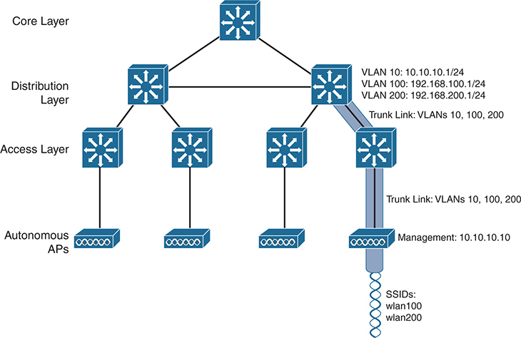

<figcaption>

<aside class="hidden" id="a02fig01">

图中展示分层网络结构，共四层：核心层、分布层、接入层和自治接入点。顶部核心层的三层交换机连接下方分布层的两台三层交换机。分布层每台三层交换机连接接入层图标下的两台三层交换机。接入层下方有四个自治 AP，分别连接接入层的各台三层交换机。三层交换机标有 VLAN 10: 10.10.10.1/24、VLAN 100: 192.168.100.1/24 和 VLAN 10: 10.10.10.1/24 等结构信息。右侧分布层到右侧自治 AP 之间展示一条中继链路，标注为“Trunk Links: VLANs 10, 100, 200”。自治 AP 层标注管理 IP 地址 10.10.10.10，下方列出 SSID wlan100 和 wlan200。

</aside>

<strong>图 2-1</strong> <em>采用自治 AP 的无线网络架构</em>

</figcaption>

</figure>

自治 AP 究竟需要什么才能成为网络的一部分？<a href="#ch02fig01">图 2-1</a> 中的无线网络包含两个 SSID：wlan100 和 wlan200，分别对应有线 VLAN 100 和 200。如阴影链路所示，这些 VLAN 必须从通常进行路由的分布层交换机，以中继方式传送到接入层，然后再通过中继链路延伸到 AP。

自治 AP 为数据在无线和有线网络之间传送提供了一条简短的路径。数据只需穿过 AP，就能到达另一侧网络。关联同一自治 AP 的两个无线用户，可以通过 AP 相互通信，无须将数据上传到有线网络。学习本章其余无线架构时，请留意每种架构所需的数据路径。

自治 AP 还必须配置管理 IP 地址，即<a href="#ch02fig01">图 2-1</a> 中的 10.10.10.10，以便进行远程管理。毕竟，你需要配置 SSID、VLAN，以及信道和发射功率等许多射频参数。管理地址通常不属于任何数据 VLAN，因此必须在中继链路中增加专用管理 VLAN，例如 VLAN 10，以便到达 AP。除非使用 Cisco Prime Infrastructure 或 Cisco Catalyst Center 等管理平台，否则必须单独配置和维护每个 AP。

由于数据 VLAN 和管理 VLAN 可能需要延伸到每个自治 AP，随着网络扩展，网络配置和效率问题可能变得棘手。例如，你很可能希望在许多 AP 上提供相同 SSID，使无线客户端几乎在任何位置、或在任意两个 AP 之间漫游时，都可以关联该 SSID。你可能还希望将对应的 VLAN 和 IP 子网延伸到每个 AP，使客户端无须在每次新关联时请求新 IP 地址。

由于 SSID 及其 VLAN 必须在二层扩展，因此需要考虑它们如何贯穿交换网络。<a href="#ch02fig02">图 2-2</a> 中的阴影链路展示单个 VLAN 在数据平面上的延伸范围。从上到下观察 VLAN 100 如何贯穿网络。VLAN 100 在分布层进行路由，必须通过中继链路传送到接入层交换机，再到达每个自治 AP。实际上，VLAN 100 必须端到端地跨越整个基础设施，这通常被认为是不良做法。

这种方法听起来可能很直接，直到你需要添加一个新 VLAN，并配置网络中的每台交换机和 AP 来承载、支持它。更糟的是，假设各层交换机之间有冗余链路，那么每台交换机上运行的生成树协议 STP 就成为防止形成桥接环路、破坏网络的关键因素。基于这些原因，客户端在自治 AP 之间漫游通常被限制在二层域，也就是单个 VLAN 的范围内。随着无线网络扩大，基础设施越来越难以正确配置，效率也会降低。

<figure class="image-c" id="ch02fig02">

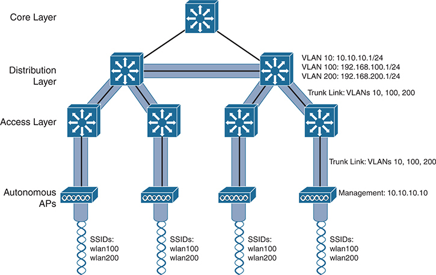

<figcaption>

<aside class="hidden" id="a02fig02">

图中展示分层网络结构，共四层：核心层、分布层、接入层和自治接入点。顶部核心层的三层交换机连接下方分布层的两台三层交换机。分布层每台三层交换机连接接入层图标下的两台三层交换机。接入层下方四个自治 AP 分别连接接入层各台三层交换机。三层交换机标有 VLAN 10: 10.10.10.1/24、VLAN 100: 192.168.100.1/24 和 VLAN 10: 10.10.10.1/24 等信息。从分布层到自治 AP 的层间中继链路标为承载 VLAN 10、100 和 200。自治 AP 层标注管理 IP 地址 10.10.10.10，各列下方都列出 SSID wlan100 和 wlan200。

</aside>

<strong>图 2-2</strong> <em>数据 VLAN 在自治 AP 网络中的延伸范围</em>

</figcaption>

</figure>

</section>

<section>

<h3 class="h3" id="ch02lev1sec4">基于云的 AP 架构</h3>

回顾一下，自治 AP 需要相当多的配置和管理。随着无线网络增长，为帮助管理越来越多的自治 AP，可以在企业内的中心位置部署 Cisco Catalyst Center（也称为 DNA Center）等 AP 管理平台。不过，这个平台同样需要购买、配置和维护。

更简单的方法是采用<a id="key_029" href="#ref-gloss_076">基于云的 AP</a> 架构，将 AP 管理功能从企业内部转移到互联网云中。Cisco Meraki 基于云，为使用 Meraki 产品构建的无线、交换和安全网络提供集中管理。例如，可以通过云网络服务配置和管理 AP、监控无线性能与活动、生成报告等。

在 Meraki 云注册之后，Cisco Meraki AP 就可以自动部署。每个 AP 开机后都会联系云端并自动配置。从那时起，可以通过 Meraki 云仪表板管理 AP。

<a href="#ch02fig03">图 2-3</a> 展示基本的云架构。注意，该网络的布局与自治 AP 网络完全相同，因为云网络中的 AP 同样都是自治 AP。最明显的区别在于，所有 AP 都从云端集中管理、控制和监控。

<figure class="image-c" id="ch02fig03">

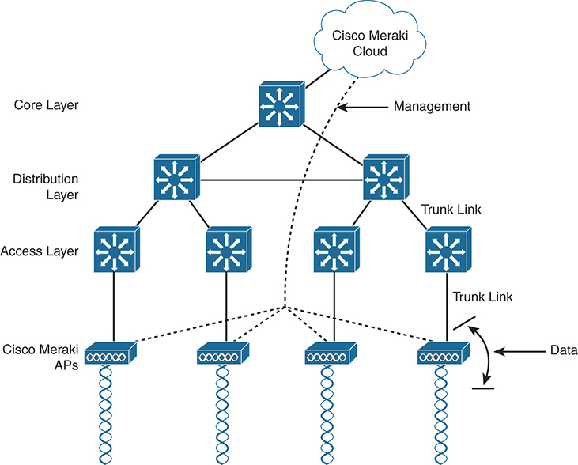

<figcaption>

<aside class="hidden" id="a02fig03">

图中展示三层分层网络结构：核心层、分布层和接入层。顶部核心层的三层交换机连接下方分布层的两台三层交换机。分布层每台三层交换机连接接入层的两台三层交换机。接入层下方，四个 Cisco Meraki AP 分别连接接入层各台三层交换机。标为“Cisco Meraki Cloud”的网络云连接核心层三层交换机，并分别连接每个 Meraki AP。从分布层到 Cisco Meraki AP 的各层之间画有中继链路。箭头表示数据从 Meraki AP 向上传送。

</aside>

<strong>图 2-3</strong> <em>Cisco Meraki 基于云的无线网络架构</em>

</figcaption>

</figure>

通过云端，可以向企业中的 AP 推送软件升级和配置更改。Cisco Meraki 云还提供智能功能，自动指示每个 AP 使用哪个信道和发射功率等级。它还可以从所有 AP 收集射频干扰、监听到的恶意或意外无线设备，以及无线使用统计等信息。

最后，关于云架构还有几点需要注意。从无线网络到有线网络的数据路径很短，自治 AP 直接连接这两个网络。进出无线客户端的数据无须上传到云端再返回；云仅用于将管理功能引入数据平面。

还要注意，<a href="#ch02fig03">图 2-3</a> 的网络包含两条不同路径，一条用于数据流量，另一条用于管理流量，分别对应以下两种功能：

<ul class="sq">

<li>
<strong>控制平面：</strong> 用于控制、配置、管理和监控 AP 本身的流量。
</li>

<li>
<strong>数据平面：</strong> 经过 AP 的终端用户流量。
</li>

</ul>

在后面各节讨论其他架构时，这种划分将非常重要。

</section>

<section>

<h3 class="h3" id="ch02lev1sec5">分离 MAC 架构</h3>

由于自治 AP 确实是自主运行的，管理它们的射频操作可能相当困难。作为网络管理员，你负责选择和配置每个 AP 使用的信道，并检测、处理可能造成干扰的恶意 AP。你还必须管理发射功率等参数，确保无线覆盖充分、不会过度重叠，也不存在覆盖空洞，即使某个 AP 的无线电发生故障也是如此。

无线网络安全管理也可能很困难。每个自治 AP 都处理自己的安全策略，无线和有线网络之间没有集中的入口。这意味着，没有方便的位置来监控流量并实施入侵检测和防御、服务质量、带宽监管等功能。

为克服分布式自治 AP 的局限，必须将自治 AP 中的许多功能转移到某个中心位置。在<a href="#ch02fig04">图 2-4</a> 中，左侧自治 AP 执行的大部分活动被分为两组：上方的管理功能和下方的实时处理。

<figure class="image-c" id="ch02fig04">

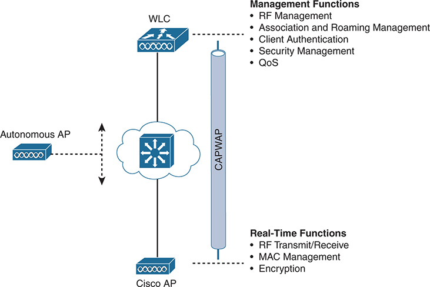

<figcaption>

<aside class="hidden" id="a02fig04">

图左侧，自治接入点通过虚线连接一条双向垂直箭头，表示该 AP 与其他网络组件之间的双向通信。右侧网络云中的三层交换机，连接上方无线 LAN 控制器 WLC 和下方 Cisco AP，表示网络基础设施。从 WLC 到 Cisco AP 的连接路径标为 CAPWAP，即无线接入点控制与配置。WLC 的管理功能包括射频管理、关联与漫游管理、客户端身份验证、安全管理和 QoS。Cisco AP 的实时功能包括射频发送／接收、MAC 管理和加密。

</aside>

<strong>图 2-4</strong> <em>自治接入点与 Cisco 接入点的比较</em>

</figcaption>

</figure>

实时处理涉及发送和接收 802.11 帧、信标及探测消息。802.11 数据加密也以逐包方式实时处理。AP 必须在称为<a id="key_037" href="#ref-gloss_206">介质访问控制（MAC）层</a>的底层与无线客户端交互。这些功能必须保留在离客户端最近的 AP 硬件中。

管理功能并不是通过射频信道处理帧所必需的组成部分，而是应当集中管理的事项。因此，可以将这些功能移到远离 AP、位于中心位置的平台上。

自治 AP 的功能被拆分后，Cisco AP 硬件只执行实时的 802.11 操作。与传统自治 AP 相比，它的软件映像和本地智能经过精简，也就是轻量化。

管理功能通常由<a id="key_040" href="#ref-gloss_378">无线 LAN 控制器（WLC）</a> 执行，它控制许多 Cisco AP，如<a href="#ch02fig04">图 2-4</a> 右下部分所示。注意，AP 只保留第一层和第二层的职责，在这些层中将帧移入或移出射频域。对于其他所有 WLAN 功能，例如验证用户身份、管理安全策略，甚至选择射频信道和输出功率，AP 都完全依赖 WLC。

注意

请记住，Cisco AP 通常无法独立运行，它非常依赖网络中某处的 WLC。这意味着，AP 如果失去与其 WLC 的连接，就会停止正常工作。唯一例外是本章后面介绍的 FlexConnect AP 模式。

AP 与 WLC 之间的这种分工称为<a id="key_038" href="#ref-gloss_330">分离 MAC 架构</a>，普通 MAC 操作被拆分到两个不同位置。网络中的每个 AP 都如此：每个 AP 都必须启动并绑定到 WLC，才能支持无线客户端。WLC 成为支持分散在网络各处 AP 的中心枢纽。

AP 如何与 WLC 绑定，组成一个完整可用的接入点？两台设备之间必须使用隧道协议，承载 802.11 相关消息及客户端数据。请记住，AP 和 WLC 可以位于同一 VLAN 或 IP 子网，但并非必须如此。它们也可以位于两个完全不同位置的两个完全不同 IP 子网中。

无线接入点控制与配置（<a id="key_027" href="#ref-gloss_058">CAPWAP</a>）隧道协议，使这些成为可能：它将轻量级 AP（LAP）与 WLC 之间的数据封装到新的 IP 数据包中。随后，隧道内的数据就可以在园区网络中交换或路由。如<a href="#ch02fig05">图 2-5</a> 所示，CAPWAP 关系实际上包含两条独立隧道：

<ul class="sq">

<li>
<strong>CAPWAP 控制消息</strong>：承载用于配置 AP 和管理其运行的交互。控制消息经过身份验证和加密，确保 AP 仅受适当 WLC 的安全控制，再通过控制隧道传输。
</li>

<li>
<strong>CAPWAP 数据</strong>：用于进出与 AP 关联的无线客户端的数据包。数据包通过数据隧道传输，但默认不加密。为 AP 启用数据加密后，数据包将受到数据报传输层安全 DTLS 的保护。
</li>

</ul>

注意

CAPWAP 由 RFC 5415、5416、5417 和 5418 定义，基于轻量级接入点协议 LWAPP，后者是 Cisco 较早的专有解决方案。

<figure class="image-c" id="ch02fig05">

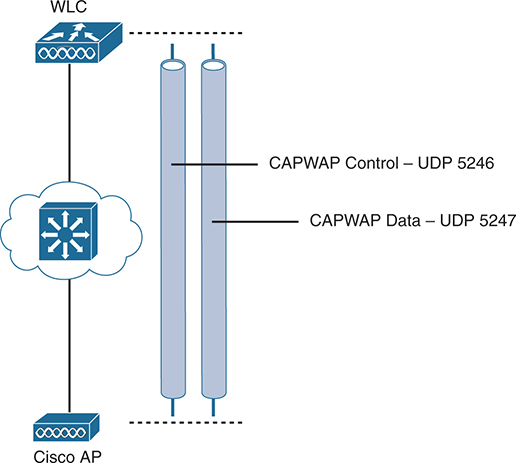

<figcaption>

<aside class="hidden" id="a02fig05">

AP 和 WLC 通过表示网络基础设施的云图标连接。两条竖线分别标为“CAPWAP Control - UDP 5246”和“CAPWAP Data - UDP 5247”，表示 AP 与 WLC 之间的通信通道。CAPWAP 控制通道使用用户数据报协议 UDP 端口 5246，数据通道使用 UDP 端口 5247。

</aside>

<strong>图 2-5</strong> <em>使用 CAPWAP 连接 AP 与 WLC</em>

</figcaption>

</figure>

每个 AP 和 WLC 还必须通过数字证书相互验证身份。购买设备时，每台设备中都预装了 X.509 证书。通过在后台使用证书，每台设备在成为无线网络成员之前都会得到适当验证。这个过程有助于确保无人能够向网络添加未经授权的 AP。

CAPWAP 隧道允许 AP 与 WLC 在地理和逻辑上分离，也消除了两者对二层连通性的依赖。例如，<a href="#ch02fig06">图 2-6</a> 用阴影区域表示 VLAN 100 的范围。注意，VLAN 100 存在于 WLC 上，以及无线客户端附近的空中 SSID 100 中，却不存在于 AP 与 WLC 之间。进出关联 SSID 100 客户端的流量，被封装在 CAPWAP 数据隧道内，穿过网络基础设施传送。隧道建立在 WLC 的 IP 地址与 AP 的 IP 地址之间，使所有隧道内的数据包都可以在第三层路由。

还要注意，AP 仅通过单个 IP 地址 10.10.10.10 来标识。由于 AP 位于接入层，其 CAPWAP 隧道也在此终结，因此可以将同一个 IP 地址同时用于管理和隧道。不需要中继链路，因为它支持的所有 VLAN 都作为第三层 IP 数据包进行封装和隧道传输，而不是作为独立的二层 VLAN 传送。

随着无线网络增长，WLC 只需建立更多 CAPWAP 隧道来连接更多 AP。<a href="#ch02fig07">图 2-7</a> 描述了包含四个 AP 的网络。每个 AP 都有一条控制隧道和一条数据隧道返回集中式 WLC。SSID 100 可以存在于每个 AP 上，VLAN 100 则通过隧道网络到达每个 AP。

<figure class="image-c" id="ch02fig06">

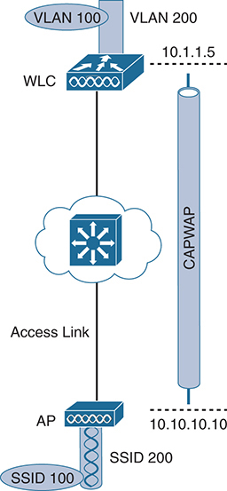

<figcaption>

<aside class="hidden" id="a02fig06">

AP 通过接入链路连接 WLC，网络基础设施画成云状。AP 广播两个服务集标识符：SSID 100 和 SSID 200。WLC 上有两个 VLAN：VLAN 100 和 VLAN 200。图中 VLAN 100 的 IP 地址为 10.1.1.5，VLAN 200 的 IP 地址为 10.10.10.10。CAPWAP 隧道连接 AP 与 WLC，承载两个 VLAN 的流量。

</aside>

<strong>图 2-6</strong> <em>VLAN 100 在 Cisco 无线网络中的范围</em>

</figcaption>

</figure>

<figure class="image-c" id="ch02fig07">

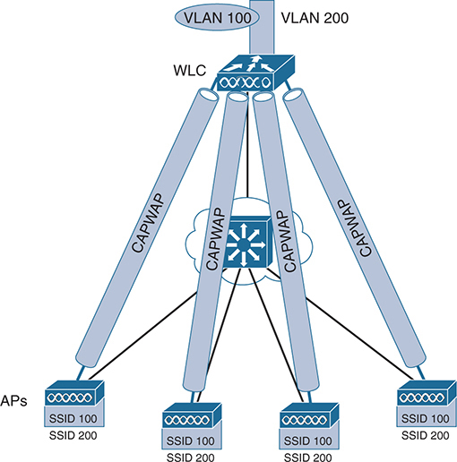

<figcaption>

<aside class="hidden" id="a02fig07">

图顶部的 WLC 连接 VLAN 100 和 VLAN 200。四条 CAPWAP 隧道从 WLC 延伸出来，每条连接一个 AP。各 AP 标注相应服务集标识符 SSID 100 和 SSID 200。每个 AP 广播两个 SSID，分别对应 VLAN 100 和 VLAN 200。CAPWAP 隧道确保 WLC 与 AP 之间无线流量的管理安全而高效。

</aside>

<strong>图 2-7</strong> <em>使用 CAPWAP 隧道将 AP 连接到一个中央 WLC</em>

</figcaption>

</figure>

WLC 与一个或多个轻量级 AP 建立 CAPWAP 隧道后，就可以开始提供各种附加功能。阅读以下 WLC 活动列表时，请回想前面讨论传统自治 WLAN 架构时提到的各种难题和不足：

<ul class="sq">

<li>
<strong>动态信道分配：</strong> WLC 可以根据区域内其他正在工作的接入点，自动选择并配置每个 AP 使用的射频信道。
</li>

<li>
<strong>发射功率优化：</strong> WLC 可以根据所需覆盖区域，自动设置每个 AP 的发射功率。
</li>

<li>
<strong>无线覆盖自愈：</strong> 如果某个 AP 的无线电失效，可以自动提高周围 AP 的发射功率，修复覆盖空洞。
</li>

<li>
<strong>灵活的客户端漫游：</strong> 客户端可以在 AP 之间快速漫游。
</li>

<li>
<strong>动态客户端负载均衡：</strong> 如果两个或更多 AP 覆盖同一地理区域，WLC 可以让客户端关联使用最少的 AP，从而将客户端负载分散到各 AP。
</li>

<li>
<strong>射频监控：</strong> WLC 管理每个 AP，使其扫描信道并监控射频使用情况。通过监听信道，WLC 可以远程收集射频干扰、噪声、相邻 AP 信号，以及恶意 AP 或 ad hoc 客户端信号等信息。
</li>

<li>
<strong>安全管理：</strong> WLC 可以通过中央服务验证客户端身份，并要求无线客户端先从可信 DHCP 服务器获取 IP 地址，然后才允许其关联并访问 WLAN。
</li>

<li>
<strong>无线入侵防御（或保护）系统：</strong> WLC 利用其中心位置，可以监控客户端数据，以检测并阻止恶意活动。
</li>

</ul>

</section>

<section>

<h3 class="h3" id="ch02lev1sec6">比较 Cisco 无线 LAN 控制器部署</h3>

假设你想部署 WLC，以支持网络中的多个轻量级 AP，应该将 WLC 放在哪里？分离 MAC 概念可以应用于几种不同网络架构。每种架构将 WLC 放在网络中的不同位置，这种选择也会影响为所需 AP 数量提供支持时需要多少个 WLC。

一种方法是将 WLC 放在中心位置，以最大化加入它的 AP 数量。这通常称为<a id="key_028" href="#ref-gloss_064">集中式 WLC 部署</a>或<em>统一 WLC 部署</em>，其基本思路是用户需要访问的大多数资源位于数据中心或互联网等中心位置。进出无线用户的流量将通过延伸到网络中心、接近核心位置的 CAPWAP 隧道传送，如<a href="#ch02fig08">图 2-8</a> 所示。集中式 WLC 也为实施影响所有无线用户的安全策略提供了方便的位置。

<a href="#ch02fig08">图 2-8</a> 展示四个 AP 加入单个 WLC。你的网络可能有更多 AP，甚至多得多。大型企业网络的接入层可能连接数千个 AP。因此，可扩展性成为集中式设计的重要因素。典型集中式 WLC 最多可支持约 6000 个 AP。如果 AP 数量超过上限，就需要在设计中添加更多 WLC，并将它们都部署在中心位置。

<figure class="image-c" id="ch02fig08">

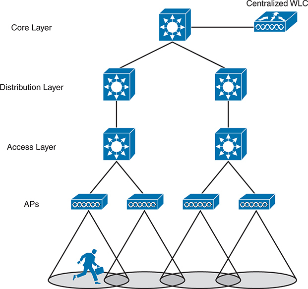

<figcaption>

<aside class="hidden" id="a02fig08">

核心层位于顶部，由提供高速、高可用连接的核心交换机组成。分布层位于核心层下方，由汇聚接入层流量的分布交换机组成。接入层位于分布层下方，由直接连接终端设备和 AP 的接入交换机组成。底部多个 AP 连接接入交换机，为用户提供无线覆盖。集中式 WLC 连接在核心层，以便高效管理网络中的全部 AP。图中还有携带设备的用户位于 AP 覆盖区内，表示终端用户如何连接网络。

</aside>

<strong>图 2-8</strong> <em>集中式部署中的 WLC 位置</em>

</figcaption>

</figure>

当 WLC 集中部署在公有云或私有云内部时，称为<a id="key_030" href="#ref-gloss_077">基于云的 WLC 部署</a>。由于私有云通常属于企业网络，WLC 可以保持相对靠近其 AP，尽量缩短两者之间的数据路径。不过，将 WLC 放在公有云会带来一个有趣的变化：控制器可能距离加入它的 AP 很远。AP 可以维持通往控制器的 CAPWAP 控制隧道，但经过 AP 的所有无线数据，都必须在 AP 本地交换进出直接连接的 VLAN。因此，AP 只能工作在 <a id="key_035" href="#ref-gloss_145">FlexConnect 模式</a>，本章后面的“<a href="#ch02lev2sec2">FlexConnect 模式</a>”一节将予以介绍。截至本书撰写时，基于云的控制器通常最多支持 6000 个 AP。

对于小型园区或分散的分支位置，各处 AP 数量相对较少，可以将 WLC 部署在网络中更靠下的位置，如<a href="#ch02fig09">图 2-9</a> 所示。这称为<a id="key_033" href="#ref-gloss_117">分布式 WLC 部署</a>，因为多个控制器分布在网络内部。典型分布式 WLC 最多可支持 250 个 AP。随着 AP 数量增长，可以在网络中其他关键区域增加 WLC。

最后，在小规模环境中，例如小型、中型或多站点分支位置，你可能完全不想投资专用 WLC。此时，可以将 WLC 功能与安装在分支站点的 AP 部署在一起。这称为<a id="key_034" href="#ref-gloss_129">嵌入式无线控制器（EWC）部署</a>，如<a href="#ch02fig10">图 2-10</a> 所示。它也称为<a id="key_032" href="#ref-gloss_095">无控制器无线部署</a>，因为完全不涉及独立的物理控制器。承载 WLC 的 AP 会与 WLC 建立 CAPWAP 隧道，同一位置的其他 AP 也如此。EWC 最多可支持 100 个 AP。

<figure class="image-c" id="ch02fig09">

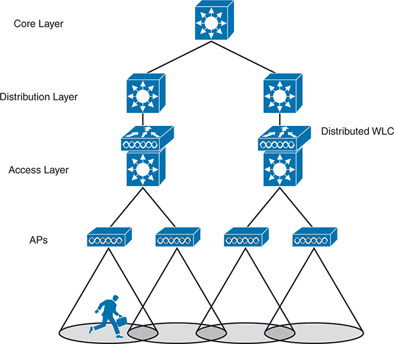

<figcaption>

<aside class="hidden" id="a02fig09">

图分为四层。核心层位于层次顶部，由核心网络交换机组成。分布层位于其下，包含汇聚接入交换机的分布交换机。接入层包含连接分布层的接入交换机。AP 连接接入层交换机，为终端设备提供无线连接。在这种部署中，分布式 WLC 位于分布层交换机旁，管理网络中的多个接入点。

</aside>

<strong>图 2-9</strong> <em>分布式部署中的 WLC 位置</em>

</figcaption>

</figure>

<figure class="image-c" id="ch02fig10">

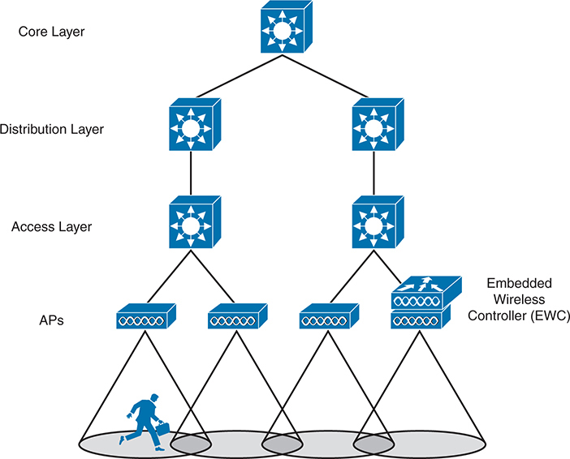

<figcaption>

<aside class="hidden" id="a02fig10">

与前一张图相似，此图分为四层。最上方核心层包含核心网络交换机。其下分布层包含分布交换机。接入层由连接分布层的接入交换机组成。AP 连接接入交换机，提供无线连接。在这种部署中，嵌入式无线控制器 EWC 集成在一台接入层交换机中。这种嵌入式方式将无线控制功能整合到接入层交换机本身。

</aside>

<strong>图 2-10</strong> <em>嵌入式无线部署中的 WLC 位置</em>

</figcaption>

</figure>

有关 WLC 部署模式、WLC 位置，以及各模式支持的典型 AP 和客户端最大数量，请参阅<a href="#ch02tab02">表 2-2</a>。

<figure class="table" id="ch02tab02" tabindex="0">

<figcaption>

<strong>表 2-2</strong> WLC 部署模式汇总

</figcaption>

<table class="all">

<tbody>

<tr>

<th class="th">
部署模式
</th>

<th class="th">
WLC 位置
</th>

<th class="th">
支持的 AP 数量
</th>

<th class="th">
支持的客户端数量
</th>

<th class="th">
典型用途
</th>

</tr>

<tr>

<td class="border">
集中式
</td>

<td class="border">
中心位置
</td>

<td class="border">
6000
</td>

<td class="border">
64,000
</td>

<td class="border">
大型企业
</td>

</tr>

<tr>

<td class="border">
基于云
</td>

<td class="border">
公有云或私有云
</td>

<td class="border">
6000
</td>

<td class="border">
64,000
</td>

<td class="border">
大型企业
</td>

</tr>

<tr>

<td class="border">
分布式
</td>

<td class="border">
接入
</td>

<td class="border">
250
</td>

<td class="border">
5000
</td>

<td class="border">
小型园区
</td>

</tr>

<tr>

<td class="border">
嵌入式
</td>

<td class="border">
其他
</td>

<td class="border">
100
</td>

<td class="border">
2000
</td>

<td class="border">
分支位置
</td>

</tr>

<tr>

<td class="border">
自治式
</td>

<td class="border">
不适用
</td>

<td class="border">
不适用
</td>

<td class="border">
不适用
</td>

<td class="border">
不适用
</td>

</tr>

</tbody>

</table>

</figure>

<section>

<h4 class="h4" id="ch02lev2sec1">Cisco AP 模式</h4>

根据配置，Cisco AP 可以工作在以下某一种模式：

<ul class="sq">

<li>
<strong>本地（Local）：</strong> 这种默认轻量级模式在特定信道上提供一个或多个正常工作的 BSS。在不发送时，AP 会扫描其他信道，测量噪声水平和干扰、发现恶意设备，并与无线入侵检测系统 WIDS 事件进行匹配。
</li>

<li>
<strong>监控（Monitor）：</strong> AP 完全不发送，但启用接收机作为专用传感器。AP 检查 IDS 事件、检测恶意接入点，并通过基于位置的服务确定站点位置。
</li>

<li>
<strong>FlexConnect：</strong> 当远程站点 AP 通往 WLC 的 CAPWAP 隧道中断时，如果已配置相应功能，AP 可以在 SSID 与 VLAN 之间本地交换流量。
</li>

<li>
<strong>嗅探器（Sniffer）：</strong> AP 将无线电专用于接收其他来源的 802.11 流量，类似嗅探器或抓包设备。捕获的流量随后被转发到运行 WireShark 等网络分析软件的 PC，以便进一步分析。
</li>

<li>
<strong>恶意设备检测器（Rogue detector）：</strong> AP 专门检测恶意设备，将在有线网络上监听到的 MAC 地址与在空中监听到的 MAC 地址进行关联。恶意设备指同时出现在两种网络中的设备。
</li>

<li>
<strong>网桥（Bridge）：</strong> AP 成为两个网络之间的专用网桥，可以是点到点或点到多点。两个网桥模式的 AP 可以连接相隔一定距离的两个地点；多个网桥模式 AP 则可以形成室内或室外网状网络。
</li>

<li>
<strong>Flex+Bridge：</strong> 在网状 AP 上启用 FlexConnect 操作。
</li>

<li>
<strong>SE-Connect：</strong> AP 将无线电专用于所有无线信道的频谱分析。可以将运行 MetaGeek Chanalyzer 或 Cisco Spectrum Expert 等软件的 PC 远程连接到 AP，收集和分析频谱分析数据，以发现干扰源。
</li>

</ul>

注意

请记住，当 Cisco AP 提供 BSS 并允许客户端设备关联到无线 LAN 时，通常处于<a id="key_036" data-original-href="vol2_ch02.xhtml#key_036a" data-unavailable="true" title="此内容不在当前提取范围内；请参阅原始 EPUB：vol2_ch02.xhtml#key_036a">本地模式</a>。将 AP 配置为其他某种模式时，本地模式会被禁用。

</section>

<section>

<h4 class="h4" id="ch02lev2sec2">FlexConnect 模式</h4>

在交换式园区基础设施中，分离 MAC 的流量模式很高效，因为 WLC 可以部署在距离 AP 合理接近的位置。这种模式通常可以尽量降低两者之间的时延，并最大化带宽。假设网络扩展到一些远程分支站点，AP 部署在分支，而唯一的 WLC 位于主站点。这种场景迫使无线流量穿过分支与主站点之间的 CAPWAP 隧道，才能访问集中资源，如<a href="#ch02fig11">图 2-11</a> 左侧所示。即使两个无线用户之间的流量，也必须沿隧道到达控制器再返回，这可能并不理想。

<figure class="image-c" id="ch02fig11">

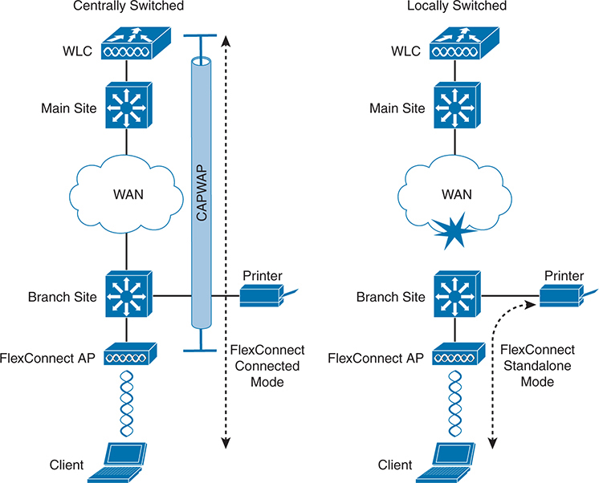

<figcaption>

<aside class="hidden" id="a02fig11">

图分为两部分。左侧为集中交换：主站点包含无线 LAN 控制器 WLC 和交换机，并连接广域网 WAN；分支站点包含 FlexConnect AP 和交换机，AP 连接打印机及笔记本客户端。客户端数据经过 FlexConnect AP、穿过 WAN，到达主站点 WLC。标为 CAPWAP 的实线箭头表示数据集中交换。右侧为本地交换：主站点同样包含连接 WAN 的 WLC 和交换机，分支站点包含 FlexConnect AP、交换机、打印机和笔记本客户端。在 FlexConnect 连接模式下，客户端数据经 AP 直接到达本地交换机和打印机，无须穿过 WAN，以实线箭头表示。在 FlexConnect 独立模式下，即使 WAN 链路故障，AP 仍可独立运行，以虚线箭头表示。

</aside>

<strong>图 2-11</strong> <em>FlexConnect AP 在集中交换与本地交换模式下运行</em>

</figcaption>

</figure>

现在考虑连接远程站点的 WAN 链路有多重要。分支 AP 通常完全依赖 WLC 来形成分离 MAC 关系。如果 WAN 链路中断，WLC 无法到达，如<a href="#ch02fig11">图 2-11</a> 右侧所示，AP 就会停止运行。

无论 WAN 链路正常还是中断，FlexConnect AP 模式都能充分适应相应情况。在<a id="key_031" href="#ref-gloss_089">连接模式</a>下，AP 加入 WLC，所有无线流量通过 CAPWAP 隧道传送。但是，如果 WAN 链路中断，AP 可以使用<a id="key_039" href="#ref-gloss_332">独立模式</a>，继续脱离 WLC 独立运行，在本地支持无线用户，并允许他们与其他本地设备通信。

连接模式与独立模式之间的切换，根据与 WLC 的连通性自动进行。更好的是，即使控制器仍然可达，也可以按每个无线 LAN 配置 FlexConnect AP，将需要留在远程站点内的流量本地交换。这种方法避免本地流量沿着漫长且不必要的发卡路径往返控制器，同时为需要在主站点集中交换的流量保留 CAPWAP 隧道。

Cisco OfficeExtend 是另一种将远程站点连接到主位置的解决方案，但它面向远程办公人员的家庭。与 FlexConnect 一样，OfficeExtend 可以在远程站点提供与企业相同的无线 LAN。不过，两种方案在规模方面很不相同。FlexConnect AP 旨在支持大量无线用户，并能与其他 FlexConnect AP 共存，使无线用户可以在 AP 之间漫游。OfficeExtend AP 则旨在作为远程办公者家中的单个 AP，因此不支持漫游。

两种方案在保护 AP 与 WLC 之间用户数据流量的方式上也不同。FlexConnect 默认只保护和加密控制流量，不保护用户数据。由于 OfficeExtend 设计为通过单个 AP 处理少量用户，因此控制流量和数据流量始终都使用 DTLS 加密。<a href="#ch02tab03">表 2-3</a> 总结了两种方案的差异。

<figure class="table" id="ch02tab03" tabindex="0">

<figcaption>

<strong>表 2-3</strong> FlexConnect 与 OfficeExtend AP 的比较

</figcaption>

<table class="all">

<tbody>

<tr>

<th class="th">

</th>

<th class="th">
FlexConnect
</th>

<th class="th">
OfficeExtend
</th>

</tr>

<tr>

<td class="border">
AP 是否加入 WLC？
</td>

<td class="border">
是
</td>

<td class="border">
是
</td>

</tr>

<tr>

<td class="border">
数据流量是否受到保护？
</td>

<td class="border">
可选
</td>

<td class="border">
是，使用 DTLS
</td>

</tr>

<tr>

<td class="border">
远程站点的典型 AP 数量
</td>

<td class="border">
无限制
</td>

<td class="border">
一个
</td>

</tr>

<tr>

<td class="border">
是否支持漫游？
</td>

<td class="border">
是
</td>

<td class="border">
否
</td>

</tr>

</tbody>

</table>

</figure>

</section>

</section>

</section>

<section class="ccna-source ccna-appendix" aria-label="答案解析与术语表">
<section data-epub-type="chapter">

<h2 class="h2" id="ref-appc">附录 C</h2>

<h2 class="h2a">自测题答案</h2>

<section>

<h3 class="h3" id="ref-appclev1sec2">第 2 章</h3>

<strong><a id="ref-ques2_1" href="#quess2_1">1</a>．</strong> A。自治 AP 可以独立运行，无须集中式无线 LAN 控制器。

<strong><a id="ref-ques2_2" href="#quess2_2">2</a>．</strong> B。Cisco Meraki AP 是自治 AP，通过 Meraki 云中的集中平台进行管理。

<strong><a id="ref-ques2_3" href="#quess2_3">3</a>．</strong> C。在轻量级 AP 上，MAC 功能被划分到 AP 硬件和 WLC 之间，因此该架构称为分离 MAC。

<strong><a id="ref-ques2_4" href="#quess2_4">4</a>．</strong> B。AP 与 WLC 建立 CAPWAP 隧道。

<strong><a id="ref-ques2_5" href="#quess2_5">5</a>．</strong> A。完全不需要承载三个 VLAN 的中继链路。本地模式的 Cisco AP 只需要一条单 VLAN 接入链路，其他所有内容都通过 CAPWAP 隧道传送到 WLC。WLC 需要连接三个 VLAN，才能与 AP 配合，将它们绑定到三个 SSID。

<strong><a id="ref-ques2_6" href="#quess2_6">6</a>．</strong> C。集中式 WLC 部署模式将 WLC 放在中心位置，以支持数量非常多的 AP。

<strong><a id="ref-ques2_7" href="#quess2_7">7</a>．</strong> A。本地模式是默认模式，AP 在此模式下提供至少一个可用的 BSS，供无线客户端加入并连接网络。Normal 和 Client 并非有效模式。监控模式用于将 AP 转变为专用无线传感器。

<strong><a id="ref-ques2_8" href="#quess2_8">8</a>．</strong> D。SE-Connect 模式用于频谱分析，“SE”指 Cisco Spectrum Expert 软件。此外，AP 一次只能工作在一种模式，本地模式是默认模式。

</section>

</section>

<section id="ref-glossary"><h2 class="h2a">术语表</h2>
<strong>自治 AP</strong> 以独立模式运行的无线 AP，可以提供功能完整的 BSS 并连接分布系统 DS。

<strong>CAPWAP</strong> 基于标准的隧道协议，定义轻量级 AP 与无线 LAN 控制器之间的通信。

<strong>集中式 WLC 部署</strong> 将 WLC 放在网络拓扑中心位置的无线网络设计。

<strong>基于云的 AP</strong> 工作方式与自治 AP 类似，但管理和控制功能位于互联网云中的无线 AP。

<strong>基于云的 WLC 部署</strong> 将 WLC 作为数据中心私有云部分中的虚拟机，集中放在网络拓扑中的无线网络设计。

<strong>连接模式</strong> FlexConnect AP 返回控制器的路径正常工作时使用的运行模式。在此模式下，所有无线流量都通过 CAPWAP 隧道往返控制器。

<strong>无控制器无线部署</strong> 基于嵌入式无线控制器 EWC 的无线设计，WLC 功能与 AP 部署在一起，而不是由独立物理控制器提供。

<strong>分布式 WLC 部署</strong> 将多个控制器分布在网络内部的无线设计，每个控制器通常支持相对较少的用户。

<strong>嵌入式无线控制器（EWC）部署</strong> 将 WLC 放在接入层、与 LAN 交换机堆叠部署在一起，并靠近其所控制 AP 的无线网络设计。

<strong>FlexConnect 模式</strong> 为远程站点设计的 AP 模式。如果 AP 的 CAPWAP 隧道正常，无线流量往返控制器；如果隧道中断，则在本地交换。

<strong>介质访问控制（MAC）层</strong> IEEE 定义的数据链路层两个子层中较低的子层。在以太网 LAN 中与 IEEE 802.3 同义。

<strong>分离 MAC 架构</strong> 将普通 AP 功能拆分到无线 LAN 控制器和轻量级 AP 之间的无线 AP 策略。

<strong>独立模式</strong> FlexConnect AP 返回控制器的路径中断、无法工作时使用的运行模式。在此模式下，所有无线流量都在本地交换，使 AP 与控制器隔离时仍能维持本地连通性。

<strong>无线 LAN 控制器（WLC）</strong> 与无线轻量级接入点 LWAP 协同创建无线 LAN 的设备，为每个 LWAP 执行部分控制功能，并在各 LWAP 与有线 LAN 之间转发数据。

</section>
</section>


<nav class="ccna-chapter-nav" aria-label="章节导航"><a href="v2-01.html">← 上一章</a><a href="v2-03.html">下一章 →</a></nav>
