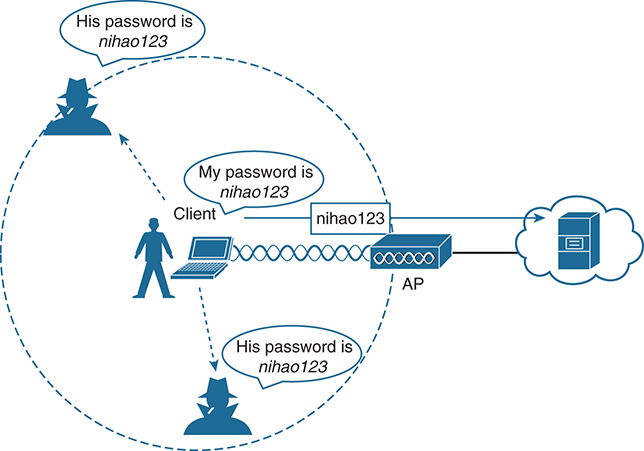
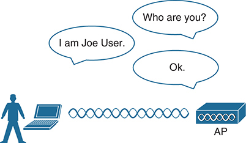
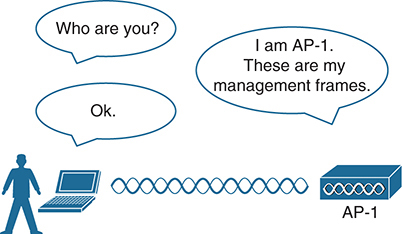
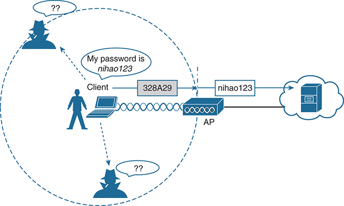
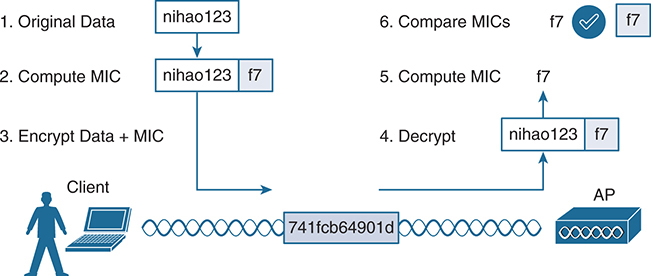
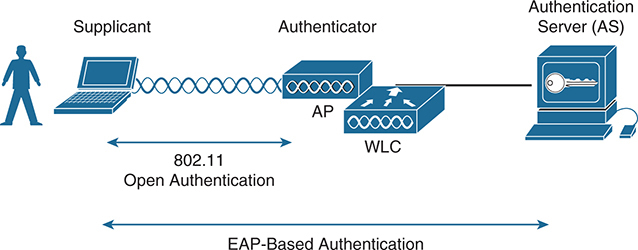

<a href="{{ '/subjects/CCNA/' | relative_url }}">← 返回 CCNA 目录</a>

第二卷 · 无线局域网

<nav class="ccna-chapter-nav" aria-label="章节导航"><a href="v2-02.html">← 上一章</a><a href="v2-04.html">下一章 →</a></nav>



<section data-epub-type="chapter">

<h2 class="h2" id="ch03">第 3 章</h2>

<h2 class="h2a">保护无线网络安全</h2>

本章涵盖以下考试主题：

1.0 网络基础

1.11 描述无线原理

1.11.d 加密

5.0 安全基础

5.9 描述无线安全协议（WPA、WPA2 和 WPA3）

到现在你已经知道，无线网络很复杂。许多技术和协议在后台协同工作，为终端用户提供通往有线网络基础设施的稳定且可移动的连接。从用户角度看，无线连接应该与有线连接没有区别。有线连接可以给用户一种安全感：在线缆上传输的数据大概不会被其他人窃听。无线连接则天然不同，在空中传送的数据可能被范围内的任何人听到。

因此，保护无线网络安全与其他任何方面同样重要。全面的无线安全方法关注以下领域：

<ul class="sq">

<li>
识别无线连接的端点。
</li>

<li>
识别终端用户。
</li>

<li>
保护无线数据不被窃听。
</li>

<li>
保护无线数据不被篡改。
</li>

</ul>

识别过程通过各种身份验证方案完成。保护无线数据则涉及加密和帧身份验证等安全功能。

本章介绍许多可用于保护无线网络安全的方法。请注意，无线安全可能让人困惑，因为它充满了缩写。有些缩写读起来甚至像儿童读物中的押韵词。实际上，本章讲述的是 WEP、PSK、TKIP、MIC、AES、EAP、EAP-FAST、EAP-TLS、LEAP、PEAP、WPA、WPA2、WPA3、CCMP、GCMP 等等。不过，学完本章后，你会更清楚这些术语的含义及它们如何相互配合，甚至可能已经准备好配置具有有效安全措施的无线 LAN。

<section>

<h3 class="h3" id="ch03lev1sec1">自测</h3>

如果你想根据得分决定应在本章投入多少时间，可以参加自测（使用此处的问题或 PTP 软件）。字母答案列在自测后面页面的底部。书末及配套网站上的 <a href="#ref-appc">附录 C</a> 包含答案和解析。你也可以在 PTP 测试软件中找到答案和解析。

<figure class="table" id="ch03tab01" tabindex="0">

<figcaption>

<strong>表 3-1</strong> 自测：基础知识小节与题目对应关系

</figcaption>

<table class="all">

<tbody>

<tr>

<th class="th">
基础知识小节
</th>

<th class="th">
题目
</th>

</tr>

<tr>

<td class="border">
安全连接的组成
</td>

<td class="border">
1、2
</td>

</tr>

<tr>

<td class="border">
无线客户端身份验证方法
</td>

<td class="border">
3, 4
</td>

</tr>

<tr>

<td class="border">
无线隐私与完整性方法
</td>

<td class="border">
5, 6
</td>

</tr>

<tr>

<td class="border">
WPA、WPA2 和 WPA3
</td>

<td class="border">
7, 8
</td>

</tr>

</tbody>

</table>

</figure>

<strong><a id="quess3_1" href="#ques3_1a">1</a>．</strong> 以下哪些是安全无线连接的必要组成部分？（选择所有适用答案。）

<ol class="lower-alpha">

<li>
加密
</li>

<li>
MIC
</li>

<li>
身份验证
</li>

<li>
以上答案都正确。
</li>

</ol>

<strong><a id="quess3_2" href="#ques3_2a">2</a>．</strong> 以下哪一项用于保护无线帧中数据的完整性？

<ol class="lower-alpha">

<li>
WIPS
</li>

<li>
WEP
</li>

<li>
MIC
</li>

<li>
EAP
</li>

</ol>

<strong><a id="quess3_3" href="#ques3_3a">3</a>．</strong> 以下哪种无线加密方法已被发现存在漏洞，不建议使用？

<ol class="lower-alpha">

<li>
AES
</li>

<li>
WPA
</li>

<li>
EAP
</li>

<li>
WEP
</li>

</ol>

<strong><a id="quess3_4" href="#ques3_4a">4</a>．</strong> 在 WLAN 上使用 802.1x 时，以下哪一项作为身份验证框架？

<ol class="lower-alpha">

<li>
开放式身份验证
</li>

<li>
WEP
</li>

<li>
EAP
</li>

<li>
WPA
</li>

</ol>

<strong><a id="quess3_5" href="#ques3_5a">5</a>．</strong> 假设你要选择一种保护无线数据隐私与完整性的方法。以下哪种方法已被弃用，应当避免使用？

<ol class="lower-alpha">

<li>
TKIP
</li>

<li>
CCMP
</li>

<li>
GCMP
</li>

<li>
EAP
</li>

</ol>

<strong><a id="quess3_6" href="#ques3_6a">6</a>．</strong> 以下哪一项是 WPA2 使用的数据加密与完整性方法？

<ol class="lower-alpha">

<li>
WEP
</li>

<li>
TKIP
</li>

<li>
CCMP
</li>

<li>
WPA
</li>

</ol>

<strong><a id="quess3_7" href="#ques3_7a">7</a>．</strong> 对于正确实现安全标准的无线设备，Wi-Fi 联盟提供以下哪些认证？（选择所有适用答案。）

<ol class="lower-alpha">

<li>
WEP
</li>

<li>
WPA2
</li>

<li>
802.11
</li>

<li>
AES
</li>

</ol>

<strong><a id="quess3_8" href="#ques3_8a">8</a>．</strong> 以下哪些无线安全配置使用预共享密钥？（选择所有适用答案。）

<ol class="lower-alpha">

<li>
WPA2 个人模式
</li>

<li>
WPA2 企业模式
</li>

<li>
WPA3 个人模式
</li>

<li>
WPA3 企业模式
</li>

</ol>

自测答案：

<strong><a id="ques3_1a" href="#ref-ques3_1">1</a></strong> D

<strong><a id="ques3_2a" href="#ref-ques3_2">2</a></strong> C

<strong><a id="ques3_3a" href="#ref-ques3_3">3</a></strong> D

<strong><a id="ques3_4a" href="#ref-ques3_4">4</a></strong> C

<strong><a id="ques3_5a" href="#ref-ques3_5">5</a></strong> A

<strong><a id="ques3_6a" href="#ref-ques3_6">6</a></strong> C

<strong><a id="ques3_7a" href="#ref-ques3_7">7</a></strong> B

<strong><a id="ques3_8a" href="#ref-ques3_8">8</a></strong> A、C

</section>

<section>

<h3 class="h3box" id="ch03lev1sec2">基础知识</h3>

</section>

<section>

<h3 class="h3" id="ch03lev1sec3">安全连接的组成</h3>

在本书前几章中，你学习了无线客户端如何与无线接入点 AP 建立关联，并通过空中介质来回传送数据。

只要所有客户端和 AP 都符合 802.11 标准，它们就可以共存，即使位于同一信道上也是如此。不过，并非所有 802.11 设备都友善可信。有时人们容易忘记：发送出去的帧并不像有线或交换式连接那样，直接从发送方到达接收方，而是按照发射机天线的方向图传播，可能到达范围内的任何接收机。

考虑<a href="#ch03fig01">图 3-1</a> 中的场景。无线客户端与某个远程实体建立会话，并分享机密密码。由于两个不可信用户也位于客户端信号范围内，他们也可能通过捕获信道上传送的帧而获知密码。无线通信的便利性，也让恶意用户更容易窃听和利用传输内容。

如果数据在开放空间中发送，如何保护它，使其保持私密和完整？802.11 标准提供了一套无线安全机制框架，可为无线网络增加信任、隐私和完整性。以下各节概述这一无线安全框架。

<figure class="image-c" id="ch03fig01">

<figcaption>

<aside class="hidden" id="a03fig01">

图包含以下元素：客户端是一位使用笔记本的用户，通过无线连接接入 AP；AP 连接云中的服务器，促成无线通信；非预期接收方是两个戴帽子剪影表示的恶意实体，处于可以截获无线通信的位置。客户端与 AP 的通信涉及密码 nihao123。客户端说“我的密码是 nihao123”，AP 将同样的密码传送给服务器。两个恶意实体位于无线范围内，截获密码，并分别说“他的密码是 nihao123”。

</aside>

<strong>图 3-1</strong> <em>无线传输到达非预期接收方</em>

</figcaption>

</figure>

<section>

<h4 class="h4" id="ch03lev2sec1">身份验证</h4>

要使用无线网络，客户端必须先发现基本服务集 BSS，然后请求关联许可。在成为无线 LAN 中正常工作的成员之前，客户端应当经过某种身份验证。为什么？

假设无线网络连接到能够访问机密信息的企业资源，那么就只应允许已知可信、符合预期的设备访问。对于访客用户，即使允许接入，也应让他们加入另一个访客 WLAN，在那里访问非机密或公共资源。不符合预期、不受欢迎的恶意客户端，则完全不应获准关联。毕竟，它们与企业网络无关，很可能只是碰巧位于网络覆盖范围内的未知设备。

为控制访问，无线网络可以在允许客户端设备关联之前验证其身份。潜在客户端必须向 AP 提交某种凭据来标识自身。<a href="#ch03fig02">图 3-2</a> 展示基本的客户端身份验证过程。

<figure class="image-c" id="ch03fig02">

<figcaption>

<aside class="hidden" id="a03fig02">

图左侧是站在笔记本旁的人物图标，代表用户。笔记本通过一系列波浪线表示的无线连接，连接右侧 AP。笔记本和 AP 上方的三个对话气泡表示身份验证消息交换。第一个气泡来自 AP，询问“你是谁？”第二个来自用户，回答“我是 Joe User”。第三个来自 AP，表示“好的”。

</aside>

<strong>图 3-2</strong> <em>验证无线客户端身份</em>

</figcaption>

</figure>

无线身份验证可以采用多种形式。一些方法只要求所有可信客户端和 AP 共享一个静态文本字符串。该字符串存储在客户端设备上，需要时直接提交给 AP。如果设备被盗或丢失，会发生什么？很可能，任何持有该设备的用户仍然可以通过网络身份验证。其他更严格的方法要求与企业用户数据库交互。此时，终端用户必须输入有效的用户名和密码，而窃贼或冒充者通常并不知道这些信息。

如果你曾加入无线网络，可能只关注验证设备或你自己的身份，却默认信任最近的 AP。例如，开启无线设备并在工作地点发现可用无线网络时，你大概会毫不犹豫地加入。机场、酒店、热点或家中的无线网络也是如此：你期望通告 SSID 的 AP 由所在场所的实体拥有并运营。但你如何确定呢？

通常，你掌握的唯一信息是 AP 广播或通告的 SSID。如果 SSID 看起来熟悉，你就很可能选择加入。你的计算机可能被配置为自动连接已知 SSID，无须干预就建立关联。无论哪种情况，即使该 SSID 由冒充者通告，你也可能在不知情时加入。

一些常见攻击让恶意用户冒充 AP。伪造 AP 可以发送信标、响应探测并关联客户端，就像被它冒充的真实 AP 一样。一旦客户端关联伪造 AP，攻击者便能利用中心位置轻易截获进出客户端的所有通信。伪造 AP 还可以发送欺骗性管理帧，使合法且正在活动的客户端解除关联或取消身份验证，借此扰乱网络正常运行。

为防止这种中间人攻击，客户端应当在自身身份得到验证之前先验证 AP。<a href="#ch03fig03">图 3-3</a> 展示一个简单场景。更进一步，客户端收到的所有管理帧也应经过验证，以证明它们由合法、符合预期的 AP 发送。

<figure class="image-c" id="ch03fig03">

<figcaption>

<aside class="hidden" id="a03fig03">

图左侧是站在笔记本旁的人物图标，代表用户。笔记本通过波浪线表示的无线连接，连接右侧标为 AP-1 的接入点。上方三个对话气泡表示身份验证消息交换。第一个来自笔记本，询问“你是谁？”第二个来自 AP，回答“我是 AP-1，这些是我的管理帧”。第三个来自笔记本，表示“好的”。

</aside>

<strong>图 3-3</strong> <em>验证无线 AP 身份</em>

</figcaption>

</figure>

</section>

<section>

<h4 class="h4" id="ch03lev2sec2">消息隐私</h4>

假设<a href="#ch03fig03">图 3-3</a> 中的客户端必须先通过身份验证，才能加入无线网络。它还可以在关联后、自身身份得到验证前，验证 AP 及其管理帧。客户端与 AP 的关系可能变得可信得多，但进出客户端的数据仍然可以被同一信道上的窃听者获得。

为保护无线网络的数据隐私，数据在自由空间传播期间应当加密。具体做法是在每个无线帧发送前加密其中的数据载荷，并在接收时解密。其思路是使用发射机和接收机共同掌握的加密方法，使数据只能由它们成功加密和解密，其他人无法做到。

在无线网络中，每个 WLAN 可能只支持一种身份验证和加密方案，因此所有客户端关联时必须使用同一种加密方法。你可能认为，共用一种加密方法会让每个客户端都能窃听其他客户端。事实未必如此，因为 AP 应当为每个关联客户端安全协商唯一的加密密钥。

理想情况下，只有 AP 和某个客户端共同掌握相应加密密钥，因此能够理解彼此的数据。其他设备不应知道或能够使用相同密钥来窃听和解密数据。在<a href="#ch03fig04">图 3-4</a> 中，客户端的机密密码信息在发送前已加密。AP 能够成功解密，再转发到有线网络，但其他无线设备和用户无法解密。

<figure class="image-c" id="ch03fig04">

<figcaption>

<aside class="hidden" id="a03fig04">

图中客户端设备尝试连接接入点 AP，消息为“我的密码是 nihao123”。AP 通过云状网络连接服务器。客户端向 AP 发送加密消息 328A29。AP 将它解密回 nihao123，再转发给服务器。两个恶意实体试图截获通信，但旁边的两个问号表示它们无法理解加密数据。

</aside>

<strong>图 3-4</strong> <em>加密无线数据以保护数据隐私</em>

</figcaption>

</figure>

AP 还维护一个“组密钥”，在需要同时向覆盖区内所有客户端发送加密数据时使用。每个关联客户端都使用同一个组密钥解密数据。

</section>

<section>

<h4 class="h4" id="ch03lev2sec3">消息完整性</h4>

数据在公共或不可信网络中传播时，加密可以隐藏其内容。预期接收方应当能够解密消息并恢复原始内容，但如果有人设法在途中修改了内容呢？接收方将很难发现原始数据已被修改。

<a id="key_053" data-original-href="vol2_ch03.xhtml#key_053a" data-unavailable="true" title="此内容不在当前提取范围内；请参阅原始 EPUB：vol2_ch03.xhtml#key_053a">消息完整性检查（MIC）</a> 是一种可防止数据篡改的安全工具。可以将 MIC 理解为发送方在加密数据帧内部添加的秘密印记。该印记基于即将发送的数据位内容生成。接收方解密帧后，可以根据接收到的数据位自行推算印记，再与秘密印记比较。如果两者相同，接收方就可以安全地认为数据未被篡改。<a href="#ch03fig05">图 3-5</a> 展示 MIC 过程。

<figure class="image-c" id="ch03fig05">

<figcaption>

<aside class="hidden" id="a03fig05">

原始数据：客户端最初的数据是 nihao123。计算 MIC：客户端为 nihao123 计算消息完整性检查 MIC，得到 f7。加密数据与 MIC：将原始数据 nihao123 和 MIC f7 一起加密，再通过无线网络发送。解密：AP 收到加密数据后解密，恢复原始数据 nihao123 和 MIC f7。计算 MIC：AP 再为解密后的 nihao123 计算 MIC，如果数据完整且未被篡改，结果应为 f7。比较 MIC：AP 将收到的 f7 与计算出的 f7 比较。匹配指示：两者匹配即确认数据完整性，图中以对勾及并列的两个 f7 表示。视觉元素包括：使用笔记本的人物表示客户端和原始数据来源；波浪线表示无线传输，标注 741 fcb 649 01 d，代表空中发送的加密数据；网络设备表示负责接收和处理数据的 AP。

</aside>

<strong>图 3-5</strong> <em>检查无线网络中的消息完整性</em>

</figcaption>

</figure>

</section>

</section>

<section>

<h3 class="h3" id="ch03lev1sec4">无线客户端身份验证方法</h3>

无线客户端尝试关联网络时，可以使用许多不同方法验证其身份。这些方法陆续推出，并随着安全弱点暴露和无线硬件进步而不断演进。本节介绍你可能遇到的最常见身份验证方法。

<section>

<h4 class="h4" id="ch03lev2sec4">开放式身份验证</h4>

原始 802.11 标准只提供两种客户端身份验证选择：开放式身份验证和 WEP。

<a id="key_054" href="#ref-gloss_046">开放式身份验证</a> 名副其实，为 WLAN 提供开放访问。唯一要求是客户端在尝试关联 AP 之前，必须发送 802.11 身份验证请求，不需要其他凭据。

什么时候会使用开放式身份验证？它听起来不太安全，事实也的确如此。在没有质询的情况下，任何 802.11 客户端都可以通过验证并访问网络。实际上，这正是开放式身份验证的全部目的：通过验证无线硬件和协议，确认客户端是有效的 802.11 设备。用户身份验证则作为真正的安全过程，通过其他方式处理。

访问公共场所时，你大概见过使用开放式身份验证的 WLAN。如果存在客户端筛选，通常采用 Web 身份验证。客户端可以立即关联，但必须打开浏览器查看并接受使用条款，并输入基本凭据。从那时起，网络访问才向该客户端开放。大多数客户端操作系统会标记这类网络，警告你加入后无线数据不会受到任何保护。

</section>

<section>

<h4 class="h4" id="ch03lev2sec5">WEP</h4>

正如你可能预料到的，开放式身份验证无法隐藏或加密客户端与 AP 之间发送的数据。作为替代，802.11 标准传统上定义了<a id="key_065" data-original-href="vol2_ch03.xhtml#key_065a" data-unavailable="true" title="此内容不在当前提取范围内；请参阅原始 EPUB：vol2_ch03.xhtml#key_065a">有线等效保密（WEP）</a>，使无线链路更像有线连接，或达到与有线连接等效的效果。

WEP 使用 RC4 密码算法，使每个无线数据帧保持私密，避免被窃听者看见。同一算法在发送方加密数据，在接收方解密数据。该算法使用一串比特作为密钥，通常称为 WEP 密钥，用它派生其他加密密钥，每个无线帧对应一个。只要发送方和接收方拥有相同密钥，一方就能解密另一方加密的内容。

WEP 被称为共享密钥安全方法。发送方和接收方必须预先共享同一密钥，才能各自派生双方认可的其他加密密钥。实际上，每个潜在客户端和 AP 都必须预先共享同一密钥，任何客户端才能与 AP 关联。

WEP 密钥不仅是加密工具，也可以作为可选的身份验证方法。客户端如果不能使用正确的 WEP 密钥，就无法关联 AP。AP 通过发送随机质询短语，测试客户端是否掌握 WEP 密钥。客户端用 WEP 加密质询短语，并将结果返回 AP。AP 将客户端的加密结果与自身结果比较，判断两个 WEP 密钥是否产生相同结果。

WEP 密钥长度可以是 40 位或 104 位，用 10 个或 26 个十六进制数字表示。一般而言，较长密钥为算法提供更多不同的比特组合，从而获得更强的加密。但 WEP 是例外。由于 WEP 在 1999 年原始 802.11 标准中得到定义，每个无线适配器都配备了 WEP 专用加密硬件。2001 年，多项弱点被发现并公开，人们开始寻找更好的无线安全方法。到 2004 年，802.11i 修订获得批准，WEP 被正式弃用。WEP 加密和 WEP 共享密钥身份验证，都被广泛认为是保护无线 LAN 的弱安全方法。

</section>

<section>

<h4 class="h4" id="ch03lev2sec6">802.1x/EAP</h4>

原始 802.11 标准只有开放式身份验证和 WEP，因此需要更安全的身份验证方法。客户端身份验证一般涉及某种质询、响应，以及是否授予访问权的决定。在后台，它还可能涉及会话密钥或加密密钥的交换，以及客户端访问所需的其他参数。每种验证方法都可能有独特要求，以自己的方式在客户端与 AP 之间传递信息。

802.11 标准没有继续内置更多身份验证方法，而是选择了更灵活、可扩展的身份验证框架：<a id="key_049" data-original-href="vol2_ch03.xhtml#key_049a" data-unavailable="true" title="此内容不在当前提取范围内；请参阅原始 EPUB：vol2_ch03.xhtml#key_049a">可扩展身份验证协议（EAP）</a>。顾名思义，EAP 可扩展，并不等同于某一种身份验证方法。它定义一组通用功能，供实际身份验证方法用来验证用户。阅读本节时，请留意有多少验证方法的名称中带有 EAP。每种方法都独特、不同，但都遵循 EAP 框架。

EAP 还有一个有趣特性：它可以与 IEEE <a id="key_041" data-original-href="vol2_ch03.xhtml#key_041a" data-unavailable="true" title="此内容不在当前提取范围内；请参阅原始 EPUB：vol2_ch03.xhtml#key_041a">802.1x</a> 基于端口的访问控制标准集成。启用 802.1x 后，在客户端通过身份验证之前，它会限制对网络介质的访问。这意味着，无线客户端可能可以关联 AP，但在成功通过身份验证之前，不能向网络其他部分传送数据。

使用开放式身份验证和 WEP 时，无线客户端在 AP 本地完成验证，无须进一步干预。使用 802.1x 后，情况发生变化：客户端先通过开放式身份验证关联 AP，然后在专用身份验证服务器上执行真正的客户端身份验证。<a href="#ch03fig06">图 3-6</a> 展示由以下实体组成的 802.1x 三方结构：

<ul class="sq">

<li>
<a id="key_062" data-original-href="vol2_ch03.xhtml#key_062a" data-unavailable="true" title="此内容不在当前提取范围内；请参阅原始 EPUB：vol2_ch03.xhtml#key_062a">请求方</a><strong>：</strong> 请求访问的客户端设备。
</li>

<li>
<a id="key_043" href="#ref-gloss_046">认证者</a><strong>：</strong> 提供网络接入的网络设备，通常是无线 LAN 控制器 WLC。
</li>

<li>
<a id="key_042" href="#ref-gloss_047">身份验证服务器（AS）</a><strong>：</strong> 接收用户或客户端凭据，并根据用户数据库和策略允许或拒绝网络访问的设备，通常是 <a id="key_060" href="#ref-gloss_278">RADIUS 服务器</a>。
</li>

</ul>

<figure class="image-c" id="ch03fig06">

<figcaption>

<aside class="hidden" id="a03fig06">

图中描述无线网络中请求方、认证者和身份验证服务器 AS 之间的交互。请求方以使用笔记本的人物表示，是寻求网络访问的客户端设备。笔记本首先通过 802.11 开放式身份验证与网络建立连接，启动验证过程。认证者以 AP 和无线 LAN 控制器 WLC 表示，负责促成验证过程。AP 接收请求方的身份验证请求，并与 WLC 通信处理该请求。身份验证服务器 AS 以带钥匙符号的计算机表示，负责验证请求方凭据，使用基于可扩展身份验证协议 EAP 的方法执行实际验证。箭头表示通信方向和验证流程：802.11 开放式身份验证双向箭头表示请求方与认证者最初建立连接；基于 EAP 的身份验证双向箭头表示请求方、认证者和验证服务器之间交换身份验证消息。

</aside>

<strong>图 3-6</strong> <em>802.1x 客户端身份验证角色</em>

</figcaption>

</figure>

无线 LAN 控制器成为客户端身份验证过程中的中间方，通过 802.1x 控制用户访问，并使用 EAP 框架与身份验证服务器通信。

以下各节概述几种常见的基于 EAP 的身份验证方法。目的是认识这些方法，而不是试图全部记住。实际上，即使配置无线 LAN 的用户身份验证，也无须选择具体方法。只需在 WLC 上选择“802.1x”，使其准备好处理各种 EAP 方法。随后，由客户端和身份验证服务器使用彼此兼容的方法。<a href="v2-04.html#ch04">第 4 章</a>“<a href="v2-04.html#ch04">构建无线局域网</a>”将进一步介绍无线 LAN 安全配置。

<section>

<h5 class="h5" id="ch03lev3sec1">LEAP</h5>

作为解决 WEP 弱点的早期尝试，Cisco 开发了专有无线身份验证方法，称为<a id="key_052" data-original-href="vol2_ch03.xhtml#key_052a" data-unavailable="true" title="此内容不在当前提取范围内；请参阅原始 EPUB：vol2_ch03.xhtml#key_052a">轻量级 EAP（LEAP）</a>。客户端必须提供用户名和密码凭据才能通过验证。身份验证服务器和客户端双方交换质询消息，然后将其加密并返回。这一过程提供双向身份验证：只要消息能够成功解密，客户端和 AS 基本上就完成了对彼此的验证。

当时，基于 WEP 的硬件仍被广泛使用。因此，LEAP 尝试使用频繁更改的动态 WEP 密钥来克服 WEP 的弱点。然而，加密质询消息所用的方法被发现存在漏洞，因此 LEAP 此后也被弃用。即使无线客户端和控制器仍提供 LEAP，也不应使用它。

</section>

<section>

<h5 class="h5" id="ch03lev3sec2">EAP-FAST</h5>

Cisco 开发了更安全的方法，称为<a id="key_046" data-original-href="vol2_ch03.xhtml#key_046a" data-unavailable="true" title="此内容不在当前提取范围内；请参阅原始 EPUB：vol2_ch03.xhtml#key_046a">通过安全隧道实现灵活身份验证的 EAP（EAP-FAST）</a>。它通过在 AS 与请求方之间传递<a id="key_056" data-original-href="vol2_ch03.xhtml#key_056a" data-unavailable="true" title="此内容不在当前提取范围内；请参阅原始 EPUB：vol2_ch03.xhtml#key_056a">受保护的访问凭据（PAC）</a> 来保护身份验证凭据。PAC 是由 AS 生成、用于双向身份验证的一种共享秘密。EAP-FAST 依次经历三个阶段：

<ul class="sq">

<li>
<strong>阶段 0：</strong> 生成或配置 PAC，并安装到客户端。
</li>

<li>
<strong>阶段 1：</strong> 请求方与 AS 相互验证身份后，协商建立传输层安全 TLS 隧道。
</li>

<li>
<strong>阶段 2：</strong> 随后通过 TLS 隧道验证终端用户身份，提供额外安全性。
</li>

</ul>

注意，EAP-FAST 中有两个独立的身份验证过程：一个在 AS 与请求方之间，另一个针对终端用户。两者以嵌套方式发生，分别是 TLS 隧道外的外层身份验证，以及 TLS 隧道内的内层身份验证。

与其他基于 EAP 的方法一样，需要 RADIUS 服务器。不过，该 RADIUS 服务器还必须充当 EAP-FAST 服务器，才能为每个用户分别生成 PAC。

</section>

<section>

<h5 class="h5" id="ch03lev3sec3">PEAP</h5>

与 EAP-FAST 一样，<a id="key_057" data-original-href="vol2_ch03.xhtml#key_057a" data-unavailable="true" title="此内容不在当前提取范围内；请参阅原始 EPUB：vol2_ch03.xhtml#key_057a">受保护的 EAP（PEAP）</a> 方法也使用内层和外层身份验证；但在外层验证中，AS 向请求方出示数字证书来证明自身身份。如果请求方认可 AS 的身份，双方就建立 TLS 隧道，用于内层客户端身份验证及加密密钥交换。

AS 的数字证书由标准格式的数据组成，用于标识持有者，并由第三方“签名”或验证。这个第三方称为<a id="key_044" data-original-href="vol2_ch03.xhtml#key_044a" data-unavailable="true" title="此内容不在当前提取范围内；请参阅原始 EPUB：vol2_ch03.xhtml#key_044a">证书颁发机构（CA）</a>，AS 和请求方都认识并信任它。请求方也必须拥有 CA 证书，才能验证从 AS 收到的证书。证书还用于公开传递公钥，该公钥可用于协助解密来自 AS 的消息。

注意，在 PEAP 中，只有 AS 拥有证书。这意味着请求方可以方便地验证 AS。客户端没有或不使用自身证书，因此必须在 TLS 隧道中通过以下两种方法之一进行身份验证：

<ul class="sq">

<li>
<strong>MSCHAPv2：</strong> Microsoft 质询身份验证协议版本 2。
</li>

<li>
<strong>GTC：</strong> 通用令牌卡；为用户生成一次性密码的硬件设备，或手动生成的密码。
</li>

</ul>

</section>

<section>

<h5 class="h5" id="ch03lev3sec4">EAP-TLS</h5>

PEAP 利用 AS 上的数字证书，作为验证 RADIUS 服务器的强健方法。在单台服务器上获取和安装证书很容易，但客户端仍需要通过其他方式标识自身。<a id="key_047" href="#ref-gloss_343">EAP 传输层安全（EAP-TLS）</a> 更进一步，要求 AS 和每台客户端设备都拥有证书。

使用 EAP-TLS 时，AS 与请求方交换证书，相互验证身份。随后建立 TLS 隧道，以便安全交换加密密钥材料。

EAP-TLS 被认为是目前最安全的无线身份验证方法，但实施起来有时较为复杂。除 AS 外，每个无线客户端也必须获取并安装证书。手动为数百或数千个客户端安装证书可能不切实际。因此，需要实施<a id="key_059" data-original-href="vol2_ch03.xhtml#key_059a" data-unavailable="true" title="此内容不在当前提取范围内；请参阅原始 EPUB：vol2_ch03.xhtml#key_059a">公钥基础设施（PKI）</a>，以安全、高效地提供证书，并在客户端或用户不再应当访问网络时撤销证书。通常，这涉及建立自己的 CA，或与能够向客户端提供证书的第三方 CA 建立信任关系。

注意

只有无线客户端能够接受和使用数字证书时，EAP-TLS 才具有实用性。许多无线设备，例如通信器、医疗设备和 RFID 标签，其底层操作系统无法与 CA 交互或使用证书。

</section>

</section>

</section>

<section>

<h3 class="h3" id="ch03lev1sec5">无线隐私与完整性方法</h3>

原始 802.11 标准只支持一种防止窃听者获取无线数据的方法：WEP。正如本章已经介绍的，WEP 已被攻破、弃用，不再值得推荐。那么，数据在自由空间传送时，还有哪些选择可以加密数据并保护完整性？

<section>

<h4 class="h4" id="ch03lev2sec7">TKIP</h4>

当 WEP 已内置于无线客户端和 AP 硬件中、但又已知存在漏洞时，人们开发了<a id="key_063" data-original-href="vol2_ch03.xhtml#key_063a" data-unavailable="true" title="此内容不在当前提取范围内；请参阅原始 EPUB：vol2_ch03.xhtml#key_063a">临时密钥完整性协议（TKIP）</a>。

TKIP 在沿用旧硬件和底层 WEP 加密的基础上，增加以下安全功能：

<ul class="sq">

<li>
<strong>MIC：</strong> 这种高效算法为每个帧添加哈希值，作为消息完整性检查，防止篡改；通常以“Michael”作为 MIC 的非正式称呼。
</li>

<li>
<strong>时间戳：</strong> 在 MIC 中加入时间戳，防止尝试重新使用或重放已发送帧的重放攻击。
</li>

<li>
<strong>发送方 MAC 地址：</strong> MIC 还包含发送方的 MAC 地址，作为帧来源的证据。
</li>

<li>
<strong>TKIP 序列计数器：</strong> 记录由唯一 MAC 地址发送的帧，防止帧被重放用于攻击。
</li>

<li>
<strong>密钥混合算法：</strong> 为每个帧计算唯一的 128 位 WEP 密钥。
</li>

<li>
<strong>更长的初始化向量（IV）：</strong> IV 长度从 24 位加倍到 48 位，使通过暴力计算穷尽所有 WEP 密钥几乎不可能。
</li>

</ul>

TKIP 成为一种相对安全的临时方案，为 802.11i 标准的批准争取时间。后来出现了一些针对 TKIP 的攻击，因此如果有更好的方法，也应避免使用它。实际上，TKIP 已在 802.11-2012 标准中被弃用。

</section>

<section>

<h4 class="h4" id="ch03lev2sec8">CCMP</h4>

<a id="key_045" data-original-href="vol2_ch03.xhtml#key_045a" data-unavailable="true" title="此内容不在当前提取范围内；请参阅原始 EPUB：vol2_ch03.xhtml#key_045a">计数器／CBC-MAC 协议（CCMP）</a> 被认为比 TKIP 更安全。CCMP 由两种算法组成：

<ul class="sq">

<li>
AES 计数器模式加密。
</li>

<li>
用作消息完整性检查 MIC 的密码块链接消息身份验证码 CBC-MAC。
</li>

</ul>

高级加密标准 AES 是美国国家标准与技术研究院 NIST 和美国政府目前采用的加密算法，并在全球广泛使用。换言之，AES 是开放、公众可获取的，代表当今可用的最安全加密方法。

在使用 CCMP 保护无线网络之前，客户端设备和 AP 必须在硬件中支持 AES 计数器模式和 CBC-MAC。仅支持 WEP 或 TKIP 的旧设备无法使用 CCMP。如何知道设备是否支持 CCMP？查看是否具有下一节介绍的 WPA2 标识。

</section>

<section>

<h4 class="h4" id="ch03lev2sec9">GCMP</h4>

<a id="key_051" data-original-href="vol2_ch03.xhtml#key_051a" data-unavailable="true" title="此内容不在当前提取范围内；请参阅原始 EPUB：vol2_ch03.xhtml#key_051a">伽罗瓦／计数器模式协议（GCMP）</a> 是一种强健的认证加密套件，比 CCMP 更安全、更高效。GCMP 由两种算法组成：

<ul class="sq">

<li>
AES 计数器模式加密。
</li>

<li>
用作消息完整性检查 MIC 的伽罗瓦消息身份验证码 GMAC。
</li>

</ul>

GCMP 用于下一节介绍的 WPA3。

</section>

</section>

<section>

<h3 class="h3" id="ch03lev1sec6">WPA、WPA2 和 WPA3</h3>

本章介绍了多种身份验证方法，以及加密和消息完整性算法。配置具有无线安全功能的 WLAN 时，是否应该根据哪种方案最好、哪种尚未弃用，尝试挑选某种组合？哪些身份验证方法与哪些加密算法兼容？

Wi-Fi 联盟（<a href="http://wi-fi.org">http://wi-fi.org</a>）是非营利无线行业协会，通过其 <a id="key_064" data-original-href="vol2_ch03.xhtml#key_064a" data-unavailable="true" title="此内容不在当前提取范围内；请参阅原始 EPUB：vol2_ch03.xhtml#key_064a">Wi-Fi 保护访问（WPA）</a> 行业认证，制定了简单明确的方法。迄今共有三个不同版本：WPA、WPA2 和 WPA3。无线产品在授权实验室中接受严格标准的测试，以确认正确实现相关标准。只要无线客户端设备、AP 及其关联 WLC 都获得 Wi-Fi 联盟相同 WPA 版本的认证，它们就应当兼容，并提供相同的安全组件。

Wi-Fi 联盟推出第一代 WPA 认证时，IEEE 802.11i 中有关最佳安全实践方法的修订仍在开发。第一代认证简称 WPA，而非 WPA1。WPA 基于 802.11i 的部分内容，包括 802.1x 身份验证、TKIP，以及动态加密密钥管理方法。

802.11i 批准并发布后，Wi-Fi 联盟将其完整纳入 <a id="key_066" data-original-href="vol2_ch03.xhtml#key_066a" data-unavailable="true" title="此内容不在当前提取范围内；请参阅原始 EPUB：vol2_ch03.xhtml#key_066a">WPA 版本 2（WPA2）</a> 认证。WPA2 以更优的 AES CCMP 算法为基础，而不是 WPA 中已弃用的 TKIP。显然，WPA2 旨在取代 WPA。

2018 年，Wi-Fi 联盟推出 <a id="key_067" data-original-href="vol2_ch03.xhtml#key_067a" data-unavailable="true" title="此内容不在当前提取范围内；请参阅原始 EPUB：vol2_ch03.xhtml#key_067a">WPA 版本 3（WPA3）</a>，作为未来取代 WPA2 的方案，并增加了几项重要且更优的安全机制。WPA3 使用带有伽罗瓦／计数器模式协议 GCMP 的 AES，提供更强加密。它还使用<a id="key_058" data-original-href="vol2_ch03.xhtml#key_058a" data-unavailable="true" title="此内容不在当前提取范围内；请参阅原始 EPUB：vol2_ch03.xhtml#key_058a">受保护的管理帧（PMF）</a>，保护 AP 与客户端之间的重要 802.11 管理帧，防止可能欺骗或篡改 BSS 运行的恶意活动。

<a href="#ch03tab02">表 3-2</a> 总结 WPA、WPA2 和 WPA3 的基本差异。每个后续版本都通过提供更好的安全功能，旨在替代之前的版本。如果网络中所有无线客户端设备、AP 和 WLC 都广泛支持 WPA3，就应使用 WPA3；否则使用 WPA2，并避免 WPA。

<figure class="table" id="ch03tab02" tabindex="0">

<figcaption>

<strong>表 3-2</strong> WPA、WPA2 和 WPA3 的比较

</figcaption>

<table class="all">

<tbody>

<tr>

<th class="th">
身份验证与加密功能支持
</th>

<th class="th">
WPA
</th>

<th class="th">
WPA2
</th>

<th class="th">
WPA3<a id="tfn3_2_1" href="#tfn3_2_1a">*</a>
</th>

</tr>

<tr>

<td class="border">
使用<strong>预共享密钥</strong>进行身份验证？
</td>

<td class="border">
是
</td>

<td class="border">
是
</td>

<td class="border">
是
</td>

</tr>

<tr>

<td class="border">
使用 <strong>802.1x</strong> 进行身份验证？
</td>

<td class="border">
是
</td>

<td class="border">
是
</td>

<td class="border">
是
</td>

</tr>

<tr>

<td class="border">
使用 <strong>TKIP</strong> 进行加密和 MIC 检查？
</td>

<td class="border">
是
</td>

<td class="border">
否
</td>

<td class="border">
否
</td>

</tr>

<tr>

<td class="border">
使用 <strong>AES 和 CCMP</strong> 进行加密和 MIC 检查？
</td>

<td class="border">
是
</td>

<td class="border">
是
</td>

<td class="border">
否
</td>

</tr>

<tr>

<td class="border">
使用 <strong>AES 和 GCMP</strong> 进行加密和 MIC 检查？
</td>

<td class="border">
否
</td>

<td class="border">
否
</td>

<td class="border">
是
</td>

</tr>

</tbody>

</table>

</figure>

<a id="tfn3_2_1a" href="#tfn3_2_1">*</a> WPA3 还包含 WPA 和 WPA2 所不具备的其他功能，例如同时对等身份验证（SAE）、前向保密和受保护的管理帧（PMF）。

请注意，三个 WPA 版本都支持两种客户端身份验证模式：预共享密钥（PSK）或 802.1x，可根据部署规模选择。这两种模式也分别称为<a id="key_055" data-original-href="vol2_ch03.xhtml#key_055a" data-unavailable="true" title="此内容不在当前提取范围内；请参阅原始 EPUB：vol2_ch03.xhtml#key_055a">个人模式</a>和<a id="key_048" data-original-href="vol2_ch03.xhtml#key_048a" data-unavailable="true" title="此内容不在当前提取范围内；请参阅原始 EPUB：vol2_ch03.xhtml#key_048a">企业模式</a>。

在个人模式下，必须先在每台客户端和 AP 上共享或配置一个密钥字符串，客户端才能连接到无线网络。预共享密钥通常需要保密，使未授权用户无法获知。密钥字符串绝不会通过无线介质发送。客户端与 AP 会执行四次握手过程，利用预共享密钥字符串构造并交换可以公开交换的加密密钥材料。该过程成功后，AP 便可验证客户端的身份，双方也就能够保护通过无线介质发送的数据帧。

在 WPA-Personal 和 WPA2-Personal 模式下，恶意用户可以窃听并捕获客户端与 AP 之间的四次握手。随后，该用户可以利用字典攻击自动猜测预共享密钥。一旦成功，该用户便能够解密无线数据，甚至冒充合法用户加入网络。

WPA3-Personal 通过一种称为<a id="key_061" data-original-href="vol2_ch03.xhtml#key_061a" data-unavailable="true" title="此内容不在当前提取范围内；请参阅原始 EPUB：vol2_ch03.xhtml#key_061a">同时对等身份验证（Simultaneous Authentication of Equals，SAE）</a>的方法加强客户端与 AP 之间的密钥交换，从而避免这类攻击。客户端不再单方面向服务器或 AP 进行身份验证，而是由客户端和 AP 以对等的方式发起身份验证过程，甚至可以同时发起。

即使密码或密钥泄露，WPA3-Personal 也提供<a id="key_050" data-original-href="vol2_ch03.xhtml#key_050a" data-unavailable="true" title="此内容不在当前提取范围内；请参阅原始 EPUB：vol2_ch03.xhtml#key_050a">前向保密</a>功能，防止攻击者利用某个密钥解密已经通过无线介质传输的数据。

提示

任何 WPA 版本的个人模式通常都很容易部署在小型环境中，或用于嵌入某些设备的客户端，因为只需要一个简单的文本密钥字符串就能验证客户端。请注意，使用该 WLAN 的每台设备都必须配置完全相同的预共享密钥。如果需要更新或更改密钥，就必须逐一操作所有设备。此外，预共享密钥应始终严格保密；绝不应向任何未授权人员透露该密钥。

从<a href="#ch03tab02">表 3-2</a>可以看出，WPA、WPA2 和 WPA3 也支持 802.1x，即企业身份验证。这意味着支持基于 EAP 的身份验证，但各 WPA 版本并不要求使用某种特定的 EAP 方法。Wi-Fi 联盟会针对 EAP-TLS、PEAP、EAP-TTLS 和 EAP-SIM 等广为使用的 EAP 方法认证其互操作性。企业身份验证的部署比个人模式复杂，因为必须搭建并配置身份验证服务器，将其作为企业的关键资源。

提示

Wi-Fi 联盟通过 WPA、WPA2 和 WPA3 认证，使无线安全配置变得简单且一致。每个新版本都通过改进安全机制来取代其前身。应始终选择环境中的客户端和无线基础设施所能支持的最高 WPA 版本。

</section>

</section>

<section class="ccna-source ccna-appendix" aria-label="答案解析与术语表">
<section data-epub-type="chapter">

<h2 class="h2" id="ref-appc">附录 C</h2>

<h2 class="h2a">自测题答案</h2>

<section>

<h3 class="h3" id="ref-appclev1sec3">第 3 章</h3>

<strong><a id="ref-ques3_1" href="#quess3_1">1</a>.</strong> D。要有效地保障安全，应结合使用身份验证、MIC 和加密。

<strong><a id="ref-ques3_2" href="#quess3_2">2</a>.</strong> C。消息完整性检查（MIC）是防止数据篡改的有效方法。WIPS 不正确，因为它提供入侵防护功能。WEP 不正确，因为它的加密能力较弱，而且不提供数据完整性保护。EAP 不正确，因为它定义的是身份验证框架。

<strong><a id="ref-ques3_3" href="#quess3_3">3</a>.</strong> D。WEP 已知存在多种弱点，而且已经被攻破。因此，它已被正式弃用，不应再用于无线网络。AES 不是正确答案，因为它是当前推荐的加密方法。WPA 不正确，因为它定义了一套安全方法。EAP 不正确，因为它定义的是身份验证框架。

<strong><a id="ref-ques3_4" href="#quess3_4">4</a>.</strong> C。EAP 与 802.1x 配合，对客户端进行身份验证并允许其访问网络。开放身份验证和 WEP 都不正确，因为二者各自定义了一种具体的身份验证方法。WPA 不正确，因为它定义了一套除身份验证之外还包含其他机制的安全方法。

<strong><a id="ref-ques3_5" href="#quess3_5">5</a>.</strong> A。802.11 标准于 2012 年更新时，TKIP 方法被弃用。CCMP 和 GCMP 仍是有效的方法。EAP 是身份验证框架，与数据加密和完整性无关。

<strong><a id="ref-ques3_6" href="#quess3_6">6</a>.</strong> C。WPA2 仅使用 CCMP。WEP 已被弃用，任何 WPA 版本都不使用它。TKIP 已被弃用，但仍可用于 WPA。WPA 不是正确答案，因为它是 WPA2 的早期版本。

<strong><a id="ref-ques3_7" href="#quess3_7">7</a>.</strong> B。Wi-Fi 联盟提供用于无线安全的 WPA、WPA2 和 WPA3 认证。WEP、AES 和 802.11 都不是由 Wi-Fi 联盟设计并授予的认证。

<strong><a id="ref-ques3_8" href="#quess3_8">8</a>.</strong> A 和 C。WPA、WPA2 和 WPA3 的个人模式要求使用预共享密钥进行身份验证。企业模式则使用 802.1x。

</section>

</section>

<section id="ref-glossary"><h2 class="h2a">术语表</h2>
<strong>AAA</strong> 认证、授权和计费。认证确认用户或设备的身份；授权确定用户或设备允许执行什么操作；计费记录访问尝试的信息，包括不恰当的请求。

<strong>身份验证（authentication）</strong> 在安全领域中，核实某个人或进程的身份。<em>另请参阅</em> <a href="#ref-gloss_014">AAA</a>。

<strong>身份验证、授权和记账（AAA）服务器</strong> 保存安全信息并提供与用户登录相关服务的服务器，尤其包括身份验证（用户是否就是其声称的身份）、授权（通过身份验证后允许用户执行哪些操作）和记账（跟踪用户活动）。

<strong>RADIUS</strong> 一种经常用于用户身份验证的安全协议，包括作为 802.lx 认证者（通常为 LAN 交换机）与 AAA 服务器之间 IEEE 802.lx 消息的一部分使用。

<strong>传输层安全（Transport Layer Security，TLS）</strong> 一种取代较早的安全套接字层（SSL）协议的安全标准，在 TCP 等可靠且按序传送的数据流上提供身份验证、机密性和消息完整性等功能。

</section>
</section>


<nav class="ccna-chapter-nav" aria-label="章节导航"><a href="v2-02.html">← 上一章</a><a href="v2-04.html">下一章 →</a></nav>
