
<a href="{{ '/subjects/CCNA/' | relative_url }}">← 返回 CCNA 目录</a>

第二卷 · 无线局域网

<nav class="ccna-chapter-nav" aria-label="章节导航"><a href="v2-03.html">← 上一章</a><a href="v2-05.html">下一章 →</a></nav>



<section data-epub-type="chapter">

<h2 class="h2" id="ch04">第 4 章</h2>

<h2 class="h2a">构建无线局域网</h2>

本章涵盖以下考试主题：

1.0 网络基础

1.1 解释网络组件的角色和功能

1.1.e 控制器

2.0 网络接入

2.7 描述 WLAN 组件的物理基础设施连接（AP、WLC、接入／中继端口和 LAG）

2.8 描述网络设备管理访问方式（Telnet、SSH、HTTP、HTTPS、控制台，以及 TACACS+/RADIUS）

2.9 解读用于客户端连接的无线局域网 GUI 配置，例如 WLAN 创建、安全设置、QoS 配置文件和高级设置

5.0 安全基础

5.10 在 GUI 中使用 WPA2 PSK 配置并验证 WLAN

在<a href="v2-01.html#ch01">第 1</a> 至<a href="v2-03.html#ch03">第 3 章</a>中，你学习了无线网络的基础知识。作为 CCNA，你还需要知道如何运用这些知识，使用 AP 和 WLC 构建能够正常工作的网络。

此外，基于<a href="v2-03.html#ch03">第 3 章</a>“<a href="v2-03.html#ch03">保护无线网络安全</a>”中学到的概念，你将能够配置 WLAN，使其使用 WPA2-Personal（WPA2-PSK）。

开始本章之前，请注意 Cisco 已不再使用最初的 WLC 操作系统 AireOS。现在，WLC 运行 IOS XE。运行 IOS XE 的新款 WLC 与许多企业级 Cisco 路由器一样具有 CLI，但 WLAN 的配置需要通过 WLC GUI 完成。不过，AireOS 和 IOS XE 的 GUI 在页面样式和配置元素方面都有所不同。本章会交替介绍两者的示例，以便你学习相关概念，并比较它们的异同。

就考试而言，考点 2.9 和 5.10 涉及 WLC 中可见的配置细节，但没有说明针对哪种操作系统。你应对两者都做好准备，因此本书会同时介绍这两种系统。

<section>

<h3 class="h3" id="ch04lev1sec1">自测</h3>

如果你希望根据得分决定在本章投入多少时间，可以完成这组自测题（在此作答，或使用 PTP 软件）。各题答案的选项字母列在自测题之后的页面底部。书末和配套网站上的<a href="#ref-appc">附录 C</a>都包含答案及解析。你也可以在 PTP 测试软件中找到答案及解析。

<figure class="table" id="ch04tab01" tabindex="0">

<figcaption>

<strong>表 4-1</strong> 自测：基础知识小节与题目对应关系

</figcaption>

<table class="all">

<tbody>

<tr>

<th class="th">
基础知识小节
</th>

<th class="th">
题目
</th>

</tr>

<tr>

<td class="border">
连接 Cisco AP
</td>

<td class="border">
1、2
</td>

</tr>

<tr>

<td class="border">
访问 Cisco WLC
</td>

<td class="border">
3
</td>

</tr>

<tr>

<td class="border">
连接 Cisco WLC
</td>

<td class="border">
4, 5
</td>

</tr>

<tr>

<td class="border">
配置 WLAN
</td>

<td class="border">
6–8
</td>

</tr>

</tbody>

</table>

</figure>

<strong><a id="quess4_1" href="#ques4_1a">1</a>.</strong> 假设你需要将一台 Cisco AP 连接到网络。以下哪种链路类型是必需的？

<ol class="lower-alpha">

<li>
接入模式链路
</li>

<li>
中继模式链路
</li>

<li>
LAG 模式链路
</li>

<li>
EtherChannel 链路
</li>

</ol>

<strong><a id="quess4_2" href="#ques4_2a">2</a>.</strong> 一台自治 AP 将配置为支持三个 WLAN，分别对应三个 VLAN。该 AP 将通过以下哪种方式连接到网络？

<ol class="lower-alpha">

<li>
接入模式链路
</li>

<li>
中继模式链路
</li>

<li>
LAG 模式链路
</li>

<li>
EtherChannel 链路
</li>

</ol>

<strong><a id="quess4_3" href="#ques4_3a">3</a>.</strong> 假设你希望连接到 WLC，在其上配置一个新的 WLAN。以下哪种协议可用于访问 WLC？

<ol class="lower-alpha">

<li>
SSH
</li>

<li>
HTTPS
</li>

<li>
HTTP
</li>

<li>
以上答案都正确。
</li>

</ol>

<strong><a id="quess4_4" href="#ques4_4a">4</a>.</strong> 将控制器所有分布系统端口捆绑在一起后形成一条逻辑链路，以下哪项正确描述了这条链路？

<ol class="lower-alpha">

<li>
PHY
</li>

<li>
DSP
</li>

<li>
LAG
</li>

<li>
GEC
</li>

</ol>

<strong><a id="quess4_5" href="#ques4_5a">5</a>.</strong> 在 AireOS 控制器上，以下哪种控制器接口用于将 WLAN 映射到 VLAN？

<ol class="lower-alpha">

<li>
桥接接口
</li>

<li>
虚拟接口
</li>

<li>
WLAN 接口
</li>

<li>
动态接口
</li>

</ol>

<strong><a id="quess4_6" href="#ques4_6a">6</a>.</strong> 创建新 WLAN 时，以下哪些对象会绑定在一起？（选择两个答案。）

<ol class="lower-alpha">

<li>
VLAN
</li>

<li>
AP
</li>

<li>
CAPWAP 隧道
</li>

<li>
SSID
</li>

</ol>

<strong><a id="quess4_7" href="#ques4_7a">7</a>.</strong> 一台 Cisco 无线控制器最多可以配置多少个 WLAN？

<ol class="lower-alpha">

<li>
8
</li>

<li>
16
</li>

<li>
512
</li>

<li>
1024
</li>

</ol>

<strong><a id="quess4_8" href="#ques4_8a">8</a>.</strong> 在 IOS-XE 控制器上创建新 WLAN 时，以下哪些参数是必需的？（选择所有适用答案。）

<ol class="lower-alpha">

<li>
WLAN 配置文件
</li>

<li>
信道编号
</li>

<li>
策略配置文件
</li>

<li>
BSSID
</li>

<li>
IP 子网
</li>

</ol>

自测答案：

<strong><a id="ques4_1a" href="#ref-ques4_1">1</a></strong> A

<strong><a id="ques4_2a" href="#ref-ques4_2">2</a></strong> B

<strong><a id="ques4_3a" href="#ref-ques4_3">3</a></strong> D

<strong><a id="ques4_4a" href="#ref-ques4_4">4</a></strong> C

<strong><a id="ques4_5a" href="#ref-ques4_5">5</a></strong> D

<strong><a id="ques4_6a" href="#ref-ques4_6">6</a></strong> A, D

<strong><a id="ques4_7a" href="#ref-ques4_7">7</a></strong> C

<strong><a id="ques4_8a" href="#ref-ques4_8">8</a></strong> A、C

</section>

<section>

<h3 class="h3box" id="ch04lev1sec2">基础知识</h3>

</section>

<section>

<h3 class="h3" id="ch04lev1sec3">连接 Cisco AP</h3>

Cisco 无线网络由 AP 以及与其配合的一台或多台无线 LAN 控制器组成。AP 最基本的功能是将无线设备连接到有线网络。因此，你应了解如何连接 AP 的有线侧，使其能够在相应的 WLAN 和 VLAN 之间传递流量。

回顾一下，自治 AP 是一台独立设备；它无需其他设备，就能将以太网帧从有线 VLAN 转发到无线 LAN，反向也一样。实际上，AP 将每个 VLAN 映射到一个 WLAN 和 BSS。自治 AP 只有一个有线以太网接口，如<a href="#ch04fig01">图 4-1</a> 左侧所示，这意味着必须通过中继链路将多个 VLAN 传送到 AP。

提示

为 AP 提供有线连接的交换机端口必须配置为支持接入模式或中继模式。在中继模式下，802.1Q 封装根据每个帧所属的 VLAN 编号为其打上标签。AP 的无线侧则通过在 802.11 帧中标记其所属 WLAN 的 BSSID，自然实现多 WLAN 帧的中继传送。

Cisco AP 同样只有一个有线以太网接口，但它必须与 WLC 配合才能完整发挥功能。终止于 WLC 的有线 VLAN 可以映射到 AP 上提供的 WLAN。虽然多个 VLAN 从 WLC 延伸到了 AP，但它们都通过二者之间的 CAPWAP 隧道传送。这意味着 AP 只需要一条接入链路，即可连接网络基础设施并终止隧道的本端，如<a href="#ch04fig01">图 4-1</a> 右侧所示。

<figure class="image-c" id="ch04fig01">

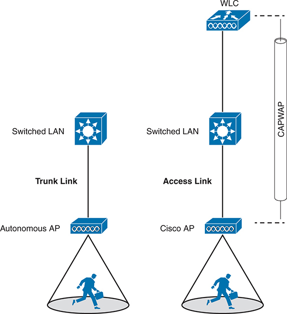

<figcaption>

<aside class="hidden" id="a04fig01">

图分为两部分。左侧：自治 AP 连接。交换式 LAN：连接到局域网（LAN）中的网络交换机。中继链路：交换机与自治 AP 之间的连接标为中继链路。自治 AP：独立运行的接入点。客户端：使用设备连接自治 AP 的用户，位于锥形覆盖区域内。右侧：Cisco AP 连接。WLC（无线 LAN 控制器）：集中管理多台 Cisco AP 的控制器。交换式 LAN：连接到局域网（LAN）中的网络交换机。接入链路：交换机与 Cisco AP 之间的连接标为接入链路。CAPWAP 隧道：表示用于管理 Cisco AP 的无线接入点控制和配置协议，以标有 CAPWAP 的竖直虚线表示。Cisco AP：由无线 LAN 控制器管理的接入点。客户端：使用设备连接 Cisco AP 的用户，位于锥形覆盖区域内。此图突出展示了自治 AP 和 Cisco AP 使用的不同网络配置和连接类型。自治 AP 独立运行，通过中继链路连接交换式 LAN；Cisco AP 则由无线 LAN 控制器通过 CAPWAP 隧道管理，并通过接入链路连接交换式 LAN。

</aside>

<strong>图 4-1</strong> <em>比较自治 AP 与 Cisco AP 的连接</em>

</figcaption>

</figure>

通常，通过浏览器会话访问 WLC 来管理 Cisco AP 最为高效。不过，也可以使用串行控制台电缆，将 PC 直接连接到 AP 的控制台端口，以监视其启动过程，或在需要时进行一些基本配置更改。AP 正常运行并拥有 IP 地址后，还可以使用 Telnet 或 SSH 通过有线网络连接到其 CLI。

</section>

<section>

<h3 class="h3" id="ch04lev1sec4">访问 Cisco WLC</h3>

要连接并配置 WLC，需要打开 Web 浏览器，通过 HTTP 或 HTTPS 访问 WLC 的管理地址。只有在 WLC 已具备初始配置、管理接口已分配管理 IP 地址，并已生成供 HTTPS 使用的有效 SSL 证书之后，才能这样操作。基于 Web 的 GUI 为监视、配置和排查无线网络故障提供了有效方式。也可以通过 SSH 会话连接 WLC，使用其 CLI 监视、配置和调试运行活动。

基于 Web 的 GUI 和 CLI 都要求管理用户登录。用户身份可以通过内部的本地用户名列表进行验证，也可以通过 TACACS+ 或 RADIUS 等身份验证、授权和记账（AAA）服务器进行验证。

首次在 Web 浏览器中打开管理地址时，将看到初始登录界面。单击<strong>登录（Login）</strong>按钮，如<a href="#ch04fig02">图 4-2</a>（IOS-XE 控制器）和<a href="#ch04fig03">图 4-3</a>（AireOS 控制器）所示，然后根据提示输入用户凭据。

<figure class="image-c" id="ch04fig02">

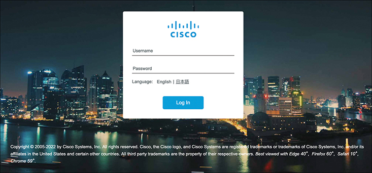

<figcaption>

<aside class="hidden" id="a04fig02">

通过 Web 浏览器访问该网站。界面显示用户名和密码字段、语言选择选项（英语和日语）以及 Log In（登录）按钮。背景是一幅夜间城市天际线照片。

</aside>

<strong>图 4-2</strong> <em>通过 Web 浏览器访问 IOS-XE WLC</em>

</figcaption>

</figure>

<figure class="image-c" id="ch04fig03">

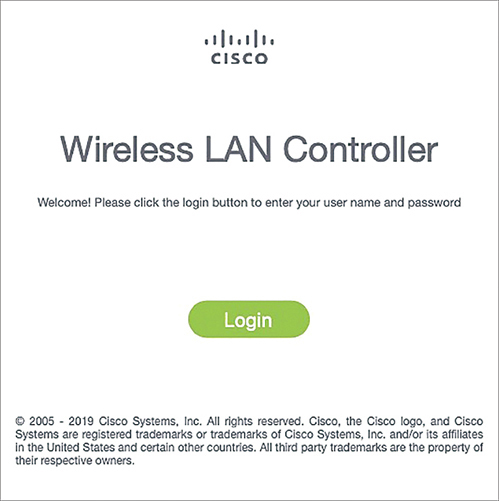

<figcaption>

<aside class="hidden" id="a04fig03">

通过 Web 浏览器访问该网站。界面显示欢迎消息和绿色的 Login（登录）按钮，顶部显示 Cisco 标志。底部是 2005–2019 年的版权声明，说明 Cisco、Cisco 标志和 Cisco Systems 是 Cisco Systems, Inc. 及／或其关联公司在美国及某些其他国家／地区的注册商标或商标。所有第三方商标均归其各自所有者所有。

</aside>

<strong>图 4-3</strong> <em>通过 Web 浏览器访问 AireOS WLC</em>

</figcaption>

</figure>

注意

CCNA 考试目标侧重于使用 WLC GUI 配置 WLAN 和安全套件。因此，本节示例假定已经有人输入初始配置，为 WLC 设置了可用于管理的有效 IP 地址。

成功登录后，WLC 会显示一个监控仪表板，类似于<a href="#ch04fig04">图 4-4</a>（IOS-XE）和<a href="#ch04fig05">图 4-5</a>（AireOS）所示的界面。这里无法更改配置，因此必须选择左侧栏中的<strong>配置（Configuration）</strong>（IOS-XE），或单击右上角的<strong>高级（Advanced）</strong>链接（AireOS）。

<figure class="image-c" id="ch04fig04">

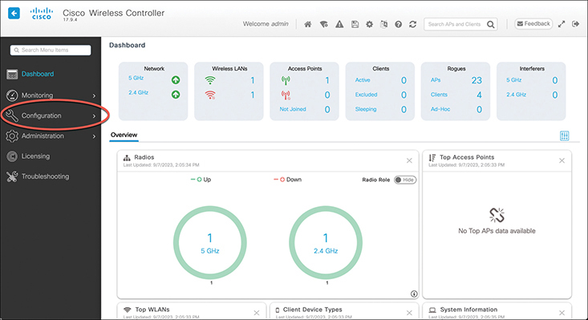

<figcaption>

<aside class="hidden" id="a04fig04">

页眉区域显示 Cisco 标志及旁边的 Cisco Wireless Controller 文字、Welcome admin 欢迎消息，以及标为 Search any APIs and Clicks 的搜索栏。右上角有通知、设置、帮助和用户反馈等图标。左侧栏是纵向菜单，包含仪表板、监控、配置（Configuration，用红圈突出标记）、管理、许可和故障排除选项。主仪表板顶部划分为多个矩形区域，显示各项指标和状态：网络（显示两个网络图标）、无线 LAN（显示一个活动的无线局域网）、接入点（一个接入点标为 Not Joined，即未加入）、客户端（活动：0，已排除：0，休眠：0）、非授权设备（Ad Hoc：0，Self：0），以及干扰（2.4 GHz 和 5 GHz 的指标均为 0）。概览区域包含一个无线电面板，其中两个圆形仪表分别显示 5 GHz 和 2.4 GHz 的 Up 和 Down 状态，两者都显示数字 1，表示活动无线电。Top Access Points（排名靠前的接入点）面板目前显示 No Top APs data available，即没有相关 AP 数据。图中突出显示的主要操作是选择左侧栏的 Configuration 选项，以访问 IOS-XE WLC 配置菜单。

</aside>

<strong>图 4-4</strong> <em>访问 IOS-XE WLC 配置菜单</em>

</figcaption>

</figure>

<figure class="image-c" id="ch04fig05">

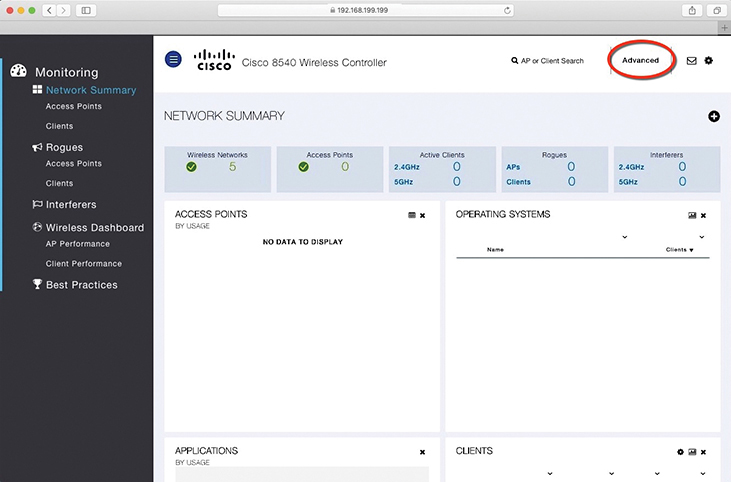

<figcaption>

<aside class="hidden" id="a04fig05">

图顶部的 URL 栏显示 https://192.168.199.199，表明这是基于 Web 的界面。其下方左侧显示 Cisco 标志和 Cisco 8540 Wireless Controller 文字，右侧有 AP or Client Search（AP 或客户端搜索）选项以及 Advanced（高级）链接；后者用红圈标出，突出说明如何访问高级设置。界面分为左侧栏和中央内容区。左侧栏标题为 Monitoring（监控），菜单包含网络摘要、接入点、客户端、非授权设备（子项为接入点和客户端）、干扰源、无线仪表板（子项为 AP 性能和客户端性能）以及最佳实践。中央内容区标题为 Network Summary（网络摘要），顶部有多个状态指标：无线网络数为 5，接入点数为 6，活动客户端数为 0，2.4 GHz 和 5 GHz 频段的 AP 数各为 0，非授权设备数为 0，干扰源数为 0。这些指标下方有四个主要面板：按使用量排列的接入点（当前显示 NO DATA TO DISPLAY，即无数据可显示）、操作系统（空面板，无数据）、按使用量排列的应用程序（同样为空，无数据）以及客户端（也为空，无数据）。

</aside>

<strong>图 4-5</strong> <em>访问 AireOS WLC 高级配置界面</em>

</figcaption>

</figure>

在 IOS-XE WLC 上，可以从一个较长的配置类别列表中进行选择，如<a href="#ch04fig06">图 4-6</a> 所示。相比之下，AireOS WLC 在屏幕顶部显示选项卡，如<a href="#ch04fig07">图 4-7</a> 所示，并在屏幕左侧列出相应功能。学习本章后续内容时，你将逐渐了解在这两类控制器上应使用哪些菜单和列表项。

<figure class="image-c" id="ch04fig06">

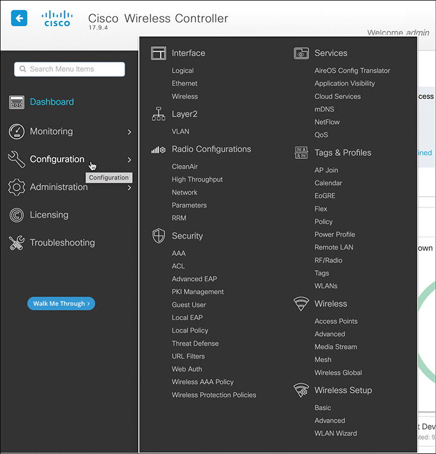

<figcaption>

<aside class="hidden" id="a04fig06">

左侧栏纵向显示多个菜单选项：仪表板（已选中）、配置（已选中并突出显示，光标正指向它）、监控、管理、许可和故障排除。菜单项下方有一个标为 Walk Me Through（引导我操作）的蓝色按钮。右侧主区域展开 Configuration（配置）菜单，展示按接口、第二层、无线电配置、安全、服务、标签和配置文件、无线以及无线设置分类的各种选项。接口类别包含逻辑、以太网和无线选项。第二层类别列出 VLAN（虚拟局域网）。无线电配置包含 CleanAir、高吞吐量、网络、参数和 RRM（无线电资源管理）。安全部分包含 AAA（身份验证、授权和记账）、ACL（访问控制列表）、高级 EAP（可扩展身份验证协议）、AP 管理、访客用户、本地 EAP、对等通信、Thread Defense、URL 过滤器、Web 身份验证、无线 AAA 策略和无线防护策略。服务类别包含 AireOS 配置转换器、应用可视性、云服务、Flex-Connect、Hotspot 2.0 和 QoS（服务质量）。标签和配置文件类别包含 AP 加入、日历、EdRRM（增强型无线电资源管理）、Flex、策略、RF 配置文件、RRM/RF、站点标签和 WLAN（无线局域网）。无线部分列出接入点、高级、媒体流和 Mesh。无线设置类别提供高级和 WLAN 向导选项。界面右上角显示当前用户为 admin。背景顶部是一条浅蓝色横栏，左侧有 Cisco 标志。

</aside>

<strong>图 4-6</strong> <em>IOS-XE WLC 配置菜单</em>

</figcaption>

</figure>

<figure class="image-c" id="ch04fig07">

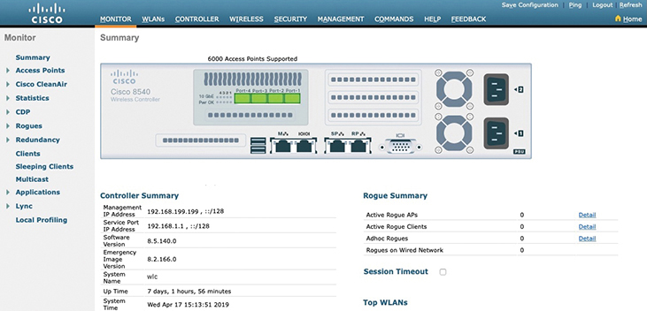

<figcaption>

<aside class="hidden" id="a04fig07">

图顶部是导航菜单，包含监控、WLAN、控制器、无线、安全、管理、命令、帮助和反馈选项卡，右侧有保存配置、注销和刷新选项。菜单下方的左侧栏包含指向各部分的链接，包括摘要、接入点、客户端、Cisco CleanAir、统计信息、日志记录、移动性、安全、威胁防御、休眠客户端、高级、本地分析和事件日志。屏幕中央以图形形式展示 Cisco 8540 无线 LAN 控制器，说明最多支持 6000 个接入点，并显示标为 MGT、HA、RP-A、RP-B、SPA 和 SPB 的端口及指示灯，以及多个系统状态 LED 和按钮。其下方有两张摘要表：左侧的控制器摘要提供管理 IP 地址（192.168.199.9/32）、冗余端口 IP 地址（169.254.1.1）、软件版本（8.5.140.0）、引导加载程序版本（8.0.140.0）、现场恢复映像版本（8.1.131.0）、固件版本（8.5.140.0）、系统名称（WLC）、运行时间（3 天 7 小时 55 分钟）和系统时间（Fri Feb 8 13:55:13 2019）。右侧的非授权设备摘要表显示活动非授权接入点、活动非授权客户端、Ad hoc 非授权设备和有线网络中的非授权设备均为 0。此外还有带详情链接的会话超时条目，以及 Top WLANs 区域，但未列出具体 WLAN。

</aside>

<strong>图 4-7</strong> <em>AireOS WLC 高级配置类别</em>

</figcaption>

</figure>

</section>

<section>

<h3 class="h3" id="ch04lev1sec5">连接 Cisco WLC</h3>

Cisco 无线 LAN 控制器（WLC）提供多种不同类型的端口和连接。以下各节将详细解释这些连接类型。本章后面针对 IOS-XE 和 AireOS 的“<a href="#ch04lev1sec6">配置 WLAN</a>”部分将进一步介绍 WLC 端口的配置。

<section>

<h4 class="h4" id="ch04lev2sec1">WLC 物理端口</h4>

WLC 有多种可以连接到网络的物理端口，如<a href="#ch04fig08">图 4-8</a> 所示。例如，可以连接串行<em>控制台端口</em>，执行初始启动功能和系统恢复。以太网<em>服务端口</em>用于通过 SSH 或 Web 浏览器进行带外管理，有时也称为<em>设备管理接口</em>。<em>冗余端口</em>用于连接对等控制器，以实现高可用性（HA）运行。

<figure class="image-c" id="ch04fig08">

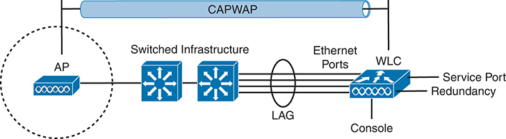

<figcaption>

<aside class="hidden" id="a04fig08">

过程从连接到交换式基础设施的接入点（AP）开始，基础设施以网络交换机图标表示。流量经由此基础设施，通过链路聚合组（LAG）传送到 WLC 的多个以太网端口。图中还展示无线接入点控制和配置（CAPWAP）协议，它通过隧道在 AP 与 WLC 之间传送流量。WLC 配备多个端口：串行控制台端口用于初始启动功能和系统恢复；以太网服务端口用于通过安全外壳（SSH）或 Web 浏览器进行带外管理，也称设备管理接口；冗余端口用于连接对等控制器，以确保高可用性（HA）运行。

</aside>

<strong>图 4-8</strong> <em>无线 LAN 控制器的物理端口</em>

</figcaption>

</figure>

控制器还具有多个必须连接到网络的以太网端口。这些端口承载进出控制器的大部分数据。例如，延伸到控制器各台 AP 的 CAPWAP 控制隧道和数据隧道都会经过这些端口。此外，使用 Web 浏览器、SSH、简单网络管理协议（SNMP）、简单文件传输协议（TFTP）等产生的管理流量，通常也通过这些端口以带内方式到达控制器。

注意

AireOS 控制器上的以太网端口称为<em>分布系统端口</em>。你也许会觉得，外观看似普通的数据端口却采用了一个奇怪的名称。回顾<a href="v2-01.html#ch01">第 1 章</a>“<a href="v2-01.html#ch01">无线网络基础</a>”中的“<a href="v2-01.html#ch01lev1sec4">无线 LAN 拓扑</a>”一节，将 AP 连接在一起的有线网络称为分布系统（DS）。在分离 MAC 架构中，AP 与 DS 的连接点被移到了上游的 WLC 上。

由于以太网端口必须承载属于许多不同 VLAN 的数据，VLAN 标签和编号就十分重要。本章稍后将介绍控制器如何将 VLAN 映射到无线 LAN。IOS-XE 控制器的以太网端口应始终配置为在 802.1Q 中继模式下工作。AireOS 控制器端口只能以中继模式工作，不能配置为其他模式。将控制器端口连接到交换机时，也应将相应交换机端口配置为无条件的 802.1Q 中继模式，以保持匹配。

控制器的以太网端口可以独立工作，每个端口将多个 VLAN 的数据传送到一组特定的控制器内部接口。为提高故障恢复能力，可以将端口配置为链路聚合组（LAG），把它们捆绑成一条更大的链路，其方式类似于交换机上的 EtherChannel 或端口通道。事实上，与控制器端口相连的交换机端口也必须配置为端口通道。采用 LAG 配置后，流量可以在组成 LAG 的各个端口之间实现负载均衡。此外，LAG 还提供故障恢复能力；如果一个或多个端口发生故障，流量将被重定向到其余正常工作的端口。

Cisco 无线控制器必须在无线 LAN 与有线 VLAN 之间提供必要的连接。控制器可以通过物理以太网端口接入 VLAN，而 WLAN 则经由 CAPWAP 隧道承载并在控制器内部终止。因此，控制器必须使用内部动态接口在 VLAN 与 WLAN 之间建立映射，如<a href="#ch04fig09">图 4-9</a> 所示。

<figure class="image-c" id="ch04fig09">

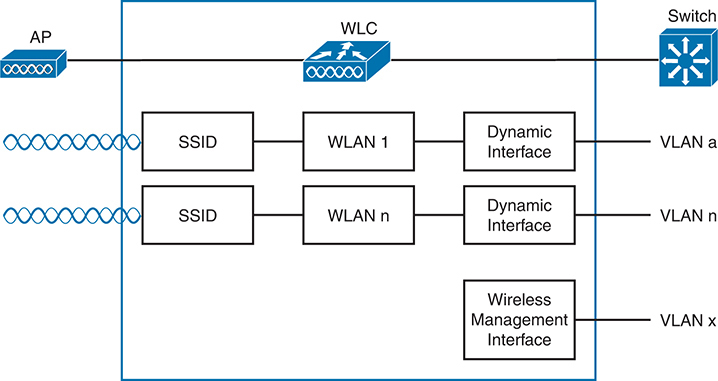

<figcaption>

<aside class="hidden" id="a04fig09">

图展示 WLC 如何管理多个 SSID 和 WLAN，将它们动态映射到特定 VLAN，并与交换机配合管理网络流量和无线网络。图左侧有两个接入点（AP），以标有 AP 的矩形图标表示，波浪线向 WLC 延伸，表示无线通信。WLC 位于中央，以标有 WLC 的方框表示。框内有标为 SSID、WLAN 1 和 WLAN n 的区域，表示 WLC 管理的不同服务集标识符（SSID）和无线局域网（WLAN）。每个 SSID 连接对应的 WLAN，后者再连接独立的动态接口块，负责将 WLAN 映射到特定 VLAN。图右侧是一台交换机，以带有网络符号的矩形图标表示。交换机通过不同 VLAN 连接 WLC：VLAN a 和 VLAN n 分别连接 WLAN 1 和 WLAN n 对应的动态接口块；无线管理接口连接 VLAN x，表示用于管理无线流量的专用接口。

</aside>

<strong>图 4-9</strong> <em>无线 LAN 控制器的逻辑端口</em>

</figcaption>

</figure>

IOS-XE 控制器的动态接口工作在第二层，因此控制器不需要在每个 VLAN 上配置第三层 IP 地址。相比之下，AireOS 控制器必须为每个连接 VLAN 的动态接口配置 IP 地址、子网掩码、默认网关以及动态主机配置协议（DHCP）服务器。

IOS-XE 和 AireOS 两种控制器平台都需要无线管理接口（WMI），用于所有带内管理流量。该接口用于常规管理流量，例如 RADIUS 用户身份验证、WLC 间通信、基于 Web 和 SSH 的会话、SNMP、网络时间协议（NTP）、syslog 等。管理接口还用于终止控制器与其 AP 之间的 CAPWAP 隧道。

WMI 使用 IP 地址、子网掩码和默认网关，使控制器能够在网络上通信。WMI 通常连接到上游交换机的管理 VLAN。在 IOS-XE 控制器上，WMI 实际上是一个交换虚拟接口（SVI），拥有整台控制器唯一配置的 IP 地址。

虚拟接口仅用于某些面向客户端的操作。例如，无线客户端发出获取 IP 地址的请求时，控制器可以将请求中继到能够提供适当 IP 地址的实际 DHCP 服务器。从客户端的角度看，DHCP 服务器似乎就是控制器的虚拟接口地址。客户端可能会看到虚拟接口地址，但控制器与交换网络上的其他设备通信时绝不会使用该地址。应为虚拟接口配置一个唯一且不可路由的地址，例如 RFC 1918 所定义的私有地址空间内的 10.1.1.1。

虚拟接口地址也用于支持客户端移动。因此，同一移动组中的每台控制器都应配置相同的虚拟地址。使用一个共同的虚拟地址后，当客户端在控制器之间漫游时，所有控制器看起来就像一个集群一样工作。

</section>

</section>

<section>

<h3 class="h3" id="ch04lev1sec6">配置 WLAN</h3>

无线 LAN 控制器与接入点协同工作，为无线客户端提供网络连接。从无线侧看，AP 通告一个服务集标识符（SSID），供无线客户端加入。从有线侧看，控制器通过某个动态接口连接到虚拟 LAN（VLAN）。要完成 SSID 与 VLAN 之间的路径，如<a href="#ch04fig10">图 4-10</a> 所示，必须先在控制器上定义一个 WLAN。

注意

CCNA 的两个考试目标涉及仅通过控制器 GUI 配置 WLAN，使用 WPA2 和 PSK 提供客户端连接。本节提供一个基于<a href="#ch04fig10">图 4-10</a> 拓扑的完整 WLAN 示例，采用 WPA2-Personal（PSK）安全模型。

<figure class="image-c" id="ch04fig10">

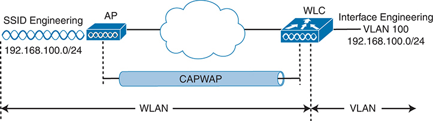

<figcaption>

<aside class="hidden" id="a04fig10">

图展示将 SSID（服务集标识符）连接到 VLAN（虚拟局域网）时的数据流和相关组件。左侧名为 Engineering 的 SSID 对应 IP 地址范围 192.168.100.0/24。该 SSID 连接接入点（AP），AP 是允许无线设备连接到有线网络的设备。AP 通过云状网络连接无线 LAN 控制器（WLC），表示管理 AP 与 WLC 间通信的 CAPWAP（无线接入点控制和配置）隧道。WLC 处理无线网络的控制和数据策略。它连接到 Engineering 接口的 VLAN 100，后者也对应 IP 地址范围 192.168.100.0/24。图进一步说明 WLAN 连接无线设备，而 VLAN 将这些连接整合到有线网络基础设施中。

</aside>

<strong>图 4-10</strong> <em>使用 WLAN 连接有线和无线网络</em>

</figcaption>

</figure>

控制器将 WLAN 绑定到某个动态接口，然后默认把 WLAN 配置推送到其所有 AP。从此，无线客户端就能通过接收信标获知新 WLAN，并能够探测和加入新的 BSS。

与 VLAN 一样，可以使用 WLAN 将无线用户及其流量划分到不同的逻辑网络中。关联到一个 WLAN 的用户无法进入另一个 WLAN，除非其流量通过有线网络基础设施，在 VLAN 之间进行桥接或路由。

创建新 WLAN 之前，通常最好先规划无线网络。在大型企业中，可能需要支持多种无线设备、用户群体和安全策略等。你或许会想针对每种情况创建一个新 WLAN，以隔离不同用户群体或支持不同类型的设备。虽然这种策略很有吸引力，但应注意两个限制：

<ul class="sq">

<li>
Cisco 控制器最多支持 512 个 WLAN，但一台 AP 上只能配置并启用其中的 16 个。
</li>

<li>
向潜在无线客户端通告每个 WLAN 都会消耗宝贵的空口时间。
</li>

</ul>

每台 AP 都必须定期广播信标管理帧，以通告 BSS 的存在。由于每个 WLAN 都绑定到一个 BSS，因此每个 WLAN 都必须使用自己的信标进行通告。信标通常以最低的强制数据速率每秒发送 10 次，即每 100 ms 发送一次。创建的 WLAN 越多，通告它们所需的信标也就越多。

而且，强制数据速率越低，传输每个信标所需的时间就越长。最终结果是：如果创建过多 WLAN，信道的可用空口时间可能耗尽。由于信道忙于传输来自 AP 的信标，客户端将难以传输自己的数据。按照经验，应始终将 WLAN 数量限制在五个以内；最好不超过三个。

默认情况下，控制器只有有限的初始配置，因此尚未定义任何 WLAN。创建新 WLAN 之前，请考虑它需要哪些参数：

<ul class="sq">

<li>
SSID 字符串
</li>

<li>
控制器接口和 VLAN 编号
</li>

<li>
所需的无线安全类型
</li>

</ul>

以下各节先演示如何在 IOS-XE 控制器上创建 WLAN，然后演示 AireOS 控制器上的操作。每个配置步骤都通过连接到 WLC 管理 IP 地址的 Web 浏览器会话执行。

<section>

<h4 class="h4" id="ch04lev2sec2">在 IOS-XE WLC 上配置 WLAN</h4>

IOS-XE 无线控制器平台功能丰富而强大，可以精细控制无线网络配置的每个部分。可以采用全局方式，让网络中的所有 AP 使用相同配置，也可以根据 AP 的位置或其他共同要求定制配置。例如，企业可能有多栋建筑。你可能希望某栋建筑内的 AP 仅在一个频段上提供 WLAN，或者希望某组 AP 仅提供完整 WLAN 列表中的一部分。在其他建筑中，则可能需要支持另一组限制条件。

使用 IOS-XE 控制器，可以配置并应用三大类用于定义 AP 运行方式的参数：

<ul class="sq">

<li>
<strong>策略（Policy）：</strong>定义各无线 LAN 及其安全策略的设置。
</li>

<li>
<strong>站点（Site）：</strong>按站点影响 AP 与控制器及 CAPWAP 关系，以及 FlexConnect 行为的设置。
</li>

<li>
<strong>射频（RF）：</strong>定义各无线频段射频运行方式的设置。
</li>

</ul>

这三类设置通过配置<em>文件（profile）</em>和<em>标签（tag）</em>应用到网络中的每台 AP。可以定义包含所需自定义设置的策略、站点和 RF 配置文件，然后为每台 AP 打上标签，标识其应使用哪些策略、站点和 RF 配置文件。<a href="#ch04fig11">图 4-11</a> 展示这一概念，并列出每类配置文件中可自定义的相关参数。

<figure class="image-c" id="ch04fig11">

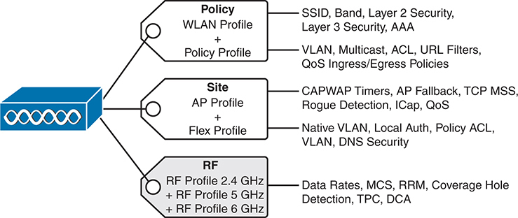

<figcaption>

<aside class="hidden" id="a04fig11">

图分为三个主要部分，分别表示策略、站点和 RF（射频）配置文件。策略部分组合 WLAN 配置文件和策略配置文件，包含 SSID（服务集标识符）、频段、第二层安全、第三层安全和 AAA（身份验证、授权和记账）设置，还包括 VLAN（虚拟局域网）、组播、ACL（访问控制列表）、URL 过滤器以及 QoS（服务质量）入站／出站策略。站点部分组合 AP 配置文件和 Flex 配置文件，包含 CAPWAP（无线接入点控制和配置）计时器、AP 回退、TCP MSS（最大报文段大小）、非授权设备检测、ICAP（入侵检测和防御）以及 QoS，还包括本征 VLAN、本地身份验证、策略 ACL、VLAN 和 DNS 安全设置。RF 部分包含 2.4 GHz、5 GHz 和 6 GHz 的 RF 配置文件，涵盖数据速率、MCS（调制与编码方案）、RRM（无线电资源管理）、覆盖盲区检测、TPC（发射功率控制）和 DCA（动态信道分配）。图左侧有一个蓝色网络设备图标，带七个相互连接的圆圈，表示控制器；配置文件和标签从这里分出，连接各自的配置设置和参数，用于管理网络环境中的 WLAN、AP 和 RF 配置。

</aside>

<strong>图 4-11</strong> <em>使用 IOS-XE 控制器的配置文件和标签配置 AP</em>

</figcaption>

</figure>

注意

虽然可以精细调整各种 AP 选项，但 CCNA 考试只关注 WLAN 配置文件和策略配置文件，以及如何通过策略标签将它们映射到 AP。换句话说，只需关注<a href="#ch04fig11">图 4-11</a> 中最上方标签相关的内容。CCNP ENCOR 考试会更详细地介绍其他标签和配置文件。

策略标签映射两种不同的配置文件：WLAN 配置文件定义 AP 将提供的 SSID 列表及 WLAN 安全设置；策略配置文件定义 AP 如何处理各类流量。

可以依次进入 <strong>Configuration &gt; Wireless Setup &gt; WLANs</strong>，然后选择 <strong>Start Now（立即开始）</strong>按钮，开始配置新 WLAN。控制器将显示一条“时间线”，即可以配置的所有配置文件和标签的完整操作顺序，如<a href="#ch04fig12">图 4-12</a> 所示。针对 CCNA 学习，本章只讨论图中突出显示的项目。

<figure class="image-c" id="ch04fig12">

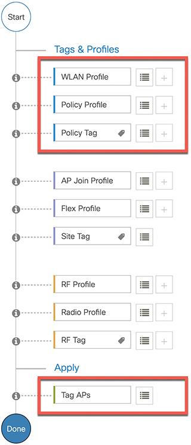

<figcaption>

<aside class="hidden" id="a04fig12">

图展示 IOS-XE 标签和配置文件的配置顺序界面，采用从顶部 Start（开始）到下方 Done（完成）的纵向流程图。红框突出显示 Tags and Profiles（标签和配置文件）以及 Apply（应用）部分中的相关项目。第一组突出显示的项目位于标签和配置文件部分，包含三个字段：WLAN Profile（WLAN 配置文件），带添加（加号）和列出详情（列表图标）按钮；Policy Profile（策略配置文件），带同样的添加和列表按钮；Policy Tag（策略标签），带添加、列表和编辑（铅笔图标）按钮。第二组突出显示的项目位于应用部分，包含 Tag APs（为 AP 添加标签）字段及列出详情的列表按钮。未突出显示的部分还包括标签和配置文件区域中的 AP Join Profile（AP 加入配置文件）、Flex Profile（Flex 配置文件），两者都有添加和列表按钮，以及带编辑按钮的 Site Tag（站点标签）。此外，应用部分还包含 RF Profile（RF 配置文件）、Radio Profile（无线电配置文件），两者都有添加和列表按钮，以及带编辑按钮的 RF Tag（RF 标签）。

</aside>

<strong>图 4-12</strong> <em>IOS-XE 标签和配置文件的配置顺序</em>

</figcaption>

</figure>

从图中可以看出，配置新 WLAN 需要以下四个步骤：

步骤 1。配置 WLAN 配置文件。

步骤 2。配置策略配置文件。

步骤 3。将 WLAN 配置文件和策略配置文件映射到策略标签。

步骤 4。将策略标签应用到一些 AP。

执行下面的 WLAN 配置步骤时，请注意，可以选择 Tags &amp; Profiles 任务序列中的小“列表”图标（见<a href="#ch04fig12">图 4-12</a>），显示控制器上已有的相关配置文件或标签。随后可以从列表中选择一项进行编辑，或选择 <strong>Add（添加）</strong>按钮创建新项。也可以选择配置文件或标签项目右侧的小 +（加号）图标，直接开始创建新的配置文件或标签。

<section>

<h5 class="h5" id="ch04lev3sec1">步骤 1：配置 WLAN 配置文件</h5>

选择 WLAN Profile 右侧的 <strong>+</strong> 图标。从 Add WLAN &gt; General 选项卡开始，如<a href="#ch04fig13">图 4-13</a> 所示，系统会提示输入 WLAN 配置文件名称和 SSID 的文本字符串（1–32 个字符）。默认情况下，WLAN 配置文件名称会复制到 SSID 字段中，但可以按需编辑。WLAN ID 只是一个用于索引控制器上各个已配置 WLAN 的数字。

<figure class="image-c" id="ch04fig13">

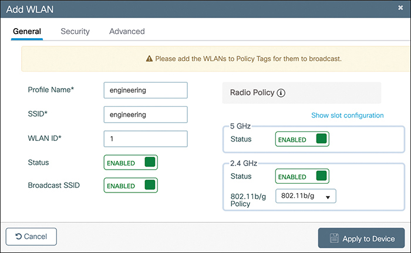

<figcaption>

<aside class="hidden" id="a04fig13">

窗口顶部有三个选项卡：General（常规）、Security（安全）和 Advanced（高级）。常规选项卡中的配置字段包括 Profile Name（配置文件名称），已输入 engineering；SSID，也已输入 engineering；以及 WLAN ID，指定为 1。Status（状态）切换开关设为 ENABLED（已启用），表示 WLAN 处于活动状态；Broadcast SSID（广播 SSID）开关同样设为 ENABLED，表示向客户端广播 SSID。右侧 Radio Policy（无线电策略）部分有 Show slot configuration（显示插槽配置）选项。5 GHz 状态为 ENABLED，表示该频段已启用；2.4 GHz 状态也为 ENABLED，其下的下拉菜单选中 802.11b/g，表示该频段使用的无线标准。底部有两个按钮：左侧 Cancel（取消）用于取消配置过程，右侧 Apply to Device（应用到设备）用于将设置应用到设备。窗口顶部的通知横幅提示：请将 WLAN 添加到策略标签中，以便进行广播。

</aside>

<strong>图 4-13</strong> <em>配置 WLAN 的常规参数</em>

</figcaption>

</figure>

可以将 WLAN Status 改为 Enabled，使其投入使用。还应启用 Broadcast SSID，允许 AP 向潜在无线客户端通告该 SSID。

General 选项卡还允许选择 WLAN 使用哪些频段。默认情况下，所有受支持频段都已启用，让无线客户端根据自身内部算法选择频段。

由于 2.4 GHz 频段经常被附近无关网络挤占，可以在自己的 AP 上禁用该频段，改用更高的频段。5 GHz 和 6 GHz 频段（<a href="#ch04fig13">图 4-13</a> 未显示 6 GHz 频段）中相互竞争的 AP 少得多，而且性能好得多，这些特性很适合语音和视频等无线应用。在 2.4 GHz 频段上，还可以选择要使用的 802.11 策略。默认支持 802.11b 和 802.11g 两项修订。可以选择 <strong>802.11g-only</strong>，彻底禁用 802.11b 设备使用的较慢旧式数据速率。

接下来选择 <strong>Security（安全）</strong>选项卡，配置 WLAN 安全参数。<a href="#ch04fig14">图 4-14</a> 展示 Layer2 选项卡的内容。请注意，屏幕横向排列着 WPA+WPA2、WPA2+WPA3、WPA3、Static WEP 和 None 选项。与本章示例场景（以及 CCNA 考试）相关的选项已在图中突出显示。该场景使用 WPA2 和 PSK，因此可以选择 WPA+WPA2 或 WPA2+WPA3，然后进入 WPA Parameters 部分，取消勾选不需要使用的 WPA 版本。

<figure class="image-c" id="ch04fig14">

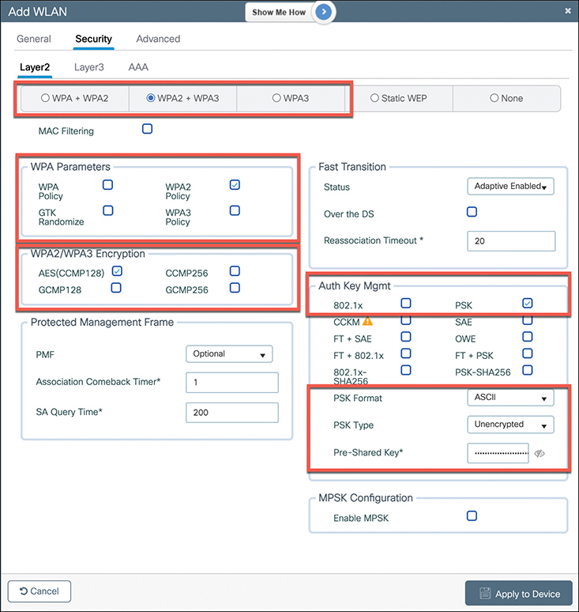

<figcaption>

<aside class="hidden" id="a04fig14">

屏幕分为多个部分，每个部分都允许配置不同的安全设置。第一处突出显示的是 WPA Parameters（WPA 参数）框，包含 WPA Policy、WPA2 Policy、WPA3 Policy 和 GTK（组临时密钥）Rekeying Interval 复选框。此处允许选择不同 WPA（Wi-Fi 保护访问）版本的策略，并设置组临时密钥的更新间隔。第二处是 WPA2/WPA3 Encryption（WPA2/WPA3 加密），提供加密方法选项，包括 128 位和 256 位密钥的 AES（高级加密标准），以及 128 位和 256 位密钥的 GCMP（伽罗瓦／计数器模式协议）。第三处是 Auth Key Mgmt，即身份验证密钥管理，提供身份验证类型选项，包括 802.1x、PSK（预共享密钥）、SAE（同时对等身份验证）、FT-802.1x、FT-PSK、PSK-SAE、802.1x-PSK、802.1x-SAE、802.1x-FTSAE 和 PSK-SAE。这里还有用于选择 PSK 格式（ASCII 或 Unspecified）的下拉菜单，以及输入预共享密钥的字段。屏幕其他部分包含 MAC 过滤、快速过渡、受保护的管理帧（PMF）和 MPSK（多预共享密钥）配置。

</aside>

<strong>图 4-14</strong> <em>配置 WLAN 的安全参数</em>

</figcaption>

</figure>

采用 WPA2 策略时，可以选择 <strong>AES(CCMP128)</strong> 加密（默认值）和 <strong>PSK</strong>，然后输入预共享密钥文本字符串（8–63 个 ASCII 字符）。也可以根据需要，以十六进制字符串形式输入 PSK（恰好 64 位）。

在<a href="#ch04fig14">图 4-14</a> 的 Auth Key Mgmt 部分，请注意 PSK 已勾选，而 802.1x 未勾选。如果希望 WLAN 改用 WPA2 Enterprise，则必须启用 802.1x，以支持用户身份验证以及用于交换加密密钥材料的 EAPOL 四次握手。还需要在 Security &gt; AAA 选项卡中定义 RADIUS、ISE 或 LDAP 服务器。

你可能希望允许使用 802.11r，也称快速过渡（FT），以简化客户端在 WLAN 内移动时的漫游和重新身份验证。FT 选项显示在 Fast Transition 部分。默认启用 FT 自适应模式，允许支持和不支持 802.11r 的客户端混合使用。

Security &gt; Layer3 选项卡包含少量与 Web 身份验证（webauth）相关的参数，如<a href="#ch04fig15">图 4-15</a> 所示。<a href="#ch04fig16">图 4-16</a> 展示 Security &gt; AAA 选项卡，在其中可以应用包含用户身份验证 AAA 服务器的身份验证列表。也可以启用 Local EAP Authentication，让控制器承担 RADIUS 功能，代替专用外部服务器。

<figure class="image-c" id="ch04fig15">

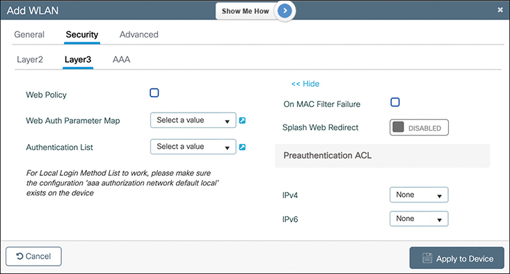

<figcaption>

<aside class="hidden" id="a04fig15">

顶部标题为 Add WLAN，下方有 General（常规）、Security（安全）和 Advanced（高级）三个主选项卡，其中 Security 已选中。主选项卡下方有 Layer 2、Layer 3 和 AAA 子选项卡，当前选中 Layer 3。该选项卡显示多个选项和字段。左侧第一部分有未勾选的 Web Policy（Web 策略）复选框、标为 Web Auth Parameter Map（Web 身份验证参数映射）的下拉菜单（占位文字为 Select a value，即选择一个值），以及同样显示 Select a value 的 Authentication List（身份验证列表）下拉菜单。下方斜体说明提示：要使本地登录方法列表生效，请确保设备上存在配置“AAA authorization network default local”。右侧有标题为 &lt;&lt; Hide for On MAC Filter Failure 的可展开部分及未勾选的复选框、标为 Splash Web Redirect 的滑动开关（DISABLED，已禁用），以及灰显且未选值的 Pre-authentication ACL（身份验证前 ACL）字段。界面底部有 IPv4 和 IPv6 两个下拉菜单，均设为 None。左下角为 Cancel（取消）按钮，右下角为 Apply to Device（应用到设备）按钮。顶部中央还有一个浮动的 Show Me How（操作指导）按钮。

</aside>

<strong>图 4-15</strong> <em>配置 WLAN 的第三层安全参数</em>

</figcaption>

</figure>

Add WLAN &gt; Advanced 选项卡包含大量选项，会影响控制器和 AP 的多种操作。<a href="#ch04fig17">图 4-17</a> 展示这些选项的前半部分。

<figure class="image-c" id="ch04fig16">

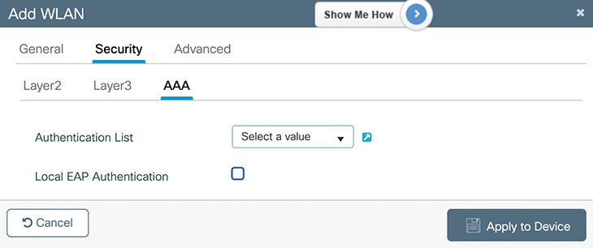

<figcaption>

<aside class="hidden" id="a04fig16">

界面顶部有 General（常规）、Security（安全）和 Advanced（高级）选项卡，当前选中 Security。其下有 Layer 2、Layer 3 和 AAA 子选项卡，当前选中 AAA。AAA 部分包括 Authentication List（身份验证列表）下拉菜单，提示用户从可用身份验证方法列表中选择一个值，以及 Local EAP Authentication（本地 EAP 身份验证）复选框，用于启用或禁用本地可扩展身份验证协议（EAP）身份验证。底部有两个按钮：左侧 Cancel（取消）用于放弃更改，右侧 Apply to Device（应用到设备）用于将配置设置应用到设备。右上角有 Show Me How（操作指导）按钮，可能提供配置 AAA 参数的更多指导或说明。

</aside>

<strong>图 4-16</strong> <em>配置 WLAN 的 AAA 参数</em>

</figcaption>

</figure>

<figure class="image-c" id="ch04fig17">

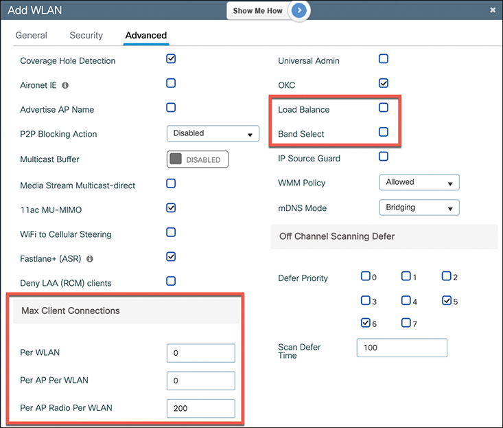

<figcaption>

<aside class="hidden" id="a04fig17">

界面包含各种配置选项，分别以复选框、下拉菜单和文本字段表示。顶部可见覆盖盲区检测、通用管理、Aironet IE、OKC、通告 AP 名称、P2P 阻塞操作、组播缓冲、媒体流组播直达、11ac MU-MIMO、Fastlane+、ASR、Wi-Fi 到蜂窝网络引导、拒绝 LAA、RQM、客户端、WMM 策略、mDNS 模式和离信道扫描延迟等选项。Load Balance（负载均衡）和 Band Select（频段选择）选项用红框突出显示，强调其重要性。左下角另一处红框突出显示 Max Client Connections（最大客户端连接数）区域，包含标为 Per WLAN（每个 WLAN）、Per AP Per WLAN（每台 AP 上的每个 WLAN）和 Per AP Radio Per WLAN（每台 AP 的每个无线电上的每个 WLAN）的文本字段，其中最后一项设为 200。

</aside>

<strong>图 4-17</strong> <em>配置 WLAN 的高级参数</em>

</figcaption>

</figure>

可以在 Max Client Connections 部分设置客户端连接负载限制。默认情况下，控制器允许每个 WLAN 的连接数不受限制（以零表示），每台 AP 上每个 WLAN 的连接数也不受限制，而每台 AP 的每个无线电上每个 WLAN 最多允许 200 个连接。请注意它们之间的细微差别：“每个 WLAN”指承载该 WLAN 的所有 AP；“每台 AP”限制任一台 AP 及其全部无线电的连接数；“每个 AP 无线电”则独立限制每个无线电的连接数。

你可能还希望让控制器决定如何允许无线客户端接入 AP 无线电。例如，可以使用 Load Balance 选项，让控制器在客户端探测和关联时，将它们分配到相邻 AP。Band Select 选项允许控制器主动影响客户端的选择：如果客户端尝试在较低且效率较差的频段上关联，就引导它们加入效率更高的频段。例如，如果附近也有可用的 5 GHz 信道，Band Select 就可以尝试阻止客户端加入 2.4 GHz 信道。

<a href="#ch04fig18">图 4-18</a> 展示 Advanced 选项卡中下半部分的选项。虽然大部分内容超出了 CCNA 考试范围，但应知道 Enable 11ax 选项（默认启用）可用于控制 WLAN 是否使用 802.11ax。

<figure class="image-c" id="ch04fig18">

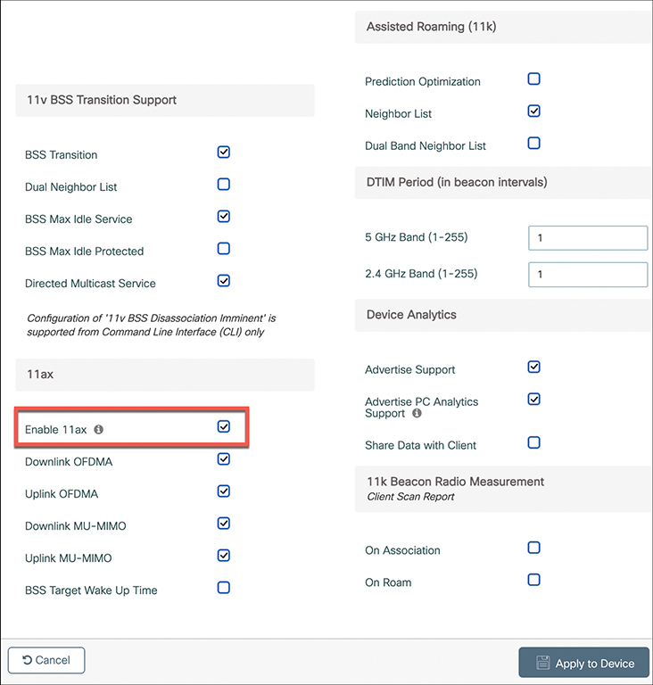

<figcaption>

<aside class="hidden" id="a04fig18">

窗口分为多个部分，每个部分包含各种选项和设置。左侧 11v BSS Transition Support（11v BSS 过渡支持）部分包含 BSS 过渡、双邻居列表、BSS 最大空闲服务和定向组播服务选项，每项都有复选框。其下说明指出，11v BSS Disassociation Imminent（即将解除关联）只能通过命令行界面（CLI）配置。再下方是 11ax 部分，主要选项 Enable 11ax（启用 11ax）被红框突出显示，复选框已勾选。其他 11ax 设置包括下行 OFDMA、上行 OFDMA、下行 MU-MIMO、上行 MU-MIMO 和 BSS 目标唤醒时间，每项均有复选框。右侧 Assisted Roaming（辅助漫游，11k）部分包含预测优化、邻居列表和双频段邻居列表选项，每项均有复选框。DTIM 周期（以信标间隔计）部分有 5 GHz 频段和 2.4 GHz 频段输入字段，两者范围均为 1–255。更下方的设备分析部分包含通告支持、通告 PC 分析支持以及与客户端共享数据选项，每项均有复选框。最后，11k 信标无线电测量部分中的客户端扫描报告选项包含关联时和漫游时，两者均有复选框。窗口底部左侧有 Cancel（取消）按钮，用于取消配置过程；右侧有 Apply to Device（应用到设备）按钮，用于将设置应用到设备。

</aside>

<strong>图 4-18</strong> <em>配置 WLAN 的其他高级参数</em>

</figcaption>

</figure>

配置并核实所有所需参数后，务必单击 <strong>Apply to Device（应用到设备）</strong>按钮，将更改提交到控制器的 WLAN 配置。控制器重新显示 WLAN 列表时，如<a href="#ch04fig19">图 4-19</a> 所示，应确认新 WLAN 已启用（浏览器页面上显示绿色向上箭头）、SSID 正确且安全设置准确。从图中可以确认，engineering SSID 已启动，并配置为使用 WPA2-PSK 和 AES。

<figure class="image-c" id="ch04fig19">

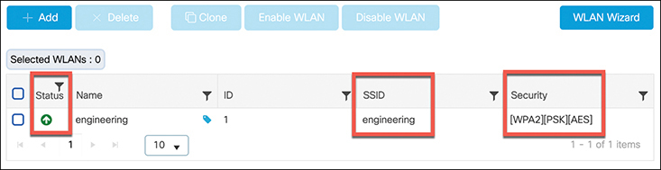

<figcaption>

<aside class="hidden" id="a04fig19">

界面顶部有 Add（添加）、Delete（删除）、Clone（克隆）、Enable WLAN（启用 WLAN）、Disable WLAN（禁用 WLAN）和 WLAN Wizard（WLAN 向导）等交互按钮，用于管理 WLAN 设置。按钮下方是一张表，列标题为状态、名称、ID、SSID 和安全。表中仅有一个条目：状态列显示带勾的绿色圆圈，表示 WLAN 已激活；名称列为 engineering；ID 列为 1；SSID 列中的服务集标识符为 engineering；安全列列出 WPA2、PSK、AES，表示 WLAN 使用 Wi-Fi 保护访问 2、预共享密钥和高级加密标准来保障安全。表格提供条目筛选和排序选项。左下角有分页导航控件，显示 1 of 1 items，表示目前只显示一条 WLAN 配置。

</aside>

<strong>图 4-19</strong> <em>验证 WLAN 配置</em>

</figcaption>

</figure>

</section>

<section>

<h5 class="h5" id="ch04lev3sec2">步骤 2：配置策略配置文件</h5>

接下来，需要创建策略配置文件，定义控制器应如何处理 WLAN 配置文件。在 Tags &amp; Profiles 任务序列中（参见<a href="#ch04fig12">图 4-12</a>），选择 Policy Profile 旁的 <strong>+</strong> 图标创建新项。如<a href="#ch04fig20">图 4-20</a> 所示，General 选项卡允许命名配置文件，并将状态设为 Enabled。

<figure class="image-c" id="ch04fig20">

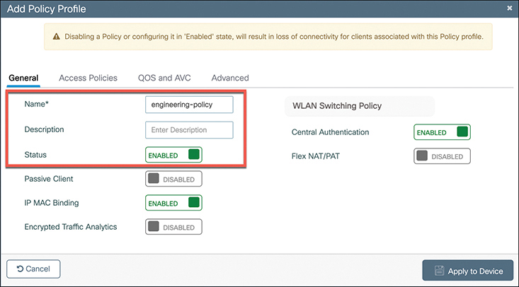

<figcaption>

<aside class="hidden" id="a04fig20">

窗口标题为 Add Policy Profile（添加策略配置文件），顶部有警告，指出禁用策略或在 Enabled 状态下配置策略会导致关联到该策略配置文件的客户端失去连接。界面分为多个选项卡，当前选中 General（常规）。该选项卡中第一处突出显示的区域包含 Name（名称）文本框，内容为 engineering-policy，以及 Description（描述）文本框，提示用户输入说明。其下方 Status（状态）通过绿色切换开关设为 Enabled（已启用）。右侧 WLAN Switching Policy（WLAN 交换策略）部分有两个选项：Central Authentication（集中身份验证），绿色开关表示已启用；Flex NAT/PAT，灰色开关表示已禁用。状态选项下还有其他设置：Passive Client（被动客户端），灰色开关表示已禁用；IP MAC Binding（IP 与 MAC 绑定），绿色开关表示已启用；Encrypted Traffic Analytics（加密流量分析），灰色开关表示已禁用。右下角有 Apply to Device（应用到设备）按钮，左下角有 Cancel（取消）按钮。

</aside>

<strong>图 4-20</strong> <em>配置策略配置文件的常规参数</em>

</figcaption>

</figure>

选择 <strong>Access Policies（访问策略）</strong>选项卡，配置控制器将映射到新 WLAN 的 VLAN。在<a href="#ch04fig21">图 4-21</a> 中，WLAN 将映射到 VLAN 100。

可以选择 <strong>QOS and AVC</strong> 选项卡，配置入站和出站服务质量（QoS）策略，以及其他语音呼叫和流量监控功能。<a href="#ch04fig22">图 4-22</a> 展示默认设置。

<figure class="image-c" id="ch04fig21">

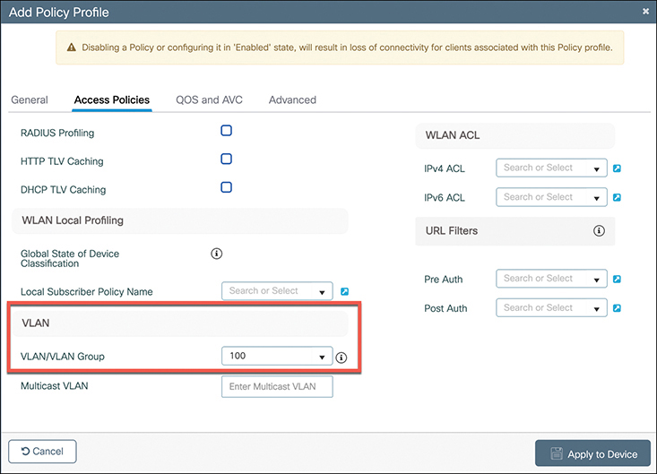

<figcaption>

<aside class="hidden" id="a04fig21">

界面顶部有 General（常规）、Access Policies（访问策略）、QOS and AVC 以及 Advanced（高级）选项卡，当前选中 Access Policies。此选项卡包含配置访问策略的多个选项和设置。左侧有多个复选框，用于启用或禁用各种分析和缓存功能，包括 RADIUS 分析、HTTP TLV 缓存、DHCP TLV 缓存和 WLAN 本地分析。其下有用于配置设备分类全局状态、本地订户策略名称的字段，以及标为 VLAN/VLAN Name/Group 的下拉菜单，当前设为 100。还有输入组播 VLAN 的选项。右侧包含更多配置项：WLAN ACL 及添加访问控制列表的按钮；IPv4 ACL 和 IPv6 ACL，各自都有添加访问控制列表的按钮；URL Filters（URL 过滤器）中的 Pre Auth（身份验证前）和 Post Auth（身份验证后）字段，各自都有添加过滤器的按钮。底部有两个按钮：左侧 Cancel（取消）用于放弃更改，右侧 Apply to Device（应用到设备）用于将配置设置应用到设备。顶部黄色警告框说明，禁用策略或在 Enabled 状态下配置策略会导致关联到此策略配置文件的客户端失去连接。

</aside>

<strong>图 4-21</strong> <em>配置策略配置文件的访问策略参数</em>

</figcaption>

</figure>

<figure class="image-c" id="ch04fig22">

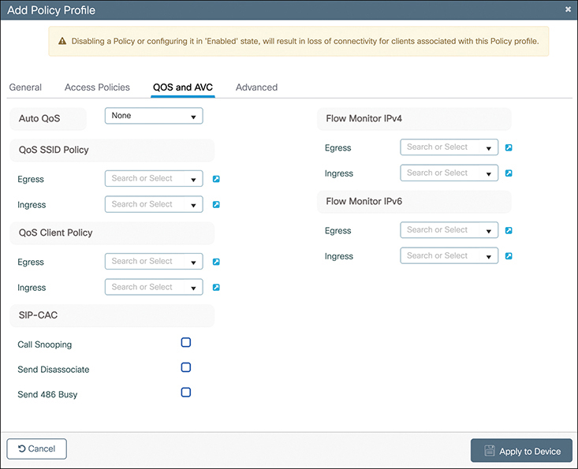

<figcaption>

<aside class="hidden" id="a04fig22">

这些设置位于 QOS and AVC 选项卡下。界面提供下拉菜单、文本字段和复选框等配置选项。顶部 Auto QOS 设为 None。其下有 QOS SSID Policy 和 QOS Client Policy 两个部分，每部分都有 Egress（出站）和 Ingress（入站）字段，并配有标为 Search or Select（搜索或选择）的下拉菜单。此外还有 Flow Monitor IPv4 和 Flow Monitor IPv6 两个部分，也各自带出站和入站字段，以及搜索或选择下拉菜单。左下角是 SIP-CAC 设置的复选框，包括 Call Snooping（呼叫侦听）、Send Disassociate（发送解除关联）和 Send 486 Busy（发送 486 忙碌）。顶部警告消息指出，禁用策略或在 Enabled 状态下配置策略可能导致关联到该策略配置文件的客户端失去连接。界面右下方有 Cancel（取消）和 Apply to Device（应用到设备）按钮，方便用户直接应用设置。

</aside>

<strong>图 4-22</strong> <em>配置策略配置文件的 QoS 和 AVC 参数</em>

</figcaption>

</figure>

接下来选择 <strong>Advanced（高级）</strong>选项卡，显示更多与 WLAN 运行相关的参数，如<a href="#ch04fig23">图 4-23</a> 所示。突出显示的 WLAN Timeout 部分包含多个与无线客户端活动相关的限制。

<figure class="image-c" id="ch04fig23">

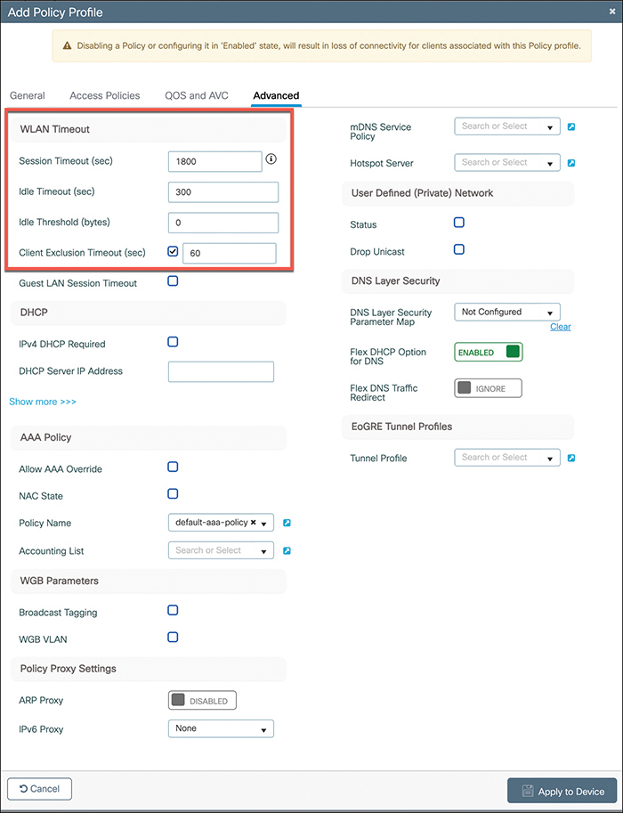

<figcaption>

<aside class="hidden" id="a04fig23">

界面显示 Advanced（高级）选项卡，包含多个区域和选项。顶部红框突出显示 WLAN Timeout（WLAN 超时）区域，字段包括 Session Timeout（会话超时，秒），设为 1800；Idle Timeout（空闲超时，秒），设为 300；Idle Threshold（空闲阈值，秒），设为 60；以及 Client Exclusion Timeout（客户端排除超时，秒），输入框为空。其下有 Guest LAN Session Timeout（访客 LAN 会话超时）复选框。左侧还列出多项设置：DHCP 包含 DHCP Required（要求 DHCP）复选框和 DHCP 服务器 IP 地址输入框；AAA 策略包含 AAA Override（AAA 覆盖）复选框、NAC 状态、设为 default-aaa-policy 的策略名称下拉菜单，以及服务器名称和记账列表字段；WGB 参数包含广播标记和 WGB VLAN 设置；策略代理设置包含设为 DISABLED 的 ASP Proxy 下拉菜单；IPv6 策略提供配置选项。右侧有多个部分和字段：mDNS 服务策略带 Search or Select（搜索或选择）下拉菜单；热点服务器带同类下拉菜单；用户定义的私有网络带选择下拉菜单；状态有 Enabled（已启用）复选框；DNS 层安全带搜索或选择下拉菜单；DHCPv6 选项带标为 Not Configured（未配置）的下拉菜单及 Clear（清除）按钮；桥接 SSID 的 IPv4 DHCP 选项复选框设为 ENABLED；EDNS 流量下拉菜单设为 IGNORE；EDGRE 隧道配置文件带搜索或选择下拉菜单。底部左侧 Cancel（取消）按钮用于取消配置过程，右侧 Apply to Device（应用到设备）按钮用于将配置设置应用到设备。顶部通知横幅警告，禁用策略或在 Enabled 状态下配置策略可能导致关联到该策略配置文件的客户端失去连接。

</aside>

<strong>图 4-23</strong> <em>配置策略配置文件的高级参数</em>

</figcaption>

</figure>

可以配置 Session Timeout，设置客户端会话在被强制重新进行身份验证前允许持续的时间。默认情况下，会话在 1800 秒（30 分钟）后超时。如果 WLAN 使用 802.1x，可以将会话超时值设在 300–86,400 秒范围内；否则，范围为 0–86,400 秒，其中 0 表示不超时。

使用 Idle Timeout 和 Idle Threshold，限制客户端被视为空闲并断开连接之前经过的时间（15–100,000 秒，默认 300 秒）和流量字节数（0–4,294,967,295 字节）。

如果勾选 Client Exclusion（客户端排除），控制器将使用其无线入侵防御系统（IPS），根据特征数据库评估客户端活动。如果检测到可疑活动，控制器会将该客户端加入排除列表，并将其与无线网络隔离，默认持续 60 秒。

配置并核实所有所需参数后，务必单击 <strong>Apply to Device（应用到设备）</strong>按钮，将更改提交到策略配置文件配置。

</section>

<section>

<h5 class="h5" id="ch04lev3sec3">步骤 3：将 WLAN 配置文件和策略配置文件映射到策略标签</h5>

在 Tags &amp; Profiles 任务序列中（参见<a href="#ch04fig12">图 4-12</a>），选择 Policy Tag 旁的 <strong>+</strong> 图标。输入策略标签名称和可选描述，如<a href="#ch04fig24">图 4-24</a> 所示。选择要通告的 WLAN 对应的 WLAN 配置文件，以及定义所用 VLAN 的策略配置文件。选择勾号图标，将这一配置文件组合添加到策略标签。

<figure class="image-c" id="ch04fig24">

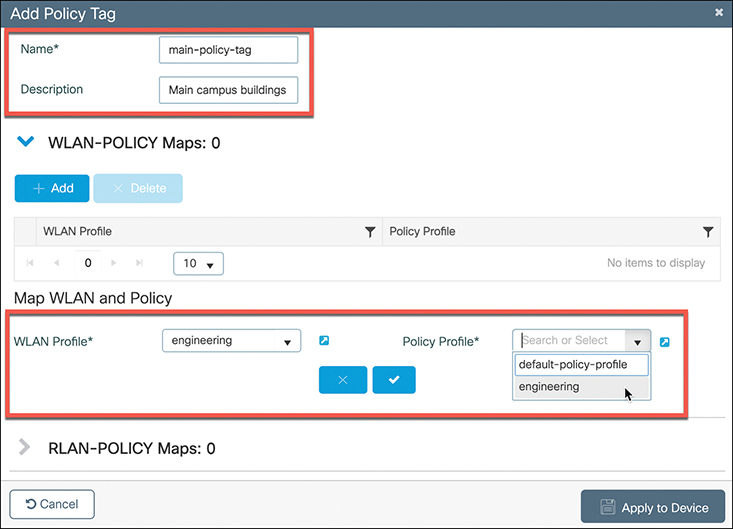

<figcaption>

<aside class="hidden" id="a04fig24">

界面顶部有 Name（名称）和 Description（描述）字段，策略标签名称为 main-policy-tag，描述为 Main campus buildings。下方 WLAN-POLICY Maps 区域显示当前映射数为 0。此区域提供 Add（添加）和 Delete（删除）映射选项。表格最初显示无项目可显示，表示尚未映射任何 WLAN 配置文件。下一部分 Map WLAN and Policy（映射 WLAN 与策略）允许将 WLAN 配置文件映射到策略配置文件。WLAN Profile 下拉菜单设为 engineering，Policy Profile 下拉菜单提供 default-policy-profile 和 engineering 两个选项，光标当前突出显示后者。此外，RLAN-POLICY Maps 区域也显示映射数为 0。界面右下角有 Cancel（取消）和 Apply to Device（应用到设备）两个按钮。

</aside>

<strong>图 4-24</strong> <em>将 WLAN 配置文件和策略配置文件映射到策略标签</em>

</figcaption>

</figure>

如果希望 AP 通告更多 WLAN，可以单击 <strong>Add（添加）</strong>按钮，在策略标签中添加更多 WLAN 和策略配置文件条目。单击 <strong>Apply to Device（应用到设备）</strong>按钮，将配置更改保存到控制器。

</section>

<section>

<h5 class="h5" id="ch04lev3sec4">步骤 4：将策略标签应用到一些 AP</h5>

回顾一下，网络中的每台 AP 都必须映射三个不同的标签：策略、站点和 RF。为此，请转到 Tags &amp; Profiles 任务序列底部（参见<a href="#ch04fig12">图 4-12</a>），然后选择 Tag APs 旁的列表图标。

Tag APs 窗口包含两部分：背景中的可用 AP 列表，以及前景中的标签配置，如<a href="#ch04fig25">图 4-25</a> 所示。首先必须选择要接收标签映射的 AP，可以勾选所需 AP 条目旁的复选框，也可以根据属性列筛选 AP。接下来，使用 <strong>Policy Tag（策略标签）</strong>下拉菜单，选择具有正确 WLAN 和策略配置文件映射的策略标签。

<figure class="image-c" id="ch04fig25">

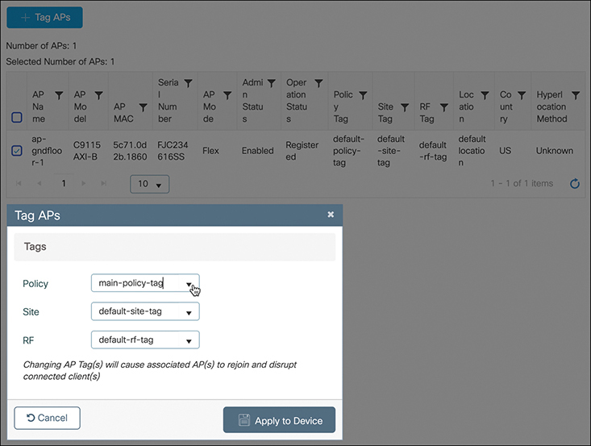

<figcaption>

<aside class="hidden" id="a04fig25">

界面分为两个主要区域：上方列出 AP 及相关详情，下方提供为选定 AP 添加标签的对话框。上方表格显示 AP 的详细信息，列包括 AP 名称、AP IP 地址、AP MAC 地址、序列号、无线电数量、管理状态、运行状态、策略标签、站点标签、RF 标签、位置、国家／地区、Hyperlocation 模式和 Hyperlocation 方法。第一行 AP 的详情如下：名称为 go fino，IP 为 10.1.1.100，MAC 为 C891.45D3.76B0，序列号为 FJC23451B5S，无线电数量为 2，管理状态为 Enabled（已启用），运行状态为 Registered（已注册），策略标签为 default-policy-tag，站点标签为 default-site-tag，RF 标签为 default-rf-tag，位置为 default location，国家／地区为 US，Hyperlocation 模式和方法均为 Unknown（未知）。AP 名称旁的复选框表明该 AP 已选中，Tag APs 按钮显示已选择一台 AP。下方标题为 Tag APs 的对话框有三个标签下拉菜单：Policy 设为 main-policy-tag，Site 设为 default-site-tag，RF 设为 default-rf-tag。警告消息说明，更改 AP 标签将导致关联 AP 重新加入，并中断已连接客户端。对话框右下角有 Apply to Device（应用到设备）按钮，左下角有 Cancel（取消）按钮。

</aside>

<strong>图 4-25</strong> <em>将策略、站点和 RF 标签应用到 AP</em>

</figcaption>

</figure>

还必须指定要使用的站点标签和 RF 标签，尽管本章没有介绍它们，因为这些内容超出了 CCNA 考试范围。幸运的是，控制器有一组预定义的默认标签，其中包含到相应默认配置文件的映射：

<ul class="sq">

<li>
<em>default-site-tag</em><strong>：</strong>映射到名为 default-ap-profile 和 default-flex-profile 的默认配置文件。
</li>

<li>
<em>default-rf-tag</em><strong>：</strong>映射到控制器的全局 RF 配置。
</li>

<li>
<em>default-policy-tag</em><strong>：</strong>默认不映射任何内容，因为任何网络都没有默认的 WLAN 和 SSID 配置。
</li>

</ul>

默认配置文件预先配置了常用参数，能够提供功能完整的无线网络。如果无需更改其中任何内容，就可以直接使用默认标签和配置文件。

注意

可以通过修改控制器的默认配置文件和标签来完成所有自定义设置，从而免去创建自己配置文件和标签的步骤；不过，这会在全局范围内影响所有 AP，除非它们已经分配了其他非默认标签和配置文件。理想情况下，应创建自己的一组自定义配置文件和标签，以充分利用精细控制能力，并为将来调整策略和微调配置做好准备。

</section>

</section>

<section>

<h4 class="h4" id="ch04lev2sec3">在 AireOS WLC 上配置 WLAN</h4>

旧式 AireOS 控制器不使用 IOS-XE 控制器的配置文件和标签概念，而是允许直接在 GUI 中配置 WLAN，对 AP 配置的控制粒度要粗得多。

创建新 WLAN 包括以下三个步骤：

步骤 1。创建动态接口，然后分配接口名称和 VLAN ID。

步骤 2。创建 WLAN，然后分配 WLAN 配置文件名称、SSID 以及唯一的 WLAN ID。

步骤 3。配置 WLAN 参数，启用 WLAN，并允许其广播 SSID。

以下各节将更详细地讨论这些步骤。

<section>

<h5 class="h5" id="ch04lev3sec5">步骤 1：创建动态接口</h5>

在 AireOS 控制器上，动态接口用于将控制器连接到有线网络中的 VLAN。创建 WLAN 时，需要将动态接口（及 VLAN）绑定到无线网络。

要创建新的动态接口，请进入 <strong>Controller &gt; Interfaces</strong>。这里应显示当前已配置的所有控制器接口列表。在<a href="#ch04fig26">图 4-26</a> 中，已存在名为 management 和 virtual 的两个接口。单击 <strong>New（新建）</strong>按钮，定义一个新接口。输入接口名称及其要绑定的 VLAN 编号。在<a href="#ch04fig27">图 4-27</a> 中，名为 Engineering 的接口映射到有线 VLAN 100。单击 <strong>Apply（应用）</strong>按钮。

<figure class="image-c" id="ch04fig26">

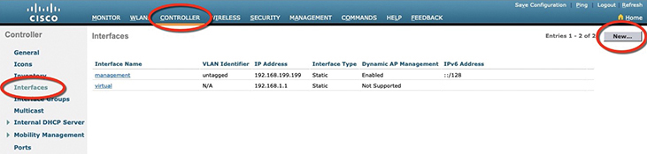

<figcaption>

<aside class="hidden" id="a04fig26">

顶部导航菜单包含 Monitor、WLANs、Controller、Wireless、Security、Management、Commands、Help 和 Feedback 选项卡。Controller（控制器）选项卡突出显示，表示当前查看的部分。菜单栏右侧有 Save Configuration（保存配置）、Logout（注销）和 Refresh（刷新）选项。左侧纵向菜单包含多个链接，其中 Interfaces（接口）突出显示，表示当前页面；其他链接包括常规、端口、内部 DHCP 服务器、自动安装、无线管理和代理。主区域在 Interfaces 标题下显示一张表，列出设备上配置的动态接口，列标题包括接口名称、VLAN 标识符、IP 地址、接口类型、动态 AP 管理和 IPv6 地址。表中条目如下：management 接口的 VLAN 标识符为 1，IP 地址为 192.168.0.1，接口类型为 Management，无 IPv6 地址；virtual 接口的 VLAN 标识符为 N/A，IP 地址为 192.0.2.1，接口类型为 Not Supported，无 IPv6 地址。表格右上角有圈出的 New（新建）按钮，允许添加新的动态接口。页面显示当前查看共 2 个接口中的第 1–2 项。

</aside>

<strong>图 4-26</strong> <em>显示动态接口列表</em>

</figcaption>

</figure>

<figure class="image-c" id="ch04fig27">

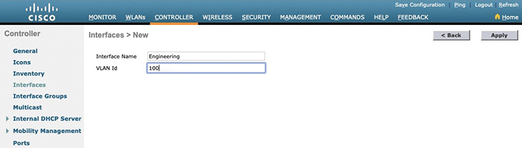

<figcaption>

<aside class="hidden" id="a04fig27">

如顶部导航路径所示，界面位于 Controller 菜单中的 Interfaces &gt; New 部分。左上角可见 Cisco 标志，主菜单包括监控、WLAN、控制器、无线、安全、管理、命令、帮助、反馈、注销、保存配置、Ping、登录和刷新等选项。主配置区域有 Interface Name（接口名称）和 VLAN ID 两个文本字段。接口名称设为 Engineering，VLAN ID 设为 666。屏幕右侧有 Back（返回）和 Apply（应用）两个按钮，用于返回或保存配置。左侧栏菜单包含常规、传感器、清单、接口、接口组、组播、内部 DHCP 服务器、移动性管理和端口等选项。

</aside>

<strong>图 4-27</strong> <em>定义动态接口名称和 VLAN ID</em>

</figcaption>

</figure>

接下来，输入接口的 IP 地址、子网掩码和网关地址。还应定义主、备用 DHCP 服务器地址，控制器中继绑定到该接口的客户端所发出的 DHCP 请求时会使用这些地址。

<a href="#ch04fig28">图 4-28</a> 展示名为 Engineering 的接口配置：IP 地址为 192.168.100.10，子网掩码为 255.255.255.0，网关为 192.168.100.1，DHCP 服务器为 192.168.1.17 和 192.168.1.18。单击 <strong>Apply（应用）</strong>按钮，完成接口配置并返回接口列表。

<figure class="image-c" id="ch04fig28">

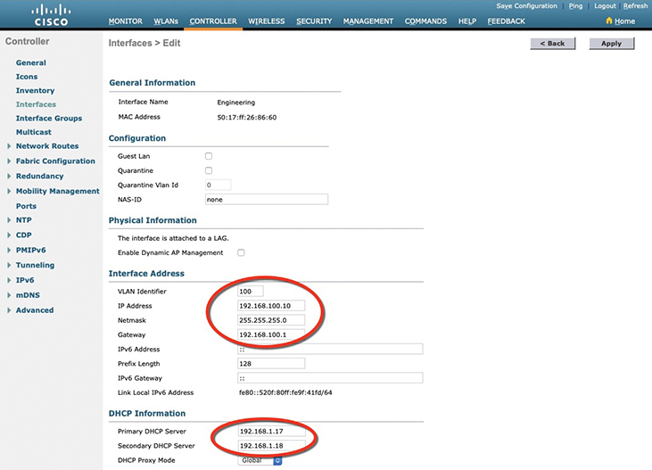

<figcaption>

<aside class="hidden" id="a04fig28">

界面分为多个部分。顶部 General Information（常规信息）中，接口名称设为 Engineering，VLAN 标识符为 0。Configuration（配置）部分包含 Guest LAN（访客 LAN）、Quarantine State（隔离状态）复选框以及 Quarantine VLAN ID（隔离 VLAN ID）输入字段。Physical Information（物理信息）部分有 The Interface is attached to a LAG 复选框，用于指明接口是否连接链路聚合组；还有 Enable Dynamic AP Management 复选框，用于启用 AP 动态管理。Interface Address（接口地址）部分包含 VLAN 标识符 100、IP 地址 192.168.100.254、IP 子网掩码 255.255.255.0 和网关 192.168.100.1，这四项均以红圈突出显示；还包含主 DHCP 服务器、备用 DHCP 服务器、设为 1500 的 MTU、设为 GigabitEthernet 0/0 的端口、物理长度、逻辑长度，以及表示当前链路状态的 Link Status。DHCP Information 部分的主 DHCP 服务器设为 192.168.1.17，并以红圈突出显示；另外还有备用 DHCP 服务器和 DHCP 中继 IP 地址字段。右上角有 Back（返回）和 Apply（应用）按钮，分别用于返回上一屏及保存并应用更改。左侧导航菜单还包含常规、清单、接口、接口组、端口、组播、高可用性、NTP、移动性管理、RADIUS 和 AP 等选项。

</aside>

<strong>图 4-28</strong> <em>编辑动态接口参数</em>

</figcaption>

</figure>

</section>

<section>

<h5 class="h5" id="ch04lev3sec6">步骤 2：创建新 WLAN</h5>

选择顶部菜单栏中的 <strong>WLANs</strong>，可以显示当前定义的 WLAN 列表。在<a href="#ch04fig29">图 4-29</a> 中，控制器尚未定义任何 WLAN。可以从下拉菜单中选择 <strong>Create New（新建）</strong>，然后单击 <strong>Go（执行）</strong>按钮，创建一个新 WLAN。

<figure class="image-c" id="ch04fig29">

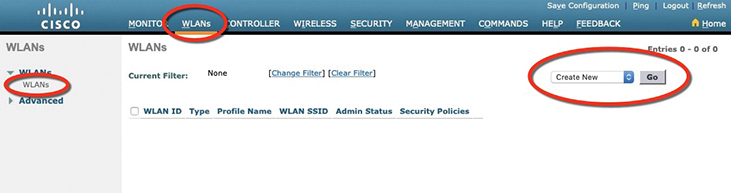

<figcaption>

<aside class="hidden" id="a04fig29">

界面具有蓝色页眉，其中有监控、WLAN、控制器、无线、安全、管理、命令、帮助和反馈等选项卡。WLAN 选项卡已选中，并用红圈突出显示。左侧栏中的 WLAN 菜单已展开，显示 WLANs 和 Advanced（高级）选项。主区域显示 WLAN 列表。顶部有更改或清除筛选条件的选项，但目前未应用任何筛选条件，Current Filters: None 表明这一点。列表为空，显示 0 - 0 of 0，表示目前没有 WLAN 条目。列表右侧有 Create New 字段及下拉菜单和 Go 按钮，允许用户开始创建新的 WLAN 配置文件。表格准备显示的列包括类型、配置文件名称、WLAN SSID、管理状态和安全策略。界面右上角有保存配置、注销选项以及已登录用户标识。界面布局清晰，便于管理和创建 WLAN 配置文件，帮助管理员掌握网络的无线配置。

</aside>

<strong>图 4-29</strong> <em>显示 WLAN 列表</em>

</figcaption>

</figure>

接下来，输入一个具有描述性的配置文件名称以及 SSID 文本字符串。在<a href="#ch04fig30">图 4-30</a> 中，为了简明起见，配置文件名称与 SSID 相同。ID 编号用于索引控制器上定义的 WLAN 列表。在使用 Prime Infrastructure（PI）模板同时配置多台控制器上的 WLAN 时，该 ID 编号就很有用。

注意

WLAN 模板应用于控制器上的特定 WLAN ID。WLAN ID 仅在本地有意义，不会在控制器之间传递。通常，应在多台控制器上保持 WLAN 名称和 ID 的顺序一致，使将来使用的配置模板能够应用到各控制器上相同的 WLAN。

<figure class="image-c" id="ch04fig30">

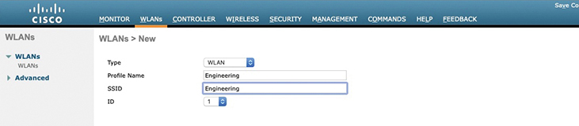

<figcaption>

<aside class="hidden" id="a04fig30">

界面分为页眉、左侧栏和配置 WLAN 的主内容区。顶部页眉显示 Cisco 标志，以及监控、WLAN、控制器、无线、安全、管理、命令、帮助和反馈导航选项卡，最右侧有 Save Config（保存配置）选项。左侧栏提供 WLAN 相关导航，包含 WLANs 区域、已选中的 WLANs 子项和 Advanced（高级）。主内容区标题为 WLANs &gt; New，表示正在创建新 WLAN。配置字段如下：Type（类型）下拉菜单设为 WLAN；Profile Name（配置文件名称）字段填入 Engineering；SSID 字段也填入 Engineering；ID 下拉菜单设为 1。

</aside>

<strong>图 4-30</strong> <em>创建新 WLAN</em>

</figcaption>

</figure>

单击 <strong>Apply（应用）</strong>按钮，创建新 WLAN。

</section>

<section>

<h5 class="h5" id="ch04lev3sec7">步骤 3：配置 WLAN</h5>

下一页允许编辑四类参数，对应顶部各选项卡，如<a href="#ch04fig31">图 4-31</a> 所示。默认选中 General（常规）选项卡。

应勾选 <strong>Status（状态）</strong>复选框，启用新 WLAN。虽然 General 页面显示 WLAN 的具体安全策略（默认为 WPA2 和 802.1x），但可以在后续步骤中通过 Security 选项卡更改。请记住，802.1x 用于采用 RADIUS 服务器和数字证书的“企业”身份验证模型，不用于预共享密钥身份验证。

<figure class="image-c" id="ch04fig31">

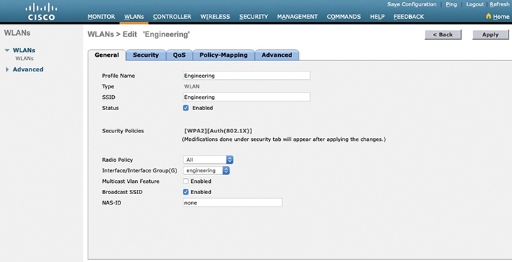

<figcaption>

<aside class="hidden" id="a04fig31">

顶部导航菜单包含监控、WLAN、安全、控制器、无线、管理、命令、帮助、反馈、保存配置、注销和刷新选项。WLANs 选项卡突出显示，表示当前查看的部分。左侧纵向菜单包含 WLANs 和 Advanced 链接，WLANs 区域已展开，显示其子项。主区域标题为 WLANs &gt; Edit 'Engineering'，包含 General（常规）、Security（安全）、QOS、Policy-Mapping（策略映射）和 Advanced（高级）选项卡，当前选中 General。其中显示：Profile Name 为 Engineering，SSID 为 Engineering，Status 的 Enabled 复选框已勾选；Security Policies 显示 WPA2 Auth 802.1X，并注明在安全选项卡中的修改将在应用更改后显示；Radio Policy 下拉菜单设为 All；Interface/Interface Group G 下拉菜单设为 engineering；Multicast VLAN Feature 和 Broadcast SSID 的 Enabled 复选框均已勾选；NAS-ID 的值为 none。右上角有 Back（返回）和 Apply（应用）按钮。

</aside>

<strong>图 4-31</strong> <em>配置 WLAN 的常规参数</em>

</figcaption>

</figure>

在 Radio Policy 中选择要提供该 WLAN 的无线电类型。默认情况下，所有已加入控制器的无线电都会提供该 WLAN。可以选择更具体的策略，例如仅 802.11a、仅 802.11a/g、仅 802.11g 或仅 802.11b/g。例如，如果新 WLAN 面向只有 2.4 GHz 无线电的设备，那么同时在 AP 的 2.4 GHz 和 5 GHz 无线电上通告该 WLAN 可能并无意义。

接下来，选择控制器的哪个动态接口绑定到该 WLAN。默认选中管理接口。下拉列表包含所有可用的动态接口名称。在<a href="#ch04fig31">图 4-31</a> 中，新的 engineering WLAN 将绑定到 Engineering 接口。

最后，使用 Broadcast SSID 复选框，选择 AP 是否在发送的信标中广播 SSID 名称。广播 SSID 通常更方便用户，因为设备可以自动获知并显示 SSID 名称。事实上，大多数设备确实需要信标中的 SSID，才能知道 AP 仍在为该 SSID 提供服务。不广播 SSID 以隐藏其名称，并不能真正提供有价值的安全保护；它只是阻止用户设备发现该 SSID，并尝试将其用作默认网络。

为便于参考和学习，<a href="#ch04tab02">表 4-2</a> 列出前面几个 WLC 配置面板中使用的一些值，以及其数据格式和长度。表中还列出后续图片中将出现的一些值。

<figure class="table" id="ch04tab02" tabindex="0">

<figcaption>

<strong>表 4-2</strong> WLAN 配置字段和格式

</figcaption>

<table class="all">

<thead>

<tr>

<th class="th">
字段
</th>

<th class="th">
长度
</th>

<th class="th">
数据格式
</th>

<th class="th">
其他规则
</th>

</tr>

</thead>

<tbody>

<tr>

<td class="border">
配置文件名称
</td>

<td class="border">
1–32
</td>

<td class="border">
ASCII
</td>

<td class="border">

</td>

</tr>

<tr>

<td class="border">
SSID
</td>

<td class="border">
1–32
</td>

<td class="border">
ASCII
</td>

<td class="border">
允许字母、数字、空格和可打印特殊字符；某些特殊值保留
</td>

</tr>

<tr>

<td class="border">
VLAN ID
</td>

<td class="border">
2–4094
</td>

<td class="border">
十进制
</td>

<td class="border">

</td>

</tr>

<tr>

<td class="border">
WLAN ID
</td>

<td class="border">
1–512
</td>

<td class="border">
十进制
</td>

<td class="border">

</td>

</tr>

<tr>

<td class="border">
预共享密钥（PSK）
</td>

<td class="border">
8–63

恰好 64 位
</td>

<td class="border">
ASCII 或十六进制
</td>

<td class="border">

</td>

</tr>

</tbody>

</table>

</figure>

</section>

<section>

<h5 class="h5" id="ch04lev3sec8">配置 WLAN 安全</h5>

选择 <strong>Security（安全）</strong>选项卡，配置安全设置。默认选中 Layer 2 Security（第二层安全）选项卡。从 Layer 2 Security 下拉菜单中选择要使用的适当安全方案。<a href="#ch04tab03">表 4-3</a> 列出可用的类型。

<figure class="table" id="ch04tab03" tabindex="0">

<figcaption>

<strong>表 4-3</strong> 第二层 WLAN 安全类型

</figcaption>

<table class="all">

<tbody>

<tr>

<th class="th">
选项
</th>

<th class="th">
说明
</th>

</tr>

<tr>

<td class="border">
无
</td>

<td class="border">
开放身份验证
</td>

</tr>

<tr>

<td class="border">
WPA+WPA2
</td>

<td class="border">
Wi-Fi 保护访问 WPA 或 WPA2
</td>

</tr>

<tr>

<td class="border">
802.1x
</td>

<td class="border">
采用动态 WEP 的 EAP 身份验证
</td>

</tr>

<tr>

<td class="border">
静态 WEP
</td>

<td class="border">
WEP 密钥安全
</td>

</tr>

<tr>

<td class="border">
静态 WEP + 802.1x
</td>

<td class="border">
EAP 身份验证或静态 WEP
</td>

</tr>

<tr>

<td class="border">
CKIP
</td>

<td class="border">
Cisco 密钥完整性协议
</td>

</tr>

<tr>

<td class="border">
None + EAP Passthrough（无安全 + EAP 透传）
</td>

<td class="border">
开放身份验证与远程 EAP 身份验证
</td>

</tr>

</tbody>

</table>

</figure>

选择安全类型时，务必记住哪些选项已经被弃用或已被证实存在弱点，并尽可能避免使用。屏幕更下方允许选择 WLAN 要支持的具体 WPA、WPA2 和 WPA3 方法。如果需要支持要求不同安全方法的多种无线客户端，可以选择多项。

在<a href="#ch04fig32">图 4-32</a> 中，下拉菜单已选中 WPA+WPA2，使 WPA2 成为有效选项。如果希望支持客户端在 AP 之间高效漫游，可以使用 802.11r 修订，也称快速过渡。请注意，Fast Transition 部分默认启用 Adaptive（自适应）模式，允许支持和不支持 802.11r 的客户端使用。

在 WPA+WPA2 Parameters 部分，已选中 WPA2 Policy 和 AES 加密。WPA 和 TKIP 复选框均未勾选，从而避免使用这些较旧且已被弃用的方法。

在 Authentication Key Management 部分，可以选择 WLAN 要使用的身份验证方法。图中仅选中 PSK，因此 WLAN 只允许采用预共享密钥身份验证的 WPA2-Personal。

假设需要使用 WPA2-Enterprise，而不是 WPA2-Personal 或 PSK。客户端身份验证可以由 RADIUS 服务器、Cisco ISE、LDAP 等执行。此时应选择 802.1X，而不是 PSK。在这种情况下，将使用 802.1x 和 EAP，通过一台或多台 RADIUS 服务器验证无线客户端身份。控制器将使用在 <strong>Security &gt; AAA &gt; RADIUS &gt; Authentication</strong> 中定义的全局列表中的服务器。要指定 WLAN 使用哪些服务器，应在 WLAN 编辑界面选择 <strong>Security（安全）</strong>选项卡，然后选择 <strong>AAA Servers（AAA 服务器）</strong>选项卡。WLAN 配置中最多可以指定六台 RADIUS 服务器。

<figure class="image-c" id="ch04fig32">

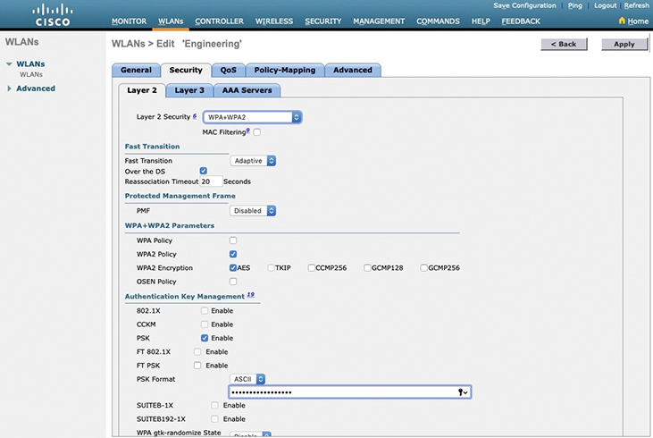

<figcaption>

<aside class="hidden" id="a04fig32">

界面侧重于第二层安全设置，导航选项包括 General（常规）、Layer 2（第二层）、Layer 3（第三层）、QOS、Policy-Mapping（策略映射）、AAA Servers（AAA 服务器）和 Advanced（高级）。顶部主菜单包含监控、WLAN、控制器、无线、安全、管理、命令、帮助、反馈、注销、保存配置、Ping、登录和刷新。主配置区域提供多种设置：Layer 2 Security 设为 WPA2 with 802.1X；MAC Filtering 复选框用于启用或禁用 MAC 过滤；Fast Transition 设置为启用，另有 Over the DS 选项，Time Out 设为 20 秒；Protected Management Frames 设为 Optional（可选）。WPA+WPA2 Parameters 部分的 WPA Policy 设为 WPA2，WPA Encryption 设为 AES，Auth Key Management 设为 802.1X。Authentication Key Management 下拉菜单提供 PSK、EAP 和 802.1X 等选项。另有用于启用或禁用 Pre-authentication（预身份验证）的复选框、用于输入 FT PSK（快速过渡预共享密钥）的字段，以及提供 Disable、Enable 和 Time 等选项的 PMK Caching 下拉菜单。FT Key Management 下拉菜单包含 FT 802.1X 和 FT PSK 等选项。此外还有 Suite-B Compatibility（Suite-B 兼容性）复选框及相关设置。底部有 Back（返回）和 Apply（应用）按钮，用于导航和保存配置。左侧栏菜单包含 WLANs 和 Advanced 选项。界面提供详细的 WLAN 第二层安全配置选项，以便实施稳健的安全设置。

</aside>

<strong>图 4-32</strong> <em>配置第二层 WLAN 安全</em>

</figcaption>

</figure>

在每个服务器条目旁，从全局定义的服务器下拉菜单中选择具体的服务器 IP 地址。系统按顺序尝试这些服务器，直到某台服务器响应。虽然 CCNA 考试目标指定的是 WPA2-Personal，但<a href="#ch04fig33">图 4-33</a> 展示采用 WPA2-Enterprise 的 WLAN 可能具有的配置，其中服务器 1 至 3 分别设为 192.168.200.28、192.168.200.29 和 192.168.200.30。

<figure class="image-c" id="ch04fig33">

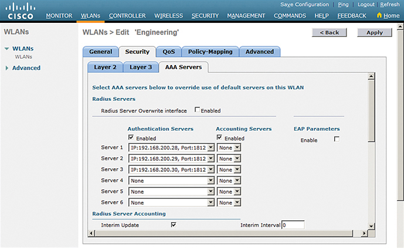

<figcaption>

<aside class="hidden" id="a04fig33">

界面顶部有 General（常规）、Security（安全）、QOS、Policy Mapping（策略映射）和 Advanced（高级）等选项卡，安全部分进一步分为 Layer 2、Layer 3 和 AAA Servers 子选项卡，当前选中 AAA Servers。主区域提示：在下方选择 AAA 服务器，以覆盖该 WLAN 对默认服务器的使用；同时提供 Radius Server Override Interface 选项及 Enabled 复选框。RADIUS 服务器列表包含六台服务器的配置字段：服务器 1 的 IP 地址为 192.168.100.253，身份验证端口为 1812，记账端口为 1813，Enabled 复选框已勾选；服务器 2 至 6 的字段显示 None，表示这些位置未选择服务器。右侧 EAP Parameters（EAP 参数）部分有 Enabled 复选框。底部 Radius Server Accounting（RADIUS 服务器记账）部分有 Interim Update（中间更新）输入字段和 Interim Interval（中间间隔）下拉菜单。右上角有 Back（返回）和 Apply（应用）按钮，用于导航以及保存并应用更改。左侧导航菜单还包含 WLANs 和 Advanced（高级设置）选项。

</aside>

<strong>图 4-33</strong> <em>为 WLAN 身份验证选择 RADIUS 服务器</em>

</figcaption>

</figure>

</section>

<section>

<h5 class="h5" id="ch04lev3sec9">配置 WLAN QoS</h5>

选择 <strong>QoS</strong> 选项卡，配置 WLAN 的服务质量设置，如<a href="#ch04fig34">图 4-34</a> 所示。默认情况下，控制器将 WLAN 中的所有帧视为普通数据，以“尽力而为”的方式处理。可以在 Quality of Service（QoS）下拉菜单中选择以下一种方式，对所有帧进行分类：

<ul class="sq">

<li>
Platinum（白金，语音）
</li>

<li>
Gold（金，视频）
</li>

<li>
Silver（银，尽力而为）
</li>

<li>
Bronze（铜，后台）
</li>

</ul>

<figure class="image-c" id="ch04fig34">

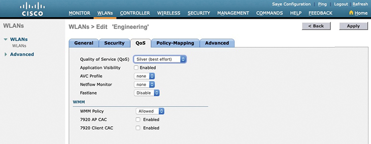

<figcaption>

<aside class="hidden" id="a04fig34">

界面具有蓝色页眉，其中有监控、WLAN、控制器、无线、安全、管理、命令、帮助和反馈等选项卡，当前选中 WLAN。左侧栏中的 WLAN 菜单已展开，显示 WLANs 和 Advanced（高级）选项。主区域标题为 WLANs &gt; Edit 'Engineering'，包含 General、Security、QOS、Policy-Mapping 和 Advanced 等选项卡。正在配置的 QoS 设置包括：Quality of Service（服务质量）下拉菜单设为 Silver（尽力而为）；Application Visibility（应用可视性）复选框用于启用或禁用该功能；AVC Profile 下拉菜单用于选择应用可视性和控制配置文件；Netflow Monitor 下拉菜单用于选择 Netflow 监视器；Fastlane 下拉菜单设为 Disable。WMM（Wi-Fi 多媒体）部分包含 WMM Policy 下拉菜单，当前设为 Allowed（允许）；用于启用或禁用 7920 接入点呼叫准入控制的 7920 AP CAC 复选框；以及用于启用或禁用 7920 客户端呼叫准入控制的 7920 Client CAC 复选框。右上角有 Back（返回）、Apply（应用）和 Cancel（取消）按钮，用于导航和保存更改。

</aside>

<strong>图 4-34</strong> <em>配置 QoS 设置</em>

</figcaption>

</figure>

还可以在 QoS 页面设置 Wi-Fi 多媒体（WMM）策略、呼叫准入控制（CAC）策略和带宽参数。有关 QoS 的更多内容，请参阅后面的<a href="v2-15.html#ch15">第 15 章</a>“<a href="v2-15.html#ch15">服务质量（QoS）</a>”。

</section>

<section>

<h5 class="h5" id="ch04lev3sec10">配置 WLAN 高级设置</h5>

最后，可以选择 <strong>Advanced（高级）</strong>选项卡，配置各种 WLAN 高级设置。在<a href="#ch04fig35">图 4-35</a> 所示的页面上，可以配置许多功能；其中大多数超出 CCNA 目标范围，因此未在图中展示。不过，你应了解一些可能影响无线客户端的参数及默认值。

可以配置 Session Timeout，设置客户端会话在被强制重新进行身份验证前允许持续的时间。默认情况下，会话在 1800 秒（30 分钟）后超时。如果 WLAN 使用 802.1x，可以将会话超时值设在 300–86,400 秒范围内；否则，范围为 0–86,400 秒，其中 0 表示不超时。

如果启用 Client Exclusion（客户端排除），控制器将使用其无线入侵防御系统（IPS），根据特征数据库评估客户端活动。如果检测到可疑活动，控制器会将该客户端加入排除列表，并将其与无线网络隔离，默认持续 180 秒。

<figure class="image-c" id="ch04fig35">

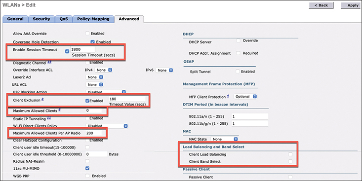

<figcaption>

<aside class="hidden" id="a04fig35">

界面包含 Enable Session Timeout（启用会话超时）选项，已勾选并设为 1800 秒；Client Exclusion（客户端排除）已启用，超时为 180 秒，最大失败次数为 3。Maximum Allowed Clients（允许的最大客户端数）设为 200，Maximum Allowed Clients Per AP Radio（每个 AP 无线电允许的最大客户端数）也设为 200。此外，Load Balancing and Band Select（负载均衡和频段选择）部分突出显示客户端负载均衡和客户端频段选择选项。其他设置包括 DHCP 配置，其中 DHCP Required 已启用，并提供 DHCP 服务器覆盖选项。Management Frame Protection（管理帧保护，MFP）部分提供保护管理帧的设置，还有与网络准入控制（NAC）、代理 ARP 和客户端负载均衡相关的配置。界面也包含 MAC 过滤选项及具体的范围设置。右上角有 Back（返回）和 Apply（应用）按钮，用于导航和应用更改。

</aside>

<strong>图 4-35</strong> <em>配置 WLAN 高级设置</em>

</figcaption>

</figure>

可以通过 Maximum Allowed Clients 限制并发客户端数量。默认情况下，控制器允许每个 WLAN 的客户端数量不受限制（以零表示）。也可以限制 WLAN 中每个 AP 无线电允许连接的客户端数量，其默认值为 200。

你可能还希望让控制器决定如何允许无线客户端接入 AP 无线电。例如，可以使用 Client Load Balancing 选项，让控制器在客户端探测和关联时，将它们分配到相邻 AP。Client Band Select 选项允许控制器主动影响客户端的选择：如果客户端尝试在较低且效率较差的频段上关联，就引导它们加入效率更高的频段。例如，如果附近也有可用的 5 GHz 信道，Client Band Select 就可以尝试阻止客户端加入 2.4 GHz 信道。

提示

180 秒真的足以阻止无线客户端发起的攻击吗？对于从可能密码字典中逐一猜测密码的暴力攻击，180 秒足以打断并延缓攻击者的进度。在没有排除策略时，找到匹配密码可能只需 3 分钟；启用排除策略后，则可能需要 15 年。

</section>

<section>

<h5 class="h5" id="ch04lev3sec11">完成 WLAN 配置</h5>

确认 WLAN 各配置选项卡中的设置符合要求后，单击 WLAN Edit 屏幕右上角的 <strong>Apply（应用）</strong>按钮。系统将创建 WLAN，并将其添加到控制器配置中。在<a href="#ch04fig36">图 4-36</a> 中，Engineering WLAN 已添加，WLAN ID 为 1，且已启用。

<figure class="image-c" id="ch04fig36">

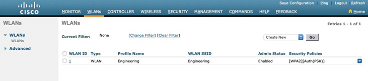

<figcaption>

<aside class="hidden" id="a04fig36">

顶部导航菜单包含监控、WLAN、控制器、无线、安全、管理、命令、帮助、反馈、保存配置、注销和刷新选项。WLANs 选项卡突出显示，表示当前查看的部分。左侧纵向菜单包含 WLANs 和 Advanced 链接，WLANs 区域已展开，显示其子项。主区域标题为 WLANs，以表格列出已配置的 WLAN。表中各列及值如下：WLAN ID 为 1，类型为 WLAN，配置文件名称为 Engineering，WLAN SSID 为 Engineering，管理状态为 Enabled，安全策略为 WPA2 Auth PSK。表格顶部有 Current Filters（当前筛选条件）选项，以及 Change Filter（更改筛选条件）和 Clear Filter（清除筛选条件）链接。右侧有 Create New（新建）和 Go（执行）按钮，允许添加新 WLAN。

</aside>

<strong>图 4-36</strong> <em>显示控制器上配置的 WLAN</em>

</figcaption>

</figure>

不要忘记验证新 WLAN 的配置。根据<a href="#ch04fig36">图 4-36</a> 中的信息，可以确认 SSID 正确、Admin Status 为已启用，并且安全设置符合 WPA2-PSK 的要求。

</section>

</section>

</section>

</section>

<section class="ccna-source ccna-appendix" aria-label="答案解析与术语表">
<section data-epub-type="chapter">

<h2 class="h2" id="ref-appc">附录 C</h2>

<h2 class="h2a">自测题答案</h2>

<section>

<h3 class="h3" id="ref-appclev1sec4">第 4 章</h3>

<strong><a id="ref-ques4_1" href="#quess4_1">1</a>.</strong> A。Cisco AP 只需要连接到一个 VLAN，即可向控制器建立 CAPWAP 隧道，因此使用接入模式。

<strong><a id="ref-ques4_2" href="#quess4_2">2</a>.</strong> B。自治 AP 必须连接到它将延伸到无线 LAN 的每个 VLAN。因此，其链路应配置为中继。

<strong><a id="ref-ques4_3" href="#quess4_3">3</a>.</strong> D。可以使用 HTTP 和 HTTPS 访问无线 LAN 控制器的 GUI，也可以使用 SSH 访问其 CLI。虽然 HTTP 是 WLC 上有效的管理协议，但通常会将其禁用，以提高 WLC 的安全性。

<strong><a id="ref-ques4_4" href="#quess4_4">4</a>.</strong> C。控制器使用链路聚合组（LAG）将多个端口捆绑在一起。

<strong><a id="ref-ques4_5" href="#quess4_5">5</a>.</strong> D。动态接口在 WLAN 与 VLAN 之间建立逻辑连接，整个连接位于 AireOS 控制器内部。

<strong><a id="ref-ques4_6" href="#quess4_6">6</a>.</strong> A 和 D。WLAN 通过控制器内部接口，将无线 SSID 绑定到有线 VLAN。

<strong><a id="ref-ques4_7" href="#quess4_7">7</a>.</strong> C。一台控制器最多可以配置 512 个 WLAN。不过，一台 AP 上最多只能配置其中的 16 个。

<strong><a id="ref-ques4_8" href="#quess4_8">8</a>.</strong> A 和 C。列表中只有 WLAN 配置文件和策略配置文件是必需的。信道编号不是必需项，因为它由系统自动提供，或通过更高级的 AP 配置指定。BSSID 也不是必需项，因为它是标识 AP 所提供 BSS 的地址。IP 子网用于绑定的 VLAN 和 WLAN，但不用于 WLAN 配置。

</section>

</section>

</section>


<nav class="ccna-chapter-nav" aria-label="章节导航"><a href="v2-03.html">← 上一章</a><a href="v2-05.html">下一章 →</a></nav>
