
<a href="{{ '/subjects/CCNA/' | relative_url }}">← 返回 CCNA 目录</a>

第二卷 · IP 访问控制列表

<nav class="ccna-chapter-nav" aria-label="章节导航"><a href="v2-04.html">← 上一章</a><a href="v2-06.html">下一章 →</a></nav>



<section data-epub-type="chapter">

<h2 class="h2" id="ch05">第 5 章</h2>

<h2 class="h2a">TCP/IP 传输层与应用简介</h2>

本章涵盖以下考试主题：

1.0 网络基础

1.5 比较 TCP 与 UDP

4.0 IP 服务

4.3 解释 DHCP 和 DNS 在网络中的作用

CCNA 考试主要关注 TCP/IP 较低层的功能，这些功能定义了 IP 网络如何利用 LAN 和 WAN，在主机之间发送 IP 数据包。本章介绍考试中涉及较少的几个主题的基础知识：TCP/IP 传输层和 TCP/IP 应用层。这些较高层的功能在实际 TCP/IP 网络中发挥着重要作用。此外，本书<a href="v2-01.html#part01">第一部分</a>和<a href="#part02">II</a>中的许多安全主题，以及<a href="v2-09.html#part03">第三部分</a>中的一些 IP 服务主题，都要求你了解 TCP/IP 传输层与应用层的基本工作方式。本章将为此提供入门介绍。

本章首先介绍两种传输层协议的功能：传输控制协议（TCP）和用户数据报协议（UDP）。第二个主要部分介绍 TCP/IP 应用层，其中还会讨论域名系统（DNS）如何进行名称解析。

<section>

<h3 class="h3" id="ch05lev1sec1">“这些知识我已经掌握了吗？”自测</h3>

如果你希望根据得分决定在本章投入多少时间，可以完成这组自测题（在此作答，或使用 PTP 软件）。各题答案的选项字母列在自测题之后的页面底部。书末和配套网站上的<a href="#ref-appc">附录 C</a>都包含答案及解析。你也可以在 PTP 测试软件中找到答案及解析。

<figure class="table" id="ch05tab01" tabindex="0">

<figcaption>

<strong>表5-1</strong> “这些知识我已经掌握了吗？”自测：基础知识小节与题目对应关系

</figcaption>

<table class="all">

<tbody>

<tr>

<th class="th">
基础知识小节
</th>

<th class="th">
题目
</th>

</tr>

<tr>

<td class="border">
TCP/IP 第4层协议:TCP和UDP
</td>

<td class="border">
1–4
</td>

</tr>

<tr>

<td class="border">
TCP/IP 应用程序
</td>

<td class="border">
5, 6
</td>

</tr>

</tbody>

</table>

</figure>

<strong><a id="quess5_1" href="#ques5_1a">1</a>.</strong> 以下哪些首部字段能够标识计算机收到的数据应交给哪个 TCP/IP 应用程序？（选择两个答案。）

<ol class="lower-alpha">

<li>
以太网类型
</li>

<li>
SNAP 协议类型
</li>

<li>
IP 协议
</li>

<li>
 TCP 端口号
</li>

<li>
UDP 端口编号
</li>

</ol>

<strong><a id="quess5_2" href="#ques5_2a">2</a>.</strong> 以下哪些是 TCP 的典型功能？（选择四个答案。）

<ol class="lower-alpha">

<li>
流量控制(窗口)
</li>

<li>
差错恢复
</li>

<li>
使用端口号实现多路复用
</li>

<li>
路由
</li>

<li>
加密
</li>

<li>
有序数据传输
</li>

</ol>

<strong><a id="quess5_3" href="#ques5_3a">3</a>.</strong>下列哪些职能由技术方案与联合发展方案共同履行?

<ol class="lower-alpha">

<li>
窗口
</li>

<li>
差错恢复
</li>

<li>
使用端口号进行多路复用
</li>

<li>
路由
</li>

<li>
加密
</li>

<li>
有序数据传输
</li>

</ol>

<strong><a id="quess5_4" href="#ques5_4a">4</a>.</strong>您所说的包含图层的数据是什么? 4 协议头和给图层的数据 4 上层,不包括来自地层的任何首部和尾部 1 改为: 3 (选择两个答案。 )

<ol class="lower-alpha">

<li>
L3PDU
</li>

<li>
数据块（Chunk）
</li>

<li>
报文段
</li>

<li>
数据包
</li>

<li>
帧
</li>

<li>
L4PDU
</li>

</ol>

<strong><a id="quess5_5" href="#ques5_5a">5</a>.</strong>在URI中<a href="http://www.certskills.com/config-labs">http://www.certskills.com/config-labs</a>,哪个部分可以识别网络服务器?

<ol class="lower-alpha">

<li>
http://www.un.un.org
</li>

<li>
<a href="http://www.certskills.com">www.certskills.com</a>
</li>

<li>
<a href="http://certskills.com">certskills.com</a>
</li>

<li>
<a href="http://www.certskills.com">http://www.certskills.com</a>
</li>

<li>
文件<a href="http://name.html">name.html</a>包含主机名.
</li>

</ol>

<strong><a id="quess5_6" href="#ques5_6a">6</a>.</strong>Fred 打开网页浏览器并连接到<a href="http://www.certskills.com">www.certskills.com</a> website. 以下是Fred的网页浏览器和网页服务器之间发生的事情的典型事实? (取出二个答.

<ol class="lower-alpha">

<li>
消息流向服务器使用 UDP 目的端口 80 。
</li>

<li>
从服务器流出的信件一般使用RTP.
</li>

<li>
流向客户端的信件一般使用来源 TCP 端口编号为80.
</li>

<li>
流向服务器的信件一般使用TCP.
</li>

</ol>

“这些知识我已经掌握了吗？”自测答案：

<strong><a id="ques5_1a" href="#ref-ques5_1">1</a></strong> D, E

<strong><a id="ques5_2a" href="#ref-ques5_2">2</a></strong> A, B, C, F

<strong><a id="ques5_3a" href="#ref-ques5_3">3</a></strong> C

<strong><a id="ques5_4a" href="#ref-ques5_4">4</a></strong> C, F

<strong><a id="ques5_5a" href="#ref-ques5_5">5</a></strong> B

<strong><a id="ques5_6a" href="#ref-ques5_6">6</a></strong> C, D

</section>

<section>

<h3 class="h3box" id="ch05lev1sec2">基础知识</h3>

</section>

<section>

<h3 class="h3" id="ch05lev1sec3">TCP/IP 第 4 层协议：TCP 和 UDP</h3>

OSI传输层(Layer 4)定义了几种功能,其中最重要的功能是差错恢复和流量控制. 同样地,TCP/IP传输层协议也实施这些同类型的特征. 注意OSI模型和TCP/IP模型都称这层为传输层. 但和往常一样,在提及TCP/IP模型时,地层名称和编号都基于OSI,因此任何TCP/IP传输层协议都被认为是"地层4"协议.

TCP和UDP的关键区别在于TCP为应用程序提供多种服务,而UDP则不提供. 例如,路由器由于许多原因丢弃了包,包括位差错,拥堵,以及无法知道正确路由的情况等. 正如您已经读过的那样,大多数数据链接协议通知出错(一个进程叫做<a id="key_070" href="#ref-gloss_131">错误检测</a>),然后丢弃出错的帧。 TCP 提供再传输(<a id="key_071" href="#ref-gloss_133">差错恢复</a>并且有助于避免拥堵(<a id="key_072" href="#ref-gloss_146">流量控制</a>),而UDP则没有. 因此,许多应用协议选择使用TCP.

但不要因为UDP缺乏服务而认为UDP比TCP差. 通过提供更少的服务,UDP在标题上比TCP需要更少的字节,从而导致网络中间接费用的字节减少. UDP软件不会在TCP能够有目的地减速的情况下减缓数据传输. 另外,一些应用程序,特别是今天的IP上的声音(VoIP)和IP上视频,不需要差错恢复,所以它们使用UDP. 因此,UDP在今天的TCP/IP网络中也占有重要地位.

<a href="#ch05tab02">表5-2</a>列出了TCP/UDP所支持的主要功能. 请注意,表中仅列出的第一个项目由UDP支持,而表中的所有项目由TCP支持.

<figure class="table" id="ch05tab02" tabindex="0">

<figcaption>

<strong>表5-2</strong> TCP/IP 传输层特征

</figcaption>

<table class="all">

<tbody>

<tr>

<th class="th">
功能
</th>

<th class="th">
说明
</th>

</tr>

<tr>

<td class="border">
使用<a id="key_080" href="#ref-gloss_256">端口</a>进行多路复用
</td>

<td class="border">
允许接收主机根据端口号选择指定数据对象的正确应用程序的函数
</td>

</tr>

<tr>

<td class="border">
差错恢复(可靠性)
</td>

<td class="border">
用序列和识别首部字段编号和确认数据的过程
</td>

</tr>

<tr>

<td class="border">
通过窗口机制进行流量控制
</td>

<td class="border">
使用窗口大小来保护缓冲空间和路由设备不因流量而超载的过程
</td>

</tr>

<tr>

<td class="border">
连接的建立和终止
</td>

<td class="border">
初始化端口号及序列和确认字段的程序
</td>

</tr>

<tr>

<td class="border">
<a id="key_079" href="#ref-gloss_240">有序数据传输</a>和数据分段
</td>

<td class="border">
连续从上层进程流出字节,在接收设备中“分块”传输并交付到上层进程,字节顺序相同
</td>

</tr>

</tbody>

</table>

</figure>

接下来,本节介绍TCP的特点,再与UDP作一简短的比较.

<section>

<h4 class="h4" id="ch05lev2sec1">传输控制协议</h4>

每个TCP/IP应用程序通常根据应用程序的要求选择使用TCP或UDP. 例如,TCP提供差错恢复,但为了这样做,它消耗了更多的带宽并使用更多的处理周期. UDP不进行差错恢复,但它需要较少的带宽,使用较少的处理周期. 无论应用程序选择使用哪一种TCP/IP传输层协议,你都应当了解每个传输层协议如何运作的基本原理.

TCP,如Request for Points(RFC)9293所定义,通过端点计算机的机制来完成<a href="#ch05tab02">表5-2</a>所列出的功能. TCP依赖IP提供端到端的数据,包括路由问题. 换句话说,TCP只履行在应用程序之间传送数据所必要的部分功能. 此外,它的作用是向端点计算机的应用程序提供服务。 无论两台计算机是否在同一以太网上,或被整个互联网所隔开,TCP都以同样的方式履行其功能.

<a href="#ch05fig01">图5-1</a> 显示 TCP 首部中的字段. 虽然您不需要记住字段的名称或位置, 但本节其余部分指的是几个字段, 因此此处包含整个标题以供参考 。

<figure class="image-c" id="ch05fig01">

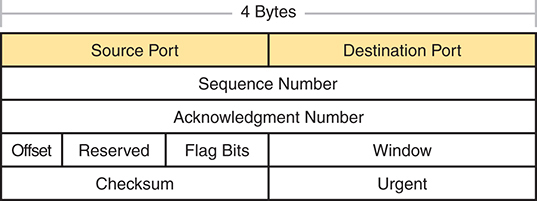

<figcaption>

<aside class="hidden" id="a05fig01">

TCP头跨出共4个字节. 上方包括了黄色的两个字段:左侧的源口和右侧的目的地口. 直接低于这些字段的是序列号,它占据了标题的整个宽度. 承认数字字段位于序列数字下方,也横跨了整个宽度. 下行包含数个字段:向左偏移,后为从左到右排列的"保留","旗帜比特"和"窗口". 下行包括左侧的Checksum字段和右侧的紧急字段. 每个字段都被划定,确保了TCP头的结构布局.

</aside>

<strong>图5-1</strong> <em> TCP头字段 </em>

</figcaption>

</figure>

由 TCP 创建的以 TCP 首部开头的信件, 以及任何应用程序数据, 都称为 TCP<a id="key_084" href="#ref-gloss_298">报文段</a>。或者,更通用的术语<em>第4层 PDU</em>,或<em>L4PDU</em>,也可以使用。

<section>

<h5 class="h5" id="ch05lev3sec1">使用 TCP 端口号实现多路复用</h5>

TCP 和 UDP 都使用一个叫做<em>多路复用</em>。因此,本节首先解释与TCP和UDP的多路复用. 后又探索了TCP的独有特征.

TCP和UDP的多路复用涉及计算机在接收数据时如何思考的过程. 计算机可能正在运行许多应用程序,例如网页浏览器,电子邮件包,或Internet VoIP应用程序(例如Skype). TCP和UDP多路分解告诉接收的计算机是哪个应用程序给出接收到的数据.

一些例子将有助于使多重性的必要性变得显而易见。 样本网络由两个PC组成,标签为汉纳和乔治. Hannah使用她写的应用程序发送出现在George屏幕上的广告. 申请每10秒向乔治发送一则新广告. 汉娜使用第二个应用程序,一个电汇应用程序,给乔治送去一些钱. 最后,汉娜使用网页浏览器访问在乔治的PC上运行的网页服务器. 广告应用和电汇应用是想象的,仅以这个为例. 网络应用在现实生活中的功能就像它一样.

<a href="#ch05fig02">图5-2</a>显示样本网络,由George运行3个应用程序:

<ul class="sq">

<li>
基于 UDP 的广告应用程序
</li>

<li>
基于 TCP 的电汇应用程序
</li>

<li>
TCP 网络服务器应用程序
</li>

</ul>

<figure class="image-c" id="ch05fig02">

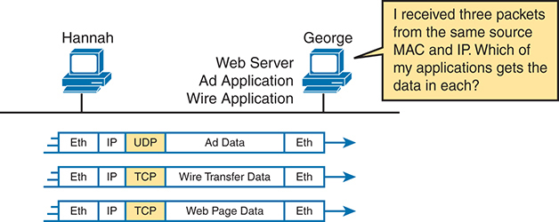

<figcaption>

<aside class="hidden" id="a05fig02">

设置包括两台被标记为汉纳和乔治的计算机,连接到一个同时托管Ad应用程序和有线应用程序的Web Server. Hannah向George发送了3个不同的包,每个包都指定用于不同的应用. 每个数据包以各自的分层和协议显示: 第一个数据包包含装有以太网,ETH,和Internet协议,I P,首部,并使用用户数据gram协议,UDP. 此软件包用于 Ad 应用程序 。 第二包包含有有线传输数据,用ETH和I P头封装,并使用传输控制协议(Transport Control Protocol, TCP). 此数据包用于电线应用程序 。 第三包包含网页数据,也用ETH和I P头封装,并使用TCP. 此软件包用于在 Web 服务器上运行的另一个应用程序 。 图表上的一则说明说:我收到了来自同一来源的MAC和I P的三包. 我哪一个应用程序能收到每个软件的数据? 这表明,尽管数据包来自同一来源,但不同的协议,UDP for Ad Data和TCP for Wire Transfer Data和Web Page Data,确定乔治侧面的哪个应用程序处理每个数据包.

</aside>

<strong>图5-2</strong> <em> 汉纳向乔治发送包件,有3个应用程序 </em>

</figcaption>

</figure>

George需要知道哪一个应用程序可以给数据,但<em>所有三个数据包都来自同一个以太网和IP地址</em>. 您可能认为乔治可以看看包中是否包含一个 UDP 或 TCP 首部, 但从图中可以看到,有两个应用程序(电传和网络)正在使用 TCP 。

TCP和UDP分别通过在TCP或UDP头中使用一个端口号字段来解决这个问题. Hannah的TCP和UDP的每个报文段都使用一个不同的<em>目的端口号</em>,使George知道将数据给哪个应用程序. <a href="#ch05fig03">图5-3</a>显示一个实例.

<figure class="image-c" id="ch05fig03">

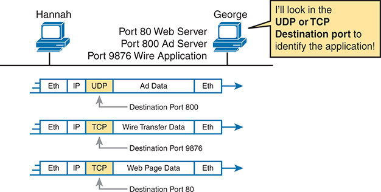

<figcaption>

<aside class="hidden" id="a05fig03">

在图像上方有两个计算机图标代表汉娜和乔治,每个图标都由指示数据传输的行连接. Hannah的计算机与三个应用相关:一个Port 80 Web Server,一个Port 800 Ad Server,和一个Port 9876有线应用程序. 下面描绘出三组数据包,每组显示数据是如何被封装和通过网络发送的: 第一组数据包显示一个以太网,ETH,一个帧,包含一个互联网协议,I P,数据包,它又包含一个用户数据报协议,UDP,报文段. 此段携带了Ad Data,目的端口为800个,表示它用于Ad Server. 第二包显示一个ETH帧,内有I P包并有传输控制协议,TCP,段. 本段携带有线传输数据,目的端口为9876,表示它用于有线应用. 第三包显示一个EH帧,内有带有TCP段的 I P 包. 此段载有Web Page Data,目的端口为80,表示它打算用于Web Server. 在图像的右侧,一个突出的黄色框包含文字: 我会在UDP或TCP目标端口查看以识别应用程序! 这强调了目的端口号在确定数据打算用于何种应用时的重要性.

</aside>

<strong>图5-3</strong> <em> 汉纳向乔治发送包件,有3个应用程序使用端口号到多端x</em>

</figcaption>

</figure>

 复杂化依赖于一个叫做<em>套接字</em>的概念. 套接字由三部分组成:

<ul class="sq">

<li>
一个 IP 地址
</li>

<li>
运输协议
</li>

<li>
一个端口编号
</li>

</ul>

因此,对于George上的网络服务器应用程序,套接字将是(10.1.1.2,TCP,端口80),因为默认情况下,网络服务器会使用出名的端口80. 当Hannah的网页浏览器连接到网页服务器时,Hannah也使用套接字——可能是这样的套接字:(10.1.1.1,TCP,49160). 为什么是...49160? Hannah只需要一个在Hannah上独有的端口号 所以Hannah看见了那个端口49160.

互联网指定号码管理局(IANA)是管理全球IP地址分配的同一组织,它将端口号细分为三个主要范围. 最初两个范围保留号,然后IANA可以通过应用程序和审查程序分配给特定应用协议,第三类保留端口按客户使用的方式动态分配,如上段的端口49160例. 端口号的名称和范围(详见RFC 6335)是:

<ul class="sq">

<li>
<strong> well Known (System) Ports: </strong> 0到1023的数字,由IANA指定,比用户端口更严格的审查程序来指定新端口.
</li>

<li>
<strong>用户(注册)端口:</strong>数字从1024到49151,由IANA指定,与知名端口相比,指定新端口的过程不太严格.
</li>

<li>
<strong> Ephemeral (Dynamic, Private) 端口:</strong> 数字从49152到65535,没有被指定,并打算在应用程序运行期间被动态分配并临时用于客户端应用程序.
</li>

</ul>

<a href="#ch05fig04">图5-4</a> 显示一个实例,在左边的用户设备上使用三个等离子端口,在右边的服务器使用两个知名端口和一个用户端口. 计算机同时使用三个应用程序;因此,三个套接字连接是打开的。 由于单台计算机上的一个插座应该是独一无二的,两个插座之间的连接应该确定两个计算机之间的一个独特的连接. 这种独特性意味着您可以同时使用多个应用程序,与运行在相同或不同计算机上的应用程序交谈. 以套接字为基础的多路复用,确保将数据传送给正确的应用程序。

端口号是套接字概念的关键部分. 服务器使用出名的端口(或用户端口),而客户端则使用动态端口. 提供某种服务的应用程序,如FTP,Telnet,以及Web服务器,使用一个著名的端口打开一个套接字,并听取连接请求. 由于客户端的这些连接请求必须同时包含源端口和目的端口号,服务器使用的端口号必须事先知道. 因此,每项服务都使用特定的知名端口号或用户端口号. 知名端口和用户端口均列于<a href="http://www.iana.org/assignments/service-names-port-numbers/service-names-port-numbers.txt">www.iana.org/assignments/service-names-port-numbers/service-names-port-numbers.txt</a>.

<figure class="image-c" id="ch05fig04">

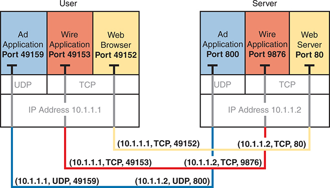

<figcaption>

<aside class="hidden" id="a05fig04">

图像分为两个主要部分:左边的用户和右边的服务器. 每节显示应用程序及其相联的端口,连接以行为代表. 用户科. 3个应用程序正在运行,每个应用程序有一个特定的端口:Ad Application on Port 49159;Wire Application on Port 49153;Web浏览器 在Port 49152. 用户区IP地址为10.1.1.1. 应用程序既使用UDP,用户数据报协议,也使用TCP,传输控制协议. Ad应用程序使用UDP,连接到服务器 I P10.1.1.2,Port 800. 有线应用和网络浏览器使用TCP. 电线应用连接到服务器 I P10.1.1.2,端口9876. 网页浏览器连接到服务器 I P10.1.1.2, Port80. 服务器科. 服务器主机为具有特定端口的相应应用程序:Ad Application on Port 800;Wire Application on Port 9876;Web Server on Port 80. 服务器部分的IP地址是10.1.1.2. 连接。 用户设备上的 Ad Application, 10.1.1.1, UDP, Port 49159, 连接到服务器上的 Ad Application, 10.1.1.2, UDP, Port 800. 用户设备上的有线应用,10.1.1.1,TCP,Port49153,连接到服务器上的有线应用,10.1.1.2,TCP,Port9876. 用户设备上的Web浏览器, 10.1.1.1, TCP, Port 49152, 连接到服务器上的Web服务器, 10.1.1.2, TCP, Port 80.

</aside>

<strong>图5-4</strong> <em> 索克特人之间的连接 </em>

</figcaption>

</figure>

在请求源头的客户机上,可以分配任何本地未使用的端口号. 结果是同一主机上的每个客户端使用不同的端口号,但一个服务器对所有连接使用相同的端口号. 例如,同一主机计算机上的100个网页浏览器可以分别连接到一个网页服务器,但与100个客户端连接的网页服务器将只有一个套接字,因此只有一个端口号(这里是80号端口). 服务器通过查看接收到的TCP报文段的源端口,可以知道100个客户端中哪一个寄出包. 服务器可以通过将数据发送到列为目的端口的同一端口号,将数据发送到正确的网络客户端(浏览器). 源和目的套接字的组合使所有参与的主机能够区分数据源和目的. 虽然这个例子用100个TCP连接来解释这个概念,但同样的端口编号概念同样适用于UDP会话.

注意

您可以在 www.rfc-editor.org/rfc/rfc 上找到所有 RFC<em>xxxx</em>.txt, 何处<em>xxxx</em>是 RFC 的编号。 如果您不知道 RFC 的编号, 您可以尝试按主题搜索 。<a href="http://www.rfc-editor.org">www.rfc-editor.org</a>.

</section>

<section>

<h5 class="h5" id="ch05lev3sec2">常见的 TCP/IP 应用</h5>

在你为CCNA考试做准备的整个过程中,你会遇到各种TCP/IP申请. 您至少应该知道一些可以用来帮助管理和控制网络的应用程序.

万维网(WWW)应用程序通过访问网络服务器上可用内容的网页浏览器存在. 虽然它经常被认为是一个最终用户应用程序,但实际上可以使用WWW来管理路由器或切换. 您启用了路由器或切换器中的网络服务器功能,并使用浏览器访问路由器或切换.

域名系统(DNS)允许用户使用名称来指代计算机,DNS用于寻找相应的IP地址. DNS 也使用客户端/服务器模型,其中<a id="key_069" href="#ref-gloss_122">DNS 服务器</a>由联网人员和DNS客户端功能控制大部分今天使用 TCP/IP 的设备的一部分. 客户端只是要求DNS服务器提供对应给定名的IP地址.

简单网络管理协议(SNMP)是一种专门用于网络设备管理的应用层协议. 例如,Cisco供应了多种网络管理产品,其中许多在Cisco Prime网络管理软件产品家族中. 它们可用于查询、编译、储存和显示有关网络操作的信息。 为了查询网络设备,Cisco Prime软件主要使用SNMP协议.

传统上,为将文件移入或移出路由器或交换机,Cisco使用简单文件传输协议(TFTP). TFTP 定义了基本文件传输的协议- 因此该单词<em>简单</em>。或者,路由器和交换机可以使用文件传输协议(FTP),这是一个功能性更强的协议来传输文件. 两者都对将文件运入和运出Cisco设备很有效. FTP允许更多的特性,使它成为一般最终用户的好选择. TFTP客户端和服务器应用程序非常简单,使其成为网络设备的嵌入部分的好工具.

有的应用使用TCP,有的则使用UDP. 例如,简单邮件传输协议(SMTP)和邮局协议(Post Office Protocol 3 (POP3))版本都用于邮件传输,需要保证交付,所以它们使用TCP.

无论使用哪个传输层协议,应用程序都会使用一个出名的端口号,以便客户端知道要连接到哪个端口. <a href="#ch05tab03">表5-3</a>列出了几个受欢迎的应用程序及其出名的端口号.

<figure class="table" id="ch05tab03" tabindex="0">

<figcaption>

<strong>表5-3</strong> 大众应用及其善知识端口编号

</figcaption>

<table class="all">

<tbody>

<tr>

<th class="th">
端口号
</th>

<th class="th">
协议
</th>

<th class="th">
应用
</th>

</tr>

<tr>

<td class="border">
20
</td>

<td class="border">
TCP
</td>

<td class="border">
FTP 数据
</td>

</tr>

<tr>

<td class="border">
21
</td>

<td class="border">
TCP
</td>

<td class="border">
FTP 控制
</td>

</tr>

<tr>

<td class="border">
22
</td>

<td class="border">
TCP
</td>

<td class="border">
SSH
</td>

</tr>

<tr>

<td class="border">
23
</td>

<td class="border">
TCP
</td>

<td class="border">
Telnet
</td>

</tr>

<tr>

<td class="border">
25
</td>

<td class="border">
TCP
</td>

<td class="border">
SMTP
</td>

</tr>

<tr>

<td class="border">
53
</td>

<td class="border">
UDP, TCP<a id="tfn5_3_1" href="#tfn5_3_1a">*</a>
</td>

<td class="border">
DNS
</td>

</tr>

<tr>

<td class="border">
67
</td>

<td class="border">
UDP
</td>

<td class="border">
DHCP 服务器
</td>

</tr>

<tr>

<td class="border">
68
</td>

<td class="border">
UDP
</td>

<td class="border">
DHCP 客户端
</td>

</tr>

<tr>

<td class="border">
69
</td>

<td class="border">
UDP
</td>

<td class="border">
TFTP
</td>

</tr>

<tr>

<td class="border">
80
</td>

<td class="border">
TCP
</td>

<td class="border">
HTTP (WWW)
</td>

</tr>

<tr>

<td class="border">
110
</td>

<td class="border">
TCP
</td>

<td class="border">
POP3
</td>

</tr>

<tr>

<td class="border">
161
</td>

<td class="border">
UDP
</td>

<td class="border">
SNMP
</td>

</tr>

<tr>

<td class="border">
443
</td>

<td class="border">
TCP、UDP
</td>

<td class="border">
HTTPS
</td>

</tr>

<tr>

<td class="border">
514
</td>

<td class="border">
UDP
</td>

<td class="border">
Syslog
</td>

</tr>

</tbody>

</table>

</figure>

<a id="tfn5_3_1a" href="#tfn5_3_1">*</a>DNS在不同情况下同时使用UDP和TCP. 它对TCP和UDP都使用端口53.

</section>

<section>

<h5 class="h5" id="ch05lev3sec3">连接的建立与终止</h5>

TCP <a id="key_068" href="#ref-gloss_090">连接建立</a>发生在其他任何TCP功能开始工作之前. 连接建立(Connection station)是指初始化序列和确认字段并商定所使用的端口号的过程.<a href="#ch05fig05">图5-5</a>显示连接建立流程的示例。

<figure class="image-c" id="ch05fig05">

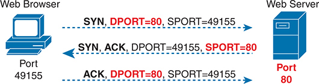

<figcaption>

<aside class="hidden" id="a05fig05">

图形描绘了 TCP 握手的三个步骤,涉及每个连接的特定源端口和目的端口。左边有一个图标,代表一个连接到 Port 的 Web 浏览器 49155 。在右边,一个图标代表连接到端口的 Web 服务器 80 。网页浏览器通过向网络服务器发送一个SYN,同步,包来启动连接。该包有一个目的端口DPORT,即 80 和一个源端口, SPORT, of 49155 ,显示为 SYN, DPORT 等值 80 时, SPORT 等值 49155 。网页服务器使用 SYN 、 ACK 、 同步、 识别、 包回网络浏览器。 包有一个目标端口: 49155 和源端口的 80 ,显示为SYN,ACK,DPORT等值 49155 时, SPORT 等值 80 最后,网页浏览器向网页服务器发送一个ACK,确认,包来完成握手。该包有一个目标端口: 80 和源端口的 49155 ,表示为ACK, DPORT 等值 80 时, SPORT 等值 49155 。

</aside>

<strong>图5-5</strong> <em>TCP 连接建立</em>

</figcaption>

</figure>

这种三相连接建立流(也叫"三相握手")必须在数据传输开始前完成. 连接存在于两个套接字之间,尽管TCP头没有单一的套接字字段. 在套接字的三个部分中,IP地址被隐含在IP头的源和目的IP地址上. TCP是被暗示的,因为一个TCP头正在被使用,由IP头中的协议字段值所指定. 因此,在TCP头需要编码的套接字中,唯一需要编码的部分是端口号.

TCP信号连接建立,使用TCP头部旗下字段内的2个位. 被称为"SYN"和"ACK"的旗帜,这些比特有特别有趣的含义. SYN是指“同步序列号”,这是TCP初始化的一个必要组成部分。

<a href="#ch05fig06">图5-6</a>显示 TCP 连接终止。 这个四向终止序列是直截了当的,并且使用一面额外的旗帜,叫做"...<em>FIN 位点</em>。(FIN是“完成的,”如您所猜测的)一个有趣的注释:在右边的设备发出序列中的第三个TCP段之前,它通知应用程序连接正在下降。 然后,它等待申请的确认,然后发送图中的第三部分。 以防应用程序需要一些时间来回复,右侧的PC发送了图中的第二个流,承认另一个PC想要取下连接. 否则,左侧的PC可能会再三重发第一段.

<figure class="image-c" id="ch05fig06">

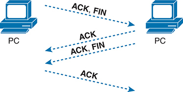

<figcaption>

<aside class="hidden" id="a05fig06">

图表显示为正确终止TCP连接所需的4个消息交换的序列. 过程从左侧的P C发送ACK,FIN消息到右侧的PC开始,启动终止序列. 右侧的P C以ACK消息回复,确认收到终止请求. 在此之后,右侧的P C将自己的ACK,FIN消息发回了左侧的PC,表示同意终止连接. 最后,左侧的P C发出ACK消息,承认从右侧的PC收到终止确认. 这个序列中的每一个步骤都由带有指示消息方向的箭头的虚线来代表,确保了对TCP连接终止过程中所涉及的双向通信的明确理解.

</aside>

<strong>图5-6</strong> <em>TCP 连接终止</em>

</figcaption>

</figure>

TCP建立并终止了端点之间的连接,而UDP则没有. 许多协议都以这些相同的概念运作,所以术语<em>面向连接</em>和<em>无连接</em>用于指每个概念的一般概念。 更正式地说,这些术语的定义如下:

<ul class="sq">

<li>
<strong>面向连接的协议 :</strong>协议要求在数据传输开始前进行消息交换,或者在两个端点之间具有必要的预先确定的相关性.
</li>

<li>
<strong>无连接协议 :</strong>一个不需要交换消息且不需要两个端点之间预先确定的关联的协议.
</li>

</ul>

</section>

<section>

<h5 class="h5" id="ch05lev3sec4">差错恢复与可靠性</h5>

TCP提供可靠的数据传输,也称为<em>可靠性</em>或者说<em>差错恢复</em>,取决于您读到的文档。 为了实现可靠性,TCP数字数据字节使用TCP头中的序列和确认字段. TCP在双向实现可靠性,使用一个方向的序列编号字段与相反方向的Acnowledged 字段结合.

<a href="#ch05fig07">图5-7</a>显示 TCP 序列和确认字段允许 PC 发送的示例 3000 到服务器的数据字节, 服务器确认收到数据。 图中的 TCP 段按顺序排列, 从上到下。 为了简单起见, 所有信件都碰巧有 。 1000 TCP 段数据部分中的数据字节。第一个序列号是一个很好的圆数( 1000 数字的上方显示三个部分,每个序列号是 1000 比前一个更能识别第一个 1000 消息中的字节 。 (在这个示例中, 第一个段持有字节) 1000 –1999 ; 第二个控取字节 2000 –2999 ; 第三个字节 3000 –3999 . )

<figure class="image-c" id="ch05fig07">

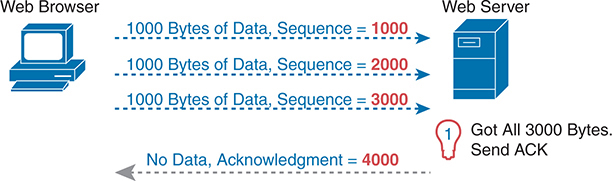

<figcaption>

<aside class="hidden" id="a05fig07">

接通顺序如下. Web浏览器向Web 服务器发送了由1000字节组成的数据段,其序列号为1000. Web浏览器向Web 服务器发送了 {1000} 字节数据的第二段,序列号为 2000}. Web浏览器向Web Server发送了1000字节数据的第三段,序列号为3000. Web 服务器接收所有三个段, 共为 3000 字节, 并向 Web 浏览器发送确认 。 来自Web Server的确认标记为无数据,确认编号为 4000,表明它已成功收到所有 3000字节的数据,现在期待序列中下一个字节,起始时间为 4000。

</aside>

<strong>图5-7</strong> <em>TCP 无错误的确认</em>

</figcaption>

</figure>

图中的第4个TCP段——唯一一个从服务器返回到网页浏览器的段——承认收到所有三个段。 怎么会? 4000的确认值意味着“我从不到4000个中收到所有序列号的数据,因此我准备接下去收到你的字节4000。” (注意这种通过列出下一个预期字节而不是最后收到的字节数来确认的公约称为 " 。<a id="key_073" data-original-href="vol2_ch05.xhtml#key_073a" data-unavailable="true" title="此内容不在当前提取范围内；请参阅原始 EPUB：vol2_ch05.xhtml#key_073a">转发确认</a>.)

然而,这个第一个例子并没有从任何错误中恢复过来;它只是显示了发送主机如何使用序列号字段来识别数据的基本原理,接收主机使用前向确认来确认数据. 更有趣的讨论围绕着如何使用这些相同的工具来进行错误的恢复. TCP使用序列和Acnowledgedment字段,这样接收主机就可以注意到丢失的数据,请发送主机重新发送,然后确认重发数据到达了.

TCP 如何进行差错恢复, 有许多不同之处 。<a href="#ch05fig08">图5-8</a>仅举出一个例子,与上一个数字有类似细节。 网页浏览器再次发送了3个TCP段,再次各发送了1000字节,再次以容易记住的序列号. 然而,在这个例子中,第二个TCP段未能跨越网络.

<figure class="image-c" id="ch05fig08">

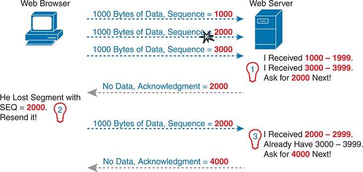

<figcaption>

<aside class="hidden" id="a05fig08">

左上方有代表网页浏览器的图标,右上方有代表网页服务器的图标. 三箭头,每个被标注为1000字节数据,序列等同于1000,1000字节数据,序列等同于2000,和1000字节数据,序列等同于3000,分别发自网页浏览器并指向网页服务器. 第一个箭头以网页服务器为结尾,由 I Accept 1000至 1999响应. 问出2000下一个! 第二支箭以得到3000至3999结束. 询问 4000 Next! 表示序列号 2000 的包丢失 。 一个被标记为"无数据"的箭头,Acnowledgment等于2000从网页服务器回指到网页浏览器,表示对缺失数据的承认. 在此下方有另一组箭头显示再发送过程:网页浏览器发送出1000字节数据,序列等同2000再发送. 网络服务器随后以"我收到2000至2999"响应. 已经有3000到3999. 问: ~4000下个! 另一个被标注为"无数据"的箭头,Acnowledgment从网页服务器到网页浏览器的分数等于4000分数,表示成功收到所有数据包,最高序列号为3999.

</aside>

<strong>图5-8</strong> <em>TCP 有错误的确认</em>

</figcaption>

</figure>

该图指出了两个主机如何思考的三组想法。 首先,在右边,服务器意识到它没有接收到所有的数据。两个接收的TCP报文段包含编号的字节 1000 –1999 和 3000 –3999 。显然,服务器没有收到中间编号的字节。然后,服务器决定承认所有数据直到丢失的数据,即发送一个与确认字段等同的段。 2000 。

收到不承认迄今发送的所有数据的确认通知发送主机重新发送数据。 左侧的PC可能等待几秒钟才能确保没有其他的承认到达(使用一个叫再传输定时器),但很快会决定服务器的意思是“我确实需要2000年的下一个——把它重新发送 。 左面的PC这样做了,如图中六个TCP报文段中的第五个所示。

最后,请注意,服务器不仅可以确认重新发送的数据,还可以确认先前收到的正确数据。在这种情况下,服务器收到了重新发送的第二个TCP段(有序列号的数据) 2000 –2999 ),但服务器已经收到了第三个 TCP 段(数据编号为 3000 –3999 服务器的下一个确认字段承认这两个段的数据,其中有一个确认字段: 4000 。

</section>

<section>

<h5 class="h5" id="ch05lev3sec5">通过窗口机制进行流量控制</h5>

TCP通过使用一个窗口概念来实施流量控制,该概念适用于可能未清的数据数量并等待任何时间的确认。 窗口概念让接收主机告诉发送者它现在能收到多少数据,使接收主机有办法让发送主机减速或加速. 接收器可以向上和向下滑动窗口大小,称为<a id="key_085" href="#ref-gloss_309">滑动窗口</a>或者说<em>动态窗口</em>——更改发送主机可以发送多少数据.

滑动窗口机制用一个例子更有意义。 实例如下:<a href="#ch05fig09">图5-9</a>,使用与前几个数字中的例子相同的基本规则。 在这种情况下,TCP部分没有任何出错,讨论开始时间比前两个数字早.

<figure class="image-c" id="ch05fig09">

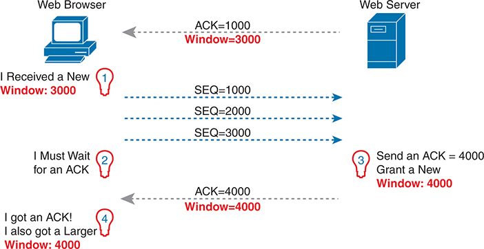

<figcaption>

<aside class="hidden" id="a05fig09">

该图分为两个主要部分:左边的Web浏览器和右边的Web服务器. 每节显示TCP段和ACK s的流量,包括序列号,SEQ和窗口大小. Web浏览器 (Left) 初始状态:Web浏览器接收到新窗口大小为3000(Window等於3000. 数据传输. SEQ等於1000:Web浏览器向Web Server发送一个序列号为1000的报文段. SEQ等同于2000:Web浏览器向Web Server发送一个序列号为2000的报文段. SEQ等同于3000:Web浏览器向Web Server发送一个序列号为3000的报文段. 等待 ACK: 网页浏览器在发送报文段后等待 Web 服务器的确认 ACK 。 ACK Recept:网页浏览器收到AK等于4000的确认,而新窗口大小为4000(Window等于4000). 新窗口:网页浏览器确认收到ACK和更大的窗口大小(Window等于4000). Web 服务器 (右). 初始状态:Web服务器从Web浏览器接收了序列号为1000,2000和3000的TCP段. ACK Transmission. ACK 等于 1000:Web Server 发送一个承认,ACK 等于 1000,窗口大小为 3000(Window 等于 3000). New Data Reception:收到所有报文段后,SEQ等于1000,SEQ等于2000,SEQ等于3000,Web Server发送一个ACK等于4000,并授予一个新的窗口大小为4000(Window等于4000).

</aside>

<strong>图5-9</strong> <em>TCP 窗口</em>

</figcaption>

</figure>

从第一个段开始,由服务器发送到PC. 承认字段现在应该已经熟悉了:它告诉PC,服务器期望接下来有一个序列号为1000的报文段. 新字段"窗口字段"设置为3000. 由于报文段流向了PC,这个值告诉PC,PC在得到承认之前,无法在这个连接上发送不超过3000字节. 因此,如左边所示,PC意识到它只能发送出3000字节,在发送出3个1000-byteTCP报文段后,它停止发送,等待承认.

继续这个例子,服务器不仅承认收到数据(没有丢失),而且决定将窗口大小滑动多一点. 注意图中右向左流出第二个消息,这次窗口为4000. 当PC接收到这个TCP段时,PC意识到它可以发送出另一个 4000字节(一个比上个值略大的窗口).

请注意,虽然最后几个数字为解释机制如何运作提供了例子,但这些例子可能会给大家留下这样的印象,即TCP让主机坐在那里等待很多的承认. TCP 不想让发送主机等待数据发送. 例如,如果在窗口用完之前收到确认,则开始一个新的窗口,发送者继续发送数据,直到当前窗口用完为止. 通常,在一个几乎没有问题,失去的分会很少,而且交通不便的网络中,TCP窗口保持相对较大,主机很少等待发送.

</section>

</section>

<section>

<h4 class="h4" id="ch05lev2sec2">用户数据报协议</h4>

UDP为应用程序提供交换消息的服务. 与TCP不同的是,UDP是无连接的,没有提供可靠性,没有窗口,也没有对收到的数据重新排序,也没有将大块数据分解成合适的大小进行传输. 然而,UDP提供了TCP的一些功能,例如数据传输和多用端口号进行多用,它这样做时的间接费用字节较少,所需处理也比TCP少.

UDP数据传输不同于TCP数据传输,因为没有完成再排序或回收. 使用 UDP 的应用程序容忍丢失的数据,或者它们有一些恢复所损失数据的应用机制。 例如,VoIP使用UDP,因为如果一个语音包丢失了,那么在能够注意到丢失和数据包再传输的时候,就会发生太多的延迟,而语音是无法理解的. 另外,DNS请求可能使用UDP,因为如果DNS解析失败,用户会重试一个操作. 另一个例子是,远程文件系统应用程序"网络文件系统"(NFS)以应用程序层代码来进行回收,因此UDP特性为NFS所接受.

<a href="#ch05fig10">图5-10</a>显示 UDP 首部格式。 最重要的是,请注意,首部包括源和目的端口字段,目的与TCP相同. 然而,UDP只有8字节,与所显示的20-byteTCP头相比.<a href="#ch05fig01">图5-1</a>。UDP需要一个比TCP更短的标题,仅仅因为UDP的工作较少.

<figure class="image-c" id="ch05fig10">

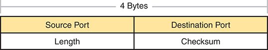

<figcaption>

<aside class="hidden" id="a05fig10">

标题为共8字节,分为4个字段,每个字节为2字节,16个位,以长度表示. 这些字段以二相矩阵格式排列. 在第一行中,Source Port字段指定了发送数据的源设备的端口号,而"目的地"字段则指定了接收数据的目的地设备的端门号. 在第二行中,长度字段表示UDP头和封装数据的长度,而Checksum字段用于错误检查头和数据. 源端口和目的端口字段以黄色突出显示.

</aside>

<strong>图5-10</strong> <em>UDP 首部</em>

</figcaption>

</figure>

</section>

</section>

<section>

<h3 class="h3" id="ch05lev1sec4">TCP/IP 应用</h3>

建立企业网络,或将一个小型的家庭或办公室网络与互联网连接起来,其整个目标是使用诸如网页浏览、短信、电子邮件、文件下载、语音和视频等应用程序。 本节审查一个特定的应用程序——使用超文本传输协议浏览网页(<a id="key_074" href="#ref-gloss_161">HTTP</a>).

万维网(WWW)由世界上所有互联网连接的网络服务器组成,外加所有互联网连接的主机有网页浏览器.<a id="key_087" href="#ref-gloss_375">网络服务器</a>,它包含在计算机上运行的网络服务器软件,存储信息(形式为:<em>网页</em>可能对不同的人有用。 A 个<em>网页浏览器</em>,是安装在终端用户计算机上的软件,提供了连接到网络服务器和显示存储在网络服务器上的网页的手段.

注意

虽然大多数人都用这个词<em>网页浏览器</em>,或简单<em>浏览器</em>,网页浏览器也被调用<em>网络客户端</em>,因为他们从网络服务器获得服务。

要使这一过程发挥作用,必须产生若干具体的应用层功能。 用户必须不知何故地识别服务器,特定网页,以及用来从服务器获取数据的协议. 客户端必须找到服务器的IP地址,基于服务器的名称,一般使用DNS. 客户端必须请求网页,网页实际上由多个独立的文件组成,服务器必须将文件发送到网页浏览器. 最后,对于电子商务(电子商务)应用而言,数据特别是敏感金融数据的转移需要安全。 以下各节述及这些职能的每一项。

<section>

<h4 class="h4" id="ch05lev2sec3">统一资源标识符</h4>

浏览器要显示网页,浏览器必须识别拥有网页的服务器,加上识别特定网页的其他信息. 大多数网页服务器有许多网页. 例如,如果使用网页浏览器浏览<a href="http://www.cisco.com">www.cisco.com</a>并点击网页,你会看到另一个网页。 再点击一次,你会看到另一个网页。 在每种情况下,点击动作都会识别服务器的IP地址以及具体的网页, 细节大多隐藏在你身上。 (这些可点击的网页上的项目,反过来又将您带到另一个网页,因此称为:<em>链接</em>.)

浏览器用户在点击网页上的东西或输入统一资源标识符时可以识别网页(United Resource Identifer).<a id="key_086" href="#ref-gloss_259">URI</a>)在浏览器的地址区域。 这两个选项——点击链接和输入URI——都指URI,因为当你点击网页上的链接时,该链接实际上指的是URI.

注意

大多数浏览器支持以某种方式查看由链接引用的隐藏的URI. 在多个浏览器中,将鼠标指针徘徊在链接上,单击右键并选择<strong>属性</strong>。弹出窗口应显示浏览器在单击该链接时将选择的 URI 。

在普通的演讲中,很多人使用这个词<em>网页地址</em>或类似相关术语<em>通用资源定位器</em>(或"统一资源定位器";URL)而不是URI,但URI确实是正确的正式名词. 事实上,在几年多的时间里,URL比URI更常用. 然而,互联网工程工作队,即IETF(界定TCP/IP的集团),以及W3C财团(<a href="http://W3.org">W3.org</a>一个制定网络标准的财团)作出了协调一致的努力,将URI作为一般术语的使用标准化. 关于这一点,见RFC 7595。

从实际角度看,用于连接网络服务器的URI包含三个关键组件,如以下所述:<a href="#ch05fig11">图5-11</a>。图中为URI字段的正式名称. 更重要的是,对于这次讨论,请注意:"p"前面的文本识别用于连接服务器的协议,"//"和"/"之间的文本以名称识别服务器,"/"之后的文本识别网页.

<figure class="image-c" id="ch05fig11">

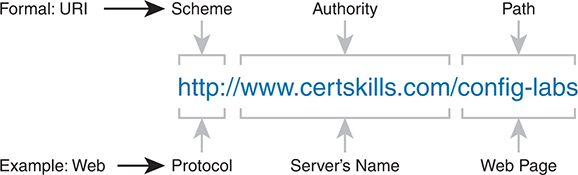

<figcaption>

<aside class="hidden" id="a05fig11">

在中心,以蓝色文字突出显示一个URI h t p 冒号向前斜拉片 w w dot certskilling dot com 向前斜拉片. 这一URI分为三个主要部分:计划,权威,和路径. 方案组成部分被贴上下箭头,指向 h t t p 冒号前斜线前斜线,说明所使用的协议。 管理局部分还用向下箭头表示,指向w w w w dot certskilling dot com,识别服务器的名称. Path 组件的标志是向下箭头指向前进的斜线配置符,指定正在访问的网页. 画面的左侧有两节. 上行部分使用正式的URI术语,并用箭头指向Scheme;而下行部分则提供Web指向协议的实用例子. 此外,权威与服务器名称一致,路径与网页一致。

</aside>

<strong>图5-11</strong> <em>用于获取网页的 URI 结构</em>

</figcaption>

</figure>

在这种情况下,协议是 Hypertext 传输协议(HTTP),主机名是<a href="http://www.certskills.com">www.certskills.com</a>,而网页的名称是 Cfig-labs 。

</section>

<section>

<h4 class="h4" id="ch05lev2sec4">使用 DNS 查找 Web 服务器</h4>

主机可以使用DNS来发现对应特定主机名的IP地址. URIs 通常列出服务器的名称——这个名称可用于动态地学习同一服务器使用的IP地址. 网页浏览器无法将一个IP包发送到目的名称,但它可以将一个包发送到一个目的IP地址. 因此,在浏览器可以向网络服务器发送一个包之前,浏览器通常需要将URI内部的名称解决到该名对应的IP地址.

为了汇集几个概念,<a href="#ch05fig12">图5-12</a>显示由网页浏览器启动的 DNS 进程,以及其他一些相关信息。 从基本角度来说,用户进入URI(在这种情况下,<a href="http://www.cisco.com/go/learningnetwork">http://www.cisco.com/go/learningnetwork</a>),解决<a href="http://www.cisco.com">www.cisco.com</a>名称输入正确的IP地址,并开始向网络服务器发送数据包。

<figure class="image-c" id="ch05fig12">

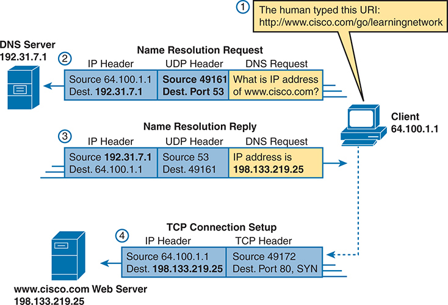

<figcaption>

<aside class="hidden" id="a05fig12">

首先,人类类型 URL h t t 冒号向前 slash slash w w w dot cisco dot com 向前 slash go go slash 学习网络进入I P地址64.100.1.1的客户端计算机上的网页浏览器,启动DNS解析请求以找到域w w w dot cisco dot com的 I P地址. 第二,客户端将一个DNS解析请求发送到一个有 IP 地址192.31.7.1的 DNS 服务器. 请求包括一个 I P 头和一个 UDP, 用户 Datagram 协议, 头, 源端口设为 49161 , 目的端口设为 53 , 问, ww w dot cisco dot com的 I P 地址是什么 ? 第三,DNS服务器以一个DNS名称解析回复,包括一个IP头和一个UDP头,源端口被设定为53,目的端口被设定为49161,表明w w w dot cisco dot com的 IP地址是198.133.219.25. 第四,客户端使用已解决的 I P 地址启动 TCP, Transmission Control Protocol,连接到 198.133.219.25的网络服务器,发送一个带有 I P 头和 TCP 头的 TCP 连接设置包,源端口设置为 49172,目的端口设置为 80. 这个包是一个SYN,同步,包,是建立TCP连接的第一步.

</aside>

<strong>图5-12</strong> <em>DNS 解析和请求网页</em>

</figcaption>

</figure>

图中所示步骤如下:

<ol class="number">

<li>
用户进入URI,<a href="http://www.cisco.com/go/learningnetwork">http://www.cisco.com/go/learningnetwork</a>,进入浏览器的地址区域。
</li>

<li>
客户端向DNS服务器发送了DNS请求. 通常,客户端通过DHCP来学习DNS服务器的IP地址. DNS 支持使用 TCP 或 UDP,这里的例子有 UDP . 无论哪种情况,协议都使用出名的端口53. (见<a href="#ch05tab03">表5-3</a>),此章前作,为一通俗知名口岸列表. )
</li>

<li>
DNS 服务器发送回复, 将 IP 地址 198.133.219.25 列为<a href="http://www.cisco.com">www.cisco.com</a> IP地址. 也注意,回复显示目的地IP地址为64.100.1.1,即客户端的IP地址. 它也显示一个UDP头,有源端口53;源端口是53,因为数据来自DNS服务器,或由DNS服务器发送.
</li>

<li>
客户端开始建立新的TCP连接到网络服务器的过程. 注意目的地IP地址是网络服务器的刚刚获得的IP地址. 该包包括一个TCP头,因为HTTP使用TCP. 也注意到目的地TCP港为80个,是HTTP的出名港口. 最后,SYN比特被显示,作为提醒,TCP连接建立过程从一个TCP段开始,并启用了SYN 比特(二进制 1).
</li>

</ol>

实例<a href="#ch05fig12">图5-12</a>显示当客户端主机不知道与主机名相关的IP地址但企业确实知道地址时会发生什么. 然而,主机可以缓存DNS请求的结果,这样一段时间内客户端不需要要求DNS解决名称. 另外,DNS服务器可以缓存先前 DNS 请求的结果;例如,企业 DNS 服务器在<a href="#ch05fig12">图5-12</a>通常不会在企业以外的域配置关于主机名的信息,所以这个示例依赖于 DNS 缓存了与主机名相关的地址<a href="http://www.cisco.com">www.cisco.com</a>.

当当地DNS不知道与主机名相关的地址时,它需要请求帮助.<a href="#ch05fig13">图5-13</a>显示相同客户端的示例<a href="#ch05fig12">图5-12</a>。在此情况下,企业DNS作为:<a id="key_082" href="#ref-gloss_285">递归 DNS 服务器</a>,发送重复的 DNS 消息,以努力识别权威的 DNS 服务器.

<figure class="image-c" id="ch05fig13">

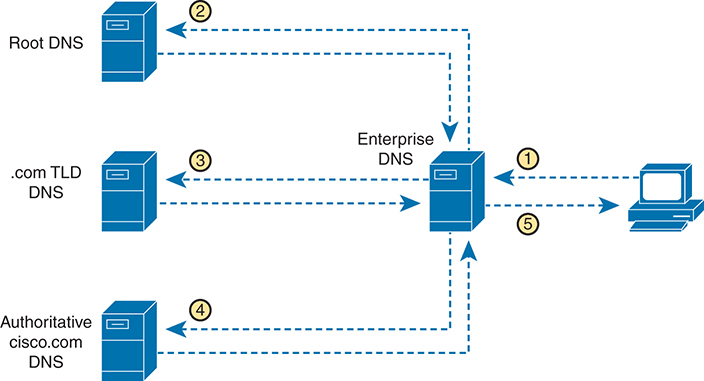

<figcaption>

<aside class="hidden" id="a05fig13">

连接顺序从用户启动从他们的计算机到企业 DNS 服务器的 DNS 查询开始,请求一个特定域的 I P 地址,如 cisco dot com. Entertainment DNS服务器没有所需的信息,将查询转发给Root DNS服务器. Root DNS服务器以点com Top-Level域名,TLD,DNS服务器的地址响应企业DNS服务器. 然后,企业 DNS 服务器为 cisco dot com 的权威 DNS 伺服器的 I P 地址查询 dot cm TLDDNS 服务器. dot com TLDDNS服务器以权威的cisco dot cm DNS服务器的地址响应. 企业 DNS 服务器为 cisco dot com 的特定 I P 地址查询权威的 cisco dot com DNS 伺服器. 权威的 Cisco dot com DNS 服务器响应请求的 I P 地址. 最后,企业DNS服务器将IP地址发回用户的计算机,完成递归DNS查询程序,并确保用户的计算机可以连接到请求域的正确IP地址.

</aside>

<strong>图5-13</strong> <em>递归式 DNS 搜索</em>

</figcaption>

</figure>

图中所示步骤如下:

<ol class="number">

<li>
客户端发送 DNS 请求<a href="http://www.cisco.com">www.cisco.com</a>到它所知道的DNS服务器,即企业的DNS服务器.
</li>

<li>
(recursive)企业的DNS服务器尚不知道答案,但它并不拒绝客户端的DNS请求. 相反,它遵循一个重复的(反向的)过程(shown as step 2,3和4),从发送到根 DNS 服务器的 DNS 请求开始. root也不提供地址,但它提供另一个DNS服务器的IP地址,一个负责.com顶级域.
</li>

<li>
递归企业 DNS 将下一个 DNS 请求发送到在前一步学到的 DNS 服务器——这次是 TLD DNS 服务器用于.com 域名. 此 DNS 也不知地址, 但是它知道 DNS 服务器, 它应该是域的权威 DNS 服务器 。<a href="http://cisco.com">cisco.com</a>,因此它提供 DNS 服务器的地址。
</li>

<li>
企业 DNS 向 DNS 服务器发出另一个 DNS 请求, 地址在前一步中得知, 再次请求解析名称<a href="http://www.cisco.com">www.cisco.com</a>。此 DNS 服务器, 权威服务器<a href="http://cisco.com">cisco.com</a>,提供地址。
</li>

<li>
企业 DNS 服务器返回一个 DNS 回复给客户端,提供步骤所请求的IP地址1.
</li>

</ol>

</section>

<section>

<h4 class="h4" id="ch05lev2sec5">使用 HTTP 传输文件</h4>

在网页客户端(浏览器)创建了与网络服务器的TCP连接后,客户端可以开始向服务器请求网页. 最常见的是用于传输网页的协议是HTTP. 在RFC 7230中定义的HTTP应用层协议,定义了文件如何在两台计算机之间被传输. HTTP是专门为在网络服务器和网络客户端之间传输文件而创建的.

HTTP定义了多个命令和响应,最常用的是HTTP GET请求. 要从网络服务器获取文件,客户端会向服务器发送一个HTTPGET请求,列出文件名. 如果服务器决定发送文件,服务器会发送HTTP GET响应,返回代码为200(意为确定),同时发送文件的内容.

注意

HTTP 请求有许多回回代码存在. 例如,当服务器没有所请求的文件时,它会发布一个 404的回回码,这意味着“文件找不到 ” 。 大多数网页浏览器没有显示特定的数字 HTTP 回码,而是显示一个响应如“ 页面找不到” 的回码 404 。

网页通常由多个文件组成,称为<em>对象</em>。大多数网页都包含文字以及一些图形图像,动画广告,可能还有语音或视频. 这些组件中的每一个都作为不同的对象(文件)被存储在网络服务器上. 为了获得全部,网页浏览器获得了第一个文件. 此文件可以(而且通常会)包含对其他URI的引用,因此浏览器随后也会请求其他对象.<a href="#ch05fig14">图5-14</a>显示一般想法,浏览器得到第一个文件,然后得到另外两个文件。

<figure class="image-c" id="ch05fig14">

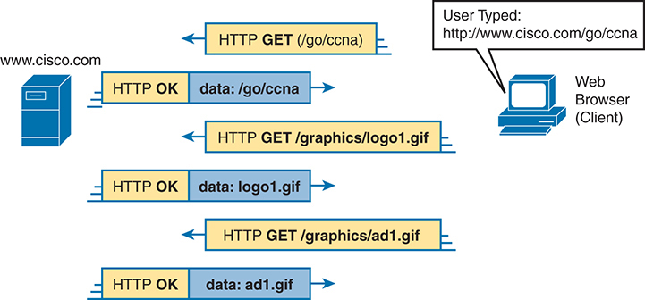

<figcaption>

<aside class="hidden" id="a05fig14">

顺序开始于用户在客户端P C上将 URL h t t p 冒号前向斜拉线前向斜拉线前向斜拉线前向斜拉线前向斜拉线前向斜拉线前向斜拉线前向斜拉线前向斜拉线前向斜拉线后向 c n a 输入网络浏览器. 网页浏览器在 w w w dot cisco dot com 时向网页服务器发送一个 HTTPGET 请求,请求资源向前斜拉出 c c n a 。 服务器以 HTTPOK 消息响应, 之后是请求的向前斜拉的数据 向前斜拉 C c n a 。 接下来,网页浏览器又会发出HTTPGET的请求,要求资源向前斜拉图形向前斜拉logo1.gif. 服务器以 HTTPOK 信件和标志 1 dot gif 的数据响应. 此模式会与网页浏览器重复发送一个HTTPGET请求,用于资源向前斜拉图形向前斜拉ad1.gif,服务器用HTTPOK消息和d-1dot gif的数据对此做出回复. 每个请求和响应都由显示网络服务器和网页浏览器客户端之间数据流量方向的箭头来代表,请求以黄色为标签,而回复以蓝色为标签.

</aside>

<strong>图5-14</strong> <em>多个 HTTP GET请求/ 回复</em>

</figcaption>

</figure>

在这种情况下,在网页浏览器获得第一个文件——URI中称为"/go/ccna"的文件之后,浏览器读取并解释该文件. 除了包含网页的部分内容外,文件还提及了另外两个文件,因此浏览器额外发布了两个HTTP GET请求. 请注意,尽管图中没有显示这些命令,但这些命令都流过一个命令(或可能)更多)客户端和服务器之间的TCP连接. 这意味着TCP将提供出错的恢复,确保数据得到交付。

</section>

<section>

<h4 class="h4" id="ch05lev2sec6">接收主机如何确定正确的接收应用</h4>

本章最后讨论了一个程序,根据这个程序,一个主机在通过任何网络接收任何消息时,可以决定其许多应用程序中哪一个应当处理收到的数据.

例如,考虑在左侧显示主机A<a href="#ch05fig15">图5-15</a>。主机碰巧打开了三个不同的网页浏览器窗口,每个窗口都使用一个独特的TCP端口. 主机A也有一个电子邮件客户端和一个聊天窗口打开,两者都使用TCP. 如图所示,电子邮件和聊天应用程序在主机A上都使用一个独特的TCP端口号.

<figure class="image-c" id="ch05fig15">

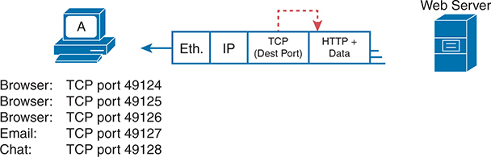

<figcaption>

<aside class="hidden" id="a05fig15">

图像的左侧显示Host A,由被标记为A的计算机图标所代表. 它发送数据封装在几个协议层:以太网(ETH),互联网协议(I P),传送控制协议(TCP)与目的端口,和超文本传输协议(HTTP)外加数据本身. 在右侧,图像显示由服务器图标所描绘的Web Server. 主机A和Web Server的连接涉及主机A的不同应用程序,每个应用程序使用特定的TCP端口:浏览器:TCP端口49124. 浏览器:TCP端口49125. 浏览器:TCP端口49126. 电子邮件:TCP端口49127. 聊天:TCP端口49128. 图表解释Host A使用TCP头中的目的端口来决定哪个应用程序应该接收数据. 例如,在TCP端口上得到的数据49124被指向浏览器应用程序,而TCP端口上的数据49127被指向电子邮件应用程序.

</aside>

<strong>图5-15</strong> <em>难题:主机 A 如何选择应该接收此数据的应用程序</em>

</figcaption>

</figure>

本章通过多个示例说明，传输层协议如何使用 TCP 或 UDP 首部中的目的端口号字段来识别接收应用程序。例如，如果<a href="#ch05fig15">图5-15</a> 中的 TCP 目的端口值为 49124，主机 A 就知道这些数据应交给三个 Web 浏览器窗口中的第一个。

在接收主机甚至可以检查TCP或UDP头,并找到目的端口字段之前,它必须首先在消息中处理外头. 如果收到的信件是封装了 IPv4 包的以太网帧, 首部看起来就像在<a href="#ch05fig16">图5-16</a>.

<figure class="image-c" id="ch05fig16">

<figcaption>

<aside class="hidden" id="a05fig16">

图像左侧有代表网页浏览器的图标,而右侧有代表网页服务器的图标. 在这些图标之间,有一个数据包结构的详细分解. 数据包被分为四个部分,每个部分被固定在一个矩形上. 第一节被标注为"以太网"(Type),包含值为0乘以0800,表示以太网帧的类型. 第二节标注为 I P v 4 (Protocol) ,其值为 6,表示 I P v 4 的协议号. 第三节被标注为"TCP (Destination Port)"的标出值为49124,代表传输控制协议(TCP)使用的目的端口编号. 最后部分被标注为HTTP和Data,包括了正在传输的实际HTTP数据. 红色破折射箭头从上方各节的值到各自的标签,将它们与数据包中的特定字段明确相接.

</aside>

<strong>图5-16</strong> <em>三个关键字段, 用于识别下一个标题</em>

</figcaption>

</figure>

接收主机需要查看多个字段,每个首部一个,以识别收到消息中的下一个首部或字段. 例如,主机A使用以太网NIC连接到网络,所以收到的消息是以太网帧. 以太网类型字段识别了遵循以太网头的片头类型——在此情况下,其值为hex 0800,是一款IPv4片头.

IPv4 首部包含一个类似字段，称为 IP 协议字段。IPv4 协议字段使用一组标准值来标识下一个首部，其中十进制 6 表示 TCP，十进制 17 表示 UDP。本例中，值 6 标识 IPv4 首部之后的 TCP 首部。接收主机一旦知道存在 TCP 首部，就可以处理目的端口字段，确定应由哪个本地应用程序进程接收数据。

</section>

<section>

<h4 class="h4" id="ch05lev2sec7">HTTP 版本</h4>

对于自1998年CCNA创立以来的大部分历史,你可以忽略HTTP版本和版本差异的细节. 随着HTTP/3在2020年前后的推出,您需要更多了解HTTP协议版本. 本节通过CCNA重要的版本和差异来工作.

<section>

<h5 class="h5" id="ch05lev3sec6">HTTP 1.0 和 1.1</h5>

Web浏览器和服务器在早期的1990s中首次出现. 最终,IETF获得了超文本传输协议(Hypertext Transit Protocol (HTTP))的所有权,被网页浏览器和服务器用于传输对象. 在早期,IETF发布了HTTP RFCs for HTTP 0.9.<a id="key_075" href="#ref-gloss_162">HTTP 1.0</a>,以及<a id="key_076" href="#ref-gloss_163">HTTP 1.1</a>,每个版本都有各种改进。 然而,应用协议的运作方式存在差异,细节对建设网络基础设施不重要. 例如,它们都使用HTTP和TCP,本章最后几页讨论的HTTP Get Request and Response 方法相同.

这些早期的HTTP版本使用共同的网络功能. 他们都使用TCP进行运输协议,IANA为服务器保留了著名的TCP端口80. HTTP 用 http 的方案( protocol) 定义 URL, URL 类似<a href="http://www.example.com">http://www.example.com</a>。URL可以指定一个非默认服务器端口号,但如果省略(如典型的),URL意味着默认为众所周知的端口. 另外,"http"方案意味着没有使用额外的安全特性,如认证或加密等.

通过使用网页浏览器,您可能注意到URL通常不会引用任何版本编号. 相反,网页浏览器和网络服务器支持许多或大多数版本. 他们使用一个版本的细节进行连接,然后可以使用应用程序层头来信号更改使用不同的版本. 作为一个用户,你没有注意到差异。 作为一名网络工程师,加上这些早期的版本,你不需要担心是用到的.

</section>

<section>

<h5 class="h5" id="ch05lev3sec7">HTTP/2 和 TLS</h5>

独立于特定的HTTP协议版本,额外的RFCs定义了如何使用Transport Layer Security(TLS)在HTTP中添加安全特性. 1990年代后期的RFC定义<a id="key_083" href="#ref-gloss_297">安全 HTTP 软件</a>,在TLS上也称为HTTP. 由于它在现有协议中添加了安全性,Security HTTP像其他浏览器会话一样使用初始序列,从客户端和服务器之间的TCP连接开始. 然而,在发送HTTP消息之前,端点会按照TLS协议创建一个TLS连接,实施服务器认证和加密等安全功能. 只有这样,HTTP消息才会流出.

为了表示连接使用安全HTTP,RFC定义了https的一个新的URI方案(protocol),其中的URL类似.<a href="https://www.example.com">https://www.example.com</a>。(您每天使用的几乎所有 URL 都从<em>https</em>并使用安全HTTP.)

从网络视角来看,与HTTP 1.1没有TLS存在两个差异. 如前所述,URL不同。 另外,IANA还保留了著名的TCP端口443用于安全HTTP,因此一个开始的URL<em>https</em>暗示 TCP 端口为 443 服务器的知名端口 。

注意

您可能会看到HTTP版本的引用为 HTTP 1.1 或带有 /, 如 HTTP/ 1.1 。

HTTP1.1和Security HTTP/1.1成为了多年来的规范,特别是进入了2000s和2010s,随着时间的推移,越来越多的流量使用安全选项. 然而,随着时间的流逝,许多利益攸关方在HTTP/1.1上看到了网站性能的问题——特别是在传送每个网页的许多对象时. HTTP/2和HTTP/3尝试用不同的方法解决性能问题.

<a id="key_077" href="#ref-gloss_164">HTTP/2</a>,于2010年代中期达到RFC状态,改进了HTTP应用层协议的内部工作,同时保留了相同的URL方案,TCP运输,知名端口,以及HTTP在TLS之上的相同使用. 更改会影响HTTP应用层协议的细节,但不会影响网络或安全细节. 因此,HTTP/2的引入虽然在IT中很重要,但并没有为大多数网络工程项目带来新的复杂性,因为HTTP/2使用与更早的HTTP版本相同的TCP运输协议和出名的端口.

</section>

<section>

<h5 class="h5" id="ch05lev3sec8">HTTP 3.0</h5>

<a id="key_078" href="#ref-gloss_165">HTTP/3</a>HTTP性能发生显著变化,采用的方法会做出额外的根本性改变,包括使用UDP来代替TCP.

Google在2010s期间开发出已经成为HTTP/3的. Google的工作虽然有用,但发现TCP的故障恢复和流量控制功能减缓了HTTP的性能. 为了解决这个问题,Google根据UDP构建了一个新的运输协议,叫做UDP<a id="key_081" href="#ref-gloss_277">QUIC</a>(不是缩写,只是名称),现在发表于RFC 9369. QUIC还具有一些类似于TCP的特性(error recovery,流量控制),它同时融合了TLS的工作,减少了间接费用流量. 因此,一些HTTP/3的性能改进来自于从TCP外加TLS独立运行向整合了UDP,QUIC和TLS功能的方法的迁移.

HTTP本身也发生了变化. IETF在2022(RFCs 9110,9111,和9114)中将协议的某些部分拆分为不同的RFCs,其中HTTP/3在RFC-9114.

在现实世界中,HTTP/2收养表现出了缓慢的增长,但HTTP/3及其QUIC运输协议却有了巨大的增长. 根据Cisco的一些统计数据,互联网HTTP/3流量现已超过HTTP/2流量. 许多主要的互联网服务,如Google、Facebook、YouTube和Instagram,都接受了HTTP/3. 大部分人一直使用HTTP/3甚至没有意识到.

HTTP/3 与其他版本相比,更改了多个网络细节,最显著的是标题. 如以下几章所讨论,这些变化会影响你能够与IP ACLs匹配的东西. 虽然其RFC将QUIC作为运输协议计费,但从头的角度来看,它看起来像是跟随UDP头的另一个头. 因此,QUIC是搭载UDP的附加协议,如下文所示:<a href="#ch05fig17">图5-17</a>.

<figure class="image-c" id="ch05fig17">

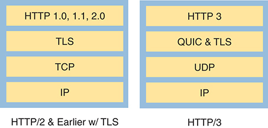

<figcaption>

<aside class="hidden" id="a05fig17">

在左侧,显示HTTP slash 2的堆栈和早先与TLS的堆栈,由四层组成. 从上到下,这些层分别是:HTTP 1.0,1.1,2.0;TLS(传输层安全);TCP(传输控制协议);和IP(互联网协议)。 右侧为 HTTP slash 3所显示的堆栈,也由四层组成. 从上到下,这些地层是:HTTP 3;QUIC和TLS(QUIC是快速UDP互联网连接的地方);UDP(用户数据协议);和IP(互联网协议). 比较强调,虽然早期版本的HTTP使用TCP来进行运输,但HTTP slash 3在UDP上使用QUIC,直接将TLS纳入QUIC协议,以提高性能和安全性.

</aside>

<strong>图5-17</strong> <em>HTTP/3 与早期版本的比较</em>

</figcaption>

</figure>

注意

HTTP/3总是使用TLS,部分原因是QUIC集成了TLS特性,而部分原因是TLS的安全特性为网络连接提供了合理性. IANA保留了UDP端口443在使用HTTP/3时作为网络服务器的出名端口.

要概括, 作为一个用户, 您不选择要使用的 HTTP 版本 。 浏览器和服务器将开始使用一个版本, 并根据两个版本之间交换的信息可选更改为另一个版本 。 作为一个网络工程师, 您应该知道这些版本, 并且知道您网络中的 HTTP 消息今天包含传统的基于 TCP 的 HTTP/ 。 1.0 中,HTTP/ 输入器 1.1 ,和 HTTP/ 软件 2 前往著名的TCP港口的交通量 80 和 443 ,但它们也包含使用 UDP 端口的 UDP 首部信件 443 。

注意

Web服务器和大多数其它服务器应用程序可以使用除他们众所周知的保留端口之外的端口号. 本章显示了可以预测的知名港口。

</section>

</section>

</section>

</section>

<section class="ccna-source ccna-appendix" aria-label="答案解析与术语表">
<section data-epub-type="chapter">

<h2 class="h2" id="ref-appc">附录C</h2>

<h2 class="h2a">对“我早就知道了吗?” 的回答。</h2>

<section>

<h3 class="h3" id="ref-appclev1sec5">第5章</h3>

<strong><a id="ref-ques5_1" href="#quess5_1">1</a>.</strong> D 和 E。许多首部都包含用于标识消息内部下一个首部的字段。以太网使用 Ethernet Type（以太网类型）字段，IP 首部使用 Protocol（协议）字段。TCP 和 UDP 首部分别使用各自的端口号字段，标识应接收 TCP 或 UDP 首部后面数据的应用程序。

<strong><a id="ref-ques5_2" href="#quess5_2">2</a>.</strong> A、B、C 和 F。路由由 IP 定义，而不是 TCP。许多其他协议定义了加密功能，但 TCP 并不提供加密。正确答案列出的都是 TCP 的各项功能。

<strong><a id="ref-ques5_3" href="#quess5_3">3</a>.</strong> C。TCP 提供窗口机制、差错恢复和有序数据传输，而 UDP 不提供这些功能。两者都不执行路由或加密。

<strong><a id="ref-ques5_4" href="#quess5_4">4</a>.</strong> C 和 F。术语<em>报文段</em>和 <em>L4PDU</em> 指传输层协议封装的首部与数据。术语<em>数据包</em>和 <em>L3PDU</em> 指第三层封装的首部与数据。<em>帧</em>和 <em>L2PDU</em> 指第二层封装的首部、尾部以及数据。

<strong><a id="ref-ques5_5" href="#quess5_5">5</a>.</strong> B。请注意，主机名是 // 与 / 之间的全部文字。// 之前的文字标识应用层协议，/ 之后的文字表示网页名称。

<strong><a id="ref-ques5_6" href="#quess5_6">6</a>.</strong> C 和 D。Web 流量使用 TCP 作为传输协议，使用 HTTP 作为应用协议。因此，Web 服务器通常使用知名 TCP 端口 80，即 HTTP 流量的知名端口。流向 Web 服务器的消息，其目的 TCP 端口为 80；从服务器发出的消息，其源 TCP 端口为 80。

</section>

</section>

<section id="ref-glossary"><h2 class="h2a">词汇表</h2>
<strong>连接建立</strong>面向连接的协议创建连接的过程. 与TCP一起,通过由三向传输的TCP路段来建立连接.

<strong>DNS 服务器</strong>用于提供域名系统(DNS)协议和世界范围的系统的名称解析服务的应用程序充当服务器.

<strong>错误检测</strong>在传输过程中发现一个数据-链接级帧是否被改变的过程. 这一过程一般在数据链接尾部中使用帧检查序列(FCS)字段.

<strong>差错恢复</strong>在一些传输数据未成功接收时注意的过程,并重新发送数据直至成功接收.

<strong>流量控制</strong>管理发送计算机向接收计算机发送的数据数量的过程。 存在几种流量控制机制,包括使用窗口的TCP流量控制.

<strong>HTTP</strong>超文本传输协议 。 网络浏览器和网络服务器用来传输文件的协议,如文本和图形文件.

<strong>HTTP/1.0</strong>HTTP协议的版本,以RFC的形式在 1990s中被发布. 它使用 TCP, 期望从 http 开始的 URL, 意味着默认的知名服务器端口为 80 . 它也允许使用安全的HTTP.

<strong>HTTP/1.1</strong>HTTP协议的版本,以RFC的形式在 1990s中被发布. 它使用 TCP, 期望从 http 开始的 URL, 意味着默认的知名服务器端口为 80 . 它也允许使用安全的HTTP.

<strong>HTTP/2.0</strong>HTTP协议的版本,以RFC的形式在 2010s中被发布. 协议改进了HTTP应用程序,以提高终端用户体验中的整体性能. 它支持使用安全HTTP(带有TLS)或不使用.

<strong>HTTP/3.0</strong>一个完全不同的HTTP版本在2022中作为RFC发布,由Google创建. 它改进了HTTP应用过程并改变了传输层协议,以提高终端用户体验中的整体性能. 它使用QUIC传输层,它使用UDP(不是TCP),并且总是包括了TLS.

<strong>命令的数据传输</strong>TCP中包含的网络功能,协议中定义了发送主机应如何给传输的数据编号,定义了接收设备在数据到达时应如何试图重新排序,并指定在数据无法按顺序发送时丢弃.

<strong>port</strong>(多位定义) (1) 在TCP和UDP中,一个用于唯一识别发送(源端口)或应当接收(去向端口)数据的应用过程的数字. (2) 在局域网切换中,换接接口的另一个术语.

<strong>端口安全</strong>一个 Cisco 切换功能,其中切换器监视接口(一个端口)中的以太网帧,跟踪所有此类帧的源MAC地址,并在超过不同此类MAC地址的数量时采取安全行动.

<strong>QUIC</strong>与TCP相比,传输层协议的名称(不是缩略语)可以改善通过网络传输物体的整体性能. 它使用UDP,并将TLS整合到其连接设置任务中.

<strong>递归 DNS 服务器</strong>一个DNS服务器,当被问到它没有信息时,执行一个重复的(重复的)过程,按顺序询问其他DNS服务器,希望找到了解信息的DNS服务器.

<strong>安全 HTTP (TLS 上的 HTTP)</strong>IETF标准定义了如何使用TLS来将服务器认证和消息加密等安全特性添加到HTTP/2和早期版本的HTTP上.

<strong>报文段</strong>(多位定义) (1) 在TCP中,一个术语用于描述一个TCP头及其封装的数据(也叫L4PDU). (2) 同样在TCP中,当TCP将应用层提供给它的一大块数据分解成与TCP报文段相适应的更小块时,一组字节会形成. (3) 在以太网中,要么是单一以太网电缆,要么是单一相撞域名(无论使用多少电缆).

<strong>滑动窗口</strong>对于像TCP这样的协议,允许接收设备在接收确认之前决定发送者可以发送的数据数量——一个叫做a的概念<em>窗口</em>——提到给予未来窗口的机制一般只是一个在每次承认后缓慢上升,向上滑动的数字.

<strong>网络服务器</strong>软件,在计算机上运行,可以存储网页并把这些网页发送给请求网页的网页客户端(web浏览器).

</section>
</section>


<nav class="ccna-chapter-nav" aria-label="章节导航"><a href="v2-04.html">← 上一章</a><a href="v2-06.html">下一章 →</a></nav>
