
<a href="{{ '/subjects/CCNA/' | relative_url }}">← 返回 CCNA 目录</a>

第二卷 · IP 访问控制列表

<nav class="ccna-chapter-nav" aria-label="章节导航"><a href="v2-05.html">← 上一章</a><a href="v2-07.html">下一章 →</a></nav>



<section data-epub-type="chapter">

<h2 class="h2" id="ch06">第 6 章</h2>

<h2 class="h2a">IPv4 访问控制列表基础</h2>

本章涵盖以下考试主题：

5.0 安全基础

5.6 配置和验证访问控制列表

IPv4 访问控制列表（ACL）允许网络工程师在路由器中编写过滤规则。每台路由器的每个接口都可以在入方向和出方向分别启用不同的 IP ACL，并使用不同的规则。每个 IP ACL 的规则告诉路由器应丢弃哪些数据包、允许哪些数据包通过。

本章讨论 IPv4 ACL 的基础知识，具体介绍<em>标准编号 IP ACL</em>，也简称为<a id="key_090" href="#ref-gloss_333">标准访问控制列表</a>。标准编号 ACL 采用简单的逻辑，只匹配源 IP 地址字段，并使用数字来引用 ACL。本章首先帮助你掌握这种较简单的 ACL。下一章“<a href="v2-07.html#ch07">命名与扩展 IP ACL</a>”讨论其他 IP ACL 变体，包括使用名称的命名 ACL，以及具有比标准 ACL 更强匹配能力的扩展 ACL。

<section>

<h3 class="h3" id="ch06lev1sec1">自测</h3>

如果你希望根据得分决定在本章投入多少时间，可以完成这组自测题（在此作答，或使用 PTP 软件）。各题答案的选项字母列在自测题之后的页面底部。书末和配套网站上的<a href="#ref-appc">附录 C</a>都包含答案及解析。你也可以在 PTP 测试软件中找到答案及解析。

<figure class="table" id="ch06tab01" tabindex="0">

<figcaption>

<strong>表6-1</strong> 自测：基础知识小节与题目对应关系

</figcaption>

<table class="all">

<tbody>

<tr>

<th class="th">
基础知识小节
</th>

<th class="th">
题目
</th>

</tr>

<tr>

<td class="border">
IPv4 访问控制列表基本内容
</td>

<td class="border">
1
</td>

</tr>

<tr>

<td class="border">
标准编号 IPv4 ACL
</td>

<td class="border">
2–6
</td>

</tr>

</tbody>

</table>

</figure>

<strong><a id="quess6_1" href="#ques6_1a">1</a>.</strong>Barney是一个IP地址为10.1.1.1在子网10.1.1.0/24的主持人. 以下哪些事物可以配置一个标准的IP ACL来完成? (取出二个答.

<ol class="lower-alpha">

<li>
匹配确切的源IP地址 。
</li>

<li>
将 10.1.1.1通过 10.1.1.4的 IP 地址匹配为 1<strong>access-list</strong>命令而不匹配其他 IP 地址。
</li>

<li>
将巴尼子网中的所有IP地址匹配到一个<strong>access-list</strong>命令而不匹配其他 IP 地址。
</li>

<li>
只匹配数据包的 IP 地址 。
</li>

</ol>

<strong><a id="quess6_2" href="#ques6_2a">2</a>.</strong>下列哪一个答案列出一个标准编号的IP ACL可以使用的有效号码? (取出二个答.

<ol class="lower-alpha">

<li>
1987
</li>

<li>
2187
</li>

<li>
187
</li>

<li>
87
</li>

</ol>

<strong><a id="quess6_3" href="#ques6_3a">3</a>.</strong>以下哪一个通配符掩码对于子网10.1.128.0,掩码255.255.255.0中所有IP包的匹配最有用?.

<ol class="lower-alpha">

<li>
0.0.0.0
</li>

<li>
0.0.0.31
</li>

<li>
0.0.0.240
</li>

<li>
0.0.0.255
</li>

<li>
0.0.15.0
</li>

<li>
0.0.248.255
</li>

</ol>

<strong><a id="quess6_4" href="#ques6_4a">4</a>.</strong>以下哪一个通配符掩码对于子网10.1.128.0,掩码255.255.240.0中所有IP包的匹配最有用?.

<ol class="lower-alpha">

<li>
0.0.0.0
</li>

<li>
0.0.0.31
</li>

<li>
0.0.0.240
</li>

<li>
0.0.0.255
</li>

<li>
0.0.15.255
</li>

<li>
0.0.248.255
</li>

</ol>

<strong><a id="quess6_5" href="#ques6_5a">5</a>.</strong>ACL1有三种语句,按以下顺序排列,并有地址和通配符等值:1.0.0.0 0.255.255.255;1.1.0.0 0.0.255.255;1.1.1.0 0.0.0.255. 如果一个路由器试图使用此 ACL 来匹配 IP 地址 1.1.1.1 来源的包, 那么哪一个 ACL 语句会认为该包是匹配的 ?

<ol class="lower-alpha">

<li>
第一个
</li>

<li>
秒
</li>

<li>
第三个
</li>

<li>
ACL 结尾处的默认否认
</li>

</ol>

<strong><a id="quess6_6" href="#ques6_6a">6</a>.</strong>(b) 下列哪一项<strong>access-list</strong>命令,从路由器的运行配置文件中取出,匹配子网172.16.4.0/23中主机发送的所有包 ?

<ol class="lower-alpha">

<li>
<strong>access-list 1 permit 172.16.0.5 0.0.255.0</strong>
</li>

<li>
<strong>access-list 1 permit 172.16.4.0 0.0.1.255</strong>
</li>

<li>
<strong>access-list 1 permit 172.16.5.0</strong>
</li>

<li>
<strong>access-list 1 permit 172.16.5.0 0.0.0.127</strong>
</li>

</ol>

自测答案：

<strong><a id="ques6_1a" href="#ref-ques6_1">1</a></strong> A、C

<strong><a id="ques6_2a" href="#ref-ques6_2">2</a></strong> A, D

<strong><a id="ques6_3a" href="#ref-ques6_3">3</a></strong> D

<strong><a id="ques6_4a" href="#ref-ques6_4">4</a></strong> E

<strong><a id="ques6_5a" href="#ref-ques6_5">5</a></strong> A

<strong><a id="ques6_6a" href="#ref-ques6_6">6</a></strong> B

</section>

<section>

<h3 class="h3box" id="ch06lev1sec2">基础知识</h3>

</section>

<section>

<h3 class="h3" id="ch06lev1sec3">IPv4 访问控制列表基础</h3>

IPv4 <a id="key_089" href="#ref-gloss_016">访问控制列表（IP ACL）</a>使网络工程师能够识别不同类型的数据包。为此，ACL 配置列出路由器可在 IP、TCP、UDP 等首部中检查的值。例如，ACL 可以匹配源 IP 地址为 1.1.1.1 的数据包、目的 IP 地址位于子网 10.1.1.0/24 中的数据包，或 TCP 目的端口为 23（Telnet）的数据包。

IPv4 ACLs在Cisco路由器中履行许多功能,最常用为包过滤. 工程师可以在路由器上启用ACL,使ACL在通过路由器时坐在包的转发道上. 在启用后,路由器会考虑每个IP包是否会被丢弃或被允许继续,仿佛ACL不存在.

然而,ACL也可以用于许多其他的IOS功能. 举例来说,ACLs可以用来匹配应用服务质量(QoS)特性的包. QoS允许路由器给一些包更好的服务,其他包更糟糕的服务. 例如,持有数字化语音的包需要非常低的延迟,因此ACLs可以匹配语音包,而QoS逻辑在转而转发语音包比数据包更快.

本第一节介绍用于包过滤的IP ACLs. 为了更好地理解ACLs,文本首先讨论了所启用的ACL位置和方向的选择所涉及的问题. 在此之后,文本将检查配置命令中允许的包匹配逻辑. 最后一节总结了过滤包时要采取的行动:拒绝(丢弃)包或允许包沿着原路继续走.

<section>

<h4 class="h4" id="ch06lev2sec1">ACL 的位置和方向</h4>

Cisco路由器可以将ACL逻辑应用到IP包输入接口的点,或者它们退出接口的地点的包上. 换句话说,ACL可以在路由器作出转发(路由)决定之前被应用到路由器上,或者在路由器做出转发决定并确定要使用的出站接口之后被应用到出站.

箭射进去了<a href="#ch06fig01">图6-1</a>显示您可以在地形中过滤左向右流的包。 例如,想象你想允许由主机A发送到服务器S1的包,但将由主机B发送到服务器S1的包丢弃. 每个箭头行代表一个路由器可以应用ACL的位置和方向,过滤由主机A和B发送的包.

<figure class="image-c" id="ch06fig01">

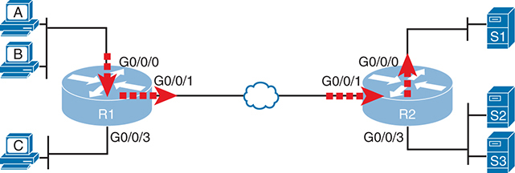

<figcaption>

<aside class="hidden" id="a06fig01">

左侧有三台主机,标签为A,B和C,连接到路由器上. 1 通过接口 G 0 斜线 0 斜线 0 0 斜线 0 斜线 1 ,和 G 键 0 斜线 0 斜线 3 路由器 R 1 连接到路由器 R 2 通过G组 0 斜线 0 斜线 1 接口,在两个路由器之间形成链接。在右侧,路由器R 2 有接口 G 0 斜线 0 斜线 0 0 斜线 0 斜线 1 ,和 G0 斜线 0 斜线 3 ,连接到三个标有 S 的服务器 1 2 和 S 键 3 分别以红箭头突出显示接口 G 0 斜线 0 斜线 0 R1和G0斜线 0 斜线 0 关于R的 2 ,表示主机A和B在向服务器S移动时过滤包的临界点 1 。

</aside>

<strong>图6-1</strong> <em>从主机 A 和 B 过滤包到服务器 S1 的位置</em>

</figcaption>

</figure>

图中的四行箭头指向用于将包从主机B传送到服务器S1的路由器接口的位置和方向. 在这个特别的例子中,这些接口和方向被传送到R1的G0/0/0接口上,被传送到R1的G0.0/1接口上,被输送到R2的G0/0/1接口上,被传送到 R2的G0/0/0接口上.

要过滤一个数据包, ACL 必须在数据包所行走的路径中 。 例如,如果在R2的G0/0/3接口上启用ACL,则无论是朝哪个方向,ACL都不可能过滤从主机B发送到服务器S1的软件包,因为R2的G0/0/3接口不是从主机B到服务器S1的路由的一部分. 总结一下逻辑:

要过滤一个带有ACL的包,确定包在通过路由器时使用的出入境接口,并且使ACL能够在同一方向上的其中一个接口上使用.

启用后,路由器再使用该ACL处理出入境的每个IP包. 例如,如果在R1上启用接口G0/0,R1可以将G0/0.0上的每个入境IP包与ACL进行比较,以决定该包的命运:继续不变或被丢弃.

注意

这本书展示了路由器上IP ACLs的数字和实例. 被配置到路由器IP包的多层交换机也支持使用相同概念和配置的IP ACLs.

</section>

<section>

<h4 class="h4" id="ch06lev2sec2">匹配数据包</h4>

当您考虑ACL的位置和方向时, 您一定已经在考虑您计划过滤( 丢弃) 哪些数据包, 您想要允许通过哪些数据包 。 要告诉路由器这些相同的想法, 您必须配置路由器 IP ACL 匹配包 。<em>匹配数据包</em>指的是如何配置ACL指令来查看每个数据包,列出如何识别哪些数据包应当被丢弃,哪些应当被允许通过。

每个 IP ACL 包含一个或多个配置命令, 每个命令列出要在一个包头内查找的值的细节 。 一般来说,ACL命令使用逻辑,比如“在包头中查找这些值,如果找到的话,就丢弃包。” (动作可能是允许包而不是丢弃。) 具体而言,ACL寻找你应该很清楚的头字段,包括源头和目的地IP地址,加上TCP和UDP端口号。

例如,考虑一个实例:<a href="#ch06fig02">图6-2</a>,其中您想要允许从主机 A 到服务器 S1 的包,但将主机 B 到同一服务器的包丢弃。 现在所有主机都有IP地址,图中显示了R2上的ACL的伪码.<a href="#ch06fig02">图6-2</a>也显示启用ACL的所选位置: 输入到 R2 的 G0/ 0/1接口上 。

<figure class="image-c" id="ch06fig02">

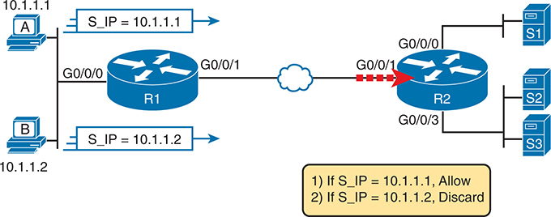

<figcaption>

<aside class="hidden" id="a06fig02">

该图包括两台贴有A和B标签的个人计算机,地址为I P 10.1.1.1 和 10.1.1.2 两个PCs都连接到路由器R 1 通过接口 G 0 斜线 0 斜线 0 路由器 R 1 连接到路由器 R 2 通过接口 G 0 斜线 0 斜线 1 ,在云层网络上代表连接。 2 有三台服务器,标签为S 1 2 和 S 键 3 ,与其接口G连接 0 斜线 0 斜线 0 0 斜线 0 斜线 2 ,和 G 键 0 斜线 0 斜线 3 图像显示,从PCs到R的交通流量均被导向路由器R。 2 通过G组 0 斜线 0 斜线 1 接口。在底部一个黄色框中显示的伪代码逻辑,指定了两项规则:如果源 I P 地址, S 下划线 I P 是 10.1.1.1 如果源 I P 地址 S 下划线 I P 是 10.1.1.2 交通被放弃了

</aside>

<strong>图6-2</strong> <em>演示 ACL 命令- 匹配逻辑的 Pseudocode</em>

</figcaption>

</figure>

<a href="#ch06fig02">图6-2</a>在下方的矩形上显示一双行的ACL,具有简单的匹配逻辑: 两种语句都只是为了与包中的源 IP 地址相匹配. 当启用时, R2 查看了接口上每个输入的IP包,并将每个包与这两个ACL命令进行比较. 允许由主机A发送的包(源IP地址为10.1.1.1)通过,而由主机B发送的包(源IP地址 为10.1.1.2)则被丢弃.

</section>

<section>

<h4 class="h4" id="ch06lev2sec3">匹配时采取的操作</h4>

当IP ACLs用于过滤包时,只能选择两个动作中的一个. 配置命令使用关键字<strong>deny</strong>和<strong>permit</strong>,它们的意思是(分别)丢弃包或让包保持仿佛ACL不存在一样.

本作以使用ACLs来过滤包为主,但IOS使用ACL来做更多的功能. 这些特性通常使用相同的匹配逻辑. 然而,在其他情况下,<strong>deny</strong>或者说<strong>permit</strong>关键词意味着一些其他动作.

</section>

<section>

<h4 class="h4" id="ch06lev2sec4">IP ACL 的类型</h4>

Cisco IOS自Cisco路由器早期就支持了IP ACLs. 从最初的标准编号IP ACLs开始,在 IOS 的早期开始,这可以启用早先显示的逻辑<a href="#ch06fig02">图6-2</a>, Cisco增加了许多ACL功能,包括以下功能: .

<ul class="sq">

<li>
标准编号ACLs (1-99)
</li>

<li>
扩展编号 ACLs (100–199)
</li>

<li>
ACL额外编号(1300-1999标准,2000-2699延长)
</li>

<li>
已命名的 ACLs
</li>

<li>
改进有序列号的编辑
</li>

</ul>

本章仅侧重于标准编号的IP ACLs,而下一章则讨论IP AC Ls的其他三大类. 简而言之,IP ACL将要么被编号,要么被命名,因为配置会使用一个数字或一个名称来识别ACL. ACL也将是标准或扩展的,扩展的ACL在匹配包方面拥有更强大的能力.<a href="#ch06fig03">图6-3</a>总结与IP ACL类别有关的大思想.

<figure class="image-c" id="ch06fig03">

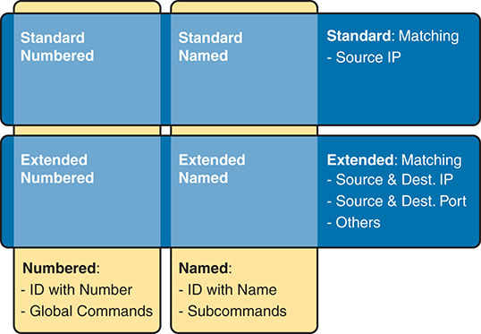

<figcaption>

<aside class="hidden" id="a06fig03">

该图将其分类为"标准"和"扩展ACL s",并进一步将每个分类为"编号"和"命名ACL s. 标准ACL s包括"标准编号"(Standard Numbered),它使用数字I D和全局命令,只根据源 I P 地址进行匹配;而"标准命名"(Stard Noted)则使用名称进行识别和子命令,它也根据源 IP 地址进行相匹配. 扩展的ACLs包括扩展编号,它使用一个数字I D和全局命令,根据源和目的I P地址、源和目的端口以及其他标准进行匹配;扩展命名,它使用名称用于识别和子命令,根据来源和目的IP地址、源与目的端口和其他标准进行匹配。 这些ACLs的命令结构也进行了比较: 编号ACLs由数字识别,并使用全局命令进行配置,而命名ACLs则由名字识别,并用子命令进行详细的配置.

</aside>

<strong>图6-3</strong> <em>IP ACL 类型比较</em>

</figcaption>

</figure>

</section>

</section>

<section>

<h3 class="h3" id="ch06lev1sec4">标准编号 IPv4 ACL</h3>

本节的标题作为一个伟大的入门,如果你可以解码Cisco通过每个特定单词的含义. 本节是关于Cisco过滤器的一类(<em>ACL</em>),只匹配数据包的源 IP 地址(<em>标准</em>),被配置以使用数字而不是名称来识别ACL(<em>编号</em>),并查看IPv4包.

本节首先研究一个ACL包含命令列表的想法,每个指令列表包含匹配和动作逻辑. 之后,文本仔细研究了如何匹配包头中源IP地址字段,包括命令的语法. 本节以完整查看配置和校验命令来完成标准的ACL.

<section>

<h4 class="h4" id="ch06lev2sec5">IP ACL 的列表逻辑</h4>

单个ACL既是单个实体,同时也是一个或多个配置命令的列表. 作为一个单一实体,该配置可以使整个ACL在一个接口上按特定方向运行,如上所示<a href="#ch06fig01">图6-1</a>。作为命令列表,每个命令都有不同的匹配逻辑,路由器在使用该ACL过滤时必须适用于每个包.

在进行ACL处理时,路由器会比照ACL处理数据包,如下:

ACLs使用首次匹配逻辑. 一旦一个包与ACL中的一行相匹配,路由器会采取ACL中该行所列出的动作,并停止在ACL中作更深入的查看.

确切地看那意味着什么, 考虑一下围绕<a href="#ch06fig04">图6-4</a>。图中显示有ACL 1的样本,并有三行伪码. 此示例在 R2 的 G0 / +0/1接口上应用 ACL 1 , 输入( 与 输入 中相同的位置) 。<a href="#ch06fig02">图6-2</a>).

<figure class="image-c" id="ch06fig04">

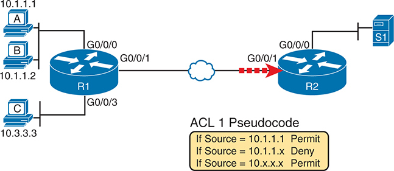

<figcaption>

<aside class="hidden" id="a06fig04">

左侧有三台标有A,B,C等标签的计算机被连接到路由器上,标有R1. 计算机A有 IP地址10.1.1.1,计算机B有 IP地址10.1.1.2,计算机C有 IP地址10.3.3.3. 连接的标签如下: 计算机A连接到接口 G0 slash 0 slash 0,计算机B连接到G0 slash 0 slash 0,计算机C连接到G0 slash 0 slash 3 on R1. R-1通过网络云与另一条路由器被标注为R-2的路由器相接,接口为G-0 slash0 slash1在R-1和R-2通过此云连接. R-1和R-2之间的连接被标记为红色的破折线来强调数据流. 在图像的右侧,R2通过接口G0 slash0 slash0点连接到一个标有S-1的服务器上,在网络图下方有一个包含ACL1点的伪码的黄盒,它规定了过滤规则:如果源等于10.1.1.1允许,如果源等于10.1.1点x Deny,如果源等于10点x点x点x允许.

</aside>

<strong>图6-4</strong> <em>与 IP ACL 讨论列表进程的后置</em>

</figcaption>

</figure>

考虑一个由主机 A 发送到服务器 S1 的包的首匹配ACL逻辑. 源IP地址会为10.1.1.1并经过路由,使其进入R2的G0/0/1接口,驱动R2的ACL1逻辑. R2将这个包比作ACL,将列表中的第一个项目与许可动作相匹配. 如以下所示,该数据包应允许通过。<a href="#ch06fig05">图6-5</a>左边

<figure class="image-c" id="ch06fig05">

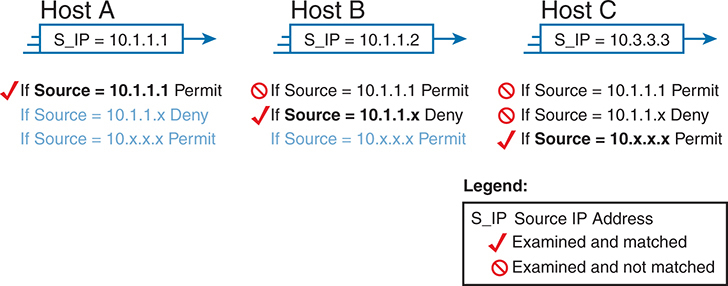

<figcaption>

<aside class="hidden" id="a06fig05">

主机A有一个 S 下划线 I P 为10.1.1.1,ACL 规则规定,如果来源为10.1.1.1,则允许使用(以检查标记表示,检查并匹配);如果来源为10.1.1点x,则拒绝使用(用有斜线和检查而未匹配的红圈表示);如果来源为10点x点x点x点x,则允许使用(以蓝色文字表示). 主机B有一个 S 下划线 I P 为 10.1.1.2,其中ACL 规则规定,如果源为 10.1.1.1,则拒绝(用斜线来表示的红圆);如果源为 10.1.1点x,则拒绝(用斜线去表示的红圆);如果源是 10点x点x点x点x,则允许(蓝色文本). 主机C有一个 S 下划线 I P 为10.3.3.3,规则是如果源为10.1.1.1,则拒绝(用斜线来表示红圆);如果源为10.1.1点x,则拒绝(用斜线去表示红圆);如果源为-10点x点x点x点x,则允许(蓝色文本). 一个位于右下方的传说解释符号:一个检查标记表示源 I P 地址被检查和匹配,而一个有斜线的红色圆圈则表示源 I P 地址被测试和不匹配.

</aside>

<strong>图6-5</strong> <em>ACL 项目比较来自主机A、B和C的包<a href="#ch06fig04">图6-4</a></em>

</figcaption>

</figure>

接下来,考虑由主机B发送的包,源IP地址为10.1.1.2. 当数据包进入R2的G0/0/1接口时,R2将数据包与ACL1的第一个语句进行比较,不匹配(10.1.1.1不等于10.1.1.2). R2再移动到第二个语句,这需要一些澄清. ACL 伪码, 回到<a href="#ch06fig04">图6-4</a>,显示 10.1.1.x,这意味着任何值都可以在上个八位组中存在。 R2只比较了前3个八位组,就决定了这个最新的包确实有一个源IP地址,从前3个八位组10.1.1开始,因此R2认为这与第二个语句是匹配的. R2 采取列出的动作( deny), 丢弃数据包 。 R2还停止了包上ACL的处理,而忽略了ACL中的第三行.

最后,考虑一下由主机C发送,再次被发送到服务器S1的包. 该包有源IP地址10.3.3.3,所以当它进入R2的G0/0/1接口并驱动R2上的ACL处理时,R2会查看ACL1的第一个指令. R2与首个ACL命令不相匹配(命令中的10.1.1.1不等于包的10.3.3.3). R2查看了第二个命令,将前三个八位组(10.1.1)与包源IP地址(10.3.3)进行比较,仍然找到没有匹配。 R2再看第三个指令. 在这种情况下,通配符表示忽略了后三个八位组,只是比较了第一个八位组(10),所以包匹配. R2然后取出所列出的动作( 许可证), 允许数据包继续运行 。

所有 Cisco IOS ACLs 都使用这个初匹配逻辑: IP ACL, IPv6 ACL , 标准或扩展, 命名或编号.

最后,每个ACL结束于<em>deny any</em>逻辑,相当于<strong>access-list</strong> <em>number</em> <strong>deny any</strong>命令。它在配置中并不存在,但如果一个路由器持续搜索列表,在列表结尾时无法匹配,IOS认为该包已经匹配了隐含的否定,而路由器则丢弃了该包.

</section>

<section>

<h4 class="h4" id="ch06lev2sec6">匹配逻辑与命令语法</h4>

标准编号的IP ACL使用以下全局指令:

<a href="#code-f0121-01" id="f0121-01a">点击此处查看代码原图</a>

<pre class="pre" tabindex="0"><code><strong>access-list</strong> {<strong>1-99</strong> | <strong>1300-1999</strong>} {<strong>permit</strong> | <strong>deny</strong>} <em>matching-parameters</em></code></pre>

每个标准编号的 ACL 有一个或多个<strong>access-list</strong>命令中,任何来自语法上行所示区域的数字。 一个号码比另一个号码好不了多少 IOS将ACL中的每行称为:<a id="key_088" href="#ref-gloss_016">访问控制条目(ACE)</a>但很多工程师都称他们为ACL声明

在ACL号码之后,<strong>access-list</strong>全局命令列出此动作( G)<strong>permit</strong>或者说<strong>deny</strong>),然后是匹配逻辑。 接下来的几页侧重于配置源地址的匹配参数.

<section>

<h5 class="h5" id="ch06lev3sec1">匹配确切的 IP 地址</h5>

要匹配特定源IP地址,请在命令末尾配置该IP地址. 例如,前一个例子对“如果源代码=10.1.1.1 允许”使用伪代码。以下命令使用 ACL 号1 以正确的语法配置逻辑 :

<pre class="pre" tabindex="0"><code><strong>access-list 1 permit 10.1.1.1</strong></code></pre>

出于历史原因,IOS(和IOS XE)支持标准ACL的两个替代语法选项来匹配单个地址. 您可以使用以下两个选项中的任何一个来配置与上一个命令相同的逻辑 :

<a href="#code-f0121-02" id="f0121-02a">点击此处查看代码原图</a>

<pre class="pre" tabindex="0"><code><strong>access-list 1 permit host 10.1.1.1</strong>

<strong>access-list 1 permit 10.1.1.1 0.0.0.0</strong></code></pre>

第一种备选方法使用:<strong>host</strong>单个地址前的关键词,另一个则列出地址后的一个值称为 a<a id="key_091" href="#ref-gloss_377">通配符掩码</a>(此处为0.0.0.0.). 虽然IOS接受两种附加格式,但它用第一个语法存储命令(版本中两个字都没有) .<strong>host</strong>关键词或0.0.0.0通卡掩码. (文字定义了通配符掩码及其在下个话题中的用法.<a href="#ch06tab02">表6-2</a>概述便于研究和审查的可选办法。

<figure class="table" id="ch06tab02" tabindex="0">

<figcaption>

<strong>表6-2</strong>为匹配一个 IP 地址而支持的标准 ACL 语法摘要

</figcaption>

<table class="all">

<tbody>

<tr>

<th class="th">

</th>

<th class="th">
<em>address</em> 0.0.0.0
</th>

<th class="th">
host <em>address</em>
</th>

<th class="th">
<em>address</em>
</th>

</tr>

<tr>

<td class="border">
<strong>标准 ACL</strong>
</td>

<td class="border">
是
</td>

<td class="border">
是
</td>

<td class="border">
是<a id="tfn6_2_1" href="#tfn6_2_1a">*</a>
</td>

</tr>

</tbody>

</table>

</figure>

<a id="tfn6_2_1a" href="#tfn6_2_1">*</a>IOS无论配置风格如何,都用这个语法存储命令.

</section>

<section>

<h5 class="h5" id="ch06lev3sec2">使用通配符掩码匹配地址的一部分</h5>

您通常需要匹配一系列的IP地址而不是单个地址. 也许你想在子网中匹配所有IP地址. 也许你想在一系列子网中匹配所有IP地址. 无论如何,您想要在一系列地址中检查多个IP地址.

IOS允许标准ACLs使用一个叫作"a"的工具来匹配一系列地址.<em>通配符掩码</em>。请注意,这不是一个子网掩码. 通配符掩码(本作缩写为:<em>WC 掩码</em>)给工程师一个方法,让IOS在进行比较时忽略部分地址,基本上将这些部分当作通配符,仿佛它们已经匹配了一样.

你可以在十进制和二进制中考虑WC掩码,两者都有其用途. 首先,想想小数点的WC掩码,使用这些规则:

<strong>小数0:</strong>路由器必须比较这个八位组是正常的.

<strong>小数255:</strong>路由器忽略了这个八位组,认为它已经匹配了.

记住这两项规则,考虑<a href="#ch06fig06">图6-6</a>,它用三个不同但受欢迎的WC掩码来演示这个逻辑:一个是告诉路由器忽略上个八位组,一个是告诉道由器忽略后两个八位组;另一个是告诉道从器忽略后三个八位组.

<figure class="image-c" id="ch06fig06">

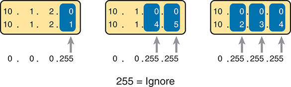

<figcaption>

<aside class="hidden" id="a06fig06">

它显示了三个例子。第一个例子描述了 IP 地址。 10.1.2.0 和 10.1.2.1 正在匹配通配符掩码 0.0.0.255 ,意为前三个八位组( 10.1.2 )必须准确匹配最后的八位组 () 0-255 )可以变化,匹配范围中的任何 I P 地址 10.1.2.0 改为: 10.1.2.255 。第二个示例显示 IP 地址 10.1.0.0 和 10.1.4.5 正在匹配通配符掩码 0.0.255.255 ,表示前两个八位组( 10.1 )必须在最后两个八位组( 0-255 )可以变化,匹配范围中的任何 I P 地址 10.1.0.0 改为: 10.1.255.255 。第三个实例是IP地址 10.0.0.0 和 10.2.3.4 正在匹配通配符掩码 0.255.255.255 ,仅指第一个八位组( 10 )必须精确匹配,而其余三个八位组( 0 改为: 255 )可以变化,匹配范围中的任何 I P 地址 10.0.0.0 改为: 10.255.255.255 。

</aside>

<strong>图6-6</strong> <em>WC掩码的逻辑 0.0.0.255,0.0.255.255,和0.255.255.255</em>

</figcaption>

</figure>

框中的所有三个例子<a href="#ch06fig06">图6-6</a>显示明显不同的数字。 WC掩码使得IOS只比较了部分八位组,而忽略了其他八位组. 所有三个例子都产生匹配,因为每个通配符掩码都告诉IOS忽略一些八位组. 左边的例子显示WC掩码0.0.0.255,它告诉路由器将上个八位组作为通配符处理,基本上忽略了用于比较的八位组. 同样地,中间的例子显示出WC掩码0.0.255.255,它告诉路由器忽略了右边的两个八位组. 最右侧的大小写显示为WC mask 0.255.255.255,告诉路由器在比较值时忽略后三个八位组.

要看到WC的掩码在行动,回想一下早先的例子:<a href="#ch06fig04">图6-4</a>和<a href="#ch06fig05">6-5</a>。这两个数字中的伪代码ACL使用了可以使用WC掩码创建的逻辑. 作为提醒,这两个数字中伪码ACL的逻辑包括如下:

<strong>线1: </strong>匹配并允许数据包的源地址是 10.1.1.1 。

<strong>线2: </strong>将数据包与源地址相匹配并拒绝, 并使用前三个 八位组10.1.1 。

<strong>线3: </strong>匹配并允许包与地址相匹配,第一个八位组值为10.

密码<strong>access-list</strong>命令通过列出两个参数与一系列地址相匹配:范围中的第一个数字加上通配符。 举例来说,<a href="#ch06fig07">图6-7</a>显示更新的版本<a href="#ch06fig04">图6-4</a>,但随着完成的,正确的ACL语法,包括WC掩码. 尤其要注意在第二个ACE中使用了WC掩码0.0.0.255,告诉R2忽略了数字10.1.1.0的最后一个八位组;在第三个ACE中则使用WC掩码0.255.255.255,告诉R2忽略了值10.0.0.0的后三个八位组.

<figure class="image-c" id="ch06fig07">

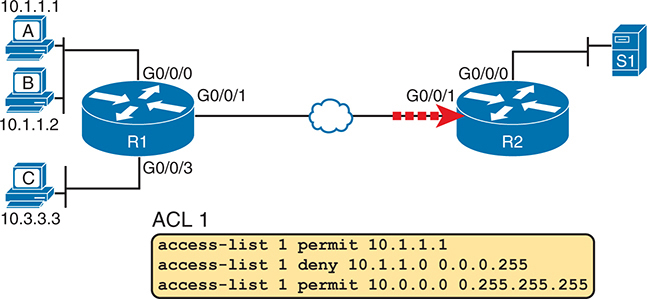

<figcaption>

<aside class="hidden" id="a06fig07">

网络图包括三台贴有A、B和C标签的个人电脑,地址为I P 10.1.1.1 , 10.1.1.2 ,以及 10.3.3.3 所有3个PCs均与路由器R连接 1 通过不同的接口:五氯苯甲醚和多氯联苯通过G 0 斜线 0 斜线 0 ,并通过 G 的 PCC 0 斜线 0 斜线 3 路由器 R 1 连接到路由器 R 2 通过接口 G 0 斜线 0 斜线 1 ,在云层网络上代表连接。 2 有服务器, 标签为 S 1 ,链接到其接口 G 0 斜线 0 斜线 0 点图显示从PC s A, B 和 C 向路由器 R 的流量 2 通过G组 0 斜线 0 斜线 1 接口。底部的黄框列出 ACL 规则如下: 1 许可 10.1.1.1 允许从 IP 地址传输 10.1.1.1 ; 访问控制列表 1 拒绝 10.1.1.2 0.0.0.255 拒绝从 IP 地址范围访问 10.1.1.2 改为: 10.1.1.255 ;和 访问控制列表 1 许可 10.0.0.0 0.255.255.255 允许来自 IP 地址范围的流量 10.0.0.0 改为: 10.255.255.255 该图使用了一条红色的破折线来表示来自多氯联苯的流量, 10.1.1.2 ,正在被路由器 R 丢弃 2 ,而来自五氯苯甲醚的流量, 10.1.1.1 ,和PCC, 10.3.3.3 ,允许继续到服务器 S 1 。

</aside>

<strong>图6-7</strong> <em>战术校正 ACL 替换 Pseudocode 从<a href="#ch06fig04">图6-4</a></em>

</figcaption>

</figure>

命令的通用语法,<strong>access-list</strong> <em>number action source</em> [<em>wildcard-mask</em>,指匹配参数为源码和通配符掩码. 当使用通配符掩码时,源值定义了地址范围内的第一个数字.

</section>

<section>

<h5 class="h5" id="ch06lev3sec3">二进制通配符掩码</h5>

Wildcard掩码,作为点-十进制(DDN)数值,代表了32-bit二进制数字. 作为32-bit数字,WC掩码引导路由器的逻辑比特比特比特比特比多. 简言之,比较WC掩码位等于0时的两个位数比特,但当WC掩码位同相对位置的二进制为1时忽略了位数.

谢天谢地,对于CCNA的研究,对于大多数现实世界的应用,你可以忽略二进制的WC掩码. 为什么? 我们一般想要匹配一系列的地址,这些地址可以很容易地通过子网号码和掩码识别出来,无论是真正的子网,还是将子网组合在一起的汇总路由. 如果您可以使用子网号和掩码描述地址范围,您可以在ACL中找到使用一些简单的十进制数学的数字,如下文所讨论.

注意

如果您真的想知道二进制掩码逻辑, 请使用两个 DDN 数字来比较 ACL 。<strong>access-list</strong>命令和从数据包头转换到二进制。 然后,同时将WC掩码转换为二进制,所以你现在有三个32位数字. 忽略任意位元的比特,其中通配符掩码比特为 1,但通配符外罩比特是 0,比较两个地址中的比特. 如果你检查的所有位数都是相等的,这是匹配的!

</section>

<section>

<h5 class="h5" id="ch06lev3sec4">确定用于匹配子网的正确通配符掩码</h5>

要将子网与ACL相匹配,您可以使用以下快捷键:

<ul class="sq">

<li>
使用子网号作为源值<strong>access-list</strong>命令。
</li>

<li>
使用通过从255.255.255.255中减去子网掩码而发现的通配符掩码.
</li>

</ul>

例如,对于子网172.16.8.0 255.255.252.0,使用子网号(172.16.8.0)作为源参数,然后进行以下数学来找到通配符掩码:

<math alttext=""><mrow><mtable columnalign="right"><mtr><mtd><mn>255.255.255.255</mn></mtd></mtr><mtr><mtd><munder><mrow><mtext> </mtext><mo>−</mo><mn>255.255.252.0</mn></mrow><mrow><mo>¯</mo></mrow></munder></mtd></mtr><mtr><mtd><mn>0.</mn><mo>⁢</mo><mtext> </mtext><mn>0.</mn><mo>⁢</mo><mtext> </mtext><mtext> </mtext><mn>3.255</mn></mtd></mtr></mtable></mrow></math>

继续这个例子,为同一个子网完成的命令如下:

<a href="#code-f0124-01" id="f0124-01a">点击此处查看代码原图</a>

<pre class="pre" tabindex="0"><code><strong>access-list 1 permit 172.16.8.0 0.0.3.255</strong></code></pre>

本节“<a href="#ch06lev2sec9">应用标准的 IP ACLs 练习</a>“在配置ACL时,你有机会练习匹配子网。

</section>

<section>

<h5 class="h5" id="ch06lev3sec5">匹配任意／所有地址</h5>

在某些情况下,您需要一个ACL命令来匹配在ACL中达到此点的任何和所有数据包. 首先,你必须知道如何(简单) 匹配所有包使用<strong>any</strong>关键词。 更重要的是,你需要考虑 什么时候匹配任何和所有包。

首先,将任何和所有数据包与ACL命令相匹配,只需使用<strong>any</strong>地址的关键字 。 例如,允许所有包 :

<pre class="pre" tabindex="0"><code><strong>access-list 1 permit any</strong></code></pre>

那么,你何时何地应该使用这样的命令? 记住,所有的 Cisco IP ACLs 都以隐含的结束<strong>deny any</strong>概念,位于每个ACL的末尾。 也就是说,如果一个路由器将一个数据包比作ACL,而该数据包与所配置的ACE没有匹配,则路由器会丢弃数据包. 想要推翻那个默认行为吗? 配置 a<strong>permit any</strong>在ACL的结尾。

您还可能想要明确配置一个命令来拒绝所有流量( 例如 ,<strong>access-list 1 deny any</strong>),在ACL结尾. 为什么,当同样的逻辑 已经坐在ACL的末尾呢? 好吧, ACL (法语)<strong>show</strong>命令列表中对应ACL中每个命令的包数的计数符,但没有对应该隐含的计数器<strong>deny any</strong>概念在ACL结尾处。 因此,如果想要看到计数器,请配置一个明确否认的选项,说明ACL末端有多少个数据包符合逻辑。

</section>

</section>

<section>

<h4 class="h4" id="ch06lev2sec7">实现标准 IP ACL</h4>

本章已经以比特和片段引入了所有配置步骤. 本节概述这些部分的配置过程。 该程序还指:<strong>access-list</strong>命令,在此重复引用其通用语法:

<a href="#code-f0125-01" id="f0125-01a">点击此处查看代码原图</a>

<pre class="pre" tabindex="0"><code><strong>access-list</strong> <em>access-list-number</em> {<strong>deny | permit</strong>} <em>source</em> [<em>source-wildcard</em>]</code></pre>

台阶.1.规划该接口上的位置(路由和接口)和方向(出入):

<ol class="step-lower-alpha">

<li>
标准ACL应放在包的目的地附近,以免无意中丢弃不应丢弃的包。
</li>

<li>
因为标准的ACL只能匹配一个包的源IP地址,所以在数据包向ACL所检查的方向走去时,识别其源IP地址.
</li>

</ol>

台阶.2.配置一个或多个<strong>access-list</strong>创建ACL的全局配置命令,同时铭记以下内容:

<ol class="step-lower-alpha">

<li>
列表按顺序搜索,使用首次匹配逻辑.
</li>

<li>
默认动作, 如果一个包不匹配其中任何一个<strong>access-list</strong>命令,即为<strong>deny</strong>(丢弃)包。
</li>

</ol>

台阶.3.启用所选路由器接口上的ACL, 方向正确, 使用<strong>ip access-group</strong> <em>number</em> {<strong>进 出</strong>\ 接口子命令 。

注意:<strong>ip access-group</strong>接口子命令工作于为 IP 路由启用的接口。 也就是说,接口配置了一个IP地址. 本章中的例子在路由器上使用物理接口;但在其他情况下,路由器或多层交换机可以使IP在子接口或VLAN接口上进行路由. 在这种情况下,您可以在这些接口上启用ACL. 对于提醒路由器或交换机可能允许IP的某些各类接口,请参见:<em>CCNA 200-301 官方证书指南 第1卷</em>,第二版,<a href="v2-18.html#ch18">第18章</a>, “<a href="v2-18.html#ch18">局域网中的 IP Routing</a>.”

<section>

<h5 class="h5" id="ch06lev3sec6">标准编号 ACL 场景 1</h5>

第一种ACL设想方案显示了与所显示的相同要求的配置。<a href="#ch06fig04">图6-4</a>和<a href="#ch06fig05">6-5</a>。经重申,对这项管制清单的要求如下:

<ol class="number">

<li>
启用路由器 R2 的 G0/ 0/1 接口上的 ACL 输入 。
</li>

<li>
许可包来自主机A。
</li>

<li>
在主机A的子网中拒绝来自其他主机的包。
</li>

<li>
许可包来自A类网络中的任何其他地址 10.0.0.0。
</li>

<li>
最初的例子没有评论默认情况下该做什么,所以简单地否定所有其他流量.
</li>

</ol>

<a href="#exa6_1">示例6-1</a>显示一个完成的正确配置,从配置进程开始,然后是来自<strong>show running-config</strong>命令。

<strong>示例6-1</strong> <em>标准编号 ACL 示例 1 配置</em>

<a href="#code-f0126-01" id="f0126-01a">点击此处查看代码原图</a>

<pre class="pre-ex" tabindex="0"><code>R2# <strong>configure terminal</strong>

Enter configuration commands, one per line. End with CNTL/Z.

R2(config)# <strong>access-list 1 permit 10.1.1.1</strong>

R2(config)# <strong>access-list 1 deny 10.1.1.0 0.0.0.255</strong>

R2(config)# <strong>access-list 1 permit 10.0.0.0 0.255.255.255</strong>

R2(config)# <strong>interface gigabitethernet 0/0/1</strong>

R2(config-if)# <strong>ip access-group 1 in</strong>

R2(config-if)# <strong>^Z</strong>

R2# <strong>show running-config</strong>

! Lines omitted for brevity

access-list 1 permit 10.1.1.1

access-list 1 deny 10.1.1.0 0.0.0.255

access-list 1 permit 10.0.0.0 0.255.255.255</code></pre>

首先,密切注意位于顶端的配置进程。<a href="#exa6_1">示例6-1</a>。注意:<strong>access-list</strong>命令不会更改命令提示符从全局配置模式的提示符,因为<strong>access-list</strong>命令是一个全局配置命令。 然后,比较一下 与输出<strong>show running-config</strong>命令:细节与配置模式中添加的命令相同。 最后,请注意:<strong>ip access-group 1 in</strong>命令,在 R2 的 G0/ 0/1 接口下,允许ACL 逻辑(位置和方向) 。

<a href="#exa6_2">示例6-2</a>列出显示此ACL信息的路由器 R2 的一些输出。 密码<strong>show ip access-lists</strong>命令只列出关于 IPv4 ACL 的详情,而<strong>show access-lists</strong>命令列出关于 IPv4 ACLs 的详细信息,加上目前配置的任何其他类型的 ACL- 例如 IPv6 ACL. 这些命令以相同格式列出相同的输出.

<strong>示例6-2</strong> <em>ACL <strong>show</strong>R2 上的命令</em>

<a href="#code-f0126-02" id="f0126-02a">点击此处查看代码原图</a>

<pre class="pre-ex" tabindex="0"><code>R2# <strong>show ip access-lists</strong>

Standard IP access list 1

    10 permit 10.1.1.1 (107 matches)

    20 deny   10.1.1.0, wildcard bits 0.0.0.255 (4 matches)

    30 permit 10.0.0.0, wildcard bits 0.255.255.255 (10 matches)

R2# <strong>show access-lists</strong>

Standard IP access list 1

    10 permit 10.1.1.1 (107 matches)

    20 deny   10.1.1.0, wildcard bits 0.0.0.255 (4 matches)

    30 permit 10.0.0.0, wildcard bits 0.255.255.255 (10 matches)

R2# <strong>show ip interface g0/0/1</strong>

GigabitEthernet0/0/1 is up, line protocol is up

  Internet address is 10.1.2.2/24

  Broadcast address is 255.255.255.255

  Address determined by non-volatile memory

  MTU is 1500 bytes

  Helper address is not set

  Directed broadcast forwarding is disabled

  Multicast reserved groups joined: 224.0.0.9

  Outgoing access list is not set

  Inbound access list is 1

! Lines omitted for brevity</code></pre>

双方的产出<strong>show ip access-lists</strong>和<strong>show access-lists</strong>命令显示两个备注项。 第一行输出注意类型(标准)和数字. 如果存在一个以上的ACL,你会看到多个输出的星座,每个ACL一个,每个都有一个这样的标题线. 接下来,这些命令列表包计算路由器与每个ACE相匹配的包数 。 例如,到目前为止的 107 数据包已经匹配ACE 。 (当解决问题时,你可以使用<strong>clear ip access-list counters</strong>命令将所有这些计数器重置为0. )

结束<a href="#exa6_2">示例6-2</a>并列出<strong>show ip interface</strong>命令输出。 此命令除了许多其他项目外, 列出在接口上启用的任何 IP ACL 的编号或名称 。<strong>ip access-group</strong>接口子命令。

</section>

<section>

<h5 class="h5" id="ch06lev3sec7">标准编号 ACL 场景 2</h5>

在第二个ACL情景中,使用<a href="#ch06fig08">图6-8</a>想象一下你的老板在大厅里 匆匆地给你一些要求 一开始,他告诉你,他想要过滤包 从右边的服务器 向左边的客户端。 然后,他说他希望您允许主机A,B和其他主机在同一子网访问服务器S1,但拒绝允许主机C子网中的主机访问该服务器. 然后,他告诉你,另外,主机A的子网中的主机应该被拒绝访问服务器S2,但是主机C的子网中的主机应该允许访问服务器S 2——全部通过过滤右到左的包. 然后他叫你把ACL输入R2的G0/0接口.

<figure class="image-c" id="ch06fig08">

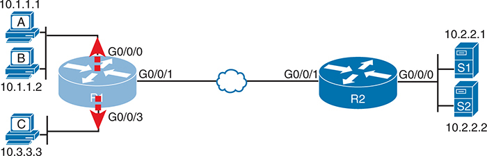

<figcaption>

<aside class="hidden" id="a06fig08">

该图由多个网络设备以及贴有特定网络接口标识符和I P地址的连接所组成. 从左起,有三台电脑,分别标有A,B和C的I P地址为10.1.1.1,10.1.1.2和10.3.3.3. 这些计算机被连接到一个路由器上,标签为R1,它有三个接口:G0斜线-0斜线-0;G0斜线-0斜线-1;和G0斜线-0斜线-3. 接口 G0 slash0 slash0连接到计算机A和B,而接口 G0 slash0 slash3连接到计算机C. 路由器R1与另一个路由器相接,标注为R2,通过接口G0斜线0斜线1通过一个网络云来象征一个广域网连接. 路由器R2有两种接口,G0斜拉桥-0斜拉桥-0和G0斜拉桥-0斜拉桥-1. 接口 G +0 slash +0 slash →0 连接两个服务器,分别标有 S +1和 S +2 有 I P地址 +10.2.2.1和 +10.2.2.2. 接口 G0 slash0 slash1从路由器R1接通广域网云.

</aside>

<strong>图6-8</strong> <em>标准ACL 设想方案2</em>

</figcaption>

</figure>

如果你通过老板的所有评论,这些要求可能会减少到以下几点:

<ol class="number">

<li>
启用 R2 的 G0/ 0 接口上的 ACL 输入 。
</li>

<li>
服务器 S1 的许可包将到 A 的子网主机 。
</li>

<li>
拒绝服务器 S1 的包到 C 的子网主机 。
</li>

<li>
服务器 S2 的许可包将会在 C 的子网中寄入主机 。
</li>

<li>
拒绝服务器 S2 的软件包到 A 子网的主机 。
</li>

<li>
(对默认情况下应做什么没有评论;使用隐含的<strong>deny any</strong>默认值。 )
</li>

</ol>

事实证明,你不能用标准的ACL来做你老板要求的一切. 例如,考虑要求编号为2的明显命令:<strong>access-list 2 permit 10.2.2.1</strong>。这允许所有源代码为10.2.2.1(server S1)的流量. 下一个要求要求您过滤来自同一IP地址的(dey)包! 即使添加了检查出源 IP 地址10.2.2.1的另外一个命令,路由器也永远不会得到它,因为路由器在搜索ACL时使用首次匹配逻辑. 您不能同时检查目的地和源IP地址,因为标准ACL不能检查目的地IP地址.

为了解决这个问题,你应该找个新的老板! 不,说真的,你应该重新思考 问题和改变规则。 在现实生活中,你可能会使用扩展的ACL取而代之,这样可以检查源地址和目的地IP地址.

为了练习另一个标准的ACL,想象一下你的上司让你改变要求. 逻辑仍然会考虑图中右向左移动的包;然而,设计时会使用两个出行ACL,两者都位于路由器R1上. 每个ACL将允许从单一服务器传输到连接的局域网,并附有下列修改的要求:

<ol class="number">

<li>
在 R1 的 G0/ 0. 0 接口上使用外部ACL , 允许服务器 S1 的包, 并拒绝所有其他包 。
</li>

<li>
使用 R1 的 G0/ 0/3 接口上的 ACL, 允许服务器 S2 的包, 并拒绝所有其他包 。
</li>

</ol>

<a href="#exa6_3">示例6-3</a>显示完成这些要求的配置。

<strong>示例6-3</strong> <em>路由器 R1 中的替代配置</em>

<a href="#code-f0128-01" id="f0128-01a">点击此处查看代码原图</a>

<pre class="pre-ex" tabindex="0"><code>access-list 2 remark This ACL permits server S1 traffic to host A's subnet

access-list 2 permit 10.2.2.1

!

access-list 3 remark This ACL permits server S2 traffic to host C's subnet

access-list 3 permit 10.2.2.2

!

interface G0/0/0

 ip access-group 2 out

!

interface G0/0/3

 ip access-group 3 out</code></pre>

如例子所强调,使用ACL 2的解决方案允许从服务器 S1 的所有流量,同时该逻辑允许包退出 R1 的 G0/0/ 0 接口。 其它交通都会因为暗指而放弃<strong>deny any</strong>在ACL的结尾。 此外,ACL 3允许从服务器S2的流量,然后允许退出R1的G0/0/3接口.

最后,确保注意<strong>access-list remark</strong>参数,它允许您留下留在ACL的文本文档。 您可以将您喜欢的语句添加到单个ACL中。

注意

路由器对自制的包与由路由器所取(接收后转发)的包不同. 路由器将任何出行的ACL逻辑应用到路由包上,但绕过ACL进行自创建包. 这些数据包的例子包括:<strong>ping</strong>和<strong>traceroute</strong>命令在路由器上。

</section>

</section>

<section>

<h4 class="h4" id="ch06lev2sec8">故障排除与验证提示</h4>

解决IPv4 ACLs的麻烦需要一定的注意细节. 特别是,你必须准备好查看地址和通配符掩码,并有把握地预测这两个综合参数相匹配的地址. 本章稍后将出现的实践问题可以帮助你为这部分工作做好准备。 但其他几个提示可以帮助你验证 并排除考试中的ACL问题。

首先,你可以看到路由器是否与几个工具包相匹配.<a href="#exa6_2">示例6-2</a>已经显示,IOS保存了与ACL每行相匹配的包的统计数据. 此外,如果添加<strong>log</strong>一个字尾的关键字<strong>access-list</strong>命令,然后,IOS发布日志信息,不时提供ACL特定行的匹配数据。 统计和日志信息都有助于确定ACL中哪行的对应数据包.

譬如说.<a href="#exa6_4">示例6-4</a>显示更新的 ACL 2来自<a href="#exa6_3">示例6-3</a>,与<strong>log</strong>关键词已添加。 然后示例的下方显示一个典型的日志消息,显示基于有源IP地址10.2.2.1(与ACL相匹配)的包与目的地址10.1.1.1的匹配结果.

<strong>示例6-4</strong> <em>为 ACL 统计创建日志消息</em>

<a href="#code-f0129-01" id="f0129-01a">点击此处查看代码原图</a>

<pre class="pre-ex" tabindex="0"><code>R1# <strong>show running-config</strong>

! lines removed for brevity

access-list 2 remark This ACL permits server S1 traffic to host A’s subnet

access-list 2 permit 10.2.2.1 log

!

interface G0/0/0

 ip access-group 2 out

R1#

Feb 4 18:30:24.082: %SEC-6-IPACCESSLOGNP: list 2 permitted 0 10.2.2.1 -&gt; 10.1.1.1,

1 packet</code></pre>

另外,当你第一次检查ACL时,首先要考虑启用ACL的接口和包流的方向。 开始忽略匹配逻辑 。 有时,匹配逻辑是完美的——但ACL已经在错误的接口上被启用,或者为错误的方向,以匹配为ACL配置的包.

譬如说.<a href="#ch06fig09">图6-9</a>重复早先显示的相同的 ACL<a href="#ch06fig07">图6-7</a>。该ACL的第一行与特定主机地址相匹配10.1.1.1. 如果ACL存在于路由器R2上,将ACL作为输入式ACL放置在R2的G0/0/1接口上可以工作,因为由主机10.1.1.1在图的左侧发送的包可以输入R2的G0/0/1接口. 然而,如果R2在其G0/0/0接口上允许ACL 1,对于入境包,ACL永远不会将一个包与源IP地址相匹配10.1.1.1,因为由主机10.1.1.1发出的包永远不会输入该接口. 由10.1.1.1所发送的包会从R2的G0/0/0接口中退出,但永远不会进入,只是因为网络地貌.

<figure class="image-c" id="ch06fig09">

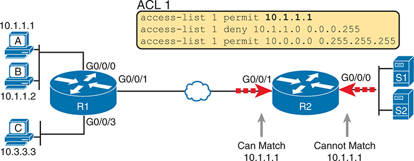

<figcaption>

<aside class="hidden" id="a06fig09">

网络图包括两个路由器,标签为R 1 和 R 数据 2 ,通过象征网络的云相连接。 1 有三个接口: G 0 斜线 0 斜线 0 0 斜线 0 斜线 1 ,和 G 键 0 斜线 0 斜线 3 连接到 G 。 0 斜线 0 斜线 0 是一个带有 I P 地址的“ A” 设备 10.1.1.1 改为 G 0 斜线 0 斜线 1 是一个带有 I P 地址的“ B” 设备 10.1.1.2 ,并提交G 0 斜线 0 斜线 3 是一个带有 I P 地址的“ C” 设备 10.3.3.3 路由器 R 2 也有两个接口: G 0 斜线 0 斜线 0 和G组 0 斜线 0 斜线 1 。附于G之后 0 斜线 0 斜线 0 编号 2 是两个标有 S 的服务器 1 2 。在图像上方一个黄色框中显示的ACL包含三项规则: 访问控制列表 1 许可 10.1.1.1 ,访问控制列表 1 拒绝 10.1.1.0 0.0.0.255 ,和访问控制列表 1 许可 10.0.0.0 0.255.255.255 。G之间的联系 0 斜线 0 斜线 1 编号 1 和G组 0 斜线 0 斜线 1 编号 2 标记为箭头,显示流量来自 10.1.1.1 可匹配ACL规则,而流量来自 10.1.1.0 无法。

</aside>

<strong>图6-9</strong> <em>ACL 接口和方向检查示例</em>

</figcaption>

</figure>

</section>

<section>

<h4 class="h4" id="ch06lev2sec9">标准 IP ACL 应用练习</h4>

一些CCNA专题,如ACL,只是比起其他专题需要更多的练习和实践. ACLs要求您想出参数来匹配数字的范围,这当然需要使用一些数学和一些过程.

本节从两个角度提供一些实践问题和提示。 首先,本节要求您构建一行标准ACL,以匹配一些数据包. 第二,本节要求您解释现有的ACL命令,以描述ACL将匹配哪些数据包. 这两种技能都对考试很有用.

<section>

<h5 class="h5" id="ch06lev3sec8">编写 access-list 命令的练习</h5>

在本节中,实践与语言学的语法相对应<strong>access-list</strong>命令,特别是选择正确的匹配逻辑。 这些技能在下一章阅读扩展并命名ACL时会有帮助.

首先,以下列表总结了在选择匹配参数时要考虑的一些重要提示:<strong>access-list</strong>命令 :

<ul class="sq">

<li>
为了与特定地址相匹配,只需列出地址.
</li>

<li>
要匹配任何和所有地址,请使用<strong>any</strong>关键词。
</li>

<li>
要匹配,只使用地址上的第一个一,二,或三个八位组,分别使用0.255.255.255,0.0.255.255和0.0.0.255WC掩码. 另外,使源(地址)参数在通配符八位组(通配符罩有255的八位组)中有0s.
</li>

<li>
要匹配子网,使用子网ID作为源头,从255.255.255.255中去掉DDN子网掩码来寻找WC掩码.
</li>

</ul>

<a href="#ch06tab03">表6-3</a>列出若干实践问题的标准。 您的工作: 创建符合数据包的标准 ACL ACE 。 答复列于该节“。<a href="#ref-ch06lev1sec10">对先前的实践问题的答复</a>,”在本章后部分。

<figure class="table" id="ch06tab03" tabindex="0">

<figcaption>

<strong>表6-3</strong>构建一线标准ACL:实践

</figcaption>

<table class="all">

<tbody>

<tr>

<th class="th">
问题
</th>

<th class="th">
条件
</th>

</tr>

<tr>

<td class="border">
1
</td>

<td class="border">
包来自172.16.5.4
</td>

</tr>

<tr>

<td class="border">
2
</td>

<td class="border">
来自主机的以 192.168.6作为前三个 八位组 的包
</td>

</tr>

<tr>

<td class="border">
3
</td>

<td class="border">
来自主机的以 192.168 为前两个 八位组 的包
</td>

</tr>

<tr>

<td class="border">
4
</td>

<td class="border">
来自任何主机的包
</td>

</tr>

<tr>

<td class="border">
5
</td>

<td class="border">
来自子网10.1.200.0/21的包
</td>

</tr>

<tr>

<td class="border">
6
</td>

<td class="border">
来自子网10.1.200.0/27的包
</td>

</tr>

<tr>

<td class="border">
7
</td>

<td class="border">
来自子网172.20.112.0/23的包
</td>

</tr>

<tr>

<td class="border">
8
</td>

<td class="border">
来自子网172.20.112.0/26的包
</td>

</tr>

<tr>

<td class="border">
9
</td>

<td class="border">
来自子网192.168.9.64/28的包
</td>

</tr>

<tr>

<td class="border">
10
</td>

<td class="border">
来自子网192.168.9.64/30的包
</td>

</tr>

</tbody>

</table>

</figure>

</section>

<section>

<h5 class="h5" id="ch06lev3sec9">从 ACL 反推地址范围</h5>

在某些情况下,您可能不会创建自己的ACL. 相反,你可能需要解释一些现有的<strong>access-list</strong>命令。要在考试中回答这些类型的问题,需要确定每个ACL语句中与特定地址/Wildcard掩码组合相匹配的IP地址范围.

根据某些对CCNA认证来说合理的假设,计算与ACL相匹配的地址范围可以相对简单. 基本上,地址的范围始于ACL命令所配置的源参数. 地址范围以源参数和通配符相加而告终. 就这样。

例如,与命令<strong>access-list 1 permit 172.16.200.0 0.0.7.255</strong>,这个范围的低端只是172.16.200.0,直接取自命令本身. 然后,为了找到这个范围的高端,只需在WC掩码上加上这个数字,如下:

<math alttext=""><mrow><mtable columnalign="left"><mtr><mtd><mn>172.16.200.0</mn></mtd></mtr><mtr><mtd><munder><mrow><mtext> </mtext><mo>+</mo><mn>0.</mn><mo>⁢</mo><mtext> </mtext><mtext> </mtext><mtext> </mtext><mtext> </mtext><mn>0.</mn><mo>⁢</mo><mtext> </mtext><mtext> </mtext><mtext> </mtext><mtext> </mtext><mtext> </mtext><mn>7.255</mn></mrow><mrow><mo>¯</mo></mrow></munder></mtd></mtr><mtr><mtd><mn>172.16.207.255</mn></mtd></mtr></mtable></mrow></math>

对于这最后一点练习,看看现有的<strong>access-list</strong>命令在<a href="#ch06tab04">表6-4</a>。在每种情况下,对IP地址的准确性,或IP地址的范围作一标记,并配以命令.

<figure class="table" id="ch06tab04" tabindex="0">

<figcaption>

<strong>表6-4</strong>找到 IP 地址/ 路由 匹配到现有 ACLs

</figcaption>

<table class="all">

<tbody>

<tr>

<th class="th">
问题
</th>

<th class="th">
用于预测源地址区域的命令
</th>

</tr>

<tr>

<td class="border">
1
</td>

<td class="border">
<strong>access-list 1 permit 10.7.6.5</strong>
</td>

</tr>

<tr>

<td class="border">
2
</td>

<td class="border">
<strong>access-list 2 permit 192.168.4.0 0.0.0.127</strong>
</td>

</tr>

<tr>

<td class="border">
3
</td>

<td class="border">
<strong>access-list 3 permit 192.168.6.0 0.0.0.31</strong>
</td>

</tr>

<tr>

<td class="border">
4
</td>

<td class="border">
<strong>access-list 4 permit 172.30.96.0 0.0.3.255</strong>
</td>

</tr>

<tr>

<td class="border">
5
</td>

<td class="border">
<strong>access-list 5 permit 172.30.96.0 0.0.0.63</strong>
</td>

</tr>

<tr>

<td class="border">
6
</td>

<td class="border">
<strong>access-list 6 permit 10.1.192.0 0.0.0.31</strong>
</td>

</tr>

<tr>

<td class="border">
7
</td>

<td class="border">
<strong>access-list 7 permit 10.1.192.0 0.0.1.255</strong>
</td>

</tr>

<tr>

<td class="border">
8
</td>

<td class="border">
<strong>access-list 8 permit 10.1.192.0 0.0.63.255</strong>
</td>

</tr>

</tbody>

</table>

</figure>

有趣的是,IOS允许 CLI 用户输入一个<strong>access-list</strong>在配置模式下命令,IOS在将命令放入运行配置文件之前,可能会更改源参数. 寻找与《公约》相符的地址范围的过程<strong>access-list</strong>命令预计<strong>access-list</strong>命令来自路由器,以便完成任何这样的修改。

监督办可以做出改变<strong>access-list</strong>命令是将通配符掩码为 255的地址的八位组 转换为 0。 例如,用通配符掩码为0.0.255.255,IOS忽略了后两个八位组. IOS预计源参数会以两个 0s结束. 如果没有,监督办仍然接受<strong>access-list</strong>命令,但IOS将地址的后两个八位组更改为0s.<a href="#exa6_5">示例6-5</a>显示一个示例,其中配置显示出出自10.1.1.1,但通配符掩码0.0.255.255.

<strong>示例6-5</strong> <em>IOS 更改地址字段<strong>access-list</strong>命令</em>

<a href="#code-f0132-01" id="f0132-01a">点击此处查看代码原图</a>

<pre class="pre-ex" tabindex="0"><code>R2# <strong>configure terminal</strong>

Enter configuration commands, one per line. End with CNTL/Z.

R2(config)# <strong>access-list 21 permit</strong> <strong>10.1.1.1 0.0.255.255</strong>

R2(config)# <strong>^Z</strong>

R2#

R2# <strong>show ip access-lists</strong>

Standard IP access list 21

    10 permit 10.1.0.0, wildcard bits 0.0.255.255</code></pre>

查找地址范围的数学依赖于命令是否完全正确,或者IOS是否已将这些地址八位组设置为0,如示例所示.

注意

最有用的WC掩码,在二进制中,不互出0s和1s. 这本书假定只使用这些类型的WC掩码. 然而,Cisco IOS允许WC掩码互出0s和1s,但使用这些WC口相打破了计算地址范围的简单方法. 在你进入CCIE研究的过程中,要准备好更深入地挖掘,学习如何确定ACL匹配哪些.

</section>

</section>

</section>

</section>

<section class="ccna-source ccna-appendix" aria-label="答案解析与术语表">
<section data-epub-type="chapter">

<h2 class="h2" id="ref-appc">附录C</h2>

<h2 class="h2a">对“我早就知道了吗?” 的回答。</h2>

<section>

<h3 class="h3" id="ref-appclev1sec6">章 次 页 次 6</h3>

<strong><a id="ref-ques6_1" href="#quess6_1">1</a>.</strong> A 和 C。标准 ACL 检查源 IP 地址。ACL 可以匹配地址范围 10.1.1.1–10.1.1.4，但需要使用多条 <strong>access-list</strong> 命令。要匹配 Barney 所在子网中的所有主机，可以使用 <strong>access-list 1 permit 10.1.1.0 0.0.0.255</strong> 命令。

<strong><a id="ref-ques6_2" href="#quess6_2">2</a>.</strong> A 和 D。标准编号 IP ACL 的有效 ACL 编号范围是 1–99 和 1300–1999，包含端点值。

<strong><a id="ref-ques6_3" href="#quess6_3">3</a>.</strong> D。通配符掩码 0.0.0.255 会匹配前三个八位组与 ACL 命令中地址相同的所有数据包。当需要匹配子网部分由前三个八位组构成的子网时，这个掩码很有用，例如使用子网掩码 255.255.255.0 的情况。

<strong><a id="ref-ques6_4" href="#quess6_4">4</a>.</strong> E。通配符掩码 0.0.15.255 会匹配前 20 位相同的所有数据包。当需要匹配子网部分由前 20 位构成的子网时，这个掩码很有用，例如使用子网掩码 255.255.240.0 的子网。

<strong><a id="ref-ques6_5" href="#quess6_5">5</a>.</strong> A。路由器始终按顺序搜索 ACL 语句，并在找到匹配项后停止。换句话说，它使用首次匹配逻辑。源 IP 地址为 1.1.1.1 的数据包可以匹配题目所述的三条显式配置命令中的任意一条，但实际采用的是第一条语句。

<strong><a id="ref-ques6_6" href="#quess6_6">6</a>.</strong> B。正确答案匹配地址范围 172.16.4.0–172.16.5.255，即所列子网的地址范围。使用 <strong>access-list</strong> 命令时，可以将地址与通配符掩码相加，得到 172.16.5.255（该范围的最后一个地址）。

一个错误选项使用通配符掩码 0.0.255.0，会匹配所有以 172.16 开头、最后一个八位组为 5 的数据包。另一个错误选项只匹配具体的 IP 地址 172.16.5.0。第三个错误选项使用通配符掩码 0.0.0.127，会匹配 172.16.5.0 至 172.16.5.127 的地址。

</section>

</section>

<section id="ref-glossary"><h2 class="h2a">词汇表</h2>
<strong>访问控制条目(ACE)</strong>在访问控制列表(ACL)中有一个带有许可或拒绝动作的配置行.

<strong>标准访问控制列表</strong>IOS 全局配置命令列表,仅能匹配一个包的源IP地址,以决定哪些包要丢弃,哪些包要通过路由器允许.

<strong>通配符掩码</strong>Cisco IOS ACL 命令以及 OSPF 和 EIGRP 中使用的掩码<strong>网络</strong>命令。

</section>
<section>

<h3 class="h3" id="ref-ch06lev1sec10">对先前的实践问题的答复</h3>

<a href="#ref-ch06tab09">表6-9</a>列出对前面所列问题的答案<a href="#ch06tab03">表6-3</a>.

<figure class="table" id="ref-ch06tab09" tabindex="0">

<figcaption>

<strong>表6-9</strong>构建一线标准 ACL: 答案

</figcaption>

<table class="all">

<thead>

<tr>

<th class="th">
问题
</th>

<th class="th">
答复
</th>

</tr>

</thead>

<tbody>

<tr>

<td class="border">
1
</td>

<td class="border">
<strong>access-list 1 permit 172.16.5.4</strong>
</td>

</tr>

<tr>

<td class="border">
2
</td>

<td class="border">
<strong>access-list 2 permit 192.168.6.0 0.0.0.255</strong>
</td>

</tr>

<tr>

<td class="border">
3
</td>

<td class="border">
<strong>access-list 3 permit 192.168.0.0 0.0.255.255</strong>
</td>

</tr>

<tr>

<td class="border">
4
</td>

<td class="border">
<strong>access-list 4 permit any</strong>
</td>

</tr>

<tr>

<td class="border">
5
</td>

<td class="border">
<strong>access-list 5 permit 10.1.200.0 0.0.7.255</strong>
</td>

</tr>

<tr>

<td class="border">
6
</td>

<td class="border">
<strong>access-list 6 permit 10.1.200.0 0.0.0.31</strong>
</td>

</tr>

<tr>

<td class="border">
7
</td>

<td class="border">
<strong>access-list 7 permit 172.20.112.0 0.0.1.255</strong>
</td>

</tr>

<tr>

<td class="border">
8
</td>

<td class="border">
<strong>access-list 8 permit 172.20.112.0 0.0.0.63</strong>
</td>

</tr>

<tr>

<td class="border">
9
</td>

<td class="border">
<strong>access-list 9 permit 192.168.9.64 0.0.0.15</strong>
</td>

</tr>

<tr>

<td class="border">
10
</td>

<td class="border">
<strong>access-list 10 permit 192.168.9.64 0.0.0.3</strong>
</td>

</tr>

</tbody>

</table>

</figure>

<a href="#ref-ch06tab10">表6-10</a>列出对前面所列问题的答案<a href="#ch06tab04">表6-4</a>.

<figure class="table" id="ref-ch06tab10" tabindex="0">

<figcaption>

<strong>表6-10</strong>问题地址区域<a href="#ch06tab04">表6-4</a>中文无改动。

</figcaption>

<table class="all">

<tbody>

<tr>

<th class="th">
问题
</th>

<th class="th">
地址范围
</th>

</tr>

<tr>

<td class="border">
1
</td>

<td class="border">
一个地址:10.7.6.5
</td>

</tr>

<tr>

<td class="border">
2
</td>

<td class="border">
192.168.4.0–192.168.4.127
</td>

</tr>

<tr>

<td class="border">
3
</td>

<td class="border">
192.168.6.0–192.168.6.31
</td>

</tr>

<tr>

<td class="border">
4
</td>

<td class="border">
172.30.96.0–172.30.99.255
</td>

</tr>

<tr>

<td class="border">
5
</td>

<td class="border">
172.30.96.0–172.30.96.63
</td>

</tr>

<tr>

<td class="border">
6
</td>

<td class="border">
10.1.192.0–10.1.192.31
</td>

</tr>

<tr>

<td class="border">
7
</td>

<td class="border">
10.1.192.0–10.1.193.255
</td>

</tr>

<tr>

<td class="border">
8
</td>

<td class="border">
10.1.192.0–10.1.255.255
</td>

</tr>

</tbody>

</table>

</figure>

</section>

</section>

<section class="ccna-source ccna-appendix" aria-label="代码原图">
<section data-epub-type="chapter">

<h2 id="code-ch06_images">代码片段</h2>

许多书籍包含程序代码或配置示例。为了优化这些内容的显示，请使用单栏横向模式阅读电子书，并将字号调至最小。除了以可重排文本格式呈现代码和配置，我们还提供了仿照纸质书排版的代码图片。因此，当可重排格式可能影响代码列表的呈现时，你会看到“点击此处查看代码原图”链接。点击链接，即可查看保持纸质书排版的代码图片。要返回之前浏览的页面，请点击设备或应用程序的返回按钮。

<a href="#f0121-01a" id="code-f0121-01">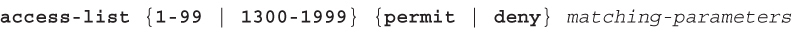</a>

<a href="#f0121-02a" id="code-f0121-02">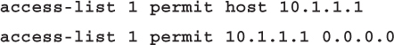</a>

<a href="#f0124-01a" id="code-f0124-01">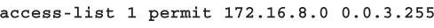</a>

<a href="#f0125-01a" id="code-f0125-01">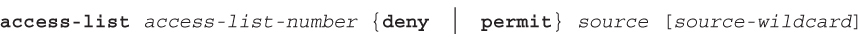</a>

<a href="#f0126-01a" id="code-f0126-01">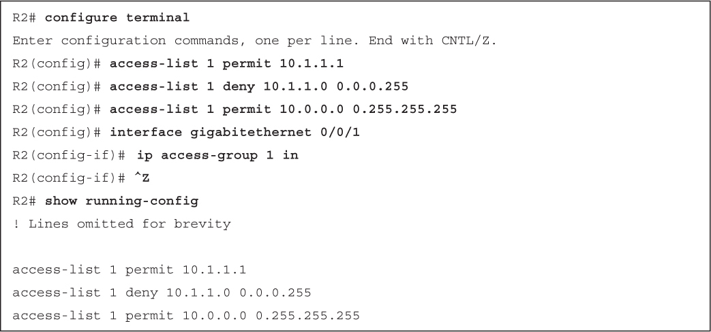</a>

<a href="#f0126-02a" id="code-f0126-02">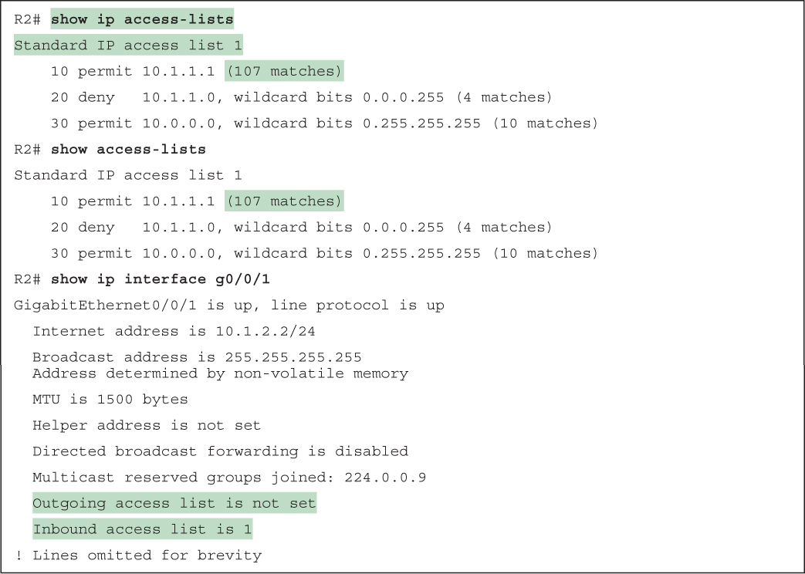</a>

<a href="#f0128-01a" id="code-f0128-01">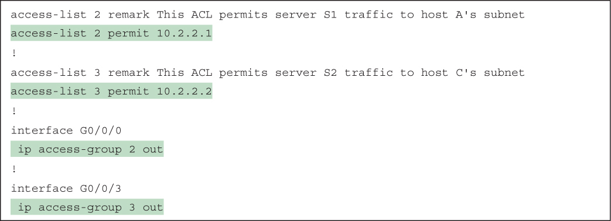</a>

<a href="#f0129-01a" id="code-f0129-01">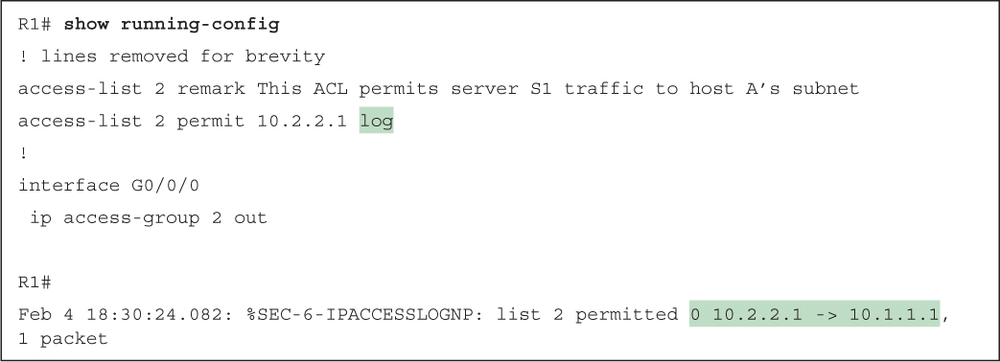</a>

<a href="#f0132-01a" id="code-f0132-01">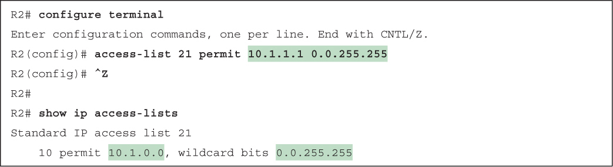</a>

</section>

</section>


<nav class="ccna-chapter-nav" aria-label="章节导航"><a href="v2-05.html">← 上一章</a><a href="v2-07.html">下一章 →</a></nav>
