
<a href="{{ '/subjects/CCNA/' | relative_url }}">← 返回 CCNA 目录</a>

第二卷 · IP 访问控制列表

<nav class="ccna-chapter-nav" aria-label="章节导航"><a href="v2-06.html">← 上一章</a><a href="v2-08.html">下一章 →</a></nav>



<section data-epub-type="chapter">

<h2 class="h2" id="ch07">第 7 章</h2>

<h2 class="h2a">命名与扩展 IP ACL</h2>

本章涵盖以下考试主题：

5.0 安全基础

5.6 配置和验证访问控制列表

上一章通过标准编号 IP ACL 介绍了 IP ACL 的基本概念和配置。理解标准编号 IP ACL 很有用，也很重要，但大多数网络需要扩展 ACL 更强的匹配能力。扩展 ACL 允许在 ACL 的每一行（即每个访问控制条目，ACE）中匹配多种首部字段，因此功能更强大。

此外，大多数网络使用命名 ACL，而不是编号 ACL。通过名称标识 ACL，可以在名称中加入提示信息，让所有人了解 ACL 的用途。而且，自数十年前 IOS 首次引入命名 ACL 起，它就使用 ACL 配置模式及其 <strong>permit</strong> 和 <strong>deny</strong> 子命令，使配置更清楚，也更便于日后修改。

本章首先讨论命名 ACL，为简化说明，只使用标准 ACL 示例。第一节还介绍如何编辑命名 ACL，以及这种能力为什么优于编号 ACL 的旧式编辑功能。第二大节详细讨论扩展 ACL，主要使用命名扩展 ACL。

<section>

<h3 class="h3" id="ch07lev1sec1">自测</h3>

如果你希望根据得分决定在本章投入多少时间，可以完成这组自测题（在此作答，或使用 PTP 软件）。各题答案的选项字母列在自测题之后的页面底部。书末和配套网站上的<a href="#ref-appc">附录 C</a>都包含答案及解析。你也可以在 PTP 测试软件中找到答案及解析。

<figure class="table" id="ch07tab01" tabindex="0">

<figcaption>

<strong>表7-1</strong> 自测：基础知识小节与题目对应关系

</figcaption>

<table class="all">

<tbody>

<tr>

<th class="th">
基础知识小节
</th>

<th class="th">
题目
</th>

</tr>

<tr>

<td class="border">
命名 ACL 与 ACL 编辑
</td>

<td class="border">
1、2
</td>

</tr>

<tr>

<td class="border">
扩展 IP 访问控制列表
</td>

<td class="border">
3–6
</td>

</tr>

</tbody>

</table>

</figure>

<strong><a id="quess7_1" href="#ques7_1a">1</a>.</strong>哪个答案最好地将命名的标准IP ACL和编号的标准IP ACL进行比较?

<ol class="lower-alpha">

<li>
使用名称而不是数字,但没有其他配置变化
</li>

<li>
添加额外的字段以匹配超过标准编号的 IP ACLs
</li>

<li>
允许您在 ACL 模式下配置匹配参数和允许/拒绝动作
</li>

<li>
允许您在接口模式下配置匹配参数并允许/拒绝动作
</li>

</ol>

<strong><a id="quess7_2" href="#ques7_2a">2</a>.</strong>您刚刚配置了名为 ACL WAN_ ACL 的标准, 其命令没有使用序列号 。 如果在ACL配置模式中输入该ACL,哪个命令将成为ACL中的第三个ACE?

<ol class="lower-alpha">

<li>
<strong>*15 许可证 *172.16.0.0 0.0.255.255</strong>
</li>

<li>
<strong>permit 16 172.16.0.0 0.0.255.255</strong>
</li>

<li>
<strong>*21 许可证 *172.16.0.0 0.0.255.255</strong>
</li>

<li>
<strong>permit 29 172.16.0.0 0.0.255.255</strong>
</li>

</ol>

<strong><a id="quess7_3" href="#ques7_3a">3</a>.</strong>哪些答案列出无法与扩展的 IP ACL 匹配的字段 ? (取出二个答.

<ol class="lower-alpha">

<li>
协议
</li>

<li>
源 IP 地址
</li>

<li>
目的 IP 地址
</li>

<li>
TCP 源端口
</li>

<li>
URL
</li>

<li>
FTP 传输的文件名
</li>

</ol>

<strong><a id="quess7_4" href="#ques7_4a">4</a>.</strong>哪个<strong>access-list</strong>命令允许从主机10.1.1.1到所有网络服务器的软件包,其IP地址以172.16.5开头? (取出二个答.

<ol class="lower-alpha">

<li>
<strong>access-list 101 permit tcp host 10.1.1.1 172.16.5.0 0.0.0.255 eq www</strong>
</li>

<li>
<strong>access-list 1951 permit ip host 10.1.1.1 172.16.5.0 0.0.0.255 eq www</strong>
</li>

<li>
<strong>access-list 2523 permit ip host 10.1.1.1 eq www 172.16.5.0 0.0.0.255</strong>
</li>

<li>
<strong>access-list 2523 permit tcp host 10.1.1.1 eq www 172.16.5.0 0.0.0.255</strong>
</li>

<li>
<strong>access-list 2523 permit tcp host 10.1.1.1 172.16.5.0 0.0.0.255 eq www</strong>
</li>

</ol>

<strong><a id="quess7_5" href="#ques7_5a">5</a>.</strong>(b) 下列哪一项<strong>access-list</strong>命令允许从所有网络服务器上向任何网络客户端发送软件包,其IP地址以172.16.5开始?

<ol class="lower-alpha">

<li>
<strong>access-list 101 permit tcp host 10.1.1.1 172.16.5.0 0.0.0.255 eq www</strong>
</li>

<li>
<strong>access-list 1951 permit ip host 10.1.1.1 172.16.5.0 0.0.0.255 eq www</strong>
</li>

<li>
<strong>access-list 2523 permit tcp any eq www 172.16.5.0 0.0.0.255</strong>
</li>

<li>
<strong>access-list 2523 permit tcp 172.16.5.0 0.0.0.255 eq www 172.16.5.0 0.0.0.255</strong>
</li>

<li>
<strong>access-list 2523 permit tcp 172.16.5.0 0.0.0.255 eq www any</strong>
</li>

</ol>

<strong><a id="quess7_6" href="#ques7_6a">6</a>.</strong>考虑以下产出:<strong>show access-list</strong>命令。哪些ACE将指定给任何SSH服务器的从10.22.33.99到10.33.22.22的包相匹配?

<a href="#code-f0137-01" id="f0137-01a">点击此处查看代码原图</a>

<pre class="pre-q" tabindex="0"><code>ip access-list extended sample

  10 permit tcp 10.22.33.0 0.0.0.63 10.33.22.0 0.0.0.127 eq 22

  20 permit tcp 10.22.33.0 0.0.0.127 eq 24 10.33.22.0 0.0.0.63

  30 permit tcp 10.22.33.0 0.0.0.127 10.33.22.0 0.0.0.127 eq 22

  40 permit tcp 10.22.33.0 0.0.0.255 10.33.22.0 0.0.0.31 eq 24</code></pre>

<ol class="lower-alpha">

<li>
第10行:
</li>

<li>
20号线
</li>

<li>
30号线
</li>

<li>
第40行:
</li>

</ol>

自测答案：

<strong><a id="ques7_1a" href="#ref-ques7_1">1</a></strong> C

<strong><a id="ques7_2a" href="#ref-ques7_2">2</a></strong> C

<strong><a id="ques7_3a" href="#ref-ques7_3">3</a></strong> E, F

<strong><a id="ques7_4a" href="#ref-ques7_4">4</a></strong> A, E

<strong><a id="ques7_5a" href="#ref-ques7_5">5</a></strong> E

<strong><a id="ques7_6a" href="#ref-ques7_6">6</a></strong> C

</section>

<section>

<h3 class="h3box" id="ch07lev1sec2">基础知识</h3>

</section>

<section>

<h3 class="h3" id="ch07lev1sec3">命名 ACL 与 ACL 编辑</h3>

从思科最早的年代起,IOS就支持编号为ACLs. 随着时间的推移,Cisco增加了对<a id="key_094" href="#ref-gloss_219">已命名的访问控制列表</a>。本节详细介绍如何配置和使用命名为ACLs,以及命名为AC Ls所允许的关键功能之一:ACL编辑.

<section>

<h4 class="h4" id="ch07lev2sec1">命名 IP 访问控制列表</h4>

已命名的IP ACL与编号为IP AC L有很多相似之处. 它们作为包过滤器发挥作用,但其他的IOS功能将其用于匹配包并进行其他动作. 它们也可以匹配相同的字段:标准编号的ACL可以匹配一个被命名为ACL的标准的同域,扩展编号的AC L可以匹配一个得到扩展的被命名的ACL的同域.

当然,命名的和编号的ACL也有区别. 与编号的ACL相比,命名的ACL最初有三个显著的区别:

<ul class="sq">

<li>
使用名称而不是数字来识别ACL,从而更容易记住ACL的原因
</li>

<li>
使用 ACL 模式子命令而不是全局命令来定义动作和匹配参数
</li>

<li>
使用 ACL 编辑功能,允许 CLI 用户从 ACL 从 ACL 删除单个行并插入新行
</li>

</ul>

通过将编号的ACLs转换为使用等同的命名ACL配置,可以轻松地学习命名ACL配置.<a href="#ch07fig01">图7-1</a>仅显示这样的转换,使用简单的三行标准ACL编号1. 来创造三个<strong>permit</strong>用于命名的 ACL 的子命令,您将复制三个编号的 ACL 命令的部分,从<strong>permit</strong>关键词。

<figure class="image-c" id="ch07fig01">

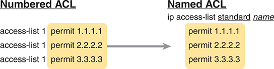

<figcaption>

<aside class="hidden" id="a07fig01">

在左侧,以三行显示编号的ACL配置:访问控制列表1许可1.1.1.1,访问控制列表1许可2.2.2.2,访问控制列表1许可3.3.3.3,均以黄色背景书写. 箭头从此配置指向右侧,表示一个转换或翻译过程. 在右侧,命名的ACL配置以标题 I P 访问控制列表标准名称显示,后面是相同的许可声明:许可证1.1.1.1,许可证2.2.2.2,许可证3.3.3.3,同样在黄色背景上.

</aside>

<strong>图7-1</strong> <em>已命名 ACL Versus 编号 ACL 配置</em>

</figcaption>

</figure>

密码<strong>ip access-list {standard | extended}</strong> <em>name</em>全局配置命令创建ACL,定义其类型,并定义其名称. 它也将用户移动到 ACL 配置模式, 如即将到来时所示<a href="#exa7_1">示例7-1</a>。一旦进入ACL配置模式,您就会配置<strong>permit</strong>, <strong>deny</strong>,以及<strong>remark</strong>显示编号的语法的命令<strong>access-list</strong>全球指令。 如果您正在配置一个名为 ACL 的标准, 这些命令匹配标准编号 ACL 的语法; 如果您正在配置名为 ACL 的扩展语法, 这些命令匹配扩展号 ACL 的语法 。

<a href="#exa7_1">示例7-1</a>显示一个命名标准ACL的配置。 特别注意配置模式提示,显示标准命名为ACL配置模式.

<strong>示例7-1</strong> <em>命名访问控制列表配置</em>

<a href="#code-f0139-01" id="f0139-01a">点击此处查看代码原图</a>

<pre class="pre-ex" tabindex="0"><code>R2# <strong>configure terminal</strong>

Enter configuration commands, one per line. End with CNTL/Z.

R2(config)# <strong>ip access-list standard Hannah</strong>

R2(config-std-nacl)# <strong>remark A sample ACL, originally five lines</strong>

R2(config-std-nacl)# <strong>permit 10.1.1.2</strong>

R2(config-std-nacl)# <strong>deny 10.1.1.1</strong>

R2(config-std-nacl)# <strong>deny 10.1.3.0 0.0.0.255</strong>

R2(config-std-nacl)# <strong>deny 10.1.2.0 0.0.0.255</strong>

R2(config-std-nacl)# <strong>permit any</strong>

R2(config-std-nacl)# <strong>interface GigabitEthernet0/0/1</strong>

R2(config-if)# <strong>ip access-group Hannah out</strong>

R2(config-if)# <strong>^Z</strong>

R2#</code></pre>

审查配置、<strong>ip access-list standard Hannah</strong>命令创建ACL,将其命名为Hannah,并将用户放入ACL配置模式. 此命令还将ACL定义为标准ACL. 下一个,五个不同的<strong>permit</strong>和<strong>deny</strong>语句定义匹配逻辑和匹配时产生的动作。

所命名的ACLs中的名称必须遵循这些规则:

<ul class="sq">

<li>
他们必须从字母特征开始。
</li>

<li>
它们不能使用空格和引号。
</li>

<li>
名字对案件很敏感。
</li>

</ul>

<a href="#exa7_2">示例7-2</a>显示由配置生成的 ACL 。<a href="#exa7_1">示例7-1</a>。两者<strong>show running-config</strong>和<strong>show access-lists</strong>命令列表 ACE 从<a href="#exa7_1">示例7-1</a>以同样的顺序。 输出中还显示自动添加的序列号<strong>permit</strong>和<strong>deny</strong>子命令 。 在配置过程中忽略它们时,IOS会添加序列号,第一次ACE使用10,每次相继ACE使用10.

<strong>示例7-2</strong> <em>命名访问控制列表验证( IOS XE)</em>

<a href="#code-f0139-02" id="f0139-02a">点击此处查看代码原图</a>

<pre class="pre-ex" tabindex="0"><code>R2# <strong>show running-config</strong>

Building configuration...

Current configuration:

! lines omitted for brevity

interface GigabitEthernet0/0/1

 ip access-group Hannah out

!

ip access-list standard Hannah

 10 permit 10.1.1.2

 20 deny   10.1.1.1

 30 deny   10.1.3.0 0.0.0.255

 40 deny   10.1.2.0 0.0.0.255

 50 permit any

R2# <strong>show access-list</strong>

Standard IP access list Hannah

    10 permit 10.1.1.2 (3 matches)

    20 deny   10.1.1.1 (5 matches)

    30 deny   10.1.3.0, wildcard bits 0.0.0.255 (10 matches)

    40 deny   10.1.2.0, wildcard bits 0.0.0.255 (15 matches)

    50 permit any (1256 matches)</code></pre>

注意

密码<strong>show access-lists</strong>和<strong>show ip access-lists</strong>命令在 IOS 和 IOS XE 上都列出序列号. 密码<strong>show running-config</strong>和<strong>show startup-config</strong>命令只显示IOS XE中的序列号,而不显示IOS中的序列号. 输出在<a href="#exa7_2">示例7-2</a>来自运行 IOS XE 的路由器.

无论是考试准备还是真正的网络工作,都做好准备,以便你既能理解编号又能被命名的ACL语法. 由于有选择,大多数网络工程师选择使用被命名的ACLs. 不过,你可能仍然能找到企业生产路由器中使用的编号ACL,CCNA考试可能会询问两种风格. 如所示<a href="#ch07fig01">图7-1</a>,当您看到一个编号为ACL的子命令时,您可以通过删除该命令来在精神上创建相应的命名ACL的分命令.<strong>access-list</strong> <em>number</em>前缀在编号的全局命令中。

</section>

<section>

<h4 class="h4" id="ch07lev2sec2">编辑 ACL</h4>

对于CCNA考试准备,您需要了解ACL编辑的一些复杂之处,既有旧的全局命令,也有更新的ACL模式命令. 本节从使用ACL模式命名的ACL开始. 之后,文本描述了与编号的ACLs相比的差异,以及使用IOS对IOS XE时的一些细微差异.

<section>

<h5 class="h5" id="ch07lev3sec1">编辑命名 ACL</h5>

当思科创建ACL模式并取名ACLs时,他们创造了从ACL中轻松地添加并去除单个ACE的能力. IOS支持删除单个ACE,在ACL的末尾添加新的ACE,甚至使用ACL的任意位置添加ACE.<a id="key_092" href="#ref-gloss_027">ACL 序列号</a>.

要删除一个 ACE, 您首先使用 ACL 配置模式<strong>ip access-list</strong> {<strong>标准</strong> | <strong>扩展</strong>} <em>name</em>全局指令 。 对于任何已存在的ACE,您有两个选项可以删除特定的子命令:

<ul class="sq">

<li>
重复整个<strong>permit</strong>, <strong>deny</strong>,或<strong>remark</strong>没有行号但前有行号的ACL子命令<strong>no</strong>命令。
</li>

<li>
使用该<strong>no</strong> <em>sequence-number</em>命令,不包含其他命令,删除使用所列出序列号的ACE。
</li>

</ul>

<a href="#exa7_3">示例7-3</a>显示基于 ACL Hannah 的五行示例 。<a href="#exa7_2">示例7-2</a>。一个删除ACL中的第4个ACE,在后加全指令.<strong>no</strong>命令,另一个则删除第二个 ACE 与<strong>no 20</strong>子命令 。

<strong>示例7-3</strong> <em>从命名的ACL中删除 ACE 的两种方法</em>

<a href="#code-f0141-01" id="f0141-01a">点击此处查看代码原图</a>

<pre class="pre-ex" tabindex="0"><code>R2# <strong>configure terminal</strong>

Enter configuration commands, one per line. End with CNTL/Z.

R2(config)# <strong>ip access-list extended Hannah</strong>

R2(config-std-nacl)# <strong>no deny 10.1.2.0 0.0.0.255</strong>

R2(config-std-nacl)# <strong>no 20</strong>

R2(config-std-nacl)# <strong>^Z</strong>

R2# <strong>show access-lists</strong>

Standard IP access list Hannah

    10 permit 10.1.1.2

    30 deny   10.1.3.0, wildcard bits 0.0.0.255

    50 permit any</code></pre>

这个例子还显示了有关序列数的一些重要细节. 其余ACE的相对顺序与前作相同,尽管这些行的序列编号没有变化. 序列数的绝对值并不重要——只有它们的相对值才是重要的,因为它们确认了ACEs在ACL中的顺序. (本节,“<a href="v2-08.html#ch08lev2sec7">重排 ACL 序列编号</a>“在<a href="v2-08.html#ch08">第8章</a>, “<a href="v2-08.html#ch08">IP ACL 应用</a>,”讨论如何重新编号ACL序列号来清理编号. )

要在ACL中添加一个ACE,同样从ACL配置模式,使用这些选项:

<ul class="sq">

<li>
要在行间插入ACE,请配置<strong>permit</strong>或者说<strong>deny</strong>命令前有序列号。 该号码决定了ACE在ACL的新位置.
</li>

<li>
要在ACL结尾处插入ACE,请配置<strong>permit</strong>或者说<strong>deny</strong>命令没有序列号,IOS会自动添加序列号,将ACE放入ACL的末尾.
</li>

</ul>

例如,想象你想将您删除的两个ACE添加到同一个ACL(汉纳)中.<a href="#exa7_4">示例7-4</a>显示了忽略序列数的经典错误,这导致了两个新的ACE到ACL的结尾. 作为提醒 ACL Hannah 在最后<a href="#exa7_3">示例7-3</a>,有3个ACE编号为10,30和50。

<strong>示例7-4</strong> <em>显示在ACL末端添加ACE</em>

<a href="#code-f0142-01" id="f0142-01a">点击此处查看代码原图</a>

<pre class="pre-ex" tabindex="0"><code>R2# <strong>configure terminal</strong>

Enter configuration commands, one per line. End with CNTL/Z.

R2(config)# <strong>ip access-list extended Hannah</strong>

R2(config-std-nacl)# <strong>deny 10.1.2.0 0.0.0.255</strong>

R2(config-std-nacl)# <strong>deny 10.1.1.1</strong>

R2(config-std-nacl)# <strong>^Z</strong>

R2# <strong>show access-lists</strong>

Standard IP access list Hannah

    10 permit 10.1.1.2

    30 deny   10.1.3.0, wildcard bits 0.0.0.255

    50 permit any

    60 deny 10.1.2.0 0.0.0.255

    70 deny 10.1.1.1</code></pre>

忘记序列数——并在ACL的结尾加上ACE——很少是你想完成的. 在这种情况下,增加这些线没有好处。 两个ACE加到<a href="#exa7_4">示例7-4</a>住在明朗的后方<strong>permit any</strong>命令于第50行,因此ACL绝不会使用示例中添加的两行.

要将两个ACE重新插入到原位置,作为第二个和第四个ACE,使用序列号开始命令.<a href="#exa7_5">示例7-5</a>这样做,再次从状态开始 在结尾<a href="#exa7_3">示例7-3</a>,其中ACEs为10,30和50在ACL.<a href="#exa7_5">示例7-5</a>显示两个<strong>deny</strong>命令,序列号为20和40。

<strong>示例7-5</strong> <em>显示在不同ACL位置插入ACE</em>

<a href="#code-f0142-02" id="f0142-02a">点击此处查看代码原图</a>

<pre class="pre-ex" tabindex="0"><code>R2# <strong>configure terminal</strong>

Enter configuration commands, one per line. End with CNTL/Z.

R2(config)# <strong>ip access-list extended Hannah</strong>

R2(config-std-nacl)# <strong>40 deny 10.1.2.0 0.0.0.255</strong>

R2(config-std-nacl)# <strong>20 deny 10.1.1.1</strong>

R2(config-std-nacl)# <strong>^Z</strong>

R2# <strong>show access-lists</strong>

Standard IP access list Hannah

    10 permit 10.1.1.2

    20 deny   10.1.1.1

    30 deny   10.1.3.0, wildcard bits 0.0.0.255

    40 deny   10.1.2.0, wildcard bits 0.0.0.255

    50 permit any</code></pre>

注意

虽然<a href="#exa7_5">示例7-5</a>用于配置命令的序列号为20和40,两个已存在的ACE之间的任何序列号都会奏效. 例如,<strong>*20 否认 *10.1.1.1</strong>ACL 子命令也可能是<strong>*11 否认 *10.1.1.1</strong>或者说<strong>*29 否认 *10.1.1.1</strong>,因为相邻的ACE目前使用序号为10和30.

</section>

<section>

<h5 class="h5" id="ch07lev3sec2">编辑编号 ACL</h5>

在IOS及其特征的历史中,编号ACLs在Cisco的历史上很早就出现. 他们在2000年前后添加了命名为ACLs,因此两种风格相去甚远. 在创建取名ACL时,Cisco准备用编号ACL来改进一些缺点——其中之一是编号ACL的不良编辑功能. 今天存在的这个问题的解决办法是允许编辑编号的ACL,仿佛使用ACL模式配置命令将其命名为ACL.

要讨论编号为ACLs,<a href="#exa7_6">示例7-6</a>在前几个例子中提供了相当于ACL Hannah的样本标准ACL 8. 配置使用<strong>access-list</strong>全局命令( 注意命令提示) 。 与通常编号为ACL的指令一样,指令不将其识别为标准ACL;相反,数字(8)意味着它是一个标准ACL(1-99,1300-1999)数字范围内的标准ACL.

<strong>示例7-6</strong> <em>带有全局命令的编号访问控制列表配置</em>

<a href="#code-f0143-01" id="f0143-01a">点击此处查看代码原图</a>

<pre class="pre-ex" tabindex="0"><code>R2# <strong>configure terminal</strong>

Enter configuration commands, one per line. End with CNTL/Z.

R2(config)# <strong>access-list 8 permit 10.1.1.2</strong>

R2(config)# <strong>access-list 8 deny 10.1.1.1</strong>

R2(config)# <strong>access-list 8 deny 10.1.3.0 0.0.0.255</strong>

R2(config)# <strong>access-list 8</strong> <strong>deny 10.1.2.0 0.0.0.255</strong>

R2(config)# <strong>access-list 8 permit any</strong>

R2(config)# <strong>interface GigabitEthernet0/0/1</strong>

R2(config-if)# <strong>ip access-group 8 out</strong>

R2(config-if)# <strong>^Z</strong>

R2#</code></pre>

最初,大多数编辑到一个编号为ACL时需要删除ACL并重新配置整个ACL. 这些规则今天仍然适用,如果你使用<strong>access-list</strong>全局命令 :

<ul class="sq">

<li>
您不能删除单个 ACE; 任何开始的命令<strong>no access-list</strong> <em>acl-number</em>删除整个ACL。
</li>

<li>
您不能将 ACE 添加到已有的 ACL 中,除非添加到 ACL (ACL) 结尾。
</li>

</ul>

第一点,<strong>no access-list</strong> <em>number</em>全局命令删除整个ACL。 但如果您用附加参数键入该命令,IOS会忽略附加参数并删除整个ACL. 举例来说,如果你发布了<strong>no access-list 8 deny 10.1.1.1</strong>ACL 中的全局命令<a href="#exa7_6">示例7-6</a>,试图删除ACL 8中的第二行,IOS则将命令视为<strong>no access-list 8</strong>命令并删除 ACL 8。

关于增加ACE,全球范围:<strong>access-list</strong>命令对序列号没有选项。 您可以在ACL 结尾处添加行数, 输入附加<strong>access-list</strong>全球指令。 要插入ACL末端以外的任意一行,请删除ACL并重新配置.

注意

当您正在编辑任何ACL时, Cisco建议在编辑之前将其从任何接口中禁用,并在完成后重新启用.

今天,你可以克服旧编号的ACL编辑困难,代之以使用ACL模式来编辑. IOS允许您使用ACL模式命令配置并编辑已编号的ACL. 由于您已经读取了最后几页,因此您可以轻松地去除并使用ACL模式添加单个ACE.<a href="#exa7_7">示例7-7</a>使用下列顺序显示示例:

台阶.1.密码<strong>show access-lists</strong>命令显示 IOS 在编号的ACL 中自动添加到每行的行号, 配置于<a href="#exa7_6">示例7-6</a>.

台阶.2.二个<strong>no</strong>命令在ACL模式中删除第二个和第四个ACE。

台阶.3.密码<strong>show access-lists</strong>命令确认单一的 ACE 删除。

台阶.4.节录自<strong>show running-config</strong>命令显示,尽管配置进程使用了 ACL 模式命令,但 IOS 仍然将编号的 ACL 存储为<strong>access-list</strong>全球指令。

<strong>示例7-7</strong> <em>从一个编号ACL(IOS)中去除ACE</em>

<a href="#code-f0144-01" id="f0144-01a">点击此处查看代码原图</a>

<pre class="pre-ex" tabindex="0"><code>R2# <strong>show access-lists 8</strong>

Standard IP access list 8

    10 permit 10.1.1.2

    20 deny   10.1.1.1

    30 deny   10.1.3.0, wildcard bits 0.0.0.255

    40 deny   10.1.2.0, wildcard bits 0.0.0.255

    50 permit any

R2# <strong>configure terminal</strong>

Enter configuration commands, one per line. End with CNTL/Z.

R2(config)# <strong>ip access-list standard 8</strong>

R2(config-std-nacl)# <strong>no deny 10.1.2.0 0.0.0.255</strong>

R2(config-std-nacl)# <strong>no 20</strong>

R2(config-std-nacl)# <strong>^Z</strong>

R2# <strong>show access-lists 8</strong>

Standard IP access list 8

    10 permit 10.1.1.2

    30 deny   10.1.3.0, wildcard bits 0.0.0.255

    50 permit any

R2# <strong>show running-config</strong>

! Lines omitted for brevity

access-list 8 permit 10.1.1.2

access-list 8 deny   10.1.3.0 0.0.0.255

access-list 8 permit any</code></pre>

</section>

</section>

</section>

<section>

<h3 class="h3" id="ch07lev1sec4">扩展 IP 访问控制列表</h3>

扩展IP ACLs的工作原理与标准IP AC L一样,但可以在单个ACE中匹配多个头字段. 和标准的IP ACL一样,扩展的ACL必须在接口上启用一个方向(在或出). IOS按顺序搜索列表,使用第一匹配逻辑,在第一匹配的ACE上取出许可或拒绝动作. 这些差异会降低匹配逻辑的多样性和复杂性.

一个扩展的ACE(ACL语句)可以检查包头的多个部分,这样所有匹配参数都必须匹配包,供IOS考虑ACE来匹配包. 每个ACE必须列出协议,源地址和目的地址的匹配参数,并附加可选字段. 强大的匹配逻辑使<a id="key_093" href="#ref-gloss_137">扩展访问控制列表</a>比标准的IP ACL更有价值和复杂. 该章的这一主要部分比较详细地审查了扩展的ACLs.

IOS和IOS XE都支持编号并命名了扩展ACLs. 编号扩展IP ACL和被命名的扩展IP ALL之间的比较与标准ACL相同.

<section>

<h4 class="h4" id="ch07lev2sec3">匹配协议、源 IP 和目的 IP</h4>

与标准编号的IP ACL一样,扩展编号的IP ACL也使用<strong>access-list</strong>global 命令。 IOS 识别由数字范围扩展的ACL, 扩展的ACL 数字为 100 –199 或者说 2000 –2699 两种支持<strong>permit</strong>和<strong>deny</strong>行动。 相匹配参数中出现了相匹配的巨大差异,本章的其余部分和下一章中的一些专用于讨论扩展的ACL相匹配选项.

关于已扩展的IP ACLs,<strong>permit</strong>和<strong>deny</strong>子命令遵循与扩展编号的IP ACLs相同的语法.

扩展ACLs的第一个匹配参数指的是协议. 协议关键词可以是<strong>ip</strong>,指所有IP包. 它还可以指由IP头的协议类型字段所定义的以IP头后继IP头的协议为基础的IP包子集.<a href="#ch07fig02">图7-2</a>显示 IP 协议 字段的位置,其概念指向后面的标题类型,以及 IP 头的一些细节以供参考。

<figure class="image-c" id="ch07fig02">

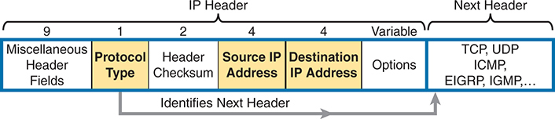

<figcaption>

<aside class="hidden" id="a07fig02">

从左到右各节包括占用了9个位的杂项首部字段,占用了1个位的协议类型,占用了2个位的首部校验和,占用了4个位的Source I P地址,占据了4个相位的Goek I P地址以及占用了可变长度的选项. 这些章节的颜色编码为协议类型、源 I P 地址和以黄色突出显示的目标 I P 住址。 协议类型部分规定了所使用的协议,如TCP,UDP,ICMP,EIGRP,和IGMP等. 整个标题被分为三个主要部分:I P 标题,包括协议类型、首部检查和地址、源 I P 地址以及目标 I P 网址;和 下个标题,包括选项和识别下个首部协议。 详细的标签和清晰的颜色区分有助于理解IP标题每个部分的构成和功能,特别是在配置扩展IPAC Ls的情况下.

</aside>

<strong>图7-2</strong> <em>IP 首部, 在扩展 IP ACLs 中聚焦必要的字段</em>

</figcaption>

</figure>

为了与协议类型相匹配,您只需使用一个关键词,例如<strong>tcp</strong>, <strong>udp</strong>,或<strong>icmp</strong>,匹配同样碰巧在IP头之后分别有TCP,UDP或ICMP头的IP包. 或者你可以用关键词<strong>ip</strong>,这意味着“所有IPv4包”。

您还必须配置源和目的 IP 地址字段的参数; 这些字段使用相同的语法和选项来匹配在其中讨论的 IP 网址<a href="v2-06.html#ch06">第6章</a>, “<a href="v2-06.html#ch06">IPv4 访问控制列表基础</a>.” <a href="#ch07fig03">图7-3</a>显示语法。

扩展ACLs支持两个语法选项来匹配一个单一地址,而标准ACLs则支持三个. (本节“<a href="v2-06.html#ch06lev3sec1">匹配精确的 IP 地址</a>”在前一章中讨论了这三种选择。 )<a href="#ch07tab02">表7-2</a>总结所支持的选项。 值得注意的是,无论您在配置时选择使用的语法,IOS都会将命令以首选语法存储,如表格所注.

<figure class="image-c" id="ch07fig03">

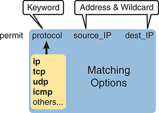

<figcaption>

<aside class="hidden" id="a07fig03">

该图被分出各节来突出组合中涉及的各种组件. 在左上方,有一个标签关键词指名词许可. 右向移动,还有两个标签地址和Wildcard指向两个不同的字段,标有标记源的下划线为I P并被下划线的上划线为 I P. 在这些标签下方,该图被分为两个主要的有色区域. 左部分以黄色突出出,在标题协议下包含一个列表. 清单包括I P,TCP(传输控制协议),UDP(用户数据报协议),ICMP(互联网控制消息协议)等表示附加协议的. 右段为彩色蓝色,标题是“匹配选项”。

</aside>

<strong>图7-3</strong> <em>扩展 ACL 语法,并附带必要的字段</em>

</figcaption>

</figure>

<figure class="table" id="ch07tab02" tabindex="0">

<figcaption>

<strong>表7-2</strong>匹配一个 IP 地址的语法支持摘要

</figcaption>

<table class="all">

<tbody>

<tr>

<th class="th">
语法选项
</th>

<th class="th">
地址:0.0.0.0
</th>

<th class="th">
host address
</th>

<th class="th">
地址
</th>

</tr>

<tr>

<td class="border">
<strong>标准 ACL</strong>
</td>

<td class="border">
是
</td>

<td class="border">
是
</td>

<td class="border">
是<a id="tfn7_2_1" href="#tfn7_2_1a">*</a>
</td>

</tr>

<tr>

<td class="border">
<strong>扩展 ACL</strong>
</td>

<td class="border">
是
</td>

<td class="border">
对*
</td>

<td class="border">
否
</td>

</tr>

</tbody>

</table>

</figure>

<a id="tfn7_2_1a" href="#tfn7_2_1">*</a>IOS无论配置风格如何,都用这个语法存储命令.

<a href="#ch07tab03">表7-3</a>列出若干样本<strong>access-list</strong>命令,只使用所需的匹配参数。 作为练习,将右列隐藏并预测命令在左列中的逻辑. 然后在右栏检查答案. 或只是审查右栏上的解释,以获得一些样本指令中逻辑的概念. 注意该表显示命名ACLs的ACL模式子命令,但在编号ACLs使用的全局指令中也存在相同的语法.

<figure class="table" id="ch07tab03" tabindex="0">

<figcaption>

<strong>表7-3</strong>扩展<strong>access-list</strong>命令和逻辑解释

</figcaption>

<table class="all">

<tbody>

<tr>

<th class="th">
access-list Statement
</th>

<th class="th">
匹配的内容
</th>

</tr>

<tr>

<td class="border">
<strong>deny tcp any any</strong>
</td>

<td class="border">
任何带有 TCP 首部的 IP 包
</td>

</tr>

<tr>

<td class="border">
<strong>deny udp any any</strong>
</td>

<td class="border">
任何带有 UDP 首部的 IP 包
</td>

</tr>

<tr>

<td class="border">
<strong>deny icmp any any</strong>
</td>

<td class="border">
任何有 ICMP 首部的 IP 包
</td>

</tr>

<tr>

<td class="border">
<strong>deny ip host 1.1.1.1 host 2.2.2.2</strong>
</td>

<td class="border">
所有来自主机1.1.1.1将主机2.2.2.2的IP包,用于所有IP包
</td>

</tr>

<tr>

<td class="border">
<strong>deny udp 1.1.1.0 0.0.0.255 any</strong>
</td>

<td class="border">
所有同时带有 UDP 首部的 IP 包, 从 {1.1.1.0/24} 子网, 并前往任何目的地
</td>

</tr>

</tbody>

</table>

</figure>

最后一个条目<a href="#ch07tab03">表7-3</a>帮助对IOS进程如何扩展ACL提出重要观点:

在扩展的ACL中<strong>access-list</strong>命令,所有匹配参数必须匹配数据包与命令相匹配。

例如,在最后一个例子中,<a href="#ch07tab03">表7-3</a>,UDP的指令检查,来自子网1.1.1.0/24的源IP地址,以及任何目的地IP地址. 如果一个路由器处理了一个有源IP地址1.1.1.1的包,它将匹配源IP地址检查. 然而,如果包中也有一个跟随IP头的TCP头,路由器将无法将包与该ACE相匹配. ACE中的所有参数必须匹配数据包.

</section>

<section>

<h4 class="h4" id="ch07lev2sec4">匹配 TCP 和 UDP 端口号</h4>

扩展的ACL还可以检查部分TCP和UDP头,特别是源端和目的端口号字段. 端口号表示发送或接收数据的应用程序.

最有用的检查端口是服务器使用的知名端口. 例如,Web服务器默认使用出名的端口80.<a href="#ch07fig04">图7-4</a>显示 TCP 头中端口号的位置,紧接 IP 头。

<figure class="image-c" id="ch07fig04">

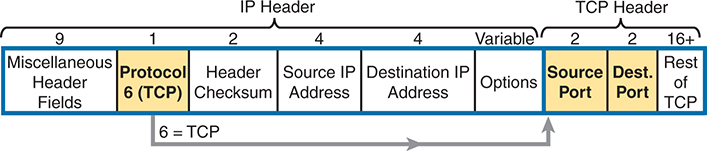

<figcaption>

<aside class="hidden" id="a07fig04">

该图有效地说明了IP和TCP头之间的相继结构以及关系,使人们清楚地了解数据是如何被封装和通过一个网络传输的。 从左边开始,I P头分为几个字段: 占用了9位的杂项头字段,再用黄色突出出协议6 (TCP)字段,宽度为1位并表明协议6对应了TCP. 接下来是标题检查和字段,它宽2个位,用于错误检查首部,然后是源 I P地址和目标 I P 地址字段,每个相宽4个位,分别指定发件人和接收者的 I P地址. 还有一个可变长度的选项字段可以包含各种可选设置. 移动到IP头后立即开始的TCP头,第一个字段是源端口和目的端口,两个字段都以黄色突出出,每个字段占据了2位,指定了TCP连接的源端口与目的端口. 在这些字段之后是TCP的其余字段,这个字段宽16个外加比特并包含额外的TCP段信息,包括序列号,承认号,旗帜和有效载荷数据.

</aside>

<strong>图7-4</strong> <em>IP 头, 后面是 TCP 头和端口编号字段</em>

</figcaption>

</figure>

当扩展的ACL 命令包括以下任一部分时:<strong>tcp</strong>或者说<strong>udp</strong>关键字,该命令可以选择引用源和/或目的端口. 为了进行这些比较,语法使用关键词来表示等同,不等同,小于,大于,并用于一定范围的端口号. 此外,该命令还可以使用字面上十进制端口号,或者对一些知名的应用端口使用更方便的关键字.<a href="#ch07fig05">图7-5</a>显示源端和目的端口字段在<strong>access-list</strong>命令和这些端口号的关键字。

<figure class="image-c" id="ch07fig05">

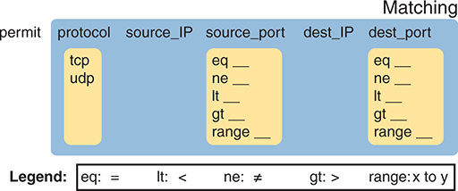

<figcaption>

<aside class="hidden" id="a07fig05">

该图被分为几节,每一节代表了匹配流量的不同标准. 从左边开始,被标注的第一节协议列出TCP和UDP,表示可以过滤的流量类型. 下一节,标签为源的下划线下划线I P和源的上划线端口,分别指定源的 I P 地址和端口号. 出处下划线端口部分包括各种条件,例如等同,不等同,小于,大于,以及有空白空间供用户输入的范围等. 同样地,Dest 下划线 I P 和 dest 上划线端口路段也随之而来,允许用户指定目的地 I P 地址和端口号,其条件选项与出处下划线端门相同. 在图的下方,一个传说解释出缩略语:等同表示等同,小于表示等同;等同表示不等同,大于表示等相;等相表示指定一行端口数的范围. 总体布局旨在以视觉方式引导用户通过根据各种参数确定允许网络流量的标准的过程,提高扩展ACL配置的清晰度和可用性.

</aside>

<strong>图7-5</strong> <em>带有 TCP 和 UDP 端口号的扩展 ACL 语法已启用</em>

</figcaption>

</figure>

例如,请考虑在以下列表中显示的简单网络<a href="#ch07fig06">图7-6</a>。FTP服务器坐落在右边,客户端位于左边. 该图显示了一个ACL的语法,该语法与以下内容相匹配: 1.

<ul class="sq">

<li>
包含 TCP 首部的包
</li>

<li>
从客户端子网发送的包
</li>

<li>
发送到服务器子网的软件包
</li>

<li>
带有 TCP 目标端口 21 (FTP 服务器控制端口) 的包
</li>

</ul>

<figure class="image-c" id="ch07fig06">

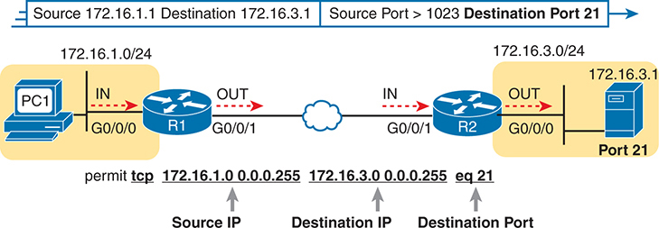

<figcaption>

<aside class="hidden" id="a07fig06">

图表显示网络流量从源头流向目的地,从一个标有 P C 的 P C 开始 1 左侧,连接到一个路由器,标签为R 1 通过接口 G 0 斜线 0 斜线 0 。交通通过路由器 R 移动 1 并通过接口 G 退出 0 斜线 0 斜线 1 ,然后向另一个路由器移动,该路由器标记为 R 2 通过接口 G 0 斜线 0 斜线 0 ,它通过接口 G 进入和退出 0 斜线 0 斜线 1 面向右侧的服务器,用标签端口的服务器图标表示 21 。 IP地址和子网信息显示源网络为 172.16.1.0/24 和目的地网络作为 172.16.3.0/24 。在网络图上方有一个文字字符串,指定过滤标准:源 172.16.1.1 目标 172.16.3.1 ,源端口大于 1023 目标端口 21 。图下方有ACL声明许可 TCP 172.16.1.0 0.0.0.255 172.16.3.0 0.0.0.255 等号 21 ,表示 TCP 流量的许可规则。本规则的组件被进一步细分为指向Source I P, Goote I P, 和 Goote Port 的箭头,提供了基于Source I P 地址, Goote I P 地址和特定目的端口的过滤标准的明确理解. 21 。

</aside>

<strong>图7-6</strong> <em>基于目标端口过滤包</em>

</figcaption>

</figure>

充分理解目的地港与<strong>eq 21</strong>参数,考虑包从左到右移动,从PC1移动到服务器。 假设服务器使用出名的端口21(FTP控制端口),包的TCP头的目的端口值为21. ACL 语法包括:<strong>eq 21</strong>参数位于目标 IP 地址之后。 目的地址参数之后的位置很重要:该位置可识别以下事实:<strong>eq 21</strong>参数应当与数据包的目的端口进行比较。 因此,ACL的语句如下:<a href="#ch07fig06">图7-6</a>如果在图中的四行所暗示的四个位置中使用,则将匹配此包和目的端口为21。

相反,<a href="#ch07fig07">图7-7</a>显示逆向流,由服务器将一个包发回PC1. 在这种情况下,包的TCP头有 21的源端口,因此ACL必须检查 21的源端口值,ACL必须位于不同的接口上. 在这种情况下,<strong>eq 21</strong>参数跟随源地址字段,但出现在目的地址字段之前。

<figure class="image-c" id="ch07fig07">

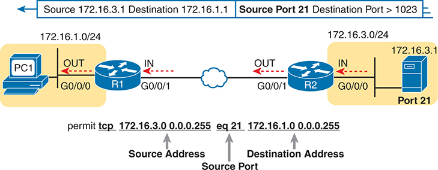

<figcaption>

<aside class="hidden" id="a07fig07">

该图有两个主要路由器,R 1 和 R 数据 2 ,通过代表网络的云连接。左边有一个个人电脑,标有P C 1 在IP范围内 172.16.1.0/24 ,连接到路由器 R 1 '接口 G' 0 斜线 0 斜线 0 路由器 R 1 通过接口 G 连接到云中 0 斜线 0 斜线 1 右侧,路由器R 2 通过 G 连接到网络 0 斜线 0 斜线 1 接口和目的地标记的端口 21 在IP范围内 172.16.3.0/24 通过接口 G 0 斜线 0 斜线 0 。图中显示带箭头的包流方向:包从G出 0 斜线 0 斜线 0 编号 1 和通过G 0 斜线 0 斜线 1 类似地,包从G出 0 斜线 0 斜线 1 编号 2 和通过G 0 斜线 0 斜线 0 。图像顶部部分显示包过滤标准,并带有源 I P 172.16.3.1 ,目标 I P 172.16.1.1 源端口 21 ,和目的端口大于 1023 。在底部的 ACL 规则指定许可 TCP 172.16.3.0 0.0.0.255 等号 21 172.16.1.0 0.0.0.255 ,表示来自源地址的流量 172.16.3.0/24 使用源端口 21 允许前往目的地址 172.16.1.0/24 。

</aside>

<strong>图7-7</strong> <em>基于源端口的过滤包</em>

</figcaption>

</figure>

在检查匹配端口号的ACL时,首先考虑应用ACL的位置和方向. 该方向决定了数据包是发送到服务器还是从服务器发送. 然后可以决定是否需要检查数据包中的源端口或目的端口 。 参考:<a href="#ch07tab04">表7至表4 按区域开列的所需资源</a>和<a href="#ch07tab05">7-5</a>列出许多受欢迎的端口号及其传输层协议和应用。

注意

您可能也想要记住端口号的ACL 命令关键字 。 无论您在配置时使用关键词还是端口号,IOS存储关键词而不是IOS拥有该端口定义关键词时的数字.

<figure class="table" id="ch07tab04" tabindex="0">

<figcaption>

<strong>表7-4</strong>IT 服务于他们熟悉的端口号

</figcaption>

<table class="all">

<tbody>

<tr>

<th class="th">
端口号
</th>

<th class="th">
协议
</th>

<th class="th">
应用
</th>

<th class="th">
Access- list and permission QQ 拒绝命令关键词
</th>

</tr>

<tr>

<td class="border">
20
</td>

<td class="border">
TCP
</td>

<td class="border">
FTP 数据
</td>

<td class="border">
<strong>ftp-data</strong>
</td>

</tr>

<tr>

<td class="border">
21
</td>

<td class="border">
TCP
</td>

<td class="border">
FTP 控制
</td>

<td class="border">
<strong>ftp</strong>
</td>

</tr>

<tr>

<td class="border">
22
</td>

<td class="border">
TCP
</td>

<td class="border">
SSH
</td>

<td class="border">
<strong>—</strong>
</td>

</tr>

<tr>

<td class="border">
23
</td>

<td class="border">
TCP
</td>

<td class="border">
Telnet
</td>

<td class="border">
<strong>telnet</strong>
</td>

</tr>

<tr>

<td class="border">
49
</td>

<td class="border">
UDP, TCP
</td>

<td class="border">
TACACS+
</td>

<td class="border">
<strong>—</strong>
</td>

</tr>

<tr>

<td class="border">
53
</td>

<td class="border">
UDP, TCP
</td>

<td class="border">
DNS
</td>

<td class="border">
<strong>domain</strong>
</td>

</tr>

<tr>

<td class="border">
67
</td>

<td class="border">
UDP
</td>

<td class="border">
DHCP 服务器
</td>

<td class="border">
<strong>bootps</strong>
</td>

</tr>

<tr>

<td class="border">
68
</td>

<td class="border">
UDP
</td>

<td class="border">
DHCP 客户端
</td>

<td class="border">
<strong>bootpc</strong>
</td>

</tr>

<tr>

<td class="border">
69
</td>

<td class="border">
UDP
</td>

<td class="border">
TFTP
</td>

<td class="border">
<strong>tftp</strong>
</td>

</tr>

<tr>

<td class="border">
161
</td>

<td class="border">
UDP
</td>

<td class="border">
SNMP
</td>

<td class="border">
<strong>snmp</strong>
</td>

</tr>

<tr>

<td class="border">
514
</td>

<td class="border">
UDP
</td>

<td class="border">
Syslog
</td>

<td class="border">
<strong>—</strong>
</td>

</tr>

<tr>

<td class="border">
1645, 1646
</td>

<td class="border">
UDP
</td>

<td class="border">
RADIUS（原始端口）
</td>

<td class="border">
<strong>—</strong>
</td>

</tr>

<tr>

<td class="border">
1812, 1813
</td>

<td class="border">
UDP
</td>

<td class="border">
RADIUS（当前端口）
</td>

<td class="border">
<strong>—</strong>
</td>

</tr>

</tbody>

</table>

</figure>

<figure class="table" id="ch07tab05" tabindex="0">

<figcaption>

<strong>表7-5</strong>用户应用程序及其熟知的端口号

</figcaption>

<table class="all">

<tbody>

<tr>

<th class="th">
端口号
</th>

<th class="th">
协议
</th>

<th class="th">
应用
</th>

<th class="th">
Access- list and permission QQ 拒绝命令关键词
</th>

</tr>

<tr>

<td class="border">
25
</td>

<td class="border">
TCP
</td>

<td class="border">
SMTP
</td>

<td class="border">
<strong>smtp</strong>
</td>

</tr>

<tr>

<td class="border">
80
</td>

<td class="border">
TCP
</td>

<td class="border">
HTTP (WWW)
</td>

<td class="border">
<strong>www</strong>
</td>

</tr>

<tr>

<td class="border">
443
</td>

<td class="border">
TCP
</td>

<td class="border">
HTTPS（使用 TLS）
</td>

<td class="border">
<strong>—</strong>
</td>

</tr>

<tr>

<td class="border">
110
</td>

<td class="border">
TCP
</td>

<td class="border">
POP3（不使用 TLS）
</td>

<td class="border">
<strong>pop3</strong>
</td>

</tr>

<tr>

<td class="border">
995
</td>

<td class="border">
TCP
</td>

<td class="border">
POP3（使用 TLS）
</td>

<td class="border">
<strong>—</strong>
</td>

</tr>

<tr>

<td class="border">
143
</td>

<td class="border">
TCP
</td>

<td class="border">
IMAP（不使用 TLS）
</td>

<td class="border">
<strong>—</strong>
</td>

</tr>

<tr>

<td class="border">
993
</td>

<td class="border">
TCP
</td>

<td class="border">
IMAP（使用 TLS）
</td>

<td class="border">
<strong>—</strong>
</td>

</tr>

<tr>

<td class="border">
16,384–32,767
</td>

<td class="border">
UDP
</td>

<td class="border">
RTP(语音、视频)
</td>

<td class="border">
<strong>—</strong>
</td>

</tr>

</tbody>

</table>

</figure>

监督办在配置出出名的端口号时,有一些出人意料的常规. 首先,您总是可以配置端口号. 然而,IOS支持一小组出名的端口关键词,如:<a href="#ch07tab04">表7-4</a>。在输入的命令中,可以键入数字或关键字;例如,可以使用<strong>80</strong>或者说<strong>www</strong>,以指著名港口 .80.

然而,请注意,如果存在文字关键字,则IOS使用该关键字存储ACL命令. 例如,一个键入的命令<strong>permit tcp any any eq 80</strong>变成<strong>permit tcp any any eq www</strong>在运行配置中。

<a href="#ch07tab06">表7-6</a>列出若干样本<strong>access-list</strong>基于端口数的匹配命令。 再次,通过覆盖右栏并分析左栏的内容,将表格用作练习. 然后检查桌子的右侧 看看是否同意 一样<a href="#ch07tab04">表7至表4 按区域开列的所需资源</a>和<a href="#ch07tab05">7-5</a>,该表使用命名为ACL的ACL模式子命令,但在扩展的ACL全局指令中也存在相同的语法.

<figure class="table" id="ch07tab06" tabindex="0">

<figcaption>

<strong>表7-6</strong>扩展<strong>access-list</strong>命令示例和逻辑解释

</figcaption>

<table class="all">

<tbody>

<tr>

<th class="th">
access-list Statement
</th>

<th class="th">
匹配的内容
</th>

</tr>

<tr>

<td class="border">
<strong>deny tcp any gt 49151 host 10.1.1.1 eq 23</strong>
</td>

<td class="border">
带有 TCP 头的包, 任何源 IP 地址, 源端口大于 ()<strong>gt</strong>)49151,一个完全为10.1.1.1的目的地IP地址,一个目的端口等同(.<strong>eq</strong>) 23.
</td>

</tr>

<tr>

<td class="border">
<strong>deny tcp any host 10.1.1.1 eq 23</strong>
</td>

<td class="border">
与前例相同,但任何源端口都匹配,因为命令省略了源端口参数.
</td>

</tr>

<tr>

<td class="border">
<strong>deny tcp any host 10.1.1.1 eq telnet</strong>
</td>

<td class="border">
与上例同为相. 密码<strong>telnet</strong>关键词被使用而不是端口23.
</td>

</tr>

<tr>

<td class="border">
<strong>deny udp 1.0.0.0 0.255.255.255 lt 1023 any</strong>
</td>

<td class="border">
使用源端口小于 (1.0.0.0/8) 的 UDP 网络中的源包<strong>lt</strong>)1023,带有任何目的地IP地址.
</td>

</tr>

</tbody>

</table>

</figure>

</section>

<section>

<h4 class="h4" id="ch07lev2sec5">扩展 IP ACL 配置</h4>

扩展的ACLs支持太多的选项,无法允许命令语法的单一通用表示. 然而,命令在<a href="#ch07tab07">表7-7</a>总结本书所覆盖的语法选项. 前两行显示编号为ACL的命令,最后两行显示ACL模式中的同一种语法<strong>permit</strong>和<strong>deny</strong>命令。

<figure class="table" id="ch07tab07" tabindex="0">

<figcaption>

<strong>表7-7</strong>扩展 IP 访问控制列表配置命令

</figcaption>

<table class="all">

<thead>

<tr>

<th class="th">
命令
</th>

<th class="th">
配置模式和描述
</th>

</tr>

</thead>

<tbody>

<tr>

<td class="border-g">
<strong>access-list</strong> <em>access-list-number</em> {<strong>deny</strong> | <strong>permit</strong>} <em>protocol source source-wildcard destination destination-wildcard</em> [<strong>log</strong>]
</td>

<td class="border-g">
扩展编号访问控制列表的全局命令 。 使用100至199或2000至2699之间的数字,包括数字在内。
</td>

</tr>

<tr>

<td class="border-g">
<strong>access-list</strong> <em>access-list-number</em> {<strong>deny</strong> | <strong>permit</strong>} {<strong>tcp</strong> | <strong>udp</strong>} <em>source source-wildcard</em> [<em>operator</em> [<em>port</em>]] <em>destination destination-wildcard</em> [<em>operator</em> [<em>port</em>]] [<strong>log</strong>]
</td>

<td class="border-g">
一个版本<strong>access-list</strong>命令,包含TCP和UDP特有的参数。
</td>

</tr>

<tr>

<td class="border">
<strong>ip access-group</strong> <em>number|name</em> <strong>in|out</strong>
</td>

<td class="border">
接口子命令,以便在一个方向的接口上启用 IP ACL。 用于编号并被命名为ACL.
</td>

</tr>

<tr>

<td class="border">
<strong>ip access-list extended</strong> <em>name</em>
</td>

<td class="border">
一个全局命令来创建扩展的ACL并移动用户到ACL配置模式.
</td>

</tr>

<tr>

<td class="border">
{<strong>deny</strong> | <strong>permit</strong>} <em>协议源代码- Wildcard 目的地- Wil德card</em> [<strong>log</strong>]
</td>

<td class="border">
具有语法的ACL子命令来匹配所需的参数:协议,外加源和目的IP地址.
</td>

</tr>

<tr>

<td class="border">
{<strong>deny</strong> | <strong>permit</strong>} {<strong>tcp</strong> | <strong>udp</strong>} <em>source source-wildcard</em> [<em>operator</em> [<em>port</em>]] <em>destination destination-wildcard</em> [<em>operator</em> [<em>port</em>]] [<strong>log</strong>]
</td>

<td class="border">
ACL子命令有参数来匹配TCP和UDP特有的参数.
</td>

</tr>

</tbody>

</table>

</figure>

扩展ACL的配置过程大多与标准ACL所用的过程相匹配. 您必须选择位置和方向来启用ACL,以便您能够描述特定地址和端口是源还是去向 。 使用 ACL 配置<strong>access-list</strong>命令,完成后,启用 ACL 使用相同的<strong>ip access-group</strong>命令,用于标准ACL。 所有这些步骤都反映了你对标准ACL的处理方式;然而,在配置时,要牢记以下差异:

<ul class="sq">

<li>
将扩展的ACL尽可能靠近ACL需要过滤的包的来源. 过滤到包的来源会节省一些带宽 。
</li>

<li>
记住,一个ACE中的所有字段都必须匹配一个数据包供路由器考虑该数据包以匹配该ACE.
</li>

<li>
编号为ACL的,使用编号为100–199和2000–2699。<strong>access-list</strong>命令;没有任何一个数字在本质上比另一个更好。
</li>

</ul>

<section>

<h5 class="h5" id="ch07lev3sec3">扩展 IP ACL 示例 1：发往 Web 服务器的数据包</h5>

关闭该章第1个主要章节的两个例子侧重于将数据包与网络服务器相匹配(第1个例子)和从网络服务器相对应(第2个例子). ) 两者都使用相同的地貌和网络服务器,在每种情况下都有不同的方向.<a href="#ch07fig08">图7-8</a>显示所需的地形、 IP 子网和特定的 IP 地址。

<figure class="image-c" id="ch07fig08">

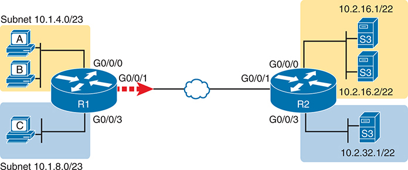

<figcaption>

<aside class="hidden" id="a07fig08">

该图包括多个网络设备以及标签为特定网络接口标识符的连接,I P地址,以及子网信息. 左侧有三台计算机被标记为A,B,C在两个不同的子网内:Subnet. 10.1.4.0/23 和子网 10.1.8.0/23 位于Subnet的计算机A和B 10.1.4.0/23 ,有我的P地址吗? 10.1.4 点x, 而位于 Subnet 的 C 计算机 10.1.8.0/23 ,有一个IP地址: 10.1.8 点x. 这些计算机连接到标签为R的路由器 1 ,它有三个接口: G 0 斜线 0 斜线 0 0 斜线 0 斜线 1 ,和 G 键 0 斜线 0 斜线 3 G接口 0 斜线 0 斜线 0 连接到 Subnet 10.1.4.0/23 接口 G 0 斜线 0 斜线 3 连接到 Subnet 10.1.8.0/23 G组 0 斜线 0 斜线 1 路由器 R 的接口 1 连接到另一个路由器,标签为R 2 ,通过代表广域网链接的网络云. Router R 2 有三个接口: G 0 斜线 0 斜线 0 0 斜线 0 斜线 1 ,和 G 键 0 斜线 0 斜线 3 G接口 0 斜线 0 斜线 0 连接到 Subnet 10.2.16.1/22 ,包括标有 S 的服务器 1 2 和 S 键 3 与我P地址 10.2.16 点x. G 0 斜线 0 斜线 1 R 接口 2 从R连接回广域网链接 1 接口 G 0 斜线 0 斜线 3 连接到 Subnet 10.2.32.1/22 ,包括标有 S 的服务器 4 5 与我P地址 10.2.32 dot x. 该图使用标准网络符号来代表路由器,计算机,服务器,子网,和连接,并包括指示网络流量通过路由器接口流动的方向箭头.

</aside>

<strong>图7-8</strong> <em>扩展访问控制列表的网络图:例1</em>

</figcaption>

</figure>

将这两个例子视为一项练习,以了解扩展ACL的力学. 为此,考虑如何为路由器R1创建ACL,用户坐落于分行. 密码ACL将应用在路由器R1的WAN链接上,即面向服务器. 匹配要求为

<ol class="number">

<li>
允许交通<em>派来的</em>左边的上层用户子网(10.1.4.0/23)和<em>准备</em>绘图右上方的子网(在内部数据中心)中的网络服务器。
</li>

<li>
允许交通<em>派来的</em>左边的上层用户子网(10.1.4.0/23)和<em>准备</em>数字右下角的单个网络服务器 10.2.32.1。
</li>

<li>
在这两种情况下,都允许HTTP和HTTPS协议.
</li>

<li>
拒绝其他交通。
</li>

</ol>

<a href="#exa7_8">示例7-8</a>显示一个名为 ACL 的扩展名, 仅此而已 。 它有两双<strong>permit</strong>发言。 在每对中,第一个匹配HTTP的端口号(80),而第二个匹配HTTPS的端口号(443). 第一对包与上右子网相匹配10.2.16.0/22,而第二对包与主机10.2.32.1相匹配.

<strong>示例7-8</strong> <em>R1的扩展访问控制列表:例 1</em>

<a href="#code-f0152-01" id="f0152-01a">点击此处查看代码原图</a>

<pre class="pre-ex" tabindex="0"><code>R1# <strong>configure terminal</strong>

Enter configuration commands, one per line.  End with CNTL/Z.

R1(config)# <strong>ip access-list extended branch_WAN</strong>

R1(config-ext-nacl)# <strong>remark Example ACL to match HTTP/S</strong>

R1(config-ext-nacl)# <strong>permit</strong> <strong>tcp</strong> <strong>10.1.4.0 0.0.1.255 10.2.16.0 0.0.3.255</strong> <strong>eq 80</strong>

R1(config-ext-nacl)# <strong>permit</strong> <strong>tcp</strong> <strong>10.1.4.0 0.0.1.255 10.2.16.0 0.0.3.255</strong> <strong>eq 443</strong>

R1(config-ext-nacl)# <strong>permit</strong> <strong>tcp</strong> <strong>10.1.4.0 0.0.1.255 host 10.2.32.1</strong> <strong>eq 80</strong>

R1(config-ext-nacl)# <strong>permit</strong> <strong>tcp</strong> <strong>10.1.4.0 0.0.1.255 host 10.2.32.1</strong> <strong>eq 443</strong>

R1(config-ext-nacl)# <strong>interface gigabitethernet0/0/1</strong>

R1(config-if)# <strong>ip access-group branch_WAN out</strong>

R1(config-if)# <strong>^Z</strong>

R1#</code></pre>

为了强调本章前面的一些要点,请注意,所有四个允许发言都使用<strong>tcp</strong>作为协议类型。 HTTP 和 HTTPS 都使用 TCP, 为了匹配ACL 中的端口编号, 您必须指定<strong>tcp</strong>或者说<strong>udp</strong>在命令中。 另外,在每个命令中,需要时间来确定定义源地址和目的地址匹配的参数. 然后注意, 端点的端口号匹配<strong>permit</strong>命令都跟随目的地址匹配参数,这意味着这些语句都试图与目的端口号相匹配。

为了完成审查,请注意,该配置使ACL能够在R1的G0/0/1接口上出行. 此外,ACL以隐含的方式结束<strong>deny any</strong>实际上,这意味着最后命令:<strong>deny ip any any</strong>。鉴于ACL的正线,ACL只允许HTTP/HTTPS的流量,其来源地和目的地址范围有限,并否认了所有其他流量. (这个ACL在一个生产网络中会限制性太大,但它提供了足够的细节来学习语法和逻辑. )

<a href="#exa7_9">示例7-9</a> 证实ACL已经启用,统计数据显示ACL中前两行的一些用法.

<strong>示例7-9</strong> <em>正在验证扩展ACL</em>

<a href="#code-f0153-01" id="f0153-01a">点击此处查看代码原图</a>

<pre class="pre-ex" tabindex="0"><code>R1# <strong>show ip interface gigabitethernet0/0/1</strong>

GigabitEthernet0/0/1 is up, line protocol is up

  Internet address is 10.1.12.1/24

  Broadcast address is 255.255.255.255

  Address determined by non-volatile memory

  MTU is 1500 bytes

  Helper address is not set

  Directed broadcast forwarding is disabled

  Multicast reserved groups joined: 224.0.0.5 224.0.0.10 224.0.0.6

  Outgoing access list is branch_WAN

  Inbound access list is not set

! Lines omitted for brevity

R1# <strong>show access-list</strong>

Extended IP access list branch_WAN

    10 permit tcp 10.1.4.0 0.0.1.255 10.2.16.0 0.0.3.255 eq www (18 matches)

    20 permit tcp 10.1.4.0 0.0.1.255 10.2.16.0 0.0.3.255 eq 443 (416 matches)

    30 permit tcp 10.1.4.0 0.0.1.255 host 10.2.32.1 eq www

    40 permit tcp 10.1.4.0 0.0.1.255 host 10.2.32.1 eq 443</code></pre>

这个例子还显示了监督办将一些数字端口号改为文本关键字的令人惊讶的习惯,正如前面文本中前面所讨论的那样。<a href="#ch07tab04">表 7-4</a>和<a href="#ch07tab05">7-5</a>。这些表格列出了一些比较常见的TCP和UDP端口号以及ACL关键词IOS支持. IOS使用关键词<strong>www</strong>对于端口 80,它将所配置的数字 80替换为<strong>www</strong>关键词。 然而,IOS左起左起左起左起左出-443同去,因为它没有该端口号的ACL关键词.

</section>

<section>

<h5 class="h5" id="ch07lev3sec4">扩展 IP ACL 示例 2：来自 Web 服务器的数据包</h5>

在了解扩展的ACL时最常见的错误之一涉及匹配TCP和UDP端口. 语法和基本概念可能令人困惑. 上一节“<a href="#ch07lev2sec4">匹配 TCP 和 UDP 端口号</a>”解释了细节,接下来的例子让你有机会思考这个问题。

作为一种练习,计划像上个例子那样在路由器R2上创建一个ACL来代替路由器R1. 您将实现同样的目标, 但将ACL 置于路由器 R2 上, 退出到它的WAN链接上, 如以下所示 :<a href="#ch07fig09">图7-9</a>。最重要的是,注意到这一变化意味着ACL与前一个例子相对应。

先为自己想想这个例子,甚至尝试在文本编辑器中创建ACL后再进一步阅读.

<figure class="image-c" id="ch07fig09">

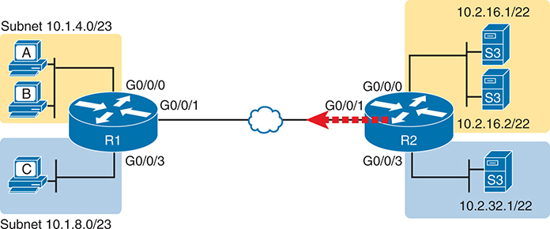

<figcaption>

<aside class="hidden" id="a07fig09">

该图有两种路由器,标记为R-1和R-2,由一个网络云连接,象征一个未指明的广域网(WAN). 路由器R-1位于左侧,通过它的接口分别与被标为A,B的3个设备相接:G-0斜口-0斜口-0相接;G-0斜口-0斜口-1相接;和G-0斜口-0斜口-3相接. 这些设备是子网10.1.4.0/23的一部分. 路由器 R1有另一个连接,即: G0斜拉桥-0斜拉桥-3,与子网10.1.8.0/23相接. 路由器R2,定位于图的右侧,有多个连接. 接口 G0 slash0 slash0 连接子网10.2.16.1/22 设备标注为S3 接口 G0 slash0 slash3 连接子网10.2.32.1/22 附加设备标注为S-3 . 路由器R-1和R-2之间的接通被用一倒挂出红线来突出显示一个显著的接通,具体通过两个路由器上的G-0 slash0 slash1. 与路由器R-2相接的子网有色码:-10.2.16.1/22以黄色为单位;-10.2.32.1/22以蓝色为单位.

</aside>

<strong>图7-9</strong> <em>扩展访问控制列表的网络图:例2</em>

</figcaption>

</figure>

以下清单详细列出了前文所列ACL要求的修订版本。<a href="#exa7_8">示例7-8</a>,用于前一个示例。 列表反转了逻辑, 因此它匹配向相反方向流动的包: 在图中右到左 。

<ol class="number">

<li>
推翻原要求1,允许通行.<em>准备</em>左边的上层用户子网(10.1.4.0/23)和<em>派来的</em>绘制右上方的子网(在内部数据中心)中的网络服务器。
</li>

<li>
推翻原要求2,允许通行.<em>准备</em>左边的上层用户子网(10.1.4.0/23)和<em>派来的</em>数字右下角的单个网络服务器 10.2.32.1。
</li>

<li>
和以前一样,允许HTTP和HTTPS协议同时使用.
</li>

<li>
和以前一样 拒绝其他交通
</li>

</ol>

<a href="#exa7_10">示例7-10</a>在路由器 R2 上显示生成的ACL 。 注意在源地址参数之后的端口号上突出显示的匹配字段。

<strong>示例7-10</strong> <em>将路由器 R2 上的ACL 扩展为匹配 Web 服务器发送的包</em>

<a href="#code-f0154-01" id="f0154-01a">点击此处查看代码原图</a>

<pre class="pre-ex" tabindex="0"><code>R2# <strong>show running-config | section access-list</strong>

ip access-list extended DC_WAN

 10 permit tcp 10.2.16.0 0.0.3.255 eq www 10.1.4.0 0.0.1.255

 20 permit tcp 10.2.16.0 0.0.3.255 eq 443 10.1.4.0 0.0.1.255

 30 permit tcp host 10.2.32.1 eq www 10.1.4.0 0.0.1.255

 40 permit tcp host 10.2.32.1 eq 443 10.1.4.0 0.0.1.255</code></pre>

</section>

</section>

<section>

<h4 class="h4" id="ch07lev2sec6">针对 HTTP/3 调整 ACL</h4>

单位<a href="v2-05.html#ch05">第5章</a>, “<a href="v2-05.html#ch05">TCP/IP 传输层与应用简介</a>,”这一节的标题是“......<a href="v2-05.html#ch05lev3sec8">HTTP 3.0</a>”详细介绍了相对新的HTTP,HTTP/3(或HTTP3.0),如何远离使用TCP. 取而代之,它使用QUIC作为传输协议,它本身使用UDP头作为IP头后下一个头. IANA保留了UDP端口443作为使用HTTP/3的网络服务器的知名端口. 因此,不仅可以匹配HTTP/3流量,还可以考虑根据需要更新现有的ACL,以匹配HTTP/3流量.

要显示一个具体的例子, 请重新考虑以前的情景, 如 ACL DC_ WAN 所示 。<a href="#exa7_10">示例7-10</a>,但添加这一要求:

<ol class="number" start="5">

<li>
确保ACL不仅匹配基于TCP的HTTP版本,而且匹配使用UDP和QUIC的HTP/3.
</li>

</ol>

作为提醒,之前的ACL与源名端口相匹配. 修订本载于<a href="#exa7_11">示例7-11</a>突出显示UDP消息与知名端口相匹配的新行443. 注意您不需要匹配 UDP 80 作为知名端口,因为 HTTP/ 3 总是使用 TLS (HTTPS) 并定义了知名的 UDP 端口 443.

<strong>示例7-11</strong> <em>订正ACL从<a href="#exa7_10">示例7-10</a>现在匹配 HTTP/3</em>

<a href="#code-f0155-01" id="f0155-01a">点击此处查看代码原图</a>

<pre class="pre-ex" tabindex="0"><code>R2# <strong>show running-config | section access-list</strong>

ip access-list extended DC_WAN

 10 permit tcp 10.2.16.0 0.0.3.255 eq www 10.1.4.0 0.0.1.255

 20 permit tcp 10.2.16.0 0.0.3.255 eq 443 10.1.4.0 0.0.1.255

 25 permit udp 10.2.16.0 0.0.3.255 eq 443 10.1.4.0 0.0.1.255

 30 permit tcp host 10.2.32.1 eq www 10.1.4.0 0.0.1.255

 40 permit tcp host 10.2.32.1 eq 443 10.1.4.0 0.0.1.255

 45 permit udp host 10.2.32.1 eq 443 10.1.4.0 0.0.1.255</code></pre>

</section>

<section>

<h4 class="h4" id="ch07lev2sec7">编写 access-list 命令的练习</h4>

<a href="#ch07tab08">表7-8</a>提供练习,帮助您适应扩展ACL命令的语法,特别是选择正确的匹配逻辑。 您的工作: 创建一行扩展ACL, 匹配数据包并使用许可动作 。 您可以使用全局语法<strong>access-list</strong>命令或ACL模式<strong>permit</strong>命令。答复见“......”一节。<a href="#ref-ch07lev1sec9">对先前的实践问题的答复</a>”在本章末尾。 请注意,如果标准提到某一特定的应用协议,例如“网络客户端”,这意味着具体与该应用协议相匹配。

<figure class="table" id="ch07tab08" tabindex="0">

<figcaption>

<strong>表7-8</strong>构建一线扩展控制列表:实践

</figcaption>

<table class="all">

<tbody>

<tr>

<th class="th">
问题
</th>

<th class="th">
条件
</th>

</tr>

<tr>

<td class="border">
1
</td>

<td class="border">
从网络客户端10.1.1.1,发送到子网10.1.2.0/24的网络服务器.
</td>

</tr>

<tr>

<td class="border">
2
</td>

<td class="border">
从 Telnet 客户端172.16.4.3/25,发送到子网172.16.3.0/25的 Telnet 服务器. 匹配客户端子网中的所有主机 。
</td>

</tr>

<tr>

<td class="border">
3
</td>

<td class="border">
ICMP 消息来自 {192.168.7.200/26} 居住在 {192.168.7.14/29} 的子网中的所有主机。
</td>

</tr>

<tr>

<td class="border">
4
</td>

<td class="border">
从网络服务器10.2.3.4/23的子网到与主机10.4.5.6/22相同的子网中的客户端.
</td>

</tr>

<tr>

<td class="border">
5
</td>

<td class="border">
从Telnet服务器172.20.1.0/24的子网,发送到与主机172.20.44.1/23相同子网的任何主机.
</td>

</tr>

<tr>

<td class="border">
6
</td>

<td class="border">
从网络客户端192.168.99.99/28,发送到子网192.168.176.0/28的网络服务器. 匹配客户端子网中的所有主机 。
</td>

</tr>

<tr>

<td class="border">
7
</td>

<td class="border">
ICMP 消息来自 {10.55.66.77/25} 居住在 {10.66.55.44/26} 的子网中的所有主机。
</td>

</tr>

<tr>

<td class="border">
8
</td>

<td class="border">
每一个IPv4包。
</td>

</tr>

</tbody>

</table>

</figure>

</section>

<section>

<h4 class="h4" id="ch07lev2sec8">ACL 实施注意事项</h4>

ACLs可以是一个加强网络安全的伟大工具,但工程师应该先考虑一些更广泛的问题,然后再简单地配置ACL来修复一个问题. 为了提供帮助,思科提出下列一般性建议:

<ul class="sq">

<li>
将扩展的ACL 设置在最接近数据包源处 。 这个策略允许ACLs提前丢弃数据包.
</li>

<li>
将标准ACL 设置在最接近数据包的目的地。 这种策略避免了标准ACL(只与源IPv4地址相匹配)对无意丢弃包的错误.
</li>

<li>
在ACL早期放置更具体的声明,在ACL后期则少作更具体的声明.
</li>

<li>
禁用接口中的 ACL( 使用<strong>no ip access-group</strong>接口子命令),在编辑 ACL 之前。
</li>

<li>
确保<strong>ip access-group</strong>接口是指您想要的ACL编号或名称; 注意正确拼写命名为ACLs,使用正确的大小写。
</li>

</ul>

第一点涉及如何定位ACL的概念. 如果您打算过滤一个数据包, 更靠近数据包源的过滤意味着数据包在网络中占用的带宽较少, 因此,Cisco建议尽可能在源头附近找到扩展的ACL.

然而,第二点似乎与第一点相矛盾,至少对于标准ACL来说,是将其定位在靠近目的地的地方. 为什么? 因为标准的ACL只看源IP地址,所以在放入源头附近时,它们往往比想过滤的要多. 例如,在<a href="#ch07fig08">图7-8</a>和<a href="#ch07fig09">7-9</a>,想象路由器R1的局域网接口(G0/0/0)上的输入式ACL会丢弃主机A(10.1.4.1)的包. 这或许正是你需要的 然而,如果希望主机能够向服务器S1发送数据包,而不是向S3发送数据包,那么标准ACL就不能在网络中的那个位置创建这个逻辑.

对于列表中的第三个项目,在每个列表的早期放置更具体的匹配参数,使得您在ACL中发生错误的可能性更小. 例如,想象ACL首先列出一个允许从子网10.1.4.0/23的流量的指令,第二个指令否认来自主机10.1.4.1的流量. 由主机 10.1.4.1所发送的包会匹配第一个ACE,并且永远不会匹配更具体的第二个命令. 请注意,后来的IOS版本在某些情况下在配置过程中防止了这种错误.

您在编辑接口之前, 可以在接口上禁用 ACLs , 从而避免与 ACL 发生临时状态的问题 。 首先,如果您删除了整个ACL,并且将IP ACL启用在接口上,IOS不会过滤出任何包. 然而,一旦你在这个启用的ACL中添加了一个ACE,IOS就根据ACL开始过滤包. 这些临时ACL配置可能会出问题.

最后,IOS不会抱怨,如果你配置<strong>ip access-group</strong>与未定义的ACL 编号或名称相接的子命令。 IOS认为ACL没有ACE(一个无效的ACL),而IOS不过滤一个接口上启用的无效ACL的包. 不过,请在定义ACL的命令和命令之间重复检查您对ACL名称的拼写<strong>ip access-group</strong>命令。拼写错误或使用不同的情况很容易。 (ACL名称为案件敏感. )

</section>

</section>

</section>

<section class="ccna-source ccna-appendix" aria-label="答案解析与术语表">
<section data-epub-type="chapter">

<h2 class="h2" id="ref-appc">附录C</h2>

<h2 class="h2a">对“我早就知道了吗?” 的回答。</h2>

<section>

<h3 class="h3" id="ref-appclev1sec7">第7章</h3>

<strong><a id="ref-ques7_1" href="#quess7_1">1</a>.</strong> C。命名标准 ACL 以全局命令 <strong>ip access-list standard</strong> <em>name</em> 开始。该命令进入 ACL 配置模式，在此模式中可以配置 <strong>permi</strong>t 和 <strong>deny</strong> 命令。这些命令使用的匹配选项与通过 <strong>access-list</strong> 全局命令配置的编号 ACL 相同。虽然通过接口子命令启用命名 ACL，但匹配逻辑是在 ACL 配置模式中配置的。

<strong><a id="ref-ques7_2" href="#quess7_2">2</a>.</strong> C。两个错误答案使用了错误的语法：以 <strong>permit</strong> 开头，后跟行号。以行号开头、后跟 <strong>permit</strong> 的两个答案使用了正确的语法。

题目说明该命名 ACL 刚刚创建，配置中没有使用行号。因此，IOS 分别为三个 ACE 分配行号 10、20 和 30。要在第二个和第三个 ACE 之间插入另一条 <strong>permit</strong> 或 <strong>deny</strong> 命令，新命令必须使用 21–29 之间的行号，包含端点值。在两个语法正确的答案中，只有正确答案使用了正确范围内的行号。

<strong><a id="ref-ques7_3" href="#quess7_3">3</a>.</strong> E 和 F。扩展 ACL 可以检查第三层（IP）和第四层（TCP、UDP）首部，以及其他少量信息，但不能检查任何应用层信息。命名扩展 ACL 可以检查与编号扩展 ACL 相同的字段。

<strong><a id="ref-ques7_4" href="#quess7_4">4</a>.</strong> A 和 E。扩展 IP 访问控制列表的正确 ACL 编号范围为 100–199 和 2000–2699。那些在 10.1.1.1 后列出 <strong>eq www</strong> 参数的答案匹配的是源端口号，而且数据包正发往 Web 服务器，而不是从服务器发出。

<strong><a id="ref-ques7_5" href="#quess7_5">5</a>.</strong> E。由于数据包发往任意 Web 客户端，需要将 Web 服务器的端口号作为源端口进行检查。题目没有指定客户端 IP 地址范围，但指定了服务器地址范围；源地址以 172.16.5 开头的选项是正确答案。

<strong><a id="ref-ques7_6" href="#quess7_6">6</a>.</strong> C。题目说明这些输出来自路由器上的命令，因此可以确信访问控制条目（ACE）的语法正确。对于地址与通配符掩码组合，也可以认为地址表示范围中的最小值，而最大值通过地址与通配符掩码相加得到。例如，将 10.22.33.0 与 0.0.0.63 逐个八位组相加，得到 10.22.33.63。因此，题干中的地址 10.22.33.99 不匹配第 10 行的源地址字段，但位于第 20、30 行的源地址范围（10.22.33.0–10.22.33.127），也位于第 40 行的范围（10.22.33.0–10.22.33.255）内。

分析目的地址字段可知，四行 ACL 都包含目的地址 10.33.22.22。这些范围包括 10.33.22.0–10.33.22.127、10.33.22.0–10.33.22.63 和 10.33.22.31。

到目前为止，上述分析只排除了第 10 行。

第 20 行匹配源端口，而不是目的端口，因此其逻辑无法匹配发往 SSH 服务器的数据包。SSH 使用端口 22，而不是 24，所以使用端口号 24 的第 20 行和第 40 行都无法匹配 SSH。这些事实排除了第 20 行和第 40 行。

第 30 行有效，因为它既匹配题目给出的源地址和目的地址，也匹配 SSH 的目的端口 22。

</section>

</section>

<section id="ref-glossary"><h2 class="h2a">词汇表</h2>
<strong>ACL 序列号</strong>每个ACL ACE在配置时指定一个编号,或者自动地,或者在配置命令中打入,这样可以更容易地删除单个ACE.

<strong>扩展访问控制列表</strong>监督办列表<strong>access-list</strong>能够匹配一个IP包多部分的全局配置命令,包括源和目的IP地址和TCP/UDP端口,目的是决定要丢弃哪些包和通过路由器允许哪些包.

<strong>已命名的访问控制列表</strong>ACL,根据名称而不是数字来识别ACL中的各种语句.

</section>
<section>

<h3 class="h3" id="ref-ch07lev1sec9">对先前的实践问题的答复</h3>

<a href="#ref-ch07tab13">表7-13</a>列出对以下所列做法问题的答案:<a href="#ch07tab08">表7-8</a>。请注意,对于引用客户端的任何问题,您可能选择匹配大于49151的端口数,匹配所有动态端口. 本表中的答案大多忽略了这个选项,但为了显示一个样本,第一个问题的答案列出了一个,其中参考的客户端端大于49151,一个没有. 其余的答案只是略去这部分逻辑.

<figure class="table" id="ref-ch07tab13" tabindex="0">

<figcaption>

<strong>表7-13</strong>构建一行扩展控制列表:答案

</figcaption>

<table class="all">

<tbody>

<tr>

<th class="th">

</th>

<th class="th">
条件
</th>

</tr>

<tr>

<td class="border">
1
</td>

<td class="border">
<strong>permit tcp host 10.1.1.1 10.1.2.0 0.0.0.255 eq www</strong>

或者说

<strong>permit tcp host 10.1.1.1 gt 49151 10.1.2.0 0.0.0.255 eq www</strong>
</td>

</tr>

<tr>

<td class="border">
2
</td>

<td class="border">
<strong>permit tcp 172.16.4.0 0.0.0.127 172.16.3.0 0.0.0.127 eq telnet</strong>
</td>

</tr>

<tr>

<td class="border">
3
</td>

<td class="border">
<strong>permit icmp 192.168.7.192 0.0.0.63 192.168.7.8 0.0.0.7</strong>
</td>

</tr>

<tr>

<td class="border">
4
</td>

<td class="border">
<strong>permit tcp 10.2.2.0 0.0.1.255 eq www 10.4.4.0 0.0.3.255</strong>
</td>

</tr>

<tr>

<td class="border">
5
</td>

<td class="border">
<strong>permit tcp 172.20.1.0 0.0.0.255 eq 23 172.20.44.0 0.0.1.255</strong>
</td>

</tr>

<tr>

<td class="border">
6
</td>

<td class="border">
<strong>permit tcp 192.168.99.96 0.0.0.15 192.168.176.0 0.0.0.15 eq www</strong>
</td>

</tr>

<tr>

<td class="border">
7
</td>

<td class="border">
<strong>permit icmp 10.55.66.0 0.0.0.127 10.66.55.0 0.0.0.63</strong>
</td>

</tr>

<tr>

<td class="border">
8
</td>

<td class="border">
<strong>permit ip any any</strong>
</td>

</tr>

</tbody>

</table>

</figure>

</section>

</section>

<section class="ccna-source ccna-appendix" aria-label="代码原图">
<section data-epub-type="chapter">

<a href="#f0137-01a" id="code-f0137-01">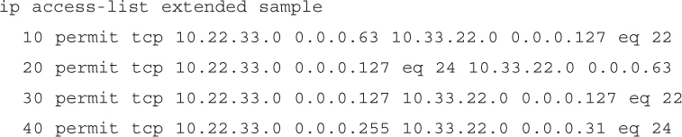</a>

<a href="#f0139-01a" id="code-f0139-01">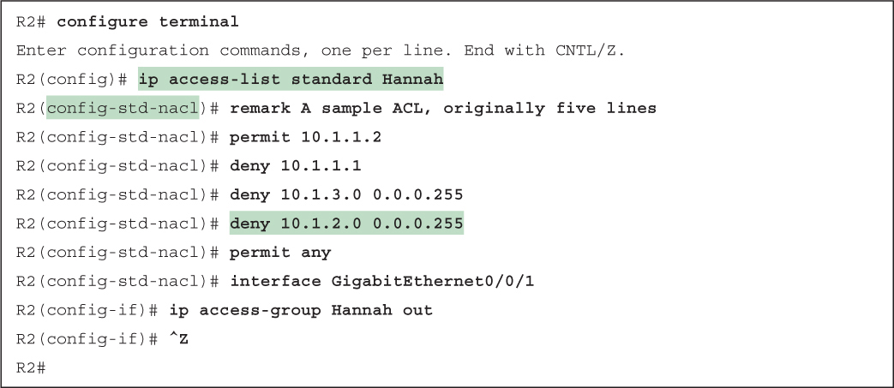</a>

<a href="#f0139-02a" id="code-f0139-02">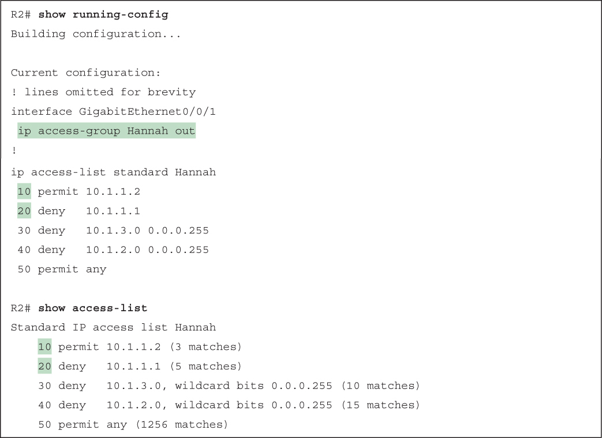</a>

<a href="#f0141-01a" id="code-f0141-01">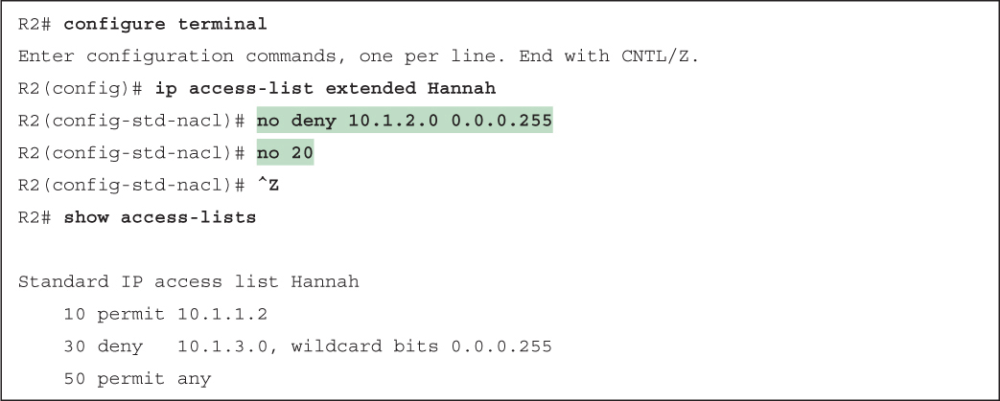</a>

<a href="#f0142-01a" id="code-f0142-01">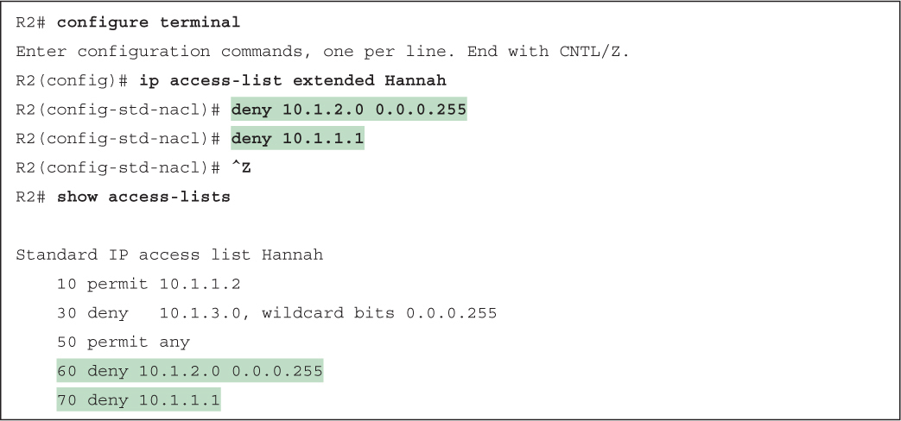</a>

<a href="#f0142-02a" id="code-f0142-02">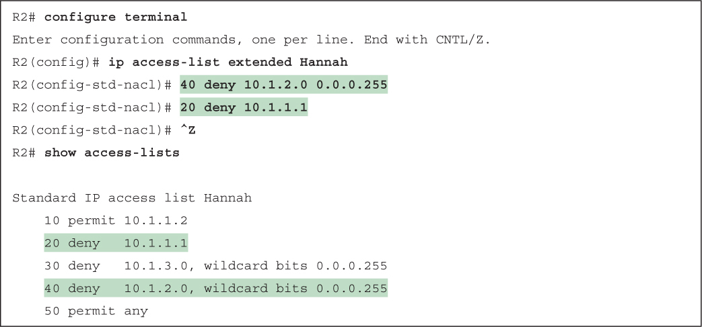</a>

<a href="#f0143-01a" id="code-f0143-01">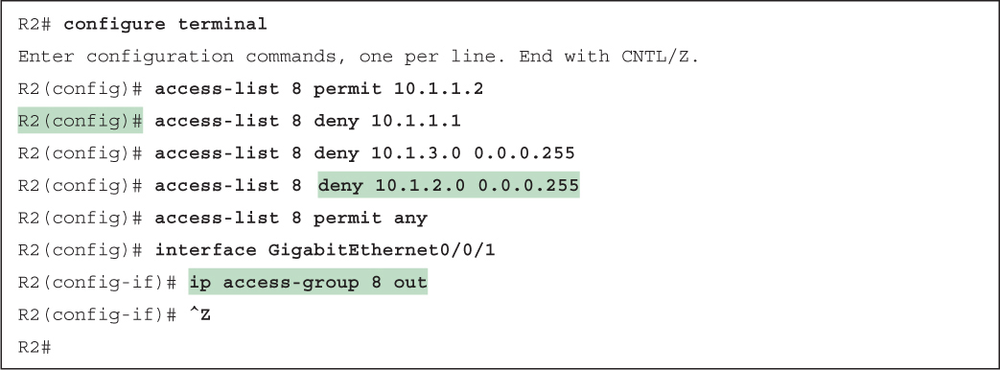</a>

<a href="#f0144-01a" id="code-f0144-01">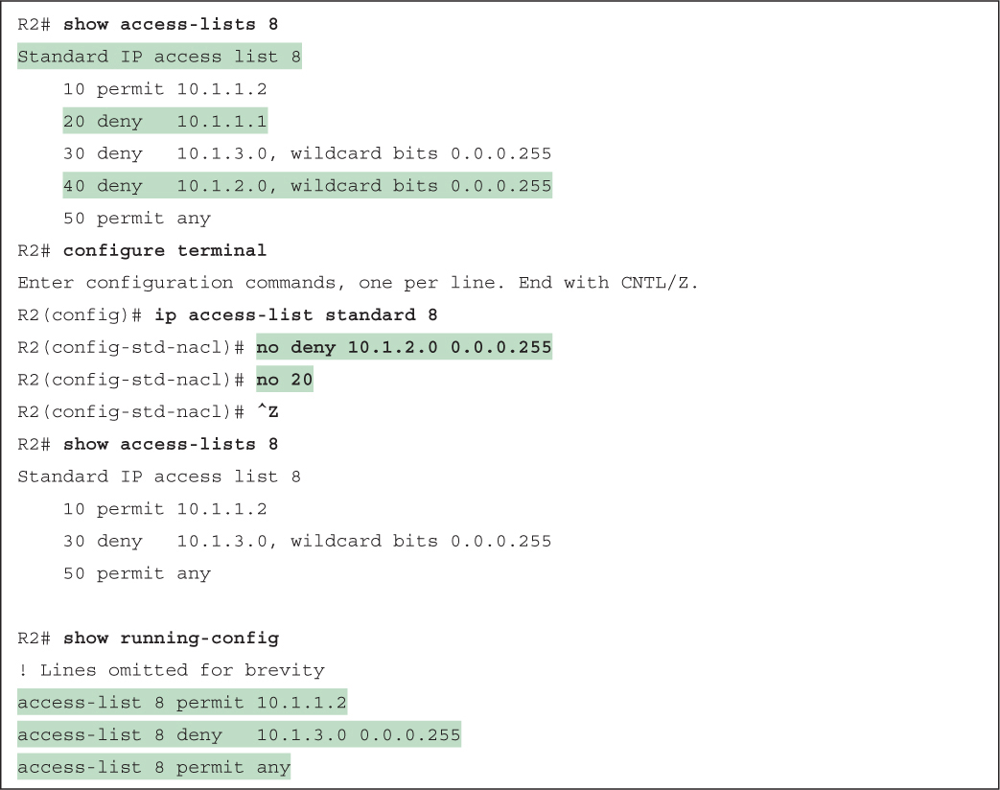</a>

<a href="#f0152-01a" id="code-f0152-01">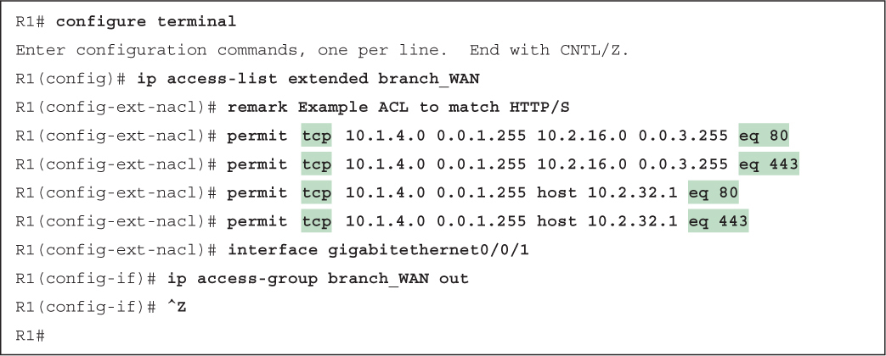</a>

<a href="#f0153-01a" id="code-f0153-01">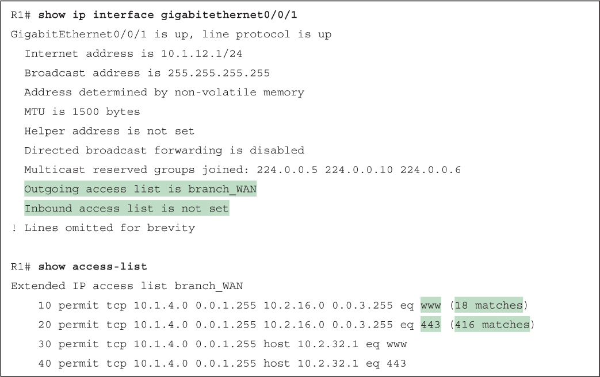</a>

<a href="#f0154-01a" id="code-f0154-01">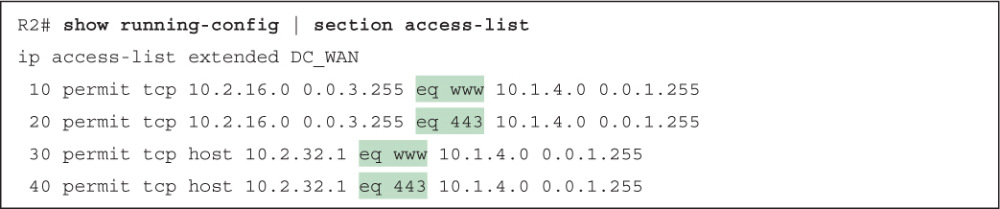</a>

<a href="#f0155-01a" id="code-f0155-01">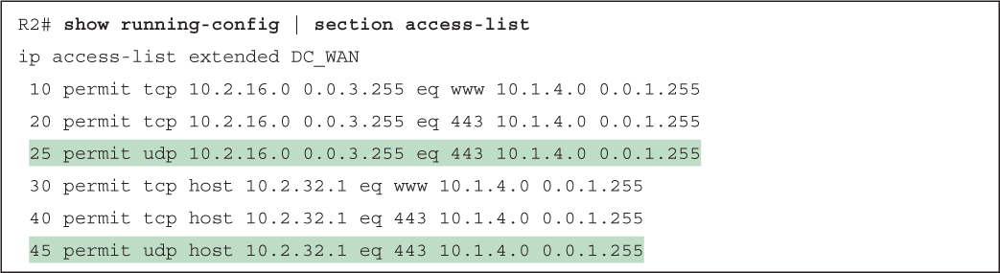</a>

</section>

</section>


<nav class="ccna-chapter-nav" aria-label="章节导航"><a href="v2-06.html">← 上一章</a><a href="v2-08.html">下一章 →</a></nav>
