
<a href="{{ '/subjects/CCNA/' | relative_url }}">← 返回 CCNA 目录</a>

第二卷 · IP 访问控制列表

<nav class="ccna-chapter-nav" aria-label="章节导航"><a href="v2-07.html">← 上一章</a><a href="v2-09.html">下一章 →</a></nav>



<section data-epub-type="chapter">

<h2 class="h2" id="ch08">第 8 章</h2>

<h2 class="h2a">IP ACL 应用</h2>

本章涵盖以下考试主题：

5.0 安全基础

5.6 配置和验证访问控制列表

规划要在生产网络中启用的实际 IP ACL 时，任务通常会变得庞大而复杂。例如，假设你依赖 ACL 末尾隐含的 <strong>deny any</strong> 逻辑，那么 ACL 就必须包含 permit 命令，匹配所有希望允许的流量；否则，ACL 会拒绝（丢弃）这些数据包。如果在扩展 ACL 末尾添加 <strong>permit ip any any</strong> 命令，使默认行为变为允许流量，就会遇到相反的问题：你需要仔细识别所有希望拒绝的流量，并在 ACL 中匹配它们。多位网络工程师参与、IT 部门需求相互冲突，以及业务环境变化，都会增加复杂性。

本章让你初步了解迈出这一步时需要考虑的一些问题。第一节讨论如何确保允许网络中的几种必要协议，以免 ACL 中后续的 deny ACE 丢弃这些流量。例如，ACL 即使正确匹配了大多数终端用户流量，却忘记考虑 DNS、DHCP、ICMP 和 OSPF，并丢弃它们，网络也会严重失常。第一节通过一些实际示例展开讨论，既可能帮助你从事网络工程工作，也能加深你应对 CCNA 考试所需的技能。

最后一节较短，讨论 Cisco IOS 和 IOS XE 操作系统在 IP ACL 方面的一些差异。CCNA 考试没有要求掌握这些差异，不过，了解这些细微区别仍有帮助。此外，该节还介绍此前 ACL 章节尚未讨论的两个功能：如何对 ACL 重新编号，以及如何向接口添加第二个 ACL，因此请花些时间阅读最后一节。

<section>

<h3 class="h3" id="ch08lev1sec1">“这些知识我已经掌握了吗？”自测</h3>

如果你希望根据得分决定在本章投入多少时间，可以完成这组自测题（在此作答，或使用 PTP 软件）。各题答案的选项字母列在自测题之后的页面底部。书末和配套网站上的<a href="#ref-appc">附录 C</a>都包含答案及解析。你也可以在 PTP 测试软件中找到答案及解析。

<figure class="table" id="ch08tab01" tabindex="0">

<figcaption>

<strong>表8-1</strong> “这些知识我已经掌握了吗？”核心主题小节与题目对应关系

</figcaption>

<table class="all">

<tbody>

<tr>

<th class="th">
基础知识小节
</th>

<th class="th">
题目
</th>

</tr>

<tr>

<td class="border">
ACLs和网络基础设施协议
</td>

<td class="border">
1–4
</td>

</tr>

<tr>

<td class="border">
比较IOS和IOS XE的ACLs
</td>

<td class="border">
5, 6
</td>

</tr>

</tbody>

</table>

</figure>

<figure class="image-c" id="ch08fig00">

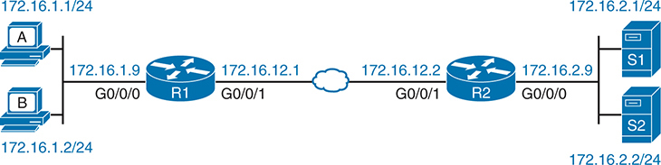

<figcaption>

<aside class="hidden" id="a08fig00">

图表显示了路由器两侧的两个独立的局域网(L A Ns). 在左侧,有两个标记为A和B的设备连接到子网上. 172.16.1.0/24 ,有 I P 地址 172.16.1.9 和 172.16.1.2 路由器 R 1 有两个接口: G 0 斜线 0 斜线 0 连接到子网 172.16.1.0/24 和G组 0 斜线 0 斜线 1 与 IP 地址的点到点链接 172.16.12.1 右侧, 路由器 R 2 也有两个接口: G 0 斜线 0 斜线 1 与 IP 地址连接到相同的点到点链接 172.16.12.2 和G组 0 斜线 0 斜线 0 连接到子网 172.16.2.0/24 ,其中两个服务器,S 1 2 ,其地址为 IP 地址 172.16.2.9 和 172.16.2.2 图表分别突出显示路由器R 1 有ACL 命名为 QA 的下划线 01 接口 G 应用出局 0 斜线 0 斜线 1 。这个设置意味着 交通离开路由器 R 1 通过接口 G 0 斜线 0 斜线 1 由指定的ACL过滤。

</aside>

<strong>问题1-4请参见此图。</strong>

</figcaption>

</figure>

<strong><a id="quess8_1" href="#ques8_1a">1</a>.</strong>图中的路由器R1使用下面的ACL,其中<strong>ip access-group QA_01 out</strong>接口子命令添加到接口 G0/0/1。 路由器没有其它与ACL相关的配置. 在产出中<strong>show access-lists</strong>命令,哪条ACL线的计数器每个路由器R1都会发送OSPF Hello?

<a href="#code-f0161-01" id="f0161-01a">点击此处查看代码原图</a>

<pre class="pre-q" tabindex="0"><code>ip access-list extended QA_01

  10 permit tcp host 172.16.12.1 any eq 520

  20 permit tcp host 172.16.12.1 any

  30 permit ospf host 224.0.0.5 any

  40 permit ospf host 172.16.12.1 any</code></pre>

<ol class="lower-alpha">

<li>
第10行:
</li>

<li>
20号线
</li>

<li>
30号线
</li>

<li>
第40行:
</li>

<li>
其他的答案都不对
</li>

</ol>

<strong><a id="quess8_2" href="#ques8_2a">2</a>.</strong>在图中,路由器R2允许在其G0/0/0接口上输入ACL. 主机A和B需要从 DHCP 服务器 S1 租赁 IP 地址. 路由器 R1 提供了 IP 帮助器的特性 。<strong>ip helper-address 172.16.2.1</strong>在其G0/0/0接口上的子命令。 哪些答案会列出一个ACE,如果是ACL的一部分,会匹配服务器和客户端之间的DHCP消息? (取出二个答.

<ol class="lower-alpha">

<li>
<strong>permit ip host 172.16.2.1 any</strong>
</li>

<li>
<strong>permit ip any host 172.16.2.1</strong>
</li>

<li>
<strong>permit udp any eq bootps host 0.0.0.0</strong>
</li>

<li>
<strong>permit udp host 172.16.2.1 eq bootpc any</strong>
</li>

<li>
<strong>permit udp host 172.16.2.1 eq bootps any</strong>
</li>

</ol>

<strong><a id="quess8_3" href="#ques8_3a">3</a>.</strong>在图中,路由器R1使用标准的ACL QA03. ACL有一个ACE;ACE允许取自子网172.16.1.0/24的包. 工程师想过滤SSH流量,所以只有从子网172.16.1.0/24的hosts才能将SSH输入到路由器中. 哪一个答案最能说明 工程师应该如何继续?

<ol class="lower-alpha">

<li>
启用 vty 模式下的 ACL<strong>access-class QA_01 in</strong>子命令 。
</li>

<li>
启用 vty 模式下的 ACL<strong>access-class QA_01 out</strong>子命令 。
</li>

<li>
启用 vty 模式下的 ACL<strong>ip access-group QA_01 in</strong>子命令 。
</li>

<li>
启用 vty 模式下的 ACL<strong>ip access-group QA_01 out</strong>子命令 。
</li>

</ol>

<strong><a id="quess8_4" href="#ques8_4a">4</a>.</strong>在图中,一个工程师允许ACL QA04通过路由器R1的G0/0/0接口进入. 想象一下,主机A试图SSH地址为172.16.12.1. ACL中哪行数据包在此情景下匹配?.

<a href="#code-f0162-01" id="f0162-01a">点击此处查看代码原图</a>

<pre class="pre-q" tabindex="0"><code>ip access-list extended QA_04

   10 permit udp 172.16.1.0 0.0.0.255 any eq 22

   20 permit tcp 172.16.1.0 0.0.0.255 any eq 22

   30 deny udp any any eq 22

   40 deny tcp any any eq 22</code></pre>

<ol class="lower-alpha">

<li>
第10行:
</li>

<li>
20号线
</li>

<li>
30号线
</li>

<li>
第40行:
</li>

<li>
隐含的<strong>deny ip any any</strong>
</li>

</ol>

<strong><a id="quess8_5" href="#ques8_5a">5</a>.</strong>在IOS XE中引入"Common" ACL之前,哪个答案最准确,一个路由器上可以启用多少个IP ACL?

<ol class="lower-alpha">

<li>
每个路由器一个
</li>

<li>
每个路由器接口一个
</li>

<li>
每个路由器接口每个方向一个
</li>

<li>
每个路由器接口每个方向两个
</li>

<li>
每个路由器接口每个方向很多
</li>

</ol>

<strong><a id="quess8_6" href="#ques8_6a">6</a>.</strong>已命名的ACL QA06有4行,序列号为10,20,30,和40. 作为工作面试期间的一项练习,请您编辑ACL,以便ACE保持相同的相对顺序,但使用序号为50,70,90,和110. 哪一个答案列出了用来自CLI的最少命令来进行这一改变的方法?

<ol class="lower-alpha">

<li>
印发<strong>ip access-list resequence QA_06 50 20</strong>在特权 EXEC 模式下命令。
</li>

<li>
印发<strong>ip access-list resequence QA_06 50 20</strong>在全局配置模式下命令。
</li>

<li>
删除整个ACL<strong>no ip access-list...</strong>全局命令,然后重新配置整个ACL.
</li>

<li>
从 ACL 模式中删除每个<strong>permit</strong>或者说<strong>deny</strong>命令,然后重新配置每个。
</li>

<li>
从ACL模式发行<strong>resequence 50 20</strong>子命令 。
</li>

</ol>

“这些知识我已经掌握了吗？”自测答案：

<strong><a id="ques8_1a" href="#ref-ques8_1">1</a></strong> E

<strong><a id="ques8_2a" href="#ref-ques8_2">2</a></strong> A, E

<strong><a id="ques8_3a" href="#ref-ques8_3">3</a></strong> A

<strong><a id="ques8_4a" href="#ref-ques8_4">4</a></strong> B

<strong><a id="ques8_5a" href="#ref-ques8_5">5</a></strong> C

<strong><a id="ques8_6a" href="#ref-ques8_6">6</a></strong> B

</section>

<section>

<h3 class="h3box" id="ch08lev1sec2">基础主题</h3>

</section>

<section>

<h3 class="h3" id="ch08lev1sec3">ACL 与网络基础设施协议</h3>

<a href="v2-07.html#ch07">第7章</a>, “<a href="v2-07.html#ch07">命名与扩展 IP ACL</a>,"完成了大部分核心ACL配置特性的讨论. 然而,ACLs的复杂性并非出自配置,而是出自将该工具应用于大量种类的网络协议,其数据包通过路由器运行. 这一章的第一部分主要论述如何与ACL中的某些协议相匹配。 本节讨论如何为其中一些间接费用联网协议创建ACE。 议题包括:

<ul class="sq">

<li>
DNS
</li>

<li>
ICMP 回声和超时
</li>

<li>
例行协议和OSPF
</li>

<li>
DHCP
</li>

<li>
SSH 和 Telnet 转换为路由器和交换器
</li>

</ul>

<section>

<h4 class="h4" id="ch08lev2sec1">过滤 DNS</h4>

DNS消息流经企业的几乎每个路由器接口,所以一个已生产准备的IP ACL需要允许. 问题是如何容忍:允许所有限制,或更加有选择性。

首先,考虑一个拥有许多分支的企业.<a href="#ch08fig01">图8-1</a>显示一个实例,左边有一个分支路由器(B1),但还有许多分支存在. 该图显示了两个DNS服务器和在即将举行的ACLs和DHCP讨论中使用的DHCP服务器.

<figure class="image-c" id="ch08fig01">

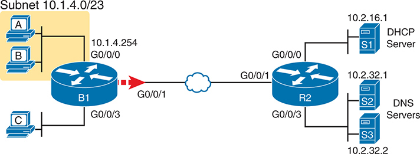

<figcaption>

<aside class="hidden" id="a08fig01">

网络从三个P C s 标记为 A, B 和 C 开始,位于左侧,连接到一个路由器标记为 B 1 通过接口 G 0 斜线 0 斜线 0 ,所有在子网内 10.1.4.0/23 . B的IP地址 1 路由器为 10.1.4.254 。该路由器通过接口 G 的流量 。 0 斜线 0 斜线 1 到一个网络云,在图中以蓝云图标为代表。在网络云的右侧,流量到达另一个路由器,标记为R 2 通过接口 G 0 斜线 0 斜线 1 。 R 数据 2 路由器有多个接口: G 0 斜线 0 斜线 0 与云相接, G 0 斜线 0 斜线 1 ,和 G 键 0 斜线 0 斜线 3 G接口 0 斜线 0 斜线 1 编号 2 连接到标记为 S 的 DHCP 服务器 1 与IP地址 10.2.16.1 ,服务子网 10.2.16.0 G接口 0 斜线 0 斜线 3 连接到两个标记为 S 的 DNS 服务器 2 3 ,有 I P 地址 10.2.32.1 和 10.2.32.2 服务于子网 10.2.32.0 。图表清楚地显示网络分割和每个服务器的作用。PC s A、B和C通过路由器B连接。 1 使用服务器S提供的DHCP和DNS等服务 1 2 和 S 键 3 通过路由器 R 2 。

</aside>

<strong>图8-1</strong> <em>DHCP 和 DNS 服务器的企业分支</em>

</figcaption>

</figure>

接下来,考虑规划一个ACL,这样每个分支路由器都可以使用相同的ACE来匹配DNS流量. 您可以首先选择每个分支路由器的WAN接口在向外方向的位置和方向 。 因此,分支ACLs处理包被发送到DNS服务器.

<a href="#exa8_1">示例8-1</a>显示一个方法。 它忽略了所有 IP 地址, 匹配源地址和目的地址<strong>any</strong>关键词。 根据这些DNS事实,ACE是匹配的:

<ul class="sq">

<li>
DNS同时使用UDP和TCP.
</li>

<li>
DNS 使用知名服务器端口 53(ACL 关键字)<strong>domain</strong>).
</li>

</ul>

<strong>示例8-1</strong> <em>允许所有 DHCP 流量到 DNS 服务器</em>

<a href="#code-f0163-01" id="f0163-01a">点击此处查看代码原图</a>

<pre class="pre-ex" tabindex="0"><code>R1# <strong>show running-config | section access-list</strong>

! ACEs below are part of extended ACL Branch_Common

 50 permit udp any any eq domain

 60 permit tcp any any eq domain</code></pre>

注意

本节许多例子中的ACL侧重于与每个专题有关的几个ACE. 这些ACE将是一个大得多的ACL的一部分.

假设没有其他较早的ACE匹配DNS包,示例中的ACE允许所有寄往任何DNS服务器的包,而不论来源和目的地址.

<a href="#exa8_2">示例8-2</a>显示一个使用同一位置和方向的更安全的选项。 然而,由于IT控制唯一合法的DNS服务器,许可ACE与合法的DNS伺服器的IP地址相匹配(行110–140). ACE 150和160随后拒绝其他DNS服务器的所有其他流量. 这种分两阶段的办法在允许所有合法的DNS流量的同时,实现了限制性更强的平衡。

<strong>示例8-2</strong> <em>允许所有 DHCP 流量到 DHCP和 DNS 服务器</em>

<a href="#code-f0164-01" id="f0164-01a">点击此处查看代码原图</a>

<pre class="pre-ex" tabindex="0"><code>R1# <strong>show running-config | section access-list</strong>

! Excerpt from extended ACL Branch_Common, replacing previous example's ACEs

 110 permit udp any host 10.2.32.1 eq domain

 120 permit udp any host 10.2.32.2 eq domain

 130 permit tcp any host 10.2.32.1 eq domain

 140 permit tcp any host 10.2.32.2 eq domain

! The next lines mimic <a href="#exa8_1">example 8-1</a>'s ACEs, denying DNS (UDP and TCP)

 150 deny udp any any eq domain

 160 deny tcp any any eq domain</code></pre>

</section>

<section>

<h4 class="h4" id="ch08lev2sec2">过滤 ICMP</h4>

受ACLs影响的另一个有趣的网络功能,请考虑:<strong>ping</strong>命令详情见<em>CCNA 200-301 官方证书指南 第1卷</em>, <a href="v2-20.html#ch20">第20章</a>, “<a href="v2-20.html#ch20">解决 IPv4 运行中的问题</a>“......”<strong>ping</strong>命令生成 ICMP Echo Request 信件。 一个响应这些消息的主机生成了 ICMP Echo Response 消息. 想打工吗? ACLs必须允许所有ICMP,或消息类型用于回声请求和回音.

例如,考虑分支办公路由器B1的情况。<a href="#ch08fig01">图8-1</a>,再次使用路由器B1的G0/0/1接口上的出行ACL。 但是,有多少允许和否认? 以下清单详细说明了《议定书》/《公约》缔约方会议三种情况,并增加了限制。<a href="#exa8_3">示例8-3</a>以下显示前两种情景的ACE。

<ol class="number">

<li>
采取一个阶段的做法:允许所有《议定书》/《公约》缔约方会议的信息
</li>

<li>
采取分两个阶段的办法:

<ol class="lower-alpha-n">

<li>
允许企业私人网络内所有含有源和去向的ICMP信息10.0.0.0
</li>

<li>
拒绝所有其他《国际CMP》
</li>

</ol></li>

<li>
与情景2相同,但只允许ICMP回声请求和答复
</li>

</ol>

<strong>示例8-3</strong> <em>实施两种替代方法的ACLs</em>

<a href="#code-f0165-01" id="f0165-01a">点击此处查看代码原图</a>

<pre class="pre-ex" tabindex="0"><code>! The following single ACE achieves scenario 1 above

 210 permit icmp any any

! Alternately, the following two ACEs achieve scenario 2 above

 220 permit icmp 10.0.0.0 0.255.255.255 10.0.0.0 0.255.255.255

 230 deny icmp any any</code></pre>

第一个ACE,行号为210,匹配所有ICMP消息. 至于语法,要匹配 ICMP 消息,您不使用 TCP 或 UDP 协议类型 。 相反,您使用关键词<strong>icmp</strong>。(ICMP不使用TCP或UDP. 相反,ICMP头直接跟随IP头. )

结尾处的双ACE替代方案<a href="#exa8_3">示例8-3</a>与所有 ICMP 匹配,但与添加的对源地址和目的地址的检查相匹配。 如果企业使用私人A类网络 10.0.0.0,此额外检查意味着只发送到该私人网络的包和地址匹配<strong>permit</strong>语句。 ICMP 包中含有网络外的源或目的地 10.0.0.0 ,例如互联网上的主机,无法匹配行 220 但匹配线条 230 路由器丢弃这些包。

<a href="#exa8_4">示例8-4</a>显示 ACE 实现第三种情景。 要匹配特定的 ICMP 消息类型,请在目的地址字段后使用关键词,如行250和260. (ICMP消息类型出现在ACE语法中的目的地址后. )行250和260一起允许ICMP Echo Request和回覆所有消息进入/从企业私人网络内的主机10.0.0.0. 终线丢弃其他 ICMP 流量, 不依赖默认<strong>deny any</strong>丢弃这些包。

<strong>示例8-4</strong> <em>允许ICMP内部回声,拒绝所有其他ICMP</em>

<a href="#code-f0165-02" id="f0165-02a">点击此处查看代码原图</a>

<pre class="pre-ex" tabindex="0"><code>! ACEs for the third ICMP scenario

ip access-list extended icmp_Echo_network_10

 250 permit icmp 10.0.0.0 0.255.255.255 10.0.0.0 0.255.255.255 echo

 260 permit icmp 10.0.0.0 0.255.255.255 10.0.0.0 0.255.255.255 echo-reply

 270 deny icmp any any</code></pre>

<a href="#exa8_4">示例8-4</a>可能会丢掉太多的流量。 ACLs的重大危险之一是过滤过多并阻碍适当的网络操作. ICMP定义了许多消息子类型,超过50个显示在CLI帮助的配置模式. ACE 在行 270 英寸<a href="#exa8_4">示例8-4</a>丢弃所有其他 ICMP 消息类型,这可能会阻止其他有用的 ICMP 函数. 例如,这些ACE将过滤 ICMP 所用的超时消息。<strong>traceroute</strong>命令这样<strong>traceroute</strong>命令不会完成 。 设想2选项,配置于<a href="#exa8_3">示例8-3</a>这可能是更好的妥协。

</section>

<section>

<h4 class="h4" id="ch08lev2sec3">过滤 OSPF</h4>

IP ACLs可能会丢弃OSPF消息,但丢弃这些消息没有任何好处. 所以,当你想到OSPF和ACL时, 考虑匹配和允许所有的OSPF包。 特别是,避免出现将OSPF包与否定行动相匹配的不幸情况,例如将其与隐含的行动相匹配。<strong>deny any</strong>在ACL的结尾。

路由协议包的范围影响到IP ACL可能过滤的包. 作为路由协议消息的典型,OSPF包通过网络进行短途旅行. 例如,在<a href="#ch08fig02">图8-2</a>,没有 OSPF 包流过已破折的行,也没有路由器转发任何 OSPG 消息。

<figure class="image-c" id="ch08fig02">

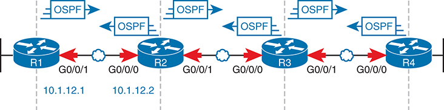

<figcaption>

<aside class="hidden" id="a08fig02">

该图为路由器使用标准网络符号,并包含方向箭头来表示OSPF消息的流出,确保路由器之间OSPF通信过程的清晰可视化. 每个路由器以线性序列连接,并附有特定的接口标识符和I P地址在连接上详细显示. Router R从左边开始. 1 有两个接口: G 0 斜线 0 斜线 1 和G组 0 斜线 0 斜线 0 ,与G组 0 斜线 0 斜线 1 连接到上一个网络段和 G 的接口 0 斜线 0 斜线 0 连接到路由器 R 的接口 2 路由器 R 2 也有两个接口: G 0 斜线 0 斜线 1 ,它连接到路由器 R 1 ,和 G 键 0 斜线 0 斜线 0 ,它连接到路由器 R 3 中。此模式将随着路由器 R 而继续 3 ,它有接口 G 0 斜线 0 斜线 1 (与R连通) 2 )和G类 0 斜线 0 斜线 0 (与R连通) 4 最后,路由器R 4 有接口 G 0 斜线 0 斜线 1 (与R连通) 3 )和G类 0 斜线 0 斜线 0 (连接到随后的网络部分). IP地址 10.1.12.1 和 10.1.12.2 与 R 之间的链接相关 1 和 R 数据 2 。每个路由器之间的连接都标有双向箭头,指示OSPF消息的交换。此外,OSPF协议标签被放在每个连接上方,以强调正在发生的信息流的类型。该图为路由器使用标准网络符号,并包含指示箭头来表示OSPF消息的流。

</aside>

<strong>图8-2</strong> <em>OSPF 路由器 R1 和 R2 之间的信件流</em>

</figcaption>

</figure>

在考虑ACL和路由协议时, 最后一个新概念与默认的IOS行为无关:

路由器绕出行走的ACL用于本地包(由路由器生成的包),包括OSPF消息.

将这一事实与路由器不转发OSPF包的事实结合起来,唯一能够丢弃OSPF消息的ACL是送入ACL. 接口上的箭头行<a href="#ch08fig02">图8-2</a>显示ACLs的位置和方向(仅输入),可以匹配 OSPF 消息。

注意

IOS XE(但不是IOS)允许您通过发布路由器生成的路由器包来改变绕出ACLs的行为.<strong>ip access-list match-local-packets</strong>全局指令 。

ACLs应允许OSPF包. 您需要匹配数据包, 但不能过滤子集: 相反, 允许所有 OSPF 消息 。 要匹配 OSPF 包,请使用<strong>ospf</strong>协议关键字。 OSPF不使用UDP或TCP,而是作为协议存在,其标题紧跟在IP头后方,因此IOS提供关键词来与OSPF协议相匹配.

<a href="#exa8_5">示例8-5</a>显示两种情景的ACE, 这两种情景都期望路由器R1的G0/0/1WAN接口有输入的ACL<a href="#ch08fig02">图8-2</a>。这个例子再次显示了两种方法:允许所有OSPF,或者允许已知邻居的OSPF消息,同时丢弃所有其他OSPF消息. 概述两种情况:

<ol class="number">

<li>
采取一个阶段的做法:允许所有OSPF信息
</li>

<li>
采取分两个阶段的办法:

<ol class="lower-alpha-n">

<li>
允许所有 OSPF 消息来自路由器 R2 的 WAN IP 地址 (10.1.12.2)
</li>

<li>
拒绝OSPF的所有其他消息
</li>

</ol></li>

</ol>

<strong>示例8-5</strong> <em>两种OSPF设想方案</em>

<a href="#code-f0167-01" id="f0167-01a">点击此处查看代码原图</a>

<pre class="pre-ex" tabindex="0"><code>! Line 310 for OSPF scenario 1

 310 permit ospf any any

! Alternately, lines 320 and 330 for OSPF scenario 2.

 320 permit ospf host 10.1.12.2 any

 330 deny ospf any any</code></pre>

注意

<a data-original-href="vol2_appd.xhtml#appd" data-unavailable="true" title="此内容不在当前提取范围内；请参阅原始 EPUB：vol2_appd.xhtml#appd">附 录 D</a>, “<a data-original-href="vol2_appd.xhtml#appd" data-unavailable="true" title="此内容不在当前提取范围内；请参阅原始 EPUB：vol2_appd.xhtml#appd">前几版的主题</a>,”包含一些超越当前CCNA考试话题的更古老的ACL内容. 一些内容讨论了排除ACL的故障,其余内容则与ACL和路由器生成的包讨论出乎意料的行为. 如果要学习更多,请参考“......<a data-original-href="vol2_appd.xhtml#appdlev1sec1" data-unavailable="true" title="此内容不在当前提取范围内；请参阅原始 EPUB：vol2_appd.xhtml#appdlev1sec1">IPv4 ACLs 故障解析</a>”节中<a data-original-href="vol2_appd.xhtml#appd" data-unavailable="true" title="此内容不在当前提取范围内；请参阅原始 EPUB：vol2_appd.xhtml#appd">附 录 D</a>.

</section>

<section>

<h4 class="h4" id="ch08lev2sec4">过滤 DHCP</h4>

乍一看,你可能期望对DHCP的处理与关于ACL的DNS大致相同. 大多数公司使用一个单一的DHCP服务器(具有高可用性功能),或可能是几个,但都拥有可识别的IP地址. DHCP消息流会通过网络在大多数网络链接中结束. DHCP使用一个著名的服务器端口(67). 在某些路由器上匹配 DHCP 消息时,遵循了您在前面章节中为网页服务器和DNS所学的同样直截了当的逻辑. 然而,在同一路由器上对执行IP帮助器功能的DHCP包应用ACL有一些出乎意料的规则.

关于背景,请考虑<a href="#ch08fig03">图8-3</a>,左边有DHCP客户端,右边有DHCP服务器. 该图突出显示四个可能考虑的ACL位置,这些位置将匹配朝向DHCP服务器的包. (您也可以向另一个方向过滤; 我只是选择了从左到右的流程作为示例。 ) 在图中显示的所有ACL位置和方向, 包的目的地 UDP 端口号为 67 。 然而,由于路由器R1上的IP帮助器特性,地址因网络位置不同而不同.

<figure class="image-c" id="ch08fig03">

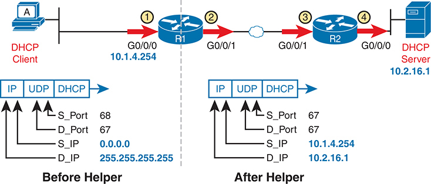

<figcaption>

<aside class="hidden" id="a08fig03">

在图的左侧被标记为"帮助前"(After Helper),一个位于 IP地址10.1.4.254的DHCP客户端通过路由器R1的接口G0 slash0 slash0. 该包的源端口为68,目的端口为67,来源为-0.0.0.0,目的为-255.255.255.255. 数据包通过 R1's G0 slash0 slash1接口流出,以到达网络的下一段. 在右侧,标签为"帮助后"(After Helper),包的源 I P 更改为10.1.4.254而目的地 I P 在通过配置于R-1的DHCP中继代理后被更新为10.2.16.1. 包再将路由器上路由器上路由器R 2的G-0 slash0 slash1向DHCP服务器穿行,最终通过接口G-0 slash0 slash0在IP地址10.2.16.1到达DHCP服务器.

</aside>

<strong>图8-3</strong> <em>需要考虑的ACL 位置: 包到 DHCP 服务器</em>

</figcaption>

</figure>

现在考虑一下路由器R2上的直截了当的情况,在图中ACL位置为3和4. R2不执行帮助器功能,因此可以根据众所周知的 DHCP 服务器端口和服务器的IP地址进行匹配. DNS 服务器也可以使用前面讨论过的相同选项<a href="#exa8_1">实例8-1</a>和<a href="#exa8_2">8-2</a>. <a href="#exa8_6">示例8-6</a>显示类似ACE 可见于<a href="#exa8_2">示例8-2</a>给DNS的 ACL对路由器R2有用,地点为每架三到四架<a href="#ch08fig03">图8-3</a>:

<ul class="sq">

<li>
<strong>第一阶段:</strong>允许所有向 DHCP 服务器( 67 端口) 发送 DHCP消息 。
</li>

<li>
<strong>两个阶段:</strong>首先,允许所有DHCP消息到合法的DHCP服务器,然后过滤(deny)所有其他消息到DHCP伺服器.
</li>

</ul>

<strong>示例8-6</strong> <em>允许所有 DHCP 交通到路由器主上的 DNS 服务器</em>

<a href="#code-f0168-01" id="f0168-01a">点击此处查看代码原图</a>

<pre class="pre-ex" tabindex="0"><code>R2# <strong>show running-config section access-list</strong>

! Option 1: Allow all packets destined to DHCP server port (bootps 67)

 240 permit udp any any eq bootps

! Option 2: permit DHCP to known server and discard other messages sent to DHCP 67

 250 permit udp any host 10.2.16.1 eq bootps

 260 deny udp any any eq bootps</code></pre>

然而,DHCP的ACL匹配逻辑在履行帮助器功能的路由器上有所不同. 特别是:

<ol class="number">

<li>
默认情况下,包会由路由器更改,原因是<strong>ip helper-address</strong>命令绕过任何正在发送的ACL。
</li>

<li>
在与输入的ACL和帮助器功能的路由器接口上,路由器先执行ACL功能,再由帮助器功能改变DHCP消息中的IP地址.
</li>

</ol>

关于这些规则的第一条,考虑将ACL的二个位置放在<a href="#ch08fig03">图8-3</a>,在R1的WAN接口上输出ACL. 根据这里的第一条规则,ACL没有考虑由路由器R1的IP帮助器函数处理的DHCP消息. R1对 DHCP 客户端使用该功能, 如主机 A 在左侧<a href="#ch08fig03">图8-3</a>。路由器 R1 处理那些带有帮助器函数的 DHCP 消息,改变源地址和目的地址,并绕过输出的ACL.

注意IP帮助路由器上的这种默认行为效果良好. 您可能想要允许向您配置的合法 DHCP 服务器发送 DHCP信件<strong>ip helper-address</strong>命令,这些信件会绕过任何您允许的 ACL 。

关于入境ACLs的第二项规则,请考虑<a href="#exa8_7">示例8-7</a>路由器R1的局域网接口的配置. 它显示<strong>ip helper-address</strong>命令和已启用的 ACL。

<strong>示例8-7</strong> <em>路由器 R1 局域网接口:与输入ACL 和帮助器的相互作用</em>

<a href="#code-f0168-02" id="f0168-02a">点击此处查看代码原图</a>

<pre class="pre-ex" tabindex="0"><code>R1# <strong>show running-config</strong>

(Lists relevant excerpts…)

interface GigabitEthernet0/0/0

  ip address 10.1.4.254 255.255.254.0

  ip helper-address 10.2.16.1

  ip access-group R1_Common in

!

! ACL excerpt: permit packets with unusual source/destination addresses to DHCP server

250 permit udp host 0.0.0.0 host 255.255.255.255 eq bootps

260 deny udp any any eq bootps</code></pre>

如第二条规则所指出,IOS在进行辅助器功能之前,先应用输入式ACL逻辑,由ACL在位置一所描绘.<a href="#ch08fig04">图8-4</a>。因此,任何基于IP地址的匹配都必须与左边显示的不寻常的IP地址相匹配<a href="#ch08fig04">图8-4</a>。(您可以选择将地址与<strong>any</strong>关键字,忽略地址. ) 只需注意,如果试图根据IP地址匹配,必须在路由器应用帮助器函数之前匹配已存在的地址.

<figure class="image-c" id="ch08fig04">

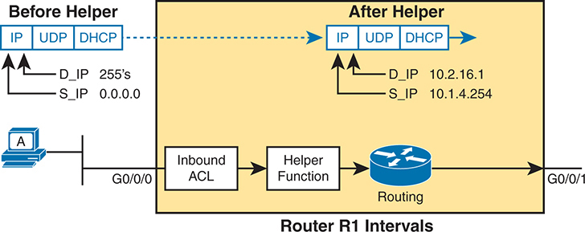

<figcaption>

<aside class="hidden" id="a08fig04">

在左侧,一个被标记为A的设备通过接口G0 slash0 slash0连接到路由器上. 到达帮助器函数前的包被显示为协议头的序列: I P, UDP, DHCP, 目的地 I P (D 下划线 I P) 被设定到广播地址255.255.255.255,源 I P (S 下划线 I P)被设定到0.0.0.0. 包再入路由器,首先会遇到入行ACL. 图表显示,在经过输入ACL后,包会到达帮助器函数. 帮助器函数将包的目的地 I P 地址修改为 10.2.16.1,源 I P 地址修改为 10.1.4.254。 这种变换通过一个被标记为"帮助后"(After Helper)的破折射箭头来表示,显示带有标题 I P, UDP, DHCP 和新的 I P 地址的更新包. 修改后的数据包接着进入路由器内部的路由过程,通过接口G0 slash0 slash1来向外出. 总体流量表明,入境的ACL首先处理包,然后是I P 帮助器功能,为DHCP中继目的改变特定包字段。 黄色背景突出这些操作发生的路由器内部区域,强调该包在穿越路由器R1时的顺序和变换.

</aside>

<strong>图8-4</strong> <em>操作顺序: 输入 ACL和 IP 帮助器</em>

</figcaption>

</figure>

</section>

<section>

<h4 class="h4" id="ch08lev2sec5">过滤 SSH 和 Telnet</h4>

SSH和Telnet都为用户提供了连接不同操作系统的指令行接口的方法. Telnet,两者中年长者,安全性要低得多,这就是为什么大多数人今天更喜欢SSH的原因.

在考虑ACLs和SSH和Telnet协议时,你应该像本章迄今为止讨论过的其他协议一样,把它们作为通常的接口ACLs考虑. 此外,路由器和交换机支持Telnet和SSH,由IOS提供另一种方法使ACL能够保护这一特定功能. 首先,这个话题为通过路由器的包检查SSH/Telnet,与接口ACLs相匹配,然后它检查<a id="key_098" href="#ref-gloss_371">vty ACL (英语).</a>特性可以过滤路由器 SSH/Telnet 访问。

<section>

<h5 class="h5" id="ch08lev3sec1">针对最终用户 SSH/Telnet 的过滤</h5>

IT工作人员,可能还有一些终端用户,可能需要使用SSH和Telnet连接到网络中服务器上的命令行(shell)提示. 因此,如果你计划在接口上添加一个ACL,它就需要考虑Telnet和SSH协议.

SSH和Telnet使用TCP,分别有著名的端口22和23. 因此,您可以在一个ACE中轻松匹配两个端口。<strong>range 22 23</strong>a 中的参数<strong>permit</strong>命令。(注意IOS和往常一样,将一些数字端口编号更改为关键词-在此情况下,将23个改为<strong>telnet</strong>.)

<a href="#exa8_8">示例8-8</a>显示两组ACE,与几个其他例子相类似. 第一种显示SSH和Telnet流量较为普遍的许可,而第二种则增加了更多的限制.

<ol class="number">

<li>
第一阶段:允许所有 SSH 和 Telnet 消息向服务器移动
</li>

<li>
两个阶段:

<ol class="lower-alpha-n">

<li>
允许所有 SSH 和 Telnet 消息向服务器移动, 其源地址和目的地址来自企业的私人网络 10.0.0.0
</li>

<li>
拒绝所有其他 SSH 和 Telnet
</li>

</ol></li>

</ol>

<strong>示例8-8</strong> <em>基于主机服务器的两种 SSH 和 Telnet 情景的 ACE</em>

<a href="#code-f0170-01" id="f0170-01a">点击此处查看代码原图</a>

<pre class="pre-ex" tabindex="0"><code>! The following single ACE achieves SSH/Telnet scenario 1 above

 410 permit tcp any any range 22 telnet

! Alternately, the following two ACEs achieve SSH/Telnet scenario 2 above

 450 permit tcp 10.0.0.0 0.255.255.255 10.0.0.0 0.255.255.255 range 22 telnet

 470 deny tcp any any range 22 telnet</code></pre>

ACE的样本在<a href="#exa8_8">示例8-8</a>工作允许SSH和Telnet在知道所有服务器的位置后进行传输. 如果你计划一个ACL,匹配向服务器移动的包,那么就可以依赖匹配的目的端口. 相反,如果计划允许从服务器发送到客户端的包的ACL,则您可以检查著名的源端口.

然而,由于Telnet和SSH,你很少知道所有的SSH服务器都住在哪里. 所有路由器和交换机以及许多其他IT设备都支持SSH或Telnet(或两者). 例如,考虑<a href="#ch08fig05">图8-5</a>。主机A使用SSH连接到服务器S1,而主机C连接到交换机SW2SSH服务器. 路由器R1的WAN接口(G0/0/1)上的出行ACL将检查目的地为SSH服务器S1的包,以及交换机SW2中来自SSH服务器的包. 从 SW2 SSH 服务器流回 SSH 客户端 C 的 packets 将有一个出名的 22 的源端口.

<figure class="image-c" id="ch08fig05">

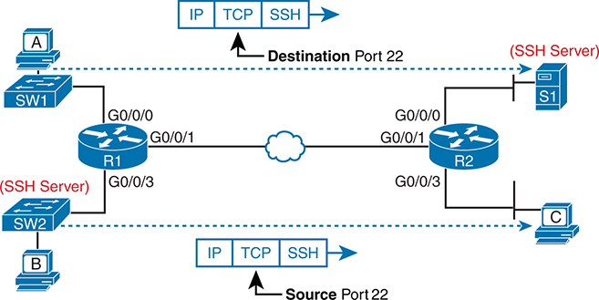

<figcaption>

<aside class="hidden" id="a08fig05">

该图具有两个路由器,即R-1和R-2,通过一个网络连接,两侧各有各种装置和交换机. 在左边,两个标有A和B的装置分别接通了S W-1和S W-2. 设备A连接了S W 1,这反过来又连接了路由器 R1的接口 G0 slash 0 slash 0. 设备 B 连接到 S W +2+ ,它被标签为 SSH 服务器,同时也连接到路由器 R +1+ 的接口 G +0 slash →0 slash +3 . 路由器R1有另一个接口,即G0斜拉桥0斜拉桥1相接站点连接到路由器R2相接站点连接. 在右侧,路由器R2类似地连接了接口G0 slash0 slash1到点对接的链接和G0 slash0 slash3到一个连接一个SSH服务器并被标注为S1的交换机. 另一个被标注为C的设备连接到同一个交换机. 该图以方向箭头强调IP,TCP和SSH的流量. 这些箭头表明必须匹配目的地口-22-和源口-22-的SSH流量,强调SSH通信的双向性质.

</aside>

<strong>图8-5</strong> <em>SSH 和 Telnet 交通两个方向匹配的必要性</em>

</figcaption>

</figure>

因此,选择以端口号匹配 SSH 和 Telnet 可能意味着您应该匹配两个方向,即检查源端口或目的端口.<a href="#exa8_9">示例8-9</a> 显示 ACEs 与 ACEs 的扩展组合<a href="#exa8_8">示例8-8</a>。最初的ACE检查了SSH和Telnet目的端口,而新的线路也检查了SSH和TelNet源端口. 在新的(突出的)线路中,要密切关注该线路的位置.<strong>range 22 telnet</strong>参数。

<strong>示例8-9</strong> <em>更新 SSH/Telnet ACE 以添加两个方向的检查</em>

<a href="#code-f0171-01" id="f0171-01a">点击此处查看代码原图</a>

<pre class="pre-ex" tabindex="0"><code>! SSH/Telnet scenario 1, revised for packets both to and from the server

 410 permit tcp any any range 22 telnet

 420 permit tcp any range 22 telnet any

! SSH/Telnet scenario 2, revised for packets both to and from the server

 450 permit tcp 10.0.0.0 0.255.255.255 10.0.0.0 0.255.255.255 range 22 telnet

 460 permit tcp 10.0.0.0 0.255.255.255 range 22 telnet 10.0.0.0 0.255.255.255

 470 deny tcp any any range 22 telnet

 480 deny tcp any range 22 telnet any</code></pre>

</section>

<section>

<h5 class="h5" id="ch08lev3sec2">针对路由器 VTY 访问的过滤</h5>

IOS提供了另一种功能,通过使用由 . . 所允许的 vty ACL 来进一步保护 CLI 访问.<strong>access-class</strong>在 vty 配置模式下命令。 当用户使用Telnet或SSH连接到路由器或切换时,IOS会将vty行与该用户连接联系起来. IOS可以在vty行上应用ACL,将可以调用net或SSH的地址过滤入路由器或切换.<a href="#ch08fig06">图8-6</a>显示该概念,由主机 A 登录的网络工程师使用 SSH 向路由器 R1 显示。 路由器R1图标上方的框代表路由器的内部逻辑.

<figure class="image-c" id="ch08fig06">

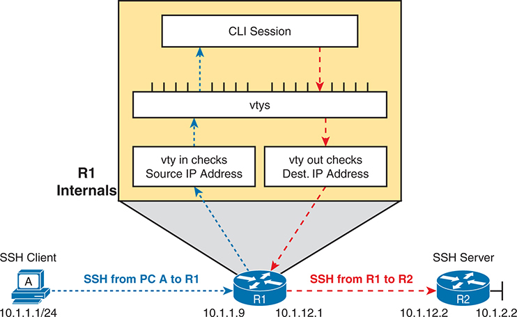

<figcaption>

<aside class="hidden" id="a08fig06">

图左侧是标为 A 的 SSH 客户端，其 IP 地址范围为 10.1.1.1/24。客户端向路由器 R1 的 IP 地址 10.1.1.9 发起 SSH 连接。PC A 到 R1 之间标为 SSH 的蓝色虚线表示此连接。路由器 R1 的内部细节显示在标为“R1 Internals”的突出框中。框顶部显示命令行接口（CLI）会话，下方是一系列虚拟终端线路（vty）。vty in 检查源 IP 地址，这是 ACL 验证传入流量的一部分。PC A 到 R1 的蓝色虚线直观表示此检查过程。图中还显示从 R1 到 SSH 服务器 R2（IP 地址 10.1.1.2）的另一条连接，用标为 SSH 的红色虚线表示。vty out 检查目的 IP 地址，这是 ACL 验证 R1 发往 R2 的传出流量的一部分。R1 通过内部处理来管理这些连接，包括传入和传出检查，确保流量符合定义的 IP ACL。图下方详细展示网络配置：SSH 客户端（PC A）位于子网 10.1.1.0/24，路由器 R1 的 IP 地址为 10.1.1.9，SSH 服务器（R2）的 IP 地址为 10.1.1.2。

</aside>

<strong>图8-6</strong> <em>IP ACLs 和路由器的内部SSH/Telnet 服务器</em>

</figcaption>

</figure>

首先,考虑启用一个输入方向的 vty ACL,用于检查试图登录到路由器的SSH/Telnet 客户端的包. 您可以使用一个标准或扩展ACL为vty ACL,但标准ACL效果良好. vty ACL 不是一个接口 ACL. 独立于ACL匹配逻辑,IOS将这些规则应用于vty ACLs:

<ul class="sq">

<li>
考虑只发送到路由器的 IP 地址的工作接口 。
</li>

<li>
仅考虑指定给SSH(端口22)或Telnet(端口23)服务器的包.
</li>

</ul>

从这些限制开始,唯一的其他有用的匹配是SSH/Telnet客户端的IP地址. 一个标准的ACL对此很有效.

例如,想象所有网络工作人员都有子网10.1.1.0/24的IP地址. 作为额外的防范措施,您配置一个 vty ACL 允许该子网中的客户端提供SSH/Telnet,但否认其他所有源地址.<a href="#exa8_10">示例8-10</a>显示路由器 R1 上完整的 ACL 配置<a href="#ch08fig06">图8-6</a>以及如何在vty模式下使用<strong>access-class</strong>命令。

<strong>示例8-10</strong> <em>vty 访问控制<strong>access-class in</strong>命令</em>

<a href="#code-f0172-01" id="f0172-01a">点击此处查看代码原图</a>

<pre class="pre-ex" tabindex="0"><code>line vty 0 15

 transport input all

 access-class IT_only in

!

ip access-list standard IT_only

 10 remark matches packets sourced from subnet 10.1.1.0/24 only; implied deny any

 10 permit 10.1.1.0 0.0.0.255</code></pre>

监督办使用<strong>access-class</strong> <em>acl</em> <strong>in</strong>vty 子命令以启用此函数 。 关键词<strong>in</strong>指向此路由器中的 Telnet 和 SSH 连接。 已配置的 ACL<strong>IT_only</strong>允许从IT子网提供源地址的包,并因暗示而否认所有其他包<strong>deny any</strong>在列表的末尾。 注意,命令可以启用ACL,<strong>access-class</strong>,在vty模式中被使用,是不同于用于在接口上启用ACL的指令和模式.

入出Vty ACLs很受欢迎,但IOS也支持不太常见出出出Vty ACL. CLI 的当前 SSH/Telnet 用户使用<strong>ssh</strong>或者说<strong>telnet</strong>要连接到另一个设备的 CLI 的EXEC 命令 。 例如,在<a href="#ch08fig06">图8-6</a>,在主机A的用户可以SSH到路由器R1. 登录后, 如果该用户使用<strong>ssh</strong>或者说<strong>telnet</strong>EXEC指令试图连接到路由器R2,IOS将把外出 vty ACL应用到连接请求上.

使用外出 vty ACL,创建 ACL 并启用它 与 .<strong>access-class</strong> <em>acl</em> <strong>out</strong>在 vty 配置模式下命令。 与输入 vty ACLs 一样,IOS 处理有限包(来源于路由器IP地址),并被指定去SSH或Telnet所熟知的端口.

标准ACL对出道的vty ACL往往效果良好,但有一个出人意料的曲折. 当用作外出 vty ACL 时, IOS 将标准的 IP ACL 地址参数比作<em>数据包的目标 IP 地址</em>而不是源地址。 也就是说,它根据设备过滤<strong>telnet</strong>或者说<strong>ssh</strong>命令试图连接。<a href="#exa8_11">示例8-11</a>以一个仅允许地址为10.1.12.1,但不允许10.1.2.2的出入口ACL进行演示。 示例显示了失败的SSH尝试和IOS错误消息,然后是成功的尝试.

<strong>示例8-11</strong> <em>路由器 R1 的 vty 访问控制</em>

<a href="#code-f0173-01" id="f0173-01a">点击此处查看代码原图</a>

<pre class="pre-ex" tabindex="0"><code>! Configuration excerpt first

line vty 0 15

 transport input all

 access-class R2_WAN out

!

ip access-list standard R2_WAN

  10 permit host 10.1.12.1

!

! An attempt denied by the ACL to router R2’s far-side LAN IP address

R1# <strong>ssh -l wendell 10.1.12.2</strong>

% Connections to that host not permitted from this terminal

! An attempt permitted by the ACL, resulting in password prompt from router R2.

R2# <strong>ssh -l wendell 10.1.12.1</strong>

Password:

R2&gt;</code></pre>

最终,出局的 vty ACLs 也支持扩展的ACLs,但与你所期望的逻辑一致. 它将源地址参数与包源地址相匹配,将目的地址参数与目的地址相匹配.

</section>

</section>

</section>

<section>

<h3 class="h3" id="ch08lev1sec4">比较 IOS 与 IOS XE 中的 ACL</h3>

思科在公司成立初期将ACLs加入到IOS中. 几十年来,思科在许多IOS版本上增加了ACL的功能和命令. Cisco为IOS XE添加了一些随时间推移而与IOS不同的功能和命令选项.

本章最后一节总结了2023年初我最近修订本章时,IOS和IOS XE的近期版本之间目前存在的一些差异. 我之所以没有选择加入这一节,是因为任何考试题目。 更一般地说,考试题目没有提到任何需要将ICLs与IOS XE进行比较. Cisco在历史上避免要求与IOS软件版本有任何关系. 然而,您可以和IOS一起练习ACLs,但随后一个考试问题可能会使用IOS XE的输出,或者反之亦然. 这个简短的章节总结了为你们准备的一些不同之处。 目标是,如果你在ACL考试题上看到小差异,而您在学习期间看到的则是小差异,你就会感到舒适。

本节首先总结了这些差异,然后讨论两个ACL特性,它们的行为在IOS上不同于IOS XE:序列号重排和常见的ACL.

<section>

<h4 class="h4" id="ch08lev2sec6">配置语法和 show 命令</h4>

原编号的IP ACLs 使用了全局命令,具体来说就是<strong>access-list</strong>全局指令 。 后来,IOS添加了对ACL模式的支持,可以使用.<strong>ip access-list</strong>命令,用子命令来定义细节。 非正式地将这两个选项视为全球模式和ACL模式。

<a href="#ch08tab02">表8-2</a>列出IOS中ACL支持与IOS XE的一些差异. 本作中ACL的章节提及了上下文中的一些类似和不同之处,但表格将它们组织起来便于参考. 请注意,该表还列出了一些相似之处,以提供更多的上下文。

<figure class="table" id="ch08tab02" tabindex="0">

<figcaption>

<strong>表8-2</strong>ACL 与IOS和IOS XE的差异

</figcaption>

<table class="all">

<tbody>

<tr>

<th class="th">
特性
</th>

<th class="th">
IOS
</th>

<th class="th">
IOS XE
</th>

</tr>

<tr>

<td class="border-g">
编号的ACL:允许全局命令配置
</td>

<td class="border-g">
是
</td>

<td class="border-g">
是
</td>

</tr>

<tr>

<td class="border-g">
编号的ACL:允许使用ACL模式命令进行配置,以便于ACL编辑
</td>

<td class="border-g">
是
</td>

<td class="border-g">
是
</td>

</tr>

<tr>

<td class="border-g">
编号的ACLs :<strong>running-config</strong>将ACL 显示为全局命令<a id="tfn8_2_1" href="#tfn8_2_1a">*</a>
</td>

<td class="border-g">
是
</td>

<td class="border-g">
否
</td>

</tr>

<tr>

<td class="border">
命名ACLs: 配置并存储为ACL模式命令
</td>

<td class="border">
是
</td>

<td class="border">
是
</td>

</tr>

<tr>

<td class="border">
已命名的ACLs :<strong>show running-config</strong>列表序列号
</td>

<td class="border">
否
</td>

<td class="border">
是
</td>

</tr>

<tr>

<td class="border">
已命名的ACLs :<strong>show access-lists</strong>列表序列号
</td>

<td class="border">
是
</td>

<td class="border">
是
</td>

</tr>

<tr>

<td class="border-g">
默认重装时重排 ACL 序列号<a id="tfn8_2_2" href="#tfn8_2_2a">**</a>
</td>

<td class="border-g">
是
</td>

<td class="border-g">
否
</td>

</tr>

<tr>

<td class="border-g">
支持第二个(常见)每个接口/方向的ACL
</td>

<td class="border-g">
否
</td>

<td class="border-g">
是
</td>

</tr>

<tr>

<td class="border-g">
允许将多个非连续端口匹配到<strong>eq</strong>
</td>

<td class="border-g">
否
</td>

<td class="border-g">
是
</td>

</tr>

</tbody>

</table>

</figure>

<a id="tfn8_2_1a" href="#tfn8_2_1">*</a>IOS将命令存储为全局命令,而IOS XE则将其存储为ACL模式命令,无论配置风格如何.

<a id="tfn8_2_2a" href="#tfn8_2_2">**</a>XE可以在重装时被配置为重排ACLs,但默认情况下它不会.

通过表格工作,前两行确认IOS和IOS XE允许将编号的ACL与原型全局命令或ACL模式子命令相配置. 第三行显示不同之处: IOS 将配置存储为全域, 但 IOS XE 将其存储为 ACL 模式子命令—— 不管你如何配置它们.

后三行(未突出)为被命名的ACL揭示出相类似的特征. 唯一的区别是: IOS XE 将 ACL 序列号显示在<strong>show running-config</strong>命令输出,而IOS则不。 监督办要求<strong>show access-lists</strong>或者说<strong>show ip access-lists</strong>命令以查看序列号。

本章的最后话题讨论了表中所剩一行,其中列出了IOS和IOS XE不同的特征.

</section>

<section>

<h4 class="h4" id="ch08lev2sec7">重新排列 ACL 序列号</h4>

在本章和上一章中,你们已经看到许多ACL序列号的例子. 例如,如果你在配置时忽略它们,IOS(和IOS XE)会从10开始为您添加. IOS(和IOS XE)为每个相继分配序列号.<strong>permit</strong>或者说<strong>deny</strong>命令,加长为10。 或者,您可以选择您的序列号,其命令在<strong>permit</strong>或者说<strong>deny</strong>命令。您也可以删除行并使用序列号添加新行.

在IOS历史上的一站,Cisco决定添加.<a id="key_096" href="#ref-gloss_026">ACL 重排顺序</a>特性。 首先,IOS会在再装入时自动重排ACL序列号,而对于IOS来说,这个行为今天仍在继续. 因此,对于IOS来说,当你重新装入路由器时,IOS会改变每个ACL中所有ACE的序列号. 它给出了第一个ACE序列号为-10,下一个为-20等,递增为-10. 例如,一个ACL的ACE编号为10,30 ,以及 60 在重新装入之前,相同的ACE在重新装入后的顺序相同,但有序列号 10 , 20 ,以及 30 。

此外,IOS支持手动ACL重排. 密码<strong>ip access-list resequence</strong> <em>name|number first increment</em>global配置命令执行特定ACL的任务,包含列出的初始序列数和递增. 例如,想象一下ACL命名为 ACL01有3个<strong>permit</strong>命令,其中编号为 10, 30,和 60。<a href="#exa8_12">示例8-12</a>显示<strong>ip access-list resequence acl_01 100 20</strong>全局指令 。 最后两个参数定义了第一个序列号为100,递增为20. (两个IOS和IOS XE支持重排,如示例所示. )

<strong>示例8-12</strong> <em>重排使用 ACLs<strong>ip access-list resequence</strong>全局指令</em>

<a href="#code-f0175-01" id="f0175-01a">点击此处查看代码原图</a>

<pre class="pre-ex" tabindex="0"><code>R1# <strong>configure terminal</strong>

R1(config)# <strong>ip access-list resequence acl_01 100 20</strong>

R1(config)# <strong>do show access-list acl_01</strong>

Extended IP access list acl_01

    100 permit ip 10.1.4.0 0.0.1.255 any

    120 permit ip 10.2.4.0 0.0.1.255 any

    140 permit ip 10.0.0.0 0.255.255.255 10.0.0.0 0.255.255.255</code></pre>

IOS和IOS XE与自动重排不同. IOS 总是在任何重启时重排(<strong>reload</strong>命令或电源关闭/运行),而IOS XE在重启时不会重排. IOS XI称其做法<a id="key_095" href="#ref-gloss_025">ACL 持久性</a>,由(默认)全局命令配置<strong>ip access-list persistent</strong>。IOS XE 允许与 IOS 一样的重排行为,通过解除 ACL 的坚持性<strong>no ip access-list persistent</strong>全局指令 。

ACL序列号恒定,与IOS XE的默认,是合情合理的. 您只能选择在想要时重新编号您的ACL, 并使用不同的编号计划, 而不是从 10 开始, 并且从 10 开始递增 。

</section>

<section>

<h4 class="h4" id="ch08lev2sec8">使用第二个公共接口 ACL</h4>

对于Cisco IOS中ACL支持的悠久历史,以下规则决定了您可以在接口上启用多少路由器ACL:

每层一个ACL 三协议,每个方向,每个接口.

例如,今天,企业路由器中最常见的-3协议是IPv4和IPv6. 在任何路由器接口上,路由器都支持1个IPv4 ACL进站,1个IPv4 ACl出站,1个IPv6 ACL出站,以及1个IPv6 ACl出站. 你马上需要这些吗? 少见. 更重要的是,您无法在一个接口上一个方向一个接一个地处理多个ACL来配置逻辑。 相反,你必须把所有ACE放入一个ACL.

IOS XE打破了模具,允许两个IPv4 ACL在同一个方向的接口上. Cisco将第一个ACL称为<a id="key_097" href="#ref-gloss_082">常见ACL</a>,第二个是<em>常设</em>。然而,两个ACL仍然像以前一样使用相同的语法和逻辑. 路由器优化了内部处理,但结果是它匹配包,就像它首先匹配常见的ACL,然后是普通的ACL,如上所显示的那样.<a href="#ch08fig07">图8-7</a>.

<figure class="image-c" id="ch08fig07">

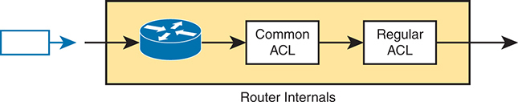

<figcaption>

<aside class="hidden" id="a08fig07">

该图被围在一个长方形框上,并被标记为"路由器内部",代表路由器的内部组件. 从左边开始,一个接入的包会进入路由器,由指向路由器图标的蓝色箭头所象征. 包首先通过路由器,由标准网络路由器符号来描绘. 在路由器内部,包会遇到第一个过滤阶段,被贴上"共同ACL"的标签. 这代表了一个应用跨越多个接口或方向的共同规则的访问控制列表. 在通过"共同ACL"后,包会进入第二个过滤阶段,给"普通ACL"贴上标签,它代表一个访问控制列表,有针对特定接口或方向的特定规则. 流出随包从路由器内部退出而来,以向外指向右边的一发黑箭来表示. 整个过程被封装在一个表示路由器内部处理机制的阴影区域内,清晰地将ACL应用的顺序从路由器内的包的出入口分出.

</aside>

<strong>图8-7</strong> <em>每个接口有两个ACL,每个方向有一个共同ACL</em>

</figcaption>

</figure>

你还在用<strong>ip access-group</strong>命令可以启用两个ACL,但使用不同的语法。<a href="#exa8_13">示例8-13</a>显示如何在路由器的 G0/ 0/1 接口上启用两个ACL,并用<strong>show ip interface</strong>命令。您可能想要将此输出与同一命令的输出比较<a href="v2-06.html#exa6_2">示例6-2</a>从<a href="v2-06.html#ch06">第6章</a>, “<a href="v2-06.html#ch06">IPv4 访问控制列表基础</a>,”取自IOS,因此它没有提到一个常见的ACL. 这里的输出证实了一个出行的普通和常规ACL,但没有入行的ACL.

<strong>示例8-13</strong> <em>启用两个 IP ACL, 出局</em>

<a href="#code-f0176-01" id="f0176-01a">点击此处查看代码原图</a>

<pre class="pre-ex" tabindex="0"><code>R1# <strong>configure terminal</strong>

R1(config-if)# <strong>interface gigabitEthernet 0/0/1</strong>

R1(config-if)# <strong>ip access-group</strong> <strong>common</strong> <strong>common_all unique_01 out</strong>

R1(config-if)# <strong>do show ip interface g0/0/1</strong>

GigabitEthernet0/0/1 is up, line protocol is up

  Internet address is 10.1.12.1/24

  Broadcast address is 255.255.255.255

  Address determined by non-volatile memory

  MTU is 1500 bytes

  Helper address is not set

  Directed broadcast forwarding is disabled

  Multicast reserved groups joined: 224.0.0.5 224.0.0.10 224.0.0.6

  Outgoing Common access list is common_all

  Outgoing access list is unique_01

  Inbound Common access list is not set

  Inbound access list is not set</code></pre>

请注意,增加通用的ACL特性并不能改善您能够与ACL匹配的东西;相反地,Cisco对该特性的动机来源于需要保存多层交换机和一些路由器中硬件ASIC使用的表格中的条目. 第一个<strong>ip access-group</strong>命令,该命令允许一个常见的ACL,需要普通ACL的ACE的表格条目。 但路由器或交换机可以再利用这些. 所以,任何重复<strong>ip access-group</strong>命令,允许同一常见的ACL不需要额外的ASIC表格条目,从而减少该资源的消耗。

注意

IOS 允许一个<strong>ip access-group</strong>用于每个方向的子命令,但不会更多——不管命令是否指一个共同的ACL. 例如,有一个现有的<strong>ip access-group fred out</strong>接口子命令,配置<strong>ip access-group common wilma betty out</strong>接口上的子命令替换已存在的命令。

</section>

<section>

<h4 class="h4" id="ch08lev2sec9">使用 eq 匹配多个不连续端口</h4>

当匹配 TCP 和 UDP 端口号时, Cisco ACLs 已长期支持匹配单个端口与<strong>eq</strong> <em>number</em>参数或带有下列条件的连续端口范围:<strong>range</strong> <em>first-last</em>参数。 然而,为了匹配多个非连续端口,语法需要多个ACE.

IOS XE 添加语法和逻辑,以匹配后最多十个端口号<strong>eq</strong>单个ACE中的关键词. 比如说,命令<strong>permit tcp any any eq 10 12 14 16 18 20</strong>匹配所有有 TCP 头的 IP 包, 并匹配任何端口号 。 换句话说,IOS XE在端口号之间使用逻辑OR,因此可以匹配端口10,或12,或14等.

</section>

</section>

</section>

<section class="ccna-source ccna-appendix" aria-label="答案解析与术语表">
<section data-epub-type="chapter">

<h2 class="h2" id="ref-appc">附录C</h2>

<h2 class="h2a">对“我早就知道了吗?” 的回答。</h2>

<section>

<h3 class="h3" id="ref-appclev1sec8">第8章</h3>

<strong><a id="ref-ques8_1" href="#quess8_1">1</a>.</strong> E。题目列出的命令针对出站数据包启用 ACL。路由器不会对自身创建的数据包应用 ACL 逻辑，因此路由器发送的 OSPF 消息不会触发 ACL 匹配，也不会匹配任何 ACE，所以 ACE 匹配计数器不会增加。所有错误答案都暗示路由器会对自身创建的出站 OSPF 数据包应用 ACL，这并不正确。

<strong><a id="ref-ques8_2" href="#quess8_2">2</a>.</strong> A 和 E。本题中的 DHCP 消息使用以下参数：

<ul class="sq1">

<li>
UDP
</li>

<li>
源地址 172.16.2.1（服务器 S1）
</li>

<li>
源 UDP 端口 67（bootps）
</li>

<li>
目的 IP 地址 172.16.1.1（路由器 R1 上配置了 <strong>ip helper-address</strong> 命令的接口地址）
</li>

</ul>

两个答案使用 <strong>ip</strong> 协议关键字，因此这些 ACE 可以匹配所有使用 IP 和 UDP 的 DHCP 消息。在这两个答案中，正确答案同时匹配服务器的源 IP 地址 172.16.2.1 和任意目的地址。错误答案将源地址和目的地址字段颠倒了，它会匹配发往服务器的数据包，而不是来自服务器的数据包。

在使用 <strong>udp</strong> 协议关键字的三个 ACE 中，一个列出了错误的源端口关键字（使用表示端口 68 的 <strong>bootpc</strong>，而不是表示端口 67 的 <strong>bootps</strong>）。另一个 ACE 列出了错误的目的 IP 地址 0.0.0.0。这三个选项中的正确答案匹配 UDP 协议、源地址 172.16.2.1、源端口 bootps 和任意目的地址。

<strong><a id="ref-ques8_3" href="#quess8_3">3</a>.</strong> A。IOS 支持启用标准 ACL，过滤通过 Telnet 和 SSH 登录路由器的入站尝试。启用的标准 ACL 检查入站数据包的源 IP 地址。不过，由于 IOS 针对尝试登录路由器的数据包应用过滤，因此使用不同的命令和模式来启用 ACL：即正确答案中列出的 vty 模式命令 <strong>access-class</strong> <em>name|number</em> <strong>in</strong>。

<strong><a id="ref-ques8_4" href="#quess8_4">4</a>.</strong> B。在此场景中，数据包具有以下重要协议特征：

<ul class="sq1">

<li>
协议：IP，后面跟随 TCP
</li>

<li>
源地址：子网 172.16.1.0/24
</li>

<li>
源端口：动态端口（大于 49,151）
</li>

<li>
目的地址：172.16.12.1
</li>

<li>
目的端口：22（SSH 的知名端口）
</li>

</ul>

根据这些特征，使用 <strong>udp</strong> 关键字匹配的两个 ACE 都不会匹配这些数据包。其余两个 ACE 都匹配上述信息。IOS 处理 ACL 时采用首次匹配逻辑，因此路由器将使用第 20 行的 ACE 匹配数据包。

<strong><a id="ref-ques8_5" href="#quess8_5">5</a>.</strong> C。Cisco IOS 长期以来支持在每个接口的每个方向（入站或出站）使用一个 IP ACL。例如，<strong>ip access-group acl_01 out</strong> 和 <strong>ip access-group acl_02 in</strong> 命令可以同时存在于一个接口上。但是，如果此时又配置了 <strong>ip access-group acl_03 out</strong> 命令，它将替代 <strong>ip access-group 1 out</strong> 命令，成为该接口唯一的出站 IP ACL。

<strong><a id="ref-ques8_6" href="#quess8_6">6</a>.</strong> B。IOS 支持使用一条命令重新排列 ACL 序列号，并指定起始值和增量。起始值为 50、增量为 20 时，前四个 ACE 将重新编号为 50、70、90 和 110。在使用 <strong>resequence</strong> 以及参数 <strong>50 20</strong> 的三条命令中，只有正确答案的语法和配置模式都正确。ACL 模式下不存在 <strong>resequence</strong> 子命令。

另外两个错误答案也能将 ACL 改为正确的序列号，但需要使用多条命令才能完成，而正确答案只需要一条命令。

</section>

</section>

<section id="ref-glossary"><h2 class="h2a">词汇表</h2>
<strong>ACL 持久性</strong>IOS XE(但不是IOS)的一个特征是路由器初始化事件(power off/ on或再装入)不会导致ACL序列号被重新分配. 此特性可以启用( 默认, 意思是不重排) 或禁用 。

<strong>ACL 重排顺序</strong>ACL命令的序列号重新编号的过程,无论是对于所有路由器初始化时的ACL(功率关闭/上下或重新加载),还是通过使用命令重新编号单个ACL.

<strong>常见的ACL</strong>IOS XE(但不是IOS)的一个功能,支持在单一的接口和方向上实现两个ACL.

<strong>vty ACL (英语).</strong>启用了 IP ACL ,用于将 SSH 和 Telnet 连接到路由器或每个路由器的出行请求<strong>ssh</strong>和<strong>telnet</strong>使用 SSH 或 Telnet 已经连接到路由器的用户发布的命令。

</section>
</section>

<section class="ccna-source ccna-appendix" aria-label="代码原图">
<section data-epub-type="chapter">

<a href="#f0161-01a" id="code-f0161-01">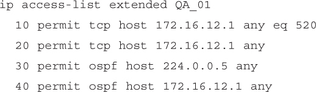</a>

<a href="#f0162-01a" id="code-f0162-01">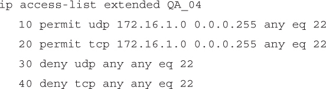</a>

<a href="#f0163-01a" id="code-f0163-01">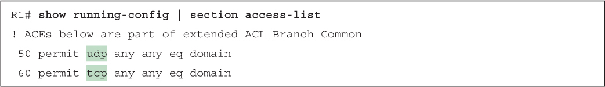</a>

<a href="#f0164-01a" id="code-f0164-01">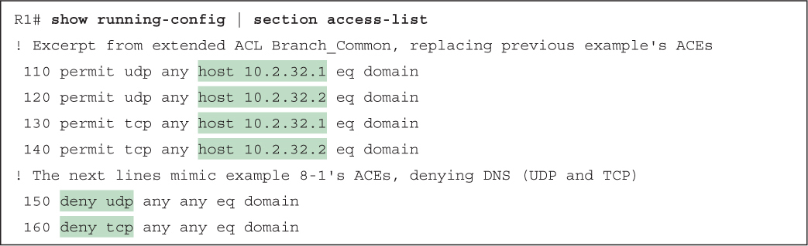</a>

<a href="#f0165-01a" id="code-f0165-01">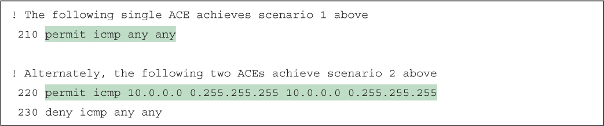</a>

<a href="#f0165-02a" id="code-f0165-02">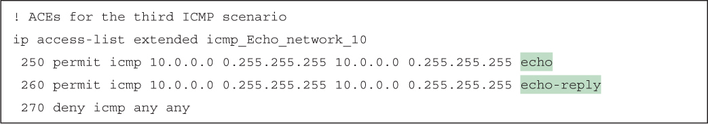</a>

<a href="#f0167-01a" id="code-f0167-01">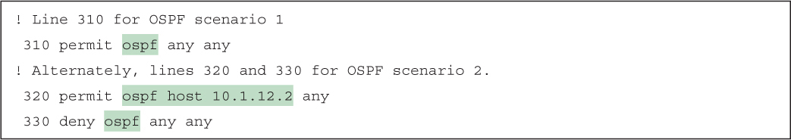</a>

<a href="#f0168-01a" id="code-f0168-01">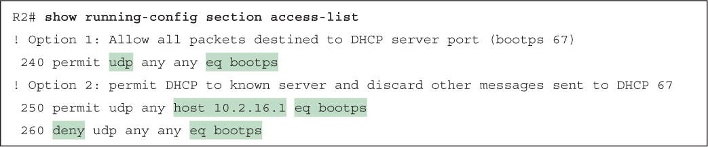</a>

<a href="#f0168-02a" id="code-f0168-02">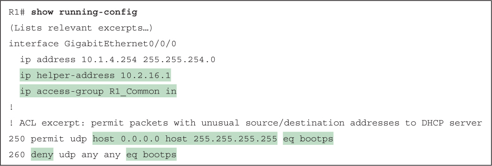</a>

<a href="#f0170-01a" id="code-f0170-01">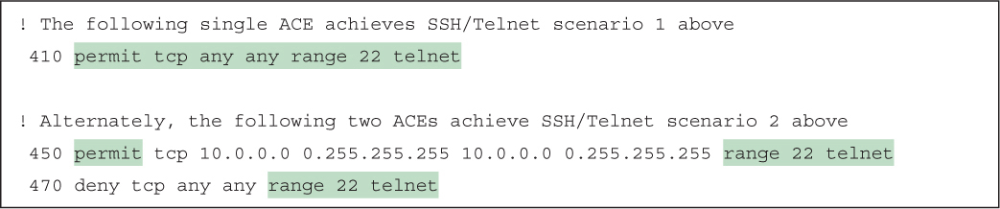</a>

<a href="#f0171-01a" id="code-f0171-01">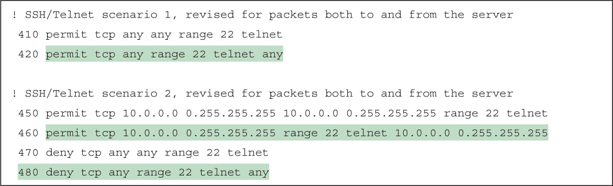</a>

<a href="#f0172-01a" id="code-f0172-01">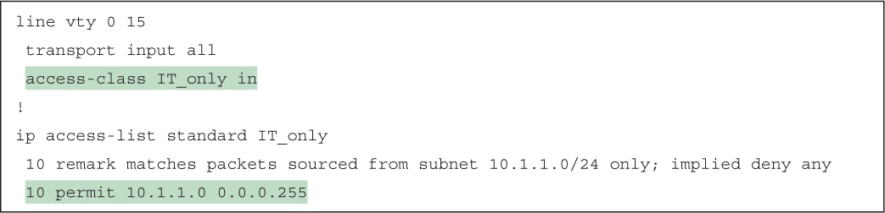</a>

<a href="#f0173-01a" id="code-f0173-01">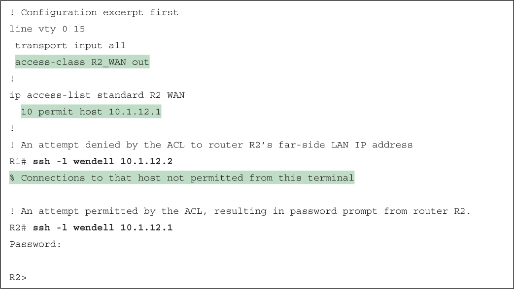</a>

<a href="#f0175-01a" id="code-f0175-01">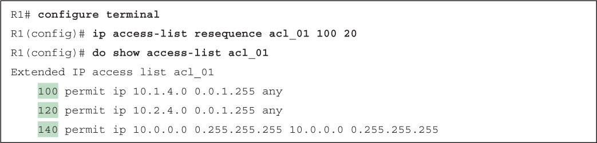</a>

<a href="#f0176-01a" id="code-f0176-01">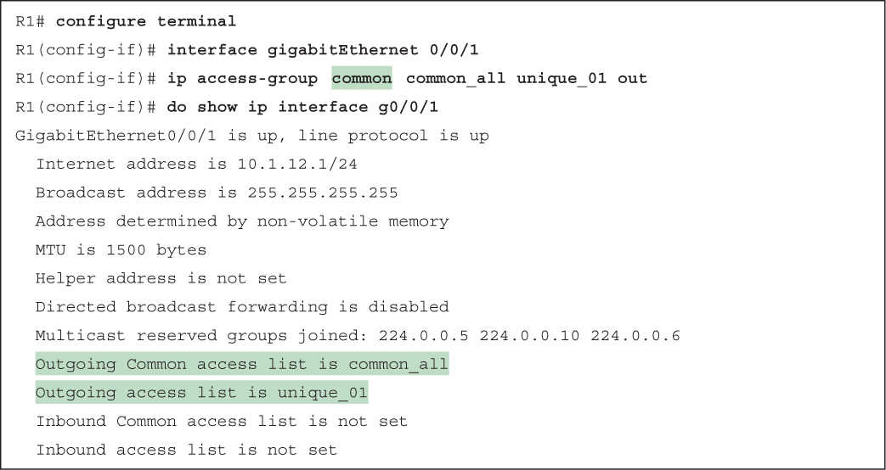</a>

</section>

</section>


<nav class="ccna-chapter-nav" aria-label="章节导航"><a href="v2-07.html">← 上一章</a><a href="v2-09.html">下一章 →</a></nav>
