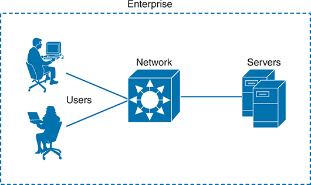
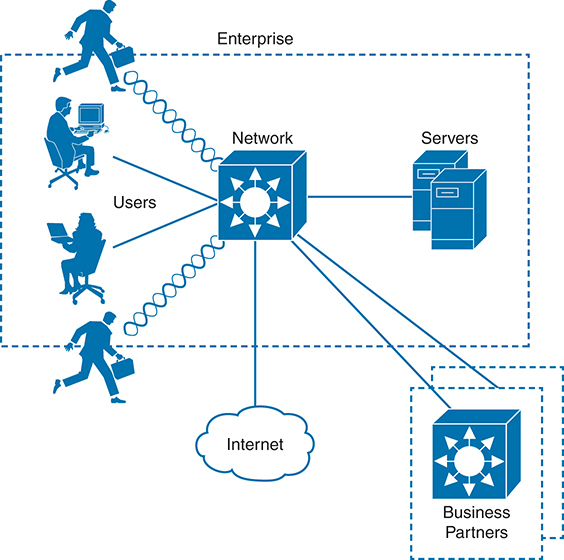
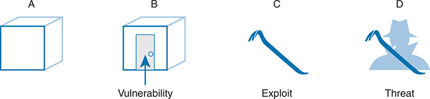
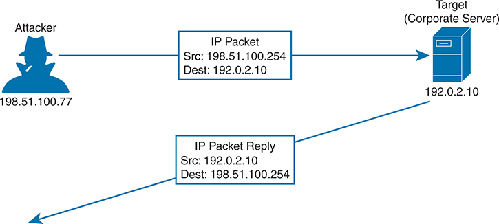
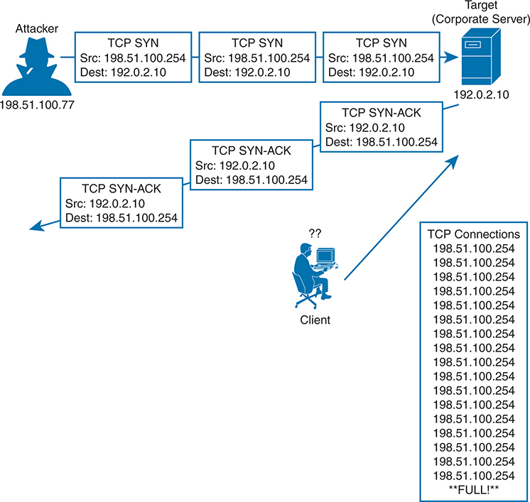
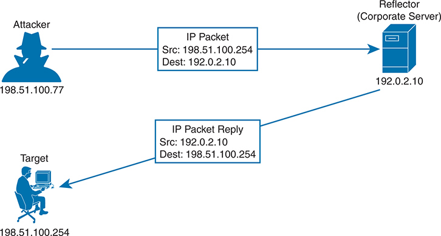
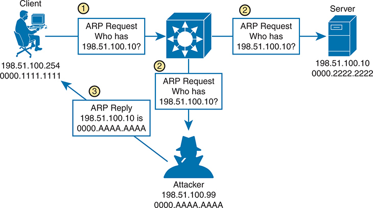
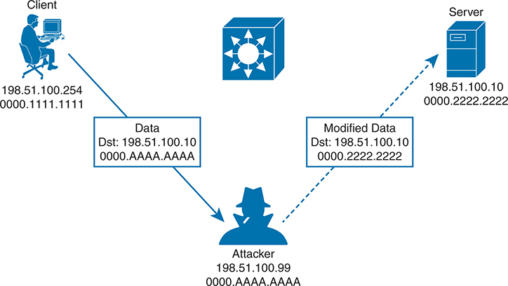
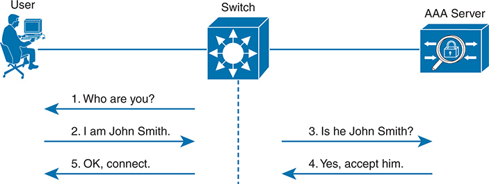

<a href="{{ '/subjects/CCNA/' | relative_url }}">← 返回 CCNA 目录</a>

第二卷 · 安全服务

<nav class="ccna-chapter-nav" aria-label="章节导航"><a href="v2-08.html">← 上一章</a><a href="v2-10.html">下一章 →</a></nav>



<section data-epub-type="chapter">

<h2 class="h2" id="ch09">第 9 章</h2>

<h2 class="h2a">安全架构</h2>

本章涵盖以下考试主题：

5.0 安全基础

5.1 定义关键安全概念（威胁、漏洞、漏洞利用和缓解技术）

5.2 描述安全计划的要素（用户意识、培训和物理访问控制）

5.4 描述安全密码策略的要素，例如管理、复杂度和密码替代方案（多因素身份验证、证书和生物识别）

5.8 比较身份验证、授权和记账的概念

学习各种网络技术时，你的注意力可能一直集中在使用网络设备构建能正常工作的网络。毕竟，网络应该让数据自由流动，使所有连接的用户都获得良好的体验，对吗？遗憾的是，并非所有连接的用户都值得信任，都会遵守规则并规范使用网络。本章将介绍企业网络中许多可能被利用的方面，以及相应的保护方法。

<section>

<h3 class="h3" id="ch09lev1sec1">“这些知识我已经掌握了吗？”自测</h3>

如果你希望根据得分决定在本章投入多少时间，可以完成这组自测题（在此作答，或使用 PTP 软件）。各题答案的选项字母列在自测题之后的页面底部。书末和配套网站上的<a href="#ref-appc">附录 C</a>都包含答案及解析。你也可以在 PTP 测试软件中找到答案及解析。

<figure class="table" id="ch09tab01" tabindex="0">

<figcaption>

<strong>表9-1</strong> “这些知识我已经掌握了吗？”核心主题小节与题目对应关系

</figcaption>

<table class="all">

<tbody>

<tr>

<th class="th">
基础知识小节
</th>

<th class="th">
题目
</th>

</tr>

<tr>

<td class="border">
安全术语
</td>

<td class="border">
1、2
</td>

</tr>

<tr>

<td class="border">
常见安全威胁
</td>

<td class="border">
3–7
</td>

</tr>

<tr>

<td class="border">
控制和监测用户访问
</td>

<td class="border">
8
</td>

</tr>

<tr>

<td class="border">
制定教育用户的安全方案
</td>

<td class="border">
9
</td>

</tr>

</tbody>

</table>

</figure>

<strong><a id="quess9_1" href="#ques9_1a">1</a>.</strong>以下哪一个术语意味着什么,可以被认为是一种会损害安全的弱点?

<ol class="lower-alpha">

<li>
漏洞利用
</li>

<li>
漏洞
</li>

<li>
攻击
</li>

<li>
威胁
</li>

</ol>

<strong><a id="quess9_2" href="#ques9_2a">2</a>.</strong>利用脆弱性的实际潜力是以下哪一个术语?

<ol class="lower-alpha">

<li>
漏洞
</li>

<li>
攻击
</li>

<li>
漏洞利用
</li>

<li>
威胁
</li>

</ol>

<strong><a id="quess9_3" href="#ques9_3a">3</a>.</strong>在一次偷袭中,以下哪些参数通常被偷袭? (取出二个答.

<ol class="lower-alpha">

<li>
MAC 地址
</li>

<li>
源 IP 地址
</li>

<li>
目的 IP 地址
</li>

<li>
ARP地址
</li>

</ol>

<strong><a id="quess9_4" href="#ques9_4a">4</a>.</strong>假设攻击者用TCP SYN旗集向目的地IP地址发送了一系列包,但没有发送其他包类型. 下列哪些袭击可能发生?

<ol class="lower-alpha">

<li>
偷袭
</li>

<li>
反射攻击
</li>

<li>
侦察攻击
</li>

<li>
拒绝服务攻击
</li>

<li>
其他答案都不正确。
</li>

</ol>

<strong><a id="quess9_5" href="#ques9_5a">5</a>.</strong>在反射攻击中,攻击包中的源IP地址被 spoofed,使其包含以下哪一个实体?

<ol class="lower-alpha">

<li>
攻击者的地址
</li>

<li>
反射器的地址
</li>

<li>
受害人的住址
</li>

<li>
路由器的地址
</li>

</ol>

<strong><a id="quess9_6" href="#ques9_6a">6</a>.</strong>在一次成功的"人入中"攻击中,以下两个动作中哪一个是最有可能出演的攻击者?

<ol class="lower-alpha">

<li>
窃听宿主之间的交通
</li>

<li>
在多个主机上触发缓冲溢出
</li>

<li>
修改主机之间传递的数据
</li>

<li>
使用 ping 扫描和端口扫描来发现网络
</li>

</ol>

<strong><a id="quess9_7" href="#ques9_7a">7</a>.</strong>以下哪一个是野蛮人攻击的目标?

<ol class="lower-alpha">

<li>
尝试每个可能的 TCP 端口, 直到服务答案 。
</li>

<li>
尝试所有可能的键盘字符组合来猜测用户的密码 。
</li>

<li>
启动一个子网中每个可能的主机的拒绝服务操作.
</li>

<li>
调查一个组织里所有可能的IP地址
</li>

</ol>

<strong><a id="quess9_8" href="#ques9_8a">8</a>.</strong>以下哪一个是AAA服务器的例子?.

<ol class="lower-alpha">

<li>
DHCP
</li>

<li>
DNS
</li>

<li>
SNMP
</li>

<li>
ISE
</li>

</ol>

<strong><a id="quess9_9" href="#ques9_9a">9</a>.</strong>实际出入控制很重要,原因如下:

<ol class="lower-alpha">

<li>
它防止未经授权的人坐在公司用户的办公桌旁并使用他们的电脑。
</li>

<li>
它能防止用户发怒并破坏计算机设备.
</li>

<li>
它防止未经授权进入网络壁橱.
</li>

<li>
它可以防止火灾摧毁数据中心。
</li>

</ol>

“这些知识我已经掌握了吗？”自测答案：

<strong><a id="ques9_1a" href="#ref-ques9_1">1</a></strong> B

<strong><a id="ques9_2a" href="#ref-ques9_2">2</a></strong> D

<strong><a id="ques9_3a" href="#ref-ques9_3">3</a></strong> A、B

<strong><a id="ques9_4a" href="#ref-ques9_4">4</a></strong> D

<strong><a id="ques9_5a" href="#ref-ques9_5">5</a></strong> C

<strong><a id="ques9_6a" href="#ref-ques9_6">6</a></strong> A、C

<strong><a id="ques9_7a" href="#ref-ques9_7">7</a></strong> B

<strong><a id="ques9_8a" href="#ref-ques9_8">8</a></strong> D

<strong><a id="ques9_9a" href="#ref-ques9_9">9</a></strong> C

</section>

<section>

<h3 class="h3box" id="ch09lev1sec2">基础主题</h3>

</section>

<section>

<h3 class="h3" id="ch09lev1sec3">安全术语</h3>

在一个完美的世界中,你可能会建立一个支持企业中每个用户的网络,其假设是每个用户都是已知的,每个用户都被批准访问网络上的一切,每个用户会完全按照一些公司准则使用现有资源. 网络显示于<a href="#ch09fig01">图9-1</a>可能代表了这种情景。 即使是这种理想,封闭的系统也不完全安全,因为用户可能决定行为不端来烦扰同事或在公司服务器上查看应该加以限制或保密的信息.

<figure class="image-c" id="ch09fig01">

<figcaption>

<aside class="hidden" id="a09fig01">

该图描绘了企业环境中的简化网络架构. 在左边,有两个用户使用台式计算机和膝上型计算机坐在桌子上。 第一个用户被描绘在左上方,是一个与桌面计算机互动的男性人物. 第二个用户位于左下方,是一个在笔记本电脑上工作的女性人物. 两个用户都连接到一个中央网络设备上,以一个大而分级的框为代表,多向外指向箭头,表示数据流. 这个中央网络组件被贴上"网络"的标签. 从这个网络设备中,一条单行延伸至右侧,连接到位于图像最右侧的一对服务器单元. 这些服务器被堆放并被贴上服务器的标签,表明它们在企业内部存储和管理数据中的作用. 整个设置被围在一个被标注为"企业"的点状矩形内部,表明这种网络配置是特定于一个组织的内部运作.

</aside>

<strong>图9-1</strong> <em>企业封闭系统实例</em>

</figcaption>

</figure>

现在考虑,几乎没有任何企业使用这种有限、封闭的环境。 毕竟,企业可能想要以某种方式连接到公共互联网上,也许与一些公司伙伴连接起来。 为了方便起见,它也可能希望让工人能够移动并携带笔记本电脑、平板电脑和智能手机进出公司边界。 企业可能希望为来访的来宾提供网络访问. 如果企业向其雇员(和来宾)提供无线连接,它也可能不知不觉地向信号范围内的人提供无线接入。 还有列表继续。 随着网络及其连通性扩大,<a href="#ch09fig02">图9-2</a>显示,企业在维护周围安全、封闭的边界方面将面临更大的困难。

<figure class="image-c" id="ch09fig02">

<figcaption>

<aside class="hidden" id="a09fig02">

该图描绘了企业环境中更为复杂的网络架构,并包括与外部实体的互动. 在中心区域,用多向外指向的箭头显示一个大而分级的网络设备,代表了数据流. 此设备被标签为 Network 。 左边,在被贴上"企业号"标签的点状矩形内,有三个用户:左上方的男性数字使用桌面计算机;左下方的女性数字使用笔记本电脑;而左下方的另一个男性数字运行在网络设备上,携带公文包. 这些用户通过行连接到网络设备,表示他们进入网络. 在网络设备的右侧,两个服务器单元被堆放并被贴上"服务器"的标签,表明它们在数据存储和管理中的作用. 在网络设备下方,一条线连接了被标注为"云形"的图标互联网,代表企业与更广大的互联网的连接. 此外,另一行从网络设备延伸至右下角,导致另一条被标注为"商业伙伴"的点状矩形. 在这个矩形内部,还有一个类似于中央的网络设备,表明商业伙伴有他们的网络基础设施与企业网络相接.

</aside>

<strong>图9-2</strong> <em>一个超越自身边界的示例企业</em>

</figcaption>

</figure>

要开始保护一个网络, 你首先需要了解它可能有什么问题。 如A部分所示,将企业网络视为一个简单的箱形设施。<a href="#ch09fig03">图9-3</a>。当所有墙壁,地上和天花板都由非常坚固的材料所制而出并非常厚厚时,盒子内的内容很可能保持安全而不会被伤害或被盗窃. 然而,店主可能很难进出盒子。

<figure class="image-c" id="ch09fig03">

<figcaption>

<aside class="hidden" id="a09fig03">

A部分显示一个简单的三维框,代表一个未受影响的系统. B部分描绘出一个相似的盒子,一箭指向其表面的特定地段,被贴上"脆弱性"的标签,表明系统潜在的弱点. C部分的特点是被贴上标签的 " 剥削 " ,象征着利用脆弱性的工具或方法。 D部分显示一个戴有帽子和掩码,被贴上标签的威胁的人的相片,代表着一个利用剥削来造成伤害的实体.

</aside>

<strong>图9-3</strong> <em>安全术语</em>

</figcaption>

</figure>

假设为方便起见引入了一扇门,如以下B部分所示:<a href="#ch09fig03">图9-3</a>。店主现在可以来去去 但其他人也一样 即使门被锁上,也可能有人想出办法把门打开并进入里面的宝藏. 因为没有门是坚不可摧的,所以门变成了一个<a id="key_122" href="#ref-gloss_372">漏洞</a>。在安全方面,脆弱性是任何可被视为会损害数据完整性或系统运作方式等其他东西安全的弱点。

仅仅因为存在脆弱性,没有什么是必然会受到威胁的。 在被锁入的门例中,只有被信任的主人才能打开门,除非使用密钥以外的某种工具. 这种工具可用于利用脆弱性。 事实上,工具本身被称为<a id="key_106" href="#ref-gloss_136">漏洞利用</a>,如Pry Bar在其中C部分所示,<a href="#ch09fig03">图9-3</a>。剥削如果用来对付目标弱点或脆弱性以外的任何情况,就不会非常有效。

从技术上讲,像打探吧这样的剥削本身就不太有效。 得有人捡起并用来对付脆弱. D部分<a href="#ch09fig03">图9-3</a>一个恶意的用户拥有了打字栏,并打算用它打开被锁入的门. 现在有潜入,破坏,偷盗,或者以其他方式擅自修改的东西的实际可能性. 这被称为<a id="key_119" href="#ref-gloss_342">威胁</a>.

在网络、系统、工作站和应用程序的信息技术世界中,有许多不同的弱点和被恶意用户所利用来成为对一个组织及其数据的威胁。 本章的其余部分概述了其中的许多,以及一些你能够利用的技术来抵消或防止恶意活动。 此类措施称为:<a id="key_109" href="#ref-gloss_211">减缓技术</a>。你也许在想一些办法<a href="#ch09fig03">图9-3</a>建筑物业主可以减轻攻击的威胁。 也许车主可以在门上加上更坚固,更安全的锁,一个更坚固的门框来抵御偷窥势力,或者一个警报系统来侦测入侵并提醒当局.

</section>

<section>

<h3 class="h3" id="ch09lev1sec4">常见安全威胁</h3>

因为现代企业网络通常由许多部分组成,所有部分都一起工作,所以保障这些网络可以成为一项非常复杂的任务. 与简单的盒子类比一样,在查明许多弱点、评估现有的许多剥削现象并意识到威胁可能来自何处之前,你无法有效地设法确保这种脆弱性。 只有这样,适当的反措施和缓解措施才能到位。

您还应当考虑企业资源中应当被保护和保存的一些重要属性. 在你努力处理本章讨论的许多威胁时,要想一想使威胁成为可能的脆弱性和剥削。 注意企业网络中有多少不同部分表现出了脆弱性,以及如何利用这些弱点来策划这些威胁。

<section>

<h4 class="h4" id="ch09lev2sec1">伪造地址的攻击</h4>

当系统正常运行时,参数和服务就可以被信任和有效使用. 例如,当机器发送IP包时,每个人都期望源IP地址是机器自己的IP地址. 以太网帧的源MAC地址预计将是发送者自己的MAC地址. 甚至像 DHCP 和 DNS 这样的服务也应该效仿;如果机器发送 DHCP 或者 DNS 请求,它期望任何 DHCP或者 DNS 的回复都来自一个合法,可信赖的服务器.

<a id="key_118" href="#ref-gloss_331">偷袭</a>重点强调一种脆弱性;地址和服务往往被隐含地信任。 攻击通常是通过用假值或假值来取而代之。 寻址攻击可以是简单和直截了当的,其中一个地址值被取而代之。

例如,攻击者可以使用被偷取的源IP地址而不是自己的IP地址发送包,如以下所示:<a href="#ch09fig04">图9-4</a>。当目标收到包裹时,它会将流量发回被窃取的地址,而不是攻击者的实际地址. 如果所覆盖的地址存在,那么带有该地址的不值得怀疑的主机将接收该数据包. 如果地址不存在,则数据包将被转发,然后在网络中进一步删除。

<figure class="image-c" id="ch09fig04">

<figcaption>

<aside class="hidden" id="a09fig04">

左侧有被贴上198.51.100.77标签的被蒙面攻击者的图标. 一个被标注为 I P P Packet 从攻击者指向右侧的目标,一个蓝色的服务器图标被标注为目标(Corporate Server),并带有 I P 地址192.0.2.10. I P 包由源代码 Src 指定:198.51.100.254和目的地 Dest :192.0.2.10,表示被窃取的源地址. 下面又一箭标有"I P Packet Response"从目标回向攻击者,出自源 Src:192.0.2.10和目的地 Dest:198.51.100.254. 这说明了攻击者如何向目标服务器发送被偷取的包,使服务器回复被偷取的源地址.

</aside>

<strong>图9-4</strong> <em>偷袭样本</em>

</figcaption>

</figure>

攻击者也可以发送被 spoofed MAC 地址,在Lale 2 交换机使用的转发表或其他主机和路由器使用的ARP表格中添加虚假信息. DHCP请求有被spoofed MAC地址的,也可以被发送到合法的DHCP服务器上,填充其地址租赁表,没有留下免费IP地址供正常使用.

请注意:<a href="v2-11.html#ch11">第11章</a>, “<a href="v2-11.html#ch11">实现交换机端口安全</a>,”讨论一个可用于帮助缓解MAC地址偷窥的工具. 单位<a href="v2-12.html#ch12">第12章</a>, “<a href="v2-12.html#ch12">DHCP 侦听与 ARP 检测</a>,"你可以更多地了解动态 ARP 检测(DAI)以及如何使用它来用ARP来缓解IP地址的盗取.

<section>

<h5 class="h5" id="ch09lev3sec1">拒绝服务攻击</h5>

在企业应用程序的正常运行中,客户打开与企业服务器的连接来交换信息. 这一行动可以采取网上会议的形式,向内部用户以及因特网上的外部用户开放。 这个过程很简单:用户打开一个网络浏览器到公司网站,然后打开一个与公司网络服务器的TCP连接;然后可以进行一些交易. 如果所有用户行为良好,进行合法交易,公司服务器(希望)没有受到压力,许多客户可以正常做生意.

现在假设一个恶意用户找到一个方法打开一个不正常的连接到同一个公司服务器. TCP连接开始于恶意用户向服务器发送SYN旗,但源IP地址被假地址所取代. 服务器将TCP连接添加到它的客户端连接表上并用SYN-ACK回复了假地址. 由于假地址不涉及TCP连接,因此没有ACK回复来完成TCP三相握手. 不完全的连接一直停留在服务器的表格中,直到它最终时断并被去除. 在此期间,攻击者可以尝试以服务器的连接表所填充的速度打开许多,更多的异常连接. 此时,服务器已无法与合法用户保持TCP连接,因此其业务交易全部停止.<a href="#ch09fig05">图9-5</a>说明这一进程。

<figure class="image-c" id="ch09fig05">

<figcaption>

<aside class="hidden" id="a09fig05">

左侧有被贴上198.51.100.77标签的被蒙面攻击者的图标. 一系列被标记为TCPSYN从攻击者到右侧的目标的箭头,一个蓝色的服务器图标被标记为目标(Corporate Server),并有IP地址192.0.2.10. 每个 TCPSYN 包以源代码Src来指定:198.51.100.254和目的地 Dest:192.0.2.10,表示发送了多个SYN 请求. 服务器用TCPSYN-ACK包回复,用箭头向回指向攻击者显示,攻击者不完成握手. 下面,一个客户端被描绘出头上方的双问号,通过箭头连接到服务器上,说明正当的流量难以通过. 在右下方,一个名为 TCP Connections 的列表显示多个条目为198.51.100.254,表示由于SYN 请求的泛滥,服务器的连接表是满的.

</aside>

<strong>图9-5</strong> <em>拒绝服役的样本</em>

</figcaption>

</figure>

当攻击者能够耗尽系统资源时,服务和系统就会变得无法使用或崩溃. 这叫做<a id="key_103" href="#ref-gloss_105">拒绝服务(DoS)攻击</a>因为它拒绝为合法用户或业务提供服务。 DoS攻击可以涉及ICMP回音(平)包,一阵UDP包的洪水等简单的东西,以及TCP连接,如之前所描述的TCP SYN洪水攻击. 如果一个系统在被利用的交通协议或交通类型方面有弱点,这种攻击就能够取得成功。

攻击者通过征集许多其他系统参与,可以更进一步地携带DoS的想法. 为了做到这一点,攻击者在互联网的某个地方安装了一台主控制计算机. 接下来,许多计算机必须首先通过利用这些机器中存在的弱点来感染恶意代码或恶意软件. 每台机器在等待主控制下的命令时,都无声地变成一个“机器人”,似乎正常运行。 当攻击开始的时候,主控制器向每个机器人发出一个指令并告诉它启动对单个目标宿主的拒绝服务攻击. 这叫做<a id="key_105" href="#ref-gloss_116">分布式拒绝服务攻击(DDoS)</a>因为攻击分布在一大批的bots, 全部被淹没或攻击同一个目标。

</section>

<section>

<h5 class="h5" id="ch09lev3sec2">反射与放大攻击</h5>

记得在一次偷袭中,攻击者向目标发送了带有偷袭源地址的包裹. 目标是迫使目标处理被偷盗的交通,并将交通退回到一个不存在的来源。 攻击者不关心返回交通的去向或无法成功交付.

在某种相关的攻击中,攻击者再次向现场主机发送了带有被窃取的源地址的包裹. 然而,宿主并不是预定目标;目标是让宿主反映对目标被窃取的地址的交换. 这被称为<a id="key_115" href="#ref-gloss_286">反射攻击</a><em>,</em>如所示<a href="#ch09fig06">图9-6</a>,而反映向目标流量的宿主称为反射器. 攻击者还可能将被偷取的包发去多个反射器,使目标收到多份出乎意料的流量.

<figure class="image-c" id="ch09fig06">

<figcaption>

<aside class="hidden" id="a09fig06">

攻击者,由贴有 I P 地址的 silhouette 人物代表 198.51.100.77 ,向反射器发送 I P 包。包的来源 I P 地址被模糊为 198.51.100.254 ,而目的地 I P 地址是 192.0.2.10 ,这是反射器的地址。反射器被描绘成带有 IP 地址标签的服务器。 192.0.2.10 ,接收数据包并发送一个 I P 数据包回复。这个答复数据包有反射器的源 I P 地址( I) 。 192.0.2.10 ),并指定为属于目标的被窃取的源 I P 地址。该目标以使用计算机的人身份被显示,并带有 I P 地址的标签。 198.51.100.254 ,从反射器收到回复包。

</aside>

<strong>图9-6</strong> <em>样本反射攻击</em>

</figcaption>

</figure>

反射攻击的影响可能似乎有限,因为单一的目标宿主是被害者,向目标反映的流量与攻击者发送的包裹成正比. 如果攻击者向反射器发送了少量流量,并利用协议或服务产生大量流量向目标移动,则<a id="key_100" href="#ref-gloss_033">扩大攻击</a>已经发生。 实际上,这种攻击扩大了攻击者破坏目标的努力。 另一个结果是,可以消耗出大量的网络带宽,使扩大的流量向目标前进,特别是在涉及许多反射器的情况下。 过去曾利用DNS和NTP的一些机制为放大攻击时巨大的带宽消耗设定了新的记录.

</section>

<section>

<h5 class="h5" id="ch09lev3sec3">中间人攻击</h5>

许多类型的攻击旨在破坏或直接损害目标系统,往往产生明显的结果。 有时攻击者可能会想偷听从一台机器传到另一台机器的数据,而避免被检测出. A 个<a id="key_108" href="#ref-gloss_203">中途攻击</a>通过让攻击者悄悄地 绕入通信通道 作为两个目标系统之间的中介

一类人入中攻击利用了每个主机维护的ARP表来与它本地网络部分上的其他主机进行交流. 通常情况下,如果一个主机需要向另一个主机发送数据,它会在其ARP表中寻找目的地主机. 如果找到一个条目,可以直接将以太网帧发送到目的地MAC地址;否则,发送者必须播放包含目的地IP地址的ARP请求并等待目的地用ARP回复和自己的MAC地址回答.

<a href="#ch09fig07">图9-7</a>说明一次成功的中途攻击。

<figure class="image-c" id="ch09fig07">

<figcaption>

<aside class="hidden" id="a09fig07">

情节包括一个客户端,一个攻击者,一个服务器,和一个网络交换机. 客户端显示为使用计算机的人,并被标注为 IP地址198.51.100.254和MAC地址0000.1111.1111,发送地址解析协议(ARP)请求,要求谁拥有198.51.100.10?以识别服务器的MAC地址. 此请求通过网络交换机转发. 网络交换机被描绘为中央设备,将ARP请求传递给合法的服务器和攻击者. 服务器作为服务器图标显示,其IP地址为198.51.100.10和MAC地址为0000.2222.2222,也接收了ARP请求. 攻击者以IP地址198.51.100.99和MAC地址0000dot AAAAAAAAA=为代表,发送了假的ARP回复,表示198.51.100.10dot AAAA AAAAAA为0000dot AAAA,从而将服务器的IP地址与攻击者的MAC地址联系起来. 这个恶意的ARP回复被发送给客户端.

</aside>

<strong>图9-7</strong> <em>曼-入中攻击开始</em>

</figcaption>

</figure>

在1步骤中,一个客户端广播了ARP请求,以了解主机使用什么MAC地址,IP地址为198.51.100.10. 在2步骤中,ARP请求被淹没到广播领域的所有主机. 这使得攻击者可以偷听ARP的请求并准备利用所学到的信息. 198.51.100.10的合法拥有者确实可以如所料用自己的ARP答复和真实的MAC地址作出答复。 然而,在步骤3中,攻击者只是等待了一小段时间,然后发送了包含自己MAC地址而不是实际去向的被偷取的ARP回信. 目标是让攻击者发送最后的ARP回复,使任何收听主机都会用最新的信息来更新其ARP表.

这一过程实际上毒害了任何系统接收虚假的ARP答复的ARP表条目。 从那时起,一个被毒害的系统会盲目地向攻击者的MAC地址推进交通,现在他正在伪装成目的地. 攻击者能够知道真正的目的地的MAC地址,因为攻击者从目的地主机收到更早的ARP回复.<a href="#ch09fig08">图9-8</a>描述最终结果。 攻击者可以通过将ARP条目毒化到多台主机上来重复这一过程,然后在不易被检测的情况下在它们之间进行接力交通.

<figure class="image-c" id="ch09fig08">

<figcaption>

<aside class="hidden" id="a09fig08">

涉及相同的四个实体:客户端,攻击者,服务器,以及网络交换机. 客户端以 IP 地址198.51.100.254和 MAC 地址0000.1111.1111 标注,发送用于服务器的数据. 贴有目的地I P地址198.51.100.10和目的地MAC地址0000dot AAAAAA的相接数据包被攻击者拦截. 攻击者被显示为IP地址198.51.100.99和MAC地址0000dot AAAAAAAAA,接收客户端的数据. 在截取数据后,攻击者可以在将数据转发给合法的服务器之前修改数据. 修改后的数据包随后被发送到服务器上,服务器被描绘为服务器图标,其I P地址为198.51.100.10和MAC地址为0000.2222.2222. 服务器接收被更改的数据,不知不觉中是被破坏的通信的一部分.

</aside>

<strong>图9-8</strong> <em>中层人物攻击成功</em>

</figcaption>

</figure>

在攻击者在两个主机之间插入后,他们可以被动地监听和检查它们之间经过的所有交通. 攻击者也可以发挥积极作用并修改通过的数据。

</section>

<section>

<h5 class="h5" id="ch09lev3sec4">地址欺骗攻击小结</h5>

攻击者的目标是以恶意方式掩饰自己的身份并愚弄其他系统。 使用<a href="#ch09tab02">表9-2</a>以审查每一攻击类型的概念和特征。

<figure class="table" id="ch09tab02" tabindex="0">

<figcaption>

<strong>表9-2</strong>窃取地址袭击摘要

</figcaption>

<table class="all">

<tbody>

<tr>

<th class="th">
目标
</th>

<th class="th">
DoS/DDoS
</th>

<th class="th">
反射
</th>

<th class="th">
放大
</th>

<th class="th">
中间人攻击
</th>

</tr>

<tr>

<td class="border">
用尽系统服务或资源; 崩溃目标系统
</td>

<td class="border">
是
</td>

<td class="border">
是
</td>

<td class="border">
是
</td>

<td class="border">
否
</td>

</tr>

<tr>

<td class="border">
欺骗一个不知不觉的共犯主机 发送流量到目标
</td>

<td class="border">
否
</td>

<td class="border">
是
</td>

<td class="border">
是
</td>

<td class="border">
否
</td>

</tr>

<tr>

<td class="border">
窃听流量
</td>

<td class="border">
否
</td>

<td class="border">
否
</td>

<td class="border">
否
</td>

<td class="border">
是
</td>

</tr>

<tr>

<td class="border">
修改经过的流量
</td>

<td class="border">
否
</td>

<td class="border">
否
</td>

<td class="border">
否
</td>

<td class="border">
是
</td>

</tr>

</tbody>

</table>

</figure>

</section>

</section>

<section>

<h4 class="h4" id="ch09lev2sec2">侦察攻击</h4>

当攻击者打算对一目标发起攻击时,攻击者可能想要识别出一些弱点来使攻击能够有重点地进行并更加有效. A 个<a id="key_114" href="#ref-gloss_284">侦察攻击</a>可用于在实际攻击前发现更多关于目标及其系统的详情.

在侦察攻击中,攻击者可以使用一些常见的工具来揭开公共细节,比如谁拥有一个域以及在那里使用的IP地址范围. 举例来说,<strong>nslookup</strong>命令存在于许多操作系统中,可以进行DNS查询,从一个完全合格的域名中解决IP地址. 如果攻击者知道一个企业的域名,nslookup可以透露域名的拥有者和注册到它的IP地址空间. 密码<strong>whois</strong>和<strong>dig</strong>命令是补充工具,可以查询DNS信息,以揭示域名拥有者,联系人信息,邮件服务器,权威名称服务器等的详细信息.

然后攻击者可以进步到使用ping扫码将ping发送到目标范围内的每个IP地址. 回答"打平"搜索的宿主,然后成为活靶. 然后,端口扫描工具可以扫描到一系列的UDP和TCP端口,以查看目标主机在任何端口号上的答案. 任何答复都表明目标主机正在运行相应的服务.

记住,侦察攻击不是真正的攻击,因为没有任何东西因此被利用。 它用于收集关于目标系统和服务的信息,以便利用其他类型的攻击来发现和利用脆弱性。

</section>

<section>

<h4 class="h4" id="ch09lev2sec3">缓冲区溢出攻击</h4>

操作系统和应用通常使用缓冲和临时内存空间来读取并写入数据. 当一个系统与另一个系统通信时,缓冲器也很重要,因为IP包和以太网帧来去. 只要内存空间得到妥善维护并数据被放置在正确的缓冲边界内,一切都应该如预期的那样工作.

然而,有些系统和应用存在可使缓冲物溢出的脆弱性。 这意味着,如果允许一个缓冲器超过其极限进行填充,一些入来的数据可能会被存储在出乎意料的内存位置. 攻击者可以通过发送大于预期的数据来利用这一条件,在所谓的“a”中。<a id="key_102" href="#ref-gloss_056">缓冲溢出攻击</a>。如果存在脆弱性,目标系统可能储存数据,将其缓冲器溢入另一个内存领域,最终使一个服务或整个系统崩溃. 攻击者也许还可以通过在其中插入恶意代码来特别地将大消息作手脚. 如果目标系统由于缓冲溢出而存储了这些数据,那么它就有可能在不意识到的情况下运行恶意代码.

</section>

<section>

<h4 class="h4" id="ch09lev2sec4">恶意软件</h4>

某些类型的安全威胁可能以恶意软件的形式出现,或<a id="key_107" href="#ref-gloss_200">恶意软件</a>。例如,a<a id="key_120" href="#ref-gloss_344">特洛伊木马</a>是一种恶意软件,它被隐藏和包装在看起来正常和合法的其它软件中。 如果一个善意的用户决定安装它,特洛伊马软件也被静悄悄地安装. 之后恶意软件可以自行对本地系统或其他系统进行攻击. 特洛伊马恶意软件只能通过用户交互,如打开电子邮件附件,从互联网上下载软件,以及将USB驱动器插入到计算机中等,从一台计算机中传播到另一台计算机.

相比之下,<a id="key_121" href="#ref-gloss_368">病毒</a>是恶意软件 可以更方便地在系统之间传播。 要传播,病毒软件必须自己注入另一个应用程序,然后依靠用户将被感染的应用软件运送到其他被害者.

另一种类型的恶意软件能够自行向其他系统传播并感染其他系统。 一个攻击者正在发展<a id="key_125" href="#ref-gloss_380">蠕虫</a>软件并存入一个系统。 从那开始,虫子自我复制,并通过自身的脆弱性传播到其他系统,再复制并反复地传播.

总而言之,<a href="#ch09tab03">表9-3</a>列出本节所描述的每一种恶意软件背后的关键想法。

<figure class="table" id="ch09tab03" tabindex="0">

<figcaption>

<strong>表9-3</strong>恶意类型摘要

</figcaption>

<table class="all">

<tbody>

<tr>

<th class="th">
特征
</th>

<th class="th">
特洛伊木马
</th>

<th class="th">
病毒
</th>

<th class="th">
蠕虫
</th>

</tr>

<tr>

<td class="border">
装入了其他软件
</td>

<td class="border">
是
</td>

<td class="border">
否
</td>

<td class="border">
否
</td>

</tr>

<tr>

<td class="border">
自注入到其他软件中
</td>

<td class="border">
否
</td>

<td class="border">
是
</td>

<td class="border">
否
</td>

</tr>

<tr>

<td class="border">
自动传播
</td>

<td class="border">
否
</td>

<td class="border">
否
</td>

<td class="border">
是
</td>

</tr>

</tbody>

</table>

</figure>

</section>

<section>

<h4 class="h4" id="ch09lev2sec5">人员方面的弱点</h4>

许多类型的攻击必须利用操作系统、服务或其他类型的应用软件中的脆弱性。 换句话说,攻击者或所涉及的恶意软件必须在目标计算机系统中找到弱点. 还有许多其他攻击可以通过利用使用计算机系统的人类的弱点而成功.

一次直截了当的攻击叫做<a id="key_116" href="#ref-gloss_320">社会工程学</a>人类的信任和社会行为会成为安全弱点。 例如,攻击者可能充当信息技术工作人员,并试图通过电话、电子邮件和社交媒体与实际终端用户联系。 最终目标可能是说服用户披露其证书或将其密码设定为“临时”价值,因为将进行一些虚构的信息技术维护,使攻击者能够方便地进入安全系统。 攻击者在进入其证书时也可能亲自在场并秘密观察用户。

<a id="key_113" href="#ref-gloss_248">网络钓鱼</a>是一种攻击者用来引诱受害者访问恶意网站的技术。 目的要么是把邀请伪装成合法的东西,恐吓受害者跟踪链接,要么是欺骗用户浏览说服他们输入机密信息的内容。

皮兴以多种形式来. 比如说,<a id="key_117" href="#ref-gloss_328">鱼叉式网络钓鱼</a>开始研究用社交媒体发现特定群体中一人或一人的事实. 攻击者随后为该个人或团体形成一个信息,由于信息中掉入的事实,听起来更令人信服.<a id="key_124" href="#ref-gloss_376">捕鲸式网络钓鱼</a>使用长矛钓鱼,但针对的是公司、政府和组织的高知名度个人。 幽灵也可以发生在传统通信上,如语音呼叫(英语:<em>语音钓鱼</em>)和短信息短信(<em>闪烁).</em>.

<a id="key_112" href="#ref-gloss_247">域名劫持</a>还试图将受害者送入恶意网站,但它采取了更严厉的做法。 伤害不是诱导受害者跟踪变相链接,而是损害引导用户访问一个知名或可信赖网站的服务。 例如,攻击者可以损害DNS服务或编辑本地主机文件来更改一个合法站点的条目. 当受害者试图使用其实际链接访问该站点时,被更改的名字解析度会返回恶意站点的地址.

在一个<a id="key_123" href="#ref-gloss_374">入水孔攻击</a>,攻击者决定哪些用户经常访问一个网站;然后该网站被泄露,恶意软件被存放在那里. 恶意软件只会感染访问网站的目标用户,同时会让其他用户无伤大雅.

你可以参考<a href="#ch09tab04">表9-4</a>(a) 审查人们通常利用的每一种人类脆弱性背后的主要想法。

<figure class="table" id="ch09tab04" tabindex="0">

<figcaption>

<strong>表9-4</strong>人的安全脆弱性摘要

</figcaption>

<table class="all">

<tbody>

<tr>

<th class="th">
攻击类型
</th>

<th class="th">
目标
</th>

</tr>

<tr>

<td class="border">
社会工程学
</td>

<td class="border">
利用人类的信任和社会行为
</td>

</tr>

<tr>

<td class="border">
网络钓鱼
</td>

<td class="border">
欺骗恶意邀请为合法
</td>

</tr>

<tr>

<td class="border">
鱼叉式网络钓鱼
</td>

<td class="border">
根据以往的研究,针对一人或一小群人发送有针对性的信息
</td>

</tr>

<tr>

<td class="border">
捕鲸式网络钓鱼
</td>

<td class="border">
将长矛钓鱼技术引向名人
</td>

</tr>

<tr>

<td class="border">
语音钓鱼
</td>

<td class="border">
使用语音呼叫
</td>

</tr>

<tr>

<td class="border">
短信钓鱼
</td>

<td class="border">
使用短消息短信
</td>

</tr>

<tr>

<td class="border">
域名劫持
</td>

<td class="border">
使用合法服务将用户发送到已损坏的网站
</td>

</tr>

<tr>

<td class="border">
水坑攻击
</td>

<td class="border">
以访问失密地点的特定受害者为目标
</td>

</tr>

</tbody>

</table>

</figure>

</section>

<section>

<h4 class="h4" id="ch09lev2sec6">密码方面的弱点</h4>

企业网络中的大多数系统使用某种形式的认证来授予或拒绝用户访问. 当用户访问一个系统时,通常会涉及一个用户名和密码. 根据某人的真名猜测某人的用户名可能相当容易。 如果用户的密码设定为某种默认值或一个易于猜测的单词或文本字符串,攻击者也可能轻易地进入系统.

像攻击者一样思考一下 看看能否对密码做出一些猜测 如果你想要登录到一个随机系统,你可能会尝试。 也许你认为密码是这样的<em>password</em>, <em>password123</em>, <em>123456</em>,等等。 (笑声) 也许你可以试试用户名<em>admin</em>密码<em>admin</em>.

攻击者可以在网上发起攻击 实际进入每个<a id="key_111" href="#ref-gloss_245">密码猜测</a>作为系统提示的用户证书。 相形之下,当攻击者能够提前取回被加密或散列的密码后,便会发生离线攻击,然后下线到外部计算机,并在那里使用软件来再三尝试取回实际密码.

攻击者也可以使用软件来进行<a id="key_104" href="#ref-gloss_111">字典攻击</a>以发现用户的密码。 该软件将自动尝试使用从字典或单词列表中取入的密码来登录. 可能要经过上千或上百万次尝试 才能发现真正的密码 此外,软件还可以执行一个<a id="key_101" href="#ref-gloss_055">野蛮攻击</a>通过尝试字母、数字和符号字符串的每一种可能的组合。 野蛮力量的攻击需要非常强大的计算资源和大量的时间.

为缓解密码攻击,企业应当对所有用户实施密码政策. 这种政策可能包括一些准则,要求一个由大写和小写字符以及数字和一些特殊字符组合而成的长口令字符串. 目标是要求所有密码都是复杂的字符串,难以被密码攻击来猜出或揭示. 此外,密码管理还应要求定期更改所有密码,以便即使是长时间的野蛮攻击也无法在密码再次被更改之前取出密码。

<section>

<h5 class="h5" id="ch09lev3sec5">密码的替代方案</h5>

简单的密码字符串是用户必须输入才能被认证的单一因素. 因为密码应该被记住 而不是写在任何地方,你可能会将您的密码视为“你知道的 ” 。 但愿没有人知道它;否则,他们在认证时可以用它来冒名顶替您。

企业还不妨考虑使用其他可带来更复杂和更安全的证书。 多要素证书要求用户提供来自不同来源的值或因子,从而减少攻击者可能拥有所有因子的机会. 一种古老的说法将两个要素的证书描述为“你拥有的东西”(动态的不断变化的加密密钥或包含有时间限制代码的短信)和“你知道的东西”(密码)。

数字证书可以作为一个替代因素,因为它是可信赖的识别形式,坚持标准格式,并包含加密信息. 如果企业支持证书的使用,那么用户必须申请并获得用于特定用途的独特证书. 例如,用于认证用户的证书必须经过批准才能认证. 要被信任,必须授予证书并由信任的证书管理机构(CA)进行数字签字. 只要企业使用的服务知道并信任CA,那么该CA签名的单个证书也可以信任.

数字证书也具有时间敏感性,因为每个证书都得到特定时间范围的批准。 证书过期后,任何使用证书认证的尝试都会被否决. 持有证书的用户可以在有效期届满之前或之后的任何时候申请新的证书。 证书也可以被吊销,如果企业决定取消用户的特权,如果用户与企业分离,等等. 即使用户仍然拥有被撤销的证书,该用户在尝试认证时也会被拒绝访问.

因为数字证书作为文件存在于计算机或设备上,所以你可能认为可以自由复制并用来识别除原所有者以外的人. 每份数字证书还必须附有拥有证明,以表明它真正被授予在认证期间出示证书的用户。 这种证明被嵌入到加密的证书内容中,因为用户的机器和认证服务器可以公开共享的公共密钥,以及每个当事方都保密的私密密钥相融合. 只要认证服务器能够验证证书是使用正确的公钥和私钥创建的,那么证书就必须被预期的拥有者所拥有. 如果没有,则会拒绝认证以阻止冒名顶替者.

生物计量学证书通过提供代表“你是什么”的因素更进一步地传递了这个计划。 这个想法是利用用户身体上的某些物理属性来专门识别这个人。 物理属性通常为每个人的身体结构所独有,不能轻易被盗取或复制. 例如,一个用户的指纹可以被扫描并用作认证因子. 其他例子包括脸部识别,棕榈印,语音识别,虹膜识别,以及视网膜扫描等. 如你所料,有些方法比其他方法更值得信任. 有时,被信任个人的照片或掩码呈现时,面部识别系统会被愚弄. 损伤和衰老过程也可以改变指纹,面部形状,虹膜图案等生物特征图案. 为了帮助减轻潜在的弱点,可以收集多种生物鉴别证书,并用来认证用户。

总而言之,<a href="#ch09tab05">表9-5</a>列出在密码认证的每个选项中使用的关键想法。

<figure class="table" id="ch09tab05" tabindex="0">

<figcaption>

<strong>表9-5</strong>密码认证和替代文件摘要

</figcaption>

<table class="all">

<tbody>

<tr>

<th class="th">
特征
</th>

<th class="th">
仅限密码
</th>

<th class="th">
双因素
</th>

<th class="th">
数字证书
</th>

<th class="th">
生物识别
</th>

</tr>

<tr>

<td class="border">
你知道的东西
</td>

<td class="border">
是
</td>

<td class="border">
是
</td>

<td class="border">

</td>

<td class="border">

</td>

</tr>

<tr>

<td class="border">
你拥有的东西
</td>

<td class="border">

</td>

<td class="border">
是
</td>

<td class="border">
是
</td>

<td class="border">

</td>

</tr>

<tr>

<td class="border">
你的生物特征
</td>

<td class="border">

</td>

<td class="border">

</td>

<td class="border">

</td>

<td class="border">
是
</td>

</tr>

</tbody>

</table>

</figure>

</section>

</section>

</section>

<section>

<h3 class="h3" id="ch09lev1sec5">控制和监视用户访问</h3>

可以通过认证、授权和会计系统管理用户活动(<a id="key_099" href="#ref-gloss_014">AAA</a>,也宣告了“三A”机制。 AAA在允许或授权访问之前,使用标准化方法质疑用户的证书. 会计协议还可以记录企业系统中的用户活动. AAA通常用于控制并监控路由器,交换机,防火墙等网络设备的访问.

简言之,你可以以以下方式去想AAA:

<ul class="sq">

<li>
<strong>认证 :</strong>谁是用户?
</li>

<li>
<strong>授权 :</strong>允许用户做什么?
</li>

<li>
<strong>会计:</strong>用户做了什么?
</li>

</ul>

AAA开始对用于认证的登录证书进行集中管理. 认证是指确认用户是他们自称的人. 用户可以提供信息(用户名和密码)或者使用他们拥有的东西(如对手机发来的信息作出回应等).

与网络设备配置中发现的分布式配置选项相比,使用集中式认证流程具有许多优势. 例如,用户应该不时地更新密码. 依赖数千个网络设备的每个设备密码配置的公司很少系统地更新这些密码。 一个集中式的AAA系统可以解决这个问题。

AAA中的第二个A,授权,定义了允许用户使用的能力. 例如,在路由器和交换机上,您应该熟悉用户模式,通过简单的登录到达,以及特权模式到达。<strong>enable</strong>命令。实际上,这些模式是两个授权级别。 IOS支持您可以配置的额外授权级别,定义每个级别允许的不同命令.

例如,用户模式不允许<strong>show running-config</strong>或者说<strong>configure terminal</strong>命令。使用 IOS 授权功能,您可以定义一个新的关卡,其中包含所有用户模式命令外加<strong>show running-config</strong>命令,让用户看到配置。 不过,你可能不想允许<strong>configure terminal</strong>命令,可以让用户更改配置。 这一授权级别可以与认证过程中确定的用户相联.

会计学是AAA中的第三个A,它定义了记录用户活动信息的必要性. 对于网络设备用户来说,这往往以日志信息的形式出现(如进一步讨论的)内<a href="v2-13.html#ch13">第13章</a>, “<a href="v2-13.html#ch13">设备管理协议</a>设备在出现注意事件时产生信息信息——日志信息。 一些日志消息跟踪用户动作,如配置设备或重新加载.

信息技术部门为终端用户以及网络设备访问使用集中的AAA服务。 Cisco的身份服务引擎(ISE)产品对网络重点活动进行认证和授权. 它使用以下两个协议与企业资源进行通信:

<ul class="sq">

<li>
<strong>TACACS+:</strong>一个Cisco专有协议,将每个AAA函数分开. TCP端口通信安全加密49.
</li>

<li>
<strong>RADIUS:</strong>一个基于标准的协议,将认证和授权合并为一个单一资源. 通信使用UDP端口1812和1813 (会计),但并未完全加密.
</li>

</ul>

现在忽略了这些差异,可以将这些协议视为用户和AAA服务器之间交换用户证书的基础. TACACS+和RADIUS均被安排为客户端/服务器模型,其中认证设备充当客户端与AAA服务器交谈.<a href="#ch09fig09">图9-9</a>显示进程的一个简化视图,即用户正试图为管理目的连接到交换机。 在AAA客户端角色中,交换机常被称作"网络接入设备"(NAD)或"网络接入服务器"(NAS). 当一个用户试图连接到交换机时,交换机会挑战用户的证书,然后将证书随同传递到AAA服务器. 简言之,如果用户通过认证,AAA服务器将一个"接受"消息返回到交换机. 如果 AAA 服务器需要额外证书, 如<a id="key_110" href="#ref-gloss_215">多要素认证</a>,将“挑战”信息返回交换机。 否则,就退回“拒绝”电文,不让用户访问。

<figure class="image-c" id="ch09fig09">

<figcaption>

<aside class="hidden" id="a09fig09">

左侧有一个图标代表计算机上的用户. 用户被连接到一个交换机上,在中心以网络连接符号来描绘. 然后该交换机被连接到右边的AAA服务器上,以一个以挂锁符号为特征的服务器图标为代表. 认证过程以编号步骤和箭头显示: 交换机问用户,你是谁? 用户回应,我是约翰・史密斯。 交换机询问AAA服务器,他是约翰·史密斯吗? AAA服务器确认,是的,接受他. 交换机告诉用户,O K,连接. 此图显示了通过AAA服务器认证用户的基本交互步骤,确保网络安全访问控制.

</aside>

<strong>图9-9</strong> <em>AA 的简化视图</em>

</figcaption>

</figure>

比较RADIUS和TACACS+,RADIUS往往更常用于最终用户AAA服务,而TACACs+(由Cisco创建)则更常用于保护网络设备. TACACS+可以授权用户允许的特定CLI命令,而RADIUS则不授权,这使得它对于具有CLI的设备的AAA有用.<a href="#ch09tab06">表9-6</a>概述两个协议之间的差异。

<figure class="table" id="ch09tab06" tabindex="0">

<figcaption>

<strong>表9-6</strong>TACACS+和RADIUS之间的比较

</figcaption>

<table class="all">

<tbody>

<tr>

<th class="th">
特征
</th>

<th class="th">
TACACS+
</th>

<th class="th">
RADIUS
</th>

</tr>

<tr>

<td class="border">
最常用于
</td>

<td class="border">
网络设备
</td>

<td class="border">
用户
</td>

</tr>

<tr>

<td class="border">
传输协议
</td>

<td class="border">
TCP
</td>

<td class="border">
UDP
</td>

</tr>

<tr>

<td class="border">
身份验证端口号
</td>

<td class="border">
49
</td>

<td class="border">
1645, 1812
</td>

</tr>

<tr>

<td class="border">
协议加密密码
</td>

<td class="border">
是
</td>

<td class="border">
是
</td>

</tr>

<tr>

<td class="border">
协议加密整个数据包
</td>

<td class="border">
是
</td>

<td class="border">
否
</td>

</tr>

<tr>

<td class="border">
支持每个用户授权一个CLI命令子集的功能
</td>

<td class="border">
是
</td>

<td class="border">
否
</td>

</tr>

<tr>

<td class="border">
定义者
</td>

<td class="border">
Cisco
</td>

<td class="border">
RFC 2865
</td>

</tr>

</tbody>

</table>

</figure>

</section>

<section>

<h3 class="h3" id="ch09lev1sec6">制定安全计划以教育用户</h3>

企业改善信息安全的一个有效办法是通过公司安全方案教育用户群体。 大多数用户可能没有信息技术背景,因此他们可能没有认识到脆弱性或意识到自己行动的后果。 例如,如果公司用户收到电子邮件信息,其中包含关于逮捕他们的法律授权令的信息,或威胁揭露某些所谓的非法行为,他们可能会被引诱跟踪一个恶意网站的链接。 这样的行动可能感染用户的计算机,然后打开后门或引入恶意软件或蠕虫,从而影响业务。

有效的安全方案应具有下列基本内容:

<ul class="sq">

<li>
<strong>用户意识 :</strong>应当使所有用户了解保护公司信息的数据保密的必要性,以及他们自己的证书和个人信息。 还应让他们了解潜在的威胁、误导计划以及报告安全事件的适当程序。 还应指示用户遵守关于数据损失的严格准则。 例如,用户不应在电子邮件或附件中列入敏感信息,不应从智能手机中保存或传输这些信息,也不应将其存储在云服务或可移动存储驱动器上。
</li>

<li>
<strong>用户培训:</strong>应要求所有用户定期参加正式培训,以便熟悉所有公司安全政策。 (这也意味着企业应当为其雇员、用户和商业伙伴制定和公布正式的安全政策。 )
</li>

<li>
<strong>实际出入控制:</strong>网络柜和数据中心等基础设施地点应保持安全锁定。 进入敏感地点的标志是一种可伸缩的解决办法,在获准进入时提供身份和时间戳的审计线索。 管理员可以在颗粒的基础上控制访问,并在员工被解职时迅速取消访问.
</li>

</ul>

</section>

</section>

<section class="ccna-source ccna-appendix" aria-label="答案解析与术语表">
<section data-epub-type="chapter">

<h2 class="h2" id="ref-appc">附录C</h2>

<h2 class="h2a">对“我早就知道了吗?” 的回答。</h2>

<section>

<h3 class="h3" id="ref-appclev1sec9">章 次 页 次 9</h3>

<strong><a id="ref-ques9_1" href="#quess9_1">1</a>.</strong> B。漏洞是可以被利用的弱点。Attack（攻击）不正确，因为它表示正在发生的威胁。术语 <em>漏洞利用</em> 指可以利用某个特定漏洞的工具。

<strong><a id="ref-ques9_2" href="#quess9_2">2</a>.</strong> D。当漏洞可以被利用时，就可能形成威胁。

<strong><a id="ref-ques9_3" href="#quess9_3">3</a>.</strong> A 和 B。攻击者通常会伪造所发送数据包的源 IP 地址，以隐藏自身，并使该 IP 地址的实际所有者成为攻击受害者。也可以在 ARP 回复中伪造 MAC 地址，迷惑本地网络中的其他主机和路由器。通常不会伪造目的 IP 地址，因为这会使攻击数据包被发送到未知或不存在的主机。最后，ARP address 不正确，因为它不是一个有效术语。

<strong><a id="ref-ques9_4" href="#quess9_4">4</a>.</strong> D。这很可能是拒绝服务攻击，因为攻击者试图使用半连接或尚未完成的 TCP 连接，耗尽目标的 TCP 连接表。

<strong><a id="ref-ques9_5" href="#quess9_5">5</a>.</strong> C。反射攻击的目标是迫使一台主机（反射器）将数据包反射到受害者。因此，伪造的源地址应包含受害者的地址，而不是反射器的地址。

<strong><a id="ref-ques9_6" href="#quess9_6">6</a>.</strong> A 和 C。攻击者在中间人攻击中占据有利位置后，可以被动检查主机之间的流量，也可以主动修改流量。这种攻击方式并不适合用于引发缓冲区溢出，或执行扫描与探测。

<strong><a id="ref-ques9_7" href="#quess9_7">7</a>.</strong> B。在暴力破解攻击中，攻击软件尝试字母、数字和特殊字符的每一种组合，最终找出与用户密码匹配的字符串。

<strong><a id="ref-ques9_8" href="#quess9_8">8</a>.</strong> D。Cisco ISE 平台提供身份验证、授权和记账所需的 AAA 服务。DHCP 不执行 AAA，而是向主机租用 IP 地址。DNS 将主机名解析为 IP 地址。SNMP 用于网络管理功能。

<strong><a id="ref-ques9_9" href="#quess9_9">9</a>.</strong> C。物理访问控制是安全计划的必要组成部分，用于将数据中心和网络配线间等敏感场所上锁，仅允许授权人员进入。

</section>

</section>

<section id="ref-glossary"><h2 class="h2a">词汇表</h2>
<strong>AAA</strong>认证、授权和会计。 认证确认用户或设备的身份. 授权决定允许用户或设备做什么. 会计记录关于访问尝试的信息,包括不适当的请求.

<strong>扩大攻击</strong>一次反射攻击,利用对反射器的服务,生成并反映大量对被害者的回音流量.

<strong>野蛮攻击</strong>一个恶意用户运行软件,尝试所有可能的字母,数字和特殊字符组合来猜测用户密码的攻击. 这种规模的攻击通常会跑出线下,因为那里有更多的计算资源和时间。

<strong>缓冲溢出攻击</strong>攻击旨在利用处理入境交通时的脆弱性,以致目标系统的缓冲器溢出;目标系统最终可能崩溃或无意中运行由攻击者注入的恶意代码.

<strong>拒绝服务(DoS)攻击</strong>试图耗尽系统资源的攻击,使系统和服务崩溃或无法使用。

<strong>字典攻击</strong>恶意用户运行软件试图通过尝试字典或单词列表中的单词来猜测用户密码的攻击.

<strong>分布式拒绝服务攻击(DDoS)</strong>由攻击者集中控制的许多宿主之间分布的DoS攻击,均以同一名被攻击者为目标.

<strong>漏洞利用</strong>一种利用脆弱因素来妥协的手段。

<strong>恶意软件</strong>恶意软件.

<strong>中途攻击</strong>攻击者设法将机器放置在网络上,从而能够拦截目标主机之间的交通。

<strong>减缓技术</strong>一种应对或防止威胁和恶意活动的方法。

<strong>多要素认证</strong>一种技术,使用一种以上类型的证书来认证用户.

<strong>password guessing</strong>恶意用户只是屡次试图猜测用户密码的攻击。

<strong>域名劫持</strong>攻击妥协了名称服务 静悄悄地将用户转向恶意网站

<strong>网络钓鱼</strong>一种攻击技术,向受害者发送特别设计的电子邮件,希望用户能够追踪恶意网站的链接。

<strong>侦察攻击</strong>设计出能尽可能多地发现目标组织信息的攻击;攻击可能涉及域发现,打平扫荡,端口扫荡等.

<strong>反射攻击</strong>使用被窃取的源地址的攻击,使目的地机器能够反映返回攻击目标流量;目的地机器被称作反射器.

<strong>社会工程学</strong>利用人类信任和社会行为传播敏感信息的攻击。

<strong>鱼叉式网络钓鱼</strong>以研究相关人群为开始的捕食,使袭击使用通过利用这些研究事实看来更合法的讯息。

<strong>偷袭</strong>一类攻击中,IP和MAC地址等参数被用假值来伪装发件人.

<strong>威胁</strong>利用剥削利用脆弱性的实际潜力。

<strong>特洛伊木马</strong>隐藏和包装在其他合法软件中的恶意软件。

<strong>病毒</strong>恶意软件,将自身注入到其他应用中,然后通过用户干预来进行传播.

<strong>漏洞</strong>一个可以用来损害安全的弱点。

<strong>入水孔攻击</strong>当一群用户经常访问的站点遭到攻击;当目标用户访问站点时,会感染恶意软件,但其他用户不会.

<strong>捕鲸式网络钓鱼</strong>以高知名度人物为目标的"先锋"钓鱼

<strong>蠕虫</strong>从一个系统传播到另一个系统的恶意软件, 随其发展而感染, 都是自主的。

</section>
</section>


<nav class="ccna-chapter-nav" aria-label="章节导航"><a href="v2-08.html">← 上一章</a><a href="v2-10.html">下一章 →</a></nav>
