
<a href="{{ '/subjects/CCNA/' | relative_url }}">← 返回 CCNA 目录</a>

第二卷 · 安全服务

<nav class="ccna-chapter-nav" aria-label="章节导航"><a href="v2-09.html">← 上一章</a><a href="v2-11.html">下一章 →</a></nav>



<section data-epub-type="chapter">

<h2 class="h2" id="ch10">第 10 章</h2>

<h2 class="h2a">保护网络设备安全</h2>

本章涵盖以下考试主题：

1.0 网络基础

1.1 解释网络组件的作用和功能

1.1.c 下一代防火墙和 IPS

4.0 IP 服务

4.8 配置网络设备，使其支持使用 SSH 进行远程访问

5.0 安全基础

5.3 配置和验证使用本地密码的设备访问控制

网络中的所有设备，包括终端、服务器，以及路由器和交换机等基础设施设备，都提供一些通过网络合法通信的方法。为了保护这些设备，安全计划会包含多种工具和缓解技术。本书<a href="#part03">第三部分</a>的各章讨论其中许多工具和技术。

本章重点讨论企业网络中的两项安全需求。首先，需要保护对网络设备 CLI 的访问。网络工程团队必须能够远程访问设备，因此设备需要允许远程 SSH 访问，有时也可能需要 Telnet。本章前半部分讨论如何配置密码以保障安全，以及如何在设备本身过滤登录尝试。

本章后半部分转向另外两种安全功能：防火墙和 IPS，它们通常由专用设备实现。这两类设备共同监视传输中的流量，判断流量是否合法，或是否可能属于某种漏洞利用活动。如果流量被认为涉及漏洞利用，或违反设备定义的规则，就可以丢弃相关消息，在攻击开始之前将其阻止。

<section>

<h3 class="h3" id="ch10lev1sec1">自测</h3>

如果你希望根据得分决定在本章投入多少时间，可以完成这组自测题（在此作答，或使用 PTP 软件）。各题答案的选项字母列在自测题之后的页面底部。书末和配套网站上的<a href="#ref-appc">附录 C</a>都包含答案及解析。你也可以在 PTP 测试软件中找到答案及解析。

<figure class="table" id="ch10tab01" tabindex="0">

<figcaption>

<strong>表10-1</strong> 核心主题小节与题目对应关系

</figcaption>

<table class="all">

<tbody>

<tr>

<th class="th">
基础知识小节
</th>

<th class="th">
题目
</th>

</tr>

<tr>

<td class="border">
保护 IOS 密码
</td>

<td class="border">
1–4
</td>

</tr>

<tr>

<td class="border">
防火墙与入侵防御系统
</td>

<td class="border">
5, 6
</td>

</tr>

</tbody>

</table>

</figure>

<strong><a id="quess10_1" href="#ques10_1a">1</a>.</strong>想象一下你已经配置了<strong>enable secret</strong>命令,然后是<strong>enable password</strong>指挥,从控制台。 你从交换机上登入控制台 哪一个命令定义了访问特权模式所需的密码 ?

<ol class="lower-alpha">

<li>
<strong>enable password</strong>
</li>

<li>
<strong>enable secret</strong>
</li>

<li>
两者都不是
</li>

<li>
密码<strong>password</strong>命令,如果它已经配置
</li>

</ol>

<strong><a id="quess10_2" href="#ques10_2a">2</a>.</strong>一些IOS命令将密码存储为清晰的文本,但您可以使用该命令加密密码 。<strong>service password-encryption</strong>全局指令 。 相比之下,其他命令会存储密码的计算散列,而不是存储密码. 比较两个选项,一个答案是:<em>最准确</em>为什么一种方法比另一种方法更好呢?

<ol class="lower-alpha">

<li>
使用散列是首选的,因为加密的IOS密码可以很容易地被解密.
</li>

<li>
由于加密需要大量的CPU努力,所以使用散列是首选的.
</li>

<li>
使用加密是首选的,因为它提供了更强大的密码保护.
</li>

<li>
使用加密是首选的,因为散列需要大量的CPU努力.
</li>

</ol>

<strong><a id="quess10_3" href="#ques10_3a">3</a>.</strong>网络工程师发布a<strong>show running-config</strong>命令,只看到一条提及<strong>enable secret</strong>命令,如下所示:

<a href="#code-f0203-01" id="f0203-01a">点击此处查看代码原图</a>

<pre class="pre-q" tabindex="0"><code>enable secret 5 $1$ZGMA$e8cmvkz4UjiJhVp7.maLE1</code></pre>

下面哪些是这个路由器的用户真实的?

<ol class="lower-alpha">

<li>
用户必须输入<strong>(单位:美元) 1 津巴布韦元 e8cmvkz4UjiJhVp7.maLE 1个P-4 1个P-3 1个P-3 1个P-3 1个P-3 1个P-3 1个P-3 1个P-3 1个P-3 1个P-3 1个P-3 1个P-3 1个P-3</strong>以达到启用模式。
</li>

<li>
路由器会将用户键入的清晰文本密码与散列密码作一比较.
</li>

<li>
A <strong>no service password-encryption</strong>配置命令会解密此密码 。
</li>

<li>
路由器会解密配置中的密码来与用户输入的清晰文本密码进行比较.
</li>

</ol>

<strong><a id="quess10_4" href="#ques10_4a">4</a>.</strong>密码<strong>show running-config</strong>路由器上的命令输出包括以下行:<strong>username test05 secret 8 $8$rTJqzmkwdI20WU$.mktApC8shjjwgABbQp7UjOmttmJaiIDfvBBJOpcns6</strong>。哪个答案最能描述用于配置此命令的网络工程师<strong>username</strong>带有清晰文本密码的命令吗 ?

<ol class="lower-alpha">

<li>
<strong>username test05 algorithm-type scrypt secret cisco</strong>
</li>

<li>
<strong>username test05 algorithm-type sha256 secret cisco</strong>
</li>

<li>
<strong>username test05 algorithm-type md5 secret cisco</strong>
</li>

<li>
<strong>username test05 secret cisco</strong>
</li>

</ol>

<strong><a id="quess10_5" href="#ques10_5a">5</a>.</strong>下一代防火墙位于公司与互联网连接的边缘。 它的配置是为了防止居住在互联网上的Telnet客户访问公司内部的Telnet服务器. 以下哪一个可以使用传统防火墙不会使用的下一代防火墙?

<ol class="lower-alpha">

<li>
匹配消息目的地 众所周知的端口 23
</li>

<li>
匹配信件应用程序数据
</li>

<li>
匹配IP协议 23
</li>

<li>
匹配消息源 TCP 端口大于 49152
</li>

</ol>

<strong><a id="quess10_6" href="#ques10_6a">6</a>.</strong>哪些动作显示一种典型的行为,由Cisco下一代IPS(NGIPS)所支持,超出了传统IPS的能力? (取出二个答.

<ol class="lower-alpha">

<li>
收集和使用基于主机的信息进行上下文
</li>

<li>
信息与开发签名数据库的比较
</li>

<li>
记录事件,供安保小组日后审查
</li>

<li>
使用声誉分数过滤 URI
</li>

</ol>

自测答案：

<strong><a id="ques10_1a" href="#ref-ques10_1">1</a></strong> B

<strong><a id="ques10_2a" href="#ref-ques10_2">2</a></strong> A

<strong><a id="ques10_3a" href="#ref-ques10_3">3</a></strong> B

<strong><a id="ques10_4a" href="#ref-ques10_4">4</a></strong> B

<strong><a id="ques10_5a" href="#ref-ques10_5">5</a></strong> B

<strong><a id="ques10_6a" href="#ref-ques10_6">6</a></strong> A, D

</section>

<section>

<h3 class="h3box" id="ch10lev1sec2">基础主题</h3>

</section>

<section>

<h3 class="h3" id="ch10lev1sec3">保护 IOS 密码</h3>

在Cisco IOS设备中保护密码的最终方法是不将密码存储在IOS设备中. 也就是说,对于任何能够使用外部认证、授权和会计(AAA)服务器的函数,都使用它。 然而,在路由器或交换机配置中存储一些密码是很常见的,本章的这一节讨论了一些保护这些密码的方法.

简而言之,<a href="#ch10fig01">图10-1</a>总结路由器或交换机上的一些典型的登录安全配置. 在左下方,您看到 Telnet 支持配置,仅使用密码(不需要用户名) 。 右侧,配置增加了用户名和密码的登录支持,同时支持Telnet和SSH用户. 左上方显示安全定义启用密码所需的一个命令。

<figure class="image-c" id="ch10fig01">

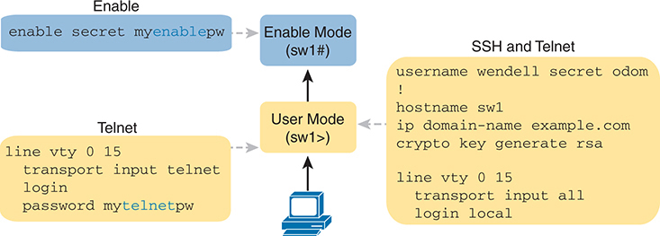

<figcaption>

<aside class="hidden" id="a10fig01">

此图分为 Enable、Telnet，以及 SSH 和 Telnet 配置三个部分。在 Enable 部分，浅蓝色框显示命令 enable secret myenablepw，并指向启用模式（sw1#）。该命令为特权 EXEC 模式设置密码，要求进行身份验证才能获得更高权限，从而增强安全性。在 Telnet 部分，另一个浅蓝色框显示 Telnet 配置：第 1 行为 line vty 0 15；第 2 行为 transport input telnet；第 3 行为 login；第 4 行为 password mytelnetpw。从启用模式到用户模式（sw1&gt;）的箭头说明用户如何在两种模式之间切换。该配置使虚拟终端线路接受 Telnet 连接，并要求用户使用指定密码登录。在 SSH 和 Telnet 部分，黄色框显示同时支持 SSH 和 Telnet 的配置。命令为：username wendell secret odom !、hostname sw1、ip domain-name example.com、crypto key generate rsa、line vty 0 15、transport input all，以及 login local。

</aside>

<strong>图10-1</strong> <em>登录安全配置样本</em>

</figcaption>

</figure>

注意

该图最右侧的配置支持SSH和Telnet,但考虑只允许SSH使用<strong>transport input ssh</strong>命令。Telnet协议发送所有未加密的数据,因此任何使用Telnet登录复制消息的攻击者都会有密码副本.

第一部分的其余部分讨论了如何使这些密码安全。 特别是,本节探讨如何避免在配置中保留出清晰的文字口令,并用使攻击者难以学习口令的方式存储密码.

<section>

<h4 class="h4" id="ch10lev2sec1">使用 service password-encryption 加密旧式 IOS 密码</h4>

一些更古老的IOS密码创造了安全曝光,因为密码存在于配置文件中作为清晰文本. 这些清晰的密码可以在配置文件的打印版本,存储在服务器上的配置文件备份副本中看到,或者显示在网络工程师的显示上.

Cisco试图通过在加密这些密码时添加一个命令来解决这个清晰的文字问题:<strong>service password-encryption</strong>全局配置命令 。 此命令加密通常为清晰文本的密码, 特别是这些命令的密码 :

<strong>password</strong> <em>password</em>(控制台或vty模式)

<strong>username</strong> <em>name</em> <strong>password</strong> <em>password</em>(全球)

<strong>enable password</strong> <em>password</em>(全球)

看它是如何工作的,<a href="#exa10_1">示例10-1</a>显示如何<strong>service password-encryption</strong>命令加密清晰文本控制台密码。 该示例使用<strong>show running-config | section line con 0</strong>命令加密前后;此命令只列出关于控制台的配置部分。

<strong>示例10-1</strong> <em>加密和密码<strong>service password-encryption</strong>命令</em>

<a href="#code-f0205-01" id="f0205-01a">点击此处查看代码原图</a>

<pre class="pre-ex" tabindex="0"><code>Switch3# <strong>show running-config | section line con 0</strong>

line con 0

 password cisco

 login

Switch3# <strong>configure terminal</strong>

Enter configuration commands, one per line.  End with CNTL/Z.

Switch3(config)# <strong>service password-encryption</strong>

Switch3(config)# <strong>^Z</strong>

Switch3# <strong>show running-config | section line con 0</strong>

line con 0

 password 7 070C285F4D06

 login</code></pre>

仔细审查前后情况<strong>show running-config</strong>命令输出既显示明显效果,也显示新概念。 加密进程现在隐藏了原始内容清晰的文本密码。 此外,监督办需要一种方式来表明:<strong>password</strong>命令列出加密密码,而不是清晰的文本。 IOS将"7"的加密或编码类型添加到命令中,具体指用该命令加密的密码.<strong>service password-encryption</strong>命令。(IOS认为清晰文本口令为0型;有的命令列出0,有的则没有. )

虽然<strong>service password-encryption</strong>全局命令加密密码, 即<strong>no service password-encryption</strong>global 命令不会立即将密码解密为清晰的文本状态 。 与此相反,这一过程的工作表现为:<a href="#ch10fig02">图10-2</a>。基本上,你进入后<strong>no service password-encryption</strong>命令中,密码会一直加密,直到您更改密码。

<figure class="image-c" id="ch10fig02">

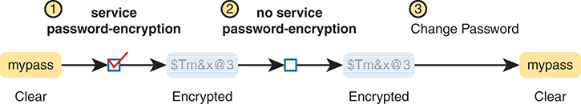

<figcaption>

<aside class="hidden" id="a10fig02">

它分为三个编号步骤。 服务密码加密:用黄色背景在左侧显示一个清晰的密码 mypass. 命令服务密码-加密加密密码,生成一个以$ T m 为代表的加密表单和x 以 3 为蓝背景. 没有服务密码加密: 没有显示服务密码加密的命令, 但是密码仍然加密为$ T m 和 x , 在 3 。 更改密码:更改密码后,重新应用了加密,导致密码再次被以清晰的文字显示为 mypass.

</aside>

<strong>图10-2</strong> <em>加密是即时的; 解密等待下一个密码更改</em>

</figcaption>

</figure>

很遗憾,<strong>service password-encryption</strong>命令不能很好地保护密码。 携带了加密值,可以搜索互联网并找到带有解密这些密码的工具的网站. 事实上,你可以从这个例子中取出加密密码,插入其中一个网站,然后解密为“cisco ” 。<strong>service password-encryption</strong>指挥会减慢好奇, 但它不会阻止一个有知识的攻击者。

</section>

<section>

<h4 class="h4" id="ch10lev2sec2">使用散列对 enable 密码进行编码</h4>

在IOS的最早时期,Cisco就使用过这个系统.<strong>enable password</strong> <em>password</em>全局命令以定义用户必须使用的密码才能达到启用模式(在使用后)<strong>enable</strong> EXEC command. 然而,正如刚才所指出,<strong>enable password</strong> <em>password</em>命令将密码存储为清晰的文本,<strong>service password-encryption</strong>命令以易于解密的方式加密密码。

Cisco 解决了只存储密码的微弱方法的问题<strong>enable password</strong> <em>password</em>通过更加安全的替换实现全局指令:<a id="key_127" href="#ref-gloss_130">启用秘密</a> <em>password</em>全局指令 。 然而,这两个命令甚至在今天的IOS中都存在. 接下来的几页从两个角度审视这两个指令,包括这两个指令之间的互动,为什么<strong>enable secret</strong>命令更为安全,同时附上说明,说明在IOS如何保障<strong>enable secret</strong>密码

<section>

<h5 class="h5" id="ch10lev3sec1">enable password 与 enable secret 之间的关系</h5>

首先,对于现实生活:使用<strong>enable secret</strong> <em>password</em>全局命令,并忽略<strong>enable password</strong> <em>password</em>全局指令 。 20年来,情况一直是如此。

不过 说到底 思科从未清除过弱者<strong>enable password</strong> command from IOS. 因此,在一个单一的交换机(或路由器)上,你可以配置一个或另一个,两者兼而有之,也没有。 那么,交换机是否期望您输入密码以达到启用模式 ? 归根结底是这些规则:

<strong>两种命令都配置了 :</strong>用户必须在<strong>enable secret</strong> <em>password</em>命令(并忽略<strong>enable password</strong> <em>password</em>

<strong>只有一个命令配置 :</strong>用那个命令中的密码 。

<strong>未配置命令( 默认) :</strong>控制台用户在没有密码提示的情况下直接移动以启用模式;Telnet和SSH用户被拒绝,无法提供启用密码.

</section>

<section>

<h5 class="h5" id="ch10lev3sec2">通过散列使 enable secret 真正保密</h5>

思科号<strong>enable secret</strong>命令保护密码值,甚至从不将清晰文本的密码存储在配置中。 然而,这一句可能会给您带来一点混淆:如果路由器或交换机不记得了清晰的文本密码,那么交换机怎么能知道用户在使用后输入了正确的密码?<strong>enable</strong>指挥? 本节通过一些基本内容来展示和理解密码值为何是秘密的。

首先,默认情况下,IOS使用一个名为"信件文摘5"(MD5)的散列函数,在配置中存储一个替代值,而不是清文本密码. 将MD5视为一个相当复杂的数学单向公式. 选择这个公式是为了即使你知道该公式的确切结果——即通过该公式将清晰文本密码输入后的结果——在计算上难以计算出原始的清晰文本密码。<a href="#ch10fig03">图10-3</a>显示主要想法:

<figure class="image-c" id="ch10fig03">

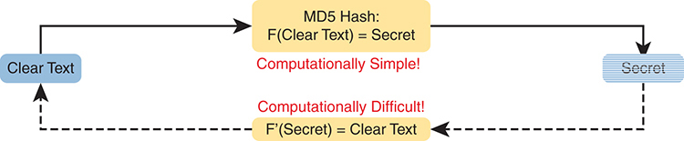

<figcaption>

<aside class="hidden" id="a10fig03">

在左侧,一个被标记为"清正"的蓝色长方形由坚实的黑色箭头与被标记为M D 5 Hash的黄色长方形相接:F(清正文)=Secret. 这表明使用 MD 5 散列函数将清晰的文本转换为密文在计算上是简单的,如红色文本计算为简单!在黄色矩形下方所示. 在右侧显示另一个被标记为"秘密"的蓝色矩形. 一个被破碎的黑箭头从"秘密"指向"清除文本",通过另一个被标记为"F'(secret)"的黄色矩形等同"清除文本. 这部分图中强调,如红色文本所指出,倒转进程,或从密语中计算出原始清晰文本,在计算上是困难的,计算起来是困难的!

</aside>

<strong>图10-3</strong> <em>MD5 Hash 创建秘密的一瓦一瓦性质</em>

</figcaption>

</figure>

注意

“相当困难”几乎是一个代码短语,意思是函数的设计者希望没有人愿意花时间来计算原始的清晰文本。

因此,如果原始的清文本密码无法再被创建,那么一个交换机或路由器如何用它来比较用户所打入的清文本密码? 答案取决于关于这些安全散列的另一个事实,如MD5:每个清晰的文字输入都得出了数学公式的独特结果.

密码<strong>enable secret fred</strong>命令生成一个<a id="key_131" href="#ref-gloss_205">MD5 散列线</a>。如果用户类型<strong>fred</strong>当尝试进入启用模式时, IOS 会根据该值运行 MD5, 并获得与列表中列出的相同的 MD5 散列 。<strong>enable secret</strong>命令,因此IOS允许用户访问启用模式. 如果用户输入了任何其他值<strong>fred</strong>,IOS会计算出一个不同的 MD5 散列,而不是存储在其中的值 。<strong>enable secret</strong>命令,而IOS将拒绝用户试图达到启用模式。

当用户在使用密码后输入密码时,该切换器可以进行比较。<strong>enable</strong>EXEC 命令如下:

台阶.1.IOS 计算密码的 MD5 散列<strong>enable secret</strong>命令并在配置中存储密码的散列。

台阶.2.当用户输入时<strong>enable</strong>命令以达到启用模式,一个需要对照该配置命令检查的密码,IOS将用户输入的清晰文本密码排出。

台阶.3.IOS比较了两个散列值:如果两者相同,用户打入的口令必须与所配置的口令相同.

因此,IOS可以存储密码的散列,但从不存储清晰文本的密码;然而,它仍然可以确定用户是否输入了相同的密码.

交换机和路由器已经使用了这里所描述的逻辑,但是通过查看交换机的配置可以看到证据.<a href="#exa10_2">示例10-2</a>显示创建<strong>enable secret</strong>命令,包含一些相关的细节。 此示例显示存储( hashed) 值, 如<strong>show running-configuration</strong>命令输出。 该产出还表明,监督办改变了<strong>enable secret fred</strong>命令以列出加密类型5(这意味着所列密码实际上是清文本密码的MD5散列)。 gobblygook 长文本字符串是散列,防止了其他人读取密码.

<strong>示例10-2</strong> <em>Cisco IOS 编码密码“ fred”为类型 5 (MD5)</em>

<a href="#code-f0208-01" id="f0208-01a">点击此处查看代码原图</a>

<pre class="pre-ex" tabindex="0"><code>Switch3(config)# <strong>enable secret fred</strong>

Switch3(config)# <strong>^Z</strong>

Switch3# <strong>show running-config | include enable secret</strong>

enable secret 5 $1$ZGMA$e8cmvkz4UjiJhVp7.maLE1

Switch3# <strong>configure terminal</strong>

Enter configuration commands, one per line.  End with CNTL/Z.

Switch3(config)# <strong>no enable secret</strong>

Switch3(config)# ^Z</code></pre>

示例的结尾还显示了一个重要侧点,即删除<strong>enable secret</strong>密码:在您进入启用模式后,您可以删除<strong>enable secret</strong>使用密码<strong>no enable secret</strong>命令,甚至无需输入密码值。 您也可以通过重覆旧密码来覆盖旧密码<strong>enable secret</strong>命令。但你不能查看原始的清晰文本密码 。

注意

<a href="#exa10_2">示例10-2</a>显示另一个快捷键,说明如何在长时期内工作<strong>show</strong>命令输出,这次使用管道到<strong>include</strong>命令。密码<strong>QQ 包括允许的秘密</strong>命令进程的一部分,输出来自<strong>show running-config</strong>仅包括带有对案件有敏感认识的文本“可能的秘密”的行。

</section>

<section>

<h5 class="h5" id="ch10lev3sec3">Cisco enable secret 改进的散列算法</h5>

使用任何散列函数来编码密码依赖于特定散列函数的几个关键特性. 特别是,每一个可能的输入值必须产生一个单一的散列值,这样当用户输入密码时,每个散列值只能有一个密码值相匹配. 另外,散列算法必须导致计算困难的数学(即颈部疼痛)来根据散列值来计算出清晰的文字密码来劝阻攻击者.

MD5散列算法已经持续了大约30年. 这些年来,计算机变得更快了,研究人员发现了攻击MD5算法的创造性方法,使得MD5对破解的难度更小. 也就是说,看到您运行的配置的人 会比MD5的早期更容易重新创建您的清晰文本秘密密码.

这些事实并不意味着MD5是坏的,而是像MD5之前的许多密码功能一样,已经取得了进展,需要新的功能. 为了提供对攻击者构成更大挑战的更近期的选项,思科在2010s中又增加了两道散列车,如本文所指出。<a href="#ch10fig04">图10-4</a>.

<figure class="image-c" id="ch10fig04">

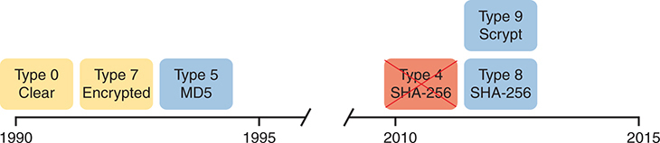

<figcaption>

<aside class="hidden" id="a10fig04">

时间段分为两段. 在左边,从1990年到1995年,显示有三种类型:0型 Clear,7型被加密;5型 M D 5,分别以黄色和蓝色矩形为代表. 右段,从2010年到2015年,显示了更先进的类型: 第4型 SHA-256 (红色矩形), 第8型 SHa-256 (蓝色矩形) 和 第9型 Scrypt (蓝色矩相).

</aside>

<strong>图10-4</strong> <em>Cisco IOS密码的加密/隐藏时间线</em>

</figcaption>

</figure>

在图中显示的较新类型中,Cisco继续使用类型 8 和 9 . Cisco 发现了安全隐患 。 4 密码执行,所以他们把密码拆了,后来又取而代之 8 两种类型 4 和 8 使用与 SHA 结合的同一种基础算法(PBKDF2)-. 256 算法。 (您可能看到文档中提及的关于类型的两个术语 。) 8 密码. ) 类型 9 使用不同的散列算法,称为Scrypt(发音为 “es crypt. ”)

IOS现在支持更近期的路由器中的两种替代算法类型并切换IOS图像.<a href="#ch10tab02">表10-2</a>显示所有三种算法类型的配置<strong>enable secret</strong>命令。

<figure class="table" id="ch10tab02" tabindex="0">

<figcaption>

<strong>表10-2</strong>命令和编码类型<strong>enable secret</strong>命令

</figcaption>

<table class="all">

<tbody>

<tr>

<th class="th">
命令
</th>

<th class="th">
类型
</th>

<th class="th">
算法
</th>

</tr>

<tr>

<td class="border">
<strong>enable algorithm-type md5 secret</strong> <em>password</em>
</td>

<td class="border">
5
</td>

<td class="border">
MD5
</td>

</tr>

<tr>

<td class="border">
<strong>enable algorithm-type sha256 secret</strong> <em>password</em>
</td>

<td class="border">
8
</td>

<td class="border">
SHA-256
</td>

</tr>

<tr>

<td class="border">
<strong>enable algorithm-type scrypt secret</strong> <em>password</em>
</td>

<td class="border">
9
</td>

<td class="border">
Scrypt
</td>

</tr>

</tbody>

</table>

</figure>

<a href="#exa10_3">示例10-3</a>显示<strong>enable secret</strong>命令从 MD5 更改为 Scrypt 算法。 值得一提的是,这个例子表明,只有1个<strong>enable secret</strong>命令应在 3 个命令之间存在<a href="#ch10tab02">表10-2</a>。基本上,如果你配置另一个<strong>enable secret</strong>命令使用不同的算法类型,该命令将替换任何已存在的<strong>enable secret</strong>命令。

<strong>示例10-3</strong> <em>Cisco IOS 编码密码“mypass1”为 第9型(SHA-256)</em>

<a href="#code-f0210-01" id="f0210-01a">点击此处查看代码原图</a>

<pre class="pre-ex" tabindex="0"><code>R1# <strong>show running-config | include enable</strong>

enable secret 5 $1$ZSYj$725dBZmLUJ0nx8gFPTtTv0

R1# <strong>configure terminal</strong>

Enter configuration commands, one per line. End with CNTL/Z.

R1(config)# <strong>enable algorithm-type scrypt secret mypass1</strong>

R1(config)# <strong>^Z</strong>

R1#

R1# <strong>show running-config | include enable</strong>

enable secret 9 $9$II/EeKiRW91uxE$fwYuOE5EHoii16AWv2wSywkLJ/KNeGj8uK/24B0TVU6

R1#</code></pre>

遵循示例中显示的程序,第一个命令确认当前<strong>enable secret</strong>命令使用5的编码类型,意思是它使用MD5. 第二,用户使用算法类型crypt来配置密码. 最后一个命令确认只有一个<strong>enable secret</strong>命令存在于配置中,现在有编码类型为9。

另外,通过IOS如何用清文本口令取取命令,再将命令存储在不同的语法中. 在这个例子中,用户会发布<strong>enable algorithm-type scrypt secret mypass</strong>命令,按名称引用算法类型。 然而,<strong>show running-config</strong>输出显示 IOS 如何删除<strong>algorithm-type scrypt</strong>参数,但它也留下了数字9<strong>secret</strong>参数。 因此,由IOS存储的命令以数字识别出算法类型. 因此,需要时间来记下每类算法的名称和数字。<a href="#ch10tab02">表10-2</a>.

最后,请注意,监督办和监督办XE与监督厅略有不同。<strong>enable secret</strong>命令。当配置时不使用<strong>algorithm-type</strong>关键词,IOS默认为MD5,而IOS XE默认为Scrypt.

</section>

</section>

<section>

<h4 class="h4" id="ch10lev2sec3">对本地用户名的密码进行编码</h4>

密码<strong>username password</strong>和<a id="key_134" href="#ref-gloss_358">用户名秘密</a>命令的历史与<strong>enable password</strong>和<strong>enable secret</strong>命令。最初,监督办支持<strong>username</strong> <em>user</em> <strong>password</strong> <em>password</em>命令——一个具有同样问题的命令,即是否是一个清晰的密码或加密不良的值(带有<strong>service password-encryption</strong>特性). 许多年后,思科又增加了<strong>username</strong> <em>user</em> <strong>secret</strong> <em>password</em>global 命令,将密码编码为 MD5 散列,由 Cisco 添加对后期更新的散列的支持. 注意Cisco使用这个术语<a id="key_130" href="#ref-gloss_197">本地用户名</a>以指代在单个路由器和交换机上配置的这些用户名,与在 AAA 服务器上集中配置的用户名相对应。

今天,<strong>username secret</strong>命令首选于<strong>username password</strong>命令;但请铭记这些规则。<strong>username</strong>命令 :

<ul class="sq">

<li>
监督办只允许一个<strong>username</strong>给定用户名的命令 - 既不是<strong>username</strong> <em>name</em> <strong>password</strong> <em>password</em>命令或一个<strong>username</strong> <em>name</em> <strong>secret</strong> <em>password</em>命令。
</li>

<li>
IOS允许混合命令(<strong>username password</strong>和<strong>username secret</strong>)在同一路由器或交换机中(用于不同的用户名).
</li>

</ul>

如前所述,交换机和路由器上的IOS在MD5之外使用额外的编码选项,就像支持该选项一样。<strong>enable secret</strong>命令。<a href="#ch10tab03">表10-3</a>显示这三种选项的语法<strong>username</strong>命令。

<figure class="table" id="ch10tab03" tabindex="0">

<figcaption>

<strong>表10-3</strong>命令和编码类型<strong>username secret</strong>命令

</figcaption>

<table class="all">

<tbody>

<tr>

<th class="th">
命令
</th>

<th class="th">
类型
</th>

<th class="th">
算法
</th>

</tr>

<tr>

<td class="border">
<strong>username</strong> <em>name</em> <strong>algorithm-type md5 secret</strong> <em>password</em>
</td>

<td class="border">
5
</td>

<td class="border">
MD5
</td>

</tr>

<tr>

<td class="border">
<strong>username</strong> <em>name</em> <strong>algorithm-type sha256 secret</strong> <em>password</em>
</td>

<td class="border">
8
</td>

<td class="border">
SHA-256
</td>

</tr>

<tr>

<td class="border">
<strong>username</strong> <em>name</em> <strong>algorithm-type scrypt secret</strong> <em>password</em>
</td>

<td class="border">
9
</td>

<td class="border">
SHA-256
</td>

</tr>

</tbody>

</table>

</figure>

IOS和IOS XE也与以下各点不同:<strong>username secret</strong>命令,默认值与<strong>enable secret</strong>命令:用于IOS的MD5和用于IOS XE的Scrypt. 还有,对于<strong>username secret</strong>命令, IOS XE 完全不支持 MD5 选项。 (与往常一样,将关于监督办和监督办XE差异的任何评论视为普遍认识,因为CCNA考试题目没有提到需要了解这种区别. ).

</section>

</section>

<section>

<h3 class="h3" id="ch10lev1sec4">防火墙与入侵防御系统</h3>

接下来的话题审视了几种不同类型的网络设备的作用:防火墙和入侵预防系统(IPS). 这两种装置都有助于保障网络的安全,但目标和办法略有不同。

此章第二大节各取一相. 本节首先讨论防火墙和IPS的核心传统特征. 本节以描述这些产品现代中较新的特征来收尾,称为下一代产品,这可以改善每种产品的功能.

<section>

<h4 class="h4" id="ch10lev2sec4">传统防火墙</h4>

传统上,a<a id="key_128" href="#ref-gloss_143">防火墙</a>坐在所有数据包的转发路径中,这样防火墙就可以选择要丢弃哪些数据包和允许通过哪些数据包。 通过这样做,防火墙通过只允许预期的流量类型流入和流出网络来保护网络免受不同种类的问题. 事实上,在最基本的形式上,防火墙与路由器对ACL做同样的工作,但防火墙可以履行包过滤功能,还有更多的选项,以及执行其他安全任务.

<a href="#ch10fig05">图10-5</a>显示一个使用物理防火墙的网站的典型网络设计。 该图显示一个防火墙,如Cisco Adaptive Security Appliance(ASA)防火墙,连接到一个Cisco路由器,而这个路由器又与互联网相接. 所有进出互联网的企业流量将通过防火墙发送。 防火墙将考虑其规则,并为每个数据包作出选择,是否允许数据包通过。

<figure class="image-c" id="ch10fig05">

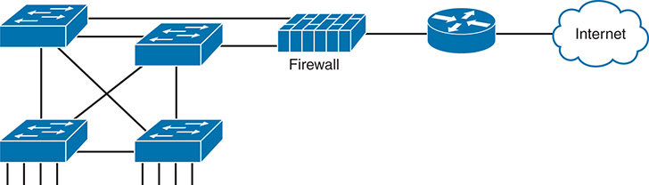

<figcaption>

<aside class="hidden" id="a10fig05">

左下方有四个蓝色长方形代表网络交换机,以网状地貌相接,并有指示连接的行. 这些交换机与中央防火墙相接,被说明为蓝色长方形区块,并有垂直线条建议分层. 防火墙随后被连接到路由器上,由带箭头的蓝色圆形图标来代表. 最后,路由器连接到互联网上,被描绘为最右边的一朵蓝云.

</aside>

<strong>图10-5</strong> <em>防火墙定位在 包前移路径</em>

</figcaption>

</figure>

虽然防火墙具有一些路由器相类似的功能(如包转发和包过滤),但它们提供的安全性能比传统路由器要高得多. 例如,大多数防火墙可以使用以下几种逻辑来选择是丢弃还是允许一个包:

<ul class="sq">

<li>
和路由器IP ACL一样,匹配源地址和目的IP地址
</li>

<li>
和路由器IP ACL一样,通过匹配其静态的知名TCP和UDP端口来识别应用程序
</li>

<li>
监视应用程序层流, 以了解特定流使用哪些额外的 TCP 和 UDP 端口, 并基于这些端口进行过滤
</li>

<li>
匹配 HTTP 请求的 URI 文本—— 即查看和比较通常称为网页地址的内容—— 并匹配模式, 以决定是否允许或拒绝下载该 URI 确定的网页
</li>

<li>
通过存储每个数据包的信息来保存状态信息,并根据历史状态信息(称为 " 未来数据包 " )就过滤未来数据包作出决定。<em>状态检查</em>,或成为状态防火墙).
</li>

</ul>

状态防火墙功能提供了防止各种攻击的手段,是路由器的ACL处理与由防火墙进行安全过滤之间更明显的区别之一. 路由器必须尽量少花时间处理每个包,这样包就不会有延迟通过路由器. 路由器不能花时间收集一个数据包的信息,然后对于未来的数据包,在作出过滤决定时考虑一些保存的关于早期数据包的状态信息. 由于其专注于网络安全,防火墙确实保存了一些关于包的信息,并且可以考虑这些信息来做未来的过滤决定.

以使用状态防火墙的好处为例,考虑简单的拒绝服务(DoS)攻击. 一个攻击者可以通过使用创建(或开始创建)大量TCP连接到服务器的工具,对网络服务器进行这种类型的攻击. 防火墙可以正常地允许TCP连接到该服务器,但设想服务器一般会在正常条件下每秒收到10个新的TCP连接,最繁忙时每秒收到100个. DoS攻击可能尝试每秒上千个或更多个TCP连接,驱动CPU和RAM在服务器上的使用,并最终使服务器超载到无法为合法用户服务的程度.

一个状态防火墙可以跟踪每秒TCP连接的数量,即根据更早的包记录状态信息,包括每个客户端IP地址到每个服务器地址的TCP连接请求的数量. 状态防火墙可以注意到大量TCP连接,检查它的状态信息,然后注意到从少数客户端到该特定服务器的请求数量非常之多,这是一些DoS攻击的典型. 状态防火墙然后可以开始过滤这些包,帮助网络服务器在被攻击后幸存下来,而无国籍的防火墙或路由器ACL就不会有历史状态信息来意识到DoS攻击正在发生.

<section>

<h5 class="h5" id="ch10lev3sec4">安全区域</h5>

防火墙不仅过滤包,而且密切关注主机启动通信的所在. 这一概念最明显的是TCP作为传输层协议,客户端通过发送一个只设置SYN比特的TCP段来启动TCP连接(见于<a href="v2-05.html#ch05fig05">图5-5</a>内<a href="v2-05.html#ch05">第5章</a>, “<a href="v2-05.html#ch05">TCP/IP 传输层与应用简介</a>”).

防火墙使用逻辑来考虑哪个主机通过监视这些初始的TCP报文段而启动了TCP连接. 要了解谁发起连接的重要性,考虑一下典型的企业网络与互联网的连接,例如:<a href="#ch10fig06">图10-6</a>。公司内部有用户打开网页浏览器,启动连接整个互联网的网页服务器. 然而,通过一个有效的互联网连接,这个公司打开了一种可能性,即攻击者可能会试图与该公司用于工资单处理的内部网络服务器建立TCP连接。 当然,公司不希望随机的互联网用户或攻击者能够连接到他们的发薪服务器.

<figure class="image-c" id="ch10fig06">

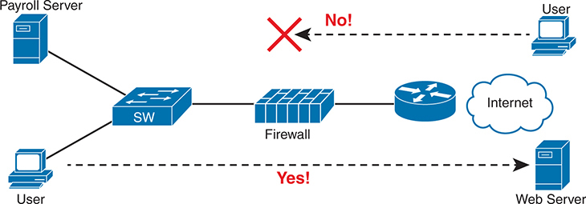

<figcaption>

<aside class="hidden" id="a10fig06">

左侧有两个用户图标通过一个被标注为S W的蓝色长方形交换机连接到一个发薪服务器. 交换机被连接到图像中心的一个防火墙上. 从防火墙上可以连接到右边的Web Server,并通过循环路由器图标连接到互联网. 网络服务器是用户可以访问的, 如标有“ 是” 的点箭头所示! 导致在最右边有一个用户图标 。 对比之下,试图从互联网上访问薪给服务器的尝试被屏蔽了,用红色X和正文No!上面指向右上方一个用户图标的破折箭头来表示.

</aside>

<strong>图10-6</strong> <em>允许出入境连接并防止出入境连接</em>

</figcaption>

</figure>

防火墙使用<em>安全区</em>(又称a)<em>区域</em>当定义哪个主机可以启动新的连接时。 防火墙有规则,这些规则定义了哪个主机可以启动从一个区到另一个区的连接. 另外,通过使用区间,一个防火墙可以将多个接口放入同一个区间,在多个接口应适用相同的安全规则的情况下.<a href="#ch10fig07">图10-7</a>描述与连接到互联网的接口相比,企业内部部分被认为处于一个单独的区域中的想法。

<figure class="image-c" id="ch10fig07">

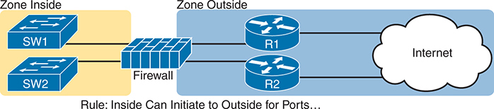

<figcaption>

<aside class="hidden" id="a10fig07">

在左侧,在"区内"区域内部,有两个被标注为SW 1和SW 2的蓝色交换机,两者均与中部的防火墙相接. 防火墙连接了两个路由器,标签为"外区"的R 1和R 2,再与互联网相接. 整个设置分为两个区:内区和外区. 图像底部的规则是: 规则:内部 Can启动到外部的港口... 强调只允许从内部区域到外部区域的联系,反之亦然.

</aside>

<strong>图10-7</strong> <em>使用带有防火墙的安全区</em>

</figcaption>

</figure>

最基本的防火墙规则 当使用两个区,如<a href="#ch10fig07">图10-7</a>减小到此逻辑 :

允许内部区域的主机启动连接到外部区域的主机,用于预设的一组安全而知名的端口(例如HTTP端口80等).

请注意,根据这个简单的规则,允许正确的流量,同时默认过滤不想要的流量. 防火墙一般禁止所有流量,除非有规则专门允许包. 因此,有了这个简单的规则,允许内部用户启动与外部区域的连接,而仅此一项,防火墙也阻止了外部用户启动与内部主机的连接.

大部分公司都有一个内外区域,以及一个称为<em>非军事区(DMZ)</em>。虽然DMZ名称出自现实世界,但几十年来在IT中一直被用来指一个防火墙安全区,用来放置需要供用户在公共互联网中使用的服务器. 譬如说.<a href="#ch10fig08">图10-8</a>显示一个典型的互联网边缘设计,在它的DMZ中增加了一对通过防火墙连接的网络服务器. 然后防火墙需要另一项规则,使区域外的用户——即互联网上的用户——能够启动与DMZ中这些网络服务器的连接。 通过将这些网络服务器分入DMZ,远离企业的其余部分,企业可以阻止互联网用户试图与内区的内部设备相接,防止多起类型的攻击.

<figure class="image-c" id="ch10fig08">

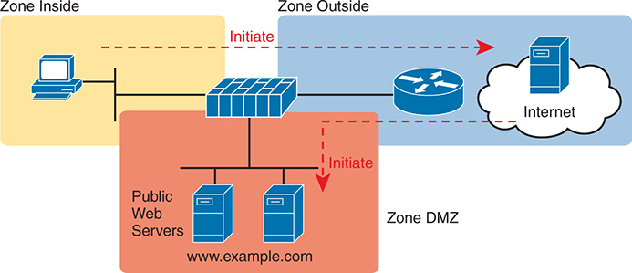

<figcaption>

<aside class="hidden" id="a10fig08">

该图分为三个区:内区,外区和DMZ区. 在"区域内部"中,一个用户图标被连接到防火墙上. 防火墙通过一个循环路由器图标连接到"区外"和"区外DMZ",其中包含两个带有URL www dot example dot com的公共网络服务器. 红色箭头标注着从内区用户图标到外区互联网、从互联网到DMZ区公共网络服务器的启动点。

</aside>

<strong>图10-8</strong> <em>对需要从互联网上访问的企业服务器使用DMZ</em>

</figcaption>

</figure>

</section>

</section>

<section>

<h4 class="h4" id="ch10lev2sec5">入侵防御系统（IPS）</h4>

传统上,防火墙具有一套用户配置的规则,规定哪些数据包应允许在网络中流动。 防火墙需要坐入数据包的路径,这样它就可以过滤数据包,将数据包转向收集,然后进行分析,或者让他们继续前往目的地.

传统的预防入侵制度(第1条)<a id="key_129" href="#ref-gloss_177">IPS</a>)可以坐入通过网络取走的路径包中,可以过滤出包,但是它用不同的逻辑来做决定. IPS首先下载了开发签名的数据库. 每个签名定义了不同开发使用的数据包序列中发现的不同头字段值. 然后,IPS可以检查包,将它们与已知的开发签名相比较,并通知当包可能是已知开发的一部分时. 一旦识别出来,IPS可以登录事件,丢弃包,甚至将包重新定向到另一个安全应用程序进行进一步检查.

传统的IPS与防火墙不同,因为与其说公司的一名工程师根据应用程序(以端口号)和区为该公司规定规则,IPS应用了主要由IPS供应商提供的签名为基础的逻辑. 这些签名寻找这些类型的攻击:

<ul class="sq">

<li>
DOS 数据
</li>

<li>
DDoS 文档
</li>

<li>
蠕虫
</li>

<li>
病毒
</li>

</ul>

为了完成任务,新闻通讯社需要下载并不断更新其签字数据库。 安全专家努力创建签名. 然后,IPS必须下载开发签名数据库,并不断下载更新,详情如下:<a href="#ch10fig09">图10-9</a>.

<figure class="image-c" id="ch10fig09">

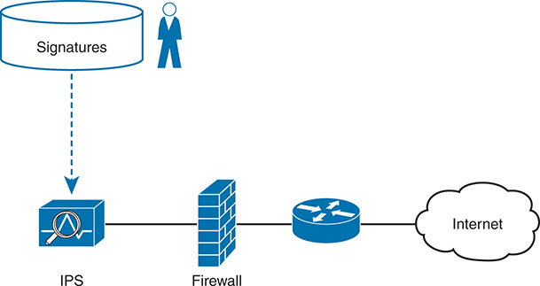

<figcaption>

<aside class="hidden" id="a10fig09">

图像上方有被标注为"签名"的圆云,表示已知威胁签名的数据库. 在签名数据库旁边显示一个代表管理员的数字。 以下一行将签名数据库与IPS设备相连接,由带有放大玻璃和波形的图标来代表,象征其检查流量以因已知威胁而起的作用. IPS右侧有被描绘为砖墙的防火墙,与路由器图标相接. 路由器被链接到一个被云标记的互联网上.

</aside>

<strong>图10-9</strong> <em>IPS和签名数据库</em>

</figcaption>

</figure>

例如,想一想当一种全新的计算机病毒被产生时会发生什么. 以主机为基础的安全产品,同抗病毒软件一样,应当安装在公司内部的计算机上. 这些工具使用类似于IPS的模型,保存着最新的病毒签名数据库. 签名可能寻找模式计算机病毒可以存储在计算机上的文件内部,也可以存储在通过电子邮件或网络浏览器发送到计算机上的文件中. 但病毒被发现(称为"零天攻击")之日和研究人员开发出病毒签名,改变数据库,让所有主机有时间更新其抗病毒软件之间会有一定时间间隔. 在这段时间里,主机处于危险之中。

IPS提供辅助性服务来预防病毒. 研究人员将寻找由IPS识别同一病毒的方法,同时在飞行中使用新的IPS签名——例如,在应用有效载荷中寻找带有特定端口和特定六分位字符串的包。 一旦开发出来,网络中的IPS设备需要用新的签名数据库来更新,以防范这种病毒. 基于主机和IPS的保护都起重要作用,但一个IPS保护一个网络的路段意味着IPS有时可以更迅速地对新的威胁作出反应来保护主机.

</section>

<section>

<h4 class="h4" id="ch10lev2sec6">Cisco 下一代防火墙</h4>

CCNA 200-301 考试题目提到术语<em>防火墙</em>和<em>IPS</em>但以术语为前言<em>下一代</em>。大约在2010年代中期,思科和他们的一些竞争对手开始使用这个术语<em>下一代</em>在讨论他们的安全产品时,强调一些较新的特征。 简而言之,a<a id="key_132" href="#ref-gloss_226">下一代防火墙(NGFW)</a><a id="key_133" href="#ref-gloss_227">下一代IPS(NGIPS)</a>是思科公司现在的防火墙和IPS产品。

然而,该术语的使用<em>下一代</em>这个术语强调几年来的一些重大转变和改进。 安全行业看到无休止的新一轮攻击,然后是新的解决办法。 一些解决方案可能需要全新的产品特性,甚至新的产品。 一些需要新的安全特征的变化包括移动设备的激增——这些设备离开企业、连接到互联网并返回企业,从而创造了全新的风险水平。 另外,任何单一的安全功能或器械(防火墙,IPS,抗疟疾软件)都不能指望能阻止一些威胁,因此下一代工具必须能够更好地合作提供解决方案. 简而言之,下一代产品具有其前身产品所没有的真正有用特征.

至于Cisco产品,多年来Cisco将其防火墙命名为Cisco适应性安全装置(ASA). 在2013左右,Cisco收购了一家安全产品公司Sourcefire. 下一代防火墙(和IPS)的许多功能来自通过该收购获得的软件. 有一段时间,思科出售了具有多条安全功能的安全用具,如NGFW等,其品牌类似于"Sourcefire"的旧名: Cisco Firepower防火墙. 截至这本书出版时,思科已经转向了以"思科安全防火墙"为名的品牌(参见:<a href="http://www.cisco.com/go/firewalls">www.cisco.com/go/firewalls</a>).

一个NGFW仍然在做一个防火墙的传统功能,当然,比如通过比较IP,TCP和UDP头中的字段来进行状态过滤,并在定义防火墙规则时使用安全区. 为了深入了解一些较新的下一代特性,考虑与端口相匹配的挑战:

<ol class="number">

<li>
每个基于IP的应用程序都应该使用一个出名的端口.
</li>

<li>
攻击者知道防火墙将过滤最有名的端口,从外部区域启动的会话到内部区域(见<a href="#ch10fig08">图10-8</a>).
</li>

<li>
攻击者使用端口扫描寻找公司防火墙现在允许通过的任何端口.
</li>

<li>
攻击者试图使用自己选择的协议(例如HTTP),但通过端口扫描发现的非标准端口作为尝试连接企业内部主机的方法.
</li>

</ol>

序列列出了攻击者需要采取的一些步骤的概要,但没有列出每一项任务. 然而,即使达到这个深度,你也能看到攻击者如何找到一种方法,将包寄出过公司防火墙.

解决方案? 一个下一代防火墙,它查看应用层数据来识别应用,而不是依赖所使用的TCP和UDP端口号. Cisco使用一个叫做“深包检查”的特性来进行他们的深包检查<a id="key_126" data-original-href="vol2_ch10.xhtml#key_126a" data-unavailable="true" title="此内容不在当前提取范围内；请参阅原始 EPUB：vol2_ch10.xhtml#key_126a">应用能见度和控制(AVC)</a>。Cisco AVC可以根据发送的数据识别出许多应用程序(应用层头+应用数据结构远超TCP和UDP头). 当使用Cisco NGFW时,防火墙与其端口号相匹配,而是与应用程序相匹配,击败了刚才所描述的攻击.

以下清单提到一个NGFW的几个特征. 注意,虽然<em>NGFW</em>是一个有用的术语,传统防火墙和下一代防火墙之间的线条可能有点模糊,因为这些术语描述的是经过了很长时间的反复变化的产品. 然而,这一清单总结了几个要点:

<ul class="sq">

<li>
<strong>传统防火墙 :</strong>一个NGFW执行传统的防火墙功能,如状态防火墙过滤,NAT/PAT,和VPN终止.
</li>

<li>
<strong>应用能见度和控制(AVC):</strong>这个特性深入查看了应用层数据来识别应用. 例如,它可以根据数据而不是端口号识别应用程序,以防御使用随机端口号的攻击.
</li>

<li>
<strong>高级恶意软件保护 :</strong>NGFW平台运行多种安全服务,不仅作为运行单独服务的平台,还用于更好地整合功能. 基于网络的抗疟疾软件功能可以运行在防火墙本身上,阻断会安装恶意软件的文件传输,并保存文件副本供后期分析.
</li>

<li>
<strong>URL 过滤 :</strong>这个功能检查了每个网络请求中的URL,对URL进行分类,或者根据规则过滤或者限制流量. Cisco Talos安全组对互联网上已知的每个域进行监控并创建名声分数,其中URL过滤器能够在其决定中使用这些分数来进行分级,过滤,或分率限制.
</li>

<li>
<strong>NGIPS:</strong>Cisco的NGFW产品也可以与防火墙一起运行他们的NGIPS功能.
</li>

</ul>

请注意,对于任何因在像防火墙一样的同道中穿行而受益的服务来说,这些功能随着时间的推移可以迁移到同一产品上运行是有道理的。 因此,当设计需要防火墙和IPS同时位于网络的同一位置时,这些NGFW产品可以运行NGIPS特性,如综合设备在其中显示的那样.<a href="#ch10fig10">图10-10</a>.

<figure class="image-c" id="ch10fig10">

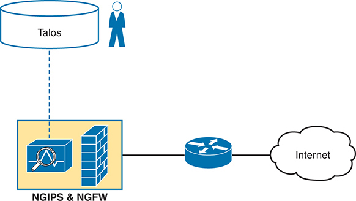

<figcaption>

<aside class="hidden" id="a10fig10">

顶部有圆形云标注为"塔洛斯"(Talos),代表思科的威胁情报组织. 塔洛斯旁边显示一个管理员数字,表示人类监督. 一个虚线将塔洛斯连接到一个NGIPS和NGFW组合模块,由一个类似于上个IPS图标的图标来显示,但被附在被标记为NGIPs和NGW的突出框中.

</aside>

<strong>图10-10</strong> <em>带有下一代IPS模块的防火墙</em>

</figcaption>

</figure>

</section>

<section>

<h4 class="h4" id="ch10lev2sec7">Cisco 下一代 IPS</h4>

Cisco下一代IPS(NGIPS)产品也遵循了与Cisco NGFW产品相类似的路径. Cisco首先主要通过它的Sourcefire收购增加了NGIPS的特性. 目前Cisco IPS产品现在作为应用在使用Cisco安全防火墙名的电器中运行. 事实上,就产品而言,更像前一个数字,有一个同时运行NGFW和NGIPS的电器.

与NGFW一样,NGIPS在传统的IPS中增加了一些特征. 传统IPS的最大问题之一,是IPS记录的大量安全事件。 举例来说:

<ol class="number">

<li>
一个IPS将列出所有已知的用法的签名数据库与所有信件进行比较.
</li>

<li>
它会产生事件,往往远远超出安保人员所能读到的.
</li>

<li>
工作人员必须在精神上过滤事件,才能找到干草堆中垂头丧气的针头,这只能通过辛勤工作,丰富的经验和挖掘的意愿才能做到.
</li>

</ol>

一个NGIPS以几种方式帮助解决了这个问题. 首先,一个NGIPS通过从所有主机和这些主机的用户收集数据来审查背景. NGIPS将了解OS,软件修订级别,哪些应用正在运行,开放端口,运输协议和正在使用的端口号等. 有了这些数据,NGIPS就可以对哪些事件进行更明智的选择。

例如,考虑将一个NGIPS放入一个网络,以保护一个校园局域网,使终端用户能够连接,但该部分的网络中并不存在数据中心。 另外,所有PC都碰巧按照公司政策运行了Windows,也可能是同一版本. 签名数据库包括用于开发Linux主机,Macs,Windows版本的签名,在网络的那部分不存在,以及用于这些主机上没有运行的服务器应用程序. 在收集这些事实之后,一个全国妇女协会可以建议取消对不适用于这些终点的剥削的检查,增加时间,并把重点放在可能发生的事件上,从而大大减少记录的事件数量。

以下是Cisco NGIPS的几个特征:

<ul class="sq">

<li>
<strong>传统 IPS :</strong>一个NGIPS执行传统的IPS特性,如利用剥削签名来比较包流,创建一个事件日志,并可能丢弃和/或重定向包.
</li>

<li>
<strong>应用能见度和控制(AVC):</strong>与NGFWs一样,NGIPS有能力深入查看应用层数据来识别应用.
</li>

<li>
<strong>背景意识:</strong>NGFW平台从主机-OS,软件版本/级别,应用的补丁,应用程序运行,开放端口,当前发送数据的应用程序等收集数据. 这些事实使国家森林调查局了解到,网络的一部分的脆弱性往往比较有限,因此国家森林调查署可以集中注意实际的脆弱性,同时大大减少记录的事件数量。
</li>

<li>
<strong>基于信誉的过滤 :</strong>Cisco Talos安全情报小组每天研究安全威胁,建立Cisco安全组合使用的数据。 部分数据根据IP地址,域名,名称,甚至特定的URL,识别出已知的坏角色,每个角色都有名声分. 一个Cisco NGIPS可以进行基于名声的过滤,同时考虑到分数.
</li>

<li>
<strong>事件影响级别 :</strong>安保人员需要评估已记录的事件,因此一个全国综合调查队根据影响水平进行评估,并描述事件是否确实属于某种攻击。
</li>

</ul>

如果你想为了自己的利益而更多地了解这些议题,请允许我提及一些资源。 第一,检查Cisco Talos情报组的文章和博客文章(<a href="http://www.talosintelligence.com">www.talosintelligence.com</a>) 思科·塔洛斯组织研究全球各地的安全问题,涉及安全产品的各个方面。 此外,一本Cisco出版社的书对下一代防火墙和IPS都有一些重要信息,作为下一步以适当的级别编写。 欲多读一出,取出此书取长名:<em>综合安全技术和解决方案,第一卷:思科安全解决方案,利用下一代防火墙进行高级威胁保护,防止入侵,AMP和内容安全</em>(或只用其ISBN,9781587147067),各有一章关于NGFW和NGIPS.

</section>

</section>

</section>

<section class="ccna-source ccna-appendix" aria-label="答案解析与术语表">
<section data-epub-type="chapter">

<h2 class="h2" id="ref-appc">附录C</h2>

<h2 class="h2a">对“我早就知道了吗?” 的回答。</h2>

<section>

<h3 class="h3" id="ref-appclev1sec10">第10章</h3>

<strong><a id="ref-ques10_1" href="#quess10_1">1</a>.</strong> B。如果同时配置两条命令，IOS 只接受 <strong>enable secret</strong> 命令中配置的密码。

<strong><a id="ref-ques10_2" href="#quess10_2">2</a>.</strong> A。<strong>service password-encryption</strong> 命令会加密路由器或交换机上原本以明文显示的密码。虽然从概念上看这是一个好方法，但互联网上的网站就可以轻易破解该算法。Cisco 很早就为以明文保存密码的命令提供了使用散列的替代命令，例如 <strong>enable secret</strong> 和 <strong>username secret</strong>。这些命令更受推荐，部分原因在于它们避免了明文密码及容易被解密的密码所带来的问题。

<strong><a id="ref-ques10_3" href="#quess10_3">3</a>.</strong> B。<strong>enable secret</strong> 命令保存密码的 MD5 散列值，不受 <strong>service password-encryption</strong> 命令影响。路由器不会将散列值还原为明文密码。相反，当用户输入明文密码时，路由器也会对该密码进行散列运算，再将所得散列值与配置中保存的散列值比较。

<strong><a id="ref-ques10_4" href="#quess10_4">4</a>.</strong> B。题干中的 <strong>username secret</strong> 命令显示类型为 8。类型 8 指 SHA256 散列类型，通过 <strong>algorithm-type sha256</strong> 参数配置。其他错误答案提到类型 9（Scrypt）和类型 5（MD5）。此外，省略算法类型的那个答案，其默认值取决于使用的是 IOS（MD5）还是 IOS XE（Scrypt）。因此，它会得到类型 5 或类型 9，而不是类型 8。

<strong><a id="ref-ques10_5" href="#quess10_5">5</a>.</strong> B。传统防火墙和下一代防火墙都能检查 TCP、UDP 端口号，但下一代防火墙的典型特征是还可以检查传输层首部之后的应用数据。NGFW 会检查应用数据，识别包含 Telnet 所用数据结构的消息，而不只是匹配端口号。这种匹配方式可以发现某些攻击：攻击者利用防火墙允许的端口号，发送通常并不使用这些端口的应用数据。

对于其他答案，传统防火墙通常依据目的端口 23 进行匹配，该端口是 Telnet 的知名端口。IP 协议号与 Telnet 无关。

<strong><a id="ref-ques10_6" href="#quess10_6">6</a>.</strong> A 和 D。传统 IPS 和下一代 IPS（NGIPS）都使用特征数据库，每条特征记录一系列消息中的字段细节，用于判断这些消息是否属于某种漏洞利用行为。两者也都会生成事件，供安全团队审查。

NGIPS 设备在使用特征数据库之外还增加了其他功能，包括收集主机的上下文信息，例如所用操作系统、当前运行的应用、开放端口等。这样，如果主机根本不可能受到影响，NGIPS 就无需记录事件。此外，NGIPS 可以使用已知恶意行为者的 IP 地址、域名和 URI 信誉评分列表，过滤信誉等级低于配置要求的来源流量。

</section>

</section>

<section id="ref-glossary"><h2 class="h2a">词汇表</h2>
<strong>enable secret</strong>引用已配置的密码<strong>enable secret</strong> <em>pass-value</em>命令,它定义了达到启用(优先)模式所需的密码。

<strong>防火墙</strong>一个将数据包转发到网络中安全性较差的部分之间的设备,它应用了决定哪些数据包允许通过和哪些不允许通过的规则.

<strong>预防入侵系统(IPS)</strong>一个安全功能,对照已知攻击特征清单和如何进行攻击的一般特征,审查更为复杂的交通模式,评定每个察觉到的威胁,并作出反应来防止更重大的威胁。<em>另见</em> <a href="#ref-gloss_181">IPS</a>.

<strong>IPS</strong> <em>见</em> <a href="#ref-gloss_177">入侵防御系统</a>.

<strong>本地用户名</strong>在路由器或交换机上配置的用户名(带有匹配的密码). 它被认为是本地的,因为它存在于路由器或交换机上,而不是在远程服务器上.

<strong>MD5 散列线</strong>用于各种安全协议的特定数学算法. 在Cisco路由器和交换机的背景下,设备存储了某些密码的MD5散列,而不是密码本身,以努力使设备更加安全.

<strong>下一代防火墙(NGFW)</strong>一个具有高级特性的防火墙设备,包括在同一防火墙设备(IPS,恶意软件检测,VPN终止)中运行许多相關安全功能的能力,以及使用应用程序能见度和控制(AVC)进行深包检查的能力,以及进行URL过滤的能力与收集的关于每个域名相关可靠性和风险的数据.

<strong>下一代IPS(NGIPS)</strong>具有先进特性的IPS设备,包括能够超越与已知攻击签名的比较范围,也查看背景数据,包括当前网络的弱点,监测新的零天威胁的能力,并经常更新Cisco Talos安全研究小组的签名.

<strong>username secret</strong>引用已配置的密码<strong>username</strong> <em>name</em> <strong>secret</strong> <em>过值</em>命令,用于在路由器或交换机上构建本地用户名/密码列表。

</section>
</section>

<section class="ccna-source ccna-appendix" aria-label="代码原图">
<section data-epub-type="chapter">

<a href="#f0203-01a" id="code-f0203-01">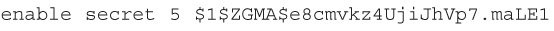</a>

<a href="#f0205-01a" id="code-f0205-01">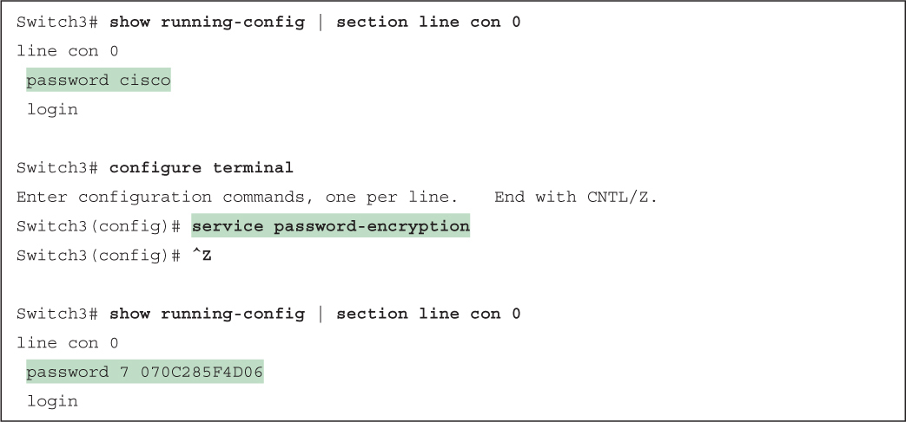</a>

<a href="#f0208-01a" id="code-f0208-01">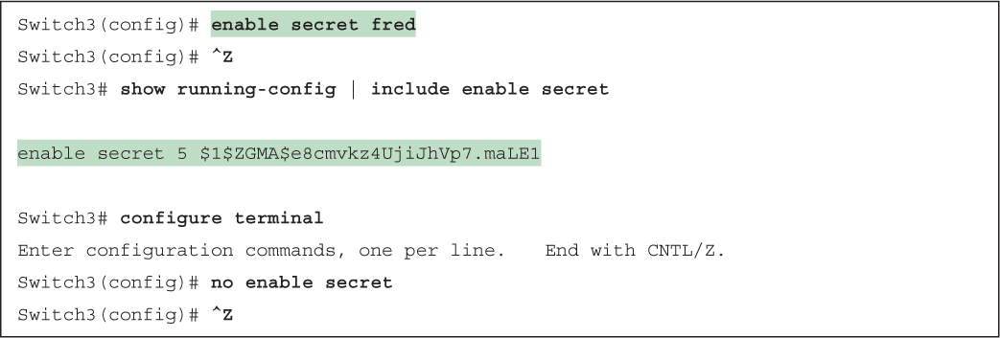</a>

<a href="#f0210-01a" id="code-f0210-01">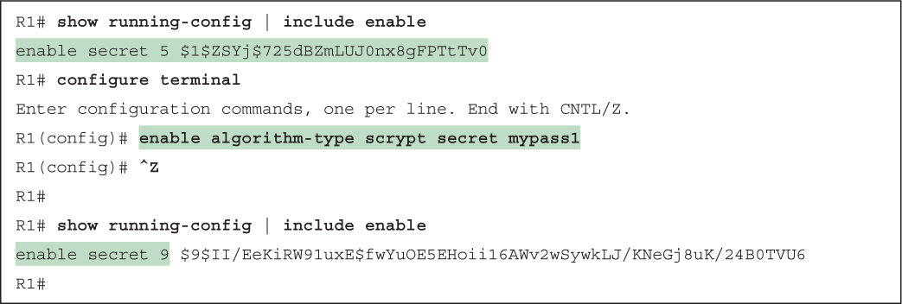</a>

</section>

</section>


<nav class="ccna-chapter-nav" aria-label="章节导航"><a href="v2-09.html">← 上一章</a><a href="v2-11.html">下一章 →</a></nav>
