
<a href="{{ '/subjects/CCNA/' | relative_url }}">← 返回 CCNA 目录</a>

第二卷 · 安全服务

<nav class="ccna-chapter-nav" aria-label="章节导航"><a href="v2-10.html">← 上一章</a><a href="v2-12.html">下一章 →</a></nav>



<section data-epub-type="chapter">

<h2 class="h2" id="ch11">第 11 章</h2>

<h2 class="h2a">实现交换机端口安全</h2>

本章涵盖以下考试主题：

5.0 安全基础

5.7 配置和验证二层安全功能（DHCP 侦听、动态 ARP 检测和端口安全）

现代网络必须实施纵深安全防御。安全架构应在关键位置部署防火墙和入侵防御系统（IPS），主机应使用防病毒和反恶意软件工具。企业中连接局域网与广域网边缘的路由器，还可以配置 IP 访问控制列表，以过滤涉及企业中不同 IP 地址范围的数据包。

LAN 交换机具备作为安全执行点的独特优势，特别是连接终端设备的 LAN 交换机。攻击者经常从连接企业 LAN 交换机的终端发起攻击。他们可能获得对终端的物理访问，也可能先感染设备，再利用它发起攻击。此外，移动设备可能在公司网络之外受到感染，随后连接公司网络，并在此时发动攻击。

工程师应假定，攻击可能来自直接连接企业 LAN 交换机接入端口的终端用户设备。因此，Cisco 交换机提供许多实用工具，帮助防止多种攻击。本章讨论其中一种工具：端口安全。<a href="v2-12.html#ch12">第12章</a>“<a href="v2-12.html#ch12">DHCP 侦听与 ARP 检测</a>”介绍另外两种利用交换机接入层角色的安全工具。

本章较短，以直接的方式介绍端口安全功能。第一节使用主要的端口安全运行模式 shutdown 来讨论概念、配置和验证。第二节再讨论 shutdown、protect 和 restrict 三种运行模式的一些细节。

<section>

<h3 class="h3" id="ch11lev1sec1">自测</h3>

如果你希望根据得分决定在本章投入多少时间，可以完成这组自测题（在此作答，或使用 PTP 软件）。各题答案的选项字母列在自测题之后的页面底部。书末和配套网站上的<a href="#ref-appc">附录 C</a>都包含答案及解析。你也可以在 PTP 测试软件中找到答案及解析。

<figure class="table" id="ch11tab01" tabindex="0">

<figcaption>

<strong>表11-1</strong> 核心主题小节与题目对应关系

</figcaption>

<table class="all">

<tbody>

<tr>

<th class="th">
基础知识小节
</th>

<th class="th">
题目
</th>

</tr>

<tr>

<td class="border">
端口安全的概念和配置
</td>

<td class="border">
1–3
</td>

</tr>

<tr>

<td class="border">
端口安全违规模式
</td>

<td class="border">
4, 5
</td>

</tr>

</tbody>

</table>

</figure>

<strong><a id="quess11_1" href="#ques11_1a">1</a>.</strong>在将港口安全配置为粘性学习时,需要下列哪一种?

<ol class="lower-alpha">

<li>
设置允许的 MAC 地址的最大数量 。<strong>switchport port-security maximum</strong>接口子命令。
</li>

<li>
启用端口安全<strong>switchport port-security</strong>接口子命令。
</li>

<li>
使用“% 1” 定义允许的 MAC 地址<strong>switchport port-security mac-address</strong>接口子命令。
</li>

<li>
所有其他的答案列表都要求命令.
</li>

</ol>

<strong><a id="quess11_2" href="#ques11_2a">2</a>.</strong>一个Cisco催化交换机连接到应该属于个人用户的PC. 每个端口都有相同的端口安全配置,配置如下:

<a href="#code-f0223-01" id="f0223-01a">点击此处查看代码原图</a>

<pre class="pre-q" tabindex="0"><code>interface range gigabitethernet 0/1 - 24

switchport mode access

switchport port-security

switchport port-security mac-address sticky</code></pre>

下列哪一个答案描述了用这些命令创建的端口安全配置的结果? (取出二个答.

<ol class="lower-alpha">

<li>
防止未知的MAC地址设备通过交换机端口发送数据.
</li>

<li>
如果用户将交换机连接到电缆,则会阻止多个设备通过端口发送数据.
</li>

<li>
将允许任何设备连接到每个端口和<em>将</em>将设备的MAC地址保存到启动配置中 。
</li>

<li>
将允许任何一台设备连接到每个端口, 但是<em>将不会</em>将设备的MAC地址保存到启动配置中 。
</li>

</ol>

<strong><a id="quess11_3" href="#ques11_3a">3</a>.</strong>下列哪些命令列出由端口安全配置的MAC地址表条目? (取出二个答.

<ol class="lower-alpha">

<li>
<strong>show mac address-table dynamic</strong>
</li>

<li>
<strong>show mac address-table</strong>
</li>

<li>
<strong>show mac address-table static</strong>
</li>

<li>
<strong>show mac address-table port-security</strong>
</li>

</ol>

<strong><a id="quess11_4" href="#ques11_4a">4</a>.</strong>密码<strong>show port-security interface f0/1</strong>命令列出安全下沉的端口状态。 此时此接口的下列答案中,必须有哪一个是真实的?

<ol class="lower-alpha">

<li>
密码<strong>show interface status</strong>命令将接口状态列表为连接状态。
</li>

<li>
密码<strong>show interface status</strong>命令将接口状态列出为错误的残疾状态。
</li>

<li>
密码<strong>show port-security interface</strong>命令可以列出一种关闭或限制的模式,但不能保护。
</li>

<li>
密码<strong>show port-security interface</strong>命令违反计数器可以在安全下沉的港口国增加。
</li>

</ol>

<strong><a id="quess11_5" href="#ques11_5a">5</a>.</strong>一个交换机的端口Gi0/1已正确启用端口安全. 配置设置违规模式以限制. 违反港口安全政策的帧进入接口,然后是没有接口的帧. 以下哪一个答案正确地描述了这种情况中发生的情况? (取出二个答.

<ol class="lower-alpha">

<li>
交换机在第一个帧到来时将接口放入出错的残疾状态.
</li>

<li>
交换机生成关于第一个帧的违反流量的syslog消息.
</li>

<li>
Gi0/1的交换台加分 由 1。
</li>

<li>
交换机同时丢弃了第一帧和第二帧.
</li>

</ol>

自测答案：

<strong><a id="ques11_1a" href="#ref-ques11_1">1</a></strong> B

<strong><a id="ques11_2a" href="#ref-ques11_2">2</a></strong> B、D

<strong><a id="ques11_3a" href="#ref-ques11_3">3</a></strong> B、C

<strong><a id="ques11_4a" href="#ref-ques11_4">4</a></strong> B

<strong><a id="ques11_5a" href="#ref-ques11_5">5</a></strong> B、C

</section>

<section>

<h3 class="h3box" id="ch11lev1sec2">基础主题</h3>

</section>

<section>

<h3 class="h3" id="ch11lev1sec3">端口安全的概念和配置</h3>

如果网络工程师知道什么设备应该有线,并且连接到交换机上的特定接口,工程师可以使用.<a id="key_136" href="#ref-gloss_259">端口安全</a>限制该接口,以便只有预期的设备能够使用。 这种方法减少了攻击者将笔记本电脑连接到一些未用交换机端口的攻击的暴露. 当这个不适当的设备试图向交换机接口发送帧时,交换机可以采取不同的动作,从简单地发布信息信息到有效关闭接口不等.

港口安全根据设备发送的以太网帧的源MAC地址识别设备. 例如,在<a href="#ch11fig01">图11-1</a>,PC1发送一个帧,以PC1的MAC地址为源地址. SW1的F0/1接口可以被配置为端口安全,如果可以,SW1将检查PC1的MAC地址并决定是否允许PC1将帧发送到端口F0/1.

<figure class="image-c" id="ch11fig01">

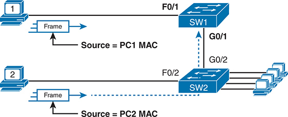

<figcaption>

<aside class="hidden" id="a11fig01">

顶部有被标注为1的电脑发送相框. 帧显示为一长方形框,箭头指向右侧,表示数据流的方向. 帧被标注为Source等同于P C1MAC,识别出源MAC地址为P C1. 此帧通过端口G-0斜放1输入被标记为S W-1的交换机. S W 1与另一个交换机相接,S W 2,通过端口G 0斜线1和G 0斜线2,说明交换机之间的网络连接. 在下方,被标注为2的第二台计算机正在发送一个带有源MAC地址P C2的帧. 这个帧同样用一箭来描绘,通过口号G0斜线2进入了S W2. S W 2 有多个连接到其他设备,由从交换机延伸的多行显示.

</aside>

<strong>图11-1</strong> <em>输入切换时在帧中的源 MAC 地址</em>

</figcaption>

</figure>

港口安全也没有任何限制,不能限制帧是来自本地设备还是通过其他交换机传输的. 例如,交换机SW1可以在其G0/1接口上使用端口安全,在从SW2转发到SW1时,从PC2中检查帧的源MAC地址.

港口安全有几种灵活的选择,但都以相同的核心概念运作。 首先,交换机使每个港口都能够保证港口的安全,每个港口都有不同的设置。 每个端口都有最大允许的MAC地址数,这意味着对于进入该端口的所有帧,只有该数量<em>变化</em>源 MAC 地址可以在端口安全认为已发生侵权之前被使用. 当带有新源MAC地址的帧到达,将MAC地址数推出允许的最大时,就会发生港口安全违规. 这时,交换机会采取行动——默认情况下,放弃该港口未来所有进港流量。

以下清单概述了与港口安全所有不同情况有关的这些共同想法:

<ul class="sq">

<li>
它审查接口上收到的帧,以确定是否发生了侵权行为。
</li>

<li>
它定义了允许接口中所有帧进入的最大数量的独特源 MAC 地址.
</li>

<li>
它在接口上保留了所有唯一来源MAC地址的列表和计数器.
</li>

<li>
它监测新学到的MAC地址,认为这些MAC地址会造成违反,如果新学到的 MAC 地址会将接口的MAC表格条目总数推过该端口所配置的最大允许MAC地址.
</li>

<li>
它会采取行动从违反的 MAC 地址丢弃帧,另外还有取决于所配置的违反模式的其他动作.
</li>

</ul>

这些规则界定了基本内容,但港口安全也允许其他选项,包括诸如这些选项:

<ul class="sq">

<li>
定义最多3个MAC地址,定义所有3个特定的MAC地址.
</li>

<li>
定义最多三个MAC地址,但允许这些地址被动态地学习,从而可以学习前三个MAC的地址.
</li>

<li>
定义最多3个MAC地址,预先定义一个特定的MAC地址并允许再有2个动态学习.
</li>

</ul>

您可能喜欢预先定义端口安全的MAC地址的想法, 但找到每个设备的MAC地址可能会是一个麻烦. 港口安全提供了一个有用的折衷方案,使用一个叫做“港口安全”的特性。<em>粘性安全 MAC 地址</em>。以此特性, 端口安全会在每个端口外学习 MAC 地址, 这样您不必预先配置值 。 它还将学到的MAC地址添加到端口安全配置(运行-配置文件中)中. 这个特性有助于减少查找每个设备的MAC地址的巨大努力.

如您所见,港口安全有很多详细的选项. 接下来的几节会引导你通过这些选择,把想法拉到一起.

<section>

<h4 class="h4" id="ch11lev2sec1">配置端口安全</h4>

港口安全配置涉及若干步骤。 首先,港口安全在进出港口和干线港口都进行工作,但要求您静态地将港口配置为干线或连接端口,而不是让切换器动态决定是否使用干线。 以下配置清单详细说明了如何启用端口安全,设定每个端口允许的最大MAC地址,并配置了实际的MAC地址: 1.

台阶.1.使用该<strong>switchport mode access</strong>或<strong>switchport mode trunk</strong>接口子命令分别使交换机接口成为静态访问或干线接口。

台阶.2.使用该<strong>switchport port-security</strong>接口子命令,以启用接口上的端口安全。

台阶.3.(可选)<strong>switchport port-security maximum</strong> <em>number</em>接口子命令,以覆盖与接口相关的允许的MAC地址的默认最大数量(1)。

台阶.4.(可选)<strong>switchport port-security violation</strong> {<strong>protect</strong> | <strong>restrict</strong> | <strong>shutdown</strong>} 接口子命令以覆盖默认对安全违规( shutdown) 采取的行动 。

台阶.5.(可选)<strong>switchport port-security mac-address</strong> <em>mac-address</em>接口子命令,以预先定义此接口的任何允许的源 MAC 地址。 使用命令多次定义多个MAC地址.

台阶.6.(可选)<strong>switchport port-security mac-address sticky</strong>接口子命令告诉切换到“ sticky learning” 动态学习的 MAC 地址。

要展示如何配置这些不同的设置,<a href="#ch11fig02">图11-2</a>和<a href="#exa11_1">示例11-1</a>显示四个港口安全实例。 3个端口作为出入口端口运行,而连接到另一个交换机的F0/4端口则作为干线运行.

<figure class="image-c" id="ch11fig02">

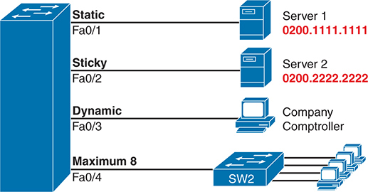

<figcaption>

<aside class="hidden" id="a11fig02">

左侧是一台大型蓝色交换机，四个端口分别标为 Fa0/1、Fa0/2、Fa0/3 和 Fa0/4。各端口连接不同设备，并具有相应的安全设置。标为 Static 的 Fa0/1 连接服务器 1，其 MAC 地址 0200.1111.1111 以红字显示，表示静态端口安全配置只允许指定的 MAC 地址。标为 Sticky 的 Fa0/2 连接服务器 2，其 MAC 地址 0200.2222.2222 也以红字显示，说明交换机会动态学习并保留连接到该端口的设备的 MAC 地址。标为 Dynamic 的 Fa0/3 连接公司财务主管的计算机，代表动态端口安全配置，允许多个动态学习的 MAC 地址，但数量不能超过指定上限。标为 Maximum 8 的 Fa0/4 连接另一台交换机 SW2，SW2 又连接多台计算机，表示此端口最多可以动态学习并允许八个 MAC 地址。

</aside>

<strong>图11-2</strong> <em>端口安全配置示例</em>

</figcaption>

</figure>

<strong>示例11-1</strong> <em>港口安全配置的变化</em>

<a href="#code-f0227-01" id="f0227-01a">点击此处查看代码原图</a>

<pre class="pre-ex" tabindex="0"><code>SW1# <strong>show running-config</strong>

(Lines omitted for brevity)

interface FastEthernet0/1

 switchport mode access

 switchport port-security

 switchport port-security mac-address 0200.1111.1111

!

interface FastEthernet0/2

 switchport mode access

 switchport port-security

 switchport port-security mac-address sticky

!

interface FastEthernet0/3

 switchport mode access

 switchport port-security

!

interface FastEthernet0/4

 switchport mode trunk

 switchport port-security

 switchport port-security maximum 8</code></pre>

首先扫描所有四个接口的配置<a href="#exa11_1">示例11-1</a>,侧重于每种情况下的前两个接口子命令。 注意,示例中前三个接口使用相同的前两个接口子命令,匹配之前注意到的前两个配置步骤<a href="#ch11fig02">图11-2</a>。密码<strong>switchport port-security</strong>命令启用端口安全,所有默认值为<strong>switchport mode access</strong>命令满足将端口配置为接入端口或干线端口的要求。 最终端口为F0/4,其配置相近,只是被配置为干线而非出入口端口.

接下来,再次扫描所有四个接口,并注意在前两个接口子命令之后,每个接口的配置都有所不同. 每个接口只是显示一个不同的视角示例.

第一个接口FastEthernet 0/1,增加了一个可选的端口安全子命令:<strong>switchport port-security mac-address 0200.1111.1111</strong>,它定义了特定的源 MAC 地址。 由于默认的最大源地址设置为 1,在此端口只允许使用有源 MAC 0200.1111.1111的帧. 当一个有除0200.1111.1111以外来源的帧输入F0/1后,交换机通常会进行MAC地址学习,并想将新的源地址添加到MAC地址表. 港口安全会将这一动作视为在港口上学习了一个太多的MAC地址,采取默认的违反动作来禁用接口.

作为第二个例子,FastEthernet 0/2使用与FastEternet 0/1相同的逻辑,只是使用了粘性学习特性. 对于端口 F0/2, 配置<strong>switchport port-security mac-address sticky</strong>命令告诉切换到动态学习源MAC 地址并添加<strong>port-security</strong>命令到运行配置。<a href="#exa11_2">示例11-2</a>显示在此情况下列出粘滞获取的 MAC 地址的运行配置文件 。

<strong>示例11-2</strong> <em>由端口安全粘贴特性所添加的配置</em>

<a href="#code-f0228-01" id="f0228-01a">点击此处查看代码原图</a>

<pre class="pre-ex" tabindex="0"><code>SW1# <strong>show running-config interface f0/2</strong>

Building configuration...

Current configuration : 188 bytes

!

interface FastEthernet0/2

  switchport mode access

  switchport port-security

  switchport port-security mac-address sticky

  switchport port-security mac-address sticky 0200.2222.2222</code></pre>

端口安全不会保存粘贴地址的配置, 所以使用<strong>copy running-config startup-config</strong>如果需要,则命令。

其他两个接口在<a href="#exa11_1">示例11-1</a>不预先定义 MAC 地址,也不粘取 MAC 的地址. 这两个接口的端口安全配置的唯一区别是FastEthernet 0/4支持了8个MAC地址,因为它连接到另一个交换机,应该接收带有多源MAC地址的帧. 接口F0/3使用一个MAC地址的默认最大.

注意

交换机还可以在语音端口和以太通道上使用端口安全. 对于语音端口,确保将最大MAC地址配置到至少两个(一个用于电话,或者一个连接到电话的PC). 在以太通道上,端口安全配置应被放入端口-通道接口上,而不应放入通道中的单个物理接口上.

</section>

<section>

<h4 class="h4" id="ch11lev2sec2">验证端口安全</h4>

密码<strong>show port-security interface</strong>命令对端口安全如何运作提供了最深入的见解,如<a href="#exa11_3">示例11-3</a>。此命令列出了接口上的端口安全配置设置;此外它还列出了当前端口安全运行的几个重要事实,包括任何安全违规信息. 示例中的两个命令显示接口为 F0/1和 F0/2,基于<a href="#exa11_1">示例11-1</a>其布局.

<strong>示例11-3</strong> <em>使用端口安全定义特定接口的正确MAC地址</em>

<a href="#code-f0228-02" id="f0228-02a">点击此处查看代码原图</a>

<pre class="pre-ex" tabindex="0"><code>SW1# <strong>show port-security interface fastEthernet 0/1</strong>

Port Security              : Enabled

Port Status                : Secure-shutdown

Violation Mode             : Shutdown

Aging Time                 : 0 mins

Aging Type                 : Absolute

SecureStatic Address Aging : Disabled

Maximum MAC Addresses      : 1

Total MAC Addresses        : 1

Configured MAC Addresses   : 1

Sticky MAC Addresses       : 0

Last Source Address:Vlan   : 0013.197b.5004:1

Security Violation Count   : 1

SW1# <strong>show port-security interface fastEthernet 0/2</strong>

Port Security              : Enabled

Port Status                : Secure-up

Violation Mode             : Shutdown

Aging Time                 : 0 mins

Aging Type                 : Absolute

SecureStatic Address Aging : Disabled

Maximum MAC Addresses      : 1

Total MAC Addresses        : 1

Configured MAC Addresses   : 1

Sticky MAC Addresses       : 1

Last Source Address:Vlan   : 0200.2222.2222:1

Security Violation Count   : 0</code></pre>

两个命令在<a href="#exa11_3">示例11-3</a>FastEthernet0/1, 但FastEthernet0/2没有发生违反安全规定的事件。 密码<strong>show port-security interface fastethernet 0/1</strong>命令显示接口位于<em>secure-shutdown</em>状态,这意味着接口由于端口安全而被禁用. 在此情况下,另一个连接到端口F0/1的装置,发送了除0200.1111.1111以外带有源MAC地址的帧,正在造成侵权. 然而,使用粘性学习的端口Fa0/2只是学习了由Server 2使用的MAC地址.

</section>

<section>

<h4 class="h4" id="ch11lev2sec3">端口安全 MAC 地址</h4>

要完成这一章,请花点时间考虑第2层切换,以及从该页输出的所有实例。<strong>show mac address-table dynamic</strong>EXEC指挥.

一旦一个交换机端口被配置为端口安全,交换机就不再认为与该端口相关的MAC地址是动态条目,列在其中<strong>show mac address-table dynamic</strong>EXEC指挥. 即使MAC地址是动态学习的,但一旦启用了端口安全,您也需要使用其中之一选项来查看与端口安全相关的MAC表格条目 :

<ul class="sq">

<li>
<strong>show mac address-table secure:</strong>列出与使用港口安全的端口相关的MAC地址
</li>

<li>
<strong>show mac address-table static:</strong>列出与使用端口安全的端口有关的MAC地址以及任何静态定义的MAC地址
</li>

</ul>

<a href="#exa11_4">示例11-4</a>证明这一点。 它从端口安全示例中显示两个关于接口F0/2的命令 。<a href="#ch11fig02">图11-2</a>和<a href="#exa11_1">示例11-1</a>。举例来说,在F0/2上,港口安全配置有粘性学习,因此从字面意义上讲,交换机从该端口(0200.2222.2222)上学习出一个MAC地址. 然而,<strong>show mac address-table dynamic</strong>命令不列出地址和端口,因为IOS认为MAC表格条目是一个静态条目。 密码<strong>show mac address-table secure</strong>命令确实列出地址和端口。

<strong>示例11-4</strong> <em>使用<strong>secure</strong>使用端口安全时查看 MAC 表格条目的关键字</em>

<a href="#code-f0230-01" id="f0230-01a">点击此处查看代码原图</a>

<pre class="pre-ex" tabindex="0"><code>SW1# <strong>show mac address-table secure interface F0/2</strong>

          Mac Address Table

-------------------------------------------

Vlan    Mac Address      Type         Ports

----    -----------      --------     -----

 1      0200.2222.2222   STATIC       Fa0/2

Total Mac Addresses for this criterion: 1

SW1# <strong>show mac address-table</strong> <strong>dynamic interface f0/2</strong>

          Mac Address Table

-------------------------------------------

Vlan    Mac Address      Type         Ports

----    -----------      --------     -----

SW1#</code></pre>

</section>

</section>

<section>

<h3 class="h3" id="ch11lev1sec4">端口安全违规模式</h3>

该章上半部分讨论了港口安全的许多细节,但大多忽略了一个主要特征:港口安全违规模式. 密码<a id="key_137" href="#ref-gloss_360">违反模式</a>界定港口安全在发生违法行为时应如何作出反应。

首先,回顾一下,什么是违反港口安全规定? 任何在接口上违反港口安全规则的收到帧。 例如:

<ul class="sq">

<li>
对于允许任意两个MAC地址的接口,当接口上预先配置和学习的MAC地址总数超过所配置的最多2个时,就会发生违反.
</li>

<li>
对于预先定义接口上允许的所有特定MAC地址的接口,当交换机收到一个来源MAC不是所配置的地址之一的帧时,就会发生违约.
</li>

</ul>

在端口安全的情况下,每个交换机端口都可以被配置到使用三种违反模式之一,这三种模式定义了发生违反时要采取的行动. 所有这三种选项都会导致交换机丢弃违法的帧(一个其源MAC地址会将所学的MAC地址数推出极限). 然而,这些模式在其它几个方面有所不同。他们采取的步骤。 例如,有些模式包括交换机生成syslog消息和SNMP Trap消息的动作,而有些模式则定义了禁用接口的动作.<a href="#ch11tab02">表11-2</a>列出三种模式、其动作以及允许在<strong>switchport port-security violation</strong> {<strong>保护 QQ 限制 关闭</strong>\ 接口子命令 :

<figure class="table" id="ch11tab02" tabindex="0">

<figcaption>

<strong>表11-2</strong>港口安全违规事件时的行动

</figcaption>

<table class="all">

<tbody>

<tr>

<th class="th">
关于切换端口安全违规命令的选项
</th>

<th class="th">
Protect
</th>

<th class="th">
Restrict
</th>

<th class="th">
Shutdown
</th>

</tr>

<tr>

<td class="border">
丢弃违规流量
</td>

<td class="border">
是
</td>

<td class="border">
是
</td>

<td class="border">
是
</td>

</tr>

<tr>

<td class="border">
发送日志和 SNMP 消息
</td>

<td class="border">
否
</td>

<td class="border">
是
</td>

<td class="border">
是
</td>

</tr>

<tr>

<td class="border">
关闭接口, 使其处于错误的状态, 丢弃全部流量
</td>

<td class="border">
否
</td>

<td class="border">
否
</td>

<td class="border">
是
</td>

</tr>

</tbody>

</table>

</figure>

由于与限制和保护模式相比,IOS对关闭模式的反应如此不同,接下来的几页解释差异——首先是关闭模式,然后是其他两种模式。

<section>

<h4 class="h4" id="ch11lev2sec4">端口安全 shutdown 模式</h4>

当使用(默认)关闭违规模式并在一个端口发生港口安全违规时,端口安全停止了接口上的所有帧转发,无论是在端口内还是出端. 实际上,它的行为就像港口安全关闭了港口;然而,它并没有从字面上将港口配置为港口。<strong>shutdown</strong>接口子命令。 相反,港口安全使用<a id="key_135" href="#ref-gloss_132">错误的残疾</a>特性。 Cisco交换机使用误差状态用于多种目的,但当使用端口安全关闭模式并发生违反时,会发生以下情况: 1.

<ul class="sq">

<li>
交换机接口状态( 每<strong>show interfaces</strong>和<strong>show interfaces status</strong>) 更改为错误的残疾状态。
</li>

<li>
交换机接口端口安全状态( 每<strong>show port-security</strong>) 改变安全下沉状态。
</li>

<li>
交换机停止在接口上发送并接收帧.
</li>

</ul>

一旦港口安全将一个港口置于错误的残疾状态,默认情况下,该港口仍然处于错误的残疾状况,直到有人采取行动。 要从错误的状态中恢复,接口必须关闭 。<strong>shutdown</strong>命令,然后启用<strong>no shutdown</strong>命令。换句话说,交换机的配置可以自动从误差状态中恢复,当由端口安全导致时,这些命令:

<ul class="sq">

<li>
<strong>errdisable recovery cause psecure-violation:</strong>一个全局命令,用于自动恢复因端口安全导致的故障状态下的接口
</li>

<li>
<strong>errdisable recovery interval</strong> <em>seconds</em><strong>:</strong>一个全局命令, 设置在恢复接口前等待的时间
</li>

</ul>

要更仔细地审视关闭模式,首先检查交换机的配置状态. 您可以在任何接口上检查端口安全配置<strong>show port-security interface</strong> <em>type number</em>命令,如前所述<a href="#exa11_2">示例11-2</a>,不过<strong>show port-security</strong>命令( 列于<a href="#exa11_5">示例11-5</a>)显示更简洁的输出,每个被启用的接口有一行.

<strong>示例11-5</strong> <em>确认港口安全违规模式</em>

<a href="#code-f0232-01" id="f0232-01a">点击此处查看代码原图</a>

<pre class="pre-ex" tabindex="0"><code>SW1# <strong>show port-security</strong>

Secure Port  MaxSecureAddr  CurrentAddr  SecurityViolation  Security Action

                (Count)       (Count)          (Count)

---------------------------------------------------------------------------

     Fa0/13              1            1                  1         Shutdown

---------------------------------------------------------------------------

Total Addresses in System (excluding one mac per port) : 0

Max Addresses limit in System (excluding one mac per port) : 8192</code></pre>

请注意,对于这些接下来的例子,一个交换机只配置了Port Fa0/13上的端口安全. 在此情况下,交换机似乎被配置为支持一个MAC地址,已经达到这个总数,并且有“shutdown”的安全侵犯行动。

下一个<a href="#exa11_6">示例11-6</a>显示在港口F0/13已发生港口安全违规事件后的结果。 第一个命令确认了错误的残疾状态(如果<strong>show interfaces status</strong>命令)和安全下沉状态(按<strong>show port-security</strong>

<strong>示例11-6</strong> <em>违反规定后关闭的港口安全状态</em>

<a href="#code-f0232-02" id="f0232-02a">点击此处查看代码原图</a>

<pre class="pre-ex" tabindex="0"><code>! The next lines show the log message generated when the violation occurred.

Jul 31 18:00:22.810: %PORT_SECURITY-2-PSECURE_VIOLATION: Security violation

occurred, caused by MAC address 0200.3333.3333 on port FastEthernet0/13

! The next command shows the err-disabled state, implying a security violation.

SW1# <strong>show interfaces Fa0/13 status</strong>

Port    Name                   Status        Vlan   Duplex  Speed  Type

Fa0/13                         err-disabled  1      auto    auto   10/100BaseTX

!

! The next command’s output has shading for several of the most important facts.

SW1# <strong>show port-security interface Fa0/13</strong>

Port Security               : Enabled

Port Status                 : Secure-shutdown

Violation Mode              : Shutdown

Aging Time                  : 0 mins

Aging Type                  : Absolute

SecureStatic Address Aging  : Disabled

Maximum MAC Addresses       : 1

Total MAC Addresses         : 1

Configured MAC Addresses    : 1

Sticky MAC Addresses        : 0

Last Source Address:Vlan    : 0200.3333.3333:2

Security Violation Count    : 1</code></pre>

产出<strong>show port-security interface</strong>命令列出当前端口安全状态(security-shutdown)以及配置模式(shutdall)。 最后一行的输出列出了导致接口故障到误差状态的违反次数,而第二行至最后一行识别出造成违反的设备的MAC地址和VLAN.

<a href="#ch11fig03">图11-3</a>总结这些行为,假设例子中显示的相同情景.

<figure class="image-c" id="ch11fig03">

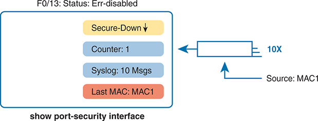

<figcaption>

<aside class="hidden" id="a11fig03">

该状态被标记为 Err- disabled 。 该图显示一个有多个指标的框:以向下箭头向下放入黄色框中的"安全下放","计数器":"蓝色框中放入1","Syslog:10 Msgs也放入蓝色框中","最后MAC:MAC 1"为"红色框". 这些指标提供了关于港口安全情况的信息。 安全下行表示港口安全功能目前已下行. 辩证方:1表示发生了一起违反安全规定的事件. Syslog:10 Msgs指由于这一违规事件已生成了十条syslog消息. 最后MAC:MAC 1显示触发安全违规的MAC地址. 在这个框的右边,有一个图标代表以太网电缆或连接,标签为10 X.

</aside>

<strong>图11-3</strong> <em>行动摘要:港口安全违规方式关闭</em>

</figcaption>

</figure>

违规计数器表示接口被移动到错误的(security-shutdown)状态的次数. 例如,它第一次失败时,反增量为1;虽然错误的残疾,但许多帧可以到达,但柜台仍然为1. IOS将在您使用关闭/不关闭命令组合恢复接口时将计数器重置为0,这样下一次违反会使计数器递增到1.

</section>

<section>

<h4 class="h4" id="ch11lev2sec5">端口安全 protect 和 restrict 模式</h4>

限制和保护违规模式在保障港口安全方面采取了完全不同的做法。 这些模式仍然抛弃了违法的交通,但接口仍处于连接(上/上)状态和港口安全状态。 因此,港口继续推进良好的交通,但放弃了违法的交通。

在看似良好的状态下拥有一个也丢弃交通的港口,在排除出故障时可能是一个挑战. 基本上,你必须知道该特性,然后知道如何分辨港口安全何时放弃港口的某些流量,尽管接口状态看起来不错.

在保护模式下,切换器对一个违反端口安全规则的帧采取的唯一行动是丢弃这个帧. 交换机不会将端口更改为错误的残疾状态,不会生成消息,甚至不会增加违规计数器.

<a href="#exa11_7">示例11-7</a>显示在几起侵权事件发生后具有保护模式的样本。 注意:<strong>show</strong>命令确认模式( 保护) , 其配置在示例的上部, 并具有安全性的端口安全状态—— 一个不会改变保护模式的状态 。 另外请注意,底部的计数器显示为0,尽管发生了多起违规事件,因为保护模式不计算违规帧.

<strong>示例11-7</strong> <em>使用保护模式的港口安全</em>

<a href="#code-f0234-01" id="f0234-01a">点击此处查看代码原图</a>

<pre class="pre-ex" tabindex="0"><code>SW1# <strong>show running-config</strong>

! Lines omitted for brevity

interface FastEthernet0/13

  switchport mode access

  switchport port-security

  switchport port-security mac-address 0200.1111.1111

  switchport port-security violation protect

! Lines omitted for brevity

SW1# <strong>show port-security interface Fa0/13</strong>

Port Security               : Enabled

Port Status                 : Secure-up

Violation Mode              : Protect

Aging Time                  : 0 mins

Aging Type                  : Absolute

SecureStatic Address Aging  : Disabled

Maximum MAC Addresses       : 1

Total MAC Addresses         : 1

Configured MAC Addresses    : 1

Sticky MAC Addresses        : 0

Last Source Address:Vlan    : 0000.0000.0000:0

Security Violation Count    : 0</code></pre>

注意

与一些更旧的交换机模式和IOS版本相比,违规计数器和上一个源地址的细微细节可能略有不同。请注意,本版的测试基于 2960XR 交换机运行 IOS 15.2 . 6 E2.

虽然关闭模式会禁用接口,而保护模式除了丢弃违法流量之外,别无他法,但限制模式提供了其他两种模式之间的妥协. 若为:<a href="#exa11_7">示例11-7</a>由于使用了限制违规模式而不是保护,港口状况也仍然处于安全状态;然而,监督办将显示一些港口安全活动的迹象,如准确的违规计数器以及syslog信息。<a href="#exa11_8">示例11-8</a>显示侵权计数器的示例,并以一个样本端口安全 syslog 消息为结尾。 本案中,至今为止的97已接入的帧违反了规则,而最新帧的源MAC地址为0200.3333.3333已用VLAN1.

<strong>示例11-8</strong> <em>使用违规模式限制的港口安全</em>

<a href="#code-f0234-02" id="f0234-02a">点击此处查看代码原图</a>

<pre class="pre-ex" tabindex="0"><code>SW1# <strong>show port-security interface fa0/13</strong>

Port Security               : Enabled

Port Status                 : Secure-up

Violation Mode              : Restrict

Aging Time                  : 0 mins

Aging Type                  : Absolute

SecureStatic Address Aging  : Disabled

Maximum MAC Addresses       : 1

Total MAC Addresses         : 1

Configured MAC Addresses    : 1

Sticky MAC Addresses        : 0

Last Source Address:Vlan    : 0200.3333.3333:1

Security Violation Count    : 97

!

! The following log message also points to a port security issue.

!

01:46:58: %PORT_SECURITY-2-PSECURE_VIOLATION: Security violation occurred, caused by

MAC address 0200.3333.3333 on port FastEthernet0/13.</code></pre>

<a href="#ch11fig04">图11-4</a>总结关于港口安全限制模式的要点。 在此情况下,该数字再次与实例相同,至今为止总的违反帧数达到97,而最新数据来自源代码MAC地址MAC3.

<figure class="image-c" id="ch11fig04">

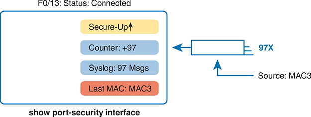

<figcaption>

<aside class="hidden" id="a11fig04">

状态被标签为 Connected . 该图包括一个有数个指标的盒子: 有向上箭头的黄色盒子中的安全上下, 计数器: +97 在蓝色盒子中; Syslog: +97 Msgs 也放入蓝色盒子中; 和 Last MAC: MAC 3 在红色盒子中. Security-Up表示,港口安全功能是活跃的并发挥作用的. 柜台:加97显示有97违反安全规定. Syslog:97Msgs指由于这些侵权行为而产生了97syslog消息. 上个MAC:MAC 3显示最后一个导致安全漏洞的MAC地址. 在本框右侧,一个图标代表以太网电缆或连接,标注为97X,表示97从源MAC地址-MAC-3.

</aside>

<strong>图11-4</strong> <em>行动摘要:港口安全违规模式限制</em>

</figcaption>

</figure>

</section>

</section>

</section>

<section class="ccna-source ccna-appendix" aria-label="答案解析与术语表">
<section data-epub-type="chapter">

<h2 class="h2" id="ref-appc">附录C</h2>

<h2 class="h2a">对“我早就知道了吗?” 的回答。</h2>

<section>

<h3 class="h3" id="ref-appclev1sec11">第11章</h3>

<strong><a id="ref-ques11_1" href="#quess11_1">1</a>。</strong> B。MAC 地址最大数量的默认值为 1，因此不必配置 <strong>switchport port-security maximum</strong> 命令。使用粘滞学习时，也无需预先定义具体的 MAC 地址。不过，必须使用接口子命令 <strong>switchport port-security</strong> 启用端口安全。

<strong><a id="ref-ques11_2" href="#quess11_2">2</a>。</strong> B 和 D。先看 sticky 参数：此命令使交换机学习源 MAC 地址，并将其添加到 <strong>switchport port-security mac-address</strong> <em>address</em> 接口子命令中。不过，端口安全将该命令添加到 running-config 文件；网络工程师还必须执行 <strong>copy running-config startup-config</strong> EXEC 命令来保存配置。

对于另一个正确选项，用户可以在网线末端连接一台交换机，再将多台设备接入该交换机。当用户觉得桌面需要更多端口时，实际网络中就会出现这种情况。不过，默认设置 <strong>switchport port-security maximum 1</strong> 意味着，来自第二个不同源 MAC 地址的帧会触发违规；默认的违规处理动作会使端口进入 err-disabled 状态。

对于另一个错误选项，该配置并未预定义任何 MAC 地址，因此不会阻止未知 MAC 地址访问端口。

<strong><a id="ref-ques11_3" href="#quess11_3">3</a>。</strong> B 和 C。IOS 将端口安全功能配置的 MAC 地址添加为静态 MAC 地址，因此这些地址不会出现在 <strong>show mac address-table dynamic</strong> 命令的输出中。<strong>show mac address-table port-security</strong> 不是有效命令。

<strong><a id="ref-ques11_4" href="#quess11_4">4</a>。</strong> B。题目指出端口安全状态为 secure-shutdown。只有 shutdown 端口安全模式才使用此状态；该状态表示接口已进入 err-disabled 状态。这些事实说明了正确选项成立以及两个错误选项不成立的原因。

提到违规计数器的选项不正确，因为在 shutdown 模式下，交换机将接口置于 secure-shutdown 状态后，违规计数器就不再递增。

<strong><a id="ref-ques11_5" href="#quess11_5">5</a>。</strong> B 和 C。先看两个错误选项：在 restrict 模式下，收到违反端口安全策略的帧不会使交换机将接口置于 err-disabled 状态。交换机会丢弃所有违反策略的帧，但接口仍保持启用，也不会丢弃未违反安全策略的帧，例如随后到达的第二个帧。

对于两个正确选项，处于端口安全 restrict 模式的端口会使交换机为违规帧生成日志消息、发送有关同一事件的 SNMP 陷阱（如果已配置 SNMP），并递增违规帧计数器。

</section>

</section>

<section id="ref-glossary"><h2 class="h2a">词汇表</h2>
<strong>已禁用错误( err- disable)</strong>局域网交换机上的接口状态,可能是许多安全违规事件之一的结果.

<strong>端口安全</strong>一个 Cisco 切换功能,其中切换器监视接口(一个端口)中的以太网帧,跟踪所有此类帧的源MAC地址,并在超过不同此类MAC地址的数量时采取安全行动.

<strong>违反模式</strong>在港口安全中,一个配置设置可以定义当发生港口安全违规时在港口上要采取的一组具体行动. 这些模式是关闭、限制和保护。

</section>
</section>

<section class="ccna-source ccna-appendix" aria-label="代码原图">
<section data-epub-type="chapter">

<a href="#f0223-01a" id="code-f0223-01">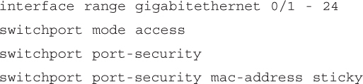</a>

<a href="#f0227-01a" id="code-f0227-01">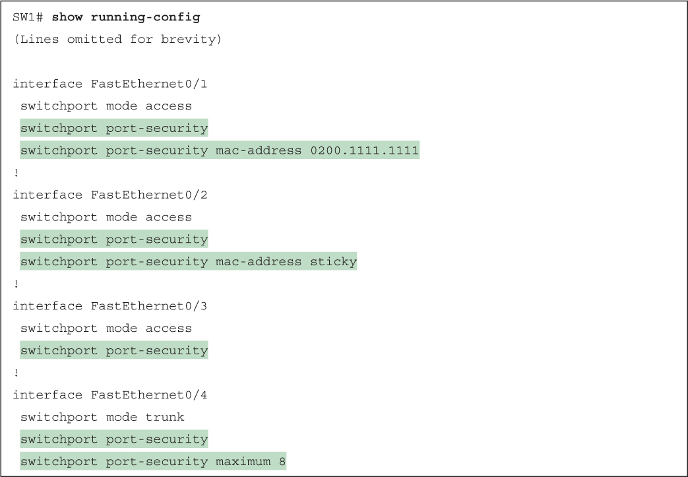</a>

<a href="#f0228-01a" id="code-f0228-01">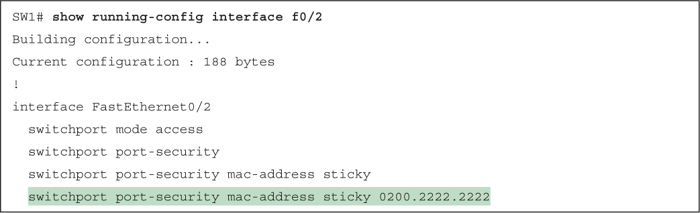</a>

<a href="#f0228-02a" id="code-f0228-02">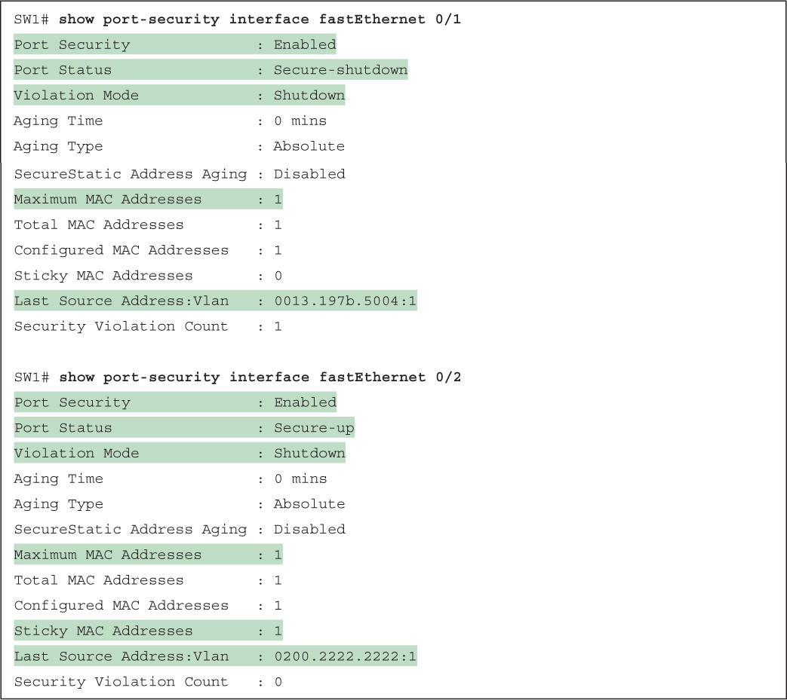</a>

<a href="#f0230-01a" id="code-f0230-01">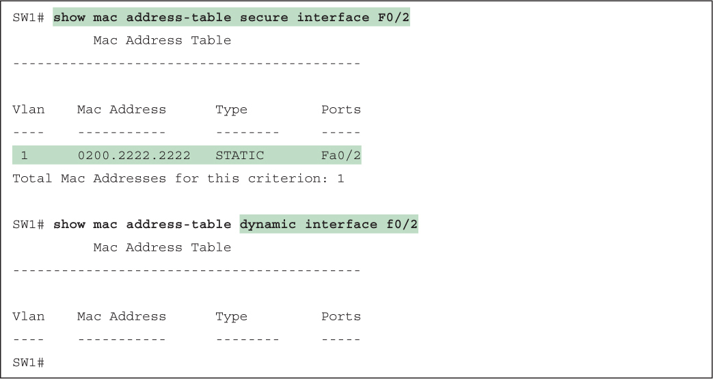</a>

<a href="#f0232-01a" id="code-f0232-01">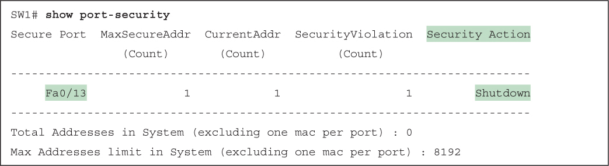</a>

<a href="#f0232-02a" id="code-f0232-02">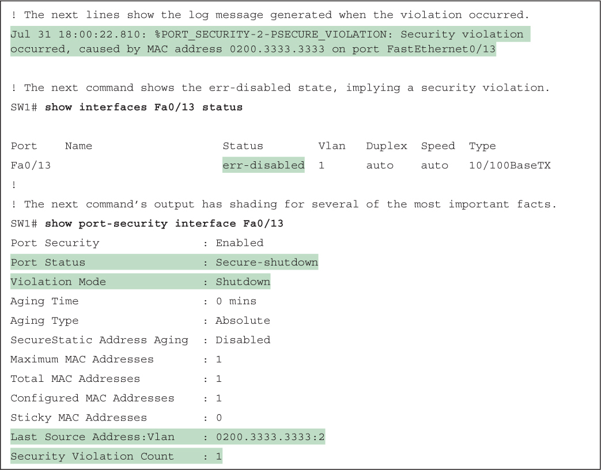</a>

<a href="#f0234-01a" id="code-f0234-01">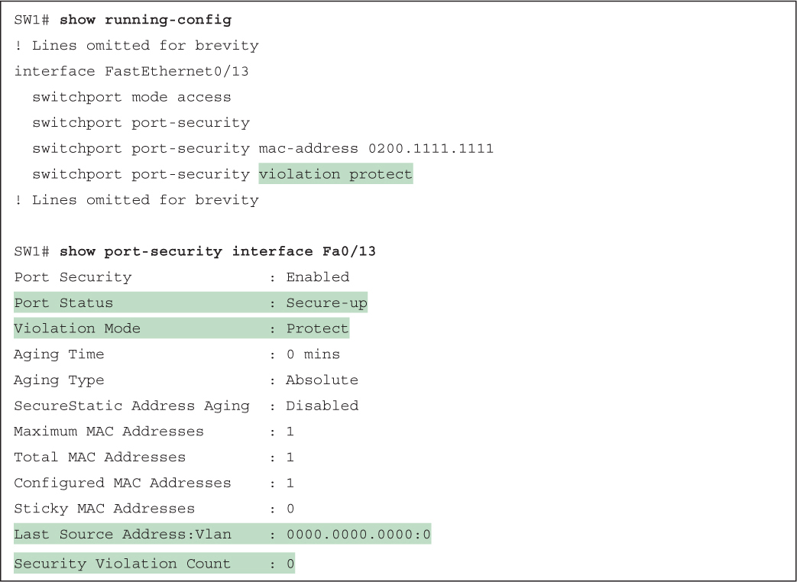</a>

<a href="#f0234-02a" id="code-f0234-02">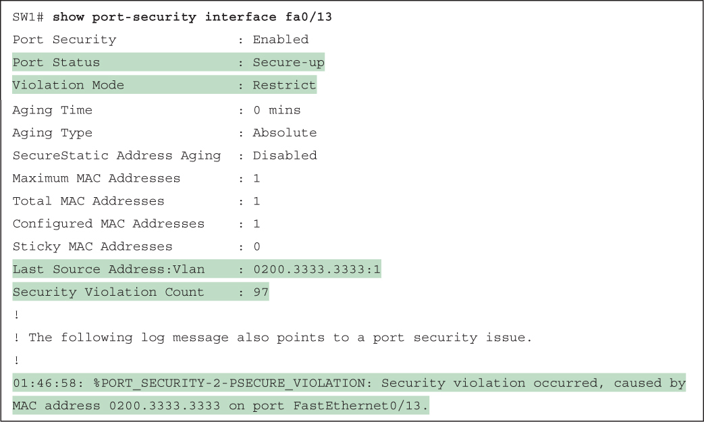</a>

</section>

</section>


<nav class="ccna-chapter-nav" aria-label="章节导航"><a href="v2-10.html">← 上一章</a><a href="v2-12.html">下一章 →</a></nav>
