
<a href="{{ '/subjects/CCNA/' | relative_url }}">← 返回 CCNA 目录</a>

第二卷 · 安全服务

<nav class="ccna-chapter-nav" aria-label="章节导航"><a href="v2-11.html">← 上一章</a><a href="v2-13.html">下一章 →</a></nav>



<section data-epub-type="chapter">

<h2 class="h2" id="ch12">第 12 章</h2>

<h2 class="h2a">DHCP 侦听与 ARP 检测</h2>

本章涵盖以下考试主题：

5.0 安全基础

5.7 配置和验证二层安全功能（DHCP 侦听、动态 ARP 检测和端口安全）

要理解现代网络中存在的风险，首先必须理解规则，然后思考攻击者可能如何以不同方式利用这些规则。有些攻击作为拒绝服务（DoS）攻击的一部分造成损害，侦察攻击则可能收集更多数据，为其他攻击做准备。对于你学到的每种网络协议和功能，都可能存在利用这些特征为攻击者谋取优势的方法。

本章讨论两项交换机功能，它们帮助防止某些攻击，避免攻击者获得合法主机收发数据包的副本。其中一项是 DHCP 侦听：它识别偏离 DHCP 正常用法的消息，这些消息可能是攻击的一部分，并将其丢弃。它还监视流经 LAN 交换机的 DHCP 消息，建立一张记录合法 DHCP 流详细信息的表，使其他交换机功能能够获知所连接设备具有哪些合法 DHCP 租约。

第二项功能是动态 ARP 检测（DAI），也用于防止数据包被重定向到攻击主机。某些 ARP 攻击试图诱使主机将数据包发送给攻击者的设备，而非真正的目的地。交换机会监视流经自身的 ARP 消息，检查传入消息是否符合 ARP 的正常行为，并将其详细信息与其他数据源比较，包括 DHCP 侦听绑定表。当 ARP 消息与网络中合法地址的已知信息不符时，交换机就过滤该消息。

本章第一大节介绍 DHCP 侦听的概念和配置，第二大节介绍 DAI。

<section>

<h3 class="h3" id="ch12lev1sec1">自测</h3>

如果你希望根据得分决定在本章投入多少时间，可以完成这组自测题（在此作答，或使用 PTP 软件）。各题答案的选项字母列在自测题之后的页面底部。书末和配套网站上的<a href="#ref-appc">附录 C</a>都包含答案及解析。你也可以在 PTP 测试软件中找到答案及解析。

<figure class="table" id="ch12tab01" tabindex="0">

<figcaption>

<strong>表12-1</strong> 核心主题小节与题目对应关系

</figcaption>

<table class="all">

<tbody>

<tr>

<th class="th">
基础知识小节
</th>

<th class="th">
题目
</th>

</tr>

<tr>

<td class="border">
DHCP 侦听
</td>

<td class="border">
1–4
</td>

</tr>

<tr>

<td class="border">
动态 ARP 检测
</td>

<td class="border">
5–7
</td>

</tr>

</tbody>

</table>

</figure>

<strong><a id="quess12_1" href="#ques12_1a">1</a>.</strong>一位工程师听说了DHCP 侦听的消息,并决定执行. 以下哪些设备可以执行DHCP 侦听? (取出二个答.

<ol class="lower-alpha">

<li>
第2层交换机
</li>

<li>
路由器
</li>

<li>
多层交换机
</li>

<li>
最终用户主机
</li>

</ol>

<strong><a id="quess12_2" href="#ques12_2a">2</a>.</strong>图层2交换机 SW2连接了图层2交换机(SW1),路由器(R1),DHCP服务器(S1)和3个PC(PC1,PC2和PC3). 所有PC都是DHCP客户端. 下列哪些最有可能是SW2上连接到所列设备的端口的 DHCP 侦听 信任状态配置 ? (取出二个答.

<ol class="lower-alpha">

<li>
连接到路由器的端口是不信任的.
</li>

<li>
连接到切换SW1的端口是信任的.
</li>

<li>
连接到PC1的端口不可信.
</li>

<li>
连接到PC3的端口是信任的.
</li>

</ol>

<strong><a id="quess12_3" href="#ques12_3a">3</a>.</strong>Switch SW1需要配置,以便在VLAN 5中使用 DHCP 侦听,而只有VLAN 5. 假设 VLAN 5 中至少有一个交换机端口必须是不可信的端口, 那么必须包含哪些命令 ? (取出二个答.

<ol class="lower-alpha">

<li>
<strong>no ip dhcp snooping trust</strong>
</li>

<li>
<strong>ip dhcp snooping untrust</strong>
</li>

<li>
<strong>ip dhcp snooping</strong>
</li>

<li>
<strong>ip dhcp snooping vlan 5</strong>
</li>

</ol>

<strong><a id="quess12_4" href="#ques12_4a">4</a>.</strong>在多层切换上,需要配置一个切换器,以便在一些层上执行 DHCP 侦听 2 VLAN 中的端口 3 。根据交换机是否兼任DHCP中继代理,可能需要还是不需要哪个命令?

<ol class="lower-alpha">

<li>
<strong>no ip dhcp snooping information option</strong>
</li>

<li>
<strong>ip dhcp snooping limit rate 5</strong>
</li>

<li>
<strong>errdisable recovery cause dhcp-rate-limit</strong>
</li>

<li>
<strong>ip dhcp snooping vlan 3</strong>
</li>

</ol>

<strong><a id="quess12_5" href="#ques12_5a">5</a>.</strong>Switch SW1已经配置,使用动态 ARP 检测,在VLAN 5中使用 DHCP 侦听. ARP请求抵达了G0/1. 哪个答案描述DAI总是比较两个项目,无论配置如何?

<ol class="lower-alpha">

<li>
消息的ARP发件人硬件地址和消息以太网头源 MAC地址
</li>

<li>
信件的 ARP 发送硬件地址和 DHCP 搜索绑定表
</li>

<li>
消息的ARP目标IP地址和 DHCP 搜索绑定表
</li>

<li>
消息的ARP目标IP地址和交换机的ARP表
</li>

</ol>

<strong><a id="quess12_6" href="#ques12_6a">6</a>.</strong>Switch SW1需要配置,以便使用动态 ARP 检测,同时在VLAN中与 DHCP 侦听 一起使用6而仅使用VLAN 6. 假设 VLAN 6 中至少有一个切换端口必须是可信任的端口, 那么必须包含哪些命令 ? (取出二个答.

<ol class="lower-alpha">

<li>
<strong>no ip arp inspection untrust</strong>
</li>

<li>
<strong>ip arp inspection trust</strong>
</li>

<li>
<strong>ip arp inspection</strong>
</li>

<li>
ip arp inspection vlan 6
</li>

</ol>

<strong><a id="quess12_7" href="#ques12_7a">7</a>.</strong>一个图层2交换机需要配置,以便与 DHCP 侦听 一起使用动态ARP 检查. 哪个命令会让 DAI 监视一个接口上的 ARP 消息速率, 平均每秒收到 4 的 ARP 消息 ? (取出二个答.

<ol class="lower-alpha">

<li>
<strong>ip arp inspection limit rate 4 burst interval 2</strong>
</li>

<li>
<strong>ip arp inspection limit rate 10 burst interval 2</strong>
</li>

<li>
<strong>ip arp inspection limit rate 16 burst interval 4</strong>
</li>

<li>
<strong>ip arp inspection limit rate 4</strong>
</li>

</ol>

自测答案：

<strong><a id="ques12_1a" href="#ref-ques12_1">1</a></strong> A、C

<strong><a id="ques12_2a" href="#ref-ques12_2">2</a></strong> B, C

<strong><a id="ques12_3a" href="#ref-ques12_3">3</a></strong> C, D

<strong><a id="ques12_4a" href="#ref-ques12_4">4</a></strong> A

<strong><a id="ques12_5a" href="#ref-ques12_5">5</a></strong> B

<strong><a id="ques12_6a" href="#ref-ques12_6">6</a></strong> B、D

<strong><a id="ques12_7a" href="#ref-ques12_7">7</a></strong> C, D

</section>

<section>

<h3 class="h3box" id="ch12lev1sec2">基础主题</h3>

</section>

<section>

<h3 class="h3" id="ch12lev1sec3">DHCP 侦听</h3>

DHCP服务器在当今大多数网络中都发挥着至关重要的作用,几乎每个用户端点都使用DHCP来学习其IP地址,掩码,默认网关,以及DNS服务器IP地址.<a href="v2-19.html#ch19">第19章</a>, “<a href="v2-19.html#ch19">在主机上的 IP 地址</a>中,“<em>CCNA 200-301 正式认证指南 第1卷</em>,第二版,说明DHCP在正常情况下应如何工作. 本节现在审查攻击者如何将DHCP用于自己的目的,以及两个具体工具——DHCP 侦听和动态 ARP 检测——如何帮助击败这些攻击。

本节从检查DHCP 侦听概念的必要性入手,包括它可以试图防止的攻击类型,再详细描述如何配置DHCP snooping.

<section>

<h4 class="h4" id="ch12lev2sec1">DHCP 侦听的概念</h4>

<a id="key_139" href="#ref-gloss_109">DHCP 侦听</a>交换机在很多方面都像防火墙或ACL 它分析一个 VLAN 中指定子集端口的来信。 DHCP 侦听从不过滤非DHCP消息,但它可能选择过滤 DHCP 消息,应用逻辑来作出选择——允许所发送的 DHCP消息或丢弃消息.

DHCP本身提供第3层服务,而DHCP 侦听则在局域网交换机上运行并被通常用于第2层局域网交换机上,并在第2层端口上启用. 将DHCP 侦听放入交换机的原因是,功能需要在典型的终端用户设备——作为DHCP客户端的设备类型——和DHCP服务器或DHCP中继代理之间实现.

<a href="#ch12fig01">图12-1</a>显示一个为讨论 DHCP 侦听 提供良好背景的样本网络. 首先,所有设备连接到第2层交换机SW2,所有端口作为第2层接线端口,都在同一个VLAN中. 典型的DHCP客户坐在图的右边. 左边显示其他设备,这些设备可能是到达DHCP服务器的路径.

<figure class="image-c" id="ch12fig01">

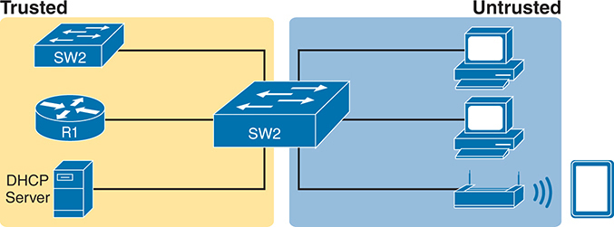

<figcaption>

<aside class="hidden" id="a12fig01">

左侧代表被信任的网络段并用黄色突出显示,有被标记为S W 2的交换机,被标记为R 1的路由器和向被信任的设备提供I P地址的DHCP服务器. 图像的右侧代表了未信任的网络段并用蓝色突出显示,包括另一个被标记为SW 2的交换机,几个计算机连接到这个交换机,以及一个带有额外设备无线连接的无线接入点.

</aside>

<strong>图12-1</strong> <em>DHCP 侦听 Basics:客户端端口无人信任</em>

</figcaption>

</figure>

DHCP 侦听首先在VLAN中的所有端口上工作,但每个端口都由DHCP Snoopping信任或不信任. 要了解原因,请考虑DHCP 侦听使用的通则摘要. 请注意,规则区分了通常由服务器(如DHCPOFFER和DHCPACK)发送的信息与通常由DHCP客户端(DHCPDISCOVER和DhCPREUST)发送的信息:

<ul class="sq">

<li>
DHCP 邮件收到日期<a id="key_147" href="#ref-gloss_351">非可信端口</a>,对于通常由服务器发送的信息,将永远被丢弃。
</li>

<li>
在不可信端口上收到的DHCP消息,通常由DHCP客户端发送,如果看起来是攻击的一部分,可以被过滤.
</li>

<li>
DHCP 邮件收到日期:<a id="key_146" href="#ref-gloss_345">可信端口</a>。信任的端口不过滤(丢弃)任何 DHCP 消息。
</li>

</ul>

<section>

<h5 class="h5" id="ch12lev3sec1">攻击示例：伪造的 DHCP 服务器</h5>

告诉你一些观点,<a href="#ch12fig02">图12-2</a>显示最右侧的合法用户的PC和最左侧的合法 DHCP 服务器。 然而,一名攻击者已经将一台笔记本电脑连接到局域网,并开始像DHCP服务器一样进行DHCP攻击. 根据图中的步骤,假设PC1试图在攻击者进行这次攻击时租赁IP地址:

<ol class="number">

<li>
PC1发送带有PC1首个DHCP消息(DHCPDISCOVER)的局域网广播.
</li>

<li>
攻击者的PC作为虚假的DHCP服务器,用DHCPDISCOFFER来复制DHCPDISCOVER.
</li>

</ol>

在这个例子中,攻击者创建并使用的DHCP服务器实际上将一个有用的IP地址租给PC1,在正确的子网中,带有正确的掩码. 为什么? 攻击者希望PC1能够发挥功能,但有一个扭矩. 注意指定PC1的默认网关:10.1.1.2,即攻击者的PC地址,而不是10.1.1.1,即路由器R1的地址. 现在PC1认为它拥有与网络连接所需的一切,它做到了——但现在PC1发送到它认为它默认的路由器首先通过攻击者的PC流出的所有包,创造了"人-中"攻击,如上所显示的.<a href="#ch12fig03">图12-3</a>.

<figure class="image-c" id="ch12fig02">

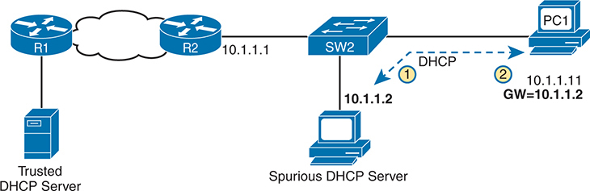

<figcaption>

<aside class="hidden" id="a12fig02">

网络设置包括一个可信赖的DHCP服务器,连接到路由器R1,通过网络云连接到另一个路由器R2. R-2连接到一个被标记为S W-2的交换机,它与P C-1连接. 一个虚假的 DHCP 服务器也被连接到同一个交换机(S W 2)上,表示有潜在的攻击. 该流程显示P C 1发送了 DHCP 请求,被虚假的 DHCP 服务器所截取,该服务器将 I P 地址 10.1.1.2 指定为 10.1.1.12 ,而不是从可信赖的 DHCP 服务器中正确的网关 10.1.1.1 .

</aside>

<strong>图12-2</strong> <em>DHCP 攻击用品 Good IP 地址但错误的默认网关</em>

</figcaption>

</figure>

<figure class="image-c" id="ch12fig03">

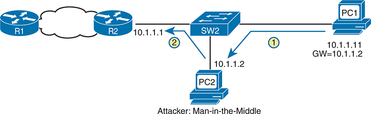

<figcaption>

<aside class="hidden" id="a12fig03">

网络设置显示R1连通了R-2,R2连通了SW-2接通了PC-1,还有一台攻击式计算机PC-2连通了同台交换机(S W-2),假想成合法设备. 该流程显示P C 1发送了DHCP请求,被P C 2(攻击者)截取,后者将IP地址10.1.1.11到PC 1,但设置了出入口到10.1.1.12,通过攻击者的计算机指挥流量.

</aside>

<strong>图12-3</strong> <em>不幸结果: DHCP出击引领中后卫</em>

</figcaption>

</figure>

注意,合法的DHCP还返回了DHCPOFFER消息作为PC1的主机,但大多数主机使用第一个收到的DHCPONFFER,而攻击者很可能是这个情景中的第一个.

图中的两个步骤显示DHCP完成后的数据流量. 对于任何预定要离开子网的流量,PC1会将其包发到默认的网关10.1.1.2,这恰好是攻击者. 攻击者将包裹转发到R1. PC1用户可以和普通一样连接到任何和所有应用程序,但现在攻击者可以保存由PC1发送的任何东西的副本.

</section>

<section>

<h5 class="h5" id="ch12lev3sec2">DHCP 侦听的逻辑</h5>

上一个例子仅显示一次攻击,攻击者的行为就像DHCP服务器(纯洁的DHCP伺服器). DHCP 侦听通过使大多数的端口不可信来击败这种攻击,这从定义上可以过滤到达未信任端口的 DHCP 服务器消息. 例如,在<a href="#ch12fig02">图12-2</a>和<a href="#ch12fig03">12-3</a>,使港口与攻击者相接,一个DHCP Snoop un trusted port会击败攻击.

为了欣赏更广泛的DHCP 侦听规则和逻辑,它有助于方便地参考一些更常见的DHCP消息和过程. 为了快速审查,正常的信息流包括这一序列:DISCOVER、OFER、要求、ACK(DORA)。 特别是:

<ul class="sq">

<li>
客户发送DISCOVER和要求。
</li>

<li>
服务器发送OFER和ACK。
</li>

</ul>

此外,DHCP客户端还使用DHCP ReLEASE和DHCPDECLINE消息. 当客户端有地址的工作租赁但不再想使用地址时,DHCP客户端可以告诉DHCP服务器它不再需要地址,将其放回DHCP伺服器,并带有DHCP ReLEASE消息. 同样,客户端也可以发送DHCP DECLINE消息来拒绝在消息上正常的DORA流量期间使用IP地址.

现在到 DHCP 搜索未信任的端口的逻辑.<a href="#ch12fig04">图12-4</a>概括这些想法,有两个交换机口。 左侧,交换机端口连接到一款DHCP服务器,因此应该信任;否则,DHCP将无法工作,因为交换机会过滤由DHCP伺服器发送的所有DHCP消息. 在右边,PC1与一个DHCP客户端连接到一个没有信任的端口.

<figure class="image-c" id="ch12fig04">

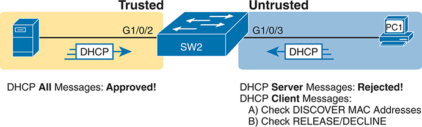

<figcaption>

<aside class="hidden" id="a12fig04">

在左侧,在被贴上"信任"标签的黄色阴影区域内,有一个DHCP服务器连接到一个交换机端口被贴上"G1" slash0" slash 2",有一个DHCP信息图标表示DHCP所有信件:批准! 右侧在被贴上"无信任"标签的蓝色阴影区域内,显示一台计算机被贴上"P C"的"1"与被贴上"G"的"交换机端口"的"G"的"1"相接而成.0"的"S"被贴上".3". 本节设置了 DHCP 信件图标,表示 DHCP 服务器信件: 已拒绝! 并指定 DHCP 客户端信件的检查, 包括 A) 检查 DISCOVER MAC 地址和 B) 检查 RELASE slash DECLINE 信件 。 中央交换机被标注为S W-2-)连接这两段.

</aside>

<strong>图12-4</strong> <em>DHCP 探险规则摘要</em>

</figcaption>

</figure>

DHCP 侦听规则如下:

<ol class="number">

<li>
检查所有 DHCP 信件 。
</li>

<li>
如果通常由服务器发送,则丢弃信件.
</li>

<li>
如果通常由客户端发送,过滤器如下:

<ol class="lower-alpha-n">

<li>
对于DISCOVER和要求信件,请检查以太网帧与DHCP信件之间的MAC地址一致性.
</li>

<li>
对于 ReLEASE 或 DECLLINE 消息,请检查接通的接口加IP地址相对于 DHCP 侦听 绑定表.
</li>

</ol></li>

<li>
对于DHCP 侦听允许的信息,要观察信息中的细节,如果它们导致DHCP租赁,则要为DHCPSnooping绑定表再建一新条目.
</li>

</ol>

接下来的几页通过对清单中的步骤3和步骤4作多一点的解释来完成对概念的讨论.

</section>

<section>

<h5 class="h5" id="ch12lev3sec3">根据 MAC 地址过滤 DISCOVER 消息</h5>

DHCP 侦听对最常用的客户端信息进行直接检查:DISCOVER和REQUST. 首先,注意DHCP消息定义了 chaddr(客户端硬件地址)字段来识别客户端. 局域网上的主机包括该设备的MAC地址作为chaddr的一部分. 和往常一样,以太网主机将 DHCP 消息封装在以太网框内,这些帧当然包括一个源MAC地址——这个地址应该是DHCP chaddr 字段使用的同名的MAC地址. DHCP 侦听进行简单的检查,以确保这些值匹配.

<a href="#ch12fig05">图12-5</a>显示攻击者如何试图超载 DHCP 服务器并租赁子网中的所有地址 。 攻击者的PC使用伪MAC地址A,因此图中的所有3个DISCOVER消息都显示一个源以太网地址"A. 然而,每个消息(在DHCP数据中)在chaddr值(shown as MAC1,MAC2和MAC3为简写)中识别出一个不同的MAC地址,因此从DHCP的角度来看,每个消息似乎都是不同的DHCP请求. 攻击者可以尝试租赁子网中每个IP地址,以便其他主机都无法获得租赁.

<figure class="image-c" id="ch12fig05">

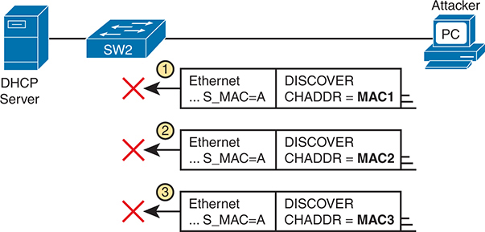

<figcaption>

<aside class="hidden" id="a12fig05">

左边有一个DHCP服务器连接到一个被标记为S W-2的交换机上. 在右侧,攻击者的电脑上标有P C也连接到交换机上. 下面描绘出三个相继的网络包,每个包都包含以太网和DHCP DISCOVER头. 在每个包中,以太网头显示S下划线MAC等于A,表示出源MAC地址为"A",而DHCP DISCOVER头则显示不同的差分值:CHADDR等于MAC1,CHADDR等于MC2,CHADDR分别等于MAC3. 每个包被标记为红色X来表示拒绝. 每个包旁边的号码为1,2和3,突出显示交换机所执行的检查顺序,以确保源的MAC地址与chaddr相匹配.

</aside>

<strong>图12-5</strong> <em>DHCP 侦听 检查 chaddr 和 Ethernet 源代码 MAC</em>

</figcaption>

</figure>

DHCP 侦听的核心特征是击败了这种对不可信端口的攻击. 它会检查以太网头源MAC地址,并将该地址与DHCP头的MAC地址进行比较,如果数值不匹配,DHCP 侦听会丢弃消息.

</section>

<section>

<h5 class="h5" id="ch12lev3sec4">过滤释放 IP 地址的消息</h5>

在查看下一点逻辑之前,您需要先理解 DHCP 侦听 绑定表.

DHCP 搜索构建<a id="key_140" href="#ref-gloss_110">DHCP 搜索绑定表</a>对于所有DHCP流,它看到它允许完成. 也就是说,对于任何行之有效的合法的DHCP流动,它都保留着一些重要事实的清单. 然后DHCP 侦听,以及"动态 ARP 检测"等其他功能,可以使用表格来做决定.

举例来说,考虑<a href="#ch12fig06">图12-6</a>,重复与<a href="#ch12fig04">图12-4</a>,现在在DHCP 侦听绑定表中有一个条目。

<figure class="image-c" id="ch12fig06">

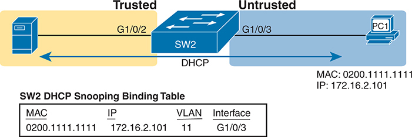

<figcaption>

<aside class="hidden" id="a12fig06">

此网络包含交换机 SW2，它连接两个区域：左侧的可信区域和右侧的不可信区域。在可信区域，服务器连接 SW2 的 G1/0/2 接口。在不可信区域，PC1 连接 SW2 的 G1/0/3 接口。服务器与 SW2 之间、PC1 与 SW2 之间的连接都带有箭头，用于显示 DHCP 通信方向。PC1 的介质访问控制（MAC）地址为 0200.1111.1111，互联网协议（IP）地址为 172.16.2.101。图下方的“SW2 DHCP 侦听绑定表”列出 DHCP 绑定信息。表格有四列：MAC 地址、IP 地址、VLAN 和接口。表项为 MAC 地址 0200.1111.1111、IP 地址 172.16.2.101、VLAN 11，以及接口 G1/0/3，说明 DHCP 侦听创建此绑定，将 MAC 地址与 IP 地址以及特定 VLAN 和接口关联起来。此图说明 DHCP 侦听如何通过确保只有合法的 DHCP 客户端获得 IP 地址来维护网络安全，从而防止 DHCP 欺骗攻击。图示及附表突出展示了 DHCP 侦听过程的关键要素，以及为 PC1 创建的绑定表项的详细信息。

</aside>

<strong>图12-6</strong> <em>由 DHCP 侦听 建造的带有 DHCP 绑定条目的合法 DHCP客户端</em>

</figcaption>

</figure>

在这个简单的网络中,右边租赁IP地址上的DHCP客户端从左侧的DHCP服务器上取出172.16.2.101. 交换机的 DHCP 侦听 特性将 DHCP 消息中的信息与端口信息(接口G1/0/3,由交换机指定给 VLAN 11)相融合,并放入DHCP 侦听 绑定表.

DHCP 侦听随后应用了额外的过滤逻辑,该逻辑使用DHCP 侦听绑定表:它检查客户端发送的信息,如RELEASE和DECLINE,这些消息会导致DHCP服务器被允许发布地址. 例如,一个合法的用户可能租赁地址172.16.2.101,并在某个时候将地址放回服务器;然而,在客户端完成租赁之前,攻击者可以发送一个DHCP ReLEASE消息,将地址放回池中. 攻击者随后可以立即尝试租借该地址,希望DHCP服务器将相同的172.16.2.101地址指定给攻击者.

<a href="#ch12fig07">图12-7</a>显示一个示例。 PC1已经有一个 DHCP 地址 (172.16.2.101), SW2 在 DHCP 侦听 绑定表上列出一个条目. 该图显示了攻击者在港口G1/0/5试图放出PC1地址的动作. DHCP 侦听 比较来信,来信接口,以及匹配的表格条目 :

<ol class="number">

<li>
攻击者PC A发送了DHCP ReLEASE消息,通过交换机SW2接收到端口G1/0/5. 该消息试图将 DHCP ReLEASE 地址 172.16.2.101.
</li>

<li>
Switch SW2比较了 DHCP 侦听 绑定表,以找到与所列出地址相匹配的条目:172.16.2.101.
</li>

<li>
Switch SW2注意到,绑定表列出了带端口G1/0/3的合法入站,但新的DHCP ReLEASE到达了端口G1/0/5. 因此,DHCP 侦听丢弃了DHCP ReLEASE消息.
</li>

</ol>

<figure class="image-c" id="ch12fig07">

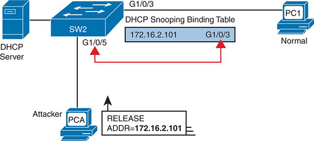

<figcaption>

<aside class="hidden" id="a12fig07">

该图包括连接到一个S W 的切换标签的 DHCP 服务器 2 ,它有多个接口。 1 斜线 0 斜线 3 2 连接到一个合法的客户端设备,标记为 P C 1 。该接口有一个相关的 DHCP 侦听 绑定表格条目和 IP 地址 172.16.2.101 . 攻击器设备,标签为PCA,与接口G相接 1 斜线 0 斜线 5 。攻击者试图释放 IP 地址 172.16.2.101 ,如图中显示的 DHCP 发布信息所示。然而,由于 DHCP 浏览,S W 上的绑定表 2 识别 IP 地址对合法接口的正确映射,防止攻击者的释放消息影响合法客户端。该图表使用箭头表示攻击者设备 PAP 的 DHCP 释放消息流向切换 S W 2 并突出绑定表在维护正确的 I P 对接口映射方面的作用. 这个设置说明了 DHCP snooping 的保护机制,它确保只接受特定接口上已知设备上授权的 DHCP 消息,有效缓解了未经授权的 I P 释放尝试等与 DHCP 相关的攻击.

</aside>

<strong>图12-7</strong> <em>DHCP 侦听 Releats a DHCP ReLEASE 从另一个端口搜索失败</em>

</figcaption>

</figure>

</section>

</section>

<section>

<h4 class="h4" id="ch12lev2sec2">DHCP 侦听配置</h4>

DHCP 侦听需要几个配置步骤才能使它发挥作用. 首先,您需要使用一对关联的全局指令:一是让 DHCP 侦听 能够使用 DHCP snooping,一是让另一个将 VLAN 列出来使用 DHPC Snoopning 的. DHCP 侦听必须包含两者才能运行.

其次,您虽然不需要字面上的要求,但通常需要将几个端口配置为可信任的端口. 大多数使用 DHCP 侦听 用于 VLAN 的交换机都有一些信任的端口和一些不信任的端口,在默认不信任的情况下,您需要配置信任的端出.

本节首先举例说明如何配置一个典型的 第2层交换机来使用 DHCP 侦听 , 并有刚才描述的必要命令, 以及其它可选命令.

<section>

<h5 class="h5" id="ch12lev3sec5">在二层交换机上配置 DHCP 侦听</h5>

即将到来的例子都依赖于图解<a href="#ch12fig08">图12-8</a>,以第2层交换机SW2为交换机,用于DHCP 侦听。 DHCP服务器坐落在WAN的另一边,在图的左边. 因此,需要信任SW2连接到路由器R2(一种DHCP中继代理)的端口. 在右边,两个样本的PC可以使用默认的不可信设置.

<figure class="image-c" id="ch12fig08">

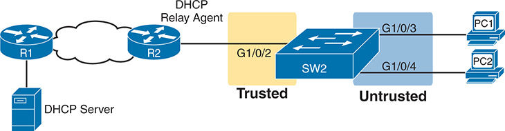

<figcaption>

<aside class="hidden" id="a12fig08">

在左侧,网络以连接到路由器标签为R的 DHCP 服务器为起点 1 。此连接通过网络云显示,象征更广泛的网络连接到另一个路由器,标签为R 2 路由器 R 2 充当 DHCP 中继代理, 并连接到一个带有S W 标签的交换机 2 通过接口 G 1 斜线 0 斜线 2 ,它标记为 Trusted。可信赖的链接表示可以信任它接收 DHCP 服务器消息。交换机 S W 2 有两个其他接口, G 1 斜线 0 斜线 3 和G组 1 斜线 0 斜线 4 ,标签为 Un trusted ,表示只接收 DHCP 客户端请求。连接到这些未信任的接口是两个P C S,标签为 P C 1 一般事务人员(特等)1人 2 PC S通过交换机SW上的不信任接口与网络相接 2 ,强调其作为 DHCP 客户端的作用。从路由器 R 中信任的连接 2 确保只将经过核实的 DHCP 服务器消息转发到切换器,同时监测未信任的端口进行可能的 DHCP spoof 活动。此设置将突出 DHCP spoop 配置中涉及的关键组件,其中 S W 2 作为区分网络内可信来源和不信任来源、防止恶意DHCP流量和确保将I P地址适当分配给客户的关键点(PC) 1 一般事务人员(特等)1人 2 )与网络相接.

</aside>

<strong>图12-8</strong> <em>DHCP 搜索配置示例中使用的样本网络</em>

</figcaption>

</figure>

Switch SW2将图中的所有端口都放入了VLAN11. 为了在VLAN 11中启用 DHCP 侦听, SW2 需要两个命令,如在顶部附近所示。<a href="#exa12_1">示例12-1</a>: <strong>ip dhcp snooping</strong>和<strong>ip dhcp snooping vlan 11</strong>。然后,为了改变要信任的端口G1/0/2(连接到路由器)上的逻辑,配置包括:<strong>ip dhcp snooping trust</strong>接口子命令。

<strong>示例12-1</strong> <em>DHCP 选中配置以匹配<a href="#ch12fig08">图12-8</a></em>

<a href="#code-f0246-01" id="f0246-01a">点击此处查看代码原图</a>

<pre class="pre-ex" tabindex="0"><code class="highlight">ip dhcp snooping
ip dhcp snooping vlan 11
no ip dhcp snooping information option
!
interface GigabitEthernet1/0/2
 ip dhcp snooping trust</code></pre>

注意:<strong>no ip dhcp snooping information option</strong>命令在其中<a href="#exa12_1">示例12-1</a>将在一个更好的背景中解释<a href="#exa12_2">示例12-2</a>但已列出于<a href="#exa12_1">示例12-1</a>以完成这个例子。

使用这一配置,交换机遵循前一节所详述的逻辑步骤,题为“<a href="#ch12lev3sec2">DHCP 搜索逻辑</a>......“为了得到对这一索赔的一些支持,请看<a href="#exa12_2">示例12-2</a>,它显示来自<strong>show ip dhcp snooping</strong>命令交换机 SW2 。

<strong>示例12-2</strong> <em>SW2 DHCP 搜索状态</em>

<a href="#code-f0247-01" id="f0247-01a">点击此处查看代码原图</a>

<pre class="pre-ex" tabindex="0"><code class="highlight">SW2# <strong>show ip dhcp snooping</strong>
Switch DHCP snooping is enabled
Switch DHCP gleaning is disabled
DHCP snooping is configured on following VLANs:
11
DHCP snooping is operational on following VLANs:
11
Smartlog is configured on following VLANs:
none
Smartlog is operational on following VLANs:
none
DHCP snooping is configured on the following L3 Interfaces:

Insertion of option 82 is disabled
   circuit-id default format: vlan-mod-port
   remote-id: bcc4.938b.a180 (MAC)
Option 82 on untrusted port is not allowed
Verification of hwaddr field is enabled
Verification of giaddr field is enabled
DHCP snooping trust/rate is configured on the following Interfaces:

Interface                  Trusted    Allow option    Rate limit (pps)
-----------------------    -------    ------------    ----------------
GigabitEthernet1/0/2       yes        yes             unlimited
  Custom circuit-ids:</code></pre>

例子中突出显示的行指出一些关键配置设置. 从顶部开始,前两段确认配置<strong>ip dhcp snooping</strong>和<strong>ip dhcp snooping vlan 11</strong>命令。 另外,输出底部被突出显示的行显示了一个列出可信任端口的段落——在此情况下,只有端口G1/0/2.

而且,你可能已经注意到 突出的线 在中间,州<strong>插入选项 82已禁用</strong>。这条线证实增加了<strong>no ip dhcp information option</strong>命令返回到配置中<a href="#exa12_1">示例12-1</a>。为了理解这个例子为什么包括这个命令,请考虑DHCP中继代理的这些事实:

<ul class="sq">

<li>
DHCP中继代理在DHCP请求中添加了新字段——被定义为可选的82 DHCP头字段(以RFC 3046为单位).
</li>

<li>
DHCP 侦听使用默认设置,如果交换机起到第3层交换机和DHCP中继代理的作用,则这种设置效果良好,这意味着交换机应当将DHCP选项82字段插入到DHCP消息中. 实际上,交换机默认使用<strong>ip dhcp snooping information option</strong>.
</li>

<li>
当交换机不同时作为 DHCP 中继代理时,默认设置会阻止 DHCP 为终端用户工作. 切换器将字段设置在 DHCP 信件中, 如原为DHCP中继代理,但对这些消息的更改导致大多数DHCP服务器(和大多数DHCD中继代理)忽略收到的DHCP消息.
</li>

<li>
结论:为了让DHCP 侦听在不同时是DHCP中继代理的交换机上工作,并为了避免防止DHCP合法租赁的问题,使用该功能禁用选项 82 特性<strong>no ip dhcp snooping information option</strong>全局指令 。
</li>

</ul>

这结束了DHCP 侦听的配置,它既是需要的,也是你最常需要的使特性发挥作用的. 本节其余部分讨论一些可选的 DHCP 侦听 特性.

</section>

<section>

<h5 class="h5" id="ch12lev3sec6">限制 DHCP 消息速率</h5>

知道DHCP 侦听阻止了他们的攻击,攻击者会做出什么反应? 策划出新的攻击,包括攻击DHCP 侦听自己.

攻击DHCP 侦听的一种方式利用了它在交换机中使用通用CPU的优势. 知道后,攻击者可以设计出攻击来生成大量DHCP消息来试图超载DHCP 侦听特性和交换机CPU本身. 目标可以是简单的拒绝服务攻击,也可以是可能使DHCP 侦听无法检查每条消息的组合攻击,允许其他DHCP攻击随后起作用.

为了帮助防止这种攻击,DHCP 侦听包含了一个可选功能,可以跟踪所接收到的DHCP消息的数量. 如果收到的 DHCP 消息数量超过此限制,则 DHCP 侦听 将事件视为攻击,并将端口移动到错误的残疾状态. 另外,该功能可以在信任和不信任的接口上被启用.

尽管限制 DHCP 消息的速率可以有所帮助,但将端口置于错误的残疾状态本身就会产生问题. 作为提醒,一旦处于错误的残疾状态,交换机将不会为接口发送或接收帧. 然而,错误残疾状态可能过于严重,因为错误残疾状态的默认追回行动需要配置一个<strong>shutdown</strong>然后一个<strong>no shutdown</strong>接口上的子命令。

为了帮助实现更好的平衡,您可以让 DHCP 侦听 速率受限,然后配置交换机从端口错误的状态中自动恢复,而不需要<strong>shutdown</strong>接下来<strong>no shutdown</strong>命令。

<a href="#exa12_3">示例12-3</a>显示如何启用 DHCP 搜索率限制和错误的回收。 首先,看看配置的下半部,到接口,看是否直接设置了每段接口限制。<strong>ip dhcp snooping rate limit</strong> <em>number</em>接口子命令。 配置的顶部使用两个全局命令,告诉IOS如果是由 DHCP 侦听 引起的,从错误的残疾状态中恢复,并使用非默认秒数等待后再恢复接口. 请注意,配置在<a href="#exa12_3">示例12-3</a>将依赖 DHCP 侦听 的核心配置,如<a href="#exa12_1">示例12-1</a>.

<strong>示例12-3</strong> <em>配置 DHCP 搜索信件速率限制</em>

<a href="#code-f0249-01" id="f0249-01a">点击此处查看代码原图</a>

<pre class="pre-ex" tabindex="0"><code class="highlight">errdisable recovery cause dhcp-rate-limit
errdisable recovery interval 30
!
interface GigabitEthernet1/0/2
 ip dhcp snooping limit rate 10
!
interface GigabitEthernet1/0/3
 ip dhcp snooping limit rate 2</code></pre>

重复一个<strong>show ip dhcp snooping</strong>命令现在显示输出结束时的速率限制,如注:<a href="#exa12_4">示例12-4</a>.

<strong>示例12-4</strong> <em>确认 DHCP 搜索率限制</em>

<a href="#code-f0249-02" id="f0249-02a">点击此处查看代码原图</a>

<pre class="pre-ex" tabindex="0"><code class="highlight">SW2# <strong>show ip dhcp snooping</strong>
! Lines omitted for brevity

Interface                  Trusted    Allow option    Rate limit (pps)
-----------------------    -------    ------------    ----------------
GigabitEthernet1/0/2       yes        yes             10
  Custom circuit-ids:
GigabitEthernet1/0/3       no         no              2
  Custom circuit-ids:</code></pre>

</section>

<section>

<h5 class="h5" id="ch12lev3sec7">DHCP 侦听配置小结</h5>

以下配置清单概括了本节中包含的关于如何配置 DHCP 侦听 的命令.

台阶.1.配置此对命令( 两者都需要) :

<figure class="image">

</figure>

<ol class="step-upper-alpha">

<li>
使用该<strong>ip dhcp snooping</strong>允许 DHCP 在交换机上浏览的全局命令 。
</li>

<li>
使用该<strong>ip dhcp snooping vlan</strong> <em>vlan-list</em>用于识别使用 DHCP 侦听 的 VLANs 的全局命令。
</li>

</ol>

台阶.2. <strong>(可选):</strong>使用该<strong>no ip dhcp snooping information option</strong>Global Communications on Layer 2交换机以禁用 DHCP Option 82数据插入到 DHCP 消息中,特别是在不起到 DHCP 中继代理作用的交换机上.

台阶.3.配置<strong>ip dhcp snooping trust</strong>接口子命令以覆盖不可信默认设置。

台阶.4. <strong>(可选):</strong>配置 DHCP 搜索速率限制和错误的回收 :

步骤A。 <strong>(可选):</strong>配置<strong>ip dhcp snooping limit rate</strong> <em>number</em>接口子命令,以设定每秒 DHCP 消息的限度。

步骤B。 <strong>(可选):</strong>配置<strong>no ip dhcp snooping limit rate</strong> <em>number</em>接口子命令,以删除已有限制并重设接口,以使用默认的无速率限制。

步骤 C. <strong>(可选):</strong>配置<strong>errdisable recovery cause dhcp-rate-limit</strong>global 命令可以实现从错误障碍模式中自动恢复的特性,假设交换机由于超过 DHCP 侦听 速率限制而使端口处于错误障碍状态.

步骤D. <strong>(可选):</strong>配置<strong>errdisable recovery interval</strong> <em>seconds</em>global 命令设置等待时间,然后从接口错误的状态恢复(不管错误的状态的原因).

</section>

</section>

</section>

<section>

<h3 class="h3" id="ch12lev1sec4">动态 ARP 检测</h3>

密码<a id="key_141" href="#ref-gloss_124">ARP动态检查(DAI)</a>切换器的特性检查未信任端口上收到的ARP消息,以过滤它认为是攻击的一部分。 DAI的核心功能是将收到的ARP消息与两个数据来源进行比较:DHCP 侦听绑定表和所配置的任何ARP ACL. 如果收到的ARP消息与交换机中的表格不符,交换机会丢弃ARP消息.

本节沿用了与DHCP 侦听部分相同的顺序,首先考察了DAI和ARP攻击背后的概念,再演示如何配置DAI同时具有需要的和可选的特性.

<section>

<h4 class="h4" id="ch12lev2sec3">DAI 的概念</h4>

要理解攻击DAI可以预防,你需要准备好将正常的ARP操作与某些类型攻击中使用的ARP的异常使用相提并论. 本节使用相同的流出,首先审查一些重要的ARP细节,再显示攻击者如何仅仅发送一个.<a id="key_138" href="#ref-gloss_040">退休人员协会的答复</a>- 所谓的a<a id="key_142" href="#ref-gloss_157">无缘无故的ARP</a>——触发主机在其ARP表格中添加不正确的ARP条目.

<section>

<h5 class="h5" id="ch12lev3sec8">回顾正常的 IP ARP</h5>

如果你只关心ARP如何正常工作, 不关心攻击, 你可以想到ARP的深度<a href="#ch12fig09">图12-9</a>。该图显示了一个典型的序列. 主机PC1需要发送IP包到它的默认路由器(R2)上,所以PC1首先发送了ARP请求消息来尝试学习与R2的172.16.2.2地址相联的MAC地址. 路由器R2发送回ARP回复,列出R2的MAC地址(注意图中显示伪MAC地址来保存空间).

<figure class="image-c" id="ch12fig09">

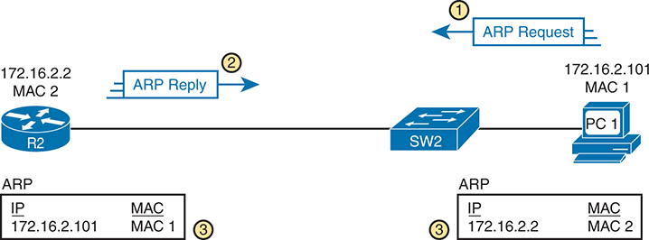

<figcaption>

<aside class="hidden" id="a12fig09">

从右边开始,PC 1 以 IP 地址显示 172.16.2.101 和MAC地址( MAC) 1 。它连接到一个带有SW标签的网络交换机 2 . 到 S W 左边 2 ,路由器 R 2 以 IP 地址显示 172.16.2.2 和MAC地址( MAC) 2 。ARP的通信顺序以三个编号步骤来标出。 1 1 发出ARP请求,由指向 R 的蓝箭头代表 2 。此请求旨在解决对应 IP 地址的 MAC 地址 172.16.2.2 步骤中 2 2 以蓝箭指向P C的ARP回复 1 本答复包含MAC地址MAC 2 与因特网网址有关的 172.16.2.2 。本函文之后的ARP表更新以两个相隔的框显示在图表的下方。 1 包括一个带有 IP 地址的条目 172.16.2.2 映射到 MAC 地址 MAC 2 同样,R的ARP表格 2 包括一个带有 IP 地址的条目 172.16.2.101 映射到 MAC 地址 MAC 1 。每个ARP表格都标注数字。 3 ,表示ARP进程的最后一步,其中两个设备都用新获得的ARP信息来更新自己的表格. 该图使用标准网络符号来代表P C,切换和路由器,并带有方向箭头和标签来清晰地说明ARP请求和答复的流出. ARP表格提供了每个设备ARP缓存的最终状态的可视化表现,显示已解决的I P-to-MAC地址映射.

</aside>

<strong>图12-9</strong> <em>PC1 DHCP和ARP之后有R2路由器的合法ARP表</em>

</figcaption>

</figure>

图下方的ARP表格隐含了一个重要的事实:两个主机都用这种双信息流来学习另一个主机的MAC地址. PC1不仅根据ARP回复(英语:Message 2)学习了R2的MAC地址,路由器R2也因为ARP请求(英语:Message 1)学习了PC1的IP和MAC地址. 为了解原因,请查看以下文件所示的对这些信息的更详细看法:<a href="#ch12fig10">图12-10</a>.

<figure class="image-c" id="ch12fig10">

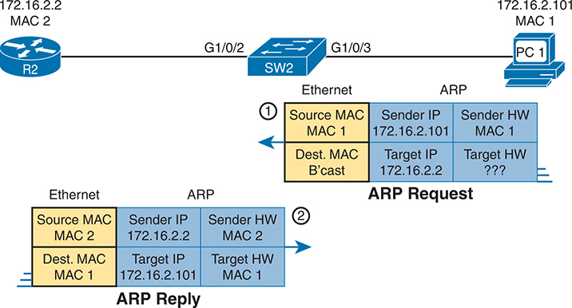

<figcaption>

<aside class="hidden" id="a12fig10">

A图上方有一个路由器的网络段,路由器标记为R2左侧,由I P地址172.16.2.2和MAC地址MAC2所识别. 路由器通过以太网连接到一个被标记为S W-2的交换机,通过接口G-1 slash0 slash2. 交换机再与右侧标有PC 1的个人电脑相接,IP地址为172.16.2.101和MAC地址为_MAC1,通过接口G1 slash0 slash3. ARP进程分为两个步骤:ARP请求和ARP答复。 在"ARP Request"步骤中,以"以太网"为环形编号以标签出1"显示,以太网帧包括了源MAC地址MAC1"和目的地MAC地址设定来广播(B'cast). 此帧中的ARP包包含发件人的硬件地址(MAC 1)和 IP地址(172.16.2.101),但目标硬件地址未知(问题标记),而目标I P地址为172.16.2.2. 在ARP Response步骤中,被标注为2的环形编号中,以太网帧现在包括了源MAC地址-MAC2和目的地MAC地址-1. 在此帧内的ARP包包含发件人的硬件地址(MAC 2)和 IP地址(172.16.2.2),以及目标硬件地址(MAC 1)和 I P地址(172.16.2.101). 这个图有效地说明了网络上的一个设备(P C 1)通过ARP请求和路由器(R 2)随后提供的提供所有必要MAC地址信息(MAC 2)的回复,确定与I P地址(172.16.2.2)相联的硬件地址的过程.

</aside>

<strong>图12-10</strong> <em>详细审查美国退休人员协会的请求和答复</em>

</figcaption>

</figure>

ARP信息定义了四个相关领域:<a id="key_143" href="#ref-gloss_299">发送硬件地址</a>, <a id="key_145" href="#ref-gloss_301">发送协议地址</a>,目标硬件地址,以及目标协议地址。 这些术语使用通用语,但"硬件"一词指MAC地址,"协议"一词指IP. 所以,你应该期待看到许多关于ARP的描述,这些描述使用类似术语,如发送者MAC地址和<a id="key_144" href="#ref-gloss_300">发送 IP 地址</a>.

每个ARP消息的发件人字段列出发送设备的IP地址和MAC,无论消息是ARP回复还是ARP请求. 例如, PC1 发送的图中的信息 1 列出了 PC1 在发送字段中的IP 和 MAC 地址, 这就是为什么路由器 R2 能够得知此信息 。 PC1同样在ARP回复中从发送方地址字段中得知了R2的MAC地址.

</section>

<section>

<h5 class="h5" id="ch12lev3sec9">作为攻击手段的免费 ARP</h5>

通常情况下,一个主机在知道另一个主机的IP地址并想学习该主机的MAC地址时会使用ARP. 然而,出于合理的理由,一个主机也可能想将它的MAC地址通知子网中的所有主机. 例如,当一个主机改变其MAC地址时,这可能是有益的。 因此,ARP支持一个带有这些特征的无端ARP消息的想法:

<ul class="sq">

<li>
这是美国退休人员协会的答复。
</li>

<li>
它是在没有首先收到ARP请求的情况下发出的。
</li>

<li>
它被发送到以太网目的广播地址,这样子网中的所有主机都会收到消息.
</li>

</ul>

例如,如果一个主机的MAC地址是MAC A,并且它更改为MAC B,使得所有其他主机都更新了他们的ARP表,则主机可以发送一个无端的ARP,列出一个MAC B的发件人MAC.

攻击者可以利用无端的ARP,因为他们让发送主机让其他主机改变他们的ARP表.<a href="#ch12fig11">图12-11</a>显示的只是PC A(攻击者)发动的如此一例,使用无端的ARP. 然而,这个ARP列出PC1的IP地址,但在第1步却有一个不同的设备的MAC地址(PC A),导致路由器更新了它的ARP表(第2步).

<figure class="image-c" id="ch12fig11">

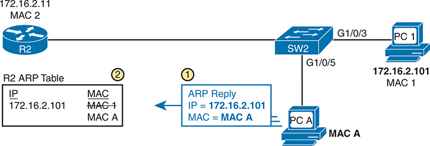

<figcaption>

<aside class="hidden" id="a12fig11">

设置包括一个路由器,标签为R 2 左侧,连接到一个贴有SW标签的交换机 2 ,这反过来又与两个设备相连: P C 1 接口 G 1 斜线 0 斜线 3 和在接口G上贴有PA标签的恶意设备 1 斜线 0 斜线 5 P C 级 1 位于右上方,有一个IP地址: 172.16.2.101 和标签为MAC的MAC地址 1 五氯苯甲醚,位置在PC以下 1 ,有一个MAC地址标记为 MACA。该图表显示来自 PCA 的 ARP 回复信件(步骤) 1 )),说明I P等同 172.16.2.101 ,MAC 等于 MACA。ARP 的回复针对路由器 R 2 ,它根据这一信息更新了ARP表。因此,Rrouter R上的ARP表 2 不正确关联 IP 地址 172.16.2.101 用MACA代替正确的MAC 1 (步骤) 2 。用两个圆形编号步骤突出这种操纵,表示事件的顺序。 2 显示错误的条目: IP 172.16.2.101 , MACMASA.

</aside>

<strong>图12-11</strong> <em>多种使用ARP回复原因 R2的ARP数据不正确</em>

</figcaption>

</figure>

此时,当R2将IP包转发到PC1的IP地址(172.16.2.101)时,R2会将其封入以太网帧,以PC A为目的地,而不是以PC1的MAC地址来封装. 起初,这似乎会阻止PC1工作,但相反,它可能是中层人物攻击的一部分,这样PC A就可以复制出每条消息.<a href="#ch12fig12">图12-12</a>显示此时此刻发生的事情:

<ol class="number">

<li>
PC1向路由器R2左侧的一些服务器发送消息.
</li>

<li>
服务器对PC1的IP地址作出答复,但R2将该包转发到PC A的MAC地址,而不是PC1.
</li>

<li>
PC A复制包供以后处理.
</li>

<li>
PC A 将新帧内的包转发到 PC1,这样 PC1 仍然有效 。
</li>

</ol>

<figure class="image-c" id="ch12fig12">

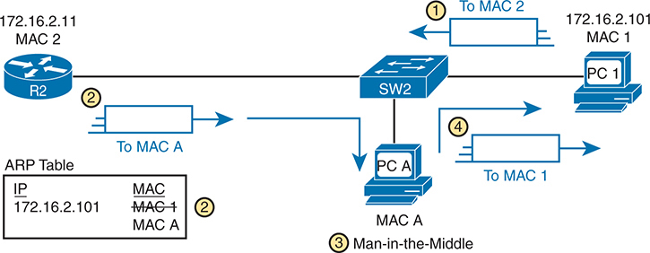

<figcaption>

<aside class="hidden" id="a12fig12">

网络图的特点是一个贴有S W-2标签的交换机连接到多个设备上. 右侧有被标注为P C1的合法设备,其I P地址为172.16.2.10和MAC地址为-MAC1. 在左侧,一个被标注为R2的路由器被连接到一个I P地址172.16.2.11和MAC地址MAC2. 在中心,与攻击者相联的被标记为PCA的恶意设备被连接到交换机上,并有一个MAC地址MACA. ARP表显示在左下方,表示IP地址172.16.2.101的条目,该条目被映射到多个MAC地址:MAC1,MAC2,和MACA,突出攻击造成的混乱. 该图使用编号步骤来描绘攻击的顺序. 常设仲裁法院向S W 2发送了无端的ARP信息,错误地将其MAC地址(MACA)与IP地址 172.16.2.101联系起来。 该交换机更新了其ARP表,以反映新的(和不正确的)关联,将I P 172.16.2.101映射到MACA. 这导致五氯苯甲醚处于PC-1-和R-2-之间的通信中间,拦截了两者的交通。 用于MAC 1(P C 1)或MAC 2(R 2)的流量被重定向到MACA(PCA),使攻击者能够捕捉并潜在地操纵数据. 该图有效地表明了ARP协议中的脆弱性,这种脆弱性可以通过发送Gratuitous ARP消息来加以利用,从而导致MITM攻击. 视觉表现包括所有涉及的装置,他们的I P和MAC地址,以及如何执行攻击的分步过程,为这种网络安全漏洞背后的力学提供了明确的了解.

</aside>

<strong>图12-12</strong> <em>由美国陆战队引出的人间攻击</em>

</figcaption>

</figure>

</section>

<section>

<h5 class="h5" id="ch12lev3sec10">动态 ARP 检测的逻辑</h5>

DAI有多种特征,可以防止这类ARP攻击. 要了解如何,请考虑DHCP和ARP的典型客户端主机的顺序。 当一个主机还没有IP地址时——即在DHCP进程完成之前——它不需要使用ARP. 一旦主机租赁了IP地址并学习了它的子网掩码,它就需要使用ARP来学习其他主机的MAC地址或者子网中默认的路由器,所以它会发送一些ARP消息. 简言之,DHCP先出事,再出事ARP.

DAI对不信任的接口采取了一种方法,根据DHCP 侦听关于先前DHCP消息的数据证实ARP的正确性. 正确的普通 DHCP 消息列出租给主机的IP地址以及主机的MAC地址. DHCP 侦听功能也将这些事实记录入交换机的DHCP Snoopping绑定表.

对于任何DAI不信任的端口,DAI将ARP消息的发件人IP和发件人MAC地址字段与DHCP 侦听绑定表进行比较. 如果在表格中找到,DAI允许ARP通过,但如果没有,DAI放弃了ARP. 比如说,<a href="#ch12fig13">图12-13</a>显示步骤1,其中PC A攻击者尝试了先前显示的无端ARP<a href="#ch12fig11">图12-11</a>。在2步骤上,DAI与DHCP 侦听绑定表进行了比较,没有找到与MAC A和IP地址172.16.2.101的匹配,因此DAI会丢弃消息.

<figure class="image-c" id="ch12fig13">

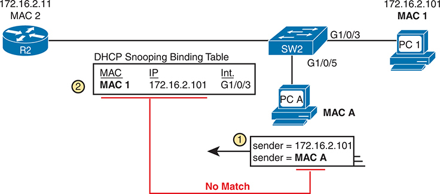

<figcaption>

<aside class="hidden" id="a12fig13">

在左侧,一个路由器标记为R 2 连接到一个带有SW标签的交换机 2 通过接口 G 1 斜线 0 斜线 3 。网络包括两个PC,标签为PC。 1 和 PCA,连接到SW交换机 2 通过接口 G 1 斜线 0 斜线 3 和G组 1 斜线 0 斜线 5 (分别为PC级) 1 拥有 IP 地址 172.16.2.101 和 MAC 地址( MAC ) 1 ,而常设仲裁法院有 I P 地址 172.16.2.110 和 MAC 地址 MACA。 DHCP 在 S W 切换器中搜索绑定的表格 2 存储条目映射 MAC 1 172.16.2.101 和接口 G 1 斜线 0 斜线 3 。图中突出显示由常设仲裁法院发送的ARP信息,发送者的I P地址是: 172.16.2.101 ,但发送者的MACA地址是MACA。此ARP消息通过切换S W对 DHCP 浏览绑定表进行仔细检查 2 。绑定表不匹配发送方的MAC地址(MACA)与存储的MAC地址(MAC) 1 ),用于IP地址. 172.16.2.101 因此,切换器将ARP消息标记为"没有匹配"并过滤出,从而防止潜在的ARP spoofing. 这个图像通过验证ARP消息对 DHCP snooping 绑定表的作用,有效地说明了DAI在加强网络安全方面的作用,以确保MAC和I P地址与所记录的绑定一致,保护网络免受恶意ARP spoofing攻击.

</aside>

<strong>图12-13</strong> <em>DAI 过滤 ARP 基于 DHCP 扫描绑定表</em>

</figcaption>

</figure>

DAI也与信任和不信任的端口的概念相配合,其逻辑一般与DHCP 侦听的逻辑相匹配. 连接到本地 DHCP 客户端的端口可以保持默认的 DAI 未信任状态. 配置 DAI 信任的所有其他交换机端口 。

请注意,虽然DAI可以使用此处所显示的 DHCP 侦听 表格,但它也可以使用类似的静态配置数据,通过一个叫作"IP"的工具列出正确的对IP和MAC地址.<em>ARP ACLs (英语).</em>。使用带有DAI的ARP ACL对连接到使用静态IP地址而不是DHCP的设备的端口有用. 注意DAI同时寻找DHCP 侦听绑定数据和ARP ACLs.

除了这一核心功能外,请注意DAI还可以选择进行其他检查。 例如,封装ARP的以太网头应该有与ARP发送器和目标MAC地址相匹配的地址.<a href="#ch12fig14">图12-14</a>显示以太网源MAC地址与ARP消息发送硬件字段的比较实例.

<figure class="image-c" id="ch12fig14">

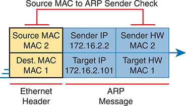

<figcaption>

<aside class="hidden" id="a12fig14">

该图分为两个主要部分:以太网头和ARP消息. 以太网头有源MAC地址(MAC 2)和目的地MAC地址(MAC 1). ARP消息部分被进一步划分为四个领域:发件人I P地址 (172.16.2.2),发件人硬件(HW)地址 (MAC 2),目标I P地址 (172.16.2.101),以及目标硬件(HW)地址 (MAC 1). 在图的上方,将Source MAC标记为ARP Sender Check的红箭指由DAI完成的校验过程. 此检查可确保以太网首部(MAC 2)中源代码MAC地址与ARP信件(也为MAC 2)中的发件人硬件地址相匹配. 这一检查的目的是通过验证ARP请求或答复的完整性来发现和防止ARP偷袭. 该图使用彩色编码来区分以太网首部和ARP消息字段,右侧有蓝色箭头代表ARP消息流的方向. 标签和布局明确显示以太网帧的MAC地址与ARP消息内的相应字段之间的关系,突出应用DAI过滤检查的关键点.

</aside>

<strong>图12-14</strong> <em>DAI 源代码MAC地址过滤检查</em>

</figcaption>

</figure>

DAI 可以进行图中显示的比较, 丢弃这些信件 :

<ul class="sq">

<li>
带有不等于ARP发送硬件地址的以太网头源 MAC 地址的信件
</li>

<li>
ARP 用不等于ARP目标硬件(MAC)地址的以太网头目的MAC地址回复消息
</li>

<li>
在两个 ARP IP 地址字段中带有出乎意料的 IP 位址的信件
</li>

</ul>

最后,同DHCP 侦听一样,DAI在交换机CPU而不是交换机ASIC中进行工作,这意味着DAI本身更容易被DoS攻击. 攻击者可以生成大量ARP消息,驱动交换机中的CPU使用. DAI可以通过在一段时间内限制ARP消息的数量来避免这些问题.

</section>

</section>

<section>

<h4 class="h4" id="ch12lev2sec4">动态 ARP 检测配置</h4>

配置 DAI 只需要几个命令,有常见的更多种可选配置设置. 本节审查DAI配置,首先以默认设置为主并依赖DHCP 侦听. 然后显示一些可选特征,如利率限制,从错误的残疾状态中自动恢复,以及如何允许对收到的ARP消息进行额外检查.

<section>

<h5 class="h5" id="ch12lev3sec11">在二层交换机上配置 ARP 检测</h5>

在配置 DAI 之前,您需要考虑该特征,并根据您的目标,地貌,以及设备角色做出一些决定. 这些决定包括:

<ul class="sq">

<li>
选择是依赖DHCP 侦听,ARP ACLs,还是两者兼而有之.
</li>

<li>
如果使用 DHCP 侦听, 请配置它, 并让 DHCP Stnooping 所信任的正确端口 。
</li>

<li>
选择启用 DAI 的 VLAN( s) 。
</li>

<li>
使 DAI 在 VLAN 中选择的端口上信任(而不是未信任的默认设置), 通常用于您对 DHCP 侦听 所信任的相同端口 。
</li>

</ul>

本节的所有配置示例都使用在 DHCP 侦听 配置主题中使用的相同样本网络,在此重复为<a href="#ch12fig15">图12-15</a>。和DHCP 侦听一样,右侧的交换机SW2应该被配置到信任连接到路由器的端口(G1/0/2),但不信任连接到PC的两个端口.

<figure class="image-c" id="ch12fig15">

<figcaption>

<aside class="hidden" id="a12fig15">

在最左边,有一个DHCP服务器连接到一个路由器,标签为R1. 此路由器通过中间云与另一个路由器相接,该路由器被标注为"R2",以象征更宽的网络或互联网. 路由器R-2起DHCP中继代理作用,通过以太网接口G-1斜通-0斜通-2已交换机标注为S W-2. 连接路由器R2到交换机的区域被标记为"信任". 交换机S W +2通过以太网接口G +1 slash +0 slash +3和 G +1 slash →0 slash →4两台个人计算机分别被标为P C +1和 P C +2. 此段标签为无信任 。 信任区和不信任区表示网络中安全或信任程度不同的地区,这对于ARP检查配置至关重要,可防止ARP偷袭. 被信任的段允许来自已知的安全源的ARP流量,而不受信任的段则受到更严格的监控来防止恶意的ARP包会损害网络安全. 这种网络设置有效地证明了信任区与不信任区之间的分离,以及各种网络组件的作用,包括DHCP服务器,路由器,交换机和PCs在ARP检查配置中的作用.

</aside>

<strong>图12-15</strong> <em>ARP检查配置实例中使用的样本网络</em>

</figcaption>

</figure>

<a href="#exa12_5">示例12-5</a>显示所需的配置,以便在 SW2 交换机时启用 DAI<a href="#ch12fig15">图12-15</a>——与 DHCP 侦听 相比,遵循类似进度的配置. 该图中的所有端口都连接到VLAN 11,所以为了在VLAN11中实现DAI,只需添加:<strong>ip arp inspection vlan 11</strong>全局指令 。 然后,为了改变由 DAI 信任的端口 G1/0/2 (连接到路由器) 上的逻辑,添加<strong>ip arp inspection trust</strong>接口子命令。

<strong>示例12-5</strong> <em>IP ARP 检查配置以匹配<a href="#ch12fig15">图12-15</a></em>

<a href="#code-f0255-01" id="f0255-01a">点击此处查看代码原图</a>

<pre class="pre-ex" tabindex="0"><code class="highlight">ip arp inspection vlan 11
!
interface GigabitEthernet1/0/2
 ip arp inspection trust</code></pre>

<a href="#exa12_5">示例12-5</a>配置 DAI,但它同时省略了 DHCP 侦听 和 ARP ACLs. (如果您要配置一个交换机, 只需使用在<a href="#exa12_5">示例12-5</a>,交换机将过滤所有输入 VLAN 中所有未信任端口的 ARP 11 . ) <a href="#exa12_6">示例12-6</a>显示一个完整且正在运行的 DAI 配置,用于添加 DHCP 侦听 配置以匹配 DAI 配置 。<a href="#exa12_5">示例12-5</a>。请注意:<a href="#exa12_6">示例12-6</a>组合<a href="#exa12_1">示例12-1</a>DHCP 先前的配置, 用于此相同的地形到 DAI 配置<a href="#exa12_5">示例12-5</a>,带有 DAI 特定配置线的亮点。

<strong>示例12-6</strong> <em>添加到支持 DAI 的 IP DHCP Snoop 配置</em>

<a href="#code-f0255-02" id="f0255-02a">点击此处查看代码原图</a>

<pre class="pre-ex" tabindex="0"><code class="highlight">ip arp inspection vlan 11
ip dhcp snooping
ip dhcp snooping vlan 11
no ip dhcp snooping information option
!
interface GigabitEthernet1/0/2
 ip dhcp snooping trust
 ip arp inspection trust</code></pre>

记住,DHCP首先与DHCP客户端发生,然后他们发送ARP消息. 随着配置在<a href="#exa12_6">示例12-6</a>,交换机通过分析收到的 DHCP 消息来构建其 DHCP 侦听 绑定表. 其次,在DAI未信任的端口上收到的ARP消息必须在绑定表中有相匹配的信息.

<a href="#exa12_7">示例12-7</a>证实基于以下配置的DAI在样本网络中正确操作的关键事实:<a href="#exa12_6">示例12-6</a>。密码<strong>show ip arp inspection</strong>命令同时提供状态变量和计数器。 例如,突出显示的行显示在VLAN中未信任端口收到的ARP信件总数和已丢弃的ARP信件数量(目前为0)。

<strong>示例12-7</strong> <em>SW2 IP ARP 检查状况</em>

<a href="#code-f0256-01" id="f0256-01a">点击此处查看代码原图</a>

<pre class="pre-ex" tabindex="0"><code class="highlight">SW2# <strong>show ip arp inspection</strong>

Source Mac Validation      : Disabled
Destination Mac Validation : Disabled
IP Address Validation      : Disabled

 Vlan     Configuration    Operation   ACL Match          Static ACL
 ----     -------------    ---------   ---------          ----------
   11     Enabled          Active

 Vlan     ACL Logging      DHCP Logging      Probe Logging
 ----     -----------      ------------      -------------
   11     Deny             Deny              Off

 Vlan      Forwarded        Dropped     DHCP Drops      ACL Drops
 ----      ---------        -------     ----------      ---------
   11             59              0              0              0

 Vlan   DHCP Permits    ACL Permits  Probe Permits   Source MAC Failures
 ----   ------------    -----------  -------------   -------------------
   11              7              0             49                     0

 Vlan   Dest MAC Failures   IP Validation Failures   Invalid Protocol Data
 ----   -----------------   ----------------------   ---------------------

 Vlan   Dest MAC Failures   IP Validation Failures   Invalid Protocol Data
 ----   -----------------   ----------------------   ---------------------
   11                   0                        0                       0
SW2# <strong>show ip dhcp snooping binding</strong>
MacAddress         IpAddress      Lease(sec) Type           VLAN  Interface
-----------------  -------------  ---------- -------------  ----  --------------------
02:00:11:11:11:11  172.16.2.101   86110      dhcp-snooping    11  GigabitEthernet1/0/3
02:00:22:22:22:22  172.16.2.102   86399      dhcp-snooping    11  GigabitEthernet1/0/4
Total number of bindings: 2</code></pre>

<a href="#exa12_7">示例12-7</a> 末尾展示了交换机 SW2 上 <strong>show ip dhcp snooping binding</strong> 命令的输出。注意，前两列列出从 DHCP 消息中学习到的 MAC 地址和 IP 地址。现在假设收到来自 PC1 的 ARP 消息，该消息的发送方 MAC 地址和 IP 地址应分别为 PC1 的 0200.1111.1111 和 172.16.2.101。根据此输出，交换机会找到匹配的数据，并允许该 ARP 消息通过。

<a href="#exa12_8">示例12-8</a>在端口 G1/ 0/4 in 显示一些关于切换 SW2 接收无效的 ARP 消息时会发生什么细节 。<a href="#ch12fig15">图12-15</a>。在这种情况下,为了创建无效的ARP消息,图中的PC2被配置为172.16.2.101(这是PC1的DHCP-租赁IP地址)的静态IP地址. 例子上方的日志消息中突出显示PC2在ARP消息中声称的发件人MAC和发件人IP地址. 如果你指回底部的话<a href="#exa12_7">示例12-7</a>,您可以看到,在 DHCP 侦听 绑定表中不存在此发件人MAC/IP配对,所以DAI拒绝ARP消息.

<strong>示例12-8</strong> <em>ARP攻击的抽样结果</em>

<a href="#code-f0257-01" id="f0257-01a">点击此处查看代码原图</a>

<pre class="pre-ex" tabindex="0"><code class="highlight">Jul 25 14:28:20.763: %SW_DAI-4-DHCP_SNOOPING_DENY: 1 Invalid ARPs (Req) on Gi1/0/4, vlan 11.([0200.2222.2222/172.16.2.101/0000.0000.0000/172.16.2.1/09:28:20 EST Thu Jul 25 2019])

SW2# <strong>show ip arp inspection statistics</strong>

 Vlan      Forwarded        Dropped     DHCP Drops      ACL Drops
 ----      ---------        -------     ----------      ---------
   11             59             17             17              0

 Vlan   DHCP Permits    ACL Permits  Probe Permits   Source MAC Failures
 ----   ------------    -----------  -------------   -------------------
   11              7              0             49                     0

 Vlan   Dest MAC Failures   IP Validation Failures   Invalid Protocol Data
 ----   -----------------   ----------------------   ---------------------
   11                   0                        0                    0</code></pre>

统计局提供的统计数据<strong>show ip arp inspection</strong>命令还确认交换机已丢弃了一些 ARP 信件。表格显示中间的突出显示行 17 在VLAN中总共投放的ARP消息 11 。同一条突出线证实,该行已全部放弃。 17 由于DHCP 侦听绑定表(“DHCP Drops”),由于ARP ACL (“ACL Drops”),所以投放为零。

</section>

<section>

<h5 class="h5" id="ch12lev3sec12">限制 DAI 消息速率</h5>

和DHCP 侦听一样,DAI也可以是DoS攻击的焦点,由攻击者生成大量ARP消息. 与 DHCP 侦听 一样,DAI 支持速率限制的配置来帮助防止这些攻击,反应是将端口设置在错误的残疾状态下,并且能够配置从错误的残疾状况下自动恢复的能力.

DHCP 侦听和DAI的速率限制在操作,默认和配置上确实有一些小的差异,具体如下:

<ul class="sq">

<li>
DAI默认对所有接口使用速率限制(信任和不信任),而DHCP 侦听默认不使用速率限.
</li>

<li>
DAI允许一个爆裂间隔(数秒)的配置,以便速率限制能有类似“的逻辑.<em>x</em>ARP 消息结束<em>y</em>(DHCP 侦听没有定义爆破设置).
</li>

</ul>

它有助于查看 DAI 和 DHCP 同步搜索速度限制配置,以便进行比较,所以<a href="#exa12_9">示例12-9</a>显示两个。 这个例子重复了之前完全相同的 DHCP 侦听 命令<a href="#exa12_3">示例12-3</a>但添加 DAI 配置( 突出显示) 。 配置在<a href="#exa12_7">示例12-7</a>可添加到显示在<a href="#exa12_6">示例12-6</a>用于一个完整的 DHCP 侦听 和 DAI 配置.

<strong>示例12-9</strong> <em>配置 ARP 检查信件率限制</em>

<a href="#code-f0258-01" id="f0258-01a">点击此处查看代码原图</a>

<pre class="pre-ex" tabindex="0"><code class="highlight">errdisable recovery cause dhcp-rate-limit
errdisable recovery cause arp-inspection
errdisable recovery interval 30
!
interface GigabitEthernet1/0/2
 ip dhcp snooping limit rate 10
 ip arp inspection limit rate 8
!
interface GigabitEthernet1/0/3
 ip dhcp snooping limit rate 2
 ip arp inspection limit rate 8 burst interval 4</code></pre>

<a href="#exa12_10">示例12-10</a>列出确认配置设置的输出。 比如说,<a href="#exa12_9">示例12-9</a>配置端口 G1/ 0/2 利率为 8 每起( 默认) 消息突起 1 第二; 输出为<a href="#exa12_10">示例12-10</a>对于接口 G1/ 0/2 也列出了 8 的速率和 1 的爆发间隔。 同样,<a href="#exa12_9">示例12-9</a>配置端口 G1/0/3,在 出-4秒的突起后,速度为8秒,<a href="#exa12_10">示例12-10</a>确认对端口 G1/ 0/3 的相同值。 注意其他两个接口在<a href="#exa12_10">示例12-10</a>显示在一秒爆破中显示 15 信件的默认设置。

<strong>示例12-10</strong> <em>确认ARP检查率限制</em>

<a href="#code-f0258-02" id="f0258-02a">点击此处查看代码原图</a>

<pre class="pre-ex" tabindex="0"><code class="highlight">SW2# <strong>show ip arp inspection interfaces</strong>
 Interface        Trust State     Rate (pps)    Burst Interval
 ---------------  -----------     ----------    --------------
 Gi1/0/1          Untrusted               15                 1
 Gi1/0/2          Trusted                  8                 1
 Gi1/0/3          Untrusted                8                 4
 Gi1/0/4          Untrusted               15                 1
! Lines omitted for brevity</code></pre>

</section>

<section>

<h5 class="h5" id="ch12lev3sec13">配置可选的 DAI 消息检查</h5>

如题为“......”的一节所述,<a href="#ch12lev3sec10">动态 ARP 检查逻辑</a>,"DAI总是检查ARP消息的发件人MAC和发件人IP地址字段相对于交换机中的某些表格,但也可以进行其他检查. 这些检查需要更多的CPU,但也有助于防止其他类型的攻击.

<a href="#exa12_11">示例12-11</a>显示如何配置这三张额外支票。 注意您可以配置 1, 2 或全部 3 个选项 :<strong>ip arp inspection validate</strong>以一个命令中的所有选项再次命令,它取代了先前的全局配置命令。 例子显示了三种选择,其中<strong>src-mac</strong>( source mac) 选项已配置 。

<strong>示例12-11</strong> <em>确认ARP检查率限制</em>

<a href="#code-f0259-01" id="f0259-01a">点击此处查看代码原图</a>

<pre class="pre-ex" tabindex="0"><code class="highlight">SW2# <strong>configure terminal</strong>
Enter configuration commands, one per line.  End with CNTL/Z.

SW2(config)# <strong>ip arp inspection validate ?</strong>
  dst-mac  Validate destination MAC address
  ip       Validate IP addresses
  src-mac  Validate source MAC address

SW2(config)# <strong>ip arp inspection validate src-mac</strong>
SW2(config)# <strong>^Z</strong>
SW2#
SW2# <strong>show ip arp inspection</strong>

Source Mac Validation      : Enabled
Destination Mac Validation : Disabled
IP Address Validation      : Disabled</code></pre>

</section>

<section>

<h5 class="h5" id="ch12lev3sec14">IP ARP 检测配置小结</h5>

以下配置清单概括了本节中包含的关于如何配置动态IP ARP检查的命令: 1.

台阶.1.使用该<strong>ip arp inspection vlan</strong> <em>vlan-list</em>global 命令,以启用指定VLANs交换机上的动态 ARP 检测(DAI).

<figure class="image">

</figure>

台阶.2.除DAI配置外,还配置了DHCP 侦听和(或)ARP ACL供DAI使用.

台阶.3.配置<strong>ip arp inspection trust</strong>接口子命令以覆盖不可信默认设置。

台阶.4. <strong>(可选):</strong>配置 DAI 速率限制和错误的回收 :

步骤A。 <strong>(可选):</strong>配置<strong>ip arp inspection limit rate</strong> <em>number</em> [<strong>爆发间隔</strong> <em>seconds</em>]接口子命令设定每秒ARP消息的限度,或每个被配置间隔的ARP消息.

步骤B。 <strong>(可选):</strong>配置<strong>ip arp inspection limit rate none</strong>接口子命令以禁用速率限制。

步骤 C. <strong>(可选):</strong>配置<strong>errdisable recovery cause arp-inspection</strong>global 命令可以实现从错误的故障模式中自动恢复的特性,假设交换机由于超过 DAI 速率限制而使端口处于错误的故障状态.

步骤D. <strong>(可选):</strong>配置<strong>errdisable recovery interval</strong> <em>seconds</em>global 命令设置等待时间,然后从接口错误的状态恢复(不管错误的状态的原因).

台阶.5. <strong>(可选):</strong>配置<strong>ip arp inspection validate</strong> {[<strong>dst-mac</strong>] [<strong>src-mac</strong>] [<strong>ip</strong>} 全局命令, 允许在未信任的端口上与 DAI 验证可选项目 。

</section>

</section>

</section>

</section>

<section class="ccna-source ccna-appendix" aria-label="答案解析与术语表">
<section data-epub-type="chapter">

<h2 class="h2" id="ref-appc">附录C</h2>

<h2 class="h2a">对“我早就知道了吗?” 的回答。</h2>

<section>

<h3 class="h3" id="ref-appclev1sec12">第12章</h3>

<strong><a id="ref-ques12_1" href="#quess12_1">1</a>。</strong> A 和 C。DHCP 侦听必须在执行二层交换的设备上实现。DHCP 侦听功能需要检查同一广播域（VLAN）内设备之间传输的 DHCP 消息。二层交换机和多层交换机都能执行此功能。路由器只执行三层转发（即路由），不转发同一 VLAN 内设备之间的消息，因此不适合作为 DHCP 侦听的实现平台（路由器上的 Cisco IOS 甚至不提供此功能）。终端用户设备也不适合作为 DHCP 侦听平台，因为它们无法接收所有 DHCP 消息，也无法在发生攻击时阻止帧的传输。

<strong><a id="ref-ques12_2" href="#quess12_2">2</a>。</strong> B 和 C。连接到 IT 部门管理的设备、且可能从这些设备接收 DHCP 服务器消息的交换机端口，应被 DHCP 侦听功能信任。这类设备包括 IT 部门管理的 DHCP 服务器、路由器和交换机。所有预期充当 DHCP 客户端的设备（如 PC）都被视为不可信，因为 DHCP 侦听无法预先知道基于 DHCP 的攻击会从哪个端口发起。在本题中，连接到全部三台 PC 的端口都会被 DHCP 侦听视为不可信。

<strong><a id="ref-ques12_3" href="#quess12_3">3</a>。</strong> C 和 D。端口默认不可信，因此无需任何配置命令就能使端口处于不可信状态。在两个涉及信任状态的错误选项中，接口配置模式下的 <strong>no ip dhcp snooping trust</strong> 会将端口从可信配置状态恢复为不可信状态。另一个选项 <strong>ip dhcp snooping untrusted</strong> 不是有效命令。

两个正确选项列出了一对必须同时配置的命令：<strong>ip dhcp snooping</strong> 用于启用 DHCP 侦听，<strong>ip dhcp snooping vlan 5</strong> 用于指定 DHCP 侦听运行的 VLAN 列表。

<strong><a id="ref-ques12_4" href="#quess12_4">4</a>。</strong> A。所有选项中的命令语法都正确，也都可用于 DHCP 侦听。不过，正确选项 <strong>no ip dhcp snooping information option</strong> 会禁用 DHCP 侦听向 DHCP 消息添加 DHCP Option 82 字段的功能。如果交换机不充当 DHCP 中继代理，此设置就很有用。相反的设置（命令开头不加 <strong>no</strong>）适用于多层交换机充当 DHCP 中继代理的情况。

<strong><a id="ref-ques12_5" href="#quess12_5">5</a>。</strong> B。DAI 始终使用一项核心功能：检查传入的 ARP 消息，将其中的发送方硬件地址和发送方 IP 地址字段与交换机记录正确 MAC/IP 地址对的数据表进行比较。交换机上的 DAI 可以将 DHCP 侦听绑定表作为有效 MAC/IP 地址对的数据表，也可以使用所配置的 ARP ACL 中的逻辑。题干说明 DAI 使用 DHCP 侦听，因此正确选项指出，交换机会将 ARP 消息的发送方硬件地址与交换机的 DHCP 侦听绑定表进行比较。

一个错误选项提到了比较消息中的 ARP 发送方 MAC（硬件）地址与以太网源 MAC 地址。DAI 可以执行此检查，但该功能可以通过配置启用或禁用，因此 DAI 并非始终执行此比较。其余错误选项列出的逻辑都不是 DAI 执行的操作。

<strong><a id="ref-ques12_6" href="#quess12_6">6</a>。</strong> B 和 D。由于默认状态为不可信，必须通过配置使 DAI 信任该端口。为此，需要在接口配置模式下使用 <strong>ip arp inspection trust</strong> 命令。形式相近的错误选项 <strong>no ip arp inspection untrust</strong> 不是有效命令。

要使 DAI 在某个 VLAN 上运行，只需要一个配置命令：<strong>ip arp inspection vlan 6</strong>。此命令同时启用 DAI，并将其运行范围限定为 VLAN 6。选项 <strong>ip arp inspection</strong> 中的命令会被交换机拒绝，因为还需要更多参数。

<strong><a id="ref-ques12_7" href="#quess12_7">7</a>。</strong> C 和 D。DAI 允许限制接收的 ARP 消息数量；默认突发间隔为 1 秒，也可以自行配置。配置完成后，DAI 允许在指定秒数的突发间隔内接收指定数量的 ARP 消息。两个正确选项中，一个允许在 4 秒间隔内接收 16 条 ARP 消息，平均每秒 4 条；另一个将数量限制为 4，使用默认的 1 秒突发间隔，平均也是每秒 4 条。两个错误选项的平均值分别为每秒 2 条和每秒 5 条。

</section>

</section>

<section id="ref-glossary"><h2 class="h2a">词汇表</h2>
<strong>退休人员协会的答复</strong>一个ARP消息,用于提供原发(原发)主机硬件(以太网)和IP地址的信息,列在原发(原发)硬件和原发(原发)IP地址字段中. 通常是在收到ARP请求电文后作出反应发送的。

<strong>DHCP 侦听</strong>交换机安全功能,交换机检查收到的 DHCP 消息,选择过滤异常消息,因此可能是 DHCP 攻击的一部分.

<strong>DHCP 搜索绑定表</strong>在使用 DHCP 侦听 时,通过分析通过交换机流动的 DHCP 消息,交换机能动态地构建一个表格. DHCP 侦听可以使用该表作为其部分过滤逻辑,其他功能如动态 ARP 检测和IP源守护也使用该表.

<strong>ARP动态检查(DAI)</strong>一个安全特性,一个局域网切换器根据ARP,以太网和IP头字段与IP DHCP 侦听绑定表所收集并在任何已配置的ARP ACLs中找到的数据的比较,在未信任端口上过滤所接入的ARP消息的子集.

<strong>无缘无故的ARP</strong>ARP回复不是作为对ARP请求消息的反应发出的,而是作为向其他主机通报发送(原发)主机地址值的一般性公告.

<strong>发送硬件地址</strong>在ARP请求和回文中,字段都打算用来列出发送者(原产地)设备的硬件地址,通常是以太网局域网地址.

<strong>发送 IP 地址</strong>在ARP请求和回文中,字段都打算用于列出发送器(原出地)设备的IP地址.

<strong>发送协议地址</strong>在ARP请求和回信中,字段原本用来列出发送者(原出地)设备的网络层地址的正式名词.

<strong>可信端口</strong>有了DHCP 侦听和动态 ARP 检测(DAI)的切换功能,概念和配置设置告诉交换机可以允许该类所有来信,而不是考虑来信(DHCP和ARP分别)进行过滤.

<strong>非可信端口</strong>DHCP 侦听 and Dynamic ARP Victory (DAI) 的切换功能,概念和配置设置让切换者分析每个收到的相应类型的消息(DHCP和ARP),并应用一些规则来决定是否丢弃消息.

</section>
</section>

<section class="ccna-source ccna-appendix" aria-label="代码原图">
<section data-epub-type="chapter">

<a href="#f0246-01a" id="code-f0246-01">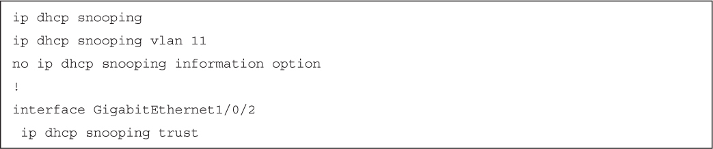</a>

<a href="#f0247-01a" id="code-f0247-01">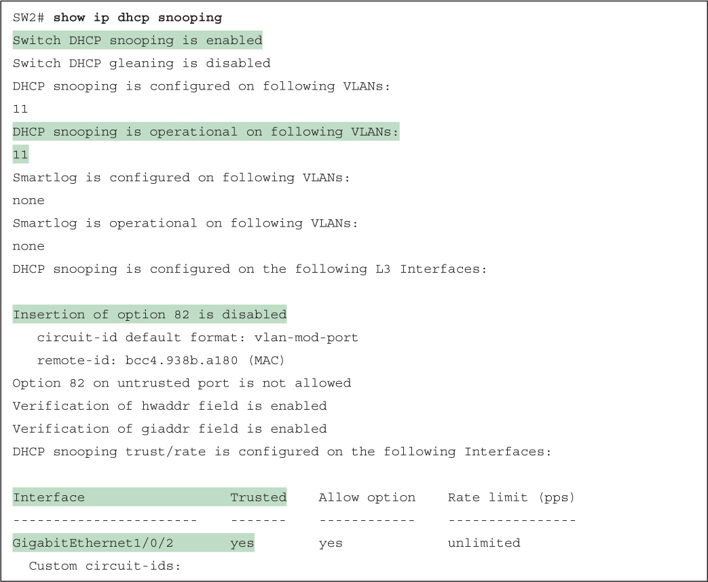</a>

<a href="#f0249-01a" id="code-f0249-01">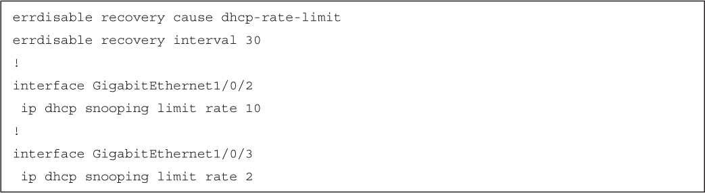</a>

<a href="#f0249-02a" id="code-f0249-02">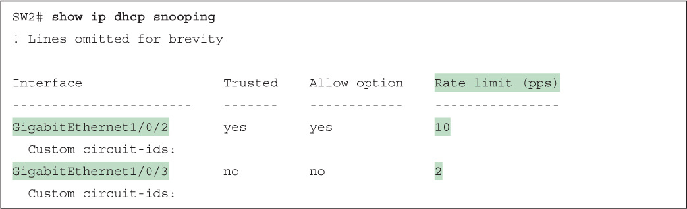</a>

<a href="#f0255-01a" id="code-f0255-01">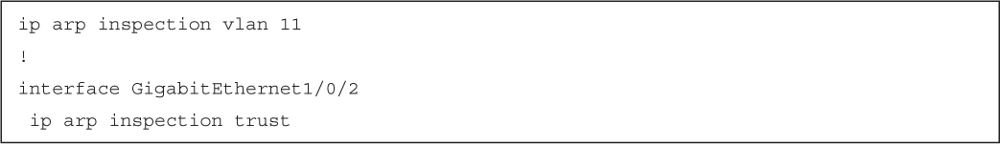</a>

<a href="#f0255-02a" id="code-f0255-02">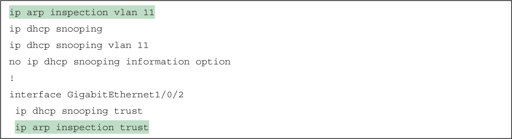</a>

<a href="#f0256-01a" id="code-f0256-01">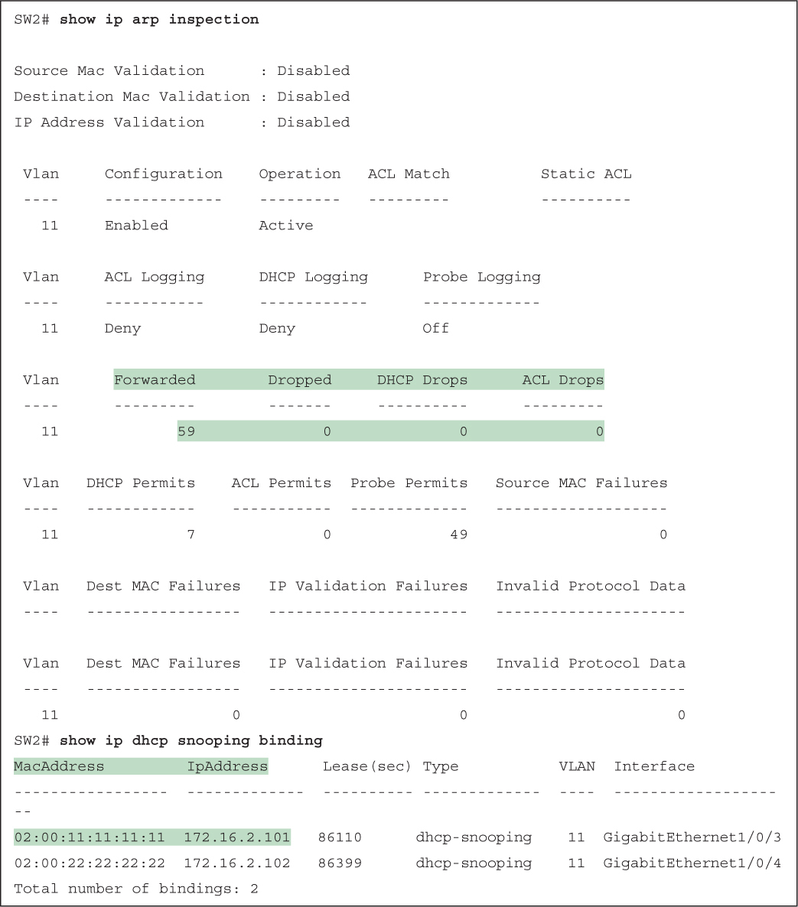</a>

<a href="#f0257-01a" id="code-f0257-01">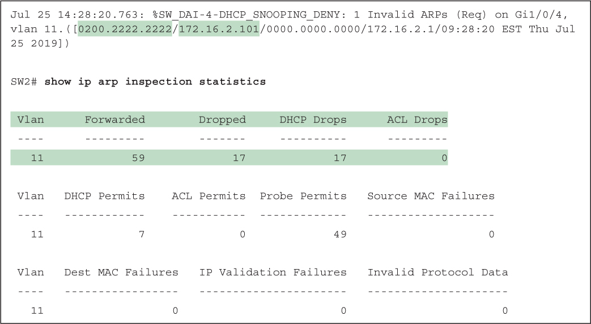</a>

<a href="#f0258-01a" id="code-f0258-01">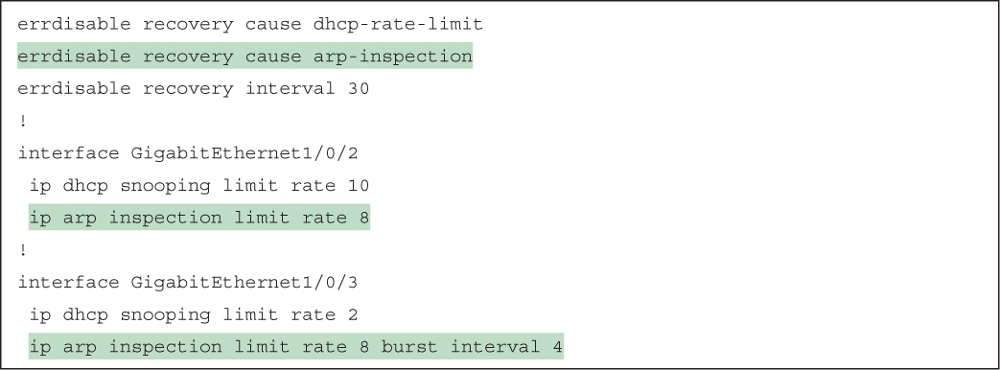</a>

<a href="#f0258-02a" id="code-f0258-02">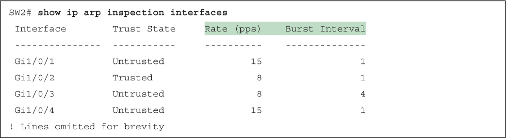</a>

<a href="#f0259-01a" id="code-f0259-01">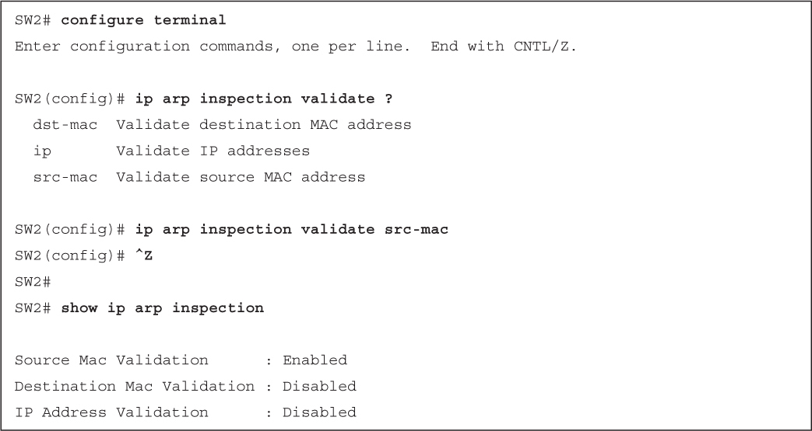</a>

</section>

</section>


<nav class="ccna-chapter-nav" aria-label="章节导航"><a href="v2-11.html">← 上一章</a><a href="v2-13.html">下一章 →</a></nav>
