
<a href="{{ '/subjects/CCNA/' | relative_url }}">← 返回 CCNA 目录</a>

第二卷 · IP 服务

<nav class="ccna-chapter-nav" aria-label="章节导航"><a href="v2-12.html">← 上一章</a><a href="v2-14.html">下一章 →</a></nav>



<section data-epub-type="chapter">

<h2 class="h2" id="ch13">第 13 章</h2>

<h2 class="h2a">设备管理协议</h2>

本章涵盖以下考试主题：

2.0 网络接入

2.3 配置和验证二层发现协议（Cisco 发现协议和 LLDP）

4.0 IP 服务

4.2 配置和验证以客户端和服务器模式运行的 NTP

4.5 描述 syslog 功能的用途，包括设施和严重性级别

本章作为<a href="#part04">第四部分</a>的开篇，讨论 Cisco 路由器和交换机上三项功能的概念、配置和验证。这些功能侧重于管理网络设备本身，而非管理设备构成的网络。

本章第一大节重点介绍日志消息和 syslog。大多数计算设备都需要将重要问题通知管理员；在计算领域，这类消息通常称为日志消息。Cisco 设备也会生成日志消息。第一节介绍 Cisco 设备如何处理这些消息，以及如何配置路由器和交换机来忽略消息，或以不同方式保存消息。

接下来，路由器和交换机的多种功能都能从时钟同步中受益。与大多数计算设备一样，路由器和交换机具有内部时钟，用于记录时间。网络时间协议（NTP）提供设备同步时间的方法，第二节对此进行讨论。

最后一大节介绍两种执行同类工作的协议：Cisco 发现协议（CDP）和链路层发现协议（LLDP）。它们都使网络设备能够了解邻居设备，而不要求当时已有可用的 IPv4 或 IPv6 通信。

<section>

<h3 class="h3" id="ch13lev1sec1">自测</h3>

如果你希望根据得分决定在本章投入多少时间，可以完成这组自测题（在此作答，或使用 PTP 软件）。各题答案的选项字母列在自测题之后的页面底部。书末和配套网站上的<a href="#ref-appc">附录 C</a>都包含答案及解析。你也可以在 PTP 测试软件中找到答案及解析。

<figure class="table" id="ch13tab01" tabindex="0">

<figcaption>

<strong>表13-1</strong> 核心主题小节与题目对应关系

</figcaption>

<table class="all">

<tbody>

<tr>

<th class="th">
基础知识小节
</th>

<th class="th">
题目
</th>

</tr>

<tr>

<td class="border">
系统消息日志（Syslog）
</td>

<td class="border">
1、2
</td>

</tr>

<tr>

<td class="border">
网络时间协议( NTP)
</td>

<td class="border">
3, 4
</td>

</tr>

<tr>

<td class="border">
使用 CDP 和 LLDP 分析拓扑
</td>

<td class="border">
5, 6
</td>

</tr>

</tbody>

</table>

</figure>

<strong><a id="quess13_1" href="#ques13_1a">1</a>.</strong>Cisco 设备的默认记录级别是多少 ?

<ol class="lower-alpha">

<li>
资料
</li>

<li>
错误
</li>

<li>
警告
</li>

<li>
调试
</li>

</ol>

<strong><a id="quess13_2" href="#ques13_2a">2</a>.</strong>什么命令将发送到 syslog 服务器的信件限制在4通过0?

<ol class="lower-alpha">

<li>
<strong>logging trap 0-4</strong>
</li>

<li>
<strong>logging trap 0,1,2,3,4</strong>
</li>

<li>
<strong>logging trap 4</strong>
</li>

<li>
<strong>logging trap through 4</strong>
</li>

</ol>

<strong><a id="quess13_3" href="#ques13_3a">3</a>.</strong>以下哪些是Cisco路由器上的 NTP 客户端函数的准确性 ?

<ol class="lower-alpha">

<li>
客户端根据NTP服务器同步其时钟.
</li>

<li>
它计算出本地路由器CPU的CPU周期,以更准确地保持时间.
</li>

<li>
客户端同步了所有以太网接口,以同样的速度使用.
</li>

<li>
客户端必须连接到与NTP服务器相同的子网.
</li>

</ol>

<strong><a id="quess13_4" href="#ques13_4a">4</a>.</strong>路由器 R1 上唯一的 NTP 配置是<strong>ntp server 10.1.1.1</strong>命令。哪个答案描述NTP如何在路由器上工作?

<ol class="lower-alpha">

<li>
仅作为 NTP 服务器
</li>

<li>
仅作为 NTP 客户端
</li>

<li>
作为 NTP 服务器,仅在 NTP 客户端与 NTP 服务器同步后 10.1.1.1
</li>

<li>
作为NTP服务器,无论NTP客户端是否与NTP服务器同步10.1.1.1
</li>

</ol>

<strong><a id="quess13_5" href="#ques13_5a">5</a>.</strong>想象一个交换机通过以太网电缆连接到路由器,路由器的主机名是汉娜. 下列哪些命令可以告诉你关于汉娜的IOS版本,而不建立与汉娜的Telnet连接? (取出二个答.

<ol class="lower-alpha">

<li>
<strong>show neighbors Hannah</strong>
</li>

<li>
<strong>show cdp</strong>
</li>

<li>
<strong>show cdp neighbors</strong>
</li>

<li>
<strong>show cdp neighbors Hannah</strong>
</li>

<li>
<strong>show cdp entry Hannah</strong>
</li>

<li>
<strong>show cdp neighbors detail</strong>
</li>

</ol>

<strong><a id="quess13_6" href="#ques13_6a">6</a>.</strong>交换机被接通到一个路由器,其主机名为汉娜. 下列哪些LLDP命令可以识别汉娜的被启用能力? (取出二个答.

<ol class="lower-alpha">

<li>
<strong>show neighbors</strong>
</li>

<li>
<strong>show neighbors Hannah</strong>
</li>

<li>
<strong>show lldp</strong>
</li>

<li>
<strong>show lldp interface</strong>
</li>

<li>
<strong>show lldp neighbors</strong>
</li>

<li>
<strong>show lldp entry Hannah</strong>
</li>

</ol>

自测答案：

<strong><a id="ques13_1a" href="#ref-ques13_1">1</a></strong> D

<strong><a id="ques13_2a" href="#ref-ques13_2">2</a></strong> C

<strong><a id="ques13_3a" href="#ref-ques13_3">3</a></strong> A

<strong><a id="ques13_4a" href="#ref-ques13_4">4</a></strong> C

<strong><a id="ques13_5a" href="#ref-ques13_5">5</a></strong> E, F

<strong><a id="ques13_6a" href="#ref-ques13_6">6</a></strong> E, F

</section>

<section>

<h3 class="h3box" id="ch13lev1sec2">基础主题</h3>

</section>

<section>

<h3 class="h3" id="ch13lev1sec3">系统消息日志（Syslog）</h3>

Cisco设备对管理员的帮助真惊人。 当发生重大(甚至非如此重大)事件时,这些Cisco设备试图将详细的系统消息通知管理员. 正如你在本节所了解到的, 这些信息从普通到那些 令人难以置信的重要。 值得庆幸的是,管理人员有各种各样的选择,可以储存这些消息,并被提醒那些可能对网络基础设施产生最大影响的信息。

当设备的OS认为有趣的事件发生时, OS如何通知我们人类? Cisco IOS可以向目前登录到设备的任何人发送消息. 它还可以存储消息,以便用户日后可以查看消息. 下几页审查这两个专题。

注意

CCNA 200-301考试题目包括一个关于伐木和syslog的题目:“描述使用sysolog特性的情况,包括设施和严重程度”。 这个考试题目并不要求您理解相关的配置。 然而,配置揭示出许多核心概念,因此本节包含了配置细节,作为帮助您了解日志和syslog工作方式的一种手段.

<section>

<h4 class="h4" id="ch13lev2sec1">向当前用户实时发送消息</h4>

Cisco IOS 运行在设备上至少尝试让当前用户看到<a id="key_151" href="#ref-gloss_198">日志消息</a>当它们发生的时候。 并不是每个路由器或交换机都有用户连接,但如果有些用户被登录,路由器会通过让网络工程师了解任何问题而获得好处.

默认情况下,IOS会显示日志消息,以控制用户处理所有严重级别的信息. 这种默认发生是因为默认<strong>logging console</strong>全局配置命令 。 事实上,如果你在阅读这本书的整个时间里一直使用一个控制台端口,你很可能已经注意到了许多syslog消息,比如关于接口上下的信息.

对于其他用户(即Telnet和SSH用户),设备在用户看到消息前需要两步进程. 首先,监督办有另一个全球配置设置——<strong>logging monitor</strong>——这让IOS能够向所有连接的用户发送日志消息. 然而,这种默认配置不足以让用户看到日志消息. 用户还必须签发<strong>terminal monitor</strong>登录会话期间的EXEC命令,它告诉IOS,这个终端会话希望收到日志消息.

<a href="#ch13fig01">图13-1</a>总结了这些关键点,即思科路由器上的IOS或切换器如何为目前连接的用户处理日志消息. 在图中,用户A坐在控制台上,总是收到日志消息. 在右边,用户B看到消息的事实(因为用户B发出消息)<strong>terminal monitor</strong>登录后的EXEC命令),用户C并不显示用户可以单独控制是否收到日志消息.

<figure class="image-c" id="ch13fig01">

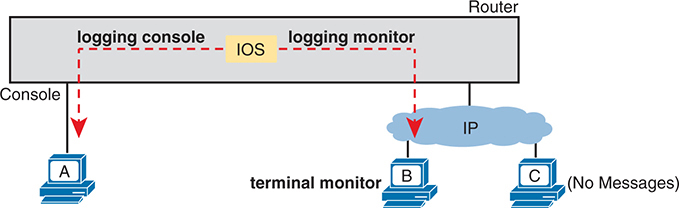

<figcaption>

<aside class="hidden" id="a13fig01">

该图的中心是路由器,被描绘成一个灰色的盒子,IOS用黄色突出显示. 有三种相接设备:A,B和C,分别代表不同的用户方案. 在左侧,设备A直接连接到路由器的控制台端口上,被贴上"控制台"的标签. 一个被标记为"IOS"的已破碎的红箭头记录控制台点到设备A,表示正在将日志信息发送给控制台用户. 在中间,设备B通过IP网络与路由器相接,被标注为终端显示器. 另一个被破碎的红箭头标记从IOS到设备B的日志监视器点,显示日志信息也正在发送到这个终端监视器用户. 在右侧,设备C通过IP网络连接到路由器上,但没有向它发送日志消息. 这由设备 C 旁边的标签( 无信件) 来表示 。

</aside>

<strong>图13-1</strong> <em>IOS 处理日志信件给当前用户</em>

</figcaption>

</figure>

</section>

<section>

<h4 class="h4" id="ch13lev2sec2">存储日志消息以供日后查看</h4>

通过记录到控制台和终端,当一个事件发生后,IOS会将消息发送到控制台及终端会话,然后IOS就可以丢弃消息. 然而,显然,保存一份日志信息供以后审查是有益的,因此监督办提供了保存副本的两种主要手段。

IOS可以通过存储存储器将日志消息的副本存储在RAM中.<strong>logging buffered</strong>全局配置命令 。 然后,任何用户可以稍后回来,通过使用<strong>show logging</strong>EXEC指挥.

作为第二种选择——生产网络中经常使用的一种选择——所有设备将其日志信息集中存储到一个<a id="key_157" href="#ref-gloss_337">syslog 服务器</a>。RFC 5424定义了Syslog协议,它提供了诸如交换机或路由器等设备可以使用UDP协议向syslog服务器发送消息以进行存储的手段. 所有设备都可以向服务器发送日志信息. 后来,一个用户可以连接到服务器(通常使用图形用户接口)并浏览来自各种设备的日志信息. 要配置路由器或切换向 syslog 服务器发送日志消息,请添加<strong>logging host {</strong><em>address</em> <strong>|</strong> <em>hostname</em><strong>}</strong>global 命令,引用 syslog 服务器的 IP 地址或主机名.

<a href="#ch13fig02">图13-2</a>显示缓冲记录和 syslog 记录背后的想法 。

<figure class="image-c" id="ch13fig02">

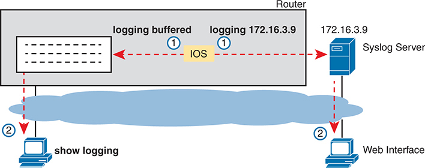

<figcaption>

<aside class="hidden" id="a13fig02">

该图主要分为两个主要部分:运行IOS的路由器和syslog服务器. 在左边,路由器被配置为两个伐木命令:伐木缓冲和-172.16.3.9. 这些命令被用箭指向各伐木目的地来描绘。 日志缓冲命令表示日志被存储在路由器的缓冲器中,而日志-172.16.3.9则向位于 IP地址-172.16.3.9的外部syslog服务器发送日志信息. 路由器的缓冲器用一个包含日志条目的框来表示,可以在后期访问以供审查. 在此下方显示一个命令显示日志, 这样管理员就可以查看路由器上的缓冲日志信息 。 右侧显示与路由器连接的syslog服务器被识别为IP地址172.16.3.9. 此服务器收集并存储由路由器发送的日志消息 。 此外,一台计算机通过网络接口与syslog服务器相接,使管理员能够通过图形用户接口查看和管理日志. 该图使用箭头和说明来显示从路由器到内部缓冲器和外部Syslog服务器的日志信息流.

</aside>

<strong>图13-2</strong> <em>用于后期视图的 IOS 存储日志消息: 缓存和 Syslog 服务器</em>

</figcaption>

</figure>

</section>

<section>

<h4 class="h4" id="ch13lev2sec3">日志消息格式</h4>

IOS定义了日志消息的格式. 消息开始于一些关于消息的数据字段,然后是一些更方便被人类读取的文本. 例如,仔细看看这个样本信息:

<a href="#code-f0272-01" id="f0272-01a">点击此处查看代码原图</a>

<pre class="pre" tabindex="0"><code class="highlight">*Dec 18 17:10:15.079: %LINEPROTO-5-UPDOWN: Line protocol on Interface
FastEthernet0/0, changed state to down</code></pre>

注意,默认在这个特定设备上,我们可以看到以下内容:

<strong>时间戳：</strong> *Dec 18 17:10:15.079

<strong>生成消息的路由器上的设施:</strong>% 线粒体

<strong>严重程度 :</strong> 5

<strong>消息的元音 :</strong> UPDOWN

<strong>电文描述:</strong>接口快速Ethernet0/0上的行协议,状态更改为下

IOS支配了信件的大部分内容,但您至少可以切换出时间戳(默认包含)和日志消息序列号(默认不启用)的使用.<a href="#exa13_1">示例13-1</a>通过关闭时间戳并打开序列号来逆转这些默认值.

<strong>示例13-1</strong> <em>禁用日志信件中的时间戳并启用序列号</em>

<a href="#code-f0272-02" id="f0272-02a">点击此处查看代码原图</a>

<pre class="pre-ex" tabindex="0"><code class="highlight">R1(config)# <strong>no service timestamps</strong>
R1(config)# <strong>service sequence-numbers</strong>
R1(config)# <strong>end</strong>
R1#
000011: %SYS-5-CONFIG_I: Configured from console by console</code></pre>

要看到格式的变化,请查看示例结尾处的日志消息. 和往常一样,当您退出配置模式时,设备会发布又一日志消息. 将此信件与上一个示例相比较,你可以看到它现在不再列出一天的时间,而是会列出一个序列号.

</section>

<section>

<h4 class="h4" id="ch13lev2sec4">日志消息严重性级别</h4>

日志信息可能只是告诉你一些平庸事件,或者它们会告诉你一些关键事件. 为了帮助您理解每条消息的重要性,IOS给每条消息分配一个重度级别(如上页左右同一消息所指出).<a href="#ch13fig03">图13-3</a>显示重度级别:数字越低,产生消息的事件就越严重。 (注意IOS命令同时使用图中的关键词和数字. )

<figure class="image-c" id="ch13fig03">

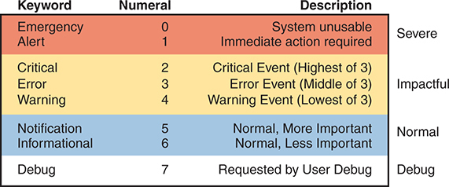

<figcaption>

<aside class="hidden" id="a13fig03">

该表有3个被标记为"关键词"(Keyword),"数字"(Numeral)和"描述"(Cription)等栏. 在第一节"有色红色"和"标签严重"中,关键词为以0为数字的"紧急"和无法使用的"描述系统",而"提醒"为以1为数字并需要的"即时行动". 本节说明最高严重程度。 第二节为有色黄色并被标签为"撞击"(Critical),包括2个数字的"临界"和描述"临界事件"(最高为3个),3个数字的错误和描述"错误事件"(中为3个数字),以及4个数字的 "警告"和描述 "警告事件"(Lowest of 3). 本节代表对系统有重大影响的事件. 第三节为有色蓝色并被标签为"正常"(Normal),由以5为数字的"通知"和以6为数字的描述"正常","更重要"(Norman, More important)和"信息"(Informational, Normal, Less importentary)组成. 本节重点介绍日常业务信息. 第四节为有色灰色并被标签为"调试"(debug),只包含数字为7的"调试会"和"用户调试会要求的描述". 本节为用户所请求的调试目的.

</aside>

<strong>图13-3</strong> <em>按关键字和数字排列的 Syslog 信件严重性级别</em>

</figcaption>

</figure>

<a href="#ch13fig03">图13-3</a>将8个重度等级分为4个部分,只是为了更清楚地理解意义。 图中最高的两个级别是最严重的. 从这一层面发出的信息意味着存在一个严肃而直接的问题。 后三个级别,称为"临界"(Critical, Error)和"警告"(Warning),也讲述了影响设备的事件,但并没有那么直接和严重. 例如,一个共同的日志信息,关于一个接口不能到物理下行状态,显示为重度三级信息。

继续下图,IOS使用下两个关卡(5和6)处理更多的是通知用户而不是识别出错误的信息. 最后,图中的最后一个关卡用于:<strong>debug</strong>命令,如本章后面的一个示例所示。

<a href="#ch13tab02">表13-2</a>总结用于启用日志和为每种类型设定重度级的配置命令。 确定重度等级后,IOS会向命令中指定的服务发送该重度等级和更重(更轻重号)的信息. 例如,命令<strong>logging console 4</strong>导致IOS向控制台发送0–4级重度消息. 请注意,禁用每项服务的命令是:<strong>no</strong>命令的版本,与<em>no</em>在命令前( 3) :<strong>no logging console</strong>, <strong>no logging monitor</strong>,等等).

<figure class="table" id="ch13tab02" tabindex="0">

<figcaption>

<strong>表13-2</strong>如何为每个日志服务配置日志信件级别

</figcaption>

<table class="all">

<tbody>

<tr>

<th class="th">
服务
</th>

<th class="th">
启用日志
</th>

<th class="th">
设置消息级别
</th>

</tr>

<tr>

<td class="border">
控制台
</td>

<td class="border">
<strong>logging console</strong>
</td>

<td class="border">
<strong>logging console</strong> <em>level-name</em> | <em>level-number</em>
</td>

</tr>

<tr>

<td class="border">
监控（Monitor）
</td>

<td class="border">
<strong>logging monitor</strong>
</td>

<td class="border">
<strong>logging monitor</strong> <em>level-name</em> | <em>level-number</em>
</td>

</tr>

<tr>

<td class="border">
缓冲
</td>

<td class="border">
<strong>logging buffered</strong>
</td>

<td class="border">
<strong>logging buffered</strong> <em>level-name</em> | <em>level-number</em>
</td>

</tr>

<tr>

<td class="border">
Syslog
</td>

<td class="border">
<strong>logging host</strong> <em>address</em> | <em>hostname</em>
</td>

<td class="border">
<strong>logging trap</strong> <em>level-name</em> | <em>level-number</em>
</td>

</tr>

</tbody>

</table>

</figure>

</section>

<section>

<h4 class="h4" id="ch13lev2sec5">配置和验证系统日志</h4>

在信息输入中<a href="#ch13tab02">表13-2</a>,在 Cisco IOS 路由器或交换机中配置 syslog 应该相对直截了当.<a href="#exa13_2">示例13-2</a>显示基于<a href="#ch13fig04">图13-4</a>。图中显示一个在 IP 地址 172.16.3.9的 syslog 服务器. 交换机和路由器将使用相同的配置<a href="#exa13_2">示例13-2</a>,虽然示例显示了单个设备上的配置过程,路由器R1.

<figure class="image-c" id="ch13fig04">

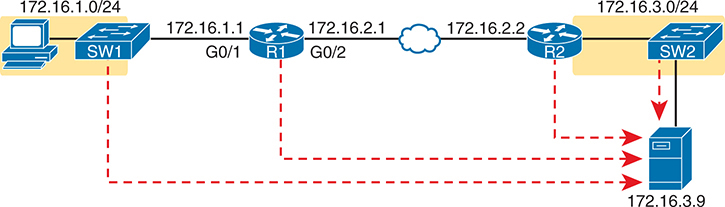

<figcaption>

<aside class="hidden" id="a13fig04">

左侧有一台个人电脑连接到一个被标记为S W-1的交换机上. 交换机S W 1是子网 172.16.1.0/24的一部份,其I P地址被指定为172.16.1.1. 这个交换机通过接口G0 slash1,连接到一个被标记为R1的路由器,其IP地址为172.16.1.1. 路由器R-1也有一个第二个接口,G-0 slash2,有一个IP地址为172.16.2.1,连接到一个广域网(WAN)云来象征连接到另一个路由器. 第二个路由器被标注为R2,通过接口G0 slash1,与WAN云相接,IP地址为172.16.2.2. 在R-2的另一边,接口G-0 slash2连接到另一个被标记为S W-2的交换机,这是子网172.16.3.0/24的一部分. 这个交换机的IP地址是172.16.3.1. 此外,一个服务器连接到S W 2,服务器的 I P 地址是 172.16.3.9. 该图显示了从个人电脑上通过SW-1,R-1,WAN云,R-2,SW-2,最后到服务器的被登录流量流的多点红线. 这些红线说明了交通所走的道路,很可能是被描绘的伐木过程的一部分. 使用交换机、路由器和服务器的标准网络符号,同时使用固态和点行来代表网络内部的连接和流量。 子网以不同的颜色背景被突出显示,以视觉区分它们.

</aside>

<strong>图13-4</strong> <em>记录实例中使用的样本网络</em>

</figcaption>

</figure>

<strong>示例13-2</strong> <em>R1 上的 Syslog 配置</em>

<pre class="pre-ex" tabindex="0"><code class="highlight">logging console 7
logging monitor debug
logging buffered 4
logging host 172.16.3.9
logging trap warning</code></pre>

首先,注意该示例在控制台和终端监控(级别为7,或调试)上配置相同的消息关卡,同时对缓冲和记录到syslog服务器(级别为4,或警告)进行相同的关卡. 这些级别可以使用数字严重性级别或前面所示的名称设定。<a href="#ch13fig03">图13-3</a>.

密码<strong>show logging</strong>命令确认这些相同的配置设置,并列出每个日志缓冲配置的日志信息。<a href="#exa13_3">示例13-3</a>显示样本,配置设置要匹配<a href="#exa13_2">示例13-2</a>以灰色突出显示。

<strong>示例13-3</strong> <em>按较早的例子查看配置的日志设置</em>

<a href="#code-f0274-01" id="f0274-01a">点击此处查看代码原图</a>

<pre class="pre-ex" tabindex="0"><code class="highlight">R1# <strong>show logging</strong>
Syslog logging: enabled (0 messages dropped, 3 messages rate-limited, 0 flushes, 0 overruns, xml disabled, filtering disabled)

No Active Message Discriminator.

No Inactive Message Discriminator.

    Console logging: level debugging, 45 messages logged, xml disabled,
                     filtering disabled
    Monitor logging: level debugging, 0 messages logged, xml disabled,
                     filtering disabled
    Buffer logging: level warnings, 0 messages logged, xml disabled,
                    filtering disabled
    Exception Logging: size (8192 bytes)
    Count and timestamp logging messages: disabled
    Persistent logging: disabled
 No active filter modules.
    Trap logging: level warnings, 0 message lines logged
       Logging to 172.16.3.9 (udp port 514, audit disabled,
           link up),
           0 message lines logged,
           0 message lines rate-limited,
           0 message lines dropped-by-MD,
           xml disabled, sequence number disabled
           filtering disabled
       Logging Source-Interface: VRF Name:
    TLS Profiles:

Log Buffer (8192 bytes):</code></pre>

您现在可能注意到, 如果想要了解命令的输出, 了解所有八个日志消息级别的名称会很方便 。 多数人<strong>show</strong>命令按名称而不是数字列出日志消息级别。 您可以从这个例子的灰色亮点中看到, 有两个关卡列出“ 调试 ” 和两个关卡“ 警告 ” , 尽管一些配置命令逐个提到这些关卡 。

而且,你无法从输出中知道这一点,但<a href="#exa13_3">示例13-3</a>,路由器 R1 没有缓冲日志消息。 (注意缓冲日志信件的对应值为 0. ) 如果任何日志信件被缓冲, 实际日志信件将在命令末尾列出 。 在这种情况下,我刚刚启动了路由器,还没有任何消息被缓冲. (你也可以从日志中清出旧消息)<strong>clear logging</strong>EXEC 命令. )

下个例子显示了目前严重程度水平的差异. 此示例显示 R1 上的用户禁用接口 G0/1 。<strong>shutdown</strong>命令,然后用<strong>no shutdown</strong>命令。如果你仔细观察突出显示的信息,你会看到几个严重性5条信息和一个严重性3条信息. 密码<strong>logging buffered 4</strong>R1 上的全局配置命令( 请参见<a href="#exa13_2">示例13-2</a>)指R1不会缓冲重度等级为5级的日志消息,而会缓冲重取等级为3级的消息.<a href="#exa13_4">示例13-4</a>结尾时在输出末尾显示日志消息<strong>show logging</strong>命令。

<strong>示例13-4</strong> <em>在Console看到Severity 3和5条消息,而Severity3只在缓冲器中</em>

<a href="#code-f0275-01" id="f0275-01a">点击此处查看代码原图</a>

<pre class="pre-ex" tabindex="0"><code class="highlight">R1# <strong>configure terminal</strong>
Enter configuration commands, one per line. End with CNTL/Z.
R1(config)# <strong>interface g0/1</strong>
R1(config-if)# <strong>shutdown</strong>
R1(config-if)#
*Oct 21 20:07:07.244: %LINK-5-CHANGED: Interface GigabitEthernet0/1, changed state   to administratively down
*Oct 21 20:07:08.244: %LINEPROTO-5-UPDOWN: Line protocol on Interface   GigabitEthernet0/1, changed state to down
R1(config-if)# <strong>no shutdown</strong>
R1(config-if)#
*Oct 21 20:07:24.312: %LINK-3-UPDOWN: Interface GigabitEthernet0/1, changed state to up
*Oct 21 20:07:25.312: %LINEPROTO-5-UPDOWN: Line protocol on Interface   GigabitEthernet0/1, changed state to up
R1(config-if)# <strong>^Z</strong>
R1#
*Oct 21 20:07:36.546: %SYS-5-CONFIG_I: Configured from console by console
R1# <strong>show logging</strong>
! Skipping about 20 lines, the same lines in <a href="#exa13_3">Example 13-3</a>, until the last few lines

Log Buffer (8192 bytes):

*Oct 21 20:07:24.312: %LINK-3-UPDOWN: Interface GigabitEthernet0/1, changed state to up</code></pre>

</section>

<section>

<h4 class="h4" id="ch13lev2sec6">debug 命令与日志消息</h4>

在8个日志信息重度级别中,一个级别,调试级别(7)有特殊目的:对于用户登录到路由器或切换后生成的信息,谁发布一个<strong>debug</strong>命令。

密码<strong>debug</strong>EXEC指令给网络工程师一种方法,要求IOS监测某些内部事件,这种监测过程会持续一段时间,以便IOS在发生这些事件时发布日志信息. 工程师可以登录,发行<strong>debug</strong>命令,然后转到其他工作。 用户甚至可以登录出设备,调试仍然启用. 监督办继续监测这一请求。<strong>debug</strong>命令并生成任何相关活动的日志消息。 调试活动持续到一些用户发布<strong>no debug</strong>命令使用相同的参数,使调试失效。

注意

虽然<strong>debug</strong>命令只是一个命令,它有很多选项,很像<strong>show</strong>命令可能是一个命令,但它也有多种选择。

最好的办法,看看如何<strong>debug</strong>命令工作,以及它如何使用日志消息,就是看到一个实例。<a href="#exa13_5">示例13-5</a>显示路由器 R1 的 OSPF Hello 消息的样本调试<a href="#ch13fig04">图13-4</a>。路由器(R1)在两个接口上启用了OSPF,并已经与路由器R2(RID 2.2.2.2)建立了1个OSPF相邻关系. 调试输出显示一个发送在端口G0/1和G0/2的Hello消息的日志信息,加上一个发送到端口G0/2的Hello消息.

<strong>示例13-5</strong> <em>使用<strong>debug ip ospf hello</strong>从 R1 控制台</em>

<a href="#code-f0276-01" id="f0276-01a">点击此处查看代码原图</a>

<pre class="pre-ex" tabindex="0"><code class="highlight">R1# <strong>debug ip ospf hello</strong>
OSPF hello debugging is on
R1#
*Aug 10 13:38:19.863: OSPF-1 HELLO Gi0/1: Send hello to 224.0.0.5 area 0 from
   172.16.1.1
*Aug 10 13:38:21.199: OSPF-1 HELLO Gi0/2: Rcv hello from 2.2.2.2 area 0 172.16.2.2
*Aug 10 13:38:22.843: OSPF-1 HELLO Gi0/2: Send hello to 224.0.0.5 area 0 from
   172.16.2.1
R1#</code></pre>

控制台用户看到代表它创建的日志信件<strong>debug</strong>命令,然后是<strong>debug</strong>命令完成。 按先前的配置在<a href="#exa13_2">示例13-2</a>, R1 级<strong>logging console 7</strong>命令告诉我们,控制台用户将收到0–7级的重度信息,其中包括7级调试信息。 另外,如果您检查了由该程序生成的日志信件,则<strong>debug</strong>命令中,您将找不到列出的重度级别。 因此,在日志信息中缺少重度级别编号,说明来自<strong>debug</strong>命令。

许多公司可能不希望将调试消息的副本保留在长期选项中来存储日志消息. 例如,以当前设置为例<a href="#exa13_2">示例13-2</a>,这些调试消息将不会在本地日志消息缓冲器中(因为<strong>logging buffered warning</strong> 路由器也不会向 syslog 服务器发送调试消息(因为<strong>logging trap 4</strong>

注意控制台用户会自动看到显示在<a href="#exa13_4">示例13-4</a>。然而,正如在说明中所指出的,<a href="#ch13fig01">图13-1</a>,使用 SSH 或 Telnet 连接到 R1 的用户也需要发布<strong>terminal monitor</strong>命令,即使与<strong>logging monitor debug</strong>命令配置在路由器 R1 上 。

注意所有已启用的调试选项都使用路由器CPU,这可能会给路由器造成问题. 您可以监视 CPU 使用<strong>show process cpu</strong>命令,但使用时应当小心<strong>debug</strong>生产设备上的命令。 另外,注意接收调试消息的CLI用户越多,CPU消耗量就越多. 因此,一些设施选择不包含用于控制台和终端日志的调试级日志消息,要求用户查看这些消息的日志缓冲器或syslog,只是为了减少路由器CPU负载.

</section>

</section>

<section>

<h3 class="h3" id="ch13lev1sec4">网络时间协议（NTP）</h3>

每个网络设备都有一些日期和时钟的概念. 例如,本章主要部分讨论的日志信息与所列日期和时间有时间戳。 现在想象一下所有路由器和交换机中的所有日志信息都存储在syslog服务器上. 所有这些信息都有一个日期和时间戳,但你如何确保时间戳一致? 您如何确保所有设备同步它们每天的时钟, 以便您能够理解 syslog 服务器上的所有日志信息 ? 在三个不同的时区发生撞击设备的事件,你怎么能理解信息呢?

例如,考虑R1和R2两个路由器上的信息,如所示<a href="#exa13_6">示例13-6</a>。路由器R1和R2不同步它们的NTP时钟. 在两个路由器之间的以太网WAN连接上,一个问题不断发生. 一个网络工程师查看了存储在syslog服务器上的所有日志消息. 然而,当看到R1在13:38:39(大约为1:40平时)发来的一些消息时,工程师并不考虑寻找R2发来的时间戳大约为9:45正时发来的消息.

<strong>示例13-6</strong> <em>比较两个路由器发送的日志信件</em>

<a href="#code-f0277-01" id="f0277-01a">点击此处查看代码原图</a>

<pre class="pre-ex" tabindex="0"><code class="highlight">*Oct 19 13:38:37.568: %OSPF-5-ADJCHG: Process 1, Nbr 2.2.2.2 on GigabitEthernet0/2
from FULL to DOWN, Neighbor Down: Interface down or detached
*Oct 19 13:38:40.568: %LINEPROTO-5-UPDOWN: Line protocol on Interface
GigabitEthernet0/2, changed state to down</code></pre>

<pre class="pre-ex" tabindex="0"><code class="highlight">! These messages happened on router R2
Oct 19 09:44:09.027: %LINK-3-UPDOWN: Interface GigabitEthernet0/1, changed state to down
Oct 19 09:44:09.027: %OSPF-5-ADJCHG: Process 1, Nbr 1.1.1.1 on GigabitEthernet0/1
from FULL to DOWN, Neighbor Down: Interface down or detached</code></pre>

在现实中,信息在两个部分都存在。<a href="#exa13_6">示例13-6</a>发生在...0.5... 秒之内,因为我发布了一个<strong>shutdown</strong>在路由器R1(未显示)上命令。 然而,两个路由器的时钟并没有同步,这使得两个路由器上的信息显得无关紧要. 有了同步的时钟,两个路由器就会列出几乎相同的时间戳,这些消息发生时几乎是同一时间,这样就更容易读取和连接到消息了.

路由器,交换机,其他网络设备, 和几乎所有已知在IT世界中的设备 都有一个时钟。 由于各种原因,同步这些时钟是有道理的,这样所有设备都有同一天的时间,除了时区的差异. 密码<a id="key_152" href="#ref-gloss_225">网络时间协议( NTP)</a>提供这样做的手段。

NTP为任何设备提供了同步其时钟的方法. NTP提供协议消息,设备用来学习其他设备的时间戳. 设备用NTP消息向对方发送时间戳,不断交换消息,一个设备更改时钟以相匹配,最终使时钟同步. 因此,从同步计时中受益的行动,如日志信息上的时间戳,效果要好得多.

本节的工作方式是推进话题,从而导致在真实网络中看到的更常见的NTP配置类型. 本节从基本设置开始,如时区,并最初在路由器或交换机上配置时间,后再进行基本的NTP配置. 然后,案文审查一些NTP内部关于NTP如何定义时间数据源(参考时钟)以及每个时间源有多好(分层)。 部分关闭后配置更多,可以解释典型的企业配置,并有多个<strong>ntp</strong>用于冗余和高可用性使用回回路接口的命令。

<section>

<h4 class="h4" id="ch13lev2sec7">设置时间和时区</h4>

NTP的工作是同步时钟,但NTP如果在启用前将设备时钟设置到一个合理接近的时间,则效果最好.<a id="key_153" href="#ref-gloss_232">NTP 客户端</a>函数与<strong>ntp server</strong>例如,我的手表上写着 8:52 P.M.现在。在启动新路由器上的NTP或交换机使其与另一个设备同步之前,我应该把时间设定为 8:52 晚上,设定正确的日期和时区,甚至告诉设备调整日出节省时间 — — 然后启用NTP。 正确设定时间让NTP开始同步。

<a href="#exa13_7">示例13-7</a>说明如何设定日期、时间、时区和节省日光的时间。 奇怪的是,它使用两个配置命令(用于时区和日出节省时间)和一个EXEC命令在路由器上设定日期和时间.

<strong>示例13-7</strong> <em>设定日期/时间<strong>clock set</strong>,加时区/DST</em>

<a href="#code-f0278-01" id="f0278-01a">点击此处查看代码原图</a>

<pre class="pre-ex" tabindex="0"><code class="highlight">R1# <strong>configure terminal</strong>
Enter configuration commands, one per line. End with CNTL/Z.
R1(config)# <strong>clock timezone EST -5</strong>
R1(config)# <strong>clock summer-time EDT recurring</strong>
R1(config)# <strong>^Z</strong>
R1#
R1# <strong>clock set 12:32:00 19 January 2023</strong>
*Jan 19 17:32:00.005: %SYS-6-CLOCKUPDATE: System clock has been updated from
12:32:16 EST Thu Jan 19 2023 to 12:32:00 EST Thu Jan 19 2023, configured from
console by console.
R1# <strong>show clock</strong>
12:32:06.146 EST Thu Jan 19 2023</code></pre>

先专注于两个配置命令. 您应该先设定前两个命令,然后确定日期 。<strong>clock set</strong>EXEC命令,因为两个配置命令会影响设定的时间. 在第一个命令中,<strong>clock timezone</strong>部分定义命令和关键字。 在此情况下,下一个参数“ EST” 是您选择的任何值, 但选择设备的时区名称 。 此值显示于<strong>show</strong>命令,因此,虽然您对数值进行了计算,但值需要对所有人有意义。 我选择了EST,美国东部标准时间的缩写. "5"参数指此装置比"世界时协调"(UTC)相差5小时.

密码<strong>clock summer-time</strong>第二个命令的部分内容定义了该做什么,而“EDT”又是您可以使用任何值的一个字段。 然而,你应该使用一个有意义的价值。 这是用时间显示的值<strong>show</strong>当日光节能时间生效时,我选择了EDT, 因为它是同一 EST 时区日光节活时间的缩写。 最后,<strong>经常性</strong>关键词告诉路由器向前弹出一个小时,并在这些年中自动倒回一个小时.

密码<strong>clock set</strong>然后,EXEC命令确定时间、月份、月份和年份。 然而,请注意,IOS将时间解释为在命令中以时区和日出节省时间为背景所打出的时间. 举例来说,<strong>clock set</strong>命令列出时间为20:52:49(命令使用时间语法,格式为24-hour,不使用12-hour格式+a.m./p.m.)。 由于时间加前两个配置指令,<strong>show clock</strong>命令(在后几秒后发布)列出该时间,但也指出该时间为EDT而不是UTC时间.

</section>

<section>

<h4 class="h4" id="ch13lev2sec8">基本 NTP 配置</h4>

与NTP一起,服务器向客户端提供日间时间信息,客户端通过调整时钟来反应以相匹配. 这一过程需要经过一段时间的反复小幅调整,以保持这种同步. 配置本身可以简单,或者在添加了安全配置和冗余后可以被扩展.

思科用品二<strong>ntp</strong>用于决定NTP如何在路由器或交换机上工作的配置命令如下:

<ul class="sq">

<li>
<strong>ntp master</strong> {<em>stratum-level</em>}: NTP 服务器模式 - 设备只起到一种作用 。<a id="key_155" href="#ref-gloss_234">NTP 服务器</a>,而不是作为NTP客户端. 设备从设备上的内部时钟获得时间信息.
</li>

<li>
<strong>ntp server</strong> {<em>address</em> | <em>hostname</em>}: NTP 客户端/服务器模式 - 该设备同时充当客户端和服务器. 首先,它充当了NTP客户端,来调整它的时间来与另一个服务器同步时间. 一旦同步,该设备随后可起NTP服务器的作用,为其他NTP客户端提供时间.
</li>

</ul>

例如,显示基本配置语法和<strong>show</strong>命令,考虑<a href="#ch13fig05">图13-5</a>。使用此简单配置 :

<ul class="sq">

<li>
R3仅充当NTP服务器.
</li>

<li>
R2在客户端/服务器模式下行为——首先作为NTP客户端与NTP服务器R3同步时间,再作为服务器向NTP客户端R1提供时间.
</li>

<li>
R1在客户端/服务器模式下发挥作用——首先作为NTP客户端与NTP服务器R2同步时间. (R1将愿意充当服务器,但在此例子中不会出现将R1作为NTP服务器引用的设备. )
</li>

</ul>

<figure class="image-c" id="ch13fig05">

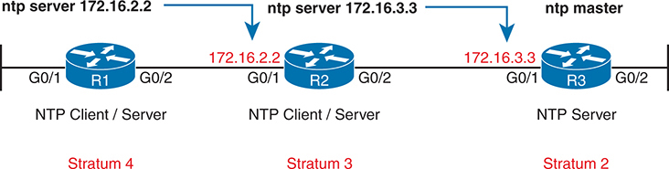

<figcaption>

<aside class="hidden" id="a13fig05">

网络由三个路由器组成,标记为R 1 2 ,和 R 键 3 从左到右依次连接。 在左侧, 路由器 R 1 通过以太网接口G连接 0 斜线 1 和G组 0 斜线 2 。它被标签为 NTP 客户端/ 服务器, 并被配置为从位于 IP 地址的 NTP 服务器同步时间 172.16.2.2 R的IP地址 1 本身是 172.16.2.2 ,标记为红色。此路由器在 Stratum 运行 4 在中间,路由器R 2 通过以太网接口G连接 0 斜线 1 和G组 0 斜线 2 改为两个R 1 和 R 数据 3 . R 语 2 作为NTP客户端和服务器的双重作用。它从位于 IP 地址的 NTP 服务器同步时间 172.16.3.3 并服务时间到 R 1 R的IP地址 2 实值 172.16.3.3 ,也用红色标出。此路由器在 Stratum 运行 3 在 NTP 等级中。在右边,路由器R 3 通过以太网接口G连接 0 斜线 1 和G组 0 斜线 2 。标记为 NTP 服务器,并充当 R 的主时间源 2 . R 语 3 拥有 IP 地址 172.16.3.3 ,以红色标出,并被指定为Stratum 2 ,表示NTP分级结构的更准确性和可靠性。路由器之间的箭头显示NTP时间同步的方向:R 1 从 R 收到时间 2 ,这反过来又从 R 得到时间 3 。标签 NTP 服务器 172.16.2.2 , NTP 服务器 172.16.3.3 ,而NTP主机则表示每个路由器同步时间的来源.

</aside>

<strong>图13-5</strong> <em>R1 为 NTP 客户端, R2 为客户端/ 服务器, R3 为服务器</em>

</figcaption>

</figure>

可见,NTP只需要很少的配置就可以使每个设备上有一个单一的配置命令来工作.<a href="#exa13_8">示例13-8</a>从图中显示的设备中收集配置,以方便参考。

<strong>示例13-8</strong> <em>NTP 客户端/ 服务器配置</em>

<pre class="pre-ex" tabindex="0"><code class="highlight">! Configuration on R1:
<strong>ntp server 172.16.2.2</strong></code></pre>

<pre class="pre-ex" tabindex="0"><code class="highlight">! Configuration on R2:
<strong>ntp server 172.16.3.3</strong></code></pre>

<pre class="pre-ex" tabindex="0"><code class="highlight">! Configuration on R3:
<strong>ntp master 2</strong></code></pre>

<a href="#exa13_9">示例13-9</a>列出来自<strong>show ntp status</strong>命令在 R1 上,其中第一行输出包含几个重要状态项目。 首先,它列出了同步状态,这证实了NTP客户端已经完成了改变时间以匹配服务器时间的过程. 任何作为NTP客户端的路由器都会在该一行中列出"未同步",直到<a id="key_156" href="#ref-gloss_235">NTP 同步</a>进程至少完成一个服务器。 它还证实了服务器的IP地址 - 这个设备的<em>参考时钟</em>—— 配置在 IP 地址<a href="#exa13_8">示例13-8</a> (172.16.2.2).

<strong>示例13-9</strong> <em>正在验证 R1 和 R2 上的 NTP 客户端状态</em>

<a href="#code-f0280-01" id="f0280-01a">点击此处查看代码原图</a>

<pre class="pre-ex" tabindex="0"><code class="highlight">R1# <strong>show ntp status</strong>
Clock is synchronized, stratum 4, reference is 172.16.2.2
nominal freq is 250.0000 Hz, actual freq is 250.0000 Hz, precision is 2**21
ntp uptime is 1553800 (1/100 of seconds), resolution is 4000
reference time is DA5E7147.56CADEA7 (15:24:38.694 EST Thu Jan 19 2023)
clock offset is 0.0986 msec, root delay is 2.46 msec
root dispersion is 22.19 msec, peer dispersion is 5.33 msec
loopfilter state is ‘CTRL’ (Normal Controlled Loop), drift is 0.000000009 s/s
system poll interval is 64, last update was 530 sec ago.</code></pre>

接下来,看看<strong>show ntp associations</strong>命令从 R1 和 R2 输出, 如<a href="#exa13_10">示例13-10</a>。此命令列出了本地设备可以尝试使用的所有NTP服务器,其中包含关于本地设备(客户端)和各种NTP服务器之间关联的状态信息. 从R1开始,请注意它有一个关联(即与NTP服务器的关系),基于一个关联<strong>ntp server 172.16.2.2.2</strong>R1上的配置命令. *指R1已成功与服务器联系. 您将看到从路由器 R2 中提取的相同命令输出的类似数据 。

<strong>示例13-10</strong> <em>正在验证 R1 和 R2 上的 NTP 客户端状态</em>

<a href="#code-f0281-01" id="f0281-01a">点击此处查看代码原图</a>

<pre class="pre-ex" tabindex="0"><code class="highlight">R1# <strong>show ntp associations</strong>
! This output is taken from router R1, acting in client/server mode
   address   ref clock st when poll reach  delay  offset disp
*~172.16.2.2 10.1.3.3  3   50  64     377  1.223  0.090  4.469
 * sys.peer, # selected, + candidate, - outlyer, x falseticker, ~ configured</code></pre>

<pre class="pre-ex" tabindex="0"><code class="highlight"> R2# <strong>show ntp associations</strong>
! This output is taken from router R2, acting in client/server mode
 address      ref clock    st  when poll  reach  delay  offset  disp
*~172.16.3.3  127.127.1.1  2   49    64   377    1.220  -7.758  3.695
 * sys.peer, # selected, + candidate, - outlyer, x falseticker, ~ configured</code></pre>

</section>

<section>

<h4 class="h4" id="ch13lev2sec9">NTP 参考时钟与层级</h4>

NTP服务器必须从某些设备中学习时间. 用于设备在<a id="key_154" href="#ref-gloss_233">NTP 客户端/服务器模式</a>,设备使用NTP客户端功能来学习时间. 然而,仅作为NTP服务器的设备从内部设备硬件或一些使用NTP以外的机制的外部时钟获得时间.

例如,当配置到<strong>ntp master</strong>命令,一个 Cisco 路由器/交换器使用其内部设备硬件来确定时间。 所有计算机,包括网络设备在内,都需要一些手段来保持时间,原因多种多样,因此它们既包括硬件组件,也包括软件流程,以保持时间,即使在设备失去动力的期间也是如此。

此外,NTP服务器和客户端使用数字来显示其基于地层的参考钟数据的感知准确性. 分层级别越低,参考时钟被认为越准确. 使用其内部硬件或外部参考钟的NTP服务器设置了自己的层层. 然后,一个NTP客户端在从它的NTP服务器中学习到的上层层次上增加了1个,这样下层层次就会从原来的时钟源上增加更多的hops.

比方说,回到了<a href="#ch13fig05">图13-5</a>,您可以看到 NTP 主服务器(R3),其分层为2. R2, 参考R3, 添加了1, 因此它的分层为3. R1使用R2作为其NTP服务器,因此R1添加了1以有4的分层. 这些不断提高的地层水平使得设备可以指代几个NTP服务器,然后使用最佳NTP服务器提供的时间信息,<em>最佳</em>是最低层的服务器 。

路由器和交换机在内部参考时钟使用默认为8的平分级,基于默认设置为8的平分级.<strong>ntp master</strong> [<em>stratum-level</em>[ 命令 ] 命令允许您从 1到15 设置一个值; in<a href="#exa13_8">示例13-8</a>,则<strong>ntp master 2</strong>命令设置路由器 R3 的地层级别为 2 。

注意

NTP认为15是最高的有用地层级,因此任何计算出其地层为16的设备都认为时间数据无法使用,不信任时间. 因此,避免在表上设置较高的层值<strong>ntp master</strong>命令。

要看到证据,请参考<a href="#exa13_10">示例13-10</a>,显示基于相同配置的两个命令。<a href="#exa13_8">示例13-8</a>和<a href="#ch13fig05">图13-5</a>。产出突出参考时钟和地层的详情如下:

<strong>R1:</strong>每个配置的<strong>ntp server 172.16.2.2</strong>命令,则<strong>show</strong>命令列出相同的地址(这是路由器R2的地址)。 参考时钟(Ref clock)和st (stratum)字段代表了R2的参考时钟为172.16.3.3-换句话说,NTP服务器R2使用,在这种情况下是R3. 3的st字段值显示了R2的地层.

<strong>R2:</strong>每个配置的<strong>ntp server 172.16.3.3</strong>命令,则<strong>show</strong>命令列表172.16.3.3,这是路由器R3上的地址. 输出时标注R3的比对时钟为127.127.1.1-表示服务器(R3)内部得到时钟. 它列出 R3 的 st ( slatum) 值为 2 — 符合配置的<strong>ntp master 2</strong>R3上的命令(每架)<a href="#exa13_8">示例13-8</a>).

在NTP主服务器本身(此处为R3)上,输出有较多的标记表示内部时钟的使用.<a href="#exa13_11">示例13-11</a>显示来自 R3 的输出,并带有127.127.1.1回回路地址的参考时钟,用于指该路由器在内部获得其时钟数据。 还有,在...<strong>show ntp associations</strong>命令下方的输出,注意同一地址,以及“.LOCL”的参考时钟值。<strong>ntp master</strong>配置指令,与其内部时钟有关联.

<strong>示例13-11</strong> <em>检查 NTP 服务器、 引用时钟和 Stratum 数据</em>

<a href="#code-f0282-01" id="f0282-01a">点击此处查看代码原图</a>

<pre class="pre-ex" tabindex="0"><code class="highlight">R3# <strong>show ntp status</strong>
Clock is synchronized, stratum 2, reference is 127.127.1.1
nominal freq is 250.0000 Hz, actual freq is 250.0000 Hz, precision is 2**20
ntp uptime is 595300 (1/100 of seconds), resolution is 4000
reference time is E0F9174C.87277EBB (15:27:54.252 EST Thu Jan 19 2023)
clock offset is 0.0000 msec, root delay is 0.00 msec
root dispersion is 0.33 msec, peer dispersion is 0.23 msec
loopfilter state is 'CTRL' (Normal Controlled Loop), drift is 0.000000000 s/s
system poll interval is 16, last update was 8 sec ago.

R3# <strong>show ntp associations</strong>
  address         ref clock       st   when   poll reach  delay  offset   disp
*~127.127.1.1     .LOCL.           1     15     16   377  0.000   0.000  0.232
 * sys.peer, # selected, + candidate, - outlyer, x falseticker, ~ configured</code></pre>

注意

<a data-original-href="vol2_appd.xhtml#appd" data-unavailable="true" title="此内容不在当前提取范围内；请参阅原始 EPUB：vol2_appd.xhtml#appd">附 录 D</a>, “<a data-original-href="vol2_appd.xhtml#appd" data-unavailable="true" title="此内容不在当前提取范围内；请参阅原始 EPUB：vol2_appd.xhtml#appd">前几版的主题</a>,”包括几页关于增加NTP冗余的内容. 对于那些转向CCNP的人,你可能想在方便的时候读一下这个话题. 你们可以找到<a data-original-href="vol2_appd.xhtml#appd" data-unavailable="true" title="此内容不在当前提取范围内；请参阅原始 EPUB：vol2_appd.xhtml#appd">附 录 D</a>校对:Soup

</section>

</section>

<section>

<h3 class="h3" id="ch13lev1sec5">使用 CDP 和 LLDP 分析拓扑</h3>

本章的前两个主要部分显示了两个特征——syslog和NTP——在路由器和交换机上同样起作用。 最后一节显示了路由器和交换机共同的又一特征,有两个相类似的协议: Cisco发现协议(Cisco Discovery Protocol (PDF)).<a id="key_148" href="#ref-gloss_061">CDP</a>和链接层发现协议(<a id="key_149" href="#ref-gloss_195">LLDP</a>) 本节主要介绍社区发展问题,随后是地方发展方案。

<section>

<h4 class="h4" id="ch13lev2sec10">查看通过 CDP 获得的信息</h4>

CDP发现了关于相邻路由器和交换机的基本信息,不需要知道相邻设备的密码. 为了发现信息,路由器和交换机将CDP消息发送出每个接口. 消息基本上宣布了发送CDP消息的设备的信息. 支持CDP的设备通过收听由其他设备发送的广告来学习关于他人的信息.

CDP从相邻的思科设备中发现了几个有用的细节:

<ul class="sq">

<li>
<strong>设备标识符 :</strong>通常为主机名
</li>

<li>
<strong>地址列表:</strong>网络和数据链接地址
</li>

<li>
<strong>端口标识符 :</strong>远程路由器上的接口或发送 CDP 广告的链接的另一端的切换
</li>

<li>
<strong>能力列表 :</strong>关于它是什么类型的设备的信息(例如路由器或交换机)
</li>

<li>
<strong>平台:</strong>设备上运行的模型和操作系统级别
</li>

</ul>

CDP发挥两个一般作用:向设备提供信息以支持某些功能,并向管理设备的网络工程师提供信息. 例如Cisco IP Phones使用CDP来学习访问交换机上配置的数据和语音VLANID. 对于第二个角色,CDP已经<strong>show</strong>命令列出相邻设备的信息,以及 CDP 如何工作的信息。<a href="#ch13tab03">表13-3</a>描述三者<strong>show</strong>命令列出最重要的 CDP 信息。

<figure class="table" id="ch13tab03" tabindex="0">

<figcaption>

<strong>表13-3显示cdp</strong>列出邻居信息的命令

</figcaption>

<table class="all">

<tbody>

<tr>

<th class="th">
命令
</th>

<th class="th">
说明
</th>

</tr>

<tr>

<td class="border">
<strong>show cdp neighbors</strong> [<em>type number</em>]
</td>

<td class="border">
列出在某个特定接口上找到的每个邻居或仅仅是邻居的一行信息摘要
</td>

</tr>

<tr>

<td class="border">
<strong>show cdp neighbors detail</strong>
</td>

<td class="border">
列出一大套(约15行)信息,每个邻居各一套
</td>

</tr>

<tr>

<td class="border">
<strong>show cdp entry</strong> <em>name</em>
</td>

<td class="border">
列出的信息与<strong>show cdp neighbors detail</strong>命令,但只针对指定的邻居(对大小写敏感)
</td>

</tr>

</tbody>

</table>

</figure>

注意

Cisco路由器和交换机支持相同的CDP命令,具有相同的参数和相同的输出类型.

接下来的例子显示了CDP命令中信息的力量. 此示例使用显示在<a href="#ch13fig06">图13-6</a>,与<a href="#exa13_12">示例13-12</a>列出若干个的输出<strong>show cdp</strong>命令。

<figure class="image-c" id="ch13fig06">

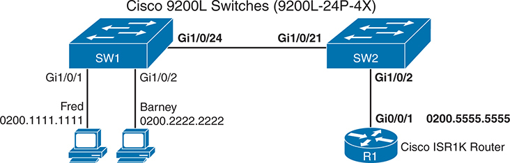

<figcaption>

<aside class="hidden" id="a13fig06">

两台交换机分别标为 SW1 和 SW2。左侧的 SW1 连接三台设备。第一台设备 Fred 连接接口 Gi1/0/1，MAC 地址为 0200.1111.1111。第二台设备 Barney 连接接口 Gi1/0/2，MAC 地址为 0200.2222.2222。SW1 还通过接口 Gi1/0/24 连接 SW2。右侧的 SW2 通过接口 Gi1/0/21 连接 SW1。此外，SW2 通过接口 Gi1/0/2 连接一台 Cisco ISR1K 路由器。该路由器标为 R1，通过接口 G0/0/1 连接 SW2，MAC 地址为 0200.5555.5555。此网络图展示交换机与路由器之间的连接，突出显示每台设备的接口和 MAC 地址。它以直观示例说明如何使用 CDP 发现并显示直连 Cisco 设备的信息，帮助理解网络拓扑和设备关系。图中展示了使用 Cisco 9200L 交换机和 ISR1K 路由器的基本网络连接及配置，以便演示 CDP 的功能。

</aside>

<strong>图13-6</strong> <em>CDP 实例中使用的小型网络</em>

</figcaption>

</figure>

<strong>示例13-12</strong> <em><strong>show cdp neighbors</strong> Command Examples: SW2</em>

<a href="#code-f0284-01" id="f0284-01a">点击此处查看代码原图</a>

<pre class="pre-ex" tabindex="0"><code class="highlight">SW2# <strong>show cdp neighbors</strong>
Capability Codes: R - Router, T - Trans Bridge, B - Source Route Bridge
                  S - Switch, H - Host, I - IGMP, r - Repeater, P - Phone,
                  D - Remote, C - CVTA, M - Two-port Mac Relay

Device ID        Local Intrfce     Holdtme    Capability  Platform  Port ID
SW1              Gig 1/0/21        155              S I   WS-C2960X Gig 1/0/24
R1               Gig 1/0/2         131             R S I  C1111-8P  Gig 0/0/1

Total cdp entries displayed : 2</code></pre>

密码<strong>show cdp neighbors</strong>命令列出每个邻居一行。 (查找设备ID列和包含 SW1 和 R1. 的列表) 这两行每行列出每个邻居最重要的地形信息:邻居的主机名(Device ID),本地设备的接口,相邻设备的接口(在端口标题下).

密切关注本地设备的接口和相邻设备的接口,将示例与图作比较. 例如,SW2的<strong>show cdp neighbors</strong>命令列出一个SW1的条目,其中SW2的本地接口为Gi1/0/21(列在 " 本地入侵 " 标题下)和SW1 的接口为GI1/0/24(列在 " Port ID " 标题之下)。

此命令还列出站台,识别相邻路由器或交换机的具体型号. 所以,即使使用这些基本信息, 你也可以构建一个像<a href="#ch13fig06">图13-6</a>或确认数字中的细节是正确的。

<a href="#ch13fig06">图13-6</a>和<a href="#exa13_12">示例13-12</a>提供良好的背景,说明设备为什么了解与CDP的直接邻居,而不是其他邻居. 首先,CDP定义了使用数据链接头的封装,但没有IP头. 为确保所有设备都收到CDP消息,以太网头使用多播目的地MAC地址(0100.0CCC.CCCC). 然而,当任何支持CDP的设备收到CDP消息时,设备会处理消息,然后丢弃,而不是转发. 例如,当路由器R1发出一个CDP消息到以太网多播地址0100.0CCC.CCCC,切换SW2接收,处理,但不转发到切换SW1——所以SW1不会将路由器R1列为CDP邻居. 同样,R1也不会将SW1列为邻居.

接下来,考虑<strong>show cdp neighbors detail</strong>命令( 显示于<a href="#exa13_13">示例13-13</a>,再次取自SW2交换机。 这个命令列出了更多的细节,你可能已经猜到了. 细节列出交换机型号的全名(C9200L-24P4X)和配置在相邻设备上的IP地址. 你必须仔细观察,但这个例子对两个相邻的邻居各有一个长长的一组消息,用一行破折线相隔.

<strong>示例13-13</strong> <em><strong>show cdp neighbors detail</strong> Command on SW2</em>

<a href="#code-f0285-01" id="f0285-01a">点击此处查看代码原图</a>

<pre class="pre-ex" tabindex="0"><code class="highlight">SW2# <strong>show cdp neighbors detail</strong>
-------------------------
Device ID: SW1
Entry address(es):
  IP address: 1.1.1.1
Platform: cisco C9200L-24P-4X,  Capabilities: Switch IGMP
Interface: GigabitEthernet1/0/21,  Port ID (outgoing port): GigabitEthernet1/0/24
Holdtime : 144 sec

Version :
Cisco IOS Software [Bengaluru], Catalyst L3 Switch Software (CAT9K_LITE_IOSXE),
Version 17.6.3, RELEASE SOFTWARE (fc4)
Technical Support: http://www.cisco.com/techsupport
Copyright (c) 1986-2022 by Cisco Systems, Inc.
Compiled Wed 30-Mar-22 21:23 by mcpre

advertisement version: 2
VTP Management Domain: 'fred'
Native VLAN: 1
Duplex: full
Management address(es):
  IP address: 1.1.1.1

-------------------------
Device ID: R1
Entry address(es):
  IP address: 10.12.25.5
Platform: cisco C1111-8P,  Capabilities: Router Switch IGMP
Interface: GigabitEthernet1/0/2,  Port ID (outgoing port): GigabitEthernet0/0/1
Holdtime : 151 sec

Version :
Cisco IOS Software [Fuji], ISR Software (ARMV8EB_LINUX_IOSD-UNIVERSALK9_IAS-M),
Version 16.8.1, RELEASE SOFTWARE (fc3)
Technical Support: http://www.cisco.com/techsupport
Copyright (c) 1986-2018 by Cisco Systems, Inc.
Compiled Tue 27-Mar-18 10:56 by mcpre

advertisement version: 2
VTP Management Domain: ‘’
Duplex: full
Management address(es):
  IP address: 10.12.25.5

Total cdp entries displayed : 2</code></pre>

注意

密码<strong>show cdp entry</strong> <em>name</em>命令列出在输出时显示的完全相同的细节<strong>show cdp neighbors detail</strong>命令,但只为命令中列出的邻居. 密码<em>name</em>参数必须是邻居的大小写敏感名称 。

</section>

<section>

<h4 class="h4" id="ch13lev2sec11">配置和验证 CDP</h4>

你对CDP的大部分工作 都与CDP能告诉你什么有关<strong>show</strong>命令。不过,这是IOS的功能,所以您可以配置 CDP 并使用一些<strong>show</strong>命令检查 CDP 本身的状况。

IOS通常可以在全球和每个接口上默认实现CDP. 然后可以禁用每个接口的 CDP<strong>no cdp enable</strong>接口子命令,然后用该命令重新启用<strong>cdp enable</strong>接口子命令。 要在全球范围禁用和重新启用设备上的CDP,请使用<strong>no cdp run</strong>和<strong>cdp run</strong>分别是全局命令。

检查 CDP 本身的状态, 请使用命令 。<a href="#ch13tab04">表13-4</a>.

<figure class="table" id="ch13tab04" tabindex="0">

<figcaption>

<strong>表13-4</strong>用于验证 CDP 操作的命令

</figcaption>

<table class="all">

<tbody>

<tr>

<th class="th">
命令
</th>

<th class="th">
说明
</th>

</tr>

<tr>

<td class="border">
<strong>show cdp</strong>
</td>

<td class="border">
说明是否在全球启用了社区发展方案,并列出默认更新和保留时间计时器
</td>

</tr>

<tr>

<td class="border">
<strong>show cdp interface</strong> [<em>type number</em>]
</td>

<td class="border">
说明是否在每个接口上启用了CDP,如果列出接口,则显示一个单一接口,并说明这些接口的更新和保存时间定时器
</td>

</tr>

<tr>

<td class="border">
<strong>show cdp traffic</strong>
</td>

<td class="border">
列出发送和接收的消费者民主党广告数量的全球统计数据
</td>

</tr>

</tbody>

</table>

</figure>

<a href="#exa13_14">示例13-14</a>列出每个命令的样本输出<a href="#ch13tab04">表13-4</a>,基于 SW2 中的切换<a href="#ch13fig06">图13-6</a>.

<strong>示例13-14</strong> <em><strong>show cdp</strong> Commands That Show CDP Status</em>

<a href="#code-f0287-01" id="f0287-01a">点击此处查看代码原图</a>

<pre class="pre-ex" tabindex="0"><code class="highlight">SW2# <strong>show cdp</strong>
Global CDP information:
        Sending CDP packets every 60 seconds
        Sending a holdtime value of 180 seconds
        Sending CDPv2 advertisements is enabled

SW2# <strong>show cdp interface GigabitEthernet1/0/2</strong>
GigabitEthernet1/0/2 is up, line protocol is up
  Encapsulation ARPA
  Sending CDP packets every 60 seconds
  Holdtime is 180 seconds

SW2# <strong>show cdp traffic</strong>
CDP counters :
        Total packets output: 304, Input: 305
        Hdr syntax: 0, Chksum error: 0, Encaps failed: 0
        No memory: 0, Invalid packet: 0,
        CDP version 1 advertisements output: 0, Input: 0
        CDP version 2 advertisements output: 304, Input: 305</code></pre>

例子中的前两个命令列出了关于 CDP 工作方式的两个相关设置:发送时间和持有时间. CDP默认每60秒发送消息,持有时间为180秒. 搁置时间告诉设备在不再听到设备的声音后等待多久,然后从CDP表格中删除这些细节. 您可以使用<strong>cdp timer</strong> <em>seconds</em>和<strong>cdp holdtime</strong> <em>seconds</em>分别是全局命令。<a href="#ch13tab05">表13-5</a>总结 CDP 和 LLDP 计时器的配置命令,以便于审查和研究.

<figure class="table" id="ch13tab05" tabindex="0">

<figcaption>

<strong>表13-5</strong>CDP 和 LLDP 计时器配置

</figcaption>

<table class="all">

<tbody>

<tr>

<th class="th">
CDP 命令
</th>

<th class="th">
LLDP 命令
</th>

<th class="th">
说明
</th>

</tr>

<tr>

<td class="border">
<strong>cdp timer</strong> <em>seconds</em>
</td>

<td class="border">
<strong>lldp timer</strong> <em>seconds</em>
</td>

<td class="border">
定义 CDP 或 LLDP 在每个接口发送消息的频率
</td>

</tr>

<tr>

<td class="border">
<strong>cdp holdtime</strong> <em>seconds</em>
</td>

<td class="border">
<strong>lldp holdtime</strong> <em>seconds</em>
</td>

<td class="border">
定义在从邻居收到最近的消息之后等待多久才能删除邻居的信息
</td>

</tr>

<tr>

<td class="border">
N/A
</td>

<td class="border">
<strong>lldp reinit</strong> <em>seconds</em>
</td>

<td class="border">
(仅限 LLDP) 定义接口出现后发送的第一个信件的等待时间
</td>

</tr>

</tbody>

</table>

</figure>

</section>

<section>

<h4 class="h4" id="ch13lev2sec12">查看通过 LLDP 获得的信息</h4>

Cisco在类似协议的任何标准存在之前就创建了Cisco-专有的CDP. 社区发展方案有许多好处。 作为第2层协议,它坐落在以太网上方,并不依赖于工作第3层协议. 它提供设备信息,可以以多种方式有用. Cisco有需要,但并没有看到一个符合需要的标准,因此Cisco编成了一个协议,这在历史上多次与许多公司和协议合作.

Link Layer Discovery Protocol(LLDP),由IEEEE标准802.1AB所定义,提供与CDP相同的一般特性的标准化协议. LLDP 配置相似, 几乎完全相同<strong>show</strong>命令与 CDP 比较。

LLDP 示例均使用 CDP 示例中使用的相同地形 。<a href="#ch13fig06">图13-6</a>(同样数字也用在社区发展的例子中)。<a href="#exa13_15">示例13-15</a>列出在图中所有设备和端口启用LLDP后学到的 SW2 的 LLDP 邻接器。 示例突出显示与该表的类似输出相匹配的项目<strong>show cdp neighbors</strong>命令在示例末尾列出,同样来自交换机 SW2.

<strong>示例13-15</strong> <em><strong>show lldp neighbors</strong> on SW2 with Similarities to CDP Highlighted</em>

<a href="#code-f0288-01" id="f0288-01a">点击此处查看代码原图</a>

<pre class="pre-ex" tabindex="0"><code class="highlight">SW2# <strong>show lldp neighbors</strong>
Capability codes:
    (R) Router, (B) Bridge, (T) Telephone, (C) DOCSIS Cable Device
    (W) WLAN Access Point, (P) Repeater, (S) Station, (O) Other

Device ID           Local Intf     Hold-time  Capability      Port ID
R1                  Gi1/0/2        120        R               Gi0/0/1
SW1                 Gi1/0/21       120        B               Gi1/0/24

Total entries displayed: 2

SW2# <strong>show cdp neighbors</strong>
Capability Codes: R - Router, T - Trans Bridge, B - Source Route Bridge
                  S - Switch, H - Host, I - IGMP, r - Repeater, P - Phone,
                  D - Remote, C - CVTA, M - Two-port Mac Relay

Device ID        Local Intrfce     Holdtme    Capability  Platform  Port ID
SW1              Gig 1/0/21        155              S I   WS-C2960X Gig 1/0/24
R1               Gig 1/0/2         131             R S I  C1111-8P  Gig 0/0/1
Total entries displayed: 2</code></pre>

产出中最重要的取出是CDP和LLDP在它们如何指代接口方面的一致性. 两者<strong>show cdp neighbors</strong>和<strong>show lldp neighbors</strong>命令有“本地接口”(接口)和“端口ID”栏。 这些列分别指本地设备的接口和相邻设备的接口.

然而,例子中的LLDP产出确实在几个重要方面与CDP不同:

<ul class="sq">

<li>
LLDP 用途<strong>B</strong>作为切换的能力代码,指<strong>桥</strong>,用于履行相同基本功能的交换机前存在的设备类型。
</li>

<li>
LLDP没有将IGMP确定为一种能力,而CDP是(一).
</li>

<li>
CDP 列出邻居的列表<strong>平台</strong>,一个定义设备类型的代码,而LLDP则没有。
</li>

<li>
LLDP 列出与不同公约有关的能力(见即将印发的<a href="#exa13_19">示例13-19</a>).
</li>

</ul>

清单上的最后一个项目需要更仔细地研究。 有趣的是, CDP 列出了邻居支持的所有能力。<strong>show cdp neighbors</strong>命令输出,无论是否启用。 相反,LLDP只列出启用的(已配置)能力,而不是所有支持的能力。<strong>show lldp neighbors</strong>命令。

密码<strong>show lldp neighbors detail</strong>和<strong>show lldp entry</strong> <em>hostname</em>命令提供相同的详细输出,第一个命令为所有邻居提供细节,第二个命令为列出的单个邻居提供细节.<a href="#exa13_16">示例13-16</a>显示相邻 R1 的细节 。 注意参数“R1”对大小写敏感,应当与“R1”所列名称相匹配。<strong>show lldp neighbors</strong>命令。

<strong>示例13-16</strong> <em><strong>show lldp entry r2</strong> Command on SW2</em>

<a href="#code-f0289-01" id="f0289-01a">点击此处查看代码原图</a>

<pre class="pre-ex" tabindex="0"><code class="highlight">SW2# <strong>show lldp entry R1</strong>

Capability codes:
    (R) Router, (B) Bridge, (T) Telephone, (C) DOCSIS Cable Device
    (W) WLAN Access Point, (P) Repeater, (S) Station, (O) Other
------------------------------------------------
Local Intf: Gi1/0/2
Chassis id: 70ea.1a9a.d300
Port id: Gi0/0/1
Port Description: GigabitEthernet0/0/1
System Name: R1

System Description:
Cisco IOS Software [Fuji], ISR Software (ARMV8EB_LINUX_IOSD-UNIVERSALK9_IAS-M),
Version 16.8.1, RELEASE SOFTWARE (fc3)
Technical Support: http://www.cisco.com/techsupport
Copyright (c) 1986-2022 by Cisco Systems, Inc.
Compiled Fri 08-Apr-22 12:42 by mcp

Time remaining: 100 seconds
System Capabilities: B,R
Enabled Capabilities: R
Management Addresses:
    IP: 10.12.25.5
Auto Negotiation - not supported
Physical media capabilities - not advertised
Media Attachment Unit type - not advertised
Vlan ID: - not advertised

Total entries displayed: 1</code></pre>

首先,关于设备能力,请注意,LLDP命令输出列出了两行邻居的能力:

<strong>系统能力 :</strong>设备能做什么?

<strong>已启用的能力 :</strong>设备现在用它目前的配置做什么

例如,在<a href="#exa13_16">示例13-16</a>,相邻的R1声称有能力进行路由和切换(代码)<strong>R</strong>和<strong>B</strong>如“电气化能力”一行所指出,目前还声称仅使用其线路能力。

另外,需要花点时间来研究一下与CDP相似的输出. 例如,此输出列出邻居R1的细节,R1使用其本地端口G0/0/1,主机名为R1. 输出中也注意到了IOS的名称和版本,经验丰富的人可以从中推断出模型编号,但没有明确提及模型.

注意

LLDP使用与CDP相同的消息概念,直接将消息封装入数据链接头. 设备不转发LLDP消息,因此LLDP只学习直接连接的邻居. LLDP向多播MAC地址0180.C200.000E发送消息,而CDP则使用0100.0CCC.CCCC.

</section>

<section>

<h4 class="h4" id="ch13lev2sec13">配置和验证 LLDP</h4>

LLDP使用类似于CDP的配置模型,但有一些关键差异. 首先,Cisco设备默认可以禁用LLDP. 此外,LLDP将LLDP消息的发送和接收分别作为单独的功能. 例如,LLDP支持处理在一个接口上接收LLDP消息,这样切换器或路由器就可以了解相邻设备,而不会向相邻设备传输LLDP信息. 为了支持这一模式,这些命令包括将LLDP消息的传输与接收消息的处理分开进行切换的选项。

LLDP的三个配置命令如下:

<ul class="sq">

<li>
<strong>[无] ldp 运行 :</strong>一个全局配置命令,为没有更具体 LLDP 子命令的任何接口设置 LLDP 操作的默认模式( )<strong>lldp transmit</strong>, <strong>lldp receive</strong>) 密码<strong>lldp run</strong>全局指令可以使LLDP在这些接口上双向运行,同时<strong>no lldp run</strong>禁用 LLDP 。
</li>

<li>
<strong>[无] ltdp 传输 :</strong>用于定义 LLDP 在接口上的操作的接口子命令, 不论全局<strong>[无] ldp 运行</strong>命令。密码<strong>lldp transmit</strong>接口子命令导致设备传输 LLDP 信件,同时<strong>no lldp transmit</strong>使其不传输 LLDP 信件 。
</li>

<li>
<strong>[无] ldp 接收:</strong>用于定义 LLDP 在接口上的操作的接口子命令, 不论全局<strong>[无] ldp 运行</strong>命令。密码<strong>lldp receive</strong>接口子命令导致设备处理收到的 LLDP 信件,同时<strong>no lldp receive</strong>使其无法处理收到的 LLDP 信件 。
</li>

</ul>

例如,考虑一个完全没有LLDP配置命令的交换机.<a href="#exa13_17">示例13-17</a>添加配置,首先允许所有接口(双向)的 LLDP<strong>lldp run</strong>全局指令 。 然后在Gi1/0/17上显示如何双向禁用LLDP,在Gi1/0/18上显示如何将LLDP禁用在一个方向上.

<strong>示例13-17</strong> <em>启用所有端口的 LLDP, 禁用少数端口</em>

<a href="#code-f0291-01" id="f0291-01a">点击此处查看代码原图</a>

<pre class="pre-ex" tabindex="0"><code class="highlight">lldp run
!
interface gigabitEthernet1/0/17
 no lldp transmit
 no lldp receive
!
interface gigabitEthernet1/0/18
 no lldp receive</code></pre>

<a href="#exa13_18">示例13-18</a>添加另一个以交换机开头并带有所有默认设置的例子。 在这种情况下,配置无法对所有接口的 LLDP 启用<strong>lldp run</strong>命令,指所有接口默认不会发送和接收LLDP消息。 这个例子确实显示,然后如何使 LLDP 在一个接口上双向运行,而第二个接口上双方向运行.

<strong>示例13-18</strong> <em>在有限港口启用LLDP,在大多数港口停用</em>

<a href="#code-f0291-02" id="f0291-02a">点击此处查看代码原图</a>

<pre class="pre-ex" tabindex="0"><code class="highlight">interface gigabitEthernet1/0/19
 lldp transmit
 lldp receive
!
interface gigabitEthernet1/0/20
 lldp receive</code></pre>

最后,检查 LLDP 状态使用与 CDP 所列完全相同的命令 。<a href="#ch13tab04">表13-4</a>,除了你使用<strong>lldp</strong>关键词代替<strong>cdp</strong>。比如说,<strong>show lldp interface</strong>列出启用 LLDP 的接口。<a href="#exa13_19">示例13-19</a>显示一些基于先前的 SW2 切换的示例<a href="#ch13fig06">图13-6</a>(CDP实例中使用的相同数字),所有接口均双向启用LLDP。<strong>cdp run</strong>全局指令 。

<strong>示例13-19</strong> <em><strong>show lldp</strong> Commands That Show LLDP Status</em>

<a href="#code-f0291-03" id="f0291-03a">点击此处查看代码原图</a>

<pre class="pre-ex" tabindex="0"><code class="highlight">SW2# <strong>show lldp</strong>
Global LLDP Information:
    Status: ACTIVE
    LLDP advertisements are sent every 30 seconds
    LLDP hold time advertised is 120 seconds
    LLDP interface reinitialisation delay is 2 seconds

SW2# <strong>show lldp interface g1/0/2</strong>

GigabitEthernet1/0/2:
    Tx: enabled
    Rx: enabled
    Tx state: IDLE
    Rx state: WAIT FOR FRAME
SW2# <strong>show lldp traffic</strong>

LLDP traffic statistics:
    Total frames out: 259
    Total entries aged: 0
    Total frames in: 257
    Total frames received in error: 0
    Total frames discarded: 0
    Total TLVs discarded: 0
    Total TLVs unrecognized: 0</code></pre>

另外,请注意,与CDP一样,LLDP也使用发送定时器并持有定时器,目的与CDP相同. 示例显示发送定时器的默认设置为30秒,持有定时器为120秒. 您可以使用<strong>lldp timer</strong> <em>seconds</em>和<strong>lldp holdtime</strong> <em>seconds</em>分别是全局命令。

<section>

<h5 class="h5" id="ch13lev3sec1">LLDP-MED 和 TLV</h5>

LLDP 802.1AB 标准定义了用于扩展 LLDP 的新函数的方法。<em>类型长度值( TLV)</em>概念。 该术语指数据结构中的三个字段. 第一种定义了所持有的数据的类型,长度列出了TLV的长度,而值则列出了数据. 任何设备处理收到的带有TLVs的信件,都可以根据指定的长度,快速识别一个接一个的TLV.

<a href="#ch13fig07">图13-7</a>显示 LLDP 样本消息。 设备直接将 LLDP 消息封装在数据链接协议中. LLDP消息由一系列TLV组成.

<figure class="image-c" id="ch13fig07">

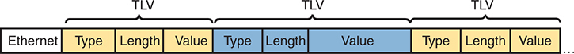

<figcaption>

<aside class="hidden" id="a13fig07">

该图被分解成多个TLV组件,显示以太网帧内的结构和组织. 整个相框被分出各段,每个段代表一个TLV元素. 每个TLV组件由三个字段组成:类型,长度和价值. 这些字段是视觉相隔并用颜色编码来提高清晰度. 从左边开始,图从以太网头开始,然后是一系列的TLV元素. 第一个TLV元素被细分为三个部分:一个被标记为黄色的场型,一个被标记于黄色的场长,和一个被标记为"黄色场值". 这个模式重复了之后的TLV元素. 第二个 TLV 元素被显示为 Type, Long, and Value 有蓝色字段,第三个 TLV 为返回到黄色字段. 类型字段指定传输的信息类型,长度字段表示值字段的大小,而值字段包含实际信息. 这种结构使得LLDP具有灵活性和可扩展性,能够将各种类型的信息包含在单一的LLDP消息中.

</aside>

<strong>图13-7</strong> <em>LLDP 信件中的 Length- Vale 概念</em>

</figcaption>

</figure>

随着时间的推移,出现了新的以终点为重点的LLDP TLVs. LLDP 媒体端点发现( R)<a id="key_150" href="#ref-gloss_196">LLDP-MED</a>) 协议使用各种端点聚焦的LLDP TLV,用于交换机和端点设备之间的操作. (虽然IEEE标准802.1AB定义了LLDP,但电信业协会[TIA]在其TIA-1057文件中将LLDP-MED定义为行业标准. ) 例如,<a href="v2-17.html#ch17">第17章</a>, “<a href="v2-17.html#ch17">SNMP、FTP 和 TFTP</a>,"讨论Power over Ethernet(PoE),设备使用LLDP-MED交换关于端点设备需要的电能的数据.

连接到局域网交换机的IP Phone也可以使用LLDP-MED或CDP来学习诸如交换机所使用的语音和数据VLANID等信息.<a href="#ch13fig08">图13-8</a>显示上下文的示例,有三部手机,每部手机都有一个连接的PC。 该设计采用VLAN 20作为语音VLAN,VLAN21作为数据VLAN. (参见:<em>CCNA 200-301 官方证书指南 第1卷</em>,第二版,<a href="v2-08.html#ch08">第8章</a>, <a href="#ch13fig08">图13-8</a>,以及周边文本以审查语音和数据 VLAN配置. )

<figure class="image-c" id="ch13fig08">

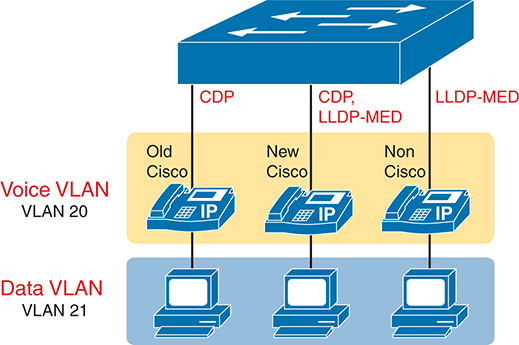

<figcaption>

<aside class="hidden" id="a13fig08">

在图像上方,描绘出一个网络交换机,其下方有三部I P手机和三部计算机相接. I P手机分为三类:老思科,新思科,和Non Cisco. 交换机使用不同的协议与这些手机通信:CDP(Cisco Discovery Protocol)用于老Cisco手机,CDP和LLDP连字符MED(Link Layer Dicovery Protocol-Media Endpoint Discovery)用于新Cisco手机,LLDP连字符MED用于非Cisco手机. 设置分为两个VLA N:Voice VLAN和Data VLAN. 语音VLAN被贴上VLAN的标签20,它被分配到I P手机上. 每台I P 手机下方,一个对应的计算机被连接,所有计算机都被分配到Data VLAN,标签为VLAN 21. 该图强调通过VLA Ns实现语音和数据流量的分化,确保从I P电话(VLAN 20)中语音流量与从计算机中的数据流量(VLAN 21)相分离.

</aside>

<strong>图13-8</strong> <em>IP Phone 访问切换样本</em>

</figcaption>

</figure>

手机需要学习语音VLAN才能使用,因为手机在手机所生成的任何以太网帧上都添加了802.1Q干线头. 您不会用语音 VLAN ID 来预先配置手机; 相反, 电话是用 LLDP- MED 或 CDP 来学习的 。 最初Cisco IP手机只支持CDP学习语音VLAN ID. Cisco IP电话已经支持LLDP-MED和CDP十多年了. 非Cisco IP手机不支持思科-专有CDP,只使用LLDP-MED.

在关于LLDP-MED的最后注释中,您配置LLDP—MED与LLDP相同的命令. 链接上的设备动态地发现它们需要包括LLDP-MED定义的TLV;不需要额外的配置.

</section>

</section>

</section>

</section>

<section class="ccna-source ccna-appendix" aria-label="答案解析与术语表">
<section data-epub-type="chapter">

<h2 class="h2" id="ref-appc">附录C</h2>

<h2 class="h2a">对“我早就知道了吗?” 的回答。</h2>

<section>

<h3 class="h3" id="ref-appclev1sec13">章 次 页 次 13</h3>

<strong><a id="ref-ques13_1" href="#quess13_1">1</a>。</strong> D。默认情况下，Cisco 设备会将所有级别的日志消息记录到控制台。为此，IOS 使用日志级别 7（debugging），从而向控制台发送严重性级别为 7 及低于 7 的消息。所有错误选项列出的级别都低于 7。

<strong><a id="ref-ques13_2" href="#quess13_2">2</a>。</strong> C。<strong>logging trap 4</strong> 命令将发送到 syslog 服务器（通过 <strong>logging host</strong> <em>ip-address</em> 命令配置）的消息限定为级别 4 及以下，即 0 至 4。

<strong><a id="ref-ques13_3" href="#quess13_3">3</a>。</strong> A。NTP 在客户端与服务器之间交换协议消息，使客户端能够调整其时钟以匹配服务器时间。NTP 与以太网接口及串行接口的速率完全无关。它也不统计 CPU 周期，而是依赖 NTP 服务器发来的消息。此外，客户端指定服务器的 IP 地址，二者不必位于同一子网。

<strong><a id="ref-ques13_4" href="#quess13_4">4</a>。</strong> C。<strong>ntp server 10.1.1.1</strong> 命令使路由器同时成为 NTP 服务器和客户端。不过，路由器首先作为 NTP 客户端与 NTP 服务器 10.1.1.1 同步时间。同步完成后，R1 就知道应提供的时间，可以充当 NTP 服务器。

<strong><a id="ref-ques13_5" href="#quess13_5">5</a>。</strong> E 和 F。CDP 发现邻居的信息。<strong>show cdp command</strong> 提供多个选项，可根据所用参数显示不同详细程度的信息。

<strong><a id="ref-ques13_6" href="#quess13_6">6</a>。</strong> E 和 F。LLDP 在 <strong>show lldp neighbors</strong> 命令的输出中列出邻居已启用的能力，在 <strong>show lldp entry</strong> <em>hostname</em> 命令的输出中同时列出已启用的能力和可能的（系统）能力。

</section>

</section>

<section id="ref-glossary"><h2 class="h2a">词汇表</h2>
<strong>CDP</strong>Cisco发现协议. 一个媒体和协议独立的设备发现协议,它运行在大多数Cisco制造的设备上,包括路由器,访问服务器,以及交换机. 使用CDP,一个设备可以向其他设备宣传它的存在,并接收关于同一局域网或一个WAN的远程侧的其他设备的信息.

<strong>LLDP</strong>链接层发现协议. IEEE标准协议(IEEE 802.1AB)定义了消息,直接被封装于以太网帧,使其不依赖于正在工作的IPv4或IPv6网络,目的是给设备一种向局域网上的其他设备宣布基本设备信息的手段. 它是类似于Cisco发现协议(CDP)的标准化协议.

<strong>LLDP-MED</strong>一组以端点为主的LLDP TLV,被定义为一组TIA标准TIA-1057. 它包括了TLV来交流语音和数据VLAN给电话,并与PoE管理电能水平.

<strong>日志消息</strong>由任何计算机生成的信息,但包含Cisco路由器和交换机,设备OS想要将某些事件通知设备的拥有者或管理员.

<strong>网络时间协议( NTP)</strong>一个用于同步时钟的协议,这样多个设备会使用同一天的时间,这使得日志消息能够更容易地根据其时间戳进行匹配.

<strong>NTP 客户端</strong>任何试图使用网络时间协议(NTP)通过根据从服务器收到的NTP消息来调整本地设备的时间来同步其时间的设备.

<strong>NTP 客户端/ 服务器模式</strong>一种与网络时间协议(NTP)的操作模式,其中设备既作为NTP客户端,又与一些服务器同步时间,还作为NTP服务器,向客户端提供时间信息.

<strong>NTP 服务器</strong>任何使用网络时间协议(NTP)通过告诉其他设备当前时间来帮助其他设备同步时钟的设备.

<strong>NTP 同步</strong>与网络时钟协议(NTP)的过程,不同设备通过该协议发送消息,交换设备当前时钟信息和其他数据,使一些设备将其时钟调整到当天时钟同时列出的地步(通常准确到至少同一秒).

<strong>syslog 服务器</strong>一个服务器应用程序,从网络上的许多设备收集syslog消息,并提供一个用户接口,使IT管理员可以查看日志消息到故障排除出问题.

</section>
</section>

<section class="ccna-source ccna-appendix" aria-label="代码原图">
<section data-epub-type="chapter">

<a href="#f0272-02a" id="code-f0272-02">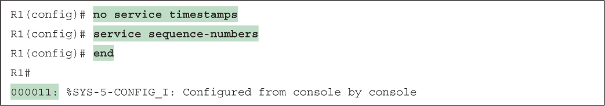</a>

<a href="#f0274-01a" id="code-f0274-01">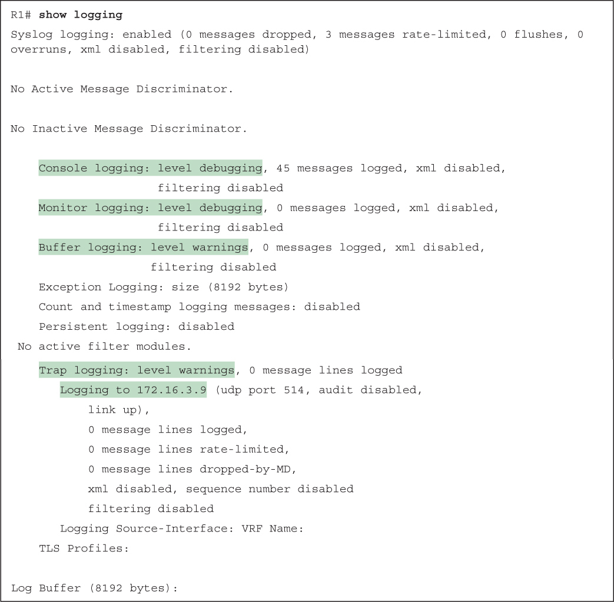</a>

<a href="#f0275-01a" id="code-f0275-01">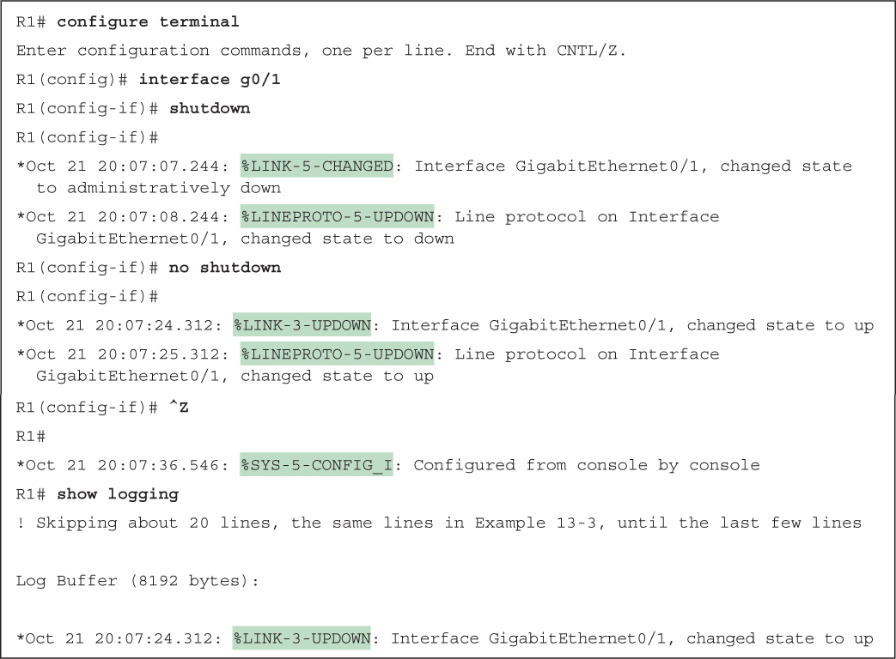</a>

<a href="#f0276-01a" id="code-f0276-01">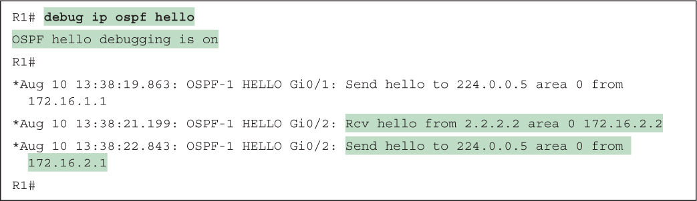</a>

<a href="#f0277-01a" id="code-f0277-01">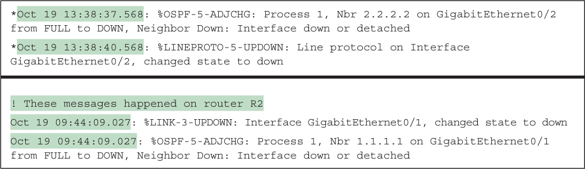</a>

<a href="#f0278-01a" id="code-f0278-01">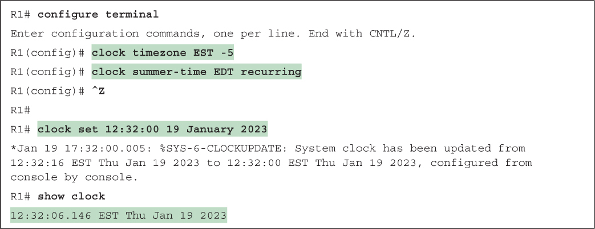</a>

<a href="#f0280-01a" id="code-f0280-01">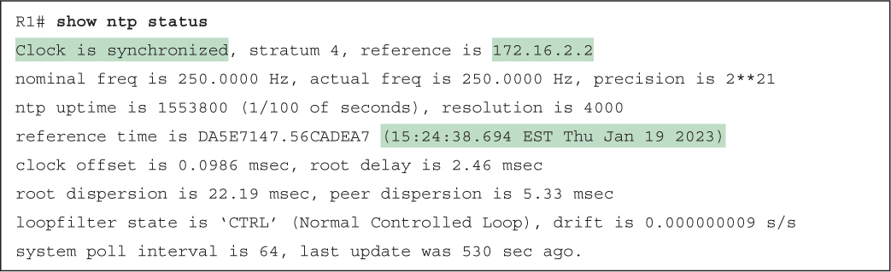</a>

<a href="#f0281-01a" id="code-f0281-01">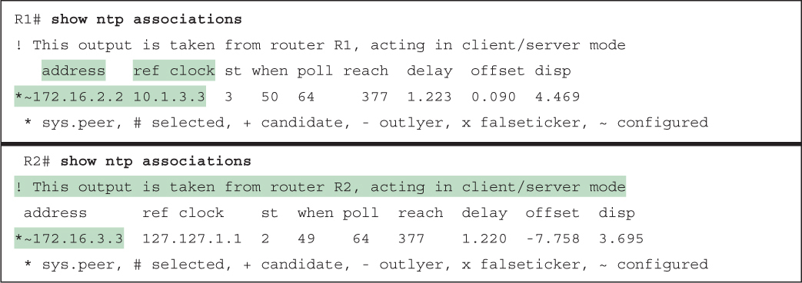</a>

<a href="#f0282-01a" id="code-f0282-01">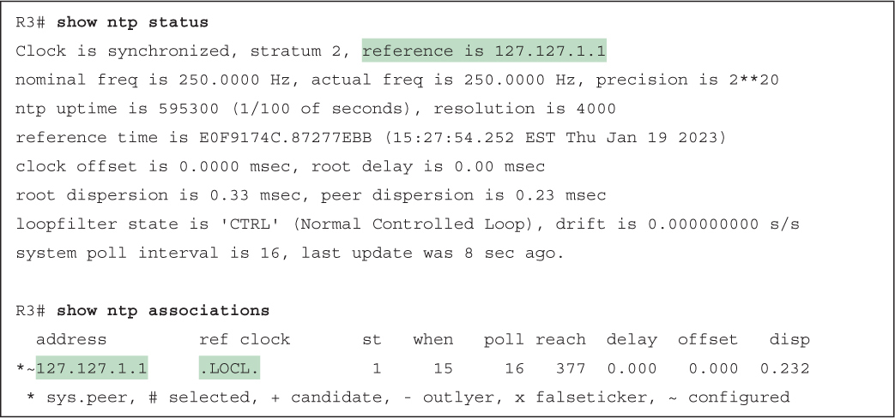</a>

<a href="#f0284-01a" id="code-f0284-01">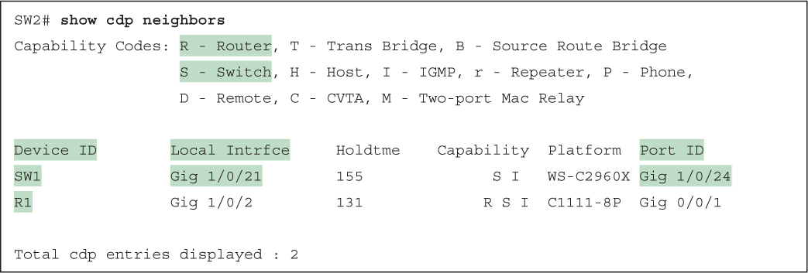</a>

<a href="#f0285-01a" id="code-f0285-01">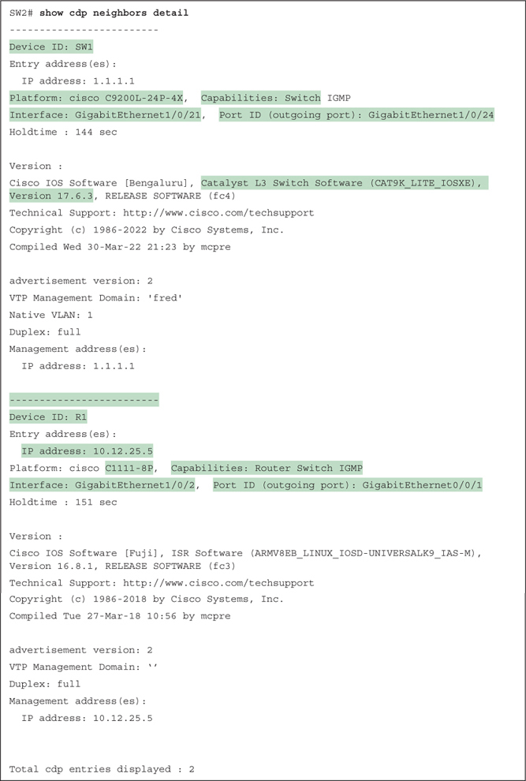</a>

<a href="#f0287-01a" id="code-f0287-01">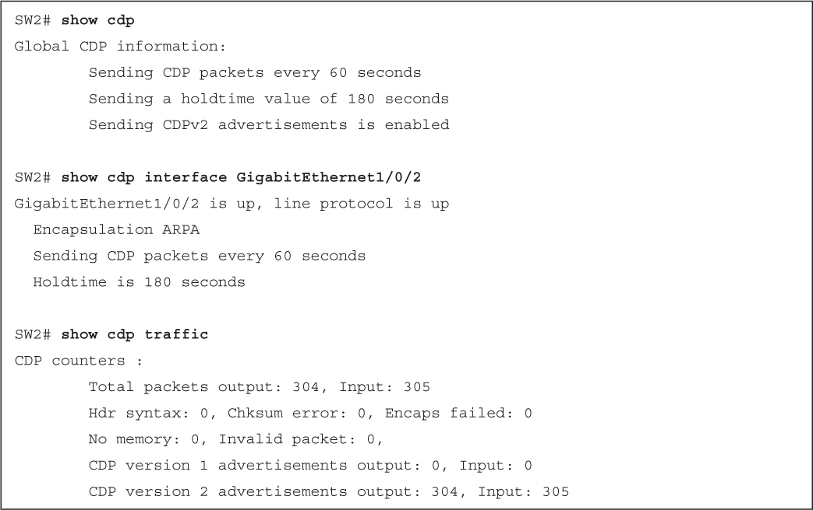</a>

<a href="#f0288-01a" id="code-f0288-01">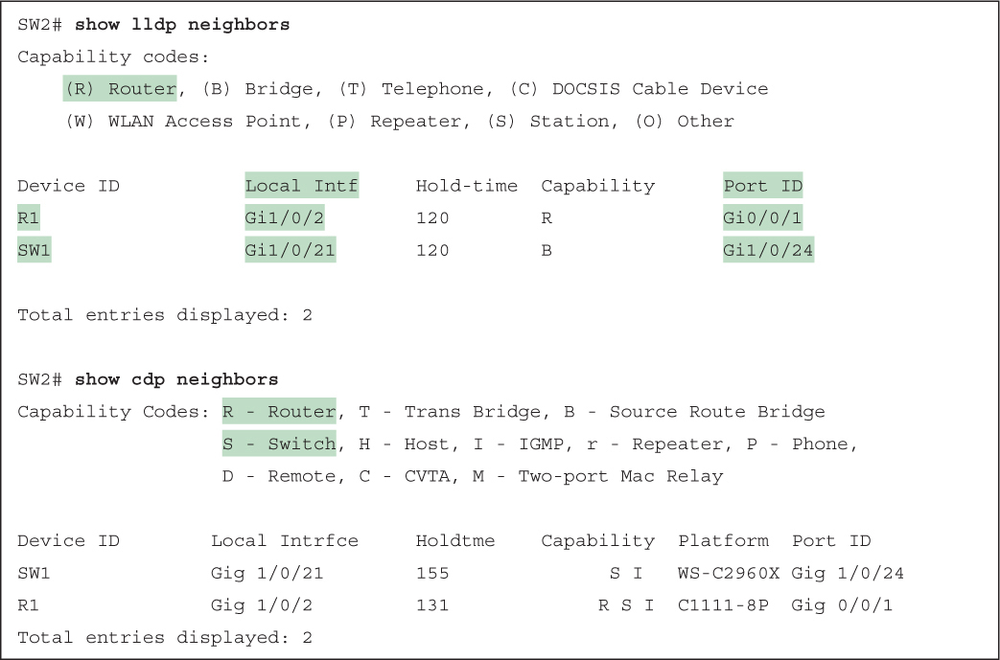</a>

<a href="#f0289-01a" id="code-f0289-01">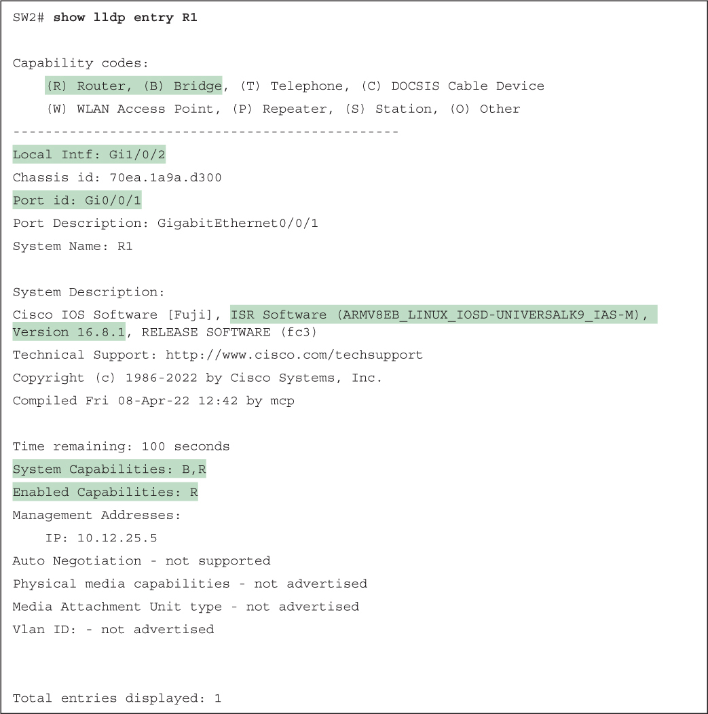</a>

<a href="#f0291-01a" id="code-f0291-01">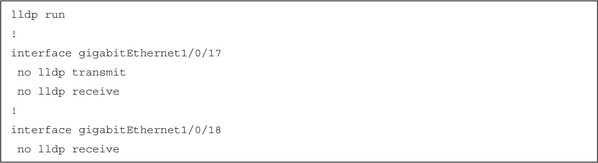</a>

<a href="#f0291-03a" id="code-f0291-03">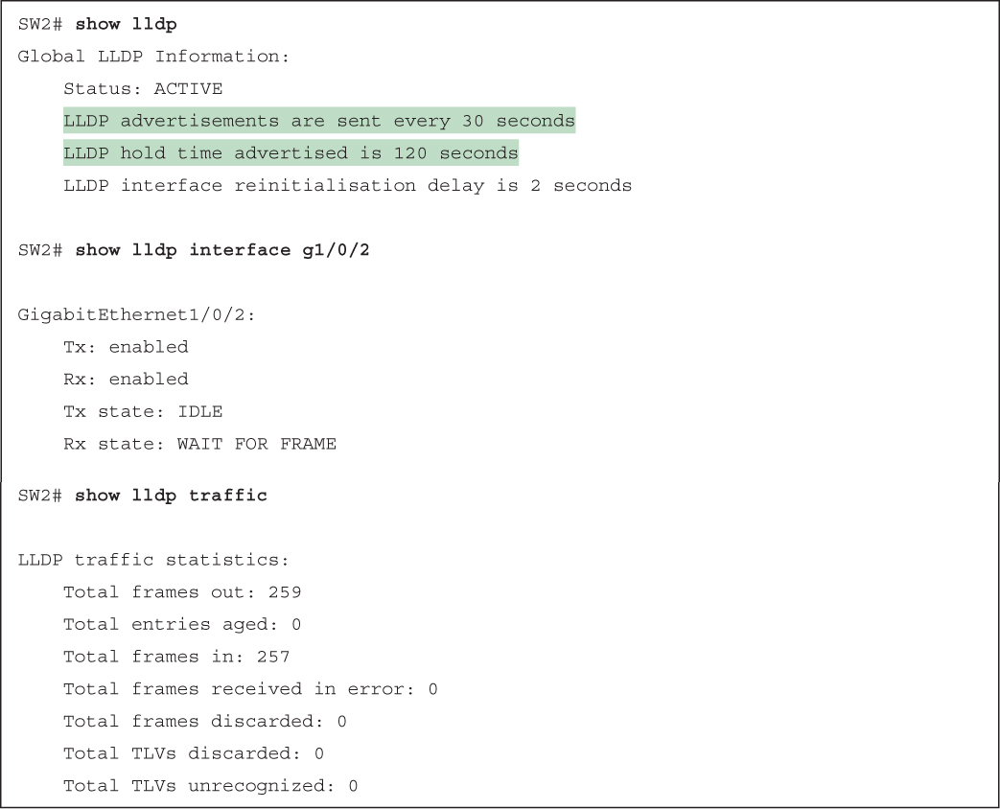</a>

</section>

</section>


<nav class="ccna-chapter-nav" aria-label="章节导航"><a href="v2-12.html">← 上一章</a><a href="v2-14.html">下一章 →</a></nav>
