
<a href="{{ '/subjects/CCNA/' | relative_url }}">← 返回 CCNA 目录</a>

第二卷 · IP 服务

<nav class="ccna-chapter-nav" aria-label="章节导航"><a href="v2-13.html">← 上一章</a><a href="v2-15.html">下一章 →</a></nav>



<section data-epub-type="chapter">

<h2 class="h2" id="ch14">第 14 章</h2>

<h2 class="h2a">网络地址转换</h2>

本章涵盖以下考试主题：

1.0 网络基础

1.7 描述私有 IPv4 编址

4.0 IP 服务

4.1 使用静态映射和地址池配置并验证内部源 NAT

大多数企业和小型办公室/家庭办公室（SOHO）网络使用网络地址转换（NAT）。NAT 帮助解决了 IPv4 的一个重大问题：如果没有 NAT，IPv4 地址空间在 20 世纪 90 年代中期就会全部分配完毕。若真如此，互联网的发展会明显放缓。NAT 将 IPv4 公有地址空间的耗尽推迟了数十年，为长期解决方案 IPv6 的成熟争取了时间。

本章分为两大节。第一节解释 NAT 的基本概念、几种 NAT 变体的工作方式，以及端口地址转换（PAT）如何节约 IPv4 地址空间。最后一节介绍如何通过 Cisco IOS 软件命令行接口（CLI）配置 NAT，以及如何排查 NAT 故障。

<section>

<h3 class="h3" id="ch14lev1sec1">“这些知识我已经掌握了吗？”自测</h3>

如果你希望根据得分决定在本章投入多少时间，可以完成这组自测题（在此作答，或使用 PTP 软件）。各题答案的选项字母列在自测题之后的页面底部。书末和配套网站上的<a href="#ref-appc">附录 C</a>都包含答案及解析。你也可以在 PTP 测试软件中找到答案及解析。

<figure class="table" id="ch14tab01" tabindex="0">

<figcaption>

<strong>表14-1</strong> “这些知识我已经掌握了吗？”核心主题小节与题目对应关系

</figcaption>

<table class="all">

<tbody>

<tr>

<th class="th">
基础知识小节
</th>

<th class="th">
题目
</th>

</tr>

<tr>

<td class="border">
网络地址转换概念
</td>

<td class="border">
1–3
</td>

</tr>

<tr>

<td class="border">
NAT 配置和解决问题
</td>

<td class="border">
4–6
</td>

</tr>

</tbody>

</table>

</figure>

<strong><a id="quess14_1" href="#ques14_1a">1</a>.</strong>根据RFC 1918,以下哪些不是私人地址? (取出二个答.

<ol class="lower-alpha">

<li>
172.31.1.1
</li>

<li>
172.33.1.1
</li>

<li>
10.255.1.1
</li>

<li>
10.1.255.1
</li>

<li>
191.168.1.1
</li>

</ol>

<strong><a id="quess14_2" href="#ques14_2a">2</a>.</strong>当仅对内部地址使用静态NAT时,是什么导致NAT路由器创建NAT表格条目?

<ol class="lower-alpha">

<li>
从内部网络到外部网络的第一个数据包
</li>

<li>
从外部网络到内部网络的第一个数据包
</li>

<li>
使用<strong>ip nat inside source</strong>命令
</li>

<li>
使用<strong>ip nat outside source</strong>命令
</li>

</ol>

<strong><a id="quess14_3" href="#ques14_3a">3</a>.</strong>当仅对内地址使用动态NAT时,是什么导致NAT路由器创建NAT表项?

<ol class="lower-alpha">

<li>
从内部网络到外部网络的第一个数据包
</li>

<li>
从外部网络到内部网络的第一个数据包
</li>

<li>
使用<strong>ip nat inside source</strong>命令
</li>

<li>
使用<strong>ip nat outside source</strong>命令
</li>

</ol>

<strong><a id="quess14_4" href="#ques14_4a">4</a>.</strong>企业对流入互联网的包使用源内NAT,其工作NAT配置包含命令<strong>ip nat inside source list alice pool barney</strong>。路由器对输入内部接口的软件包应用NAT时,哪些语句必须是真实的?

<ol class="lower-alpha">

<li>
ACL ALIC 必须在包中匹配许可动作.
</li>

<li>
ACL ALIC 必须在包中匹配拒绝动作.
</li>

<li>
Pool Barney 必须包含数据包的源IP地址 。
</li>

<li>
Pool Barney 必须包含包的目的地IP地址 。
</li>

</ol>

<strong><a id="quess14_5" href="#ques14_5a">5</a>.</strong>一名工程师创建了此处显示的不完整配置. 该配置应当在连接企业与互联网的路由器上实现典型的路由器源NAT功能,并使用单一的公有 IP地址. 哪些答案列表命令或参数可以帮助完成配置? (取出二个答.

<a href="#code-f0299-01" id="f0299-01a">点击此处查看代码原图</a>

<pre class="pre-q" tabindex="0"><code>interface GigabitEthernet0/0/0

 description LAN interface (private)

 ip address 10.1.1.1 255.255.255.0

 ip nat inside

interface GigabitEthernet0/0/1

 description WAN interface (public)

 ip address 200.1.1.249 255.255.255.252

ip nat inside source list 1 interface GigabitEthernet0/0/1

access-list 1 permit 10.1.1.0 0.0.0.255</code></pre>

<ol class="lower-alpha">

<li>
密码<strong>ip nat outside</strong>命令
</li>

<li>
密码<strong>ip nat pat</strong>命令
</li>

<li>
密码<strong>overload</strong>关键词
</li>

<li>
密码<strong>ip nat pool</strong>命令
</li>

<li>
密码<strong>inside</strong>关键词
</li>

</ol>

<strong><a id="quess14_6" href="#ques14_6a">6</a>.</strong>检查以下内容:<strong>show</strong>在为动态NAT配置的路由器上命令输出 :

<a href="#code-f0300-01" id="f0300-01a">点击此处查看代码原图</a>

<pre class="pre-q" tabindex="0"><code>-- Inside Source

access-list 1 pool fred refcount 2288

 pool fred: netmask 255.255.255.240

 start 200.1.1.1 end 200.1.1.7

 type generic, total addresses 7, allocated 7 (100%), misses 965</code></pre>

用户抱怨无法上网。 以下哪些是最可能的原因?

<ol class="lower-alpha">

<li>
这个问题与NAT无关,基于命令输出中的信息.
</li>

<li>
NAT 池没有足够的条目满足所有请求.
</li>

<li>
不能使用标准的ACL 1;必须使用扩展的ACL.
</li>

<li>
命令输出不能提供足够的信息来识别问题.
</li>

</ol>

“这些知识我已经掌握了吗？”自测答案：

<strong><a id="ques14_1a" href="#ref-ques14_1">1</a></strong> B, E

<strong><a id="ques14_2a" href="#ref-ques14_2">2</a></strong> C

<strong><a id="ques14_3a" href="#ref-ques14_3">3</a></strong> A

<strong><a id="ques14_4a" href="#ref-ques14_4">4</a></strong> A

<strong><a id="ques14_5a" href="#ref-ques14_5">5</a></strong> A, C

<strong><a id="ques14_6a" href="#ref-ques14_6">6</a></strong> B

</section>

<section>

<h3 class="h3box" id="ch14lev1sec2">基础主题</h3>

</section>

<section>

<h3 class="h3" id="ch14lev1sec3">网络地址转换的概念</h3>

互联网的最初设计要求每个组织都要求并接收一个或一个以上注册的公共级IPv4网络号码. 然而,根据这项计划,世界本来会用完几十年前的独特公开IPv4的演讲。 网络地址转换(NAT)作为短期解决方案的一部分,拖延了世界公有 IPv4地址耗尽的一天.

<section>

<h4 class="h4" id="ch14lev2sec1">使用 NAT 节约 IPv4 地址</h4>

<a href="#ch14fig01">图14-1</a>显示一些在当今企业中使用私人和公共地址的例子,以及它们如何减少公有 IPv4地址的使用. 每个公司在一个连接到互联网的路由器上使用NAT. 有了最初的计划,两家公司都需要一个公共的B类IPv4网络,每个网络包含65,536公有 IPv4地址. 相反,一家公司使用一个小型的无类别域间路由(L.<a id="key_158" href="#ref-gloss_067">CIDR</a>)块为16公共地址,而其他仅使用8. 对于计算机内部使用的地址,按其设置,两家公司均使用任何<a id="key_164" href="#ref-gloss_268">私有 IP网络</a>他们选择,做出最常见的选择:使用A级私人网络10.0.0.0.

该设计使用NAT,但依赖于私人网络和公共的CIDR块. 负责审查:<a href="#part04">第四编</a>音量图 1 书籍,RFC 1918 公司和家庭可以在内部使用这些网络,例如:<a href="#ch14fig01">图14-1</a>。(此章余多所诠道及所由.<a href="#ch14tab02">表14-2</a>显示私有地址空间。

<figure class="image-c" id="ch14fig01">

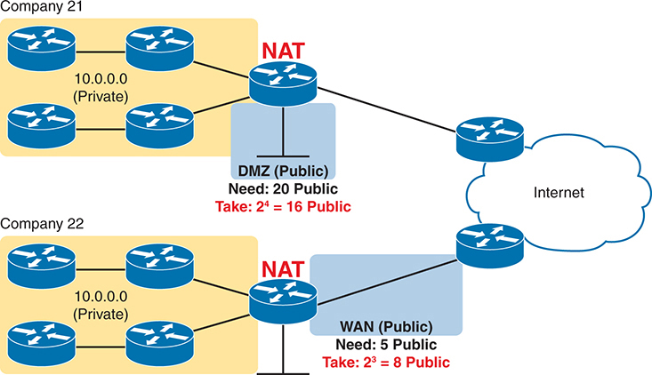

<figcaption>

<aside class="hidden" id="a14fig01">

两家公司都有使用 I P 地址范围的私人网络10.0.0.0/8. 由上部所描绘出的公司(Company 21)拥有与NAT设备相接的私人网络,然后连接到一个被标注为"公共"的非军事化区(DMZ). DMZ需要20公用I P地址,但通过使用NAT,只使用16公用地址,如注:2给4等同16公用. DMZ与互联网相接,以右边有云符号为代表. 公司22在下方显示,其私人网络也连接了NAT设备,然后连接到一个被贴上标签的广域网(WAN). WAN需要5公用 I P地址,但通过使用NAT,只使用8公用地址,如注:2给3等同8公用. 这个WAN也连接到互联网上.

</aside>

<strong>图14-1</strong> <em>带有小 CIDR 块的 NAT 保存 IPv4 地址</em>

</figcaption>

</figure>

<figure class="table" id="ch14tab02" tabindex="0">

<figcaption>

<strong>表14-2</strong>RFC 1918 私人地址空间

</figcaption>

<table class="all">

<tbody>

<tr>

<th class="th">
IP 地址范围
</th>

<th class="th">
网络
</th>

<th class="th">
网络类别
</th>

<th class="th">
网络数量
</th>

</tr>

<tr>

<td class="border">
10.0.0.0至10.255.255.255
</td>

<td class="border">
10.0.0.0
</td>

<td class="border">
A
</td>

<td class="border">
1
</td>

</tr>

<tr>

<td class="border">
172.16.0.0至172.31.255.255
</td>

<td class="border">
172.16.0.0 – 172.31.0.0
</td>

<td class="border">
B
</td>

<td class="border">
16
</td>

</tr>

<tr>

<td class="border">
192.168.0.0至192.168.255.255
</td>

<td class="border">
192.168.0.0 – 192.168.255.0
</td>

<td class="border">
C
</td>

<td class="border">
256
</td>

</tr>

</tbody>

</table>

</figure>

任何组织都可以使用这些网络编号. 然而,任何组织都无法在互联网上使用路由协议为这些网络做广告,互联网上的路由器也不会试图将发送到私人地址的软件包转发出去.

短期公共地址保护计划将NAT与CIDR块公共地址结合起来,如以下所示:<a href="#ch14fig01">图14-1</a>。这些<em>CIDR 块</em>动作像一个公有 IP网络,给每个公司一系列连续的公有 IPv4地址,但允许任何功率大小为2. 互联网路由器会为这些公共地址发布路由广告,以便路由器将这些包转发给NAT路由器.

将所使用的私人和公共地址与NAT进行比较,一家公司需要足够的私有 IP地址,因此公司内部的所有设备都有一个独特的地址. 然而,公司在使用NAT时只需要一小套公共地址,因为企业内部的主机将共享公有 IP地址.<a href="#ch14tab03">表14-3</a>总结了有助于IPv4寿命延长数十年的这些关键特征。

<figure class="table" id="ch14tab03" tabindex="0">

<figcaption>

<strong>表14-3</strong>延长IPv4寿命的三个重要函数

</figcaption>

<table class="all">

<tbody>

<tr>

<th class="th">
特性
</th>

<th class="th">
RFC( 数)
</th>

<th class="th">
主要优点
</th>

</tr>

<tr>

<td class="border">
CIDR<a id="tfn14_3_1" href="#tfn14_3_1a">*</a>
</td>

<td class="border">
4632
</td>

<td class="border">
比起A类,B类和C类网络,向公司分配更具体的公用IPv4地址块.

根据世界范围的地址分配计划,汇总通往公有 IPv4地址的路由.
</td>

</tr>

<tr>

<td class="border">
NAT<a href="#tfn14_3_1a">*</a>
</td>

<td class="border">
3022
</td>

<td class="border">
启用约65,000个TCP/UDP会话,由单一的公用IPv4地址支持.
</td>

</tr>

<tr>

<td class="border">
私有网络
</td>

<td class="border">
1918
</td>

<td class="border">
允许企业互联网连接使用NAT,在企业内部使用私人地址.
</td>

</tr>

</tbody>

</table>

</figure>

<a id="tfn14_3_1a" href="#tfn14_3_1">*</a>CIDR和NAT可能因其原始的RFC(1518,1519年为CIDR;1631为NAT)而更出名.

注意

本章显示在路由器上已执行的NAT,但防火墙也支持NAT.

</section>

<section>

<h4 class="h4" id="ch14lev2sec2">内部源 NAT</h4>

路由器和防火墙的NAT特性包括几个变体. 然而,一个关于NAT的CCNA考试话题使用了这个短语.<a id="key_161" href="#ref-gloss_325">内源 NAT</a>,指企业边缘通常使用的NAT,如<a href="#ch14fig01">图14-1</a>。这个下个话题引入了内源NAT的核心概念,但意识到本章中的所有讨论都只指内源NAT.

在RFC 3022中定义的NAT允许一个使用私有 IP地址的主机通过互联网与其他主机通信. NAT通过使用有效的已注册公有 IP地址来代表私人地址到互联网的其余部分来实现其目标. NAT 函数将私有IP地址更改为每个IP包内公开注册的IP地址,如下所示:<a href="#ch14fig02">图14-2</a>.

<figure class="image-c" id="ch14fig02">

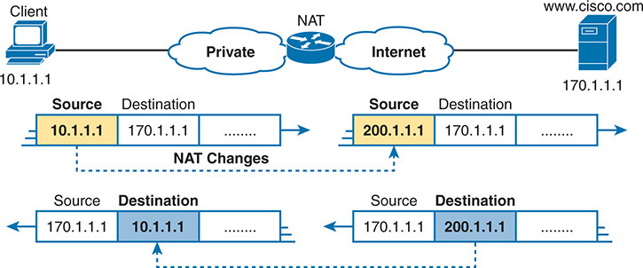

<figcaption>

<aside class="hidden" id="a14fig02">

该图被分解成多个TLV组件,显示以太网帧内的结构和组织. 整个相框被分出各段,每个段代表一个TLV元素. 每个TLV组件由三个字段组成:类型,长度和价值. 这些字段是视觉相隔并用颜色编码来提高清晰度. 从左边开始,图从以太网头开始,然后是一系列的TLV元素. 第一个TLV元素被细分为三个部分:一个被标记为黄色的场型,一个被标记于黄色的场长,和一个被标记为"黄色场值". 这个模式重复了之后的TLV元素. 第二个 TLV 元素被显示为 Type, Long, and Value 有蓝色字段,第三个 TLV 为返回到黄色字段. 类型字段指定传输的信息类型,长度字段表示值字段的大小,而值字段包含实际信息. 这种结构使得LLDP具有灵活性和可扩展性,能够将各种类型的信息包含在单一的LLDP消息中.

</aside>

<strong>图14-2</strong> <em>NAT IP 地址拆分: 私人地址</em>

</figcaption>

</figure>

注意, 执行 NAT 的路由器会在包离开私人组织时更改包的源 IP 地址 。 执行NAT的路由器也会改变每个返回到私人网络的包中的目的地址. (网络200.1.1.0)是一个注册网络,位于<a href="#ch14fig02">图14-2</a>.) NAT 特性,在被标记为 NAT 的路由器中配置,执行转换.

下几页讨论内源NAT的三个变体:静态NAT,动态NAT,以及<a id="key_163" href="#ref-gloss_257">端口地址转换( PAT)</a>,也叫<a id="key_162" href="#ref-gloss_222">NAT 超载</a>。全部转换如下所示地址:<a href="#ch14fig02">图14-2</a>然而,大多数IPv4网络使用PAT,因为它是唯一保存公有 IP地址的变体.

</section>

<section>

<h4 class="h4" id="ch14lev2sec3">静态 NAT</h4>

静态NAT的作品如下所示:<a href="#ch14fig02">图14-2</a>但是静态的一对一地绘制 私人和公共地址。 为了帮助你了解静态NAT的影响,并解释几个关键术语,<a href="#ch14fig03">图14-3</a>以更多信息显示类似的例子。

<figure class="image-c" id="ch14fig03">

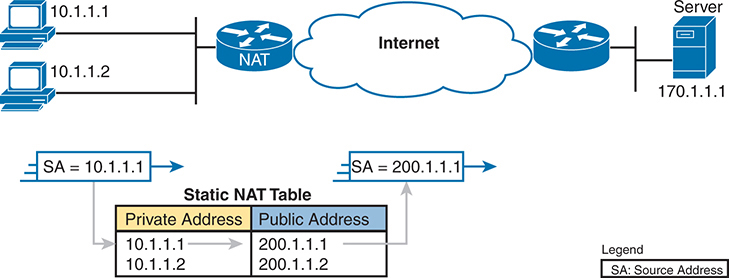

<figcaption>

<aside class="hidden" id="a14fig03">

在图像上方,描绘出一个网络交换机,其下方有三部I P手机和三部计算机相接. I P手机分为三类:老思科,新思科,和Non Cisco. 交换机使用不同的协议与这些手机通信:CDP(Cisco Discovery Protocol)用于老Cisco手机,CDP和LLDP连字符MED(Link Layer Dicovery Protocol-Media Endpoint Discovery)用于新Cisco手机,LLDP连字符MED用于非Cisco手机. 设置分为两个VLA N:Voice VLAN和Data VLAN. 语音VLAN被贴上VLAN的标签20,它被分配到I P手机上. 每台I P 手机下方,一个对应的计算机被连接,所有计算机都被分配到Data VLAN,标签为VLAN 21. 该图强调通过VLA Ns实现语音和数据流量的分化,确保从I P电话(VLAN 20)中语音流量与从计算机中的数据流量(VLAN 21)相分离.

</aside>

<strong>图14-3</strong> <em>静态 NAT 在本地和全球地址内显示</em>

</figcaption>

</figure>

第一,概念:该公司的ISP已经为它指定了一个注册的公共C级网络200.1.1.0. 企业内部所有计算机的设置均使用私人A类网络的地址10.0.0.0. 因此,NAT路由器必须使包中的私有 IP地址作为200.1.1.0网络的一部分出现. 因此,NAT路由器会改变图中从左到右的包中的源IP地址.

静态NAT需要NAT表格条目的直接配置,让NAT改变地址. 单位<a href="#ch14fig03">图14-3</a>,内部源 NAT(如考试题目所提及)依赖于全局指令<strong>ip nat inside source static 10.1.1.1 200.1.1.1</strong>以添加第一个表格条目。 然后,您可以将其他静态NAT表条目添加到可用的公共地址数量中.

由于在私人和公共地址之间进行一对一的映射,静态NAT不会减少公有 IP地址的使用. 单位<a href="#ch14fig03">图14-3</a>,因为企业拥有一个已注册的单一C类网络,它最多可以支持254个使用NAT的私有 IP地址,通常有两个保留号码(网络号码和网络广播地址).

</section>

<section>

<h4 class="h4" id="ch14lev2sec4">内部本地地址与内部全局地址</h4>

所描绘的NAT表格<a href="#ch14fig03">图14-3</a>使用术语<em>私有地址</em>和<em>公有地址</em>为了清晰起见。 然而,思科命令使用术语<a id="key_160" href="#ref-gloss_175">内部本地</a>私人地址和<a id="key_159" href="#ref-gloss_174">内部全局</a>公开演讲。

为了更好地理解NAT术语,首先想到任何包含NAT的网络图. 将它分作两部分,在路由器的两侧表演NAT. 一方包含企业的网络(或您使用SOHO路由器的家用网络). 另一边包含有互联网. 在Cisco NAT术语中,<em>inside</em>指企业一方,以及<em>outside</em>指互联网方面。

另外两个术语指NAT表格条目中的地址对. 比如说,<a href="#ch14fig02">图14-2</a>和<a href="#ch14fig03">14-3</a>显示一个主机,其私人地址为10.1.1.1。 这些数字也显示NAT将该地址转换为200.1.1.1. 因此Cisco路由器上的NAT提到这些关联地址如下:

<strong>本地地址内 :</strong>通过企业(当地)网络旅行的包中代表内部主机的地址。 您在主机的设置中找到此地址 。 它在使用源内NAT时一般是私有 IP地址. 例如,地址10.1.1.1在<a href="#ch14fig04">图14-4</a>.

<strong>全球内部地址:</strong>该地址代表了通过全球互联网旅行的包内主机. 您不会在主机的设置中找到此地址, 而是在 NAT 表格中找到 。 它通常是一个公开的IP地址,因此互联网路由器可以转发数据包. 例如,200.1.1.1在<a href="#ch14fig04">图14-4</a>.

<a href="#ch14fig04">图14-4</a>重复同样的示例<a href="#ch14fig03">图14-3</a>,并显示一些术语。

<figure class="image-c" id="ch14fig04">

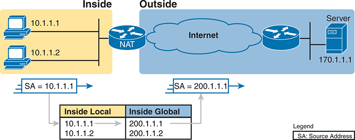

<figcaption>

<aside class="hidden" id="a14fig04">

网络地貌主要分为两个部分:内地和外地. 内地地段上,有两台个人电脑,有I P地址. 10.1.1.1 和 10.1.1.2 。这些计算机连接到一个执行NAT的路由器。路由器连接到互联网上,以云符号为代表,从而导致外部区域的另一个路由器。这第二个路由器连接到一个服务器上,地址是 I P 。 170.1.1.1 。内部部分为阴影黄色,外部部分为阴影蓝色。当数据包从内部移到外部时,图像突出显示源地址(S A)的翻译。例如,来自计算机的有 I P 地址的数据包。 10.1.1.1 其源地址(SA)已翻译为 200.1.1.1 当它从 NAT 路由器向 Internet 退出时。这由标记为 S A 的蓝箭头表示 200.1.1.1 从 NAT 路由器指向互联网。在主图下,有一个表格说明内部本地地址和内部全球地址之间的关系。内部本地地址是内部网络内设备的原始 I P 地址( 10.1.1.1 和 10.1.1.2 ). Inside Global地址是NAT路由器为互联网通信指定的公共 I P 地址 (. 200.1.1.1 和 200.1.1.2 。右下角的一个传说解释道,S A代表源地址。

</aside>

<strong>图14-4</strong> <em>静态NAT术语</em>

</figcaption>

</figure>

</section>

<section>

<h4 class="h4" id="ch14lev2sec5">动态 NAT</h4>

动态NAT与静态NAT相似,但有一个关键区别. 与静态NAT一样,NAT路由器在局部内部和内部全球地址之间创建了一对一的映射,并在出站进入内部网络时在包中更改IP地址. 由于一对一的映射,它也并不保存公开的IPv4地址. 但是这个名字<em>动态 NAT</em>给出了巨大的区别:它动态地创建了NAT表格条目. 这一动态行为也增加了一些防范互联网上攻击者的措施.

动态NAT设置了全球地址内部可能的集合,并定义了匹配标准,以确定哪些本地IP地址应当与NAT一起转换. 例如,在<a href="#ch14fig05">图14-5</a>,NAT路由器有5个全球IP内部地址的集合:200.1.1.1通过200.1.1.5. 动态NAT还需要匹配逻辑来启动从10.1.1开始的任何内部本地地址的转换.

<figure class="image-c" id="ch14fig05">

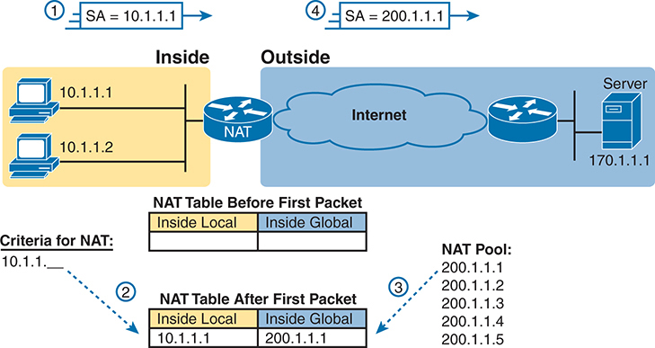

<figcaption>

<aside class="hidden" id="a14fig05">

一张图分为两个主要部分,分别标注在内外. 左侧,内地段内,有两台个人计算机,I P地址分别为10.1.1.1和10.1.1.2. 这些设备与NAT路由器相接,作为将本地地址翻译为全局地址的中介. NAT路由器被定位在内部网络和互联网之间,被描绘为被贴上"外部"标签的云. 在右侧外段内,互联网连接到一个远程服务器,IP地址为170.1.1.1,说明内部客户端可能与之通信的目标服务器. 在NAT路由器上方,有一系列步骤来说明翻译过程:一个被标记为1的箭头将从内部网络取出初始包的源地址(S A)显示为10.1.1.1. 在首个包之前,NAT路由器下面的一款标签为NAT表的路由器显示该表为空. 第二节标签为"首个包后NAT表"(First Packet)显示翻译后条目,其中内侧本地地址10.1.1.1被映射到内侧全球地址200.1.1.1. 一个标有4的箭头在包出局到外网时将所翻译的源地址(S A)显示为200.1.1.1. 在NAT表的右边有一张NAT Pool,列出可供翻译的全球I P地址:200.1.1.1,200.1.1.2,200.1.1.3,200.1.1.4和200.1.1.5. 图表显示,NAT的标准包括内部I P范围10.1.1点x.

</aside>

<strong>图14-5</strong> <em>动态NAT</em>

</figcaption>

</figure>

图中数字1,2,3和4指以下事件的顺序: 数字:

<ol class="number">

<li>
主机10.1.1.1向服务器发送了第一个包,地址为170.1.1.1.
</li>

<li>
当数据包进入NAT路由器时,路由器会将数据包与源地址相匹配(在本地地址内),从10.1.1开始. 匹配的软件包会触发新的NAT表格条目 。 在这种情况下,从 10.1.1.1 源出的数据包会导致一个新的NAT表条目.
</li>

<li>
要创建新的NAT表格条目,NAT路由器必须从有效的全球地址池内分配一个IP地址. 它选取第一个可用的(此处为200.1.1.1)并加入NAT表来完成条目.
</li>

<li>
NAT路由器转换出源IP地址并转发数据包.
</li>

</ol>

只要连续数据包与NAT表格条目相匹配,动态条目就留在表格中. 如果没有数据包需要一个NAT表项来表示已配置的超时值,路由器会去掉动态条目. 您也可以手动清除表格中的动态条目 。<strong>clear ip nat translation *</strong>命令。

在一个重要的安全注释上,动态NAT只允许内部主机启动新的NAT表格条目. 动态NAT会触发新的NAT表格条目,只针对进入内部接口的包. 例如,内部网络中的一个PC用户可以连接到互联网上的一个网站. 它发送到互联网上的网络服务器的第一个软件包进入了NAT路由器的内部接口,触发了一个新的条目. 然而,互联网上的PC用户无法连接到内部网络中的网络服务器. 它发送的第一个数据包将输入外部接口,而不触发新的NAT表条目. 这种与动态NAT的简单区别提供了一个主要的安全特征,即只允许内部用户启动新的连接.

注意,在预定义的NAT表格条目中,静态NAT对触发新的NAT表格项没有限制:静态的NAT表条目将允许由互联网用户启动的连接. 因此,工程师们经常使用静态的NAT,而这正是目标——允许互联网上的主机与公司内部的服务器建立新的连接.

按设计,NAT池的地址通常少于企业内部主机的总数. 路由器从池中分配地址, 直到没有留下任何地址 。 如果新包到来,触发了对新NAT表格条目的需求,但池中没有未使用的地址,路由器只是丢弃了包. 用户必须再次尝试,直到NAT的输入时间出局,此时NAT函数对发送一个包的下一个主机有效. 基本上,内部全球地址库需要与需要同时使用互联网的最多同时使用主机一样多——除非您使用PAT, 如下一节所解释的那样。

</section>

<section>

<h4 class="h4" id="ch14lev2sec6">使用端口地址转换实现 NAT 过载</h4>

静态NAT和动态NAT使用一对一的本地和内地全球地址之间的映射,因此它们不会减少公有 IPv4满足企业需要的数量. NAT超载功能也叫"端口地址转换"(PAT)来解决这个问题. 过载使用一对多的映射,使得NAT能够规模化支持很多只有少数公开IP地址的内部主机.

PAT使用传输层协议作为共享公共地址的手段. 要了解如何,首先考虑从三个不同的主机到一个网络服务器的三条独立的TCP连接的想法,如下文所示:<a href="#ch14fig06">图14-6</a>.

<figure class="image-c" id="ch14fig06">

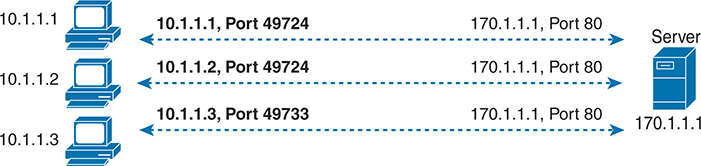

<figcaption>

<aside class="hidden" id="a14fig06">

第一个P C,带有 I P 地址10.1.1.1,在 I P 地址170.1.1.1使用源端口49724连接到服务器上. 连接由从P C到服务器的虚线来描绘,标注为10.1.1.1,PC侧口为49724,而服务器侧口为170.1.1.1,80. 第二个PC,带有 IP 地址10.1.1.2,也使用同源端口49724在 IP 地址170.1.1.1连接到服务器. 此连接同样以虚线显示,标签为:10.1.1.2; PC侧口为:49724; 服务器侧口为:170.1.1.1;80。 第三个PC,带有 IP 地址10.1.1.3,在 IP 地址170.1.1.1建立与服务器的连接,但使用不同的源端口49733. 此连接由另一条破折线所代表,标签为10.1.1.3,Port +49733 在PC一侧和170.1.1.1,Port →80在服务器一侧.

</aside>

<strong>图14-6</strong> <em>三台个人计算机的三台TCP连接</em>

</figcaption>

</figure>

接下来,比较这三条TCP连接<a href="#ch14fig06">图14-6</a>至3个类似的,现在所有3个TCP连接都来自一个客户端,如以下所示:<a href="#ch14fig07">图14-7</a>。服务器确实意识到一个差异,因为服务器看到客户端在两个数字中使用的IP地址和TCP端口号. 然而,服务器并不关心TCP连接是来自不同的主机还是同一个主机;服务器只是通过每个连接发送并接收数据.

<figure class="image-c" id="ch14fig07">

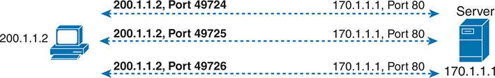

<figcaption>

<aside class="hidden" id="a14fig07">

该图突出显示客户端之间的通信,地址是: 200.1.1.2 和具有 IP 地址的服务器 170.1.1.1 。这些连接描述如下: 第一个 TCP 连接来源于客户端的 IP 地址 200.1.1.2 使用源端口 49724 并连接到位于 IP 地址的服务器 170.1.1.1 目标端口 80 。第二个 TCP 连接也来源于客户端的 IP 地址 200.1.1.2 但使用不同的源端口, 49725 ,并在 IP 地址连接到同一服务器 170.1.1.1 目标端口 80 。第三个TCP连接与前两个相似,来源于客户端在 IP 地址 200.1.1.2 使用源端口 49726 并连接到位于 IP 地址的服务器 170.1.1.1 目标端口 80 。每个连接都用从客户端到服务器的虚线箭头来表示,强调每个会话使用不同的源端口,同时保持相同的目的地 I P 地址和端口。这个设置可以显示如何从一个设备到服务器同时建立多个 TCP 连接,每个端口由源端口号确定。 80 表示所有连接都可能用于网络流量。

</aside>

<strong>图14-7</strong> <em>3个从一个个人电脑连接的 TCP</em>

</figcaption>

</figure>

NAT利用了这样一个事实,即从传输层的角度来看,服务器并不关心它是否每个连接到三个不同的主机,还是三个连接到一个单一的主机IP地址. PAT 在必要时转换 IP 地址和端口号, 使看起来像许多 TCP 或 UDP 从不同的主机流出( 如<a href="#ch14fig06">图14-6</a>)看起来与一个主机的流量相同(如<a href="#ch14fig07">图14-7</a>). <a href="#ch14fig08">图14-8</a>概括逻辑,有三个不同主机的TCP连接,NAT路由器使它们作为三个TCP连接从一个单一主机中出现.

<figure class="image-c" id="ch14fig08">

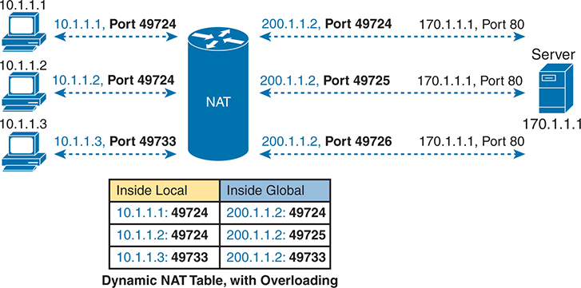

<figcaption>

<aside class="hidden" id="a14fig08">

图表显示一个本地网络中的多个设备如何通过使用不同的端口号来共享一个单独的公共 I P 地址。在左侧,有三台计算机有私人 I P 地址 。 10.1.1.1 , 10.1.1.2 ,以及 10.1.1.3 。每台计算机都向一个有 IP 地址的外部服务器提出请求。 170.1.1.1 在端口时 80 这些请求的私人I P地址和端口号如下: 10.1.1.1 在端口时 49724 , 10.1.1.2 在端口时 49725 ,以及 10.1.1.3 在端口时 49733 。这些请求通过一个NAT启用的设备进行路由,该设备在图中中心代表。NAT设备将私有的 I P 地址和端口翻译为单一的公共 I P 地址。 200.1.1.2 ,同时为每个会话保留独特的端口号。翻译过的公用 I P 地址和端口如下: 200.1.1.2 在端口时 49724 , 200.1.1.2 在端口时 49725 ,以及 200.1.1.2 在端口时 49733 。在右侧,翻译请求被引导到服务器。 170.1.1.1 在端口时 80 。图表中的箭头描绘了通过NAT设备从内部私人地址流向外部公共地址,最后流向服务器的流量。在图表下方显示一个带有超载的动态NAT表格。该表格有内地和内地全球地址的列,列出地图如下: 10.1.1.1 冒号 49724 改为: 200.1.1.2 冒号 49724 。10.1.1.2 冒号 49725 改为: 200.1.1.2 冒号 49725 。10.1.1.3 冒号 49733 改为: 200.1.1.2 冒号 49733 。

</aside>

<strong>图14-8</strong> <em>NAT 超载( PAT)</em>

</figcaption>

</figure>

工作通过NAT表格的具体内容<a href="#ch14fig08">图14-8</a>。内部全局专栏列出全球(公有)IP地址内单项. 查看表内局部侧的具体端口号: 从10.1.1.1和10.1.1.2的TCP连接均使用49,724. 在全球内部的这些相同的表格条目上,NAT必须更改一个端口号,使每个地址/端口组合都具有独特性. 对于第三次TCP连接,主机使用的端口号(49,733)在全局地址200.1.1.1内不与NAT同用,因此NAT路由器不需要更改端口号.

更一般地说,PAT的工作就像动态NAT,但它在转换中同时使用地址和端口号. 当 PAT 创建动态映射时, 它会注意到来信包的源 IP 地址和源传输端口, 用于表内本地条目 。 对于一个新的动态表格条目,它从集合中选择一个内部全局IP地址,然后选择一个尚未使用且带有内部全局地址的端口号.

NAT路由器为本地IP地址和与内部全球地址和唯一端口相联的端口的每一个独特的组合保留了NAT表条目. 此外,由于端口号字段有16个比特,NAT超载可以使用216个端口号,每个端口内有全局(公用)地址. PAT的尺度很好,不需要许多注册的IP地址——在许多情况下,只需要一个全球IP地址。

真正的网络比这里讨论的三种内源NAT类型中的其他使用PAT要多得多. 静态NAT和动态NAT有它们的用途,但是它们并不减少公有 IP地址的消耗,使得它们在企业与互联网之间的主要NAT特征上是一个差的选项.

</section>

</section>

<section>

<h3 class="h3" id="ch14lev1sec4">NAT 配置与故障排除</h3>

以下各节描述了如何配置NAT的三种最常见的变体:静态NAT、动态NAT和PAT,以及<strong>show</strong>和<strong>debug</strong>用于校正NAT的指令。

<section>

<h4 class="h4" id="ch14lev2sec7">静态 NAT 配置</h4>

静态NAT配置只需要几个配置步骤. 配置必须包括内部(私人)地址和全球(公共)地址之间的每个静态映射。 此外,必须在必要的接口上启用NAT,将接口确定为内部或外部。 具体步骤如下:

<figure class="image">

</figure>

台阶.1.使用该<strong>ip nat inside</strong>命令在接口配置模式中配置NAT设计内部部分的接口。

台阶.2.使用该<strong>ip nat outside</strong>命令在接口配置模式中配置NAT设计外部部分的接口。

台阶.3.使用该<strong>ip address</strong> <em>address mask</em>命令在接口配置模式中配置一个子网,该子网包含用于设计的全球内部(公共)地址。

台阶.4.使用该<strong>ip nat inside source static</strong> <em>inside-local inside-global</em>命令在全局配置模式下配置静态映射。

即将到来的例子使用熟悉的网络设计和地址 。<a href="#ch14fig09">图14-9</a>。可见Certfult已经以已注册的网络号码获得C级网络200.1.1.0. 整个网络,带有掩码255.255.255.0,被配置在Certfult和互联网之间的互联网接入链接上. 链接上的两个路由器使用其中两个地址,留有252地址供NAT使用. NAT表格在静态条目中列出了其中两个可用的地址.

<figure class="image-c" id="ch14fig09">

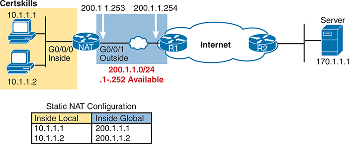

<figcaption>

<aside class="hidden" id="a14fig09">

网络地理学分为内外科. 内地段有两台个人电脑,I P地址为10.1.1.1和10.1.1.2,与一个执行NAT的路由器相接. 此路由器被显示为接口 G0 slash0 slash0 连接到内部网络(内侧)和接口 G0 slash0 slash1 连接到外部网络(外侧). NAT路由器在其G-0 slash0 slash1接口上被分配为公用IP地址200.1.1.253和200.1.1.254,代表其与互联网的连接. 公共 I P 地址范围为200.1.1.0/24被突出显示,地址为200.1.1.1至200.1.1.252可供使用. 该图显示,I P地址为200.1.1.1和-200.1.1.2,分别被映射到I P地址为-10.1.1.1和-10.1.1.2,作为静态NAT配置的一部分. NAT路由器连接了以云符号为代表的互联网,这导致另一个路由器被标注为R1. 路由器R-1与路由器R-2相接,而路由器又与一个服务器相接,IP地址为170.1.1.1. 图像包括显示流量流量和NAT过程的方向箭头. 在图的下方,一个被标注为"静态NAT配置"的表格列出了内地和内地全球地址. 本地地址为10.1.1.1和10.1.1.2,分别被映射到200.1.1.1和200.1.1.2。 该图使用计算机,路由器,服务器的标准网络符号,并使用色彩编码来区分内(黄)和外(蓝)两段.

</aside>

<strong>图14-9</strong> <em>NAT实例样本网络,公共类C200.1.1.0/24</em>

</figcaption>

</figure>

<a href="#exa14_1">示例14-1</a>列表 NAT 配置,使用 200.1.1.1 和 200.1.1.2 两个静态NAT映射。

<strong>示例14-1</strong> <em>静态NAT 配置</em>

<a href="#code-f0308-01" id="f0308-01a">点击此处查看代码原图</a>

<pre class="pre-ex" tabindex="0"><code>NAT# <strong>show running-config</strong>

!

! Lines omitted for brevity

!

interface GigabitEthernet0/0/0

 ip address 10.1.1.3 255.255.255.0

 ip nat inside

!

interface GigabitEthernet0/0/1

 ip address 200.1.1.253 255.255.255.0

 ip nat outside

!

ip nat inside source static 10.1.1.2 200.1.1.2

ip nat inside source static 10.1.1.1 200.1.1.1</code></pre>

为了进一步探索配置,这些步骤使用与示例前的配置核对表相同的编号步骤来分析配置:

<ol class="number">

<li>
与企业网络连接的接口 G0/ 0. 0, 显示<strong>ip nat inside</strong>命令,允许NAT,并将其识别为内部接口。
</li>

<li>
连接到企业网络的接口G0/0/1显示<strong>ip nat outside</strong>命令,允许NAT,并将其识别为外部接口。
</li>

<li>
接口 G0/ --0/1-- -- 使用命令<strong>ip address 200.1.1.251 255.255.255.0</strong>,定义连接子网200.1.1.0/24. 此子网中未使用的地址将可供静态映射使用.
</li>

<li>
密码<strong>ip nat inside source static</strong>global配置命令创建静态映射,指两个内置主机和两个地址在子网200.1.1.0/24中的地址.
</li>

</ol>

<a href="#exa14_2">示例14-2</a>提供几种<strong>show</strong>命令列出必要的NAT信息。 密码<strong>show ip nat translations</strong>命令列出在配置中创建的两个静态NAT条目。 它将标题显示为本地(列出私人地址)和全球(列出公共地址)内部的Cisco名词. 密码<strong>show ip nat statistics</strong>命令中提及当前正在运行的转换表格条目数(带有静态NAT),其数值与所配置的NAT表格条目数相匹配. 统计数据还包括点击次数,每包NAT都必须转换地址。

<strong>示例14-2</strong> <em>静态NAT 核查</em>

<a href="#code-f0309-01" id="f0309-01a">点击此处查看代码原图</a>

<pre class="pre-ex" tabindex="0"><code>NAT# <strong>show ip nat translations</strong>

Pro Inside global      Inside local       Outside local       Outside global

--- 200.1.1.1          10.1.1.1           ---                 ---

--- 200.1.1.2          10.1.1.2           ---                 ---

NAT# <strong>show ip nat statistics</strong>

Total active translations: 2 (2 static, 0 dynamic; 0 extended)

Outside interfaces:

  GigabitEthernet0/0/1

Inside interfaces:

  GigabitEthernet0/0/0

Hits: 100 Misses: 0

Expired translations: 0

Dynamic mappings:</code></pre>

在离开静态NAT之前,再次考虑NAT使用的公共地址. 一个典型的NAT设计依赖于一个连接到NAT路由器的子网,这个连接的子网包括NAT所需的所有内部全球(公共)地址.

本节的例子显示了企业和ISP之间的互联网接入链接上使用整个公共地址块的经典案例,这里是200.1.1.0/24. 链接上的路由器使用地址为200.1.1.253和200.1.1.254. 密码<strong>ip address 200.1.1.253 255.255.255.0</strong>命令在企业中的路由器 R1 上导致子网的连接路由 200.1.1.0/24 。该子网包括两个保留值( 200.1.1.0 和 200.1.1.255 )和两个接口地址( 200.1.1.253 和 200.1.1.254 。留下的地址 。 200.1.1.1 –200.1.1.252 可用于路由器上的NAT.

所以这个配置需要熟悉的<strong>ip address</strong>接口子命令,但地址规划需要一些思考,配置可以创建一个连接的路由,包含NAT所需的所有公共地址. NAT路由器上的任何接口都将为此而工作,而与ISP的链接是最常见的. NAT路由器也可以使用回回回路由.

</section>

<section>

<h4 class="h4" id="ch14lev2sec8">动态 NAT 配置</h4>

动态NAT配置与静态NAT配置有一些相似之处. 您以同样的方式配置内外接口 。 您还需要配置一个带IP地址的路由器接口并蒙上掩码,这样连接的子网就包含了设计计划中的所有内部全局地址. 毫不出人意料的是,不同的是动态NAT不需要预先配置的静态NAT表条目.

相反,动态NAT显示器包进入接口内部,将包的源地址与访问控制列表(ACL)相匹配. 将ACL与许可动作相匹配的来信包触发了NAT进程. 一旦被触发,NAT路由器将在需要时创建一个新的NAT表格条目. 此外,动态NAT配置包括一些以NAT池为形式的全球(公共)内部地址. 具体步骤如下:

台阶.1.使用该<strong>ip nat inside</strong>命令在接口配置模式中配置NAT设计内部部分的接口(就像静态NAT一样).

<figure class="image">

</figure>

台阶.2.使用该<strong>ip nat outside</strong>命令在接口配置模式中配置NAT设计外部部分的接口(就像静态NAT一样).

台阶.3.使用该<strong>ip address</strong> <em>address mask</em>命令在接口配置模式中配置一个子网,该子网包含用于设计的全球内部(公共)地址。

台阶.4.配置一个 ACL , 匹配 允许动作, 输入内部接口的包, 路由器应该应用 NAT 。

台阶.5.使用该<strong>ip nat pool</strong> <em>name first-address last-address</em> {<strong>netmask</strong> <em>subnet-mask</em> | <strong>prefix-length</strong> <em>length</em>} 在全局配置模式下命令配置已公开注册的 IP 地址池 。

台阶.6.使用该<strong>ip nat inside source list</strong> <em>acl-number</em> <strong>pool</strong> <em>pool-name</em>命令在全局配置模式下启用动态NAT。 注意命令引用了ACL和池,按前几个步骤显示。

以下示例显示一个样本动态NAT配置,使用与上一个示例相同的网络地貌(参见:<a href="#ch14fig09">图14-9</a>) 两个内地地址——-10.1.1.1和-10.1.1.2需要转换. 然而,与之前的静态NAT实例不同,配置在<a href="#exa14_3">示例14-3</a>将公有 IP地址(200.1.1.1和200.1.1.2)放入全局地址内可动态分配的集合.

<strong>示例14-3</strong> <em>动态 NAT 配置</em>

<a href="#code-f0311-01" id="f0311-01a">点击此处查看代码原图</a>

<pre class="pre-ex" tabindex="0"><code>NAT# <strong>show running-config</strong>

!

! Lines omitted for brevity

!

interface GigabitEthernet0/0/0

 ip address 10.1.1.3 255.255.255.0

 ip nat inside

!

interface GigabitEthernet0/0/1

 ip address 200.1.1.253 255.255.255.0

 ip nat outside

!

ip nat pool fred 200.1.1.1 200.1.1.2 netmask 255.255.255.252

ip nat inside source list 1 pool fred

!

access-list 1 permit 10.1.1.2

access-list 1 permit 10.1.1.1</code></pre>

动态 NAT 配置公共( 全球) 地址池<strong>ip nat pool</strong>命令在全局地址的包含范围中列出第一个和最后一个数字。 例如,如果池需要10地址,命令可能列出200.1.1.1和200.1.1.10,这意味着NAT可以通过200.1.1.10使用200.1.1.1.

动态NAT 还对<strong>ip nat pool</strong>带有所需命令的指令<strong>netmask</strong>参数。 池里的地址应该在同一子网里 假设你应用了<strong>netmask</strong>(或 减:<strong>prefix-length</strong>)参数作为子网掩码. 如果地址位于数学的不同子网中,那么IOS就拒绝<strong>ip nat pool</strong>命令。例如, 配置在<a href="#exa14_3">示例14-3</a>,IOS批准该逻辑的值:

<ul class="sq">

<li>
^200.1.1.1有掩码255.255.255.252暗示子网200.1.1.0,广播地址200.1.1.3.
</li>

<li>
^200.1.1.2有掩码255.255.255.252暗示子网200.1.1.0,广播地址200.1.1.3.
</li>

</ul>

如果这个例子使用了地址200.1.1.1和200.1.1.6,带有掩码255.255.255.252,IOS会拒绝这个逻辑的指令:

<ul class="sq">

<li>
^200.1.1.1有掩码255.255.255.252暗示子网200.1.1.0,广播地址200.1.1.3.
</li>

<li>
^200.1.1.6有掩码255.255.255.252暗示子网200.1.1.4,广播地址200.1.1.7.
</li>

</ul>

动态NAT也需要一个<strong>ip nat inside source</strong>全局指令 。 命令指的是它想用于全局内地址的NAT集合的名称——在此情况下为fred. 它还指一个IP ACL,它定义了本地IP地址内部的匹配逻辑. 所以,我们的逻辑是<strong>ip nat inside source list 1 pool fred</strong>在此示例中,命令如下:

为输入任何内部接口的包创建NAT表格条目,在ACL 1匹配的主机之间绘制映射图,从名为 fred 的池中分配一个内部全局地址.

</section>

<section>

<h4 class="h4" id="ch14lev2sec9">动态 NAT 验证</h4>

<a href="#exa14_4">示例14-4</a>在创建任何动态NAT表格条目之前,在NAT路由器上显示NAT状态,并<a href="#exa14_5">示例14-5</a>在用户流量触发动态NAT表格条目后显示相同的命令 。 单位<a href="#exa14_4">示例14-4</a>,则<strong>show ip nat translations</strong>命令输出显示一行空白,这意味着不存在NAT表格条目。 密码<strong>show ip nat statistics</strong>命令显示动态NAT表格条目数的对数,显示零活性转换。

<strong>示例14-4</strong> <em>生成流量之前的动态 NAT 验证</em>

<a href="#code-f0312-01" id="f0312-01a">点击此处查看代码原图</a>

<pre class="pre-ex" tabindex="0"><code>! The next command lists one empty line because NAT has not yet added table entries.

NAT# <strong>show ip nat translations</strong>

NAT# <strong>show ip nat statistics</strong>

Total active translations: 0 (0 static, 0 dynamic; 0 extended)

Peak translations: 8, occurred 00:02:44 ago

Outside interfaces:

  GigabitEthernet0/0/1

Inside interfaces:

  GigabitEthernet0/0/0

Hits: 0 Misses: 0

CEF Translated packets: 0, CEF Punted packets: 0

Expired translations: 0

Dynamic mappings:

-- Inside Source

[id 1] access-list 1 pool fred refcount 0

 pool fred: netmask 255.255.255.252

    start 200.1.1.1 end 200.1.1.2

    type generic, total addresses 2, allocated 0 (0%), misses 0

Total doors: 0

Appl doors: 0

Normal doors: 0

Queued Packets: 0</code></pre>

离开之前<a href="#exa14_4">示例14-4</a>,仔细看<strong>show ip nat statistics</strong>命令,在示例结尾处。 它列出了一些令人着迷的排除故障信息,其中有两个不同的计数器标有“Misses”,如例子所强调。 此计数器的首次出现, 大约在命令输出的中点, 算出新数据包出现的次数, 需要NAT 条目, 但不存在匹配条目 。 此时,动态NAT反应并构建出条目.

在命令输出的结尾,第二个Misses计数器与游泳池有关. 这种反递增只有在动态NAT尝试分配一个新的NAT表条目时,才会从池中寻找一个未使用的地址,但找不到可用的地址. 在这种情况下,NAT不能添加表项,因此数据包不能被转换——很可能会导致最终用户无法进入应用程序.

下一个<a href="#exa14_5">示例14-5</a>更新两个命令的输出<a href="#exa14_4">示例14-4</a>,这次是在主机用户10.1.1.1 telnets到主机170.1.1.1后.

<strong>示例14-5</strong> <em>生成流量后的动态NAT验证</em>

<a href="#code-f0313-01" id="f0313-01a">点击此处查看代码原图</a>

<pre class="pre-ex" tabindex="0"><code>NAT# <strong>show ip nat translations</strong>

Pro Inside global      Inside local       Outside local       Outside global

--- 200.1.1.1          10.1.1.1           ---                  ---

NAT# <strong>show ip nat statistics</strong>

Total active translations: 1 (0 static, 1 dynamic; 0 extended)

Peak translations: 11, occurred 00:04:32 ago

Outside interfaces:

  GigabitEthernet0/0/1

Inside interfaces:

  GigabitEthernet0/0/0

Hits: 69 Misses: 1

Expired translations: 0

Dynamic mappings:

-- Inside Source

access-list 1 pool fred refcount 1

[eml fred: netmask 255.255.255.252

    start 200.1.1.1 end 200.1.1.2

    type generic, total addresses 2, allocated 1 (50%), misses 0</code></pre>

例起于主机10.1.1.1 telnetting to170.1.1.1 (未显示),由NAT路由器创建了NAT条目. NAT表显示单项,将10.1.1.1至200.1.1.1. 和第一行的输出<strong>show ip nat statistics</strong>命令列出1活性转换的计数器,如示例上方的NAT表格所示.

花点时间来考虑突出线,其中:<strong>show ip nat statistics</strong>命令列出1个失败和69个命中。 第一个失手计数器,现在在1,意味着一个包裹到达需要NAT,但是没有NAT表条目. NAT反应并添加了NAT表条目,因此69的命中计数器意味着以下69个数据包使用了新添加的NAT表项.

在例子的底部,第二个漏取计数器仍为0. 计数器没有递增,因为NAT池内全球IP地址足够分配新的NAT表条目. 另外,请注意,最后一行列出了关于分配的集合成员人数(-1-)和目前使用的集合百分比(-50-%)的统计数据。

动态NAT表条目在一段时间后停止活动,释放出内部全局地址供未来使用.<a href="#exa14_6">示例14-6</a>显示两个不同主机在全局地址200.1.1.1内使用的顺序。 主机10.1.1.1在全局地址200.1.1.1使用以实例开头。 而不是仅仅等待NAT条目的超时, 示例澄清NAT表格条目与<strong>clear ip nat translation *</strong>命令。这时用户在10.1.1.2电话网到170.1.1.1,新的NAT表条目出现,使用相同的200.1.1.1在全局地址内.

<strong>示例14-6</strong> <em>再次使用动态全球IP地址的例子</em>

<a href="#code-f0314-01" id="f0314-01a">点击此处查看代码原图</a>

<pre class="pre-ex" tabindex="0"><code>! Host 10.1.1.1 currently uses inside global 200.1.1.1

NAT# <strong>show ip nat translations</strong>

Pro Inside global      Inside local       Outside local       Outside global

--- 200.1.1.1          10.1.1.1           ---                 ---

NAT# <strong>clear ip nat translation *</strong>

!

! telnet from 10.1.1.2 to 170.1.1.1 happened next; not shown

!

! Now host 10.1.1.2 uses inside global 200.1.1.1

NAT# <strong>show ip nat translations</strong>

Pro Inside global      Inside local       Outside local       Outside global

--- 200.1.1.1          10.1.1.2           ---                 ---

!

! Telnet from 10.1.1.1 to 170.1.1.1 happened next; not shown

!

NAT# <strong>debug ip nat</strong>

IP NAT debugging is on

Oct 20 19:23:03.263: NAT*: s=10.1.1.1-&gt;200.1.1.2, d=170.1.1.1 [348]

Oct 20 19:23:03.267: NAT*: s=170.1.1.1, d=200.1.1.2-&gt;10.1.1.1 [348]

Oct 20 19:23:03.464: NAT*: s=10.1.1.1-&gt;200.1.1.2, d=170.1.1.1 [349]

Oct 20 19:23:03.568: NAT*: s=170.1.1.1, d=200.1.1.2-&gt;10.1.1.1 [349]</code></pre>

最后,在结束时,<a href="#exa14_6">示例14-6</a>,您可以看到,主机 10.1.1.1 已经调用到另一个主机 在互联网上,加<strong>debug ip nat</strong>命令输出。 这个<strong>debug</strong>命令使路由器每次为NAT转换地址时都会发出消息。 您通过从 10.1.1.1到170.1.1.1的 Telnet 连接输入一些行来生成输出结果 。 调试输出告诉你,主机10.1.1.1在全局地址200.1.1.2内用于此新连接.

</section>

<section>

<h4 class="h4" id="ch14lev2sec10">NAT 过载（PAT）配置</h4>

静态和动态的NAT配置很重要,但本节的NAT超载(PAT)配置更为重要. PAT允许NAT支持许多本地IP地址内部只有一个或几个全球IP地址内部. 通过将内部本地地址和端口号转换为一个内部全球地址,但有一个独特的端口号,NAT可以支持许多(超过65 000个)同时进行的TCP和UDP流量,只有一个公开的全球地址.

PAT配置包括两个变体:

<ul class="sq">

<li>
一个有多个地址的集合
</li>

<li>
一个从现有接口拥有一个单一的全球内部地址
</li>

</ul>

使用集合地址的 PAT 配置看起来与动态 NAT 完全相同,除了<strong>ip nat inside source list</strong>全局指令有一个<strong>overload</strong>关键词添加到结尾 。 汇总 PAT 在使用一个地址池时与动态 NAT 之间的配置差异 :

如上一节所概述,使用相同的步骤来配置动态NAT,但包括<strong>overload</strong>字段末尾的关键字<strong>ip nat inside source list</strong>全局指令 。

或者,PAT可以有效地使用全球内部的单一地址。 你家里的路由器可能就是这样 它从您的ISP中租赁了单一的公开IP地址,并作为内部全球(公共)地址执行NAT. 企业路由器可以做同样的事情,并在一个接口上使用公有 IP地址,一般是连接路由器与互联网的接口. 有了这个单一地址,NAT可以支持超过65 000个并行流量。 如果每台计算机平均有10个并发流量,一个公有 IP地址将支持主机内部的6500左右.

以下核对表详细列出使用接口IP地址作为全球IP地址内唯一内部地址时的配置:

台阶.1.与动态和静态NAT一样,配置<strong>ip nat inside</strong>用于识别内部接口的接口子命令。

<figure class="image">

</figure>

台阶.2.与动态和静态NAT一样,配置<strong>ip nat outside</strong>用于识别外部接口的接口子命令。

台阶.3.与动态和静态NAT一样,请使用<strong>ip address</strong> <em>address mask</em>命令在接口配置模式中配置一个子网,该子网包含用于设计的全球内部(公共)地址。

台阶.4.和动态NAT一样,配置一个与输入内部接口的包相匹配的ACL.

台阶.5.配置<strong>ip nat inside source list</strong> <em>acl-number</em> <strong>interface</strong> <em>type/number</em> <strong>overload</strong>global配置命令,指前一步的ACL,以及连接的子网包括用于转换的Global地址内的NAT的接口.

动态NAT与PAT配置的关键区别来自于使用.<strong>overload</strong>关键词。 步骤5注意到PAT版本<strong>ip nat inside source</strong>命令,结束于<strong>overload</strong>。动态NAT( 不包含 PAT) 省略<strong>overload</strong>关键词。

以下例子显示了使用单个接口IP地址的PAT配置.<a href="#ch14fig10">图14-10</a>显示相同熟悉的网络, 有几处变化 : CIDR 块200.1.1.248/30 而不是 C级网络200.1.1.0 。 CIDR块有两个可用的地址:200.1.1.249和200.1.1.250. Certshilling路由器上的NAT功能将所有NAT地址转换到它的接口地址:200.1.1.249.

<figure class="image-c" id="ch14fig10">

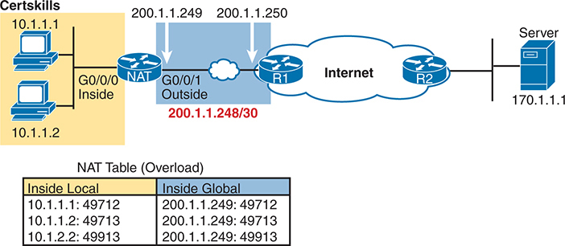

<figcaption>

<aside class="hidden" id="a14fig10">

该图分为两个主要部分,分别标注在内部和外部,通过互联网连接. 左侧,内地段内部,有两台个人计算机,I P地址分别为10.1.1.1和10.1.1.2,通过接口G0斜通0连接到NAT路由器上. 这个路由器位于内网和外网之间,便于将本地地址翻译为全局地址. 本节为"Certfult"所标注. 在中心,NAT路由器通过接口G0 slash1与互联网相接,该路由器被贴上"外"的标签. 路由器的全局接口有IP地址200.1.1.248/30,具体地址为200.1.1.249和200.1.1.250显示. 在右侧,在外段内,互联网连接到一个远程服务器,IP地址为170.1.1.1,说明内部客户端可能与之通信的目标服务器. ANAT表被描绘在图的下方,被标记为NAT表(Overload). 本表显示本地地址内部到全球地址的映射,并附有相通端口号:10.1.1.1分号49712分号被映射为200.1.1.249分号49712分号. ^10.1.1.2分号为^49713分号为^200.1.1.249分号为^49713分号. ^10.2.2.2克口号×49913被映射为^200.1.1.249克口号49913.

</aside>

<strong>图14-10</strong> <em>使用全球地址内部接口的 PAT 示例</em>

</figcaption>

</figure>

单位<a href="#exa14_7">示例14-7</a>,它显示了NAT超载配置,NAT转换仅使用全球范围内的地址200.1.1.249,因此NAT池不需要.

<strong>示例14-7</strong> <em>NAT 超载配置</em>

<a href="#code-f0316-01" id="f0316-01a">点击此处查看代码原图</a>

<pre class="pre-ex" tabindex="0"><code>NAT# <strong>show running-config</strong>

!

! Lines Omitted for Brevity

!

interface GigabitEthernet0/0/0

 ip address 10.1.1.3 255.255.255.0

 ip nat inside

!

interface GigabitEthernet0/0/1

 ip address 200.1.1.249 255.255.255.252

 ip nat outside

!

ip nat inside source list 1 interface GigabitEthernet0/0/1 overload

!

access-list 1 permit 10.1.1.2

access-list 1 permit 10.1.1.1</code></pre>

密码<strong>ip nat inside source list 1 interface gigabitethernet0/0/1 overload</strong>命令有多个参数,但是如果你理解动态的NAT配置,新的参数不应该太难把握. 密码<strong>list 1</strong>参数表示与动态NAT相同:在匹配ACL1的本地IP地址内部有他们的地址被转换. 密码<strong>interface gigabitethernet 0/0/1</strong>参数表示唯一可用的全球IP地址是NAT路由器接口Gigabitethernet的IP地址0/0/1. 最后,<strong>overload</strong>参数允许NAT超载(PAT). 没有这个参数,路由器不会执行超载,只是动态NAT.

<a href="#exa14_8">示例14-8</a>在两个主机共创建了3个TCP连接后显示NAT转换表. 需要一些时间来输出<strong>show ip nat translations</strong>命令。它显示了表中的三个动态条目. 现在全局内和本地内列既列出IP地址,也列出端口号(数字匹配)<a href="#ch14fig10">图14-10</a>).

<strong>示例14-8</strong> <em>NAT 超载核查</em>

<a href="#code-f0317-01" id="f0317-01a">点击此处查看代码原图</a>

<pre class="pre-ex" tabindex="0"><code>NAT# <strong>show ip nat translations</strong>

Pro  Inside global      Inside local       Outside local      Outside global

tcp  200.1.1.249:49712  10.1.1.1:49712     170.1.1.1:23       170.1.1.1:23

tcp  200.1.1.249:49713  10.1.1.2:49713     170.1.1.1:23       170.1.1.1:23

tcp  200.1.1.249:49913  10.1.1.2:49913     170.1.1.1:23       170.1.1.1:23

NAT# <strong>show ip nat statistics</strong>

Total active translations: 3 (0 static, 3 dynamic; 3 extended)

Peak translations: 12, occurred 00:01:11 ago

Outside interfaces:

  GigabitEthernet0/0/1

Inside interfaces:

  GigabitEthernet0/0/0

Hits: 103 Misses: 3

Expired translations: 0

Dynamic mappings:

-- Inside Source

access-list 1 interface GigabitEthernet0/0/1 refcount 3</code></pre>

最后,在产出中:<strong>show ip nat statistics</strong>命令,点击和丢失的计数器的工作与动态NAT一样。 三者错过了每个 TCP 连接中的第一个数据包,从而触发了 NAT 表格条目的创建. 带原已存在的NAT表条目抵达的后一批数据会给点击计数器造成增量.

</section>

<section>

<h4 class="h4" id="ch14lev2sec11">NAT 故障排除</h4>

大多数NAT故障排除问题都涉及使配置正确. 内源NAT有多个配置选项——静态,动态,和PAT——每个都有多个配置命令. 您应该努力与配置一起建立技能,以快速识别配置错误. 以下的故障解析清单总结出最常见的源NAT问题,其中大部分与不正确的配置有关.

<ul class="sq">

<li>
<strong>内外反相:</strong>确保配置包括<strong>ip nat inside</strong>和<strong>ip nat outside</strong>接口子命令,且命令不倒转(<strong>ip nat inside</strong>命令位于外部接口上,反之亦然。 有了源 NAT,只有进入内部接口的包会触发新的转换,所以指定正确的内部接口特别重要.
</li>

<li>
<strong>静态NAT:</strong>检查一下<strong>ip nat inside source static</strong>命令,以确保它首先列出内部本地地址,然后列出内部全局IP地址。
</li>

<li>
<strong>动态NAT( ACL ):</strong>确保在任何 NAT 转换发生之前, ACL 配置以匹配内部主机发送的包 。 例如,如果将10.1.1.1的本地内部地址转换为200.1.1.1,则确保ACL与源地址10.1.1.1相匹配,而不是200.1.1.1.
</li>

<li>
<strong>动态NAT( 集合) :</strong>对于没有PAT的动态NAT,确保池子有足够的IP地址. 在不使用PAT时,每个内置主机都会从池中消耗一个IP地址. 第二处值大或正在增加的值<strong>show ip nat statistics</strong>命令输出可以指示这个问题。 另外,将配置的集合与NAT转换表中的地址列表进行比较(<strong>show ip nat translations</strong>) 最后,如果池子很小,问题可能是要使用 PAT 的配置并缺少<strong>overload</strong>关键词(见下项).
</li>

<li>
<strong>PAT:</strong>很容易忘记添加<strong>overload</strong>选项。<strong>ip nat inside source list</strong>命令。带有池的 PAT 配置与有效的动态 NAT 配置完全相同,只是 PAT 需要<strong>overload</strong>关键词。 没有它,活泼的NAT就起作用了,但通常池内全球地址太少. NAT路由器如果不为其流量提供可用的池IP地址,则不会转换或转发主机的流量,因此一些主机会经历停用.
</li>

<li>
<strong>ACL:</strong>如前所述。<a href="v2-08.html#ch08">第8章</a>, “<a href="v2-08.html#ch08">IP ACL 应用</a>,”您总是可以添加导致问题的ACLs的检查. 也许NAT被正确配置了,但其中一个接口上存在ACL,丢弃了数据包. 请注意,在本案中,路由器内部的操作顺序很重要. 对于进入接口的包,IOS会在源内NAT之前处理ACL. 对于退出接口的包,IOS在转换由于内源NAT而导致的地址后处理任何外出ACL.
</li>

<li>
<strong>需要用户流量 :</strong>动态NAT和PAT对用户流量的反应. 如果您在实验室中配置NAT,NAT不会起到创建转换的作用( NAT) 。<strong>show ip nat translations</strong>),直到一些用户流量通过内部接口进入NAT路由器,触发NAT进行转换. NAT配置可以完美,但如果没有匹配NAT配置的出入境流量发生,NAT则无所作为.
</li>

<li>
<strong>IPv4 路由 :</strong>IPv4的路由可以防止包到达NAT路由器的两侧. 注意, 路由必须为包中使用的目的地IP地址工作 。 例如,互联网上的路由器必须有与NAT使用的公共地址相匹配的路由,以便指定给这些地址的包能到达NAT路由器.
</li>

</ul>

</section>

</section>

</section>

<section class="ccna-source ccna-appendix" aria-label="答案解析与术语表">
<section data-epub-type="chapter">

<h2 class="h2" id="ref-appc">附录C</h2>

<h2 class="h2a">对“我早就知道了吗?” 的回答。</h2>

<section>

<h3 class="h3" id="ref-appclev1sec14">第14章</h3>

<strong><a id="ref-ques14_1" href="#quess14_1">1</a>。</strong> B 和 E。RFC 1918 定义了私有网络号，其中包括 A 类网络 10.0.0.0、B 类网络 172.16.0.0 至 172.31.0.0，以及 C 类网络 192.168.0.0 至 192.168.255.0。

<strong><a id="ref-ques14_2" href="#quess14_2">2</a>。</strong> C。对源地址使用静态 NAT（内部源 NAT）时，NAT 路由器使用 <strong>ip nat inside source</strong> 命令定义的静态条目。题目提到转换内部地址，因此命令需要使用 <strong>inside</strong> 关键字。本章未讨论的其他 NAT 功能使用 <strong>outside</strong> 关键字。

其余两个选项都提出了触发动态 NAT 表条目的方法，而静态 NAT 不会创建这种条目。

<strong><a id="ref-ques14_3" href="#quess14_3">3</a>。</strong> A。使用动态 NAT 时，来自内部网络的第一个数据包流会触发表条目的创建。进入外部接口的数据包不会触发 NAT 表条目的创建。动态 NAT 不会预先定义 NAT 表条目，因此列出配置命令的两个选项不正确。

<strong><a id="ref-ques14_4" href="#quess14_4">4</a>。</strong> A。<strong>ip nat inside source list alice pool barney</strong> 命令启用内部源 NAT。这意味着路由器会监视进入已通过接口子命令 <strong>ip nat inside</strong> 启用 NAT 的接口的数据包。数据包还必须匹配所引用的 ACL（本例为 Alice）并被其允许，才会触发地址转换。这些事实支持唯一正确的选项。

一个错误选项认为 ACL 应拒绝数据包来触发 NAT。实际上，ACL 应允许该数据包。

两个错误选项提到了 NAT 地址池。执行 NAT 并修改源地址时，NAT 使用已定义地址池（本例为 Barney）中的一个地址。在数据包进入内部接口时（NAT 转换之前），数据包中并不包含 NAT 地址池中的地址。NAT 地址池包含代表内部主机的公有 IP 地址。这些公有地址无需与 NAT 配置中的任何内容匹配。

<strong><a id="ref-ques14_5" href="#quess14_5">5</a>。</strong> A 和 C。配置中的 <strong>ip nat inside source</strong> 命令缺少 <strong>overload</strong> 关键字。没有该关键字，路由器会执行动态 NAT，但不会执行 PAT，因此每个内部全局 IP 地址无法支持多个 TCP 或 UDP 连接或流。此外，每个 NAT 外部接口都需要接口子命令 <strong>ip nat outside</strong>。配置中，接口 G0/0/1 是连接互联网且具有公有地址的链路，但缺少此配置命令。

<strong><a id="ref-ques14_6" href="#quess14_6">6</a>。</strong> B。对于正确选项：输出的最后一行指出地址池有七个地址，全部已分配，misses 计数器接近 1000，这意味着路由器因 NAT 地址池容量不足而拒绝了大约 1000 个新流。对于错误选项，NAT 既允许标准 ACL，也允许扩展 ACL，因此可以使用标准 ACL 1。其余两个错误选项可以排除，因为正确选项所述的根本原因能够从命令输出中找到。

</section>

</section>

<section id="ref-glossary"><h2 class="h2a">词汇表</h2>
<strong>CIDR</strong>无阶级域间路由. 用于全球IP地址范围分配的 RFC-标准工具. CIDR减少了互联网路由器的IP路由表的大小,有助于应对互联网的快速增长. 术语<em>无类</em>指被汇总的网络组代表一组不符合IPv4类(A级,B级,C级)分组规则的地址.

<strong>内部全局</strong>对于寄入和寄出在使用NAT的网络可信部分内的主机的包,这个术语是指当这些包穿越全球(公共)互联网时,这些包头中使用的IP地址.

<strong>内部本地</strong>对于寄入和寄出在使用NAT的网络可信部分内的主机的包,这个词指当这些包通过网络的企业(私人)部分时,这些包头中使用的IP地址.

<strong>NAT 超载</strong>港口地址转换的另一个术语(PAT). 配置NAT的几种方法之一,在此情况下根据端口号转换了TCP和UDP流量,除了使用一个或只使用几个全球范围内的地址外.

<strong>端口地址转换( PAT)</strong>一个NAT功能,其中一个全球IP地址内部支持65,000+并行的TCP和UDP连接.

<strong>私有 IP网络</strong>RFC定义的 IPv4 Class A, B, 或 C 网络 1918 ,意在公司内部使用,但不用作公有 IP网络.

<strong>来源 NAT</strong>网络地址转换(NAT)的类型在网络中最常被使用(与目的地NAT相比),其中输入内部接口的包的源IP地址被转换出.

</section>
</section>

<section class="ccna-source ccna-appendix" aria-label="代码原图">
<section data-epub-type="chapter">

<a href="#f0299-01a" id="code-f0299-01">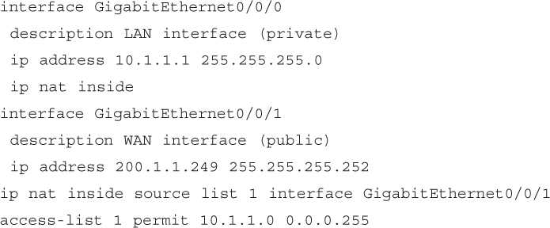</a>

<a href="#f0300-01a" id="code-f0300-01">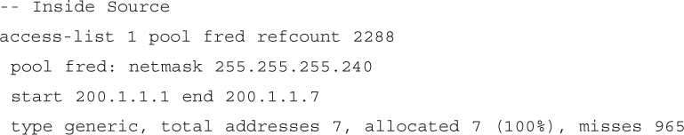</a>

<a href="#f0308-01a" id="code-f0308-01">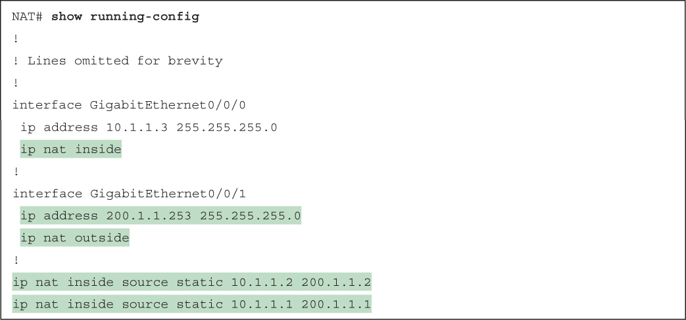</a>

<a href="#f0309-01a" id="code-f0309-01">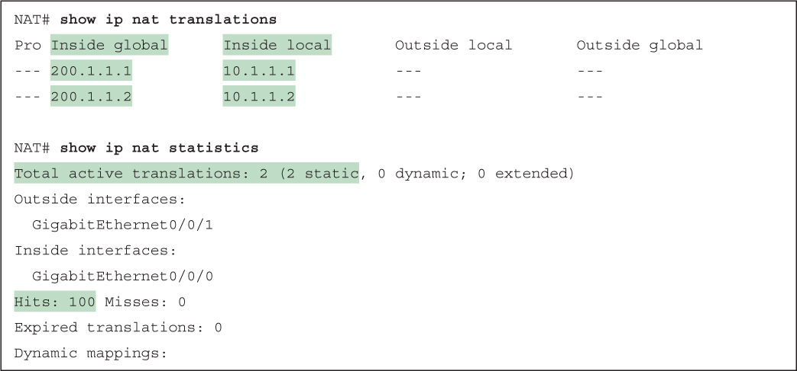</a>

<a href="#f0311-01a" id="code-f0311-01">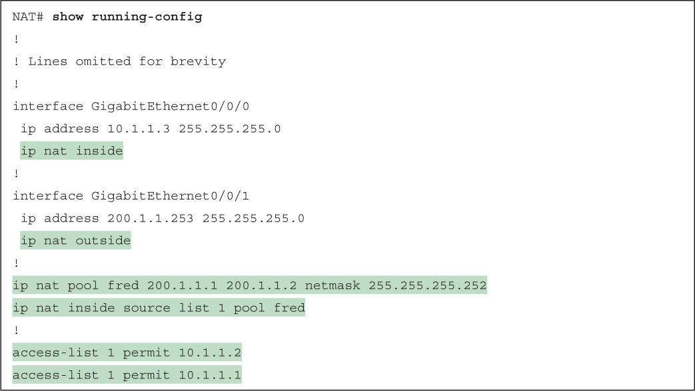</a>

<a href="#f0312-01a" id="code-f0312-01">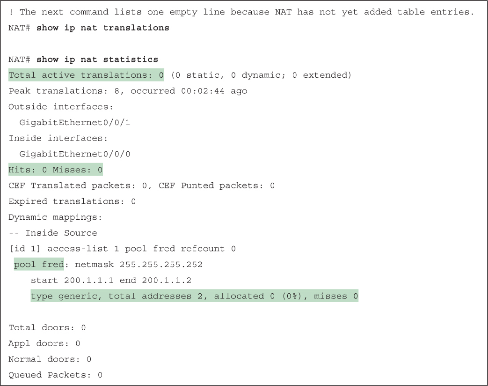</a>

<a href="#f0313-01a" id="code-f0313-01">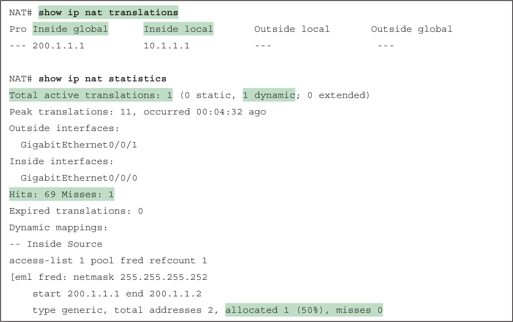</a>

<a href="#f0314-01a" id="code-f0314-01">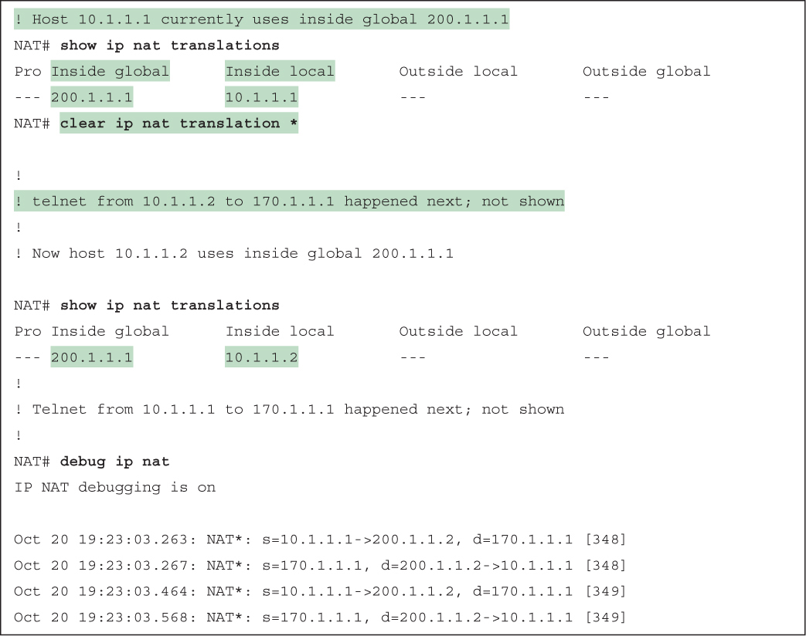</a>

<a href="#f0316-01a" id="code-f0316-01">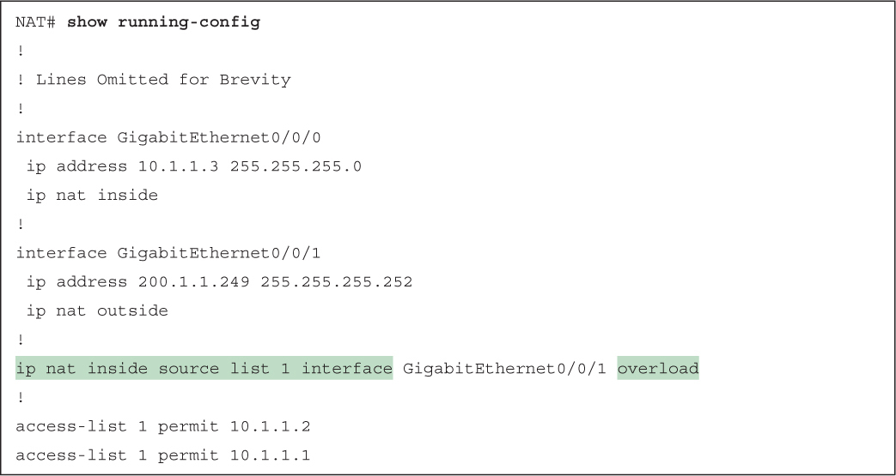</a>

<a href="#f0317-01a" id="code-f0317-01">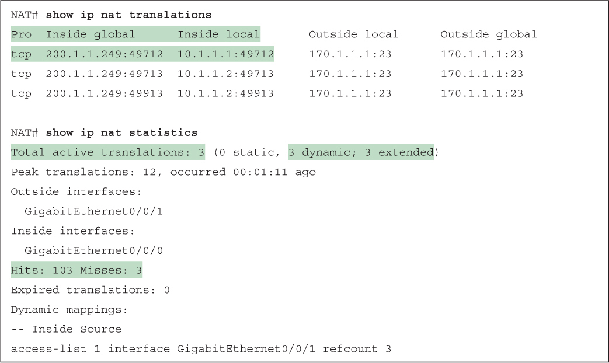</a>

</section>

</section>


<nav class="ccna-chapter-nav" aria-label="章节导航"><a href="v2-13.html">← 上一章</a><a href="v2-15.html">下一章 →</a></nav>
