
<a href="{{ '/subjects/CCNA/' | relative_url }}">← 返回 CCNA 目录</a>

第二卷 · IP 服务

<nav class="ccna-chapter-nav" aria-label="章节导航"><a href="v2-14.html">← 上一章</a><a href="v2-16.html">下一章 →</a></nav>



<section data-epub-type="chapter">

<h2 class="h2" id="ch15">第 15 章</h2>

<h2 class="h2a">服务质量（QoS）</h2>

本章涵盖以下考试主题：

4.0 IP 服务

4.7 解释 QoS 的转发每跳行为（PHB），例如分类、标记、排队、拥塞、流量监管和流量整形

服务质量（QoS）指网络设备用于管理数据包流经网络时若干相关特征的工具。具体来说，这些工具管理可供该类数据包使用的带宽、数据包经历的时延、同一流中连续数据包之间的抖动（时延变化），以及各类数据包的丢包百分比。这些工具在不同类型流量何时获得网络资源之间作出权衡，对某些流量给予较高优先级，对其他流量给予较低优先级。

QoS 工具定义设备可以在消息进入到离开设备之间对其执行的操作。QoS 将这些操作定义为<a id="key_175" href="#ref-gloss_246">每跳行为（PHB）</a>，正式指代存储和转发消息以外的操作。这些操作可以延迟消息、丢弃消息，甚至修改首部字段。设备可以为不同类型的消息选择不同的 PHB，改善某些消息的 QoS 表现，同时使其他消息的 QoS 表现变差。

本章逐一介绍唯一一条 QoS 考试主题中列出的工具：“解释 QoS 的转发每跳行为（PHB），例如分类、标记、排队、拥塞、流量监管和流量整形。”每个主题都强调工具解决的问题，以及它如何管理带宽、时延、抖动和丢包。

<section>

<h3 class="h3" id="ch15lev1sec1">自测</h3>

如果你希望根据得分决定在本章投入多少时间，可以完成这组自测题（在此作答，或使用 PTP 软件）。各题答案的选项字母列在自测题之后的页面底部。书末和配套网站上的<a href="#ref-appc">附录 C</a>都包含答案及解析。你也可以在 PTP 测试软件中找到答案及解析。

<figure class="table" id="ch15tab01" tabindex="0">

<figcaption>

<strong>表15-1</strong> 核心主题小节与题目对应关系

</figcaption>

<table class="all">

<tbody>

<tr>

<th class="th">
基础知识小节
</th>

<th class="th">
题目
</th>

</tr>

<tr>

<td class="border">
QoS简介
</td>

<td class="border">
1
</td>

</tr>

<tr>

<td class="border">
分类和标识
</td>

<td class="border">
2, 3
</td>

</tr>

<tr>

<td class="border">
排队
</td>

<td class="border">
4
</td>

</tr>

<tr>

<td class="border">
流量整形和流量监管
</td>

<td class="border">
5
</td>

</tr>

<tr>

<td class="border">
拥塞避免
</td>

<td class="border">
6
</td>

</tr>

</tbody>

</table>

</figure>

<strong><a id="quess15_1" href="#ques15_1a">1</a>.</strong>QoS 工具管理以下哪些属性 ? (选取三答.

<ol class="lower-alpha">

<li>
带宽
</li>

<li>
延迟
</li>

<li>
装入
</li>

<li>
MTU
</li>

<li>
损失
</li>

</ol>

<strong><a id="quess15_2" href="#ques15_2a">2</a>.</strong>在通过四个不同的路由器,通过不同的局域网和广域网链接发送时,下列哪些QoS标记字段可以保留一个包? (取出二个答.

<ol class="lower-alpha">

<li>
CoS
</li>

<li>
IPP
</li>

<li>
DSCP
</li>

<li>
MPLS EXP
</li>

</ol>

<strong><a id="quess15_3" href="#ques15_3a">3</a>.</strong>在思科路由器上,DiffServ中的包有下列哪些分类方法? (选取三答.

<ol class="lower-alpha">

<li>
匹配IP DSCP 字段
</li>

<li>
匹配 802.1p COS 字段
</li>

<li>
将字段与扩展的 IP ACL相匹配
</li>

<li>
匹配 SNMP 位置变量
</li>

</ol>

<strong><a id="quess15_4" href="#ques15_4a">4</a>.</strong>以下哪些行为被应用到 Cisco 路由器或交换机中的低延迟队列上? (取出二个答.

<ol class="lower-alpha">

<li>
流量整形
</li>

<li>
流量监管
</li>

<li>
优先日程安排
</li>

<li>
轮询 列表
</li>

</ol>

<strong><a id="quess15_5" href="#ques15_5a">5</a>.</strong>企业路由器R1通过一个WAN链接发送数据到ISP路由器ISP1. R1形状向出行流量为200Mbps,而ISP1则以250-Mbps/的速率对出行流量进行调控. 在很长一段时间(足够长的时间去耗尽整形器和警用器的任何爆破能力),R1接收到300Mbps的流量,从连接到ISP1的连接线中导出. 哪些答案可以描述这种情景中最有可能的流量整形和流量监管行动? (取出二个答.

<ol class="lower-alpha">

<li>
警方测得的费率超过维持流量监管的费率。
</li>

<li>
警方测得的费率不超过维持流量监管率。
</li>

<li>
整形器不是排队包来减慢发送速率.
</li>

<li>
整形器是排队包来减慢发送速率.
</li>

</ol>

<strong><a id="quess15_6" href="#ques15_6a">6</a>.</strong>一个排队系统有三个排队,配备有轮询排行表和一个能容纳所有语音流量的低空排队. 圆-robin队列1主要持有UDP流量,而圆-robin队列 2和3主要持有TCP流量. 每个队列中的包有各种由QoS设计的DSCP标记. 使用避免拥堵( 滴入管理) 工具的队列是否合理 ? (取出二个答.

<ol class="lower-alpha">

<li>
有限责任问题
</li>

<li>
队列 1
</li>

<li>
队列 2
</li>

<li>
队列 3
</li>

</ol>

自测答案：

<strong><a id="ques15_1a" href="#ref-ques15_1">1</a></strong> A, B, E

<strong><a id="ques15_2a" href="#ref-ques15_2">2</a></strong> B, C

<strong><a id="ques15_3a" href="#ref-ques15_3">3</a></strong> A, B, C

<strong><a id="ques15_4a" href="#ref-ques15_4">4</a></strong> B, C

<strong><a id="ques15_5a" href="#ref-ques15_5">5</a></strong> A, D

<strong><a id="ques15_6a" href="#ref-ques15_6">6</a></strong> C, D

</section>

<section>

<h3 class="h3box" id="ch15lev1sec2">基础主题</h3>

</section>

<section>

<h3 class="h3" id="ch15lev1sec3">QoS 简介</h3>

路由器一般坐落在WAN边缘上,同时有WAN接口和LAN接口. 这些局域网接口一般运行速度快得多,而WAN接口运行速度更慢. 虽然这个较慢的WAN接口正忙于发送在路由器中等待的包,但还有上百个甚至上千个IP包可以到达局域网接口,但都需要发送出同样的WAN接口. 路由器应该做什么? 把他们都派过来,跟他们来的顺序一样? 把包放在优先位置,提前寄出一些,偏好一种交通而不是另一种交通? 当等待退出路由器的包数太大时, 丢弃一些包?

上一段描述了许多经典中的一些<a id="key_179" href="#ref-gloss_275">服务质量（QoS）</a>网络中的问题。 QoS指网络设备在通过设备时用来对网络中的包进行一些不同的处理的工具. 例如,WAN边缘路由器将排队包等WAN接口可用. 路由器还可以使用一个队列排程算法来确定下一步应该发送哪些包,它使用的是到达命令以外的一些其他顺序——给一些包更好的服务和一些更差的服务.

<section>

<h4 class="h4" id="ch15lev2sec1">QoS：管理带宽、时延、抖动和丢包</h4>

Cisco在路由器和交换机上都提供了广泛的QoS工具. 所有这些工具都为您提供了管理网络流量的四个特征的手段:

<ul class="sq">

<li>
带宽
</li>

<li>
延迟
</li>

<li>
抖动
</li>

<li>
损失
</li>

</ul>

<a id="key_165" href="#ref-gloss_051">带宽</a>指链接的速度,以比特每秒(bps)为单位. 但是,当我们把带宽看作是速度时,它也帮助把带宽看作连接的能力,从每秒可以发送多少个位点到链接上. 网络设备的QoS工具决定下一个链接发送什么数据包,所以网络设备控制着接下来哪些信息可以访问带宽 以及每类传输中有多少带宽(容量)会随着时间推移而得到。

例如,考虑一个典型的WAN边缘路由器,它有上百个包等待退出WAN链接. 工程师可能配置一个排队工具,将10%的带宽用于语音传输,50%用于任务关键数据应用,并将其余带宽留给所有其他类型的通信。 排队工具然后可以使用这些设置来选择下一步要发送哪些数据包 。

<a id="key_168" href="#ref-gloss_104">延迟</a>可被描述为单向延迟或回程延迟.<em>单向延迟</em>指从发送一个包到同一包到达目的地主机之间的时间。<em>往返延迟</em>计算单向延迟, 加上第一个数据包的接收者发送一个数据包的时间, 换句话说, 在两个主机之间发送一个数据袋并接收一个数据包所需的时间 。 许多不同的个别行动影响延迟;本章讨论其中的几个,包括排队和流量整形延迟.

<a id="key_172" href="#ref-gloss_186">抖动</a>指的是同一应用程序发送的相继数据包之间的单向延迟变化。例如,设想一个应用程序会向某个特定主机发送几百个数据包。第一个数据包的单向延迟是: 300 毫秒( 毫秒) 300 ms, 或. ) 3 。下一个数据包的单向延迟是 300 ms;第三组也是如此,等等。在这种情况下,没有抖动。然而,如果第一个数据包有单向延迟: 300 ms,下一个有 单向延迟 310 毫秒,下一个是 325 ms,那么有些变化的延迟, 10 数据包之间的 ms 1 和 2 ,另一个 15 数据包之间的 ms 2 和 3 。这种区别叫做焦躁。

终于,<a id="key_173" href="#ref-gloss_199">损失</a>指的是丢失消息的数量,通常作为发送的包的百分比。 比较很简单:如果一些应用程序的发送者发送了100个数据包,而且只有98个到达目的地,那么该特定应用程序流就损失了2%。 损失可能由许多因素所造成,但人们往往认为损失是由错误的电缆或差的广域网服务造成的。 这是一个原因。 然而,由于网络设备的正常运行,设备的排队量过大,因此设备没有地方放出新包,从而丢弃了包. 多个QoS工具管理排队系统来帮助控制并避免损失.

</section>

<section>

<h4 class="h4" id="ch15lev2sec2">流量类型</h4>

在QoS中,一个网络工程师在带宽、延迟、焦急和损失方面将选择一种交通方式而不是另一种交通方式。 有时,这种选择涉及具体业务。 例如,如果所有对任务至关重要的应用程序都安装在三个已知子网的服务器上,那么就可以制定 " QoS " 计划,以匹配该子网的出/入数据包,并比其他流量更好地处理该流量。 然而,在另一些情况下,如何应用QoS工具的选择与不同类型应用的性质有关. 有些应用的QoS需求与其他应用不同. 这个下个话题根据流量的类型比较了QoS需求的基本差异.

<section>

<h5 class="h5" id="ch15lev3sec1">数据应用</h5>

首先,考虑一个基本的网络应用程序,在PC或平板电脑上有一个用户. 用户在 URI 中键入请求网页 。 这一要求可能需要一个单一的软件包去网络服务器,但它可能导致成百上千的软件包回到网络客户端,如以下所示:<a href="#ch15fig01">图15-1</a>.

<figure class="image-c" id="ch15fig01">

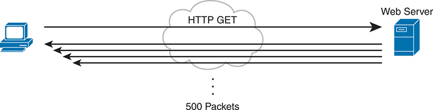

<figcaption>

<aside class="hidden" id="a15fig01">

在左边,一个计算机代表客户端,它向网络服务器发送一个HTTPGET请求,在右边被描绘. 通讯路径以标有HTTPGET的箭头显示,通过象征互联网的云从客户端指向网络服务器. 收到HTTPGET请求后,网络服务器会用数据包回复. 以多个指向客户端的箭头来说明响应,表示数据从服务器流向客户端. 在这些箭头下方有一个标签,上面写着500个Packets,它表示服务器根据HTTPGET最初的请求发送给客户端的数据包的数量.

</aside>

<strong>图15-1</strong> <em>交互式数据应用程序</em>

</figcaption>

</figure>

注意

如果您想知道一个网页可能如何需要上千个数据包,请考虑这个数学:使用 1500-byte IP最大传输单元(MTU),一个TCP段的数据部分最多可以为 1460 字节( +1500 字节为 +20 字节,每个字节为 IP 和 TCP 头). 在此例子中, 1000 这样的包共为1,460,000字节,或大约为1.5 MB. 很容易想象一个只有几个图形的网页,其总长度超过1.5MB.

那么,带宽、延迟、焦急和丢失对交互式网络应用程序有何影响? 首先,这些包需要一定的带宽容量. 至于延迟,从服务器到客户端的每个数据包都需要一定的单向延迟,同时也需要一些焦急. 显示的500个包中:<a href="#ch15fig01">图15-1</a>,如果有些丢失(传输错误,被设备丢弃,或其他原因),那么服务器的TCP逻辑会重新发送,但网页的部分内容可能不会立刻出现.

虽然QoS工具侧重于管理带宽,延迟,焦急和损失,但用户主要关心整体体验的质量. 例如,在网络应用程序下,点击后多久你可以看到网页浏览器中有用的东西? 所以,作为一个用户,你关心<em>经验的质量(快取)</em>,这个词指的是用户对网络上应用的感知. QoS工具会直接冲击带宽,延迟,焦急和损失,然后会产生一些总体好的效果来影响用户的QoE. 你可以使用 QoS 工具为更重要的流量创建更好的 QoE ; 例如, 你可能会给某些商业关键应用程序提供更好的 QOS 处理, 这可以改善这些应用程序的用户的 Qo E 。

相比之下,一个非交互式数据应用程序(史称<em>批次</em>例如,数据备份或文件传输——与交互式数据应用程序相比,对QoS的要求不同。 批量应用程序通常比交互式应用程序发送更多的数据,但由于没有人坐在那里等待屏幕上看到被弹出的东西,延迟和焦急并不重要. 对这些应用程序而言,更为重要的是满足在更大的时间窗口内完成更大任务(移交文件)的需要。 QoS工具可用于提供足够的带宽以满足这些应用程序的能力需要并管理损失来减少再传输的次数.

</section>

<section>

<h5 class="h5" id="ch15lev3sec2">语音和视频应用</h5>

语音和视频应用程序各有类似的交互和非交互流分解. 为使语音和视频的要点更深入地看语音流量.

不过在看声音之前 先想想这个词的用法<em>流</em>在网络中。 一个流是网络上从一个应用程序到另一个应用程序的所有数据,每个方向都有一个流. 例如,如果打开一个网站并连接到一个网络服务器,从服务器移动到客户端的网页内容就是一流. 听一些音乐,在你的手机上有一个音乐应用程序, 并由此从您的应用程序到音乐应用程序的服务器, 从服务器到您的手机。 从语音角度看,两个IP电话之间的一个电话会为每个方向创造出一个流量. 对于视频来说,可能是安全软件收集的一款视频监控相机的流量.

现在开始语音,具体是IP上的声音(VoIP). VoIP定义了将一个电话所发的声音取入IP包内通过一个IP网络发送的方法,在另一个电话上播放回声.<a href="#ch15fig02">图15-2</a>显示一般的想法。 这一数字包括以下步骤:

台阶.1.电话用户打个电话然后开始说话.

台阶.2.一个芯片叫"一"<em>编解码器</em>进程(数字化) 创建二进制编解码器的声音(用G来表示的-160字节). ——711分解码器等,用于一定时间段(通常为20毫秒).

台阶.3.电话将数据放入IP包中.

台阶.4.电话把包裹送到目标IP手机.

<figure class="image-c" id="ch15fig02">

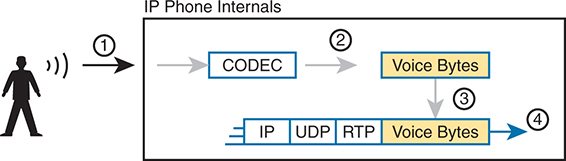

<figcaption>

<aside class="hidden" id="a15fig02">

该图被分为几个步骤,显示一个IP电话的内部功能,以及语音数据如何被封入网络包. 台阶.1. 过程从一个在IP电话里说话的人开始. 这代表着一个人类人物,其声音波由它们发出,表明声音的输入. 步骤2. 在 I P 手机内部,模拟语音信号被用一个CODEC(Coder-Decoder)转换成数字形式,具体来说就是G点711codec. 这个步骤会用一箭向外显示一个被标记为"CODEC"的盒子,然后它会生产出Voice Bytes,代表数字语音数据. 步骤3. 语音字节随后准备进行传输. 这个步骤涉及将语音字节放入协议堆栈,将它们封装在不同网络协议层中. 该图显示了被封装在一系列协议头中的语音字节:实时传输协议(RTP),用户数据报协议(UDP)和互联网协议(IP). 步骤4。 封装的语音字节通过网络传输. 这个步骤用一箭指向外来来描绘,表示即将出局的Vo I P包已准备好进行网络传输. 图像使用标签和箭头来表示过程的每个步骤,从捕获模拟语音信号到将数字化并封装的语音数据发送到网络上.

</aside>

<strong>图15-2</strong> <em>使用 IP Phone 和 G.711 编解码器创建 VoIP 包</em>

</figcaption>

</figure>

如果稍微通过数学操作,这个带有G.711编码器的单调需要大约80克bps的带宽(在数据链接头和尾部上方加亮). 如图中所示,计算头和VoIP有效载荷,每个IP包都有200字节. 每个都持有20 ms的数字化语音,所以手机发送每秒50包. 这50个包,200字节,每秒等于10,000字节,或80,000比特每秒,即80克bps. 其他语音解码器则需要更小的带宽,而常用的G.729取取了大约24克bps(又忽略了数据-链路高通).

起初,似乎VoIP的电话对QoS的要求很少。 对于带宽来说,与许多数据应用相比,单声调或流量只需要一点带宽. 然而,互动的语音确实需要更高水平的质量来应对延迟、焦急和损失。

例如,考虑在高单向延迟的情况下拨打电话。 你结束发言,暂停 对方的答复。 那个人不说话,你再说话吧!你应当听见别人的呼声。 问题:太迟了。 或考虑声音破裂的呼声. 问题? 可能是包丢了,也可能是焦躁不安

您可以通过一个IP网络实现高质量的语音流量,但您必须执行QoS来实现. QoS工具设定将给出不同种类的流量,以说明它们需要的QoS行为. 思科集团<em>企业 QoS 解决方案参考网络设计指南</em>除了依靠思科在实施QoS方面的长期经验外,它本身还引用了其他来源,建议采用下列互动语音准则:

<ul class="sq">

<li>
<strong>延迟( 单向) :</strong>150毫秒或以下
</li>

<li>
<strong>抖动 :</strong>30毫秒或以下
</li>

<li>
<strong>损失 :</strong>1%或以下
</li>

</ul>

相较之下,互动语音比QoS特性的交互式数据应用需要更多的关注. 数据应用通常比语音(和视频)更能容忍延迟、抖动和损失。 单声调一般比典型的数据应用带宽要少,但带宽要求是相容的. 数据应用程序往往会起爆,数据会因用户对应用程序做某事而爆发.

视频的QoS要求更为多样. 一般来说,想一想像语音这样的视频,但带宽要求比语音(每流)高得多,对低延迟,焦急,和损失的要求也相类似. 至于带宽,视频可以使用各种会影响所发送的数据量的可解码器,但许多其他技术特征会影响单个视频流所需的带宽量. (例如,一个在屏幕上动作多的体育赛事比新闻主播在一个扎实的背景前读取新闻的带宽还要多,几乎没有动静. )这次引用来自此.<em>端到端的QoS网络设计</em>,第二版(Cisco出版社,2013年),对视频的一些要求包括:

<ul class="sq">

<li>
<strong>带宽：</strong>384 Kbps 至 20+ Mbps
</li>

<li>
<strong>时延（单向）：</strong>200–400 ms
</li>

<li>
<strong>抖动：</strong>30–50 ms
</li>

<li>
<strong>损失 :</strong> 0.1%–1%
</li>

</ul>

</section>

</section>

<section>

<h4 class="h4" id="ch15lev2sec3">本书涉及的 QoS 内容</h4>

QoS工具会改变网络中某些流量的QoS特性. 本章的其余部分侧重于关于QoS的单独CCNA-200-301-版本-1.1-考试主题中提到的具体工具,主要介绍如下:

<ul class="sq">

<li>
“<a href="#ch15lev1sec4">分类和标识</a>”是关于包的标记和信任界限的定义。
</li>

<li>
“<a href="#ch15lev1sec5">排队</a>“”描述将某一类包优先于另一类包的列表。
</li>

<li>
“<a href="#ch15lev1sec6">流量整形和流量监管</a>”这两个工具一起解释,因为它们经常被用在一个链接的相向端上.
</li>

<li>
“<a href="#ch15lev1sec7">拥塞避免</a>”讨论了网络设备忙碌时如何管理包丢失的问题。
</li>

</ul>

</section>

<section>

<h4 class="h4" id="ch15lev2sec4">交换机和路由器上的 QoS</h4>

在继续讨论关于具体QoS工具的章节的几个部分之前,让我谈谈这些术语。<em>数据包</em>和<em>帧</em>如本章所用。

本章中讨论的QoS工具既可用于交换机,也可用于路由器. 由于路由器和交换机之间的内部架构不同,在特征和执行上存在一些差异. 然而,就这里所讨论的深度而言,这些描述同样适用于局域网交换机和IP路由器。

本章使用这个词<em>数据包</em>泛指网络设备正在处理的任何信息,只是为了方便。 通常,该术语<em>数据包</em>指IP头和封装头和数据,但没有数据链接头和尾部. 术语<em>帧</em>指带有封装头和数据的数据链接头/尾部。 对于本章来说,这些分歧与讨论无关,但与此同时,讨论经常显示一个信息,有时是字面上的包(没有数据链接头/尾部),有时是帧.

整个章节中,案文使用了<em>数据包</em>对所有信息来说,因为电文是否恰好有数据链接头/尾部这一事实对于基本讨论特征无关紧要。

此外,请注意,本章中的所有例子都提到路由器,只是为了保持一致。

</section>

</section>

<section>

<h3 class="h3" id="ch15lev1sec4">分类与标记</h3>

本章所讨论的第一个QoS工具,分类和标记,或简单标记,指一类QoS的工具,根据包头内容进行分类,再通过改变特定首部字段中的一些位来标记消息. 本节首先审视了所有QoS工具的分类作用,再审查标记特征.

<section>

<h4 class="h4" id="ch15lev2sec5">分类基础</h4>

QoS工具坐落在数据包通过路由器或切换器传输时所走的路径上,这与ACLs的定位很像. 与ACLs一样,QoS工具在接口上被启用. 与ACLs一样,QoS工具也被启用,用于方向:包入接口(在转发决定前)或消息出接口(在发送决定后).

术语<a id="key_167" href="#ref-gloss_075">分类</a>指的是在信件中匹配字段以选择采取一些QoS动作的过程. 因此,再次将QoS工具与ACL比较,ACL进行分类和过滤;即ACLs匹配(分类)包头. ACLs可以有选择哪些包丢弃的目的(动作). QoS 工具进行分类( 匹配首部字段) , 以决定哪些数据包可以对 Qo S 采取某些行动 。 这些行动包括本章所讨论其他类型的QoS工具,如排队、流量整形、维持流量监管等。

例如,考虑路由器所完成的内部处理,如:<a href="#ch15fig03">图15-3</a>。在这种情况下,在接口上启用了一个输出排队工具. 路由器使用队列工具将一些数据包放在一个输出队列中,其他数据包放在另一个输出队列中,等等,当输出的接口恰好繁忙时。 然后,当输出的接口可用以发送另一个消息时,排队工具的调度器算法可以从任何一个队列中选择下一个消息,根据网络工程师所配置的规则优先排列流量.

<figure class="image-c" id="ch15fig03">

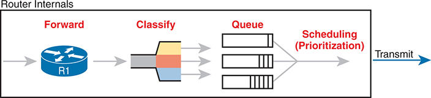

<figcaption>

<aside class="hidden" id="a15fig03">

过程从前进步骤开始,即输入的数据包输入路由器. 箭头表示数据从这个初始阶段到下一个阶段的流量. 在分类阶段,根据预先定义的标准对数据包进行评估和分类,从视觉上以漏斗为代表,将数据包分为以颜色代码为标志的不同类别。 这种分类有助于确定每个包的优先级别或类型,为随后的排队过程提供方便. 分类后,包会进入队列阶段,根据分级安排到不同的队列. 图像显示多个队列,可视化代表为平行垂直堆栈,表示不同类别数据包的单独路径. 最后阶段,即日程安排(优先),涉及确定不同队列的包将传送的顺序。 这一阶段对于确保首先发送高度优先数据包,优化网络的整体效率和性能至关重要。 然后发送计划包,以箭指向右边的传送阶段来表示。

</aside>

<strong>图15-3</strong> <em>大思想:在路由器中排队的分类</em>

</figcaption>

</figure>

图中显示了路由器的内部以及部分内部处理过程中的包会发生的情况,将路由器内左向右移动,如下所示:

台阶.1.路由器会作出转发(路由)决定.

台阶.2.输出排队工具使用分类逻辑来确定哪些包会进入哪个输出队列.

台阶.3.路由器在输出队列中持有数据包,等待输出的接口可用以发送下一封信.

台阶.4.排队工具的排程逻辑选择了下一个包, 有效地将一个包排到另一个包上 。

虽然示例显示了一个排队工具,但请注意,排队工具需要能够通过比较消息和配置来对消息进行分类,这与ACL大相径庭.

</section>

<section>

<h4 class="h4" id="ch15lev2sec6">匹配（分类）基础</h4>

现在从全企业的角度考虑分类,这帮助我们理解标记的必要性. 每个QoS工具都可以检查各种头来比较分类包. 然而,你可能会将QoS工具应用到网络中大多数的每个设备上,有时在大多数接口的入入入入出出入入出入入入. 使用每个设备以及大多数接口中许多头字段的复杂匹配需要大量的配置. 匹配包的工作甚至可以降解一些设备的装置性能. 所以,虽然你可以让每个设备都使用复杂的包匹配, 但这样做是一个糟糕的策略。

一个更好的策略,由Cisco和RFCs推荐,建议在一个包的早期做复杂的匹配,然后标记包.<a id="key_174" href="#ref-gloss_204">标记</a>指QoS工具会改变一个或多个首部字段,在标题中设置一个值. 已经设计出几个头字段,以标记用于QoS处理的包. 然后,在后期处理数据包的设备可以使用更简单的分类逻辑.

<a href="#ch15fig04">图15-4</a>显示一个实例,左边有一个 PC 将 IP 包发送到图右侧的一些主机( 未显示) 。 切换 SW1, 第一个转发数据包的网络设备, 做一些复杂的比较并标记数据包<a id="key_170" href="#ref-gloss_114">差异化服务码点(DSCP)</a> 字段,表示QoS标记的 IP 标题中的 6-bit字段。 接下来处理此消息的三种设备—— SW2, R1, R2—— 然后使用更简单的匹配来通过比较包的DSCP值来分类包, 将一个DSCP值的包放在 1 类中, 将包和另一个DSCP值放在 2 类中 。

<figure class="image-c" id="ch15fig04">

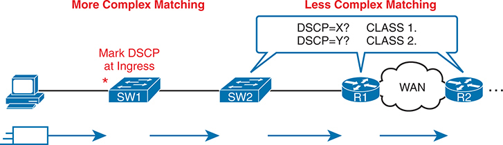

<figcaption>

<aside class="hidden" id="a15fig04">

网络地貌包括了各种装置和连接,过程分为两个部分:更复杂的相配和更不复杂的相配. 从左边开始,个人电脑连接到一个被标记为S W 1的交换机. 入侵点是DSCP值被标出的地方,由一颗红星指向相邻的S W 1. 入侵时的这种标记是比较复杂的匹配过程的一部分,它涉及对入站流量的详细检查和分类. 标记的流量随后会流到另一个被标记为S W-2的交换机上,这继续了转发过程. 该图向Less Complex配对区段过渡,该区段通过标有R-1和R-2的路由器通路,通过广域网(WAN)连接. 路由器使用更简单的匹配规则根据DSCP值对流量进行分类,如与DSCP的语音泡等同为X所显示? Classs 1和DSCP等同Y?. Classs 2. 方向箭可以说明个人电脑的流量通过S W-1和S W-2,再通过路由器R-1和R-2横穿WAN. WAN云符号表示连接路由器的广域网.

</aside>

<strong>图15-4</strong> <em>企业分类和标识系统</em>

</figcaption>

</figure>

</section>

<section>

<h4 class="h4" id="ch15lev2sec7">在路由器上使用 ACL 和 NBAR 进行分类</h4>

现在大家知道分类和标记在一起的基本原理了,本节以更仔细地看路由器上的分类来更深入地讨论,然后更仔细地看看标记功能.

首先,QoS分类听起来很像ACLs的作风,应该如此. 事实上,许多QoS工具支持仅指IP ACL的能力,具有这种逻辑:

对于ACL与许可动作相匹配的任何包,视该包为QoS相匹配,那么特定的QoS动作也会如此.

以教诲发誓,<a href="#ch15fig05">图15-5</a>显示 IP 和 TCP 头。 所有这些字段都与QoS分类相匹配.

<figure class="image-c" id="ch15fig05">

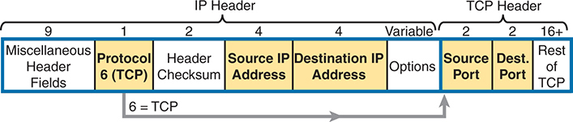

<figcaption>

<aside class="hidden" id="a15fig05">

该图细分了I P包的结构,并突出了用于扩展ACL分类的相关字段. 数据包主要分为两个头:I P头和TCP头. 从左边开始,I P头中的第一个部分包括"杂项"头字段,它有9个字节长并包含各种头信息. 下一个字段被贴上"协议6"(TCP)的标签,并有1字节长,表示所使用的协议是"TCP",而编号为"6"代表了"协议领域"中的"TCP. 在此之后是Header Checksum字段,这个字节也为1字节长并用于对Heaper的完整性进行错误检查. 其次,强调了扩展ACL的两个关键领域:源 I P地址和目的地 I P地址,每个字节长为4个字节。 这些字段分别指定发件人和接收人的I P地址. 可以在 IP 标题内遵循可变长的字段标签选项,用于可能存在的附加选项. 向TCP头过渡,前两个被突出显示的字段是源端口和目的端口,每个字节长为2个. 这些字段分别指定了源应用程序和目的应用程序使用的端口号. TCP头的剩余部分被标注为"TCP的其余部分",长度至少为16字节,并包含了其他TCP特有的信息,如序列号,承认号,旗帜,窗口大小等.

</aside>

<strong>图15-5</strong> <em>扩展ACLs使用的五个字段的分类</em>

</figcaption>

</figure>

现在考虑一下企业的QoS计划。 该计划应列出详细情况,例如为了排队目的、为了流量整形和为了任何其他 " QoS " 工具,哪些类型的交通应划入同一类别。 该计划应详细列出标题中可以匹配的字段。 例如,如果所有IP电话都位于地址10.3.0.0/16范围内的子网中,那么QoS计划就应该说明这一点. 然后,网络工程师可以配置一个扩展的ACL,将所有数据包与10.3.0.0/16内部的IP地址相匹配,并对语音流量应用适当的QoS动作.

然而,并不是每个分类都可以通过与ACL相匹配来容易地进行. 在更具挑战性的情况下,可以使用Cisco网络基于应用程序识别(NBAR). NBAR基本上处于第二大版本,称为NBAR2或下一代NBAR.简言之,NBAR2以对QoS非常有用的多种方式匹配了分类包.

NBAR2看起来远远超出了ACL在信息中可以检查的范围. 仅凭知名的端口无法识别出许多应用. NBAR解决了这些问题。

Cisco还组织NBAR可以匹配的功能,使得交通容易分出不同的等级. 例如,Cisco WebEx应用程序在网上提供音频和视频会议。 在QoS计划中,你可能想要将WebEx与其他视频流量不同分类,并将其与IP手机之间的语音通话不同分类. 也就是说,你可以对WebEx的流量进行分类,并给它一个独特的DSCP标记. NBAR为WebEx提供了容易的内置匹配能力,加上1000多个不同的子类应用程序.

和NBAR一起开车回家<a href="#exa15_1">示例15-1</a>列出许多 NBAR 配置命令之一的多行帮助输出。 我选择了各种可能更令人难忘的物品. 在正确的配置命令中,在帮助行中使用了关键词,可以匹配与各种亚马逊公共云提供相关的流量. NBAR提到将不同应用的特性定义为:<em>应用程序签名</em>.

<strong>示例15-1</strong> <em>许多 NBAR2 可匹配应用程序示例</em>

<a href="#code-f0332-01" id="f0332-01a">点击此处查看代码原图</a>

<pre class="pre-ex" tabindex="0"><code class="highlight">R1#(config)# <strong>class-map matchingexample</strong>
R1(config-cmap)# <strong>match protocol ?</strong>

! output heavily edited for length
  amazon-ec2                Secure and resizable compute capacity in the cloud.
  amazon-instant-video      VOD service by Amazon
  amazon-s3                 Amazon S3 (Simple Storage Service) is a cloud
                            computing web service.
  amazon-web-services       Amazon collection of remote computing services
! Output snipped.</code></pre>

</section>

<section>

<h4 class="h4" id="ch15lev2sec8">标记 IP DSCP 和以太网 CoS</h4>

企业的 " QoS " 计划以创造应接受某些类型的 " QOS " 治疗的交通类别为中心。 这项计划将注意到如何将数据包分类到每个数据包中,以及应该标记在数据包上的值,基本上把每个数据包贴上数字,以便与该分类联系起来。 例如,该计划可以规定如下:

<ul class="sq">

<li>
将所有用于商业目的的语音有效载荷流量分类为IP DSCP EF和CoS 5。
</li>

<li>
将所有用于商业目的的视频会议和其他互动视频分类为IP DSCP AF41和COS 4.
</li>

<li>
将所有业务关键数据应用流量分类为IP DSCP AF21和COS 2.
</li>

</ul>

这个下个话题更仔细地审视了可以被标记的具体字段,定义了DSCP和COS标记字段.

<section>

<h5 class="h5" id="ch15lev3sec3">标记 IP 首部</h5>

在IP头中标记一个QoS字段与QoS合作良好,因为IP头存在于从源主机到目的地主机的整个行程. 当一个主机发送数据时,主机会发送一个数据链接帧来封装一个IP包. 每个转发IP包的路由器都丢弃了旧的数据链接头并添加了一个新的头. 因为IP路由保留了IP头,所以IP头中的标记从IP头被标记的第一地一直保留到到达目的地主机的数据.

IPv4 在 IPv4 标题中定义了一类服务( TOS) 字节, 如<a href="#ch15fig06">图15-6</a>。原始 RFC 定义了 3-bit<a id="key_171" href="#ref-gloss_180">IP 优先( IPP)</a>字段用于 QoS 标记。 这个字段给了我们8个单独的值——二进制--000,-001,-010等,通过-111——转换为十进制时为-0至-7.

<figure class="image-c" id="ch15fig06">

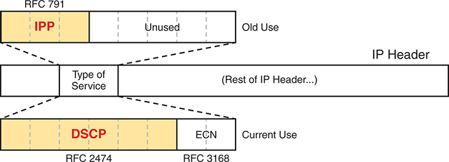

<figcaption>

<aside class="hidden" id="a15fig06">

在图像中,I P头显示时会以服务字段类型为焦点. 由 RFC 791 定义的这个字段的旧用法为 I P P Preedence (IPP) 分配了前三个比特,以黄色突出并被标注为 IPP,其余比特未使用. RFC 2474和RFC 3168定义的当前用法重新定义了这个领域. 前6个比特现在用于DSCP,也用黄色和被标记为DSCP来突出显示,而后2个比特则用于明确摄取通知(ECN).

</aside>

<strong>图15-6</strong> <em>IP 优先和区别服务代码点字段</em>

</figcaption>

</figure>

注意

RFC 791的ToS字节后5个字节大多是为某种目的定义的,但实际上并未被大量使用.

虽然是一个好主意,但IPP只给了我们八个不同的值来标记,因此后来的RFCs用DSCP域重新定义了ToS字节. DSCP将标记位数增加到了6位,允许64个可以被标记的独特值. 密码<a id="key_169" href="#ref-gloss_113">差异服务(DiffServ)</a>早在1990年代后期成为RFCs的RFC已经被接受为在做QoS时最常用的方法,而使用DSCP场来作标记也变得相当普遍.

IPv6也有类似的领域需要标记. 6位字段也取名DSCP,IPv6标题中的字节被叫作IPv6<em>交通类</em>字节。 否则,想一想IPv4和IPv6在标识上是等同的.

IPP和DSCP字段可以用其小数值以及一些方便的文本名来引用. 后面一节的标题是“<a href="#ch15lev2sec10">DiffServ 建议的标记值</a>“详细列出一些名字。

</section>

<section>

<h5 class="h5" id="ch15lev3sec4">标记以太网 802.1Q 首部</h5>

另一个有用的标记字段存在于802.1Q首部中,在最初由 IEEE 802.1p标准定义的字段中. 此字段位于4-byte802.1Q首部的第三个字节中,作为一个3-bit字段,提供八个可能的值来标记(参见:<a href="#ch15fig07">图15-7</a>) 它有两个不同的名字:<a id="key_166" href="#ref-gloss_074">服务类别(COS)</a>和<em>优先级代码点 (PCP)</em>.

<figure class="image-c" id="ch15fig07">

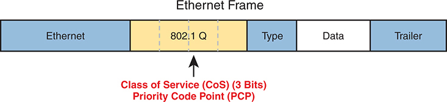

<figcaption>

<aside class="hidden" id="a15fig07">

图像描绘了以太网帧,强调在以太网头与被框的有效载荷之间插入了802.1Q slash p header. 802.1Q slash p header包括一个被标记为优先代码点(PCP)的字段,以黄色突出出,为3位长并用于服务类(Co S)设置. 这个领域可以给网络流量分配不同级别的优先级,促进服务质量(Q o S)管理.

</aside>

<strong>图15-7</strong> <em>802.1Q/p 标题中的服务领域等级</em>

</figcaption>

</figure>

该图使用两种略为不同的灰色(印出)阴影来表示以太网头和尾部字段, 802.1Q 标题,作为提醒: 802.1Q 标题不包含在所有以太网框中。 802.1Q 标题只存在于 802.1Q 因此, QoS 工具只能为在使用干线的接口上启用的QoS 特性而使用 COS 字段。<a href="#ch15fig08">图15-8</a>.

<figure class="image-c" id="ch15fig08">

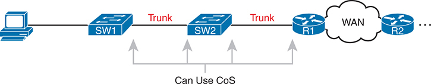

<figcaption>

<aside class="hidden" id="a15fig08">

从左边开始,一台计算机被连接到一个被标记为S W-1的交换机. 这个交换机通过干线连接到第二个交换机,即S W-2,这个交换机也通过干线连接到一个路由器,标记为R-1. R-1后被连接到一个广域网(WAN)上,这个广域网连接到另一个路由器,在最右边标有R-2. 该图表明Co S可以被用在S W −1和S W −2之间的干线连接上,以及S W −2和 R −1之间的干线连接上.

</aside>

<strong>图15-8</strong> <em>COS 标记的有用寿命</em>

</figcaption>

</figure>

例如,如果左边的PC将数据发送到图外的某处的服务器,那么整个行程都会存在DSCP字段. 然而,COS场将仅存在于两个干线上,主要用于箭行指向的四个接口上.

</section>

<section>

<h5 class="h5" id="ch15lev3sec5">其他标记字段</h5>

其他标记字段也存在于其他标题中.<a href="#ch15tab02">表15-2</a>列出这些字段供参考。

<figure class="table" id="ch15tab02" tabindex="0">

<figcaption>

<strong>表15-2</strong>标记字段

</figcaption>

<table class="all">

<tbody>

<tr>

<th class="th">
字段名称
</th>

<th class="th">
首部
</th>

<th class="th">
长度( 位数)
</th>

<th class="th">
使用位置
</th>

</tr>

<tr>

<td class="border">
DSCP
</td>

<td class="border">
IPv4、IPv6
</td>

<td class="border">
6
</td>

<td class="border">
端到端包
</td>

</tr>

<tr>

<td class="border">
IPP
</td>

<td class="border">
IPv4、IPv6
</td>

<td class="border">
3
</td>

<td class="border">
端到端包
</td>

</tr>

<tr>

<td class="border">
CoS
</td>

<td class="border">
802.1Q
</td>

<td class="border">
3
</td>

<td class="border">
通过 VLAN 中继链路
</td>

</tr>

<tr>

<td class="border">
TID
</td>

<td class="border">
802.11
</td>

<td class="border">
3
</td>

<td class="border">
通过 Wi-Fi
</td>

</tr>

<tr>

<td class="border">
EXP
</td>

<td class="border">
MPLS 标签
</td>

<td class="border">
3
</td>

<td class="border">
通过 MPLS WAN
</td>

</tr>

</tbody>

</table>

</figure>

</section>

</section>

<section>

<h4 class="h4" id="ch15lev2sec9">定义信任边界</h4>

终端用户设备可以标记DSCP字段——甚至连COS字段,如果在链接上使用干线. 作为网络工程师,你是否相信这些设置,并让网络设备信任这些标记并对这些标记做出反应,以进行各种QoS动作?

我们大多数人不会这样做,因为最终用户控制有时可能不适当地使用。 例如,一个PC用户对DiffServ和DSCP了解得足够多,可以知道大多数语音流量被标记为DSCP,叫"快速转发"(EF),它有一个小数值为46. 语音流量得到很好的QoS治疗,因此PC用户可以将所有流量标记为DSCP46,希望得到很好的QoS治疗.

为企业创建QoS计划的人必须选择将网络的信托界限放在哪里. 密码<em>信任边界</em>指的是一个通过网络流出的数据包的路径中的点,在这个路径中,网络设备可以信任当前的QoS标记. 该边界一般位于信息技术工作人员控制的装置中。

例如,一个典型的信任边界可以设置在网络中的第一个入侵切换器中间,例如:<a href="#ch15fig09">图15-9</a>。PC发送的消息上的标记无法信任. 然而,由于SW1在包入交换机时进行了分类和标记,因此可以信任这时的标记.

<figure class="image-c" id="ch15fig09">

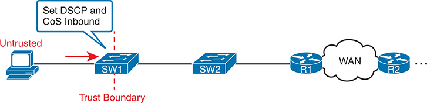

<figcaption>

<aside class="hidden" id="a15fig09">

在左边,一个被贴上"无信任"标签的计算机被连接到一个被贴上"S W-1-"标签的交换机上. 计算机与S W 1的连接被标记为红色的被标记为"信任边界"(Trust Birder). 图表显示,DSCP和Co S值被设定在S W 1上,用于来自无人信任的计算机的流量。 网络从S W 1到另一个交换机,S W 2,然后连接到一个路由器上标注为R 1. R1已连接到一个广域网(WAN),导致另一路由器被标记为R2在最右侧.

</aside>

<strong>图15-9</strong> <em>信任设备-PC</em>

</figcaption>

</figure>

有趣的是,当访问层包括IP Phone时,电话一般是信任边界,而不是访问层交换机. IP Phone可以设置由手机所创建的信息的COS和DSCP字段,以及从PC通过手机传输的信息.<a href="#ch15fig10">图15-10</a>标出手机的标记逻辑:用特定的DSCP和/或CoS标出PC的所有流量,以及用不同值标出手机流量。

<figure class="image-c" id="ch15fig10">

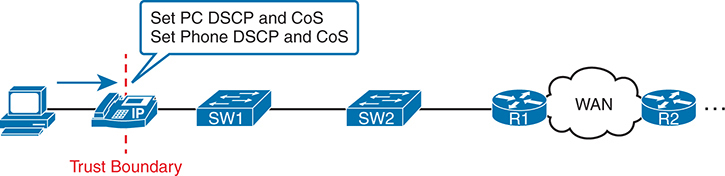

<figcaption>

<aside class="hidden" id="a15fig10">

左边有一个PC连接到一个IP电话,然后连接到一个被标记为S W-1的交换机. 这个交换机与另一个交换机S W 2相接,通过路由器R-1和R-2连接到广域网(WAN). 在P C 和 I P 电话之间划出一条红色的被标记为信任边界的分界线,标明信任边界的设置地点。 I P电话的配置是为了设置P C和电话本身的分化服务代码点和服务类值(DSCP). IP手机上方的语音泡包含有:设置PCDSCP和CoS,设置Phone DSCP和CoS等文字,说明IP手机负责在流量到达交换机后再分配出这些Q o S值,然后是WAN.

</aside>

<strong>图15-10</strong> <em>信任设备-IP电话</em>

</figcaption>

</figure>

</section>

<section>

<h4 class="h4" id="ch15lev2sec10">DiffServ 建议的标记值</h4>

本章中的一切都遵循了最初由RFC 2475定义的DiffServ架构,外加许多其他DiffSServ RFC. 特别是DiffServ在几个领域超越了理论,包括就标识IP包时使用的具体DSCP值提出建议. DiffServ建议为特定类型的流量打上具体标记,希望在所有网络中一致地使用DSCP值。 通过这样做,产品销售商可以为其QoS特性提供良好的默认设置,QoS可以在企业和服务提供商之间更好地工作,还可以实现许多其他好处.

后两个话题概述了DiffServ中使用的三套DSCP值.

<section>

<h5 class="h5" id="ch15lev3sec6">加速转发（EF）</h5>

DiffServ 定义<em>快速转发(EF)</em>DSCP值——一个单一值——建议用于需要低延迟(延迟)、低抖动和低损失的包。 快速转发RFC 3246定义了特定的DSCP值(小数46)和等同的文本名(Expedited Transfering). QoS配置命令允许使用十进制值或文本名称,但使用文本缩略语的一个目的是使该值更能被纪念,因此许多QoS的配置参考了文本名称.

QoS计划通常使用EF来标记语音有效载荷包. 随着语音调用,一些包携带语音有效载荷,而其他包则携带呼叫信号信息. 调用信号消息在两个设备之间设置(创建)语音调用,不需要低延迟,快活和丢失. 语音有效载荷包载有数字化语音,如上所示。<a href="#ch15fig02">图15-2</a>,这些包确实需要更好的QoS. 默认情况下,Cisco IP Phones用EF标记语音有效载荷,并用另一个叫CS3的值标记手机发送的语音信号包.

</section>

<section>

<h5 class="h5" id="ch15lev3sec7">保证转发（AF）</h5>

密码<em>保证移交(AF)</em>DiffServ RFC (2597)定义了一组12个DSCP值,意在互相配合使用. 首先,它定义了排队系统中四个分队的概念. 此外,它定义了每个队列中用于防堵工具的三等降级优先级. 每排有4个队列,并有3个降下优先级,您需要12个不同的DSCP标识,每个组合排出优先级并降出优先级. (本章下文将讨论排队和阻塞机制。 )

Assurved Transfering 定义了AF DSCP 中列出的特定文本名称和等同的小数值<a href="#ch15fig11">图15-11</a>。文本名称遵循AFXY格式,X指队列(1通过4)和Y指降级优先级(1通过3).

<figure class="image-c" id="ch15fig11">

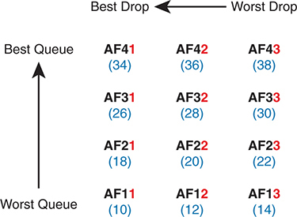

<figcaption>

<aside class="hidden" id="a15fig11">

矩阵由9个AF类组成,排列为3乘以3的网格. 垂直轴代表队列偏好,上方为"最佳队列",下方为"最差队列". 水平轴代表倒放优先级,左边有"最佳倒放"(Best Drop),右边有"最坏倒放". 网格中的每个单元格都包含一个A F值,其相应的DSCP值在括号中. 第一行(Best Quue)包含:AF 41 (34),AF 42 (36),A F 43 (38). 第二行包括:A F 31 (26)、A F 32 (28)、A F 33 (30)。 第三行(Worst Queee)包含:A F 21 (18),A F 22 (20),A f 23 (22). 第四行(Worst Queee)包含:AF 11(10),AF 12 (12),A F 13 (14). 图表显示,降位优先的A F值(e dot g dot,A F 41)具有较高的优先级并不太可能被降;而降位优先高的F值(e dot g dot,A F 13)具有较低的优先级并更有可能被降.

</aside>

<strong>图15-11</strong> <em>不同服务保证了价值和意义转移</em>

</figcaption>

</figure>

例如,如果用全部12个值标记包,那么AF11、AF12和AF13的包将全部排入一个队列;AF21、AF22和AF23的包将排入另一个队列;等等。 在AF2Y所有流量的排队中,你会对AF21,AF22,和AF23在投放动作(阻塞避)方面各有不同的处理方式,其中AF21获得优待,而AF23获得最差的待遇.

</section>

<section>

<h5 class="h5" id="ch15lev3sec8">类别选择器（CS）</h5>

最初,ToS字节被定义为3位IP Precedence (IPP)字段. 当DiffServ重新定义了"ToS字节"时,为了与IPP值的后向相容性而创建出8个DSCP值是有道理的. 密码<em>类选择器( CS)</em>DSCP值就是这些设置.

<a href="#ch15fig12">图15-12</a>在名称和十进制值中,显示与八个 CS 值一起的主要想法。 基本上,DSCP值与IPP字段具有相同的前3位,后3位的二进制为0s,如图中左侧所示. CSx代表文本名称,其中x是匹配的IPP值(0到7).

<figure class="image-c" id="ch15fig12">

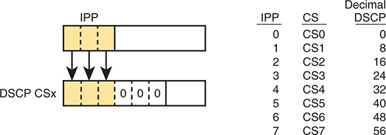

<figcaption>

<aside class="hidden" id="a15fig12">

左部分显示IPP值被映射为DSCP值. IPP值为3个位长,显示直接被复制到DSCP域的前3个位. DSCP字段的其余3个位被设定为0,形成6个位的DSCP值. 这种转变过程被显示为将IPP值映射到DSCP的箭头所突出. 在图像的右侧,一个表格显示IPP值,类选择器(C S)名称,及其十进制DSCP等同物之间的对应. 表格条目如下: IPP0地图到 C S0,DSCP值为0. IPP1地图到 C S1,DSCP值为8. IPP2地图到 C S2,DSCP值为16. IPP3地图到C S3,DSCP值为24. IPP4地图到C S4,DSCP值为32. IPP5地图到 C S5,DSCP值为40. IPP6地图到 C S6,DSCP值为48. IPP7地图到C S7,DSCP值为56. 绘制地图对于在网络交通管理中执行Q o S政策至关重要。

</aside>

<strong>图15-12</strong> <em>类别选择器</em>

</figcaption>

</figure>

关于分类和标识的这一节为理解本章下三节所探讨的工具提供了坚实的基础:排队、流量整形和流量监管以及避免拥堵。

</section>

<section>

<h5 class="h5" id="ch15lev3sec9">DSCP 标记值的指导原则</h5>

即便对各种DSCP标记值的这个介绍,你也可以想象企业需要遵循一个关于如何使用标记的公约. 拥有如此多的不同值,在同一企业中不同设备对不同的DSCP值使用不同,最多只能使QoS的部署变得相当困难.

思科公司在为QoS标准化所作的许多努力中,帮助开发了RFC 4954,这是一种RFC,它定义了几种公约,用于如何使用DSCP领域. RFC提供不同程度的详细替代计划. 每个计划都定义了一种流量和DSCP值,在标记数据时使用. 在不进入任何一项计划的深度的情况下,所有计划都具体说明了所有设备应如何将数据标记如下的一些变异:

<ul class="sq">

<li>
DSCP EF:语音有效载荷
</li>

<li>
AF4x:交互式视频(例如电视会议)
</li>

<li>
AF3x:流媒体
</li>

<li>
AF2x:高优先(低延迟)数据.
</li>

<li>
CS0:标准数据.
</li>

</ul>

Cisco不仅努力制定RFC标准,而且还使用这些标准。 Cisco根据RFC 4594中的标记数据使用默认标记常规,但有一些小例外. 如果要更多读取这些QoS标记计划,请参考几个来源. 首先,查找 Cisco QoS 设计指南 。<a href="http://Cisco.com">Cisco.com</a>。也参考了RFC4594.

</section>

</section>

</section>

<section>

<h3 class="h3" id="ch15lev1sec5">排队</h3>

所有网络设备都使用队列. 网络设备接收消息, 作出转发决定, 然后发送消息... 但有时发送的接口会很忙 。 因此,设备将发送的消息保留在队列中,等待发送的接口可用——足够简单了.

术语<a id="key_180" href="#ref-gloss_276">排队</a>指的是QoS工具集,用于管理在等待返回时持有包的队列以退出接口(在其他情况下,路由器持有包以等待某种资源). 但是排队是指不止一个想法,所以你必须去查看设备的内部,思考它们是如何工作的. 例如,考虑<a href="#ch15fig13">图15-13</a>,显示路由器的内部。 当然,路由器会作出转发决定,它需要准备好在输出的接口可用后排队传输包. 同时,路由器还可以采取各种其他动作,有:也女气相通(ACL),相通相通相机(在内部接口上),相接相通相接相接相机在转发后进行等.

<figure class="image-c" id="ch15fig13">

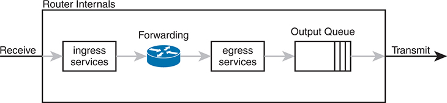

<figcaption>

<aside class="hidden" id="a15fig13">

图表从左起取一个标记为“接收”的箭头,表示输入路由器的数据包。 第一阶段是被贴上入室服务标签,代表入室包的初始处理. 在此之后,数据包会进入前进阶段,其中路由器确定每个数据包的适当后退路径. 接下来,包会进入 Egress 服务阶段,其中在被放入输出队列之前会应用额外的处理. 输出队列被描绘为一连串堆叠的矩形,表示包被按照预先定义的标准组织并排列出优先次序. 图表显示右侧标有箭头的 Transmit, 表示被排入队列后数据包会从路由器中被发送出 。 这个过程确保了数据包的有序传输,坚持路由政策和在路由器上配置的Q o S设置.

</aside>

<strong>图15-13</strong> <em>在路由器中输出排队: 传输前最后输出动作</em>

</figcaption>

</figure>

图中显示<em>输出队列</em>,设备在输出接口可用之前持有消息。 排队系统可能使用单一输出队列,并设有先入先出(FIFO)调度器. (换句话说,这就像在三明治店订购午餐,

接下来,更深入地思考排队系统. 大多数的网络设备可以有一个有多个队列的排队系统. 要使用多组队列,排队系统需要一个分类器函数来选择哪些包被放入哪个队列. (分类器可以对先前所标记的值作出反应,也可以做更广泛的匹配. ) 排队系统也需要一个排程器,以便在接口可用时决定下一步要带哪个消息,如上所示.<a href="#ch15fig14">图15-14</a>.

<figure class="image-c" id="ch15fig14">

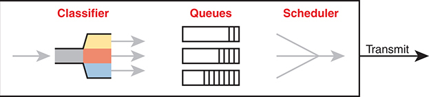

<figcaption>

<aside class="hidden" id="a15fig14">

流量流入分类器,根据预定标准分为不同的类别。 分类流量再被引导为单独的队列,这些队列被显示为代表不同队列处理流量的三个垂直矩形. 每个队列存储包,直到它们准备好被传送为止. 最终的组件是调度器,它管理从队列传输包的顺序和时间. 调度器确保根据设定的调度政策发送数据包,最后一步是传输阶段,即传输流量被发送出系统. 这幅图片详细展示了以CBWFQ为主的基于分级的重心展会(CBWBQ),并附有回合-罗宾排行表. 与第一个图像类似,过程从一个分类器开始,它以一个带有色码的分节的漏斗为代表,该分节将来电流量分入不同的类. 分类流量被定向为三个被标注为Q1,Q2和Q3的具体队列,显示为垂直矩形. 每个队列被分配到不同的带宽百分比,由标签表示:Q 1 有20%,Q 2 有30%,而Q 3 有50%. 调度员使用圆-罗宾机制,被描绘为圆形箭头,根据所分配的重量来分配带宽并管理从队列发出的包传输. 最后一步是传送相机舞台,其中的预定流量被发送出系统.

</aside>

<strong>图15-14</strong> <em>排队组件</em>

</figcaption>

</figure>

在排队系统的所有这些组件中,调度器可以是最有趣的部分,因为它可以执行优先排序.<em>优先排序</em>是指以某种方式优先排出一个队列而不是另一个队列的概念。

<section>

<h4 class="h4" id="ch15lev2sec11">轮询调度（优先级处理）</h4>

Cisco路由器和交换机使用的一个调度算法采用了圆-robin逻辑. 以最基本的形式<a id="key_181" href="#ref-gloss_294">轮询</a>按顺序循环,随每个队列轮流进行。 在每个周期中,调度器要么取出一个消息,要么取出每个队列中的一些字节,通过取出足够多的信息来取出这个字节数的总和. 带一些信息从队列 1 开始,从队列 2 开始取出一些,然后从队列 3 开始取取出一些等,在完成完整通过队列后从队列 1开始返回。

圆桌会议日程安排还包括以下概念:<em>加权</em>(一般称为:<em>加权轮询</em>) 基本上,调度器从每个队列中取出不同的数据包(或字节),给予一个队列比另一个队列更多的偏好.

例如,路由器使用一个通俗工具,称为<em>基于阶级的加权公平排名(CBWFQ)</em>保证每一类的最低带宽。 也就是说,每个类都至少得到在拥堵时期配置的带宽量,但也许更多. 在内部,CBWFQ使用加权圆-robin调度算法,同时让网络工程师将权重定义为链接带宽的百分比.<a href="#ch15fig15">图15-15</a>显示一个实例,其中系统的三个队列分别获得了20%、30%和50%的带宽。

<figure class="image-c" id="ch15fig15">

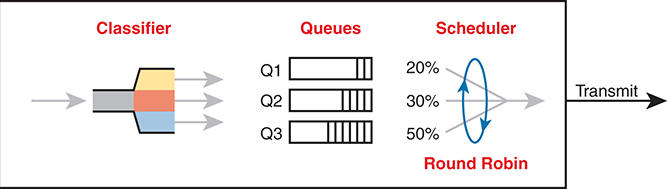

<figcaption>

<aside class="hidden" id="a15fig15">

在左侧,分类器部分显示进入的数据流被归类为不同类型的流量. 分级者将数据分为四个被标记为"语音"的队列,数据1,数据2和默认,每个队列分别代表不同类型的网络流量. 在中心,队列部分列出这四个队列,表示数据是根据其类型排列的. 右侧的调度器部分使用轮询算法来分配传输带宽. 轮询排程器被描绘为一个有箭头和百分比分配的圆:50%用于语音,10%用于数据1,15%用于数据2,25%用于默认流量. 这意味着调度员根据这些百分比按比例向每个队列分配传输机会.

</aside>

<strong>图15-15</strong> <em>CBWFQ 回合-罗宾日程安排</em>

</figcaption>

</figure>

随着图中显示的排队系统,如果出站链接被拥堵,调度器保证了图中显示到每个队列的百分比带宽. 也就是说,队列1得到20%的链接 即使在繁忙时期。

</section>

<section>

<h4 class="h4" id="ch15lev2sec12">低时延排队</h4>

本章前面的“<a href="#ch15lev3sec2">语音和视频应用</a>”一节讨论了语音和视频，特别是电话和视频会议等交互式语音、视频，为什么需要低时延、低抖动和低丢包率。遗憾的是，轮询调度器无法提供足够低的时延、抖动或丢包率。解决办法是为调度器添加低时延排队（LLQ）。

先快速回顾一下，<a href="#ch15tab03">表15-3</a> 列出一次语音呼叫的 QoS 要求。数据来自本章前面引用的《<em>企业 QoS 解决方案参考网络设计指南</em>》。每次呼叫所需的带宽取决于所使用的编解码器。不过，所有语音呼叫的时延、抖动和丢包要求都相同。（交互式视频对时延、抖动和丢包也有类似要求。）

<figure class="table" id="ch15tab03" tabindex="0">

<figcaption>

<strong>表15-3</strong> Cisco 语音设计指南中 VoIP 呼叫的 QoS 要求

</figcaption>

<table class="all">

<tbody>

<tr>

<th class="th">
每次呼叫的带宽
</th>

<th class="th">
单向时延（最大值）
</th>

<th class="th">
抖动（最大值）
</th>

<th class="th">
丢包率（最大值）
</th>

</tr>

<tr>

<td class="border">
30–320 Kbps
</td>

<td class="border">
150 ms
</td>

<td class="border">
30 ms
</td>

<td class="border">
&lt;1%
</td>

</tr>

</tbody>

</table>

</figure>

轮询排队系统会给这些语音和视频数据包增加过多时延。要理解原因，假设一个语音数据包到达，并被路由到使用<a href="#ch15fig16">图15-16</a> 所示排队系统的某个接口发送。但是，该语音数据包恰好在轮询调度器转而服务“data 1”队列时到达。即使语音队列获分配了 50% 的链路带宽，调度器仍必须先从其他三个队列发送一些消息，才会发送该语音消息，从而增加时延和抖动。

<figure class="image-c" id="ch15fig16">

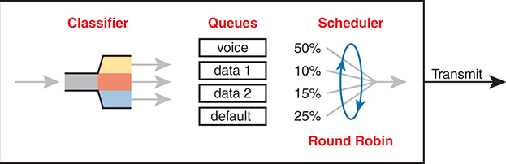

<figcaption>

<aside class="hidden" id="a15fig16">

在左侧,分类器部分显示进入的数据流被归类为不同类型的流量. 分级者将数据分为四个被标记为"语音"的队列,数据1,数据2和默认,每个队列分别代表不同类型的网络流量. 在中心,队列部分列出这四个队列,表示数据是根据其类型排列的. 右侧的排程器部分使用轮询算法,但对语音流量有特别的优先权. LLQ机制用标签LLQ-Always Next来表示,并用箭头从语音队列直接指向传输路径,绕过圆-robin循环.

</aside>

<strong>图15-16</strong> <em>轮询不利于控制语音时延和抖动</em>

</figcaption>

</figure>

解决办法 LLQ 告诉调度器，将一个或多个队列作为特殊的<a id="key_178" href="#ref-gloss_266">优先队列</a>。LLQ 调度器始终从这些特殊优先队列之一取出下一条消息。这样，队列中的数据包时延很小，抖动也很小，问题得到解决。此外，队列来不及填满，因此不会因队列满而丢包。<a href="#ch15fig17">图15-17</a> 展示为语音队列添加 LLQ 逻辑后的情况。

<figure class="image-c" id="ch15fig17">

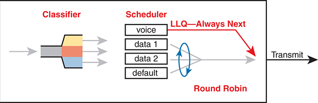

<figcaption>

<aside class="hidden" id="a15fig17">

在左侧,一个被标记为"来袭测量交通速率"的图表显示随着时间的推移,交通量会波动,标注为"T等于0到T等于1",而蓝色破折线代表了警力率. 交通高峰和河谷表明来通车率的自然变化. 一个被标记为"流量监管率"的箭头指向了右边,导致另一个被标记为外出测量交通率的图表. 此图还显示从T等于0到T等于1的时段交通量有波动,但高峰减少而河谷平滑,表明交通流量整形的效果. 外出交通图右侧贴有Burst标签的字条,突出显示偶尔发生的超过警力的交通暴动.

</aside>

<strong>图15-17</strong> <em>LLQ 总是排程语音包下一个</em>

</figcaption>

</figure>

使用 LLQ,或优先排队,为该排队的流量提供所需的低延迟,焦急和损失. 但是,想想那些其他的队列。 你看到问题了吗? 如果接口的速度是X比特每秒,但超过X比特/秒进入语音队列会怎样? 调度员从不为其他队列提供服务(称为<em>队列饥饿</em>).

您可能猜想,有一个解决方案:使用一个名为功能的功能,限制排入优先排队的流量<em>流量监管</em>。下一节更详细地讲述了警察,但目前认为它是优先队列所使用的带宽上的一个盖子. 例如, 您可以为语音队列保留20% 的链接带宽, 并使其成为优先排队 。 然而,在这种情况下,与其说20%是最小带宽, 不如说它是排队的最大。 如果超过20%的链接比特值出现在队列中,路由器就会丢弃多余的部分.

限制优先队列中的带宽量保护了其他队列,但这又引起了另一个问题. 声音和视频需要低损失, 和LLQ,我们把声音和视频输入优先排队,以丢弃超过带宽限制的多余消息。 解决方案? 寻找一种方法来限制网络将这条链接带出的声音和视频的数量,这样警察就不会丢弃任何流量. 有QoS工具可以帮助你做到这一点,叫做呼叫录用控制(CAC)工具. 然而,CAC工具在考试题目中没有得到提及,因此本章仅简要地提及这些工具.

</section>

<section>

<h4 class="h4" id="ch15lev2sec13">数据、语音和视频的优先级处理策略</h4>

关于排队的这一节提出了几个相关的想法,因此,在离开对排队的讨论之前,考虑一下大多数企业如何在其QoS计划中进行排队:

<ol class="number">

<li>
采用CBWFQ等轮询排队方法,用于数据类和非交互式语音和视频.
</li>

<li>
如果与典型的流量相比带宽过小,则给予支持业务关键应用的数据类比给予不太重要的数据类要多得多的保证带宽.
</li>

<li>
使用 LLQ 优先排队进行交互式语音和视频排行,实现低延迟,焦急和丢失.
</li>

<li>
将语音与视频分开排队,这样流量监管功能就分别适用于每个视频.
</li>

<li>
定义每个优先级队列的足够带宽, 这样内置的警察就不会丢弃优先级队队列中的任何信件 。
</li>

<li>
使用呼叫接收控制(CAC)工具来避免给网络添加过多的声音或视频,这将触发警察功能.
</li>

</ol>

</section>

</section>

<section>

<h3 class="h3" id="ch15lev1sec6">流量整形与流量监管</h3>

本节介绍两个相关的QoS工具——<a id="key_182" href="#ref-gloss_304">流量整形</a>和<a id="key_176" href="#ref-gloss_254">流量监管</a>。这些工具具有更专业的用途,在典型企业中并不多见。 这些工具在企业网络设计中最常被用到WAN边缘.

维持流量监管和流量整形都监控着通过设备流出的综合消息的比特率. 一旦启用,警察或定型员会记录每个通过的数据包,并随时间推移测量每秒位数。 两者都试图使比特率保持在或低于所配置的速度,但通过使用两个不同的动作:警察丢弃包,而形状者会将包按在队列中来拖延包.

形状和警察监测流量(通过形状或警察移动的每秒比特)与配置的流量<a id="key_183" href="#ref-gloss_305">整形率</a>或者说<a id="key_177" href="#ref-gloss_255">维持流量监管率</a>分别是: 双方提出的基本问题如下,根据答复采取的行动如下:

<ol class="number">

<li>
下一包是否将测量率推过配置的整形率或维持流量监管率?
</li>

<li>
若无:

<ol class="lower-alpha-n">

<li>
让数据包继续走在正常的路径上 并且不要做额外的数据包。
</li>

</ol></li>

<li>
如果是:

<ol class="lower-alpha-n">

<li>
如果流量整形,则通过排队来延迟消息.
</li>

<li>
如果维持流量监管,要么丢弃信息,要么以不同方式标记信息。
</li>

</ol></li>

</ol>

本节首先解释流量监管,即丢弃或重新标出超过流量监管速率的讯息,再由整形来减慢超过整形快率的讯息.

<section>

<h4 class="h4" id="ch15lev2sec14">流量监管</h4>

关注交通速率与设定的维持流量监管速率,以及弃置消息的维持流量监管行动。 这些概念是维持流量监管职能的核心。

交通以不同的速度到达网络装置,有山谷和尖顶。 也就是说,如果你将输入或退出任何接口的集体位元的比特率绘制成图,那么图就会看起来像左侧的比特率<a href="#ch15fig18">图15-18</a>。警方将测量这一比率,并作出类似的衡量。 仍然在图的左侧,水平破折线表示警力率,即为警力所配置的警力率. 因此,警察对长期测量的比特率有一定的认识,这可以和配置的比特率相比较.

<figure class="image-c" id="ch15fig18">

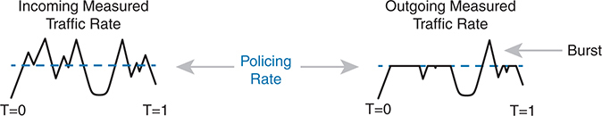

<figcaption>

<aside class="hidden" id="a15fig18">

图像上部显示一个简单的网络,有两个路由器,R 1和R 2,通过一个未说明的WAN连接,每个路由器分别被标有接口G 0 slash 1和G 0 srash 2. 下方部分展示了一个更为详细的设置,其中路由器R 1和R 2通过一对交换机连接. 交换机之间的连接代表了WAN链接,标签为每秒200兆比特. CIR. 图表还包括交换机附近的红色标签,显示警察每秒200兆比特,表明交通受到管制,以确保不超过每秒200个兆比特的CIR。

</aside>

<strong>图15-18</strong> <em>警用和制动器对提供交通载荷的影响</em>

</figcaption>

</figure>

右侧图上显示当警察丢弃任何原本会将率推出所配置的维持流量监管率的讯息时,交通会怎样. 实际上,警察以维持流量监管的速度砍出图表上方。

右侧的图还显示一个警察允许交通突起的例子. 警方允许在活动减少一段时间后,短暂地超出维持流量监管率。 因此,一个超过右侧图上警力率的峰值允许了爆发性数据应用的性质.

<section>

<h5 class="h5" id="ch15lev3sec10">在何处使用流量监管</h5>

既然你了解了维持流量监管的基本原理 慢慢考虑一下 警察监控消息,测量一个速率,并丢弃一些消息. 如何帮助一个网络在QoS方面? 乍一看,它似乎伤害了网络,丢弃了消息,其中许多传输或应用层将不得不再发送. 如何改善带宽、延迟、焦急或损失?

流量监管只有在某些情况下才有意义,作为一般的工具,它可以最好地被用在两个网络之间的边缘. 例如,考虑在R1和R2两个企业路由器之间建立典型的点到点地铁以太网WAN连接. 通常,企业网络工程师只是将WAN看成云,路由器上有以太网接口,如上图所示.<a href="#ch15fig19">图15-19</a>.

<figure class="image-c" id="ch15fig19">

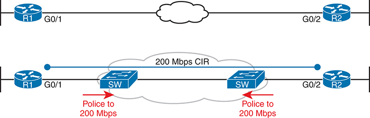

<figcaption>

<aside class="hidden" id="a15fig19">

图分为三个主要部分:转发器、整形器和输出排队。 左出行地段显示从R1输入路由器的流量. 流量再移动到Shaper区段,该区段包含多个队列. 上行队列被标注为LLQ(Low Latency Queing),为优先流量设计;而其他队列被标注为CBWFQ(Class-based Wighted Fair Queing),为不同流量类别设计. 流量按形状速率处理,如指向右侧的箭头所显示的,显示如何管理数据包以符合所配置的流量流量整形政策. 形状流量再移动到输出排队区段,在从路由器传输出之前排队. 该图突出显示使用有限责任公司优先安排重要流量,使用有限责任公司公平分配不同流量类别之间剩余带宽,确保高效和有秩序地传送数据包。

</aside>

<strong>图15-19</strong> <em>以太网 WAN: 链接速度 Versus CIR</em>

</figcaption>

</figure>

现在考虑一下这个MetroE连接的合同, 显示在底部<a href="#ch15fig19">图15-19</a>。在这种情况下,此连接会使用 Gigabit 以太网进行访问链接,并使用 200-Mbps<em>承诺信息率(CIR)</em>。即提供WAN服务的SP同意允许企业向每个方向发送出-200Mbps流量. 然而,请记住,企业路由器以访问链接的速度传输数据,或此处的1Gbps.

像SP一样思考一下, 考虑支持数以万计的 Gigabit 以太网链接 在你的WAN服务, 所有与 200-Mbps CIRs。 如果你让所有这些客户发送数据, 随着时间的推移,平均接近1000 Mbps(1 Gbps) 会发生什么? 也就是说,如果所有客户继续发送远远超出其签约的CIR的数据,那么大量的流量会给广域网服务造成拥堵. 此外,这些客户可能选择支付较低的CIR,知道SP无论如何都会发送数据。 而那些行为良好且没有发送超过其CIR的客户可能会像发送过多数据的客户一样遭受拥堵.

<a href="#ch15fig19">图15-19</a>也注意到问题的解决方案:SP可以对接入的包裹进行监管,设定出与客户选择的CIR匹配的维持率. 通过这样做,SP保护了所有客户免受发送过多流量的客户的负面影响. 顾客得到他们付的钱。 而SP可以提供实际流量率的报告,因此企业知道何时为每个链接购买更快的CIR.

警察可以丢弃过量的流量,但也可以重新标记包. 想想SP对入侵警察做了什么,如<a href="#ch15fig19">图15-19</a>:他们正在丢弃客户的留言。 因此,SP可能想要做出一个对客户更好的妥协,同时仍然保护SP的网络. SP可以以新的标记价值标记信息,采用这一战略:

<ol class="number">

<li>
重新标出超过警力的包裹,
</li>

<li>
如果其他SP网络设备在处理包时出现拥堵,不同的标记意味着设备可以丢弃包. 不过...
</li>

<li>
如果没有其它的SP网络设备在转发重新标记的包时出现拥堵,它反正会通过SP网络.
</li>

</ol>

通过这一策略,SP可以通过减少流量来更好地对待客户,同时在压力时期仍能保护SP的网络.

概述维持流量监管的主要特点:

<ul class="sq">

<li>
流量监管衡量一段时间的交通率,以便与所配置的流量监管率进行比较。
</li>

<li>
流量监管允许在一段时间后出现数据突起.
</li>

<li>
在接口上启用了流量监管,无论是朝哪个方向,但通常都是在入侵时启用。
</li>

<li>
流量监管可以丢弃多余的信息,但也可以重新标记信息,以便它成为以后旅程中更具侵略性的丢弃物的候选者.
</li>

</ul>

</section>

</section>

<section>

<h4 class="h4" id="ch15lev2sec15">流量整形</h4>

你有一个从路由器到SP的-1-Gbps链接,但一个-200-MbpsCIR用于交通到另一个站点,例如:<a href="#ch15fig19">图15-19</a>。SP已经告诉你,它总是丢弃 流量超过CIR。 解决方案? 使用变形器来减速交通——在此情况下为200-Mbps的变形速率.

这种情景——在向维持流量监管的战略计划发送数据之前形成——是整形器的典型用途之一。 变形器也可以在其它情况下有用,但一般来说,变形器当一个设备可以以一定的速度发送时是有道理的,但减速有益处.

整形器通过排出消息来慢化消息. 整形器随后为流量整形队列服务,但不基于物理接口可用时. 相反,整形器会根据形状速率从形状队列中排出消息,例如:<a href="#ch15fig20">图15-20</a>。在图中的从左到右流之后,对于路由器来说,包会被路由出一个接口;整形器会排出包来使通过整形器的发送速率不超过整形速率;然后输出排队工作正常,如果需要的话.

<figure class="image-c" id="ch15fig20">

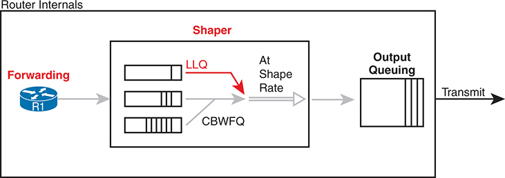

<figcaption>

<aside class="hidden" id="a15fig20">

时间轴分为两段，每段表示一秒间隔。在 T = 0 时，图中显示以 1 Gbps 的线路速率，在 200 毫秒（ms）内发送 2 亿比特。随后等待 800 毫秒，期间不发送数据。在 T = 1 秒时，重复这一循环：再用 200 毫秒发送 2 亿比特，然后等待 800 毫秒。

</aside>

<strong>图15-20</strong> <em>流量整形队列:以 LLQ 和 CBWFQ 为排程</em>

</figcaption>

</figure>

请注意,在某些情况下,输出排队功能几乎没有什么可做的. 例如,在早先的例子中,<a href="#ch15fig19">图15-19</a>警方在200Mbps监视收到的信息 如果路由器(例如R1)将所有向SP出口的流量也定型为200 Mbps,加上这个1-Gbps接口,输出队列即使被堵塞也很少出现.

因为整形器会创建消息等待的队列,所以您应该对这些队列应用一个排队工具. 如图中所示,将CBWFQ和LLQ的轮回和优先排队特征分别用于流量整形队列是完全正常的.

<section>

<h5 class="h5" id="ch15lev3sec11">为语音和视频设置适当的整形时间间隔</h5>

一个QoS工具再次试图解决一个QoS问题,但又引入了另一个. 整形器的不幸副作用是它减慢了包,从而造成更多的延迟,可能更焦躁. 出现延迟的部分原因是消息只是等待在队列中,而部分是由于整形器使用的机理. 幸运的是,您可以(并且应该)配置一个整形器的设置,改变整形器的内部操作,从而减少语音和视频流量的延迟和焦躁。

整形器<em>时间间隔</em>是指其内部逻辑以及整形器如何随时间推移以特定速率发出平均值. 造型者基本上会尽可能快地发送,然后等待;会发出和等待;会发送和等待. 例如,本节的维持流量监管和流量整形实例表明,在路由器上以200 Mbps 来流量整形一个1000-Mbps(1-Gbps)出入口。 在这种情况下,整形器会导致接口发送数据的时间占20%,而沉默的时间占80%。

<a href="#ch15fig21">图15-21</a> 展示整形时间间隔的概念，假设时间间隔为 1 秒。要达到每秒 2 亿比特的平均速率，整形器应允许每秒有 2 亿比特离开整形队列并从接口发出。由于接口以 1 Gbps 发送比特，发送全部 2 亿比特只需 0.2 秒，即 200 ms。随后，整形器必须等待该时间间隔剩余的 800 ms，才能开始下一个时间间隔。

<figure class="image-c" id="ch15fig21">

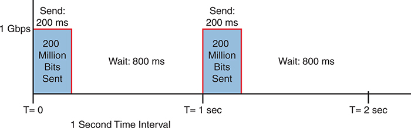

<figcaption>

<aside class="hidden" id="a15fig21">

该图分为三个部分,每个部分代表了不同程度的拥堵. Little Contracting:最左边的一节显示有3个队列,最小的包积分,表示网络流量低. 没有投放任何数据包,网络正在有效运作。 中摄取:中段显示出数量较多的排队量,表示中度网络拥堵. 一些包裹开始溢出并被扔下,由红色的破碎箭头取出一桶标签为"尾弹"(Tail Drop). 这表明到达队列尾部的包被先丢出. Much Conclusion:最右侧的一节描绘出严重拥堵的排队,包被大量地溢出. 更多包被投放,如多发红色破折射箭指向"尾滴"桶所显示. 这表明严重的拥堵导致包装损失增加.

</aside>

<strong>图15-21</strong> <em>一秒（1000 ms）的整形时间间隔，以线路速率的 20% 进行整形</em>

</figcaption>

</figure>

现在想想一个需要非常低延迟和焦急的语音或视频包, 不幸的是,它恰好在整形器完成发送时间间隔的数据时到达。 即使该语音或视频包处于优先流量整形队列中,该包也会等待800 ms后,然后整形器会安排下一个包,与150 ms的单向延迟语音目标相比太长了。

这个问题的解决方案:配置一个短的时间间隔. 例如,考虑以下时间间隔(缩写为Tc)及其效果,就这个例子而言(1-Gbps链接,形状为200 Mbps),但时间间隔更短更短:

<strong>Tc = 1 秒（1000 ms）：</strong> 以 1 Gbps 发送 200 ms，然后暂停 800 ms

<strong>Tc = 1. 1秒(100毫秒):</strong>发送1Gbps 20 ms,休息80 ms

<strong>Tc =.01秒(10毫秒):</strong>发送1Gbps为2ms,休息为8ms

流量整形时,使用短时间间隔. 根据建议,使用10ms的时间间隔来支持语音和视频. 有了这种设定,声音或视频包就只能等待了在等待下一个流量整形时间间隔时为10 ms,此时优先排行排行安排应接下所有语音和视频消息.

概述整形器的主要特征:

<ul class="sq">

<li>
Shapers测量一段时间的流量率,以与所配置的整形率作比较.
</li>

<li>
发作者允许在无活动期后爆出.
</li>

<li>
在用于 Egress (出包) 的接口上启用了 Shapers 。
</li>

<li>
通过排队来减慢数据包的速度, 并随着时间推移而以整形速度将其从队列中释放出来。
</li>

<li>
Shapers使用排队工具来创建并排出整形队列,由于输出排队讨论的同样原因,这非常重要.
</li>

</ul>

</section>

</section>

</section>

<section>

<h3 class="h3" id="ch15lev1sec7">拥塞避免</h3>

QoS 特性叫做<em>拥塞避免</em>试图通过先发制人地丢弃TCP连接中使用的一些包来减少整体包损失. 要了解它是如何工作的,首先需要查看TCP在窗口操作方面如何工作,再看看避免拥堵的特性是如何工作的.

<section>

<h4 class="h4" id="ch15lev2sec16">TCP 窗口机制基础</h4>

TCP 使用流量控制机制,称为<em>窗口</em>。每个TCP接收器给发件人一个窗口. 窗口是一个数字,它定义了发送者在至少为其中部分字节接收到TCP确认之前,可以通过TCP连接发送的字节数. 更确切地说,窗口大小是发送者在发送者必须简单地停止并等待之前可以发送的未承认字节数.

TCP窗口机制让接收者控制发送者的数据发送速率. 接收器发送回发件人的每一个新段都给予一个新的窗口,这个窗口可能比上个窗口小或更大. 通过起降窗口,接收器可以使发件人多等或少等.

注意

每个TCP连接有2个发件人和2个接收人;即每个主机发送并接收数据. 对于这一讨论,关注一个方向,一个宿主作为发送者,另一个宿主作为接收者. 如果将一个主机称为“发件人”和一个“收件人”,则通知收件人承认接收人发回发送人的TCP段的数据。

根据选择,当一切都好时,接收器会不断增加给定的窗口,每次接收器确认数据时将它翻一番. 最终,窗口增长到发件人从不停止发送的地步:发件人在发送上个窗口的全部数据之前,不断收到TCP的确认. 每个新的承认(如TCP部分和TCP 首部所列出)都为发送者提供了一个新的窗口。

同样通过选择,当一个TCP接收器感知到一个TCP段的丢失后,接收器会用下一个TCP段列出的下个窗口大小来收缩窗口,接收器发送回发件人. 对于每一个丢失的 TCP 段,窗口可以收缩一半,其中多个分块损失导致窗口缩小了一半多倍,使发送者的速率大幅减慢.

现在考虑一下路由器的队列 没有避免拥堵的工具,一个事件叫做<em>尾丢弃</em>导致网络中下降最多。<a href="#ch15fig22">图15-22</a>说明这个想法,显示同样的排队系统,但在三个不同的条件下——小拥堵,中拥堵,多拥堵. 在左侧,由于拥堵很少,接口上输出的队列尚未被填充. 在中间,队列开始被填满,一个队列完全被填满. 因为排队尾部没有空位(尾部放倒),所以现在到达排队的任何新包都会被丢弃.

<figure class="image-c" id="ch15fig22">

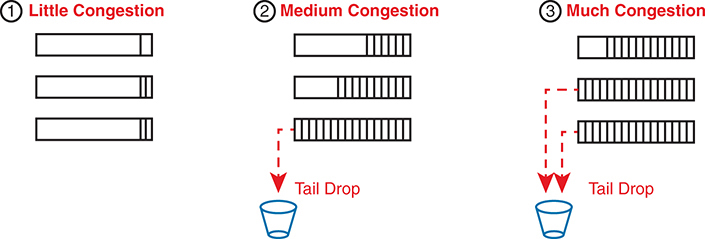

<figcaption>

<aside class="hidden" id="a15fig22">

该图显示一个垂直的队列,有四个不同的区段,每个区段代表了队列填充级别的不同状态及其对包滴的影响. 排队全:最上方的一节为有色红色并被标签为"Full Drops",表示队列满后会放下所有接入的包. 最大阈值:下面的一节被标为"最大阈值",标出队列开始以一定百分比投放包的点. 本节为彩色蓝色并标注了 % Drops, 显示包是按预定义的百分比来丢放的, 以防止队列完全饱和 。 最小阈值:在最大阈值下方是最小阈值,这标志着蓝色部分的开始. 这部分队列经历没有包放出,在正常情况下运行而不拥堵. 队列空:下方部分为有色黄色并被标签为"无放"(No Drops),表示当队列为空或低于最小阈值时,所有接入的包均被接受而无需任何放入.

</aside>

<strong>图15-22</strong> <em>稳定 TCP 窗口: 窗口过期前收到确认</em>

</figcaption>

</figure>

排队的拥堵情况越严重,尾巴下降的可能性就越大,如图中右侧最拥堵的病例所显示. 交通拥堵越多,对交通的负面影响就越大——无论是在损失方面,还是在TCP连接的延误增加方面。

</section>

<section>

<h4 class="h4" id="ch15lev2sec17">拥塞避免工具</h4>

避免堵塞的工具试图避免堵塞,主要是通过使用TCP自己的窗口机制. 这些工具在队列填充前丢弃了部分TCP段,希望足够的TCP连接会减慢,减少拥堵,并避免一个更严重的问题:由于尾巴倒下而导致更多包被丢出的效果. 策略很简单:现在抛弃一些,希望从长远来看设备丢弃的要少得多.

Contracting 避免工具会随时间推移监视平均队列深度, 触发更严重的动作, 更深的队列, 如以下所示 。<a href="#ch15fig23">图15-23</a>。框的高度代表队列深度,或者队列中的包数. 当队列深度低,低于最低门槛值时,避免拥堵的工具无所作为. 当队列深度介于最小和最大阈值之间时,避免拥堵的工具会丢弃一部分数据包——通常是很小的百分比,比如5,10,或者20%. 如果队列深度超过最大阈值, 工具会丢弃所有数据包, 在一个叫做 a 的动作中<em>全部丢弃</em>.

当然,和本章中提及的所有QoS工具一样,避免拥堵的工具可以将消息分类,以比其他的更好地对待一些包. 在同一排队中,带有一个标记的包可能投得更猛烈,具有更好的DSCP标记的包则投得更少.

<figure class="image-c" id="ch15fig23">

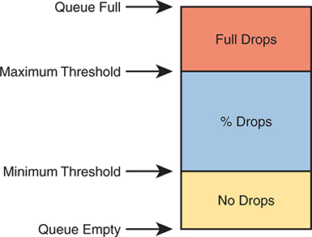

<figcaption>

<aside class="hidden" id="a15fig23">

它代表着根据队列占用级别管理包滴的简化模式. 图表被分为三个有色部分,每个部分对应队列的不同状态: 无放(Yellow):此部分位于下方并显示队列空到最小阈值时的状态. 包被接受,在这个范围内没有任何下降。 百分数(蓝色):中段代表最小阈值和最大阈值之间的范围. 在这个范围内,包会受到概率下降机制的制约,这意味着有一定比例的包被放弃来防止拥堵的形成. 随着队列大小接近最大阈值,准确的下降百分比会增加. Full Drops (Red):上段显示队列高于最大阈值并接近满能时的状态. 在此状态下,所有接入的包被丢弃来防止队列完全溢出. 这一重大措施旨在向发送装置发出信号,以降低其传输率。

</aside>

<strong>图15-23</strong> <em>避免机制</em>

</figcaption>

</figure>

</section>

</section>

</section>

<section class="ccna-source ccna-appendix" aria-label="答案解析与术语表">
<section data-epub-type="chapter">

<h2 class="h2" id="ref-appc">附录C</h2>

<h2 class="h2a">对“我早就知道了吗?” 的回答。</h2>

<section>

<h3 class="h3" id="ref-appclev1sec15">第15章</h3>

<strong><a id="ref-ques15_1" href="#quess15_1">1</a>。</strong> A、B 和 E。QoS 工具管理带宽、时延、抖动和丢包。

<strong><a id="ref-ques15_2" href="#quess15_2">2</a>。</strong> B 和 C。IP 优先级（IPP）和区分服务代码点（DSCP）字段位于 IP 首部中，会随数据包从源主机传输到目的主机。服务类别（CoS）字段位于 802.1Q 首部中，因此仅用于中继链路；路径上的任何路由器都会将其随传入的数据链路首部一起移除。MPLS EXP 位仅在数据包穿越 MPLS 网络期间存在。

<strong><a id="ref-ques15_3" href="#quess15_3">3</a>。</strong> A、B 和 C。一般来说，DiffServ 通过比较消息自身所含的某些信息来匹配数据包。802.1p CoS 字段位于 VLAN 中继链路的数据链路首部中；IP DSCP 字段位于 IP 首部中；扩展 ACL 检查消息首部中的字段。SNMP Location 变量不会随每个数据包传输，而是可向设备请求的一个值。

<strong><a id="ref-ques15_4" href="#quess15_4">4</a>。</strong> B 和 C。低时延排队（LLQ）采用优先队列调度，只要 LLQ 中有数据包，就始终从中取出下一个数据包。为防止其他队列饥饿，IOS 还会对 LLQ 实施流量监管。不过，对 LLQ 应用流量整形会减慢流量，在已经存在监管功能的情况下没有意义。提到轮询调度的选项不正确，因为 LLQ 使用的是优先队列调度。

<strong><a id="ref-ques15_5" href="#quess15_5">5</a>。</strong> A 和 D。如果 R1 上以 200 Mbps 的速率启用整形器，而 R1 尝试从该接口发送 300 Mbps 的流量，R1 就开始将数据包排队。随后，R1 控制数据发送，使一段时间内的传输速率为 200 Mbps。

至于 ISP1 上配置速率为 250 Mbps 的监管功能，监管器测量速率后会发现，传入速率（由于 R1 的整形而为 200 Mbps）没有超过监管速率。

<strong><a id="ref-ques15_6" href="#quess15_6">6</a>。</strong> C 和 D。丢弃管理依赖 TCP 的行为，即 TCP 连接会根据拥塞窗口的计算结果降低数据包发送速率。语音流量使用 UDP，题目还指出队列 1 使用 UDP。因此，队列 2 和 3 适合使用拥塞管理工具。

</section>

</section>

<section id="ref-glossary"><h2 class="h2a">词汇表</h2>
<strong>带宽</strong>通过链接发送和接收比特的速度.

<strong>服务级(COS)</strong>3-bit字段在802.IQ首部中的非正式名词,意在为应用QoS动作对以太网帧进行标识和分类. 优先代码点(PCP)的另一个名词.

<strong>分类</strong>研究联网信息的各种领域,以确定哪些信息适合某些预先确定的组别(类)。

<strong>延迟</strong>在QoS中,一个消息需要多少时间才能跨出一个网络. 延迟可以指: 单向延迟(消息从源主机发送到目的主机所需的时间)或双向延迟(从源到目的主机再回回回的延迟).

<strong>差异服务(DiffServ)</strong>最初由RFC 2475所定义的QoS方法,采用每个分类应用QoS的模式,其中规划将应用程序和其他流量类型分配给每个类别,每个类别在路径中的每个网络设备上给出了不同的QoS每跳行为.

<strong>差异化服务码点(DSCP)</strong>一个作为ToS字节的第一个 6比特存在的字段,由 RFC 2474所定义,它重新定义了IP RFC最初对IP头 ToS 字节的定义. 字段用于在首部中标出一个值,目的是在数据包上执行后期的QoS动作.

<strong>IP 优先( IPP)</strong>在IP头的"服务类型"(TOS)字节的原始定义中,TOS字节的首个-3位,用于为应用QoS动作而标记IP包.

<strong>抖动</strong>单个应用程序流中连续包所经历的延迟变化 。

<strong>损失</strong>在发送但无法到达目的主机的网络中引用包 。

<strong>标记</strong>修改包括IP头的DSCP字段在内的各种网络协议头中一小组字段之一的过程,以便日后根据该标记值对消息进行分类.

<strong>每起跳动行为( PHB)</strong>用于描述一组QoS动作的一般术语,一个设备从进入网络设备时起可以适用于一个消息,直到设备转发该消息. PHB包括分类,标识,排队,流量整形,维持流量监管,并避免拥堵.

<strong>流量监管</strong>一个QoS工具,用于监测在网络设备处理中通过某个点的信息的比特速率,这样如果比特速率在一段时间内超过流量监管速率,警察可以丢弃多余的包来降低速率.

<strong>维持流量监管率</strong>警方比较通过维持流量监管功能的包的比特率的比特率,目的是对符合(低于)率的包和超过(高于)率的包采取不同的行动。

<strong>优先排队</strong>在Cisco排队系统中,低等队列(LLQ)的另一个名词.

<strong>服务质量（QoS）</strong>电文的性能,或应用程序发送的电文,涉及电文所经历的带宽,延迟,抖动等特性.

<strong>排队</strong>网络设备在等待某些受限资源时持有内存包的过程;例如,当太多包在短时间内到达时等待输出的接口可用时.

<strong>轮询</strong>一个队列排程算法,其中排程算法服务于一队列,再接一队,再接一队等,按顺序通过队列工作.

<strong>流量整形</strong>一个QoS工具,用于监视消息退出网络设备的比特速率,这样如果比特速率在一段时间内超过整形速率,整形器可以排出数据包,有效地减慢发出速率以与整形速率相匹配.

<strong>整形率</strong>一个整形器比较通过形状函数的位包速率的比特速率,这样当超过速率时,整形器就可以排出包来排队,从而减缓了通过整形器的集体包的比特速率,因此比特通过整形器的速度不会超过形状速率.

</section>
</section>

<section class="ccna-source ccna-appendix" aria-label="代码原图">
<section data-epub-type="chapter">

<a href="#f0332-01a" id="code-f0332-01">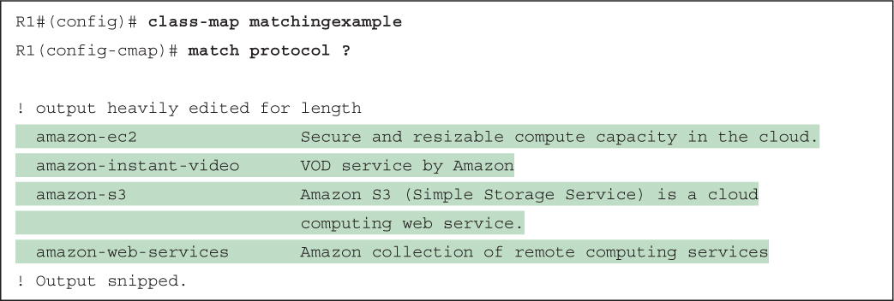</a>

</section>

</section>


<nav class="ccna-chapter-nav" aria-label="章节导航"><a href="v2-14.html">← 上一章</a><a href="v2-16.html">下一章 →</a></nav>
