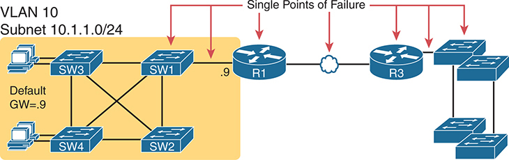
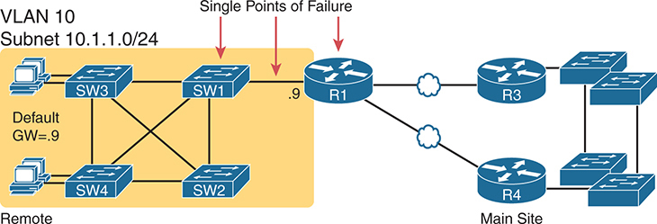
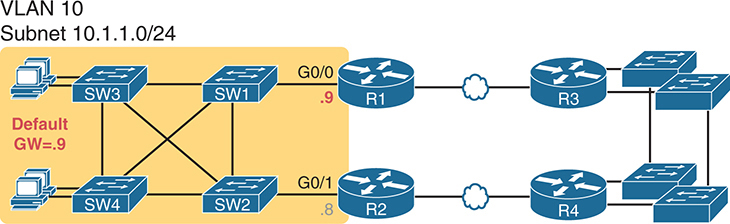
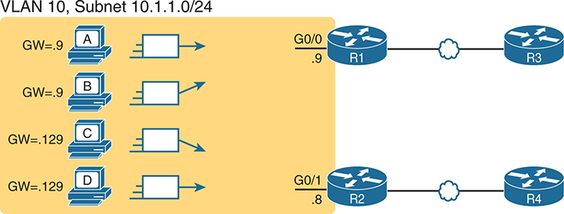
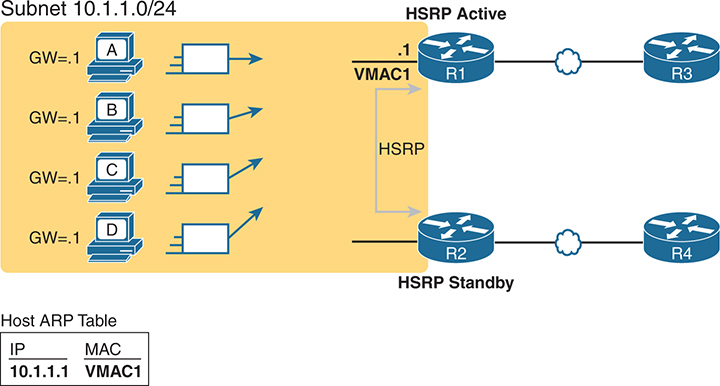
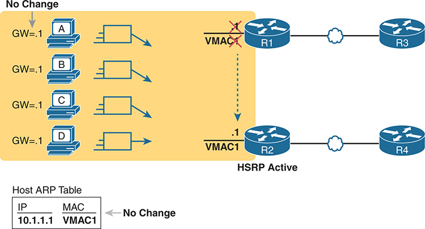
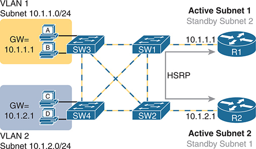
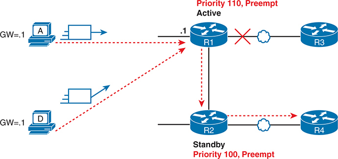
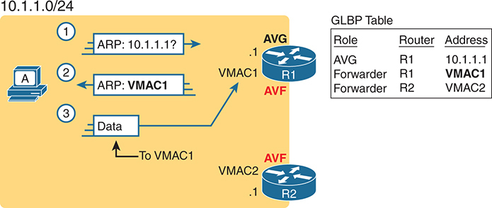
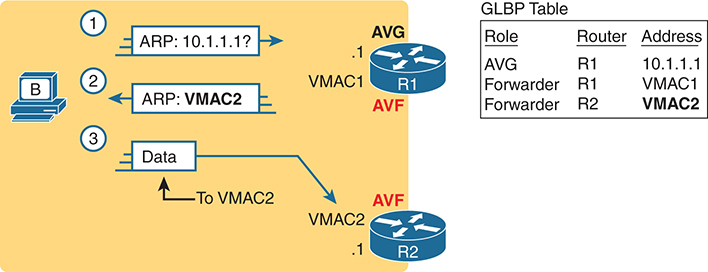

<a href="{{ '/subjects/CCNA/' | relative_url }}">← 返回 CCNA 目录</a>

第二卷 · IP 服务

<nav class="ccna-chapter-nav" aria-label="章节导航"><a href="v2-15.html">← 上一章</a><a href="v2-17.html">下一章 →</a></nav>



<section data-epub-type="chapter">

<h2 class="h2" id="ch16">第 16 章</h2>

<h2 class="h2a">第一跳冗余协议</h2>

本章涵盖以下考试主题：

3.0 IP 连通性

3.5 描述第一跳冗余协议的目的、功能和概念

任何主机的默认路由器都是从发送方到接收方的路由路径中的第一台路由器，也就是第一跳。不过，IPv4 并未包含与默认路由器有关的高可用性和冗余功能。IP 主机只有一项设置，用于指定一个默认路由器 IP 地址。此外，IP 也未为连接同一子网的多台路由器定义备份或负载分担机制。

第一跳冗余协议（FHRP）为任意子网中的默认路由器功能增加了冗余和负载分担能力。

本章首先介绍所有 FHRP 的核心概念。各种 FHRP 都定义了多台路由器如何共同工作、分担责任，并对外表现为一台默认路由器。所有 FHRP 都向主机隐藏自身的存在，因此无需改变主机的路由逻辑。第二节介绍最常用的 FHRP：热备份路由器协议（HSRP）。最后一节将 HSRP 与另外两种 FHRP 进行比较：虚拟路由器冗余协议（VRRP）和全局负载均衡协议（GLBP）。

<section>

<h3 class="h3" id="ch16lev1sec1">“这些知识我已经掌握了吗？”自测</h3>

如果你希望根据得分决定在本章投入多少时间，可以完成这组自测题（在此作答，或使用 PTP 软件）。各题答案的选项字母列在自测题之后的页面底部。书末和配套网站上的<a href="#ref-appc">附录 C</a>都包含答案及解析。你也可以在 PTP 测试软件中找到答案及解析。

<figure class="table" id="ch16tab01" tabindex="0">

<figcaption>

<strong>表16-1</strong> “这些知识我已经掌握了吗？”核心主题小节与题目对应关系

</figcaption>

<table class="all">

<tbody>

<tr>

<th class="th">
基础知识小节
</th>

<th class="th">
题目
</th>

</tr>

<tr>

<td class="border">
第一跳冗余协议
</td>

<td class="border">
1、2
</td>

</tr>

<tr>

<td class="border">
热备用路由器协议
</td>

<td class="border">
3, 4
</td>

</tr>

<tr>

<td class="border">
VRRP和GLBP 概念
</td>

<td class="border">
5, 6
</td>

</tr>

</tbody>

</table>

</figure>

<strong><a id="quess16_1" href="#ques16_1a">1</a>.</strong>R1和R2附着在同一个以太网VLAN上,子网为10.1.19.0/25,地址分别为10.1.19.1和10.1.19.2,配置为:<strong>ip address</strong>接口子命令。 主机A指 10.1.19.1 作为其默认路由器,而主机B指 10.1.19.2 作为其默认路由器. 路由器不使用FHRP. 这个局域网有什么问题吗?

<ol class="lower-alpha">

<li>
设计打破了IPv4处理规则,因为两个路由器无法连接到同一个局域网子网.
</li>

<li>
如果一个路由器失败,则两个主机都无法将包发送出子网外.
</li>

<li>
如果一个路由器出故障,两个主机都会将所剩的一个路由器作为默认的路由器.
</li>

<li>
如果一个路由器失败,使用该路由器作为默认路由器的主机不能发送包出子网.
</li>

</ol>

<strong><a id="quess16_2" href="#ques16_2a">2</a>.</strong>R1和R2附着在同一个以太网VLAN上,子网为10.1.19.0/25,地址分别为10.1.19.1和10.1.19.2,配置为:<strong>ip address</strong>接口子命令。 路由器使用一个FHRP. 主机A和主机B附加在同一局域网上,并且每个FHRP配置都有正确的默认路由器设置. 下列哪些声明对局域网是真实的?

<ol class="lower-alpha">

<li>
设计打破了IPv4处理规则,因为两个路由器无法连接到同一个局域网子网.
</li>

<li>
如果一个路由器失败,则两个主机都无法将包发送出子网外.
</li>

<li>
如果一个路由器出故障,两个主机都会将所剩的一个路由器作为默认的路由器.
</li>

<li>
如果一个路由器失败,两个主机中只有一个仍然能够发送包去掉子网.
</li>

</ol>

<strong><a id="quess16_3" href="#ques16_3a">3</a>.</strong>R1和R2附着在同一个以太网VLAN上,子网为10.1.19.0/25,地址分别为10.1.19.1和10.1.19.2,配置为:<strong>ip address</strong>接口子命令。 路由器使用HSRP. 网络工程师更愿意在R1和R2同时上架时让R1成为默认的路由器. 此子网中主机可能的默认路由器设置如下 ?

<ol class="lower-alpha">

<li>
10.1.19.1
</li>

<li>
10.1.19.2
</li>

<li>
除了10.1.19.1和10.1.19.2之外,子网10.1.19.0/25的又一IP地址
</li>

<li>
FHRP迷你DNS最初指向10.1.19.1的一个主机名.
</li>

</ol>

<strong><a id="quess16_4" href="#ques16_4a">4</a>.</strong>路由器R1,R2和R3,地址分别是:-10.1.1.1,-10.1.1.2和-10.1.1.3,属于HSRPv2组-16,并使用VIP10.1.1.8. R2是目前的HSRP活路由器. 关于子网中的HSRP操作,哪些声明是真实的?

<ol class="lower-alpha">

<li>
来自子网主机的流量在所有路由器(R1,R2和R3)之间平衡.
</li>

<li>
从子网主机的流量只流入路由器R2.
</li>

<li>
R1路由器仅对ARP地址10.1.1.8的请求做出回复.
</li>

<li>
该 HSRP 组使用虚拟 MAC 地址 0000.0C9F.F016。
</li>

</ol>

<strong><a id="quess16_5" href="#ques16_5a">5</a>.</strong>路由器R1,R2和R3,地址分别是:-10.1.1.1,-10.1.1.2和-10.1.1.3,属于VRRPv3组-32. R3是目前的VRRP活路由器. 子网中哪些 VRRP 操作是真实的 ? (取出二个答.

<ol class="lower-alpha">

<li>
现任要人可能是10.1.1.3.
</li>

<li>
现任要人必须是10.1.1.3.
</li>

<li>
VRRP将其组信息发送到多播地址224.0.0.18.
</li>

<li>
VRRP将其组信息发送到多播地址224.0.0.2.
</li>

</ol>

<strong><a id="quess16_6" href="#ques16_6a">6</a>.</strong>哪个答案最能描述一个机制,使GLBP能够实现活性/活性负载平衡,而组转发包中的所有路由器都是默认的路由器?

<ol class="lower-alpha">

<li>
通过配置匹配路由器接口 IP 地址的要人
</li>

<li>
在同一组中,每个路由器使用不同的VIP
</li>

<li>
通过对每个路由器使用单独的 GLBP 组
</li>

<li>
通过使用同一组中每个路由器不同的虚拟 MAC 地址
</li>

</ol>

“这些知识我已经掌握了吗？”自测答案：

<strong><a id="ques16_1a" href="#ref-ques16_1">1</a></strong> D

<strong><a id="ques16_2a" href="#ref-ques16_2">2</a></strong> C

<strong><a id="ques16_3a" href="#ref-ques16_3">3</a></strong> C

<strong><a id="ques16_4a" href="#ref-ques16_4">4</a></strong> B

<strong><a id="ques16_5a" href="#ref-ques16_5">5</a></strong> A, C

<strong><a id="ques16_6a" href="#ref-ques16_6">6</a></strong> D

</section>

<section>

<h3 class="h3box" id="ch16lev1sec2">基础主题</h3>

</section>

<section>

<h3 class="h3" id="ch16lev1sec3">第一跳冗余协议</h3>

当网络使用包括冗余路由器,交换机,局域网链接,和WAN链接在内的设计时,在某些情况下,需要其他协议来利用这种冗余,并预防由此引起的问题.

例如,设想一个具有许多远程分支办事处的广域网。 如果每个远程分支都有两个WAN链接将其连接到网络的其余部分,这些路由器可以使用一个IP路由协议来选择最佳路由. 路由协议通过两个WAN链接学习路由,将最佳路由添加到路由表中. 当更好的WAN链接失败后,路由协议会利用冗余链接,将替代的路由添加到IP路由表中.

另一个例子是,考虑使用具有冗余链接和交换机的局域网。 这些局域网有问题,除非交换机使用Spanning Tree协议(STP)或Rapid STP(RSTP). STP/RSTP防止通过局域网中的额外冗余路径循环的帧所制造出的问题.

本节审查另一个协议,当一个网络使用一些冗余时会有所帮助,这次是使用冗余的默认路由器. 当两个或两个以上的路由器连接到同一个局域网子网时,该子网中的主机可以使用任何一个路由器作为他们的默认路由器. 然而,需要另一种协议来最好地使用冗余的默认路由器. 术语<a id="key_184" data-original-href="vol2_ch16.xhtml#key_184a" data-unavailable="true" title="此内容不在当前提取范围内；请参阅原始 EPUB：vol2_ch16.xhtml#key_184a">第一次跳伞裁员协议(FHRP)</a>指使主机能够利用子网中冗余路由器的协议类别.

本章的第一主要部分讨论了不同联邦人权方案如何运作的主要概念。 本节首先讨论一个网络一般需要冗余和需要冗余的默认路由器.

<section>

<h4 class="h4" id="ch16lev2sec1">网络对冗余的需求</h4>

网络需要多余的链接来改善这些网络的可用性。 最终,一个网络中的东西会失败. 路由器电源可能会故障,或者连接会中断,或者交换机可能会断电. 而这些WAN链接,在本作中大多数图画中显示为简单的行,代表了网络中最复杂的物理部分,许多单个组件也可能被失败.

取决于网络的设计,单个组件的故障可能意味着至少影响部分用户群的停用. 网络工程师指任何一个部件,如果它失败,就会将网络的这一部分作为一个<em>单点故障</em>。例如,在<a href="#ch16fig01">图16-1</a>,局域网似乎有一些冗余,而广域网则没有。 如果大多数流量在站点之间流出,如图所示,就存在许多单一的故障点.

<figure class="image-c" id="ch16fig01">

<figcaption>

<aside class="hidden" id="a16fig01">

左侧标为 VLAN 10 的网段使用子网 10.1.1.0/24，其中多台交换机（SW1、SW2、SW3 和 SW4）相互连接。一台计算机连接 SW3，该 VLAN 的默认网关设为与 SW1 关联的 10.1.1.9。SW1 连接路由器 R1，R1 再通过 WAN 链路连接另一台路由器 R3。WAN 链路和 R1 用红色箭头标出，并标注为“单点故障”，表示任一项发生故障都会中断网络与外部网络或站点的连接。此网络图强调了故障可能影响整个网络可靠性的关键位置。

</aside>

<strong>图16-1</strong> <em>R1 和作为单一失败点的 One WAN 链接</em>

</figcaption>

</figure>

该图指出,若干组成部分是单一的失败点。 如果网络中任何已注意到的部件都失效,则数据包不能从网络的左侧流向右侧。

为了改善可用性,网络工程师首先研究一个设计,并找到故障的单一点. 然后工程师选择在网络中添加何处,这样现在一个(或多个)单一的故障点就有了多余的选项,增加了可用性. 特别是工程师

<ul class="sq">

<li>
添加冗余设备和链接
</li>

<li>
执行任何利用冗余设备或链接的必要功能
</li>

</ul>

例如,在所有单一的失败点中,<a href="#ch16fig01">图16-1</a>长期而言,最昂贵的可能是广域网连接,因为每月收费持续。 然而,在统计学上,广域网链接是最有可能失败的组件. 因此,一个很好的升级 从网络在<a href="#ch16fig01">图16-1</a>将增加一个WAN链接,甚至可能连接到网络右侧的另一个路由器,如下文所示:<a href="#ch16fig02">图16-2</a>.

许多真正的企业网络遵循的设计如:<a href="#ch16fig02">图16-2</a>,每个远程站点有一个路由器,两个WAN链接连接回主站点,以及主站点的冗余路由器(在图中右侧). 比较<a href="#ch16fig01">图16-1</a>,设计在<a href="#ch16fig02">图16-2</a> 单点失败的点数较少。 在剩余的单一失败点中,风险依然存在,但是一种计算出的风险。 对于许多出道者,再装入路由器就能解决问题,出道时间很短. 但风险仍然存在,交换机或路由器硬件会出故障并需要时间在现场交付替换设备后,该站点才能再次工作.

<figure class="image-c" id="ch16fig02">

<figcaption>

<aside class="hidden" id="a16fig02">

左边显示同样的VLAN 10 与子网连接 10.1.1.0/24 和互联交换机(SW) 1 2 3 ,和 S W 键 4 ),与SW连接的计算机. 3 默认网关设置为 10.1.1.9 关于SW的 1 在这种设置中,S W 1 连接到路由器 R 1 ,然后连接到两个不同的WAN链接,提供冗余。 1 连接到两个路由器, R 3 和 R 数据 4 ,在主站点,增强整个网络的可用性。尽管添加了用于冗余的WAN链接,但路由器R 1 本身仍被标记为用红色箭头指向失败的单一点,表明如果 R 1 失败时, 网络将失去与外部网络或站点的连接。 此图像突出显示改进了的网络设计, 但指出对路由器 R 的剩余关键依赖性 1 。

</aside>

<strong>图16-2</strong> <em>更高可用度,但R1仍为单一故障点</em>

</figcaption>

</figure>

对于能够证明需要更多费用的企业来说,提高该远程站点可用率的下一步是防止这些灾难性路由器和交换机故障。 在这个特定的设计中,在网络左侧增加一个路由器<a href="#ch16fig02">图16-2</a>删除前面指出的所有单个故障点。<a href="#ch16fig03">图16-3</a>以第二个路由器显示设计,它连接到不同的局域网交换机,这样SW1就不再是单一的故障点了.

<figure class="image-c" id="ch16fig03">

<figcaption>

<aside class="hidden" id="a16fig03">

网络在子网 10.1.1.0/24 上配置 VLAN 10。多台交换机（SW1、SW2、SW3、SW4）相互连接，形成冗余环路，以增强网络的故障恢复能力。连接到这些交换机的设备可以使用两个默认网关中的任意一个：10.1.1.9（对应路由器 R1）或 10.1.1.8（对应路由器 R2），从而提供故障切换机制。R1 和 R2 连接其他网络基础设施，进一步增强网络冗余。此配置确保任一组件故障时，网络仍可持续运行。

</aside>

<strong>图16-3</strong> <em>从网络设计中删除所有单个失败点</em>

</figcaption>

</figure>

注意

中型至大型企业网络努力在高可用性特征与可用预算美元之间取得平衡。<a href="http://Cisco.com">Cisco.com</a>拥有许多设计文件,在高可用性设计中讨论取舍. 如果有兴趣学习更多, 搜索<a href="http://Cisco.com">Cisco.com</a>为本站的思科设计区段.

</section>

<section>

<h4 class="h4" id="ch16lev2sec2">第一跳冗余协议的必要性</h4>

在本章迄今显示的设计中,只有<a href="#ch16fig03">图16-3</a>其设计有两个路由器支持图中左侧的局域网,具体来说就是同一个VLAN和子网.在同一子网帮助上拥有冗余路由器的同时,当这些冗余路从器存在时,网络必须使用FHRP.

要了解使用FHRP的必要性和好处,首先考虑这些冗余路由器如何能够被VLAN 10/subnet-10.1.1.0/24中的主机用作默认路由器,如上所示.<a href="#ch16fig04">图16-4</a>。主机逻辑将保持不变,因此每个主机都有一个单一的默认路由器设置. 因此,默认路由器设置的一些设计选项包括以下内容:

<ul class="sq">

<li>
子网中的所有主机都使用R1(10.1.1.9)作为其默认的路由器,如果R1失败,它们会静态地将默认的路由器设置重新配置为R2的10.1.1.8.
</li>

<li>
子网中的所有主机都使用R2(10.1.1.8)作为其默认路由器,如果R2失败,它们会静态地将默认路由器设置重新配置到R1的10.1.1.9.
</li>

<li>
一半主机使用R1,一半使用R2作为其默认的路由器,如果任一路由器失败,一半的用户会静态地重新配置其默认路由器设置.
</li>

</ul>

<figure class="image-c" id="ch16fig04">

<figcaption>

<aside class="hidden" id="a16fig04">

网络包括被标注为A,B,C和D的4个客户端设备. 设备A和B被配置到使用默认网关10.1.1.9(Router R 1),而设备C和D被配置到使用默认网关-10.1.1.8(Router R 2). 这种分布有助于在两个路由器之间均衡地分配网络交通负荷,防止任何单一路由器成为瓶颈. 两个路由器R-1和R-2连接到更多的网络基础设施,确保了整个网络的平衡而高效的交通流量.

</aside>

<strong>图16-4</strong> <em>通过向不同的客户端分配不同的默认路由器来平衡交通</em>

</figcaption>

</figure>

为了确保这一概念明确,<a href="#ch16fig04">图16-4</a>显示第三个选项,其中一半主机使用R1,另一半使用R2。 该图删除了所有局域网交换机,以解开该图. 主机A和B使用R1作为其默认路由器,而主机C和D使用R2作为其默认路由器.

所有这些选项都有问题:用户必须采取行动. 他们必须知道停电了。 他们必须知道如何重新配置他们的默认路由器设置. 他们必须知道何时可以把它改回原来的设定。

FHRPs使用冗余的默认路由器,最终用户不会意识到任何更改. 这两个路由器看起来是一个单一的默认路由器. 用户从来不需要做任何事情:他们的默认路由器设置保持不变,他们的ARP表格保持不变.

为了让主机保持不变,路由器必须做更多的活,如FHRP协议之一所定义. 一般而言,每个《联邦人权方案》都规定:

<ol class="number">

<li>
所有主机都像以前一样,有一个默认的路由器设置,永不改变.
</li>

<li>
默认路由器在子网中共享由FHRP定义的虚拟IP地址.
</li>

<li>
主机使用FHRP虚拟IP地址作为其默认路由器地址.
</li>

<li>
路由器交换FHRP协议消息,以便双方同意哪个路由器在任何时间点做什么工作.
</li>

<li>
当路由器出故障或有其他问题时,路由器会使用FHRP来选择哪个路由器从出故障的路由器中接管责任.
</li>

</ol>

</section>

<section>

<h4 class="h4" id="ch16lev2sec3">第一跳冗余的三种解决方案</h4>

术语<em>第一跳冗余协议</em>不指定任何一项协议。 取而代之的是,它命名了一个包含相同角色的协议家族. 对于给定的网络,像左侧<a href="#ch16fig04">图16-4</a>工程师会从FHRP家族中选取协议之一

注意

<em>第一个跳</em>指的是默认的路由器是第一个路由器,或者第一个路由符 hop,一个包必须经过它。

<a href="#ch16tab02">表16-2</a>将三个FHRP协议按时间顺序列出为市场首次使用。 Cisco 首次引入专有性<a id="key_188" href="#ref-gloss_159">热备用路由器协议(HSRP)</a>这对很多顾客来说都很好 后来,IETF为类似协议开发了RFC,.<a id="key_195" data-original-href="vol2_ch16.xhtml#key_195a" data-unavailable="true" title="此内容不在当前提取范围内；请参阅原始 EPUB：vol2_ch16.xhtml#key_195a">虚拟路由器冗余协议(VRRP)</a>。最后,思科开发了一个更强壮的选择,<a id="key_185" href="#ref-gloss_155">网关负载平衡协议(GLBP)</a>.

<figure class="table" id="ch16tab02" tabindex="0">

<figcaption>

<strong>表16-2</strong>三个 FHRP 选项

</figcaption>

<table class="all">

<tbody>

<tr>

<th class="th">
缩略语
</th>

<th class="th">
完整名称
</th>

<th class="th">
来源
</th>

<th class="th">
冗余方式
</th>

<th class="th">
负载均衡的单位
</th>

</tr>

<tr>

<td class="border">
HSRP
</td>

<td class="border">
热备用路由器协议
</td>

<td class="border">
Cisco
</td>

<td class="border">
active/standby
</td>

<td class="border">
子网
</td>

</tr>

<tr>

<td class="border">
VRRP
</td>

<td class="border">
虚拟路由器冗余协议
</td>

<td class="border">
RFC 5798
</td>

<td class="border">
active/standby
</td>

<td class="border">
子网
</td>

</tr>

<tr>

<td class="border">
GLBP
</td>

<td class="border">
网关负载均衡协议
</td>

<td class="border">
Cisco
</td>

<td class="border">
active/active
</td>

<td class="border">
host
</td>

</tr>

</tbody>

</table>

</figure>

CCNA200-301版本1.1蓝图要求您了解FHRP的目的,功能和概念. 为此,下一节深入审视了HSRP概念,而章节的最后一节则将VRRP和GLBP与HSRP进行比较. (本章不讨论FHRP配置,但如果想在考试题目的简单措辞之外学习,请注意:<a data-original-href="vol2_appd.xhtml#appd" data-unavailable="true" title="此内容不在当前提取范围内；请参阅原始 EPUB：vol2_appd.xhtml#appd">附 录 D</a>, “<a data-original-href="vol2_appd.xhtml#appd" data-unavailable="true" title="此内容不在当前提取范围内；请参阅原始 EPUB：vol2_appd.xhtml#appd">前几版的主题</a>,”包含关于HSRP和GLBP配置的简短部分,从更早的版本本作中复制. )

</section>

</section>

<section>

<h3 class="h3" id="ch16lev1sec4">热备份路由器协议</h3>

HSRP以活性/待机模式运作(更通称为:<em>主用/备用</em>) HSRP允许两个(或更多)路由器合作,都愿意充当默认路由器. 然而,在任何时候,只有一个路由器积极支持最终用户的交通. 主机发送到其默认路由器的包会流到一个活动路由器上. 然后其他路由器耐心地坐在那里,等待在主动的HSRP路由器出现问题时接手.

本章下一节讨论HSRP如何实现其提供默认路由器冗余的目标. 它通过虚拟IP和MAC地址,故障处理,负载平衡,对象跟踪,以及HSRP版本等机制短暂地取得进展.

<section>

<h4 class="h4" id="ch16lev2sec4">HSRP 虚拟 IP 地址和 MAC 地址</h4>

密码<a id="key_189" href="#ref-gloss_159">HSRP 活动</a>路由器执行 a<a id="key_193" href="#ref-gloss_362">虚拟IP地址( VIP)</a>并匹配<a id="key_194" href="#ref-gloss_363">虚拟 MAC 地址</a>。此虚拟 IP 地址是 HSRP 配置的一部分, 相对于通常的配置项目 。<strong>ip address</strong>接口子命令。 这个虚拟IP地址与接口IP地址处于同一个子网,但它是一个不同的IP地址. 然后路由器会自动创建虚拟的MAC地址. 所有合作的HSRP路由器都知道这些虚拟地址,但只有HSRP活动路由器在任何一个时间点使用这些地址.

使用路由器之间的 HSRP 协议信息,路由器在 HSRP 有活动或有活动时进行商谈和结算<a id="key_192" href="#ref-gloss_160">HSRP 备用状态</a>状态。 最高的路由器<a id="key_191" href="#ref-gloss_160">HSRP 优先级</a>胜出并变得活跃,而另一个路由器成为备用路由器. 如果优先级平分,则IP地址最高的路由器会取胜并开始活动. (也请注意,虽然FHRPs在一个组中经常只有两个路由器,如果使用三个或三个以上,HSRP只使用一个备用路由器而其他路由器处于听觉状态,等待有一天成为新的备用路由克. ) .

活动路由器除了其配置的接口IP地址外,还在其接口上执行虚拟IP和MAC地址. 主机将虚拟IP地址称为他们的默认路由器地址,而不是任何路由器的接口IP地址. 例如,在<a href="#ch16fig05">图16-5</a>,R1和R2使用HSRP. HSRP虚拟IP地址为10.1.1.1,为简洁起见,虚拟MAC地址被引用为VMAC1.

<figure class="image-c" id="ch16fig05">

<figcaption>

<aside class="hidden" id="a16fig05">

子网10.1.1.0/24包含被标为A,B,C,和D等多个主机,每个主机配置了一个默认的网关为10.1.1.1. 这些主机将其流量发送到路由器R1,该路由器目前是HSRP活性路由器,由标签HSRP活性所表示. 路由器R1,以虚拟MAC地址为VMAC1,将流量推进到网络中下一个hop,由路由器R3所代表. 路由器R-2已处于备用状态,准备在R-1失败时接任. 每个主机地图的ARP(地址分辨率协议)表,IP地址10.1.1.1到虚拟MAC地址VMAC1,确保通过活动路由器R1的路由一致.

</aside>

<strong>图16-5</strong> <em>所有交通到 1 (R1, 哪些是活动); R2 是备用</em>

</figcaption>

</figure>

</section>

<section>

<h4 class="h4" id="ch16lev2sec5">HSRP 故障切换</h4>

在正常条件下,随着所有设备和接口的运行,一个HSRP路由器是默认的路由器,而另一个路由器则处于待命状态. 这可能会发生在备用路由器需要接管之前的几个月. 然而,为了使备用路由器知道何时行动,两个路由器继续互相发送HSRP消息.

HSRP使用HSRP Hello消息让同一HSRP组中的其他HSRP路由器知道活动路由器继续工作. HSRP定义了Hello计时器,它规定在活动路由器连续发送Hello消息之间(以秒计)的频率. HSRP还定义了Hold计时器,一般是Hello计时器的3倍多. 当备用路由器未能在持有时间所定义的时间内收到活动路由器的"Hello"时,待命路由器认为活路由器失败了,并开始作为活路由取而代之.

譬如说.<a href="#ch16fig06">图16-6</a>显示 R1, HSRP 活动路由器在<a href="#ch16fig05">图16-5</a>,失去动力。 R2未能从路由器R1收到额外的HSRP Hello,以换取持有时间. 这时,R2,新的活动路由器,开始使用虚拟IP和MAC地址.

<figure class="image-c" id="ch16fig06">

<figcaption>

<aside class="hidden" id="a16fig06">

最初,所有主机A,B,C,和D继续发送流量到默认网关 10.1.1.1 ,仍然映射到 VMAC 中 1 On on R. 1 失败,R 2 成为新的 HSRP 活动路由器, 接管虚拟 I P 地址 10.1.1.1 和虚拟 MAC 地址 VMAC 1 。来自东道主的交通现在被引导到R 2 ,它向路由器 R 前进 4 ,网络中下一跳。主机上的 ARP 表格不会改变,因为虚拟 MAC 地址是 VMAC 1 保持不变,确保不间断的网络服务。

</aside>

<strong>图16-6</strong> <em>通过 R2( 新活动) 发送的封包, 在它被失败的 R1 占据后</em>

</figcaption>

</figure>

图中显示从主机流向路由器R2的包,主机上没有变化. 主机保留了相同的默认路由器设置,引用了虚拟IP地址(10.1.1.1). 主机的ARP表也不必更改,默认路由器的ARP条目列出虚拟MAC.

要将以前流到路由器R1的以太网帧引导到路由器R2,路由器和局域网交换机都发生改变. 新的活动路由器(R2)必须准备好使用虚拟IP和MAC地址接收包(封装内框). 隐藏在后几个数字中的局域网交换机也必须改变其MAC地址表. 以前,他们的MAC表格将指定用于VMAC1的帧引导到路由器R1,但现在的交换机必须知道将帧发送到新的活动路由器R2.

为了让交换机更改VMAC1的MAC地址表条目,R2发送以太网帧,以VMAC1为源MAC地址. 交换机通常学习源的MAC地址(VMAC1),但带有指向R2的新端口. 帧也是一种局域网广播,因此所有交换机都会为VMAC1学习一个MAC表项,从而通向R2. (顺便说一句,这个以太网帧持有一个ARP Response消息,被称作"无端ARP",因为路由器发送时没有首先收到ARP请求. )

</section>

<section>

<h4 class="h4" id="ch16lev2sec6">HSRP 负载均衡</h4>

HSRP的活性/待发模式意味着所有主机都只通过一个路由器发送出其非子网包. 换句话说,路由器不分担工作量;相反,一个路由器转发了所有的包. 比方说,回到了<a href="#ch16fig05">图16-5</a>, R1 是活动路由器。 子网中的所有主机都通过R1发送了他们的包,没有一个通过R2发送了他们的包.

HSRP通过偏好不同路由器作为不同子网中的活性路由器来支持负载平衡. 大多数需要第二个路由器来进行冗余的站点也使用站点上的若干个VLAN和子网. 这两个路由器很可能连接到所有的VLAN,充当每个子网的默认路由器. HSRP配置设置可以导致一个路由器在一个子网中活动,另一个路由器在另一个子网中活跃,平衡流量. 或者可以在同一个子网(称为多个HSRP组)中配置多例HSRP,更倾向于一个路由器在一个组中活动,另一个路由器在另一个组中被选择为活性.

比如说,<a href="#ch16fig07">图16-7</a>显示一个重新设计的局域网,其中两个主机在VLAN 1中,两个在VLAN →2中. R1和R2使用VLAN干线和路由器-上-A-stick(ROAS)配置连接到局域网. 两个路由器定义了两个HSRP组,一个用于支持两个子网中的每个子网. 在这种情况下,R1胜出并活跃于Subnet1;而路由器R2则活跃于Subnet2.

<figure class="image-c" id="ch16fig07">

<figcaption>

<aside class="hidden" id="a16fig07">

网络分为两个VLA N:VLAN 1 和甚高频 2 ,与子网相对应 10.1.1.0/24 和子网 10.1.2.0/24 分别是VLAN. 1 包括连接到SW交换机的计算机A和B 3 ,并使用网关(GW) IP地址 10.1.1.1 . VLAN(维也纳) 2 包括连接到SW交换机的C和D计算机 4 ,并使用网关 I P 地址 10.1.2.1 交换机 SW 3 4 与 S W 连接 1 2 在冗余的网状地貌中,确保数据传输的多路径. Router R 1 ,连接到SW 1 ,作为 Subnet 的主动路由器 10.1.1.0/24 作为 Subnet 的备用路由器 10.1.2.0/24 反之,路由器R 2 ,连接到SW 2 ,作为 Subnet 的主动路由器 10.1.2.0/24 作为 Subnet 的备用路由器 10.1.1.0/24 。这个设置由 HSRP 管理,它提供路由器之间的冗余和负载平衡。

</aside>

<strong>图16-7</strong> <em>通过每个子网使用不同的活动路由器来负载与 HSRP 平衡</em>

</figcaption>

</figure>

注意,该设计通过让每个路由器在一些子网中作为HSRP活路由器而同时使用路由器和WAN链接.

周围的例子<a href="#ch16fig07">图16-7</a>提出了在何地考虑使用高压压方案的问题。 您应当考虑在任何路由器或第3层交换机接口上设置一个带有IP地址的FHRP,这个IP地址可以连接到依赖于默认路由器设置的主机. 如果只有一个路由器连接到子网,则不需要一个FHRP,但如果两个或两个以上连接到子网络,则从使用一个FHRp中受益.

</section>

<section>

<h4 class="h4" id="ch16lev2sec7">HSRP 接口跟踪</h4>

FHRPs支持的另一个功能跟踪其他路由器特性的运行状态. IOS允许跟踪接口状态,跟踪IP路由表中的路径,以及其他类型的对象. 当跟踪接口或对象失败时, HSRP 将减少路由器的HSRP优先级. 在选择好的优先级和跟踪设置下,您可以安排HSRP配置,这样当一切都完美工作时,一个路由器就活动了. 后来,当某事失败与该路由器有关时,又一路由器先发制人并接任为活路由器.

<a href="#ch16fig08">图16-8</a>显示一个经典的失败案例,而无需跟踪即可发生。 在这个例子中,路由器R1使用优先级110,而路由器 R2使用100(默认),因此R1获胜并成为HSRP活性. 然而,连接到R1的一个WAN链接失败了. R1仍为HSRP活路由器. 在此失败的情况下,主机转发包到路由器 R1,它必须转发给路由器R2,而R2是唯一的工作WAN链接.

<figure class="image-c" id="ch16fig08">

<figcaption>

<aside class="hidden" id="a16fig08">

左侧有A和D两台电脑,每台电脑与各自的子网相接. 计算机A位于 Subnet10.1.1.0/24,而计算机D位于 Subnet10.1.2.0/24,两者都使用以点-1结尾的网关 I P地址. 路由器R-1被显示为活动路由器,其优先级为110并启用了先发制人,管理了计算机A的主路由. 路由器R-2是备用路由器,其优先级为100并启用了预置,管理了计算机D的主路由. 两个路由器都与以云符号为代表的WAN相接. 在路由器R-1的WAN链接失败的情景下,由红色十字表示,来自计算机A的交通需要通过路由器R-2. 由于交通首先被引导至路由器R-2-,然后被引出到WAN,这导致了额外的线路hop. 红色的破折线说明了从计算机A经路由器R2到WAN的改道交通所走的道路.

</aside>

<strong>图16-8</strong> <em>问题: R1 WAN 链接失败时会跳出额外的跑道</em>

</figcaption>

</figure>

一个更好的计划将HSRP角色与WAN链接状态相连接. 例如,在接口跟踪和先发制人的情况下,您可以配置 HSRP如下:

如果 R1 的 WAN 链接已经上线, 请让 R1 HSRP 激活 。

如果 R1 的 WAN 链接已下调, 请让 R2 HSRP 活动 。

为此,R1上的HSRP对象跟踪监视了R1 WAN接口的状态. 如果接口失败,HSRP会降低R1的HSRP优先级,允许R2先发制人R1. 例如:

<ol class="number">

<li>
R1通知其WAN接口失败.
</li>

<li>
R1将其HSRP优先级降低20分.
</li>

<li>
HSRP消息使得R1和R2都能够意识到R2拥有更好的(更高的)优先权,并有权先发制人.
</li>

<li>
R2,使用先发制人,成为HSRP活路由器.
</li>

</ol>

因此,当路由器R1的WAN链接下架时,从左上方主机的包首先会流到R2,然后会流出一个WAN链接. 后来,当R1的WAN链接恢复后,它会先发制人路由器R2并再次被激活.

</section>

<section>

<h4 class="h4" id="ch16lev2sec8">HSRP 恢复与抢占</h4>

密码<a id="key_190" href="#ref-gloss_159">HSRP 预置</a>也规定当一个原活性路由器恢复时会发生什么,独立于任何HSRP跟踪. HSRP默认会禁用先发制人,但在任何路由器上都支持.

首先,考虑以下设想:

<ol class="number">

<li>
R1拥有110优先级,而R2拥有100优先级,因此R1获胜并开始活动,而R2. 成为备用.
</li>

<li>
后来,R1失败了,因此R2变得活性.
</li>

<li>
当R1恢复后,会发生什么?
</li>

</ol>

由于默认设置为无先发制人,R2仍然是活动路由器. HSRP组中只有两个路由器,当R1恢复后会移动到备用状态,准备在R2下一次失败时从R2接任. 在这种情况下,业务人员可以选择何时使故障发生,例如当轻微停产没有影响时,可选择轮班。

如果你喜欢,你可以启用先发制人。 在先发制人的情况下,在此情况下,或任何在组中出现比活性路由器更优先(更高的)的新路由器的情况,它会被取而代之作为活性路从器. 切换到新的活性路由器是有条理的,但速度快,没有等待像"Hello"和"Hold"这样的定时器会过期,但可能会造成一两秒钟的包流中断. (注意先发制人不适用于优先级相接的情况,而只适用于新路由器具有较高优先级的情况. )

</section>

<section>

<h4 class="h4" id="ch16lev2sec9">HSRP 版本</h4>

Cisco路由器和图层 3交换机支持两个版本的HSRP:版本 1和2. 各版本的相差已足够多,如多播IP地址被使用和消息格式,因此同一HSRP组中的路由器必须使用同版本. 假设配置在同一个HSRP组中的两个路由器错误地使用不同的版本. 在这种情况下,他们不会互相理解,为了HSRP的目的会互不理睬.

使用更近期的HSRP版本2(HSRPv2)有很好的理由. HSRPv2增加了IPv6支持. 它还支持在变化发生时使用更短的"Hello"和"Hold"定时器进行更快的汇合,而HSRPv1一般拥有最小的1-secondHello定时器.<a href="#ch16tab03">表16-3</a>列出 HSRPv1 和 HSRPv2 之间的区别 。

<figure class="table" id="ch16tab03" tabindex="0">

<figcaption>

<strong>表16-3</strong>HSRPv1 韦尔苏斯HSRPv2

</figcaption>

<table class="all">

<tbody>

<tr>

<th class="th">
特性
</th>

<th class="th">
第1个版本
</th>

<th class="th">
版本 2
</th>

</tr>

<tr>

<td class="border">
IPv6 支持
</td>

<td class="border">
否
</td>

<td class="border">
是
</td>

</tr>

<tr>

<td class="border">
Hello 计时器最小的单位
</td>

<td class="border">
秒
</td>

<td class="border">
毫秒
</td>

</tr>

<tr>

<td class="border">
组号范围
</td>

<td class="border">
0..255
</td>

<td class="border">
0..4095
</td>

</tr>

<tr>

<td class="border">
使用的虚拟MAC地址( E)<em>xx</em>或者说<em>xxx</em>是十六进制组编号)
</td>

<td class="border">
0000.0C07.AC<em>xx</em>
</td>

<td class="border">
0000.0C9F.F<em>xxx</em>
</td>

</tr>

<tr>

<td class="border">
使用的 IPv4 多播地址
</td>

<td class="border">
224.0.0.2
</td>

<td class="border">
224.0.0.102
</td>

</tr>

</tbody>

</table>

</figure>

确保您理解路由器如何选择表格中显示的虚拟 MAC 。 HSRPv1 支持 256 每个接口的分组, 而 HSRPv2 支持 4096 。您可以代表小数值 0..255 两位数十六进制等同 00..FF ,而小数值 0..4095 需要三个十六进制数字 000..FFF 。 HSRP 虚拟 MAC 地址使用配置的小数 HSRP 组号的十六进制等同值作为虚拟 MAC 地址的最后两到三个位数如下 :

HSRPv1: 0000.0C07.AC (英语).<em>xx</em>时,<em>xx</em>是十六进制组编号

HSRPv2: 0000.0C9F.F <em>xxx</em>时,<em>xxx</em>是十六进制组编号

例如，HSRPv1 组 1 使用虚拟 MAC 地址 0000.0C07.AC<strong>01</strong>，而 HSRPv2 组使用 0000.0C9F.F<strong>001</strong>。对于十进制组号 100（十六进制为 64），两者分别使用 0000.0C07.AC<strong>64</strong> 和 0000.0C9F.F<strong>064</strong>。

</section>

</section>

<section>

<h3 class="h3" id="ch16lev1sec5">VRRP 和 GLBP 的概念</h3>

既然你对HSRP的目的,功能和概念有了透彻的理解,本章的第三个主要部分考察了另外两个FHRP:VRRP和GLBP. 两者都提供与HSRP相同的主要功能. VRRP与HSRP有较多的相似性,而GLBP则超越了HSRP,具有更好的负载平衡特性.

<section>

<h4 class="h4" id="ch16lev2sec10">虚拟路由器冗余协议（VRRP）</h4>

HSRP和VRRP出现于1990年代,当时TCP/IP和路由器首先在公司网络中变得很常见. 和通常的情况一样,思科看到了一种需要,但没有基于标准的解决方案,因此他们将HSRP定义为首个hop路由器冗余的专有解决方案. 后来,IETF创建了VRRP,提供了相类似的功能. 然而,与很多关于Cisco-专有性前标准特性的故事不同,HSRP并没有被淡出历史;在许多Cisco产品家族中,你仍然会找到HSRP和VRRP的支持.

注意

VRRP包括版本为1,2和3,而本章中的所有引用均指VRRPv3(RFC 5798.

关于相似性,请注意,如本章前所述,VRRP支持所有与HSRP相同的功能. 目的仍然是为默认的路由器函数提供备用备份,如果需要则先发制人,并用多组VRRP来加载平衡默认路由器角色.

差异来自默认设置、协议细节和使用的地址。<a href="#ch16tab04">表16-4</a>列出HSRP、VRRP和GLBP之间的一些比较点(目前为ignore GLBP)。

<figure class="table" id="ch16tab04" tabindex="0">

<figcaption>

<strong>表16-4</strong>比较三个FHRP选项的特征

</figcaption>

<table class="all">

<tbody>

<tr>

<th class="th">
缩略语
</th>

<th class="th">
HSRPv2
</th>

<th class="th">
VRRPv3
</th>

<th class="th">
GLBP
</th>

</tr>

<tr>

<td class="border">
Cisco 专有
</td>

<td class="border">
是
</td>

<td class="border">
否
</td>

<td class="border">
是
</td>

</tr>

<tr>

<td class="border">
VIP 必须不同于路由器的接口 IP 地址
</td>

<td class="border">
是
</td>

<td class="border">
否
</td>

<td class="border">
是
</td>

</tr>

<tr>

<td class="border">
默认关闭抢占
</td>

<td class="border">
是
</td>

<td class="border">
否
</td>

<td class="border">
是
</td>

</tr>

<tr>

<td class="border-g">
是否允许抢占
</td>

<td class="border-g">
是
</td>

<td class="border-g">
是
</td>

<td class="border-g">
是
</td>

</tr>

<tr>

<td class="border-g">
默认优先级值( 十进制)
</td>

<td class="border-g">
100
</td>

<td class="border-g">
100
</td>

<td class="border-g">
100
</td>

</tr>

<tr>

<td class="border-g">
支持跟踪以改变优先级
</td>

<td class="border-g">
是
</td>

<td class="border-g">
是
</td>

<td class="border-g">
是
</td>

</tr>

<tr>

<td class="border-g">
支持 IPv4 和 IPv6
</td>

<td class="border-g">
是
</td>

<td class="border-g">
是
</td>

<td class="border-g">
是
</td>

</tr>

<tr>

<td class="border">
在一个组中与多个活动路由器相平衡的活性/活性负载
</td>

<td class="border">
否
</td>

<td class="border">
否
</td>

<td class="border">
是
</td>

</tr>

<tr>

<td class="border-g">
使用的 IPv4 多播地址
</td>

<td class="border-g">
224.0.0.102
</td>

<td class="border-g">
224.0.0.18
</td>

<td class="border-g">
224.0.0.102
</td>

</tr>

<tr>

<td class="border-g">
IOS 中支持的组号
</td>

<td class="border-g">
0–4095
</td>

<td class="border-g">
1–255
</td>

<td class="border-g">
0–1023
</td>

</tr>

<tr>

<td class="border-g">
虚拟 MAC 地址模式
</td>

<td class="border-g">
0000.0c9f.fxxx
</td>

<td class="border-g">
0000.5e00.01xx
</td>

<td class="border-g">
0007.b40x.xxrr
</td>

</tr>

</tbody>

</table>

</figure>

您可以配置 VRRP, 使其看起来像 HSRP 一样有效 。 两个或两个以上 VRRP 路由器在一个子网内组成一个组. VRRP路由器定义了1个要人,使用多播消息互相通信,使用主动/待发方式,选择与HSRP相同的逻辑活性路由器,允许跟踪,当主(活性)路由器出故障时失败. (注意VRRP使用术语)<em>主用</em>和<em>备份</em>而不是说<em>主用</em>和<em>备用</em>.)

在选择要人方面有一个区别。 您可以使用与 VRRP 路由器的接口地址之一相同的 IP 地址, 或者像 HSRP 一样, 在子网中使用另一个 IP 地址 。 例如,高研办围绕以下几点展开的讨论:<a href="#ch16fig05">图16-5</a>和<a href="#ch16fig06">16-6</a>使用VIP10.1.1.1,路由器地址为10.1.1.9和10.1.1.8. 您可以对 VRRP 做同样的事情, 或者使用 10.1.1.9( 与路由器 R1 的接口 IP 地址相同的 IP 地址) 。

VRRP也有协议上的差异. 它使用多播IPv4地址(224.0.0.18)来获取它的信息. 虽然每组使用一个单一的虚拟MAC,但MAC地址遵循不同的模式. VRRP配置使用从1到255小数的小数组号. 虚拟MAC在虚拟MAC的末端使用等同的两位数的六进制组号,由VRRP路由器根据这个模式选择他们的虚拟MAC:

VRRPv3：0000.5e00.01<em>xx</em>，其中 <em>xx</em> 是十六进制组号

</section>

<section>

<h4 class="h4" id="ch16lev2sec11">GLBP 的概念</h4>

Cisco-专有GLBP,由HSRP和VRRP所定义,提供与HSRP 和VRPRP相同的效益,但实施细节不同. 但同时也包括不同的内部能使负载平衡更有效得多. 因此,在用于冗余时<em>R</em>在FHRP中,GLBP还按名称添加了稳重的负载平衡.

这个GLBP部分首先与其他FHRP进行比较,然后讨论其改进后的加载平衡方法.

<section>

<h5 class="h5" id="ch16lev3sec1">GLBP、HSRP 和 VRRP 的相似之处</h5>

GLBP为默认路由器功能提供冗余,同时从使用该默认路由站地址的主机中隐藏冗余. 但大部分核心特征都遵循一个熟悉的主题:

<ul class="sq">

<li>
它使用虚拟IP地址(VIP),这是端点用作其默认路由器的地址.
</li>

<li>
它根据最高优先级确定组内最好的路由器.
</li>

<li>
它允许在拥有更好(更高)优先级的新路由器加入组时先发制人地使用最佳路由器.
</li>

<li>
它支持跟踪,这能动态地降低一个路由器的优先级,允许另一个路由器根据接口故障等条件先发制人.
</li>

<li>
它使用多播发送消息,但使用不同的地址:224.0.0.102.
</li>

</ul>

GLBP使用与其他FHRP不同的虚拟MAC地址作为负载平衡的基础支持的一部分. 与HSRP和VRRP一样,一个GLBP团体有一个VIP. 与HSRP和VRRP不同的是,一个组中的路由器不使用一个虚拟MAC地址,其功能与一个活动路由器同住. 取而代之的是,GLBP使用每个GLBB路由器一个独特的虚拟MAC地址.

MAC地址值包括三个十六进制数字来代表小数位 GLBP 组号,其中最后一个二位数(-01,-02,-03,或-04)代表一组中允许的四个GLBP路由器. MAC地址模式为0007.b40<em>x</em>.<em>xxrr</em>。例如,对于同一GLBP组的两个路由器:

<strong>路由器 R1：</strong> 0007:b40<strong>0:1401</strong>（十进制组号为 20，对应十六进制组号 014，分配的路由器编号为 01）

<strong>路由器 R2：</strong> 0007:b40<strong>0:1402</strong>（十进制组号为 20，对应十六进制组号 014，分配的路由器编号为 02）

</section>

<section>

<h5 class="h5" id="ch16lev3sec2">GLBP 双活负载均衡</h5>

使用Gateway Load平衡协议等名称,负载平衡应该是关键特征. 术语<em>网关</em>指默认路由器的替代术语(<em>默认网关</em>因此,GLBP声称在子网中装入默认路由器之间的平衡,而它确实如此。

GLBP 在一个子网中操纵主机的 IP ARP 表格, 以便一些主机转发到一个路由器, 而有些则转发到另一个路由器 。 和往常一样,所有主机都使用与其默认路由器地址相同的VIP. 在正常情况下,随着多个GLBP路由器在子网中工作,GLBB将默认的路由器工作量分散到所有GLBp组成员. 当其中一个路由器失败时,GLBP定义了剩余路由器或路由器接管失败路由器作用的方法.

为了实现这种活性/活性负载平衡,一个GLBP发挥以下作用:<a id="key_187" href="#ref-gloss_156">GLBP 活动虚拟网关( AVG)</a>。AVG为要人处理所有ARP功能. 了解组内所有路由器的虚拟MAC地址,AVG用一个虚拟MAC回复了部分ARP请求,有些则用另一个响应. 因此,子网中的一些主机会将帧发送到其中一个路由器的以太网MAC地址,不同的主机会将其帧发送到第二个路由器所设置的MAC地址.

所有路由器都作为<a id="key_186" href="#ref-gloss_155">GLBP 活动虚拟转发器( AVF)</a>用于支持负载平衡。 所有 AVFs 都准备好接收以太网帧 发送到他们独特的虚拟 MAC 地址,并像往常一样对封装的包进行路由. 请注意,一个路由器同时作为AVG和AVF.

<a href="#ch16fig09">图16-9</a>和<a href="#ch16fig10">16-10</a>显示来自 AVG R1 的两条ARP 回复消息的结果 。 首先,<a href="#ch16fig09">图16-9</a>显示一个GLBP如何根据AVG(R1)发送的ARP回复来平衡主机A的流量. 两个AVF路由器支持虚拟IP地址10.1.1.1,主机使用该地址作为其默认路由器设置.

图中显示由上至下的三个消息,有以下动作: 1.

<ol class="number">

<li>
主机A没有ARP表条目用于它的默认路由器,10.1.1.1,因此主机A发送了ARP请求来学习10.1.1.1的MAC地址.
</li>

<li>
GLBP AVG,即本案中的R1,发回了ARP的答复. AVG在ARP Reference,VMAC1中包括其虚拟MAC地址.
</li>

<li>
Host A将未来的IP包封装在以太网框中去向为VMAC1,所以它们到达了R1(也是一种AVF).
</li>

</ol>

<figure class="image-c" id="ch16fig09">

<figcaption>

<aside class="hidden" id="a16fig09">

网络运行在子网 10.1.1.0/24 上。ARP 请求：主机 A 发送 ARP 请求，询问默认网关 10.1.1.1 的 MAC 地址。ARP 应答：路由器 R1 向主机 A 发送 ARP 应答，提供 MAC 地址 VMAC1。数据传输：主机 A 随后向 MAC 地址 VMAC1 发送数据。网络图右侧的 GLBP 表列出角色及地址：AVG（活动虚拟网关）为 R1、10.1.1.1；AVF（活动虚拟转发器）为 R1、VMAC1；转发器为 R2、VMAC2。

</aside>

<strong>图16-9</strong> <em>GLBP 以 R1 的 VMAC 1 发送 ARP 回复 来引导主机 A</em>

</figcaption>

</figure>

为了平衡负载,AVG用交替路由器的MAC地址回答每个新的ARP请求.<a href="#ch16fig10">图16-10</a>继续负载平衡效应,由主机B的 ARP 请求10.1.1.1。 充当AVG(R1)的路由器仍然发送ARP回信,但这次使用R2的虚拟MAC(VMAC2).

<figure class="image-c" id="ch16fig10">

<figcaption>

<aside class="hidden" id="a16fig10">

网络运行在子网 10.1.1.0/24 上。ARP 请求：主机 B 发送 ARP 请求，询问默认网关 10.1.1.1 的 MAC 地址。ARP 应答：路由器 R1 向主机 B 发送 ARP 应答，提供 MAC 地址 VMAC2。数据传输：主机 B 随后向 MAC 地址 VMAC2 发送数据。网络图右侧的 GLBP 表列出角色及地址：AVG（活动虚拟网关）为 R1、10.1.1.1；AVF（活动虚拟转发器）为 R1、VMAC1；转发器为 R2、VMAC2。

</aside>

<strong>图16-10</strong> <em>GLBP 以 R2 的 VMAC 2 发送回 ARP 回复方式引导主机 B</em>

</figcaption>

</figure>

图中的步骤如下:

<ol class="number">

<li>
主机B发出ARP请求学习10.1.1.1的MAC地址.
</li>

<li>
GLBP AVG(R1)发回了ARP回复,列出了VMAC2,R2的虚拟MAC地址.
</li>

<li>
主机B将未来的IP包封装在以太网帧中,以至VMAC2,所以它们到达了R2.
</li>

</ol>

最后,为了抓住GLBP这个例子以外的几个相关点,请注意GLBB使用优先,先发制人和跟踪. 然而,这些规则仅适用于AVG;所有GLBP路由器都作为AVF. 因此,如果AVG失败了,一个GLBP组中剩下的路由器会选出一个新的AVG.

这个模型需要额外的逻辑来处理AVF故障. 当仅作为AVF的路由器出故障时,AVG会确认故障并导致一个仍然起作用的AVF开始接收发送到被故障的AV F虚拟MAC地址的帧.

</section>

</section>

</section>

</section>

<section class="ccna-source ccna-appendix" aria-label="答案解析与术语表">
<section data-epub-type="chapter">

<h2 class="h2" id="ref-appc">附录C</h2>

<h2 class="h2a">对“我早就知道了吗?” 的回答。</h2>

<section>

<h3 class="h3" id="ref-appclev1sec16">第16章</h3>

<strong><a id="ref-ques16_1" href="#quess16_1">1</a>。</strong> D。在采用此设计但未使用 FHRP 的情况下，只要主机 A 到 R1 的连接正常，主机 A 就能向子网外发送数据包。同样，只要主机 B 能连接到路由器 R2，主机 B 就能向子网外发送数据包。两台路由器可以连接到同一 LAN 子网；由于不使用 FHRP，它们作为默认路由器时无需相互协调。任一路由器发生故障时，以它为默认路由器的主机都无法进行故障切换。

<strong><a id="ref-ques16_2" href="#quess16_2">2</a>。</strong> C。在此设计中使用 FHRP，就是为了使任一路由器发生故障时，仍能支持子网内所有主机与子网外通信。根据 IPv4 编址规则，两台路由器可以连接到同一 LAN 子网。

<strong><a id="ref-ques16_3" href="#quess16_3">3</a>。</strong> C。HSRP 使用虚拟 IP 地址。虚拟 IP 地址与路由器的 LAN 接口属于同一子网，但不同于使用接口子命令 <strong>ip address</strong> 配置的路由器地址。因此，在此设计中，主机不会将 10.1.19.1 或 10.1.19.2 设为默认网关。另一个错误选项提出使用域名系统（DNS）将主机引向正确的默认路由器。虽然这个想法很有意思，但三种 FHRP 协议都不包含这种机制。

<strong><a id="ref-ques16_4" href="#quess16_4">4</a>。</strong> B。两个选项提到了对该子网中主机发送的流量进行负载均衡。这些主机根据默认路由器设置发送流量，HSRP 在路由器 R1、R2 和 R3 之间为这一功能提供冗余。HSRP 提供主用/备用式负载均衡，因此所有流量都经过当前的主用路由器（R2）。这些事实说明了其中一个选项正确、另一个选项错误。

关于 ARP 请求的选项，只有主用路由器会回复 ARP 请求。备用路由器保持静默，只发送 HSRP 消息，为将来接管主用角色做准备。

关于虚拟 MAC 地址的选项，虚拟 MAC 地址末尾使用十进制 HSRP 组号对应的三位十六进制数。题目给出的十进制 HSRP 组号为 16，转换为十六进制得到 10，写成三位十六进制数就是 010。因此，正确的虚拟 MAC 地址 0000.0C9F.F010 以 010 结尾，而不是 016。

<strong><a id="ref-ques16_5" href="#quess16_5">5</a>。</strong> A 和 C。本题的选项可以分为两对，每对各有一个正确选项和一个错误选项。其中一对讨论 VIP（虚拟 IP 地址）是否可以为 10.1.1.3，或者是否必须为 10.1.1.3。根据题干，R3 的 IP 地址为 10.1.1.3。VRRP 允许使用接口 IP 地址作为 VIP，但并不强制这样做。（注意，HSRP 和 GLBP 都不允许使用接口 IP 地址作为 VIP。）因此，指出 VIP 可以为 10.1.1.3 的选项正确。

另一对选项提到了 VRRP 使用的组播地址，需要记住该地址。VRRP 使用 224.0.0.18（正确选项），HSRPv1 使用 224.0.0.2（错误选项），HSRPv2 使用 224.0.0.102。

<strong><a id="ref-ques16_6" href="#quess16_6">6</a>。</strong> D。GLBP 使组中的每台路由器都处于活动状态，也就是说，每台路由器都可以使用各自唯一的 GLBP 虚拟 MAC 地址充当默认路由器。所有终端主机仍采用相同的默认路由器设置。一台 GLBP 路由器（AVG）响应针对 VIP 地址的 ARP 请求，发送 ARP 应答。AVG 在 ARP 应答中给出不同路由器的虚拟 MAC 地址，使部分主机将数据包转发给某台路由器，其他主机则转发给其他路由器。

对于错误选项，同一组中不允许每台路由器使用不同的 VIP。此外，为每台路由器配置一个独立的 GLBP 组，意味着这些路由器无法相互提供冗余。

最后，还有一个错误选项建议使用与某台路由器接口 IP 地址相同的 VIP，而 GLBP 不允许这样做。

</section>

</section>

<section id="ref-glossary"><h2 class="h2a">词汇表</h2>
<strong>GLBP 活动虚拟转发器( AVF)</strong>一个由GLBP组中的所有路由器执行的角色,监听发送到一个独特的虚拟MAC地址的帧,因此它可以作为组中几个活动默认路由器之一.

<strong>GLBP 活动虚拟网关( AVG)</strong>由GLBP组的一个路由器执行一个角色,代表该组的要人响应ARP请求,从而实现负载平衡.

<strong>HSRP 预置</strong>一个配置设置,它决定一个HSRP路由器在以HSRP初始化时,如果其优先级高于当前活动路由器,是否能够立即接管HSRP的活性角色(优先级).

<strong>HSRP 优先级</strong>从0至255的配置设置会影响HSRP活性状态的选择,其中最高优先路由器被选为活性.

<strong>虚拟IP地址( VIP)</strong>与第一个hop冗余协议一起使用,一个地址被主机引用为他们的默认路由器,可以在多个路由器之间移动,以支持默认路由器功能从一个路由器到另一个路由器的故障.

<strong>虚拟机</strong>操作系统的一个实例,运行在服务器硬件上,使用超显相器将服务器硬件的子集(CPU,RAM,磁盘和网络)分配给了该VM.

</section>
</section>


<nav class="ccna-chapter-nav" aria-label="章节导航"><a href="v2-15.html">← 上一章</a><a href="v2-17.html">下一章 →</a></nav>
