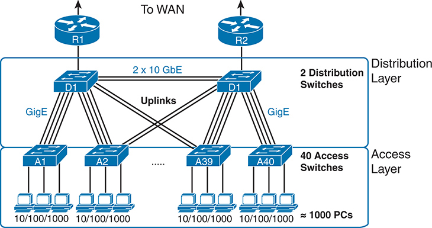
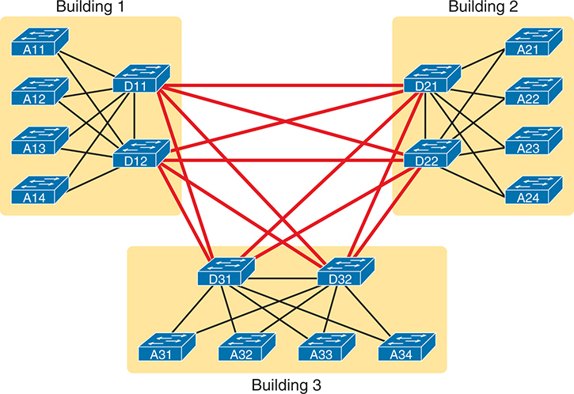
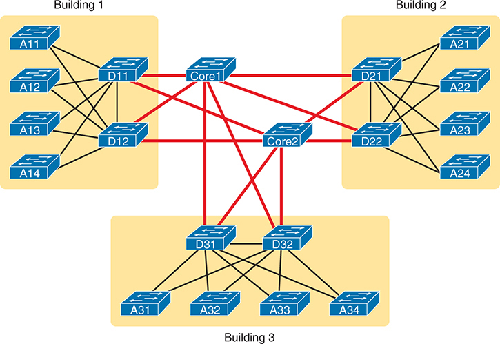
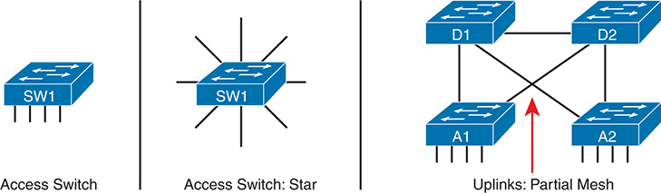
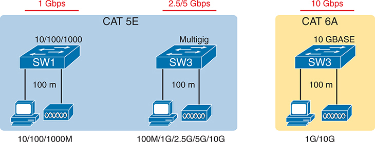
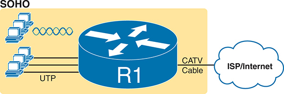
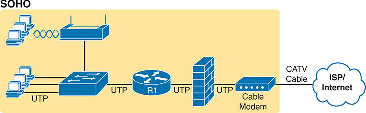
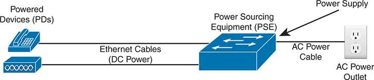

<a href="{{ '/subjects/CCNA/' | relative_url }}">← 返回 CCNA 目录</a>

第二卷 · 网络架构

<nav class="ccna-chapter-nav" aria-label="章节导航"><a href="v2-17.html">← 上一章</a><a href="v2-19.html">下一章 →</a></nav>



<section data-epub-type="chapter">

<h2 class="h2" id="ch18">第 18 章</h2>

<h2 class="h2a">局域网架构</h2>

本章涵盖以下考试主题：

1.0 网络基础

1.1 解释网络组件的作用和功能

1.1.h 以太网供电（PoE）

1.2 描述网络拓扑架构的特征

1.2.a 两层架构

1.2.b 三层架构

1.2.e 小型办公室/家庭办公室（SOHO）

1.3 比较物理接口和布线类型

1.3.a 单模光纤、多模光纤、铜缆

到现在为止，你已经学到了许多有关以太网和以太网交换机的知识。你了解了单条链路的工作方式，包括布线、双工设置和成帧；知道地址如何工作，以及交换机如何根据地址转发帧；也了解了交换机如何使用 STP/RSTP 以及将链路组合为 EtherChannel 来处理冗余。而在第二卷中，你还学习了交换机提供的各种安全功能，包括动态 ARP 检测、DHCP 侦听和 ARP 检测。

此前对各项功能的讨论，很少涉及架构和设计。你现在知道交换机如何工作，但为什么要采用某一种拓扑连接交换机，而不采用另一种？如果有两种可选拓扑，为什么会偏好其中一种？本章讨论其中一些设计问题，具体对应 CCNA 200-301 V1.1 考试大纲中列出的主题领域。

本章涵盖四个涉及设计考量的具体主题。第一节介绍园区以太网 LAN 的拓扑，以及<em>两层</em>和<em>三层</em>这两个设计术语，它们描述终端与通向园区外其他站点的设备之间存在多少个交换机层次。第二节讨论园区链路的铜缆和多模光纤布线选择。第三节较短，介绍小型办公室/家庭办公室（SOHO）LAN，以及它们与企业 LAN 的差异。最后一节介绍以太网供电（PoE）的概念，以及 LAN 设计为什么需要考虑 PoE。

<section>

<h3 class="h3" id="ch18lev1sec1">自测</h3>

如果你想根据得分决定应在本章投入多少时间，可以参加自测（使用此处的问题或 PTP 软件）。字母答案列在自测后面页面的底部。书末及配套网站上的 <a href="#ref-appc">附录 C</a> 包含答案和解析。你也可以在 PTP 测试软件中找到答案和解析。

<figure class="table" id="ch18tab01" tabindex="0">

<figcaption>

<strong>表18-1</strong> 基础主题小节与题目对应关系

</figcaption>

<table class="all">

<tbody>

<tr>

<th class="th">
基础知识小节
</th>

<th class="th">
题目
</th>

</tr>

<tr>

<td class="border">
分析园区 LAN 拓扑
</td>

<td class="border">
1–3
</td>

</tr>

<tr>

<td class="border">
以太网物理媒体和标准
</td>

<td class="border">
4
</td>

</tr>

<tr>

<td class="border">
小型办公室/家庭办公室
</td>

<td class="border">
5
</td>

</tr>

<tr>

<td class="border">
以太网供电
</td>

<td class="border">
6, 7
</td>

</tr>

</tbody>

</table>

</figure>

<strong><a id="quess18_1" href="#ques18_1a">1</a>.</strong>哪个答案能最好地描述地貌 在两级校园局域网的设计中? (取出二个答.

<ol class="lower-alpha">

<li>
设计采用全网连接接入和配送交换机.
</li>

<li>
该设计采用了访问和分配交换机间连接的部分网格.
</li>

<li>
该设计采用了分布交换机和核心交换机间连接的部分网格.
</li>

<li>
终端用户和服务器设备直接连接到接入层交换机.
</li>

</ol>

<strong><a id="quess18_2" href="#ques18_2a">2</a>.</strong>在三级校园局域网设计中,哪一个答案最能形容地貌?. (取出二个答.

<ol class="lower-alpha">

<li>
该设计采用了访问和分配交换机间连接的部分网格.
</li>

<li>
设计采用全网连接接入和配送交换机.
</li>

<li>
该设计采用了分布交换机和核心交换机间连接的部分网格.
</li>

<li>
终端用户和服务器设备直接连接到汇聚层交换机.
</li>

</ol>

<strong><a id="quess18_3" href="#ques18_3a">3</a>.</strong>哪个地理学术语是指一个网络,在这个网络中,一个节点连接到其他所有没有其他链接的节点?

<ol class="lower-alpha">

<li>
部分网状
</li>

<li>
全网状
</li>

<li>
混合拓扑
</li>

<li>
星形拓扑
</li>

</ol>

<strong><a id="quess18_4" href="#ques18_4a">4</a>.</strong>哪些有线电缆类别在相距至100米时支持1000BASE-T? (取出二个答.

<ol class="lower-alpha">

<li>
CAT 5
</li>

<li>
CAT 5E
</li>

<li>
CAT 6
</li>

<li>
OM1
</li>

<li>
OM3
</li>

</ol>

<strong><a id="quess18_5" href="#ques18_5a">5</a>.</strong>哪些答案列表标准是SOHO网络的典型标准? (取出二个答.

<ol class="lower-alpha">

<li>
AP使用独立模式的功能.
</li>

<li>
AP的功能是使用使用WLC的分解-MAC架构.
</li>

<li>
一个单一的网络设备执行路由器,交换机,AP,以及防火墙等功能.
</li>

<li>
单独的网络设备执行每个功能(路由器,交换机,AP,和防火墙).
</li>

</ol>

<strong><a id="quess18_6" href="#ques18_6a">6</a>.</strong>在决定了附加设备想要接收UTP电缆的功率后,PoE LAN交换机如何选择初始功率级别来应用?

<ol class="lower-alpha">

<li>
它应用了标准的少量电压.
</li>

<li>
它问使用 CDP 消息。
</li>

<li>
它使用 LLDP 消息询问 。
</li>

<li>
它应用基于所配置值的电压.
</li>

</ol>

<strong><a id="quess18_7" href="#ques18_7a">7</a>.</strong>以下哪些标准是指在UTP电缆中为四对全部提供动力的标准? (取出二个答.

<ol class="lower-alpha">

<li>
PoE
</li>

<li>
UPoE
</li>

<li>
PoE+
</li>

<li>
UPoE+
</li>

</ol>

自测答案：

<strong><a id="ques18_1a" href="#ref-ques18_1">1</a></strong> B, D

<strong><a id="ques18_2a" href="#ref-ques18_2">2</a></strong> A, C

<strong><a id="ques18_3a" href="#ref-ques18_3">3</a></strong> D

<strong><a id="ques18_4a" href="#ref-ques18_4">4</a></strong> B, C

<strong><a id="ques18_5a" href="#ref-ques18_5">5</a></strong> A, C

<strong><a id="ques18_6a" href="#ref-ques18_6">6</a></strong> A

<strong><a id="ques18_7a" href="#ref-ques18_7">7</a></strong> B, D

</section>

<section>

<h3 class="h3box" id="ch18lev1sec2">基础主题</h3>

</section>

<section>

<h3 class="h3" id="ch18lev1sec3">分析园区 LAN 拓扑</h3>

术语<em>学校局域网</em>是指为在相邻的建筑物或多座建筑物中支持设备而建立的局域网。 例如,一家公司可能在同一办公公园的几所建筑中租赁办公用地。 然后,网络工程师可以建造一个校园局域网,其中包含每栋大楼的交换机,再加上建筑物中交换机之间的以太网连接,从而创建出更大的校园局域网上.

在规划和设计校园局域网时,工程师必须考虑可用以太网的种类以及每种类型的电缆长度支持. 工程师们还需要为每一个以太网段选择所需的速度. 此外,工程师使用不同角色的交换机——有些直接连接到最终用户设备,而另一些则连接交换机。 最后,大多数项目要求工程师考虑已经安装的设备类型,以及某些部分速度的提高是否值得购买新设备的费用。

本章第一主要部分讨论校园局域网设计的地貌. 网络设计师并不只是在任何端口插入设备,任意连接交换机,就像你可能用实验室中的几个设备一样. 取而代之的是,大多数传统的校园局域网设计要么遵循双层设计,要么遵循三级设计,如下页所讨论.

<section>

<h4 class="h4" id="ch18lev2sec1">两层园区设计（折叠核心）</h4>

<a href="#ch18fig01">图18-1</a>显示一个大型校园局域网的典型设计加上一些关键术语. 这个局域网有大约1000个PC连接到交换机,每个交换机支持大约25个端口. 对术语的解释与该数字相仿。

<figure class="image-c" id="ch18fig01">

<figcaption>

<aside class="hidden" id="a18fig01">

网络主要分为两个地层:分布地层和访问地层. 在汇聚层中,两个分布交换机(D1和D2)连接了路由器R1和R2,这些路由器提供与广域网(WAN)的连接. 这些分布式交换机是互相连接的,通过高速上行链路(2×10 Gigabit以太网)与接入层交换机相接. 在访问层中,有40个接入交换机(A 1至A 40),每个交换机通过每秒10 slish 100 slish 1000 Megabits(M b p s)以太网端口提供连接到1000 P C s. 配电交换机从接入交换机中交换总流量,提供通向广域网的路径,确保高效和可扩展的网络连接。 接入交换机连接了PC S等终端设备,使其可以在校园网络内通信,并通过配送交换机访问外部资源.

</aside>

<strong>图18-1</strong> <em>带有设计术语的校园局域网</em>

</figcaption>

</figure>

Cisco使用三个术语来描述校园设计中每个交换机的作用:<em>接入</em>, <em>汇聚</em>,以及<em>核心</em>。角色不同,取决于交换机是否从用户设备及局域网其余部分(接入)前传流量,或者交换机前传其他局域网交换机之间的流量(分布和核心).

<em>访问交换机</em>直接连接到终端用户,提供用户设备对局域网的访问. 接入交换机通常发送来往于连接到的终端用户设备的流量,并坐落在局域网的边缘.<a id="key_228" href="#ref-gloss_019">访问链接</a>将访问交换机连接到各种端点设备。 以下列表总结了访问交换机所执行的更常见的功能:

<ul class="sq">

<li>
终端和无线AP的物理网络访问链接
</li>

<li>
以太网的权力( PoE)
</li>

<li>
与以太通道和STP/RSTP的冗余上行链路
</li>

<li>
安保(港口安保、DHCP 侦听和DAI)
</li>

<li>
使用 QoS 分类和标记创建的QoS信任边界
</li>

</ul>

<em>分发交换机</em>提供一条通道,使接入交换机能够将交通向对方推进,并让校园外的交通向企业的其余部分推进. 接入和分配交换机之间的联系――上行链路或<a id="key_235" href="#ref-gloss_119">分发链接</a>——典型地将每个接入交换机连接到两个分布交换机上,往往在一个以太通道内有多个链接.

除了基本的连通性,<a id="key_234" href="#ref-gloss_118">汇聚层</a>提供了影响连接到接入交换机的端点的许多特性。 由于设计只使用几个发行交换机,一些服务需要额外的处理,发行交换机往往需要更强大的处理器和更多的内存. 以下列表总结了分配交换机所执行的更常见的特性:

<ul class="sq">

<li>
连接接入交换器到网络
</li>

<li>
直接(双层)或使用(三级)核心交换机与其他分布式交换机创建核心
</li>

<li>
提供第3层功能,例如 InterVLAN 路由、默认路由器、 FHRPs
</li>

<li>
执行动态IP路由协议(如OSPF)
</li>

<li>
冗余链接和设备(以太通道、STP/RSTP、FHRP)的负载平衡
</li>

<li>
提供QoS(排队、维持流量监管、投放)
</li>

<li>
过滤带有 ACLs 的 IPv4 和 IPv6 包
</li>

</ul>

<a href="#ch18fig01">图18-1</a>显示双层设计,分层为访问层(或分层)和汇聚层(或相层)。 双层设计解决了两大设计需要:

<ul class="sq">

<li>
提供一个连接终端用户设备的地方(<a id="key_227" href="#ref-gloss_018">接入层</a>,带有接入交换机),一般在100米以内
</li>

<li>
通过将所有40个接入交换机连接到两个分布交换机,在所有有合理数量的电缆设备之间创建路径并切换端口
</li>

</ul>

</section>

<section>

<h4 class="h4" id="ch18lev2sec2">三层园区设计（核心）</h4>

双层设计<a href="#ch18fig01">图18-1</a>,带有<a id="key_239" href="#ref-gloss_243">部分网状</a>恰好是最常用的校园局域网设计。 它还有两个常见的名称:一种是双层设计(出于明显的原因),另一种是:<a id="key_231" href="#ref-gloss_081">倒塌的核心设计</a>(原因较不明显). 术语<em>折叠核心</em>指没有第三级(核心级)的双层设计. 双层设计有核心,但分配交换机执行核心;核心被倒塌为分配交换机. 下一个题目是审查三级设计,其中<a id="key_233" href="#ref-gloss_098">核心层</a>在进一步详细阐述核心目的的同时,还要从视角出发。

想象一下你的校园只有两到三个建筑。 每栋建筑内部有两级设计,每栋建筑有一对配发交换机,并根据需要将出入交换机分布在建筑周围. 你会如何连接每栋大楼的局域网? 嗯,只要几栋楼, 简单把分配交换机绑在一起就有意义了。<a id="key_236" href="#ref-gloss_151">全网状</a>,如<a href="#ch18fig02">图18-2</a>.

设计在<a href="#ch18fig02">图18-2</a>效果很好,很多公司都使用这种设计. 有时网络中心会使用全网,有时是部分网,这取决于建筑物之间是否有电缆.

使用校园中心的第三层——核心层——在大型校园中具有若干优势。 例如,在连接大楼局域网时,可以使用更少的交换机端口和链接. 请注意,随着建筑物之间的连接,外出运行的电缆往往会更昂贵地安装起来,而且几乎总是用更昂贵的交换机端口来接通纤维电缆,因此保存建筑物之间使用的电缆数量可以帮助降低成本.

<figure class="image-c" id="ch18fig02">

<figcaption>

<aside class="hidden" id="a18fig02">

每栋大楼都有多个接入交换机与配送交换机相接. 在1楼中,接入交换机的标签为:A11,A12,A13和A14,连接两个配发交换机的标签为:D11和D12. 同样地,在2楼中,贴有A21,A-22,A-23和A-24等标签的接入交换机与贴有D-21和D-22等标签的配送交换机相接. 在3号楼中,贴有A31,A32,A33和A34等标签的接入交换机与贴有D31和D32的配发交换机相接. 每栋大楼的分布交换机通过一系列代表链接的红线相互连接,形成网状网络. 不同建筑的配电交换机之间的这种互通性确保了冗余性和网络回弹能力,但缺乏中央核心层.

</aside>

<strong>图18-2</strong> <em>双层建筑设计,无核心,三层建筑</em>

</figcaption>

</figure>

三级<a id="key_232" href="#ref-gloss_081">核心设计</a>,在这个时候并不出人意料地,再增加几个交换机(核心交换机),这提供了一种主要功能:连接分布式交换机.<a href="#ch18fig03">图18-3</a>显示<a href="#ch18fig02">图18-2</a>已倒塌的地心(一个没有地心的设计)到三级地心设计. 请注意,在地形学上,核心交换机位于显示的网络中间;然而,一般情况下,这些交换机与配电交换机一起安装在一栋建筑物的接线柜中。

使用核心设计,在核心中部分网格连接,仍然提供局域网各部分的连通性,以及发送包到WAN上方的路由器,而建筑之间的连通也较少. 但是,重点转向了速度、低延迟和高可用性——奇怪的是,这也意味着避免在核心领域做太多事情。 概述核心交换机的关键作用:

<ul class="sq">

<li>
在保存连接和端口的同时,分布式交换机之间的连接
</li>

<li>
快速运输
</li>

<li>
高可用性(冗余硬件和设计)
</li>

<li>
低潜伏度
</li>

<li>
避免所有可能延缓信息发送的服务
</li>

</ul>

<figure class="image-c" id="ch18fig03">

<figcaption>

<aside class="hidden" id="a18fig03">

在1 楼内,接入交换机A11,A12,A13和A14 连接到配送交换机D11和D12. 在2楼中,接入交换机A21,A22,A23和A24连接到配送交换机D21和D22. 在3 楼,接入交换机A31,A32,A33和A34已连接到配送交换机D31和D32. 这一设计中的重要添加是核心层,由两个核心交换机组成,分别被标注为"核心-1-"和"核心-2-". 这些核心交换机是集中定位的,并连接到三栋大楼内的所有配电交换机. 红线代表连接每个分配交换机到核心交换机的链接,建立中央核心层.

</aside>

<strong>图18-3</strong> <em>三层建筑设计(核心设计) 三层建筑</em>

</figcaption>

</figure>

以下列表概括了描述校园交换机作用的术语:

<ul class="sq">

<li>
<strong>访问 :</strong>提供终端用户设备的连接点(访问)和与分配层的连接. 他们还实施以端点设备为重点的服务,例如Power over Ethernet(PoE),切换端口安全,以及DHCP 侦听等.
</li>

<li>
<strong>分发 :</strong>为访问交换机提供聚合点,提供与局域网中其他设备的连接,交换机之间的转发帧,但不直接连接到终端用户设备. 这些交换机为校园局域网提供大部分服务。
</li>

<li>
<strong>核心 :</strong>在大型园区局域网中汇总分配交换机,由于网络规模大,为较大的交通量提供高转发率,同时有目的地实施很少的服务。
</li>

</ul>

</section>

<section>

<h4 class="h4" id="ch18lev2sec3">拓扑设计术语</h4>

下一个专题将一些通用地貌学术语应用于典型的两级设计,以结束对企业局域网地貌学的讨论.

访问交换机图画经常显示一系列平行的垂直电缆,显示在最左边<a href="#ch18fig04">图18-4</a>。然而,一个访问交换机及其访问链接通常被称为a<a id="key_246" href="#ref-gloss_334">星形拓扑</a>。为什么? 看看图中央的再生接驳交换机 电线从中央辐射出来 看上去有点像孩子画的星星,所以这个词<em>星形拓扑</em>.

<figure class="image-c" id="ch18fig04">

<figcaption>

<aside class="hidden" id="a18fig04">

左边有一个单一的接入交换机,标签为S W 1,其下有四个相接设备,显示了一个基本的设置. 在中心,还有一个被标记为S W 1的交换机在恒星地表学中连接到多个设备,表示一个中央交换机,所有直接与之相接的设备都与之相接. 右侧有部分网格网络配置,有四个交换机标注为:D1,D2,A1和A2. 这些交换机使用代表网络电缆的线路相互连接. 一个被标记为上行链路的红色箭头:部分 Mesh指向一个特定的连接,突出显示交换机之间的冗余链接,通过提供多条数据路径来增强网络可靠性和性能.

</aside>

<strong>图18-4</strong> <em>局域网设计术语</em>

</figcaption>

</figure>

图中的右侧重复了典型的两级设计,以分布链路的网格为主. 与恒星地表学相比,任何连接更多链路的节点组一般称为a.<em>网状拓扑</em>。在这种情况下,网格是...<em>部分网状</em>因为并不是所有的节点之间都有直接的联系. 用链接连接所有节点的设计是<em>全网状</em>.

为什么不在接入和分配交换机之间使用一个完整的网格? 一个完整的网格将连接接入交换机相互连接,创建比需要更多的链接,并使用太多的交换机端口. 出入交换机的端点设备之间很少有交通往来。 相反,一个端点和校园局域网外的服务器之间的流量流量,因此在所有链接工作时,流量很少需要在接入交换机之间流动. 大部分流量端口到服务器:从端口到接入交换机,到发售交换机,再出到WAN.

关于链接的数量,设想一个双层设计,有40个接入交换机和两个分布交换机. 如果设计需要从每个接入交换机中调取两个上行链路到每个分配交换机,则需要160个上行链道. (每个接入交换机4个,有40个交换机. ) 换句话说,分布式和接入式交换机(42个交换机)之间的全网格,每对交换机之间只有1个连接,需要861个分布式连接. (数学使用公式)<em>N</em>(<em>N</em>1) / 2,或在此情况下,42 * 41 / 2. = 861链接. )

真正的网络使用这些地貌学思想,但往往有一个网络将这些思想结合起来. 例如,右侧<a href="#ch18fig04">图18-4</a>将访问层的恒星地貌与汇聚层的部分网格结合. 所以,你可能会听到这些设计 结合概念,叫做<em>混合拓扑</em>.

</section>

</section>

<section>

<h3 class="h3" id="ch18lev1sec4">以太网物理介质与标准</h3>

在本章讨论的两级和三级设计中,个别链接使用以太网数据链接协议,支持以太网帧——但往往使用不同的物理层标准. 这些标准界定了最大链路段长度和传输速度。 下一节在选择校区局域网使用的电缆时,要更仔细地研究一些考虑和决定,首先注重访问链接,这些链接经常使用UTP电缆,然后是分布和核心链接,它们使用UTP和光纤链接.

<section>

<h4 class="h4" id="ch18lev2sec4">接入层的以太网 UTP 链路</h4>

多数(如果不是全部的话)访问链接都使用无屏蔽的扭曲式铺设电缆,这并非偶然。 从以太网早期开始,IEEE就着手确保以太网成为商业上可行,使其非常有用和价格低廉,以UTP电缆作为最便宜的选择. 举例来说:

<ul class="sq">

<li>
IEEE知道UTP的布线成本低于其他选项,因此强调支持UTP在典型网络中最常见的链接:访问链接的标准.
</li>

<li>
早期的研究表明,对于大多数办公楼来说,100米高的电缆可以从接线衣柜接通到地板上的任何点.
</li>

<li>
因此,IEEE在其多年来以UTP为基础的连续标准中使用了100米最大长度的常规.
</li>

</ul>

大部分建筑建设计划包括结构化的电缆系统. 每层楼的电缆从中央接线衣柜的接线板跑到地上周围的大多数地点. 例如,在办公用隔间使用的地板上,结构化的电缆系统包括从接线柜到每个隔间位置的UTP电缆,通常在墙板上用RJ-45接线器终止.

并非所有的UTP电缆都有相同的物理传输特性,因此电缆行业和标准机构对以太网使用的UTP电缆有很长的定义标准. 以太网标准指由电信业协会和美国国家标准研究所(TIA/ANSI)定义的UTP有线评级类别. 这些类别在使用电缆时定义了物理传输质量.

虽然TIA和ANSI没有定义以太网,而IEEE也没有定义电缆标准,但是以太网基于UTP的标准指的是以太网的最低质量.<a id="key_248" href="#ref-gloss_359">UTP 有线电视类别</a>支持每个以太网标准。 对于TIA/ANSI类别,数字和字母越高,质量越高,标准发布时间越近,使用电缆的IEEE标准也越近. 这些类别包括:CAT-3、CAT-5、CAT-5E、CAT-6、CAT-6A和CAT-8。

<a href="#ch18tab02">表18-2</a>列出关于电缆类别和匹配以太网标准的数据。 注意电缆类别编号/字母越高,支持更快以太网标准越好. 另外,该表没有列出每个组合;然而,该表确实列出了支持100米电缆长度的标准.

<figure class="table" id="ch18tab02" tabindex="0">

<figcaption>

<strong>表18-2</strong>以太网和电缆标准支持100米部分

</figcaption>

<table class="all">

<tbody>

<tr>

<th class="th">
标准（常用名称）
</th>

<th class="th">
标准（原始文档）
</th>

<th class="th">
标准年份
</th>

<th class="th">
(最低)ANSI/TIA类别
</th>

<th class="th">
最大速度
</th>

</tr>

<tr>

<td class="border">
<a id="key_218" href="#ref-gloss_007">10BASE-T</a>
</td>

<td class="border">
802.3
</td>

<td class="border">
1990
</td>

<td class="border">
CAT 3
</td>

<td class="border">
10 Mbps
</td>

</tr>

<tr>

<td class="border">
<a id="key_219" href="#ref-gloss_011">100BASE-T</a>
</td>

<td class="border">
802.3u
</td>

<td class="border">
1995
</td>

<td class="border">
CAT 5
</td>

<td class="border">
100 Mbps
</td>

</tr>

<tr>

<td class="border">
<a id="key_220" href="#ref-gloss_013">1000BASE-T</a>
</td>

<td class="border">
802.3ab
</td>

<td class="border">
1999
</td>

<td class="border">
CAT 5E
</td>

<td class="border">
1 Gbps
</td>

</tr>

<tr>

<td class="border">
<a id="key_225" href="#ref-gloss_009">10GBASE-T</a>
</td>

<td class="border">
802.3an
</td>

<td class="border">
2006
</td>

<td class="border">
CAT 6A<a id="tfn18_2_1" href="#tfn18_2_1a">*</a>
</td>

<td class="border">
10 Gbps
</td>

</tr>

<tr>

<td class="border">
<a id="key_226" href="#ref-gloss_010">40GBASE-T</a>
</td>

<td class="border">
802.3ba
</td>

<td class="border">
2010
</td>

<td class="border">
CAT 8
</td>

<td class="border">
40 Gbps
</td>

</tr>

<tr>

<td class="border">
<a id="key_223" href="#ref-gloss_002">2.5GBASE-T</a>
</td>

<td class="border">
802.3bz
</td>

<td class="border">
2016
</td>

<td class="border">
CAT 5E
</td>

<td class="border">
2.5 Gbps
</td>

</tr>

<tr>

<td class="border">
<a id="key_224" href="#ref-gloss_002">5GBASE-T</a>
</td>

<td class="border">
802.3bz
</td>

<td class="border">
2016
</td>

<td class="border">
CAT 5E
</td>

<td class="border">
5 Gbps
</td>

</tr>

</tbody>

</table>

</figure>

<a id="tfn18_2_1a" href="#tfn18_2_1">*</a>10GBASE-T也可以使用CAT 6电缆,但距离限制为55米.

该表列出最低有线电视类别,较好的有线电视类也起作用. 例如,最初的10BASE-T在当时的CAT 3电缆(或更好)上工作. 100BASE - T,下一个IEEEE UTP以太网标准,需要CAT 5(或更好)。 以下以太网UTP标准为1000BASE-T,需要甚至更好的电缆(CAT 5E)来达到100米.

今天,IEEE公司和其他人努力改进以太网的UTP电缆标准,将100米的接入链路作为关键的设计点。 如日期所示:<a href="#ch18tab02">表18-2</a>,大约从1990年到2010年每5年,IEEE就提供一个新的基于UTP的标准比UTP更快. 这些标准为接入层提供了大量的速度,前提是安装了所需的电缆类型。

</section>

<section>

<h4 class="h4" id="ch18lev2sec5">CAT 5E 布线上的多千兆以太网</h4>

在引入了1000BASE-T后,随着时间的推移,校园局域网的接入层到达了市场上一个舒适的地方. 许多建筑物完成迁移使用<a id="key_229" href="#ref-gloss_059">CAT 5E</a>电缆。 对于10/100/1000交换机端口和NIC,价格很快变得合理. 而每个连接到台式计算机或笔记本电脑的接入链路的1-Gbps速度为PC提供了足够多的容量.

2010年代,IEEE预想了校园局域网接入层的潜在迁移问题. 移动超过1-Gbps速度的端点需要10GBASE-T,它不会运行在CAT 5E电缆上,至少按照IEEE标准运行. 根据标准,10GBASE-T要求

<ul class="sq">

<li>
CAT 6 电缆通向55米
</li>

<li>
<a id="key_230" href="#ref-gloss_060">CAT 6A</a>接线至100米
</li>

</ul>

IEEE认为,从1000BASE-T移动到入口层的10GBASE- T,连接可达100米,需要迁移到CAT 6E电缆或更佳,使得这些迁移成本要高得多. 因此,他们开始创造一种替代以太网标准,它运行速度快于1Gbps,但也在CAT 5E电缆的大型安装基座上工作.

解决方案,<a id="key_237" href="#ref-gloss_216">多吉克以太网</a>,来自2016 IEEE802.3bz增编. 它定义了两个以UTP为基础的新的物理传输标准:2.5GBASE-T和5GBASE-T. 这两作都用CAT-5E接线(如1000BASE-T)来进行,但运行速度快于2.5Gbps和5Gbps.<a href="#ch18fig05">图18-5</a>显示基本的迁移概念和电缆类别。

<figure class="image-c" id="ch18fig05">

<figcaption>

<aside class="hidden" id="a18fig05">

左侧有一个红色标签,表示出-1G b p s,有一个名为CAT-5E的蓝色盒子,上面有一个带有S W-1的交换机,与计算机和路由器连接,连接支持速度为-10斜100斜1000大比特每秒(M b p)相距为-100米. 在中间,一个红色标签下表示出-2.5 slash5G b s,还有一个名为 CAT5 E的蓝盒子,上面有一个多吉交换机,标有S W3 连接到计算机和路由器上,支持速度为-100 兆比特每秒(M b s),-1 Gigabit每秒(G b s),-2.5 (G b),-5 (G p s),和-10 (B)相距为-100米. 在右侧,一个红色标签下表示出-10G b p s,有一个黄色的盒子,取名为 CAT-6A,其交换机标记为 S W-3 ,连接计算机和路由器,支持速度为-1G b p s和-10G b p s,相距为-100米. 这种比较突出了不同以太网电缆标准的推进和速度能力,而CAT-5-E支持多吉快作为比传统的-1-G b p s更快的选择.

</aside>

<strong>图18-5</strong> <em>概念: 使用 CAT 5E 作为快捷选项的多相比 Gbps</em>

</figcaption>

</figure>

超过PC,无线接入点(APs)驱动了多吉以太网市场. IEEE 802.11ac(WI-FI 5)和802.11ax(WI-FI-6)APs支持的无线流量超过1Gbps,因此它们需要以太网接口的速度快于1Gbps. 使用多吉NIC连接到多吉交换机端口的AP,AP可以支持2.5-或5-Gbps速度,使以太网链接不会成为瓶颈.

要使用多吉克以太网, 您需要多吉主机NICs并切换端口 。 多吉克NIC和交换机端口使用IEEE自旋谈判来选择最佳速度. 因此,多基端口一般不使用10/100/1000端口,而是支持100Mbps,1Gbps,2.5Gbps,和5Gbps,均使用CAT5E接线. 如果连接到升级了的CAT6/6E电缆,他们也可以谈判使用10Gbps.

</section>

<section>

<h4 class="h4" id="ch18lev2sec6">光纤上行链路</h4>

对于所有的上行链路,需要选择所需的速度和物理层以太网标准. 安装的电缆影响到选择,因为使用安装的电缆而不是安装新的电缆可以大大减少成本。

如果可能,请使用UTP电缆进行所有上行连接. 比如说,<a href="#ch18tab02">表18-2</a>列出 10GBASE-T 需要 CAT 6A UTP 电缆处理距离到 100米。 使用10GBASE-T上行链路,

然而,有几个因素会推动决定使用以太网纤维选项. 为什么是纤维? 最初的电缆设计可能需要超过100米的电缆段,所以他们预计你选择使用使用光纤电缆的以太网标准. 有了预先安装的纤维电缆,你就可以集中精力研究以太网标准会用什么来做这种电缆,选择最好的交换机硬件(例如,SFPs来添加交换机)等等.

多模纤维电缆具有类似于UTP电缆类别的质量标准。 这些标准,称为:<a id="key_238" href="#ref-gloss_239">光学多模器(OM)</a>,包括OM1,OM2,OM3和OM4,数字较高是较新的,能力更强的电缆标准. 电缆标准界定了电缆的某些属性——例如,芯片和电缆的直径。 (单位:<em>CCNA 200-301 官方证书指南 第1卷</em>,第二版,见<a href="v2-02.html#ch02">第2章</a>一些显示有纤维电缆芯片和接线的人物的题为 " 纤维电缆传输概念 " 的章节。 )<a href="#ch18tab03">表18-3</a>列出这些OM标准,有些则支持以太网标准。

<figure class="table" id="ch18tab03" tabindex="0">

<figcaption>

<strong>表18-3</strong>光学多模(OM)和相关以太网标准

</figcaption>

<table class="all">

<tbody>

<tr>

<th class="th">
最低 ISO 电缆类别
</th>

<th class="th">
纤芯/包层直径
</th>

<th class="th">
每标准1000BASE-SX 最大距离
</th>

<th class="th">
10GBASE-SR 最大距离/ 标准
</th>

</tr>

<tr>

<td class="border">
OM1
</td>

<td class="border">
62.5/125
</td>

<td class="border">
220米长
</td>

<td class="border">
33米长
</td>

</tr>

<tr>

<td class="border">
OM2
</td>

<td class="border">
50/125
</td>

<td class="border">
550米长
</td>

<td class="border">
82米长
</td>

</tr>

<tr>

<td class="border">
OM3
</td>

<td class="border">
50/125
</td>

<td class="border">
N/A
</td>

<td class="border">
300米长
</td>

</tr>

<tr>

<td class="border">
OM4
</td>

<td class="border">
50/125
</td>

<td class="border">
N/A
</td>

<td class="border">
400米长
</td>

</tr>

</tbody>

</table>

</figure>

尝试利用已经安装的多模光纤时，应先确定以太网标准为了达到目标速率所要求的 OM 类别。随后可以分析表中的数据，或其他以太网标准的类似数据，确定每种以太网标准支持的最大电缆长度。（注意，厂商通常表示，其 SFP、SFP+ 等光收发器能够支持超过标准规定的距离。）如<a href="#ch18tab03">表18-3</a> 所示，<a id="key_222" href="#ref-gloss_012">1000BASE-SX</a> 支持的距离超过 1000BASE-T 的 100 米，这可能很有用。10GBASE-SR 标准支持类似距离，但速率为 10 Gbps。

此外,使用表中的数字进行初步规划,但要了解几个要点:

<ul class="sq">

<li>
标准一般给出保守的距离估计,但您也许能够使链接在更长的距离工作.
</li>

<li>
在实际操作中,1000BASE-SX在OM3和OM4上工作. 该表列出N/A(不适用),因为1000BASE-SX标准早于OM3和OM4标准. 但形式上,以太网标准的1000BASE-SX部分并未提及OM3和OM4.
</li>

</ul>

在识别出特定的电缆后,可以规划以太网标准并切换端口. 例如,您可以制定标准,使用支持1或10 Gbps的模块化端口购买访问和分销交换机。 然后可以购买1000BASE-SX SFP或<a id="key_221" href="#ref-gloss_008">10GBASE-SR</a>SFP+,以匹配满足每个案例需要的标准.

</section>

</section>

<section>

<h3 class="h3" id="ch18lev1sec5">小型办公室/家庭办公室</h3>

由于你对企业局域网的设计选择和条件了解得更多,下一节将审查一种较小的局域网类型:小型办公室/家用办公室(<a id="key_245" href="#ref-gloss_324">SOHO</a>) 局域网. SOHO是指要求量如此之小的设计与执行——缝隙交换机口,AP,路由器,和WAN链接——以致设计差异很大. 该名词本身指两种最常见的案例:一种是在家工作的用户,另一种是小办公室,有少量工人和器械. 接下来的简短议题指出了几个突出的问题,即SOHO网络与企业网络之间的区别.

首先,作为提醒,IEEE定义了以太网和无线局域网(WLANs). 所有IEEE802.3以太网标准都使用电缆——即以太网定义有线局域网. IEEE 802.11工作组定义了无线局域网,也称"无线局域网".<em>无线网络</em>按Wi-Fi联盟的商标名词计算(<a href="http://www.wi-fi.org">www.wi-fi.org</a>).

大多数人都使用过Wi-Fi,并且可能每天使用. 你们中有些人可能在家里安装了Wi-Fi,这表现在<a href="#ch18fig06">图18-6</a>。你可能用了一个叫"A"的单一消费设备<em>无线路由器</em>在一个家庭。 设备的一面连接到互联网,而另一面连接到家用设备. 在家中,设备可以连接到Wi-Fi或有线以太网电缆.

<figure class="image-c" id="ch18fig06">

<figcaption>

<aside class="hidden" id="a18fig06">

网络被贴上"SOHO"(Small Office slash Home Office)的标签,包括几台个人电脑连接到一个中央路由器,被贴上"R"的标签. R.1. 该图显示了两类连接:无线和有线. 无线连接由连接一些个人计算机和路由器的wavy线来代表. 有线连接使用无屏蔽的Twisted Pair(UTP)电缆,被描绘为从其他个人计算机到路由器的固态线路. 路由器R-1是这些连接的中心枢纽,通过CATV(有线电视)有线电视与互联网服务提供商(ISP)相接. ISP slash Internet以云符号为代表,表示家用网络为对外通信所连接的更广阔的网络.

</aside>

<strong>图18-6</strong> <em>典型的家用有线和无线局域网</em>

</figcaption>

</figure>

虽然图中显示硬件是一个单一的路由器图标,但内部,一个无线路由器就像在企业校园里你会发现的单独的设备一样:

<ul class="sq">

<li>
以太网交换机,用于有线以太网连接
</li>

<li>
一个无线接入点(AP),与无线设备通信,并将帧转发到/从有线网络传送出去.
</li>

<li>
一个路由器,用于将 IP 包从局域网和WAN(互联网)接口连接/调出
</li>

<li>
一个防火墙,它常常默认只允许客户端连接到互联网上的服务器,但反之亦然
</li>

</ul>

<a href="#ch18fig07">图18-7</a>重复了上个图,将内部组件分解出来,仿佛它们是单独的物理设备一样,只是为了说明一个单一的消费无线路由器的行为就像几个设备一样.

<figure class="image-c" id="ch18fig07">

<figcaption>

<aside class="hidden" id="a18fig07">

该图从几台个人计算机起步,连接到一个无线接入点,以有天线的无线路由器图标为代表. 这些连接显示为无线线线和用未遮蔽的Twisted Pair(UTP)电缆接通的有线线线的干线。 无线路由器与交换机相接,由交换机图标来描绘,而交换机图标又与中央路由器相接并被标记为R1. 路由器R1被链接到一个防火墙上,由防火墙图标所象征,为网络增加了一层安全. 从防火墙上,网络通过UTP电缆连接到有线调制解调器. 有线调制解调器通过CATV(有线电视)有线电视与互联网服务供应商(ISP)相接,ISP斜线互联网以云符号为代表.

</aside>

<strong>图18-7</strong> <em>消费者无线线路产品中功能的体现</em>

</figcaption>

</figure>

在一款SOHO无线局域网中,无线AP是自主行事的,而不是与一款WLC合作,完成创建并控制WLAN所需的全部工作. 换句话说,自主AP使用802.11协议和无线电波与各种无线设备进行通信. 它在有线侧使用以太网协议. 它在转发到/从802.3以太网和802.11无线帧之前,将802.11和802.3帧在首部格式上的差异转换为. 但它并没有在CAPWAP中封装帧,因为AP不会将它们发送给一个WLC.

对于互联网连接,路由器(combo)设备与任何可用的互联网接入技术相接,包括有线互联网,DSL,4G/5G无线,或纤维以太网. 请注意:<a href="v2-19.html#ch19">第19章</a>, “<a href="v2-19.html#ch19">广域网架构</a>,”介绍了这些技术。

</section>

<section>

<h3 class="h3" id="ch18lev1sec6">以太网供电（PoE）</h3>

只要在任何建筑物周围走走, 你可以看到电源插口 到处都是。 在完成建筑物内部时,电工会开通电缆,并安装电源插口到任何可能需要电力的地方。 它们也直接运行电源电缆到光固定装置等设备上. 而当网络工程师考虑电能时,他们考虑确保电商有足够的电能运行到接线衣柜和其他地点为网络设备提供动力.

以太网的权力<a id="key_240" href="#ref-gloss_250">PoE</a>)改变思维,使向某些设备提供电力的责任可以由网络工程组承担. 一些现代设备可以从以太网电缆中取出电源,而不是单独的电线. 为了成功,连接到电缆的局域网交换机必须提供电缆上的电源. 使用PoE,公司可以获得一些优势,包括比起传统的电力电缆跑道和电源插口,需要更少的有线跑道和更好的电力管理能力来降低成本. 本章最后一节审查PoE。

<section>

<h4 class="h4" id="ch18lev2sec7">PoE 基础</h4>

供电标准家族以通名命名<em>以太网供电</em>(英文) (英文). 有了PoE,一些设备,一般是局域网交换机,就起到作用<a id="key_243" href="#ref-gloss_264">电力采购设备(PSE)</a>——即提供DC对以太网UTP电缆供电的设备(如上所示)<a href="#ch18fig08">图18-8</a>) 一个能够用电源在以太网电缆上而不是由设备上的其他电源连接器供电的设备叫做:<a id="key_244" href="#ref-gloss_265">电源设备( PD)</a>.

<figure class="image-c" id="ch18fig08">

<figcaption>

<aside class="hidden" id="a18fig08">

受电设备或P Ds通过携带D C电源的以太网电缆连接到电力源设备或PSE. PSE通过一款AC电源电缆连接到一款A C电源出入口. PSE配有电源.

</aside>

<strong>图18-8</strong> <em>以太网术语的权力</em>

</figcaption>

</figure>

PoE对于安装在往往没有预先安装的电源电缆或电源输出位置的装置来说,具有极佳的优势. 例如,无线网络将AP定位在大多数楼层的天花板上的许多地方. 另外,IP相机可能放置在天花板角落内或不同外部地点. 单以太网电缆运行不同时向每个设备运行电源和网络电缆,而是可以向设备提供电源,同时允许以太网在同一电缆和电线对上进行例行通信.

PoE也以一些不太明显的实用方式有所帮助,因为它提供DC对以太网电缆的电力,因此设备不需要AC/DC转换器. 例如,膝上型计算机和IP电话等设备使用电线,包括一个电砖——一个AC到DC的转换器——将AC电能从电源输出器转换为设备所需的DC电能。 PoE通过以太网电缆提供DC电流. 例如,对于IP电话来说, 不再有电源电缆, 也不再有电砖搅动办公桌, 或占用一个电源。

</section>

<section>

<h4 class="h4" id="ch18lev2sec8">PoE 工作过程</h4>

PoE必须具备避免伤害电路端上装置的手段. 每个电器设备都可能因为接收到太多电流而损坏,这就是电商安装断路器的原因,也是我们使用起伏保护器的原因. 在以太网电缆上应用电能可能具有同样的效果,如果设备不支持PoE,则会损害到设备的另一端.

PoE先执行<a id="key_242" href="#ref-gloss_261">电源检测</a>接下来<a id="key_241" href="#ref-gloss_260">电力分类</a>。Power survey定义了PSE如何能检测附着设备是否为PD. 为此,PSE发出低功率信号. PD完成电路,而非PD则不完成. 另外,PD会添加一个定义对电路的阻力,它使得PSE不仅能够检测到PD完成电路,而且还能添加正确的阻力量——在PSE中确认所附带的设备是PD.

PoE功率分类决定了PSE应适用于电路的功率. 这个过程确定了由PoE定义的特定动力等级,每个动力等级都定义了电压和电流等电能特性.

第1层电能分类使用电缆上的电能信号,在一小组低能级中选择,伤害设备的可能性较小. 但是,第1层动力分类具有巨大的优势,可以分配出一种动力类,并提供足够的动力来启动一个简单的OS,可以参与第2层动力分类.

第2层电能分类遵循了第1层电能分级. 第2层电源分类使用LLDP和CDP消息,定义为第2层协议,因为它们不包括IP头来决定电源类. PD向PSE发送消息,告诉PSE期望的班级. 如果PSE有足够的动力,它就供给它;如果没有,它就停止提供电力. (见<a href="v2-13.html#ch13">第13章</a>, “<a href="v2-13.html#ch13">设备管理协议</a>,”以广泛讨论LLDP和CDP.).

也可以在交换机上配置 PoE 设置. 默认情况下,PoE端口使用本节所讨论自动电源检测和分级. 或者,您可以在一个端口上禁用PoE, 或者设置特定的动力等级, 保留该端口的动力, 并绕过对动力分类的需要。

这些标准允许通过电源检测和分级程序走各种道路。 以下列表给出了典型的例子(注意列表并不试图描述每个过程组合).

台阶.1.除非电源检测发现设备需要电源,否则不得在PoE能端口提供电源.

台阶.2.PSE 执行图层 1 通过发送低功率信号和监测回放信号,对PD的存在进行电源检测,以确定设备是否为PD.

台阶.3.如果被确定为PD,则根据Lyer 1电能分类和提供该电能级来确定初始电能级,给予PD足够的电能来进行一些软件初始化步骤.

台阶.4.执行图层 2 使用 LLDP 或 CDP 进行电能分类,PD 宣布一个特定的电能类别。如果选择一个新的电能类别,则调整电能级别。

这些过程导致PD表示他们希望从PSE获得多少瓦特的功率. 视具体PoE标准而定,PSE将提供两对或四对以上的电源,如上所述。<a href="#ch18tab04">表18-4</a>.

<figure class="table" id="ch18tab04" tabindex="0">

<figcaption>

<strong>表18-4</strong>以太网标准之上的权力

</figcaption>

<table class="all">

<tbody>

<tr>

<th class="th">
名称
</th>

<th class="th">
标准
</th>

<th class="th">
PSE 输出功率（瓦）
</th>

<th class="th">
功率等级
</th>

<th class="th">
供电线对
</th>

</tr>

<tr>

<td class="border">
PoE
</td>

<td class="border">
802.3af
</td>

<td class="border">
15
</td>

<td class="border">
0
</td>

<td class="border">
2
</td>

</tr>

<tr>

<td class="border">
PoE+
</td>

<td class="border">
802.3at
</td>

<td class="border">
30
</td>

<td class="border">
4
</td>

<td class="border">
2
</td>

</tr>

<tr>

<td class="border">
UPoE
</td>

<td class="border">
802.3bt
</td>

<td class="border">
60
</td>

<td class="border">
6
</td>

<td class="border">
4
</td>

</tr>

<tr>

<td class="border">
UPoE+
</td>

<td class="border">
802.3bt
</td>

<td class="border">
90
</td>

<td class="border">
8
</td>

<td class="border">
4
</td>

</tr>

</tbody>

</table>

</figure>

除此以外,表格还显示了PoE标准,但Cisco创建了更早的标准前的PoE功能"Cisco Inline Power (ILP)". 然而,Cisco的文献大多提到表首一栏中比较熟悉的名字. 思科早就迁移到他们产品线中使用了IEEE PoE标准,而不是他们专有的思科内线电能.

</section>

<section>

<h4 class="h4" id="ch18lev2sec9">PoE 与 LAN 设计</h4>

本书中讨论的大多数局域网交换机功能(以及<em>CCNA 200-301 官方证书指南 第1卷</em>, 第2版)作为软件特性存在. 一旦你了解到软件的功能, 使用它, 你只需要配置它。 (有时,你可能需要先研究和添加软件许可证。 )不管怎样,添加基于软件的特性几乎不需要或根本不需要事先规划。

PoE在规划有线电站(以太网和电气)和选择新的联网硬件时都需要更多的规划和工程努力. 以下列表包括了规划包含PoE的局域网设计时需要考虑的一些要点:

<ul class="sq">

<li>
<strong>有动力设备 :</strong>确定设备的类型,具体型号,及其动力要求.
</li>

<li>
<strong>电力需求:</strong>规划不同种类的PD数量,连接到每个接线衣柜来构建动力预算. 然后分析数据,以确定PoE功率通过每个交换机提供多少.
</li>

<li>
<strong>切换端口 :</strong>一些交换机支持所有港口的PoE标准,有些则支持没有港口,有些则支持子港口. 一些交换机支持 PoE+,但不支持<a id="key_247" href="#ref-gloss_349">UPoE</a>或 UPoE+. 研究各种交换机模型,使您能够购买足够的PoE能力端口,并具备为每个接线衣柜计划的交换机所需的标准.
</li>

<li>
<strong>切换供电:</strong>PoE交换机充当电力的经销商,因此交换机供电必须提供比交换机本身需要的多得多的瓦特. 您需要根据连接的 PD 数量和每个设备的电源需求, 创建每个交换机的电源预算, 并购买符合这些需求的电源。
</li>

<li>
<strong>PoE标准与实际:</strong>考虑PoE交换机端口所需数量,它们支持的标准,PD支持的标准,以及它们消耗的能耗. 例如,一个PD和一个交换机端口可能都支持PoE+,它支持由PSE提供的可达30瓦. 然而,这种有动力的装置可能需要最多9瓦才能运行,因此你的动力预算需要为这些装置预留的功率要少于最高的功率.
</li>

</ul>

</section>

</section>

</section>

<section class="ccna-source ccna-appendix" aria-label="答案解析与术语表">
<section data-epub-type="chapter">

<h2 class="h2" id="ref-appc">附录C</h2>

<h2 class="h2a">对“我早就知道了吗?” 的回答。</h2>

<section>

<h3 class="h3" id="ref-appclev1sec18">章 次 页 次 18</h3>

<strong><a id="ref-ques18_1" href="#quess18_1">1</a>。</strong> B 和 D。接入层交换机连接终端设备，包括终端用户设备和服务器。从接入层到汇聚层，每台接入层交换机通常连接两台汇聚层交换机，而接入层交换机之间不直接连接，因此形成网状拓扑（但只是部分网状）。两层设计也称为折叠核心设计，不使用核心交换机。

<strong><a id="ref-ques18_2" href="#quess18_2">2</a>。</strong> A 和 C。连接终端用户设备或服务器等终端设备的是接入层交换机，而非汇聚层交换机。从接入层到汇聚层，每台接入层交换机通常连接两台汇聚层交换机，接入层交换机之间不直接连接，因此形成部分网状拓扑。三层设计也称为核心设计，使用核心交换机，汇聚交换机与核心交换机之间形成部分网状连接。每台汇聚交换机连接多台核心交换机，但通常不会直接连接其他汇聚交换机。

<strong><a id="ref-ques18_3" href="#quess18_3">3</a>。</strong> D。接入层使用接入交换机连接终端设备。一台接入交换机及其终端设备构成星形拓扑，其中一个中心节点连接其他每个节点。

全网状拓扑将每个节点与其余所有节点连接起来，部分网状拓扑则是全网状拓扑的任意子集。混合拓扑指更复杂的拓扑，其中的不同部分可以采用星形、全网状或部分网状设计。

<strong><a id="ref-ques18_4" href="#quess18_4">4</a>。</strong> B 和 C。三个带有 <em>CAT</em> 的选项指 TIA 和 ANSI 定义的 UTP 布线标准。带有 <em>OM</em>（Optical Multimode，光学多模）的选项指 ISO 的多模光纤标准。题目询问 1000BASE-T，这是一种要求使用 UTP 布线的标准，因此两个以 <em>OM</em> 开头的选项不正确。

在三个以 <em>CAT</em> 开头的选项中，1000BASE-T 标准要求使用 CAT 5E 或更高等级的电缆，以支持最长 100 米的距离。因此，所给选项中的 CAT 5E 和 CAT 6 正确。

<strong><a id="ref-ques18_5" href="#quess18_5">5</a>。</strong> A 和 C。在 SOHO LAN 中，通常由一台集成设备提供全部必要功能，包括路由、交换、无线接入点（AP）和防火墙。AP 采用独立模式，无需无线局域网控制器（WLC），也不需要将帧封装到 CAPWAP 中。

<strong><a id="ref-ques18_6" href="#quess18_6">6</a>。</strong> A。PoE 交换机端口首先执行电源检测（PD），判断所连接的设备是否需要供电。题干指出电源检测过程已经完成，而且设备需要供电。

PoE 交换机端口开始进行功率分类，先执行第一层过程，再执行第二层过程，以确定交换机提供多少功率。在第一阶段，也就是第一层过程中，交换机提供标准低电压信号（由此可确定正确选项）。然后，交换机可以通过 CDP 或 LLDP 消息进一步进行功率分类；这通常发生在设备已上电、具备足够功能来回复 CDP/LLDP 消息之后。交换机只有完成第一层电源检测阶段后，才会根据配置设置供电。

<strong><a id="ref-ques18_7" href="#quess18_7">7</a>。</strong> B 和 D。通用以太网供电（UPoE）和增强的 UPoE Plus（UPoE+）通过全部四对线供电。注意，1000BASE-T 及更高速、基于 UTP 的以太网标准通常需要四对线，而早期较慢的标准不需要。UPoE/UPoE+ 利用这四对线，通过全部四对线供电。以太网供电（PoE）和 PoE+ 使用两对线供电，因此也适用于只使用两对线的 10BASE-T 和 100BASE-T 等以太网标准。

</section>

</section>

<section id="ref-glossary"><h2 class="h2a">词汇表</h2>
<strong>2.5GBase-T</strong>以太网的两个物理层标准之一称为多基加比特以太网(另一个是-5.0GBase-T),最早定义于IEEE增编-802.3bz,它定义了-2.5Gbps数据率在相距为-100米的Cat5EUTP电缆上.

<strong>10BASE-T</strong>一个以太网物理层标准,最早在802.3标准中直接被定义为第一个基于UTP的以太网物理层标准. 它使用两个扭曲的Pair UTP电缆并支持10Mbps数据速率.

<strong>10GBASE-SR</strong>一个使用光学多模(OM)电缆的以太网物理层标准,首次定义于IEEE增编802.3ae,它定义了10Gbps数据率.

<strong>(简体中文)10GBaseT</strong>以太网物理层标准,作为IEEE增编802.3an所引入,支持10Gbps数据率超过四平的UTP电缆.

<strong>(简体中文)40GBaseT</strong>以太网物理层标准,由IEEE增编802.3ba所引入,支持40Gbps数据率超过四平UTP电缆.

<strong>100BASE-T</strong>以太网物理地层标准,作为IEEE增编802.3u所引入,支持100Mbps数据率超过双帕UTP电缆.

<strong>1000BASE-SX</strong>一个使用光学多模(OM)电缆的以太网物理层标准,首次定义于IEEE增编802.3z,它定义了1Gbps数据率.

<strong>1000BASE-T</strong>以太网物理层标准,作为IEEEE增编802.3ab所引入,支持1000Mbps (1Gbps)数据率超过四平UTP电缆.

<strong>接入层</strong>在校园局域网设计中,直接连接到端点设备(服务器,用户设备)并连接到分配层交换机的交换机.

<strong>访问链接</strong>在校园局域网设计中,一个连接一个接入交换机到端点设备和无线接入点的链接.

<strong>CAT 5E</strong>来自TIA和ANSI的无屏蔽扭曲-pair(UTP)电缆质量标准。它支持 1000BASE -T (并慢) UTP 以太网,距离 100 。它也支持多吉克以太网标准 。 100-meter 相去相还相去相去.

<strong>CAT 6A</strong>由TIA和ANSI提供的无屏蔽扭曲-pair(UTP)电缆质量标准. 它是在相距为100米时正式支持10GBase-T UTP以太网的最低UTP电缆类别.

<strong>倒塌的核心设计</strong>在校园局域网设计中,设计除了分配交换机之外,不使用单独的一套核心交换机,实际上将核心折叠入分配交换机中。

<strong>核心层</strong>在校园局域网设计中,连接配电层交换机的交换机相互连接,提供各种配电层交换机之间的连接.

<strong>汇聚层</strong>在校园局域网设计中,连接接入层交换机的交换机是提供从接入层连接到局域网其他部分的最有效手段.

<strong>分发链接</strong>在校园局域网设计中,一个连接分配交换机到接入交换机的链接.

<strong>全网状</strong>从地理学角度来说,任何具有两个或两个以上设备的地理学,每个设备都能够将帧发送到每一个其他设备.

<strong>多吉以太网</strong>以太网标准的通用名称为-2.5GBase-T和-5.0GBase-T以太网标准,当同时发布时,代表了当时定义的标准速度为-1Gbps和-10Gbps之间以多千兆比特速度的UTP以太网的选项.

<strong>光学多模器(OM)</strong>在各种电缆标准中用来指多模光纤电缆的术语.

<strong>部分网状</strong>一个网络地理学中,两个以上的设备可以进行物理通信,但通过选择,只允许连接到网络的一对设备的子集直接通信.

<strong>PoE</strong>权力压倒以太网. 无论是对于任何在以太网连接上提供电源的标准,还是IEEE 802.3af修正802.3标准中定义的具体PoE标准,都是一种通称.

<strong>电力分类</strong>以太网(Power over Ethernet (PoE)),一个交换机一旦检测到一个设备想要电能,就会发现由一套标准化的电能分类所定义的电能量.

<strong>电源检测</strong>以太网(Power over Ethernet (PoE)),一个交换机发现连接设备是否想要接收连接的电源的过程.

<strong>电力采购设备(PSE)</strong>以太网标准上的任何功率,这个术语指提供电缆上功率的设备,然后被有电的设备(PD)用在电缆的另一端.

<strong>电源设备( PD)</strong>以太网标准上的任何权力,这个术语指接收或抽取其权力于以太网电缆的设备,电源设备(PSE)在电缆的另一端提供电力.

<strong>SOHO</strong>以相对较少的装置对商业场所进行分类,有时是在他们家中的员工办公室.

<strong>星形拓扑</strong>网络地理学中,一个网络上的端点通过点到点链接连接到一个共同的中心设备.

<strong>以太网世界强国(UPoE)</strong>IEEE 802.3bt修正802.3标准中定义的具体PoE标准,该标准使用由PSE提供的最大功率为60瓦特的四对电线来提供电能.

<strong>UTP 有线类</strong>一套来自TIA和ANSI的标准,在各种测试中定义了UTP电缆的电能特性. 以太网标准再指这些UTP电缆类别来定义在所说明的距离上支持以太网标准的最低限度需要的类别.

</section>
</section>


<nav class="ccna-chapter-nav" aria-label="章节导航"><a href="v2-17.html">← 上一章</a><a href="v2-19.html">下一章 →</a></nav>
