
<a href="{{ '/subjects/CCNA/' | relative_url }}">← 返回 CCNA 目录</a>

第二卷 · 网络架构

<nav class="ccna-chapter-nav" aria-label="章节导航"><a href="v2-18.html">← 上一章</a><a href="v2-20.html">下一章 →</a></nav>



<section data-epub-type="chapter">

<h2 class="h2" id="ch19">第 19 章</h2>

<h2 class="h2a">广域网架构</h2>

本章涵盖以下考试主题：

1.0 网络基础

1.2 描述网络拓扑架构的特征

1.2.d 广域网（WAN）

5.0 安全基础

5.5 描述 IPsec 远程访问 VPN 和站点到站点 VPN

《<em>CCNA 200-301 官方认证指南，第一卷</em>》第二版对两种 WAN 链路——点到点串行链路和点到点以太网 WAN 链路——作了足够的介绍，使你能够理解 CCNA 的重点之一：IP 路由。本章将注意力转向 WAN 主题，从作为某个 WAN <a id="key_269" href="#ref-gloss_302">服务提供商（SP）</a>客户的企业角度展开讨论。（Cisco 的服务提供商认证路由会探讨 SP 如何实现其网络。）

本章第一大节首先讨论城域以太网，它定义了如何在客户站点与 SP 之间使用以太网链路。第二节介绍 MPLS VPN，尽管从历史上看，MPLS VPN 比城域以太网出现得更早。这里先介绍城域以太网，是因为 LAN 与 WAN 中以太网的用法存在许多相似之处，使该主题更容易学习。

本章最后的第三节讨论如何使用虚拟专用网（VPN）技术，将互联网作为私有 WAN 服务使用。互联网本身并不提供私密服务，这意味着攻击者如果获得正在互联网中传输的数据包副本，就可以读取其内容。VPN 保护通过互联网发送的数据，从而在公共互联网上有效创建私有 WAN 服务。

<section>

<h3 class="h3" id="ch19lev1sec1">自测</h3>

如果你希望根据得分决定在本章投入多少时间，可以完成这组自测题（在此作答，或使用 PTP 软件）。各题答案的选项字母列在自测题之后的页面底部。书末和配套网站上的<a href="#ref-appc">附录 C</a>都包含答案及解析。你也可以在 PTP 测试软件中找到答案及解析。

<figure class="table" id="ch19tab01" tabindex="0">

<figcaption>

<strong>表19-1</strong> 基础主题小节与题目对应关系

</figcaption>

<table class="all">

<tbody>

<tr>

<th class="th">
基础知识小节
</th>

<th class="th">
题目
</th>

</tr>

<tr>

<td class="border">
城域以太网
</td>

<td class="border">
1–3
</td>

</tr>

<tr>

<td class="border">
多协议标签交换（MPLS）
</td>

<td class="border">
4, 5
</td>

</tr>

<tr>

<td class="border">
互联网 VPN
</td>

<td class="border">
6
</td>

</tr>

</tbody>

</table>

</figure>

<strong><a id="quess19_1" href="#ques19_1a">1</a>.</strong>以下哪一个地貌学术语最接近于描述地铁以太网树(E-Tree)服务所创造的地貌学? (取出二个答.

<ol class="lower-alpha">

<li>
全网状
</li>

<li>
部分网状
</li>

<li>
赫德和说话了
</li>

<li>
点到点
</li>

</ol>

<strong><a id="quess19_2" href="#ques19_2a">2</a>.</strong>以下哪一种技术是最有可能用来连接地铁以太网服务的技术?

<ol class="lower-alpha">

<li>
100BASE-LX10
</li>

<li>
高速TDM(例如:T3, E3).
</li>

<li>
MPLS
</li>

<li>
100BASE-T
</li>

</ol>

<strong><a id="quess19_3" href="#ques19_3a">3</a>.</strong>企业使用带有以太网局域网(E-LAN)服务的地铁以太网WAN,连接了公司总部和10个远程站点. 企业在所有站点使用OSPF,每个站点都有一个路由器与服务相接. 下面哪些是真实的 关于地层 .3. 最有可能用于这种服务和设计的细节? (取出二个答.

<ol class="lower-alpha">

<li>
WAN使用一个IP子网.
</li>

<li>
WAN使用10个或更多的IP子网.
</li>

<li>
一个远程站点路由器会有一个OSPF的邻居.
</li>

<li>
一个远程站点路由器会有10个OSPF的邻居.
</li>

</ol>

<strong><a id="quess19_4" href="#ques19_4a">4</a>.</strong>企业使用 MPLS 层3VPN,连接公司总部和十个远程站点. 企业在所有站点使用OSPF,每个站点都有一个路由器与服务相接. 以下哪一个是真实的 3 极有可能与使用 MPLS 连接的路由器相连接的细节 ? (取出二个答.

<ol class="lower-alpha">

<li>
WAN使用一个IP子网.
</li>

<li>
WAN使用10个或更多的IP子网.
</li>

<li>
一个远程站点路由器会有一个OSPF的邻居.
</li>

<li>
远程站点路由器将拥有10个或更多的OSPF邻居.
</li>

</ol>

<strong><a id="quess19_5" href="#ques19_5a">5</a>.</strong>下面关于MPLS网络访问链接选项的答案中,哪一个最准确?

<ol class="lower-alpha">

<li>
仅使用TDM(T1, T3, E1, E3等)
</li>

<li>
仅使用以太网
</li>

<li>
仅使用 DSL和电缆
</li>

<li>
使用多种第1层和第2层的联网技术
</li>

</ol>

<strong><a id="quess19_6" href="#ques19_6a">6</a>.</strong>一位同事提到一个远程访问VPN,在他们的笔记本电脑上使用VPN客户端. VPN集聚器可以选择哪些协议要求VPN客户端?. (取出二个答.

<ol class="lower-alpha">

<li>
TLS
</li>

<li>
IPsec 语句
</li>

<li>
GRE
</li>

<li>
FTPS
</li>

</ol>

自测答案：

<strong><a id="ques19_1a" href="#ref-ques19_1">1</a></strong> B、C

<strong><a id="ques19_2a" href="#ref-ques19_2">2</a></strong> A

<strong><a id="ques19_3a" href="#ref-ques19_3">3</a></strong> A、D

<strong><a id="ques19_4a" href="#ref-ques19_4">4</a></strong> B, C

<strong><a id="ques19_5a" href="#ref-ques19_5">5</a></strong> D

<strong><a id="ques19_6a" href="#ref-ques19_6">6</a></strong> A, B

</section>

<section>

<h3 class="h3box" id="ch19lev1sec2">基础主题</h3>

</section>

<section>

<h3 class="h3" id="ch19lev1sec3">城域以太网</h3>

<a id="key_260" href="#ref-gloss_209">城域以太网</a>(MetroE)包括具有某些共同特征的各种广域网服务. MetroE服务使用以太网物理链接连接客户设备与服务提供商设备. 第二,它提供第2层服务,即WAN提供商将以太网帧从一个客户设备转发到另一个客户设备.

在概念上,Metro以太网的操作就像WAN服务由一个以太网切换器创建,如以下所示:<a href="#ch19fig01">图19-1</a>。图中显示同公司有4个站点,每个站点有路由器. 每个路由器以以太网链接连接到WAN服务;由于所涉及的距离,这些以太网链接一般使用纤维以太网标准之一. 从客户的角度来看(即从作为WAN SP客户的企业的角度来看),WAN服务就像一个局域网交换机,因为它转发了以太网帧.

注意

整个篇章,这个词<em>客户</em>系指服务供应商的客户——购买广域网服务的企业。

<figure class="image-c" id="ch19fig01">

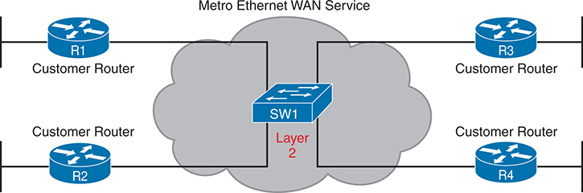

<figcaption>

<aside class="hidden" id="a19fig01">

在中心处,有一个被标记为S W 的交换机-1,下面写有"Layer"-2",表示它在OSI(Open SystemsInterconnection)模型的Layer-2"操作". 围绕交换机的有4个客户路由器,每个路由器被标为客户路由器. 左侧有两种路由器:R-1-和R-2-. 右侧有2个路由器:R-3+和R-4+. 这些路由器被连接到交换机S W 1,象征着客户网络如何通过地铁以太网服务实现互联互通.

</aside>

<strong>图19-1</strong> <em>大都会以太网概念作为大以太网交换机</em>

</figcaption>

</figure>

本章的这一个主要章节审查一个地铁以太网服务中的物理连接. 另外,企业通常会用路由器或Layle 3交换机连接到MetroE服务,因此本节在使用Metro E时也会描述IP子网和路由协议.

<section>

<h4 class="h4" id="ch19lev2sec1">城域以太网物理设计与拓扑</h4>

从企业的角度来看,要使用地铁以太网服务,每个站点都需要用(至少)一个以太网链接连接到服务. 但是,企业的路由器不需要直接连接到彼此。 例如,在<a href="#ch19fig01">图19-1</a>,四个企业的路由器中每个都使用一个物理以太网链接连接到SP的MetroE服务——但互不相通.

SP需要建立一个网络来创建地铁以太网服务. 为了降低成本,SP安装了许多设备,通常是以太网交换机,在称为 " a " 的SP设施内,在尽可能多的客户点附近安装。<a id="key_266" href="#ref-gloss_251">存在点(PoP)</a>。目标:在物理以太网光纤标准的距离限制内定位交换机.<a href="#ch19fig02">图19-2</a>收集了一些这些术语和想法。

<figure class="image-c" id="ch19fig02">

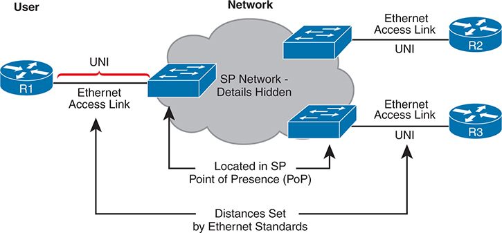

<figcaption>

<aside class="hidden" id="a19fig02">

网络由数个路由器(R 1,R 2,R 3)通过以太网接入链接连接到SP网络,其内部细节被隐藏. 路由器R1代表用户,通过以太网访问链接与SP网络相接. 用户一侧的连接点被贴上用户网络接口(UNI)的标签. SP网络由一朵云来代表,表明其复杂而抽象的性质. 以太网访问链接从用户的UNI连接到SP网络,与位于存在点(Po P)的SP设备相接. 从SP网络到路由器R 2和R 3的连接也通过以太网访问链接和U N Is,完成网络配置. 这些以太网链接的距离由以太网标准决定.

</aside>

<strong>图19-2</strong> <em>以太网访问链接进入地铁以太网服务</em>

</figcaption>

</figure>

SP一般指任何连接客户和SP的链接.<a id="key_249" href="#ref-gloss_019">访问链接</a>,所以当使用地铁以太网时,链接是一个<em>以太网访问链接.</em>该链接上的所有内容都属于以下定义的范围:<em>用户网络接口</em>,或UNI(英语:UNI). 打破术语<em>UNI</em>,这个词<em>网络</em>指SP的网络,而SP的客户(企业)称为:<em>用户</em>在网络上。

SP的网络仍然隐藏在客户的手中,这表现在<a href="#ch19fig02">图19-2</a>。SP承诺通过WAN提供以太网帧. 可以想象,交换机会查看以太网头的MAC地址字段和802.1Q干线头为VLAN标签,但网络内部的细节仍然被隐藏.

UNI支持任何IEEE以太网标准.<a href="#ch19tab02">表19-2</a>列出一些您可能期望用作以太网访问链接的标准, 因为它们比使用 UTP 电缆的标准支持更长的距离 。

<figure class="table" id="ch19tab02" tabindex="0">

<figcaption>

<strong>表19-2</strong>IEEE 以太网标准对地铁以太网访问有用

</figcaption>

<table class="all">

<thead>

<tr>

<th class="th">
名称
</th>

<th class="th">
速率
</th>

<th class="th">
距离
</th>

</tr>

</thead>

<tbody>

<tr>

<td class="border">
100BASE-LX10
</td>

<td class="border">
100 Mbps
</td>

<td class="border">
10公里
</td>

</tr>

<tr>

<td class="border">
1000BASE-LX
</td>

<td class="border">
1 Gbps
</td>

<td class="border">
5公里长
</td>

</tr>

<tr>

<td class="border">
1000BASE-LX10
</td>

<td class="border">
1 Gbps
</td>

<td class="border">
10公里
</td>

</tr>

<tr>

<td class="border">
1000BASE-ZX
</td>

<td class="border">
1 Gbps
</td>

<td class="border">
100公里
</td>

</tr>

<tr>

<td class="border">
10GBASE-LR
</td>

<td class="border">
10 Gbps
</td>

<td class="border">
10公里
</td>

</tr>

<tr>

<td class="border">
10GBASE-ER
</td>

<td class="border">
10 Gbps
</td>

<td class="border">
40公里
</td>

</tr>

</tbody>

</table>

</figure>

</section>

<section>

<h4 class="h4" id="ch19lev2sec2">以太网 WAN 服务与拓扑</h4>

除了从每个站点添加物理以太网连接到SP的地铁<a id="key_254" href="#ref-gloss_135">以太网广域网</a>服务,企业必须在MetroE服务的若干可能的变体之间作出选择. 这些变化使用了满足不同客户需要的不同地貌。

经济、社会、文化权利委员会(MEF)<a href="http://www.mef.net">www.mef.net</a>)定义了地铁以太网的标准,包括不同地铁E服务的规格.<a href="#ch19tab03">表19-3</a>列出本章所描述的三种服务类型及其地貌。

<figure class="table" id="ch19tab03" tabindex="0">

<figcaption>

<strong>表19-3</strong>3个MEF服务类型及其地形

</figcaption>

<table class="all">

<tbody>

<tr>

<th class="th">
MEF 服务名称
</th>

<th class="th">
MEF 简称
</th>

<th class="th">
拓扑术语
</th>

<th class="th">
说明
</th>

</tr>

<tr>

<td class="border">
以太网线路服务
</td>

<td class="border">
E-Line
</td>

<td class="border">
<a id="key_265" href="#ref-gloss_252">点到点</a>
</td>

<td class="border">
两种客户前提设备(CPE)可以交换以太网帧,在概念上类似于所租行.
</td>

</tr>

<tr>

<td class="border">
以太网局域网服务
</td>

<td class="border">
E-LAN
</td>

<td class="border">
<a id="key_255" href="#ref-gloss_151">全网状</a>
</td>

<td class="border">
这种服务像局域网一样,使所有设备都能将帧发送到所有其他设备上.
</td>

</tr>

<tr>

<td class="border">
以太网树服务
</td>

<td class="border">
E-Tree
</td>

<td class="border">
<a id="key_256" href="#ref-gloss_166">赫德和说话了</a>; <a id="key_264" href="#ref-gloss_243">部分网状</a>; 点对多点
</td>

<td class="border">
一个中心站点可以和一组定义的远程站点进行通信,但远程站点无法直接通信.
</td>

</tr>

</tbody>

</table>

</figure>

注意

你可能会看到这个词<em>虚拟私人电线服务</em>(VPWS)用于MEF定义的电子线路服务和<em>虚拟私营局域网服务</em>(VPLS)用于MEF所定义的电子局域网服务. 你可能也会看到这个词<em>以太网覆盖 MPLS</em>(EMPLS) (英语). 所有这些术语都指SP在内部使用MPLS来创建客户所认为的以太网WAN服务的情况.

<section>

<h5 class="h5" id="ch19lev3sec1">以太网线路服务（点到点）</h5>

以太网线路服务,或<a id="key_253" href="#ref-gloss_127">E-Line</a>,是地铁以太网服务中最简单的. 客户将两个站点与接入链接连接. 然后MetroE服务允许两个客户设备互相发送以太网帧.<a href="#ch19fig03">图19-3</a>显示实例,以路由器作为 CPE 设备。

<figure class="image-c" id="ch19fig03">

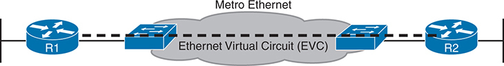

<figcaption>

<aside class="hidden" id="a19fig03">

路由器R-1和路由器R-2通过地铁以太网连接. 地铁以太网网络以云为代表,表示其在提供基础连通性方面的作用. EVC被描绘为一条穿行于地铁以太网的虚线,直接连接了R-1和R-2.

</aside>

<strong>图19-3</strong> <em>地铁以太网电子线路服务中的点到点地形学</em>

</figcaption>

</figure>

与所有MetroE服务一样,服务所做的承诺是在整个服务中提供以太网帧,仿佛两个客户路由器之间有相当长的交叉电缆连接. E-Line服务与Ethernet WAN服务相同,你在本书的许多例子中都看到过。<em>CCNA-200-301-官方证书指南 第1-卷</em>,第二版 例如,在这种情况下:

<ul class="sq">

<li>
路由器会使用物理以太网接口.
</li>

<li>
路由器将在相同的子网中配置IP地址。
</li>

<li>
他们的路由协议会成为邻居和交换路由.
</li>

</ul>

MetroE的规格定义了一种概念:<em>以太网虚拟连接</em>,或EVC,它定义了哪些用户(客户)设备可以与哪个设备通信. 顾名思义,一款E-Line服务创建了点到点的EVC,指服务允许两个端点进行通信.

企业可能希望实施一个完全如以下所示的网络<a href="#ch19fig03">图19-3</a>,但存在其他变异。 例如,想一想典型的企业WAN地貌,有一个中心站点和100个远程站点. 如所显示的,有了E-Line服务,中心站点路由器将需要100个物理以太网接口才能连接到这些100个远程站点. 那可能很贵的 相反,企业可以使用一个高速以太网接入链接的设计.<a href="#ch19fig04">图19-4</a>仅用三个远程站点显示设计概念。 在这种情况下:

<ul class="sq">

<li>
中心站点路由器使用单一的10-Gbps访问链接.
</li>

<li>
中心站点连接了100个E-Line(仅显示三行).
</li>

<li>
所有E-Line通过同一个访问链接发送并接收帧.
</li>

</ul>

<figure class="image-c" id="ch19fig04">

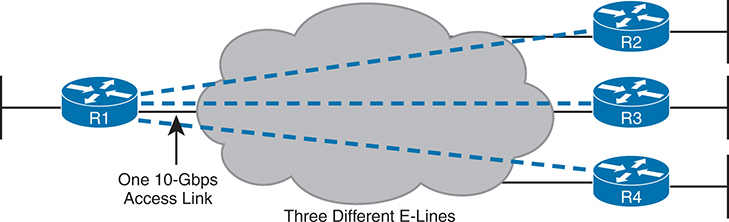

<figcaption>

<aside class="hidden" id="a19fig04">

在此配置中,路由器R1已连接到一个代表地铁以太网服务的云. 单通-10-Gigabit每秒接入链路将R1与云相接. 从地铁以太网云起,有三条独立的"快线"延伸至远程路由器R2,R3和R4,表示有三条不同的"快线"服务. 每条E快线提供R-1与每个远程站点之间的专用点到点连接,确保与R-2,R-3和R-4的隔离和直接通信路径.

</aside>

<strong>图19-4</strong> <em>使用多条 E- 线, 每个远程站点一个</em>

</figcaption>

</figure>

</section>

<section>

<h5 class="h5" id="ch19lev3sec2">以太网 LAN 服务（全网状）</h5>

想象一个企业需要将几个站点连接到一个WAN,目标是允许每个站点直接向其他每个站点发送帧. 你可以用E -Line做,但是你...需要很多钱。 例如,为了连接六个站点,你需要15个E线,但是有了20个站点,你就需要190个E线. 相反,你需要任何服务, 更像局域网。

一个地铁<em>以太网局域网服务</em>,或<a id="key_252" href="#ref-gloss_126">E-LAN</a>,以全网连接所有站点,满足所有广域网站点直接连接的需要. 一个电子局域网服务允许与该服务相连接的所有设备直接向所有其他设备发送以太网帧,仿佛以太网WAN服务是一个大以太网交换机一样.<a href="#ch19fig05">图19-5</a>显示单个E-LAN EVC的表示,允许路由器R1,R2,R3和R4直接发送相框. 都住在广域网的3层子网里

<figure class="image-c" id="ch19fig05">

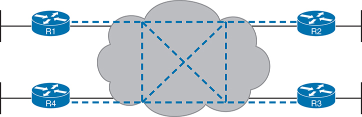

<figcaption>

<aside class="hidden" id="a19fig05">

在这个配置中,路由器R 1,R 2,R 3和R 4连接到地铁以太网云. 被废弃的线路代表了路由器与云之间的连接,表明所有路由器都可以使用地铁以太网服务. 在云层内部,额外的破折线连接了每对路由器,形成一个完全被密接的网络. 这表明任何路由器都可以直接通过地铁以太网云与任何其他路由器通信.

</aside>

<strong>图19-5</strong> <em>MetroE Ethernet LAN Service——任何向该处转帐</em>

</figcaption>

</figure>

</section>

</section>

<section>

<h4 class="h4" id="ch19lev2sec3">使用城域以太网的第三层设计</h4>

工程师在使用以太网WAN服务时,应如何规划IP地址和子网? 对路由协议有什么影响? 本节回答这些问题。 请注意,本节使用路由器作为企业的WAN边缘设备,但这些概念也适用于第3层交换机.

<section>

<h5 class="h5" id="ch19lev3sec3">使用 E-Line 服务的第三层设计</h5>

每 E-Line 就会产生一分一分的地貌. 对于第3层协议,

<ul class="sq">

<li>
每E行一个子网
</li>

<li>
E-Line上的两个路由器之间发生路由协议邻接关系,但没有E-Line的路由器则不会发生.
</li>

</ul>

<a href="#ch19fig06">图19-6</a>显示带有两条E线的设计,并添加了 IP 子网细节. 路由器对R1-R2和R1-R3连接到一款E-Line,但R2-R3没有. 结果,

<ol class="number">

<li>
R1-R2 E-Line使用子网(此处为10.1.12.0/24).
</li>

<li>
R1-R3 E-Line使用子网(此处为10.1.13.0/24).
</li>

<li>
R1将成为一个有R2和R3的路由协议邻居.
</li>

<li>
R2和R3不会成为路由协议的相邻方,也不会直接从对方学习IP路由.
</li>

</ol>

图中还显示了路由器R3的IP路由表. 请注意,所有OSPF-learning路由的下通地址是指路由器R1的10.1.13.1IP地址:R1在R1-R3 E-Line的另一端的地址. 查看R3的路由为子网10.1.2.0/24,与路由器R2连接的局域网子网. R2和R3之间没有E-Line或路由协议相邻关系,R3从R1得知了它的子网10.1.2.0/24的路由,以R1的10.1.13.1地址为下个hop地址.

<figure class="image-c" id="ch19fig06">

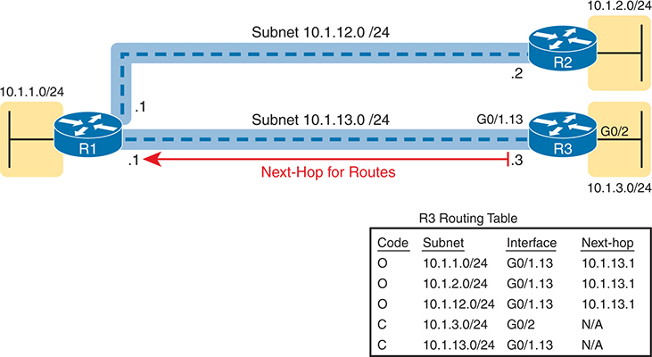

<figcaption>

<aside class="hidden" id="a19fig06">

左侧的路由器 R1 连接子网 10.1.1.0/24。两条蓝色虚线表示 R1 到中心站点路由器 R2 和 R3 的连接。右上方的 R2 连接子网 10.1.2.0/24，其接口 G0/1.12 的 IP 地址为 10.1.12.2。右下方的 R3 连接子网 10.1.3.0/24，其接口 G0/1.13 的 IP 地址为 10.1.13.3。标为“路由的下一跳”的红色箭头从 R3 指向 R1 的接口 G0/1.13，该接口 IP 地址为 10.1.13.1。图下方是 R3 的路由表，列出 10.1.1.0/24、10.1.2.0/24 和 10.1.3.0/24 等路由，以及各自的接口和下一跳地址，说明 R3 如何根据目的子网将数据包转发到相应的下一跳。

</aside>

<strong>图19-6</strong> <em>第3层 远程站点之间的转发-通过中心站点</em>

</figcaption>

</figure>

</section>

<section>

<h5 class="h5" id="ch19lev3sec4">使用 E-LAN 服务的第三层设计</h5>

通常情况下,四个路由器连接在同一局域网交换机上,在同一VLAN上,使用相同的路由协议,通常所有四个路由器都会在同一子网中拥有IP地址,所有路由器都会成为邻居. 电子局域网服务也出现同样的IP地址和路由协议关系.<a href="#ch19fig07">图19-7</a>显示一个与一个E-LAN服务连接的有四个路由器的示例,这些路由器都以子网10.1.99.0/24为地址.

<figure class="image-c" id="ch19fig07">

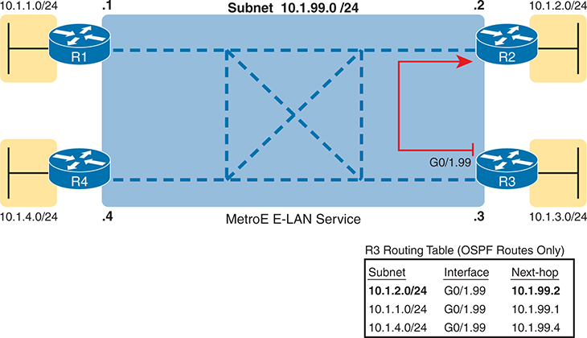

<figcaption>

<aside class="hidden" id="a19fig07">

被描绘出四个路由器,形成一个长方形地貌. Router R. 1 左上端连接到子网 10.1.1.0/24 ,路由器 R 2 右上方连接到子网 10.1.2.0/24 ,路由器 R 3 右下方连接到子网 10.1.3.0/24 ,和路由器 R 4 左下方连接到子网 10.1.4.0/24 。这些路由器通过一个蓝色的遮蔽区域相互连接,代表了MetRE E switch 局域网服务,该服务提供了全网。红箭头表示来自 R 的特定链接。 2 '接口 G' 0 斜线 1.99 地址为 IP 地址 10.1.99.2 改为R 3 。图下有一个R的路由表 3 列出最短路径第一( OSPF) 路径 : 10.1.2.0/24 , 10.1.1.0/24 ,以及 10.1.4.0/24 ,带有相应的接口和下一张地址,显示R 3 E破折号局域网服务中向指定的下一站传输信息。

</aside>

<strong>图19-7</strong> <em>第3层 使用电子局域网服务在站点之间转发</em>

</figcaption>

</figure>

为显示使用E-LAN服务时IP路由的不同,关注R3到R2局域网子网的路由(10.1.2.0/24). 在这种情况下,R3的下一个跳出地址是R2(10.1.99.2)上的WAN地址,而R3会直接向R2发送数据包. 也注意路由表中另外两条路由列出了R1 (10.1.99.1)和R4 (10.1.99.4)的下通地址,显示了路由器在WAN上直接向对方发送包的例子.

</section>

</section>

</section>

<section>

<h3 class="h3" id="ch19lev1sec4">多协议标签交换（MPLS）</h3>

从您的 CCNA 准备到目前为止, 您已经对 Layle 了解了很多 .3 路由 , 如 左到右的 数据包<a href="#ch19fig08">图19-8</a>。每个路由器分别作出转发数据包的决定,如图中步骤1,2和3所显示. 每个路由器比较了包的目的地IP地址和路由器的IP路由表;匹配的IP路由表条目告诉路由器下一步要往哪里转发包. 路由器通常运行一些路由协议来学习这些路由.

<figure class="image-c" id="ch19fig08">

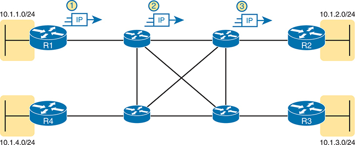

<figcaption>

<aside class="hidden" id="a19fig08">

网络包含 R1、R2、R3 和 R4 四台路由器，以网状拓扑排列，并通过多条链路互连。路由器连接不同子网，子网用黄色阴影区域表示。R1 连接子网 10.1.1.0/24，R2 连接子网 10.1.2.0/24，R3 连接子网 10.1.3.0/24，R4 连接子网 10.1.4.0/24。图中用步骤 1、2 和 3 展示 IP 数据包在网络中的传输：步骤 1，IP 数据包从连接 R1 的子网发出，由从子网指向 R1 的箭头表示；步骤 2，数据包经过中间路由器，从 R1 移动到网状拓扑的中央路由器；步骤 3，数据包被路由到最终目的地，到达连接 R2 的子网。方向箭头和 IP 数据包符号清楚地描绘了数据包经过互连路由器从一个子网到另一个子网的路径，展示 IP 路由的基本原理。

</aside>

<strong>图19-8</strong> <em>IP 包的基本 IP 运行</em>

</figcaption>

</figure>

MPLS创建一个WAN服务,在客户站点之间传递IP包. 企业按常例部署路由器和交换机. SP随后创建了自己的IP网络,覆盖了一大片地域. 然后客户可以连接到MPLS网络,每个站点都有访问链接,其中SP路由IP包从一个客户站点到另一个客户站点. 例如,在<a href="#ch19fig08">图19-8</a>,中间四个路由器可以代表SP的MPLS网络,编号路由器在边缘由一家公司拥有.

然而,一个SP不能只是构建一个大型的IP网络,并将其所有客户与同一个IP网络连接起来,只使用你迄今为止学到的相同的IP路由规则. 例如,许多客户会使用相同的私有 IP网络(例如网络10.0.0.0),所以SP的IP网络会学习大量连接到相重叠子网的路由. SP的路由器会弄不清楚向何处转发包。

为了克服这一问题和其他问题,SP建立了自己的IP网络,以便使用<a id="key_263" href="#ref-gloss_218">多协议标签交换（MPLS）</a>特别是,<a id="key_261" href="#ref-gloss_213">MPLS 虚拟PNs</a>。MPLS VPNs允许SP制作一个广泛的MPLS网络,创建一个基于IP的私人WAN,但它为每个客户保持IP路由的分离. 通过MPLS VPN,SP可以将从一个客户学到的路由与为下一个客户学到的路由区分开来;因此,SP可以支持每个客户,同时防止包从一个客户泄露到另一个客户.

为了给大家一个小的洞见,为什么MPLS不仅仅是一个带路由器的IP网络,在内部,MPLs网络中的设备使用标签切换-hence,即MPL斯的名称. MPLS网络边缘的路由器在进出MPLS网时会向包中添加并去除一个MPLs头. MPLS网络内部的设备在通过MPLS网转发数据时,再使用该MPLs头部内部的标签字段. 标签的选择,连同其他相关逻辑,允许MPLS VPN创建单独的VPN,使不同的客户流量分开.

注意

虽然MPLS VPNs为客户提供Layer 3服务,但MPLS本身有时被称为Layer 2.5协议,因为它在数据链接头(Layer 2)和IP头(Layer 3)之间添加了MPLS头.

与往常一样,本作中对WAN服务的讨论也尽量忽略了SP的网络. 例如,您不需要知道 MPLS 标签是如何工作的 。 然而,由于MPLS VPNs创建了Layle 3服务,客户必须比其他WAN服务器更了解SP的工作,所以你需要知道一些关于MPLs网络如何接近一些Lay 3功能的事实. 特别是,SP的MPLS VPN网络

<ul class="sq">

<li>
将构建与客户路由器的路由协议邻居关系
</li>

<li>
将用这些路由协议来学习客户子网/路由
</li>

<li>
将用路由协议为客户的路由作广告, 以便所有连接到 MPLS VPN 的路由器能够学习所有通过 MPLs VPN网络公布的路由
</li>

<li>
将根据客户的IP地址空间和客户的IP 路由, 作出关于 MPLS VPN 转发的决定, 包括要添加和删除的 MPLs 标签
</li>

</ul>

除此以外,MPLS VPNs通过将客户数据分开,而不是通过加密数据来创建私人网络. 一些VPN服务加密了数据,期望攻击者可能能够收到数据包的副本. 有了MPLS,尽管两个客户的包可能通过同样的设备并连接在了MPLs网络内部,但MPLLS逻辑可以让每个客户的包分开.

MPLS网络也可以提供服务质量(QoS)功能. MPLS提供者控制着他们的整个网络. 因此,每一个转发客户流量的设备都可以对标记作出反应并应用不同的QoS特性. 注意地铁以太网也可以提供QoS服务,但有不同的标记域. 然而,Internet WAN不能支持QoS,因为互联网由许多ISP组成,一家公司与之连接的ISP无法保证其他ISP会遵守任何特定的QoS承诺.

该章的两大节中的这一秒通过MPLS的基础来工作,具体来说就是MPLs VPN. 本节首先研究MPLS网络中与构建客户-造型部分相关的设计,地貌,和术语. 然后它查看MPLS网络,提供第3层服务.

<section>

<h4 class="h4" id="ch19lev2sec4">MPLS VPN 物理设计与拓扑</h4>

MPLS提供第3层服务,承诺向上转发第3层包(IPv4和IPv6). 为了支持这一服务,MPLS SPs通常在MPLs网络的边缘使用路由器,因为路由器提供了转发Lage 3数据包的功能.

<a href="#ch19fig09">图19-9</a>在上下文中显示两个重要的 MPLS 术语:<a id="key_251" data-original-href="vol2_ch19.xhtml#key_251a" data-unavailable="true" title="此内容不在当前提取范围内；请参阅原始 EPUB：vol2_ch19.xhtml#key_251a">客户边缘( CE)</a>和<a id="key_267" href="#ref-gloss_271">提供者边缘( PE)</a>。由于MPLS需要这么多关于客户和SP网络边缘设备的讨论,因此MPLs对每个设备使用特定的术语. 术语<em>客户边缘</em>指客户站点的路由器,即在购买MPLS服务的公司的站点。 密码<em>提供者边缘</em>设备位于 SP 网络的边缘,访问链接的另一端。

<figure class="image-c" id="ch19fig09">

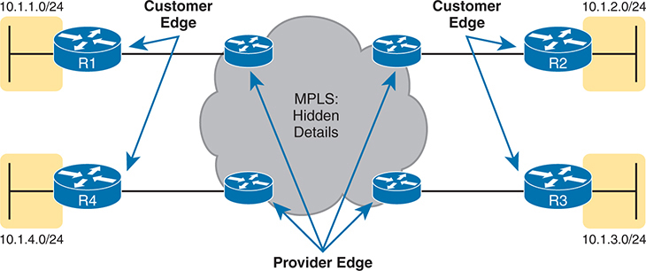

<figcaption>

<aside class="hidden" id="a19fig09">

网络包含四台 CE 路由器 R1、R2、R3 和 R4，分别连接不同子网；MPLS 云中还有多台 PE 路由器。R1 连接子网 10.1.1.0/24，R2 连接子网 10.1.2.0/24，R3 连接子网 10.1.3.0/24，R4 连接子网 10.1.4.0/24。标为“MPLS：隐藏的细节”的 MPLS 云代表提供商的网络基础设施。云中的 PE 路由器负责连接客户边缘的 CE 路由器。方向箭头表示 CE 路由器与 MPLS 云之间的数据流。

</aside>

<strong>图19-9</strong> <em>MPLS 第3层设计,带有PE和CE路由器</em>

</figcaption>

</figure>

接下来,为了欣赏MPLS的工作,考虑回路由器去封装和再封装. 当运行一个数据包时,路由器会丢弃一个接入的数据链接帧的数据链接头和尾部. 一旦路由器了解了出站接口,它就会建立一个新的数据链接头/尾部. 这一行动使收到的数据包能够在一个数据链接协议的帧之内到达,并留下一个与另一个数据链接协议的接口。 因此,如以下所示,MPLS支持可用于MPLS访问链接的任何数据链接协议:<a href="#ch19fig10">图19-10</a>.

<figure class="image-c" id="ch19fig10">

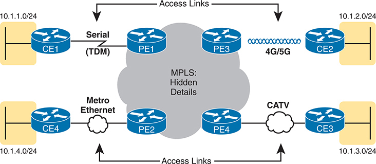

<figcaption>

<aside class="hidden" id="a19fig10">

网络图包括4个客户边缘路由器(C E1,C E-2,C E-3和C E-4),通过不同的接入链路技术连接到4个供应商边缘路由器(P E-1,P E-2,P E-3和P E-4). C E1至P E1:通过串行(TDM)链接连接. C E2至P E3:通过4G斜拉索5G无线链接连接. C E3至P E4:通过CATV(有线TV)链接连接. C E4至P E2:通过地铁以太网连接. 每个客户边缘路由器代表不同的子网(10.1.1.0/24,10.1.2.0/24,10.1.3.0/24,和10.1.4.0/24). MPLS核心在中心被代表,被标注为"MPLS:隐藏细节",表示MPLS操作从客户处得到的抽象. 访问链接被标记,显示各种技术如何将客户站点与MPLS网络连接.

</aside>

<strong>图19-10</strong> <em>流行的 MPLS 访问链接技术</em>

</figcaption>

</figure>

</section>

<section>

<h4 class="h4" id="ch19lev2sec5">MPLS VPN 的第三层</h4>

因为MetroE提供第2层服务,SP不需要了解客户第3层的设计. SP对客户IP地址计划一无所知,不需要参与路由协议.

MPLS VPNs采取完全相反的方法. 作为第3层服务, MPLS 必须知道客户的IP地址 。 SP使用路由协议,并广告这些客户路由穿过WAN. 本节更仔细地审视了这意味着什么。

首先,牢记首要目标:在各站点之间提供IP包。 CE路由器必须为所有其他CE路由器已知的子网学习路由;然而,MPLS路由协议设计在CE和PE路由器之间建立了路由协议的相邻关系,但不在CE路由器之间,如上所见<a href="#ch19fig11">图19-11</a>。MPLS支持所有标准路由协议:RIPv2,EIGRP,OSPF,甚至eBGP.

<figure class="image-c" id="ch19fig11">

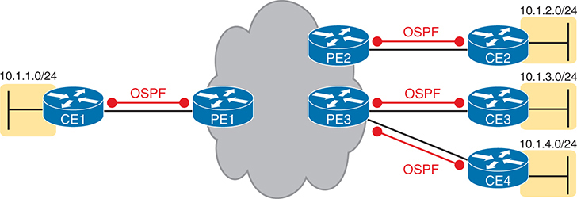

<figcaption>

<aside class="hidden" id="a19fig11">

该图以OSPF(开放最短路径第一)为主. C E1至P E1:与OSPF在它们之间运行相接,形成OSPF的相邻关系. P E1至P E2:显示主干MPLS连接. P E2至C E2:与OSPF在它们之间运行相接. PE3至CE E3:与OSPF在它们之间运行相接. PE4至CE E4:与OSPF在它们之间运行相接. 每个客户边缘路由器代表不同的子网(-10.1.1.0/24;-10.1.2.0/24;-10.1.3.0/24;-10.1.4.0/24).

</aside>

<strong>图19-11</strong> <em>与 MPLS 客户边缘路由器的邻国关系</em>

</figcaption>

</figure>

CE路由器学习了所有路由,因为PE路由也交换了路由;然而,PE路从器除了本作已经讨论过的主题外,还必须使用额外的路由协议特征. 首先,MPLS SP使用一种叫做 BGP 的变体<a id="key_262" href="#ref-gloss_217">多Protocol BGP (MP- BGP) (英语).</a>在PE路由器之间. MP-BGP为PE路由器提供了使用虚拟路由和转发(VRF)实例保持客户路由分离的手段.<a href="v2-20.html#ch20">第20章</a>, “<a href="v2-20.html#ch20">云架构</a>,"在数据中心网络的背景下讨论VRFs. )因此,CE路由器互相学习路由.

例如,在<a href="#ch19fig12">图19-12</a>,对于CE3从CE1学习路由,这一过程从CE1开始,将路由广告到PE1. PE1将路由重新分配到MP-BGP中,并给PE3做广告. PE3将其再分配到OSPF,并向CE3发布广告. 因此,CE3在MPLS WAN上方转发包的路由会将PE3的IP地址列为下一跳路由器.

<figure class="image-c" id="ch19fig12">

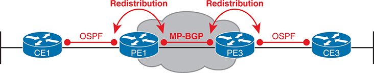

<figcaption>

<aside class="hidden" id="a19fig12">

该图显示有以下组件的网络: 客户边缘(C E) 路由器: C E 1和 C E 3是连接到供应商边缘路由器的客户边缘路由被. 提供方边缘 (P E) 路由器:P E 1和P E 3是通过MPLS网络连接的提供方边缘路由器. MPLS Network:核心MPLS网络连接了PE路由器. 连接方式如下: C E 1 使用 Open Bast Path First(OSPF)连接到 P E 1. P E 1在MPLS网络内将OSPF路由再分配为MP-BGP. P E 3将M P-BGP路由再分配回OSPF. C E 3使用OSPF连接到P E 3.

</aside>

<strong>图19-12</strong> <em>MPLS VPN 在 PE 路由器上使用 MP- BGP 重排</em>

</figcaption>

</figure>

</section>

</section>

<section>

<h3 class="h3" id="ch19lev1sec5">互联网 VPN</h3>

为了建设互联网,互联网服务提供商需要连接其他互联网服务提供商和互联网服务提供商的客户。 互联网核心使用各种高速技术连接ISP. 此外,因特网接入链接将一个ISP与每个客户连接起来,并使用不同的技术。将ISP和客户网络连接到ISP的结合,创造了世界范围的互联网.

虽然消费者通常通过互联网连接到互联网的目的地,但企业也可以使用互联网作为广域网服务. 一,企业可以将每个业务站点与互联网相接. 之后,企业利用虚拟私人网络(VPN)技术,可以创建互联网VPN. 互联网VPN可以通过加密和其他方式将企业的软件包保密,即使通过互联网发送数据也是如此。

本章最后一节主要讨论了互联网接入链接的一些基本内容. 该节随后详细介绍了企业如何通过互联网安全地沟通,通过创建互联网VPN,使公用互联网像私人网络一样发挥作用.

<section>

<h4 class="h4" id="ch19lev2sec6">互联网接入</h4>

企业可以使用私人广域网技术进入ISP的网络,包括本章前面讨论的以太网广域网和MPLS技术.<a href="#ch19fig13">图19-13</a>显示这些选项的图像提醒。

<figure class="image-c" id="ch19fig13">

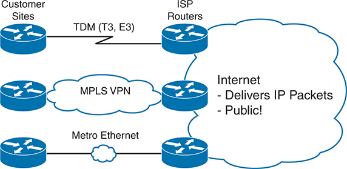

<figcaption>

<aside class="hidden" id="a19fig13">

该图包括各种网络组件和连接类型: 客户站点:由客户站点的路由器代表. ISP路由器:属于互联网服务提供商(ISP)的路由器. 网友云:劝阻公共互联网提供IP包,公众可访问. 所显示的连接类型有TDM(T 3,E 3): 传统时分多路由连接客户站点和ISP路由器. MPLSVPN:基于MPLS的V P Ns通过ISP网络提供客户站点之间的安全,私人的连接. 地铁以太网:以太网为基础的连接提供高速,可扩展的互联网接入.

</aside>

<strong>图19-13</strong> <em>公司互联网接入链接的3个实例</em>

</figcaption>

</figure>

此外,企业还可以使用消费者更常用的互联网接入技术,包括DSL,有线电视,4G/5G和纤维以太网等. 本章包括关于因特网接入技术的这一信息,以便在进入VPN专题之前提供有益的背景资料。

<section>

<h5 class="h5" id="ch19lev3sec5">数字用户线路</h5>

电话公司(telcos)自互联网初期就通过连接大多数家庭的原有电话线路提供互联网接入服务. 最初,该访问使用连接在电话线路上的模拟调制解调器. 后来,综合服务数字网络(ISDN)在同一条电话线上创建了更快的数字服务. 第三波使用本地电话线路,数字用户线路(DSL)的技术,增加了更多的改进,速度要快得多.

<a href="#ch19fig14">图19-14</a>详细介绍DSL如何在家用电话线上工作. 手机可以做它一贯做的事:插入一通电话J并发送模拟信号. 对于数据,一个DSL调制解调器连接到一个备用的电话出入口. DSL调制解调器作为数字信号以语音频率以外的频率发送和接收数据,在同一个本地回路上,甚至在和电话时间一样 (注意物理安装经常使用图中未显示或此处讨论的频率过滤器. )

<figure class="image-c" id="ch19fig14">

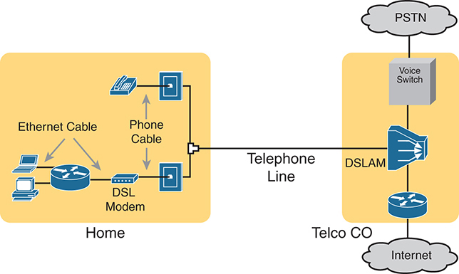

<figcaption>

<aside class="hidden" id="a19fig14">

在左边,家用设置包括各种通过DSL调制解调器连接的设备. DSL调制解调器通过以太网电缆连接到一台计算机和无线路由器. 此外,还有一条电话电缆将DSL调制解调器与一通电话墙接通. 从家中,一条电话线通向图中右侧的Telco中央办公室(C O). 在Telco C O,电话线连接到一个DSLAM(数字订阅器线路访问多路复用器),它将语音和数据信号分割开来. 语音信号被引导到一个连接PSTN(公共交换机电话网)的语音交换机,而数据信号则被发送到互联网上.

</aside>

<strong>图19-14</strong> <em>Home DSL 链接的线和设备</em>

</figcaption>

</figure>

因为DSL在同一条线路上发送模拟(语音)和数字(数据)信号,所以telco不得不以某种方式在连接的telco一侧分出这些信号. 本地环路连接到 a<em>DSL 访问多路复用程序</em>(DSLAM)位于相邻的特尔科中央办事处(CO. DSLAM 将数字数据分割到右下方的路由器<a href="#ch19fig14">图19-14</a>,完成互联网连接。 DSLAM还将模拟语音信号分割出到右上方的语音交换机.

</section>

<section>

<h5 class="h5" id="ch19lev3sec6">有线电视互联网接入</h5>

DSL使用本地telco的本地链接(电话线路). 相反,有线互联网在大多数市场——有线公司——使用已经成为主要竞争者的电缆。

有线互联网创建了一种互联网接入服务,在普遍而不是具体浏览时,它与DSL有许多相似之处. 与DSL一样,有线互联网充分利用了现有的有线电视(CATV)有线电视发送数据. 和DSL一样,有线互联网使用不对称速度,下游发送数据的速度比上游快,这对大多数消费地点都有效. 而有线互联网仍然允许原始服务(有线电视),同时添加了互联网接入服务.

有线互联网使用CATV电缆,但与有电话线路和DSL的Telco相同一般型号. 左边<a href="#ch19fig15">图19-15</a>播放一个连接到CATV电缆的电视, 就像它通常会连接一样。 在另一条有线出道口,有线调制解调器连接到同条有线. 互联网服务流经一个频率,就像另一个电视频道一样,只是为互联网服务预留了.

<figure class="image-c" id="ch19fig15">

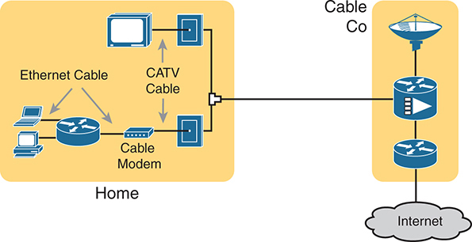

<figcaption>

<aside class="hidden" id="a19fig15">

在左边,家用设置包括各种通过有线调制解调器连接的装置. 有线调制解调器通过以太网电缆连接到一台计算机和无线路由器. 此外,一台有线电视(CATV)有线电视将有线调制解调器与一台电视和一个墙接通。 从家中,一台CATV电缆运行到图中右侧的有线公司(有线公司). 在有线公司,CATV电缆连接到管理互联网和电视服务发行的网络设备. 数据信号通过这些设备被传送到互联网.

</aside>

<strong>图19-15</strong> <em>家用有线互联网链接的线和装置</em>

</figcaption>

</figure>

与DSL类似,在连接的CATV公司一侧(图中右侧),CATV公司必须分出数据和视频流量. 数据通过路由器流向下方右侧,通向互联网. 影片来自录像,

</section>

<section>

<h5 class="h5" id="ch19lev3sec7">无线 WAN（4G、5G）</h5>

阅读这本书的许多人都有手机可以上网. 你可以用手机检查你的电子邮件,冲上网,下载应用程序,并观看视频. 本节涉及连接这些移动电话的因特网接入技术背后的大概念。

移动电话使用无线电波通过附近的一个移动电话塔进行通信. 电话有一个小的无线电天线, 供应商有一个更大的天线 坐在一个塔的顶端 在你和你的手机的英里之内。 电话、平板电脑、膝上型计算机,甚至路由器(带有正确的接口卡)可以使用这一技术通过互联网进行交流,其表现方式如下:<a href="#ch19fig16">图19-16</a>.

<figure class="image-c" id="ch19fig16">

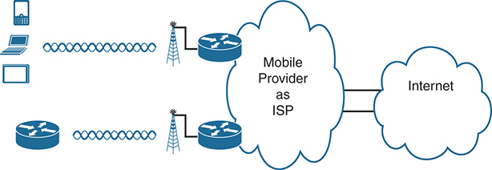

<figcaption>

<aside class="hidden" id="a19fig16">

左边显示有三种设备:智能手机,笔记本电脑和平板电脑,表示各种用户设备. 这些装置以Wavy线路为代表,无线连接到配备有天线的蜂窝塔. 每个蜂窝塔都与路由器相接,这是移动提供商基础设施的一部分. 路由器随后连接到被云标为"移动提供商"的ISP,象征着作为互联网服务提供商的移动服务提供商. 从移动供应商的云端,连接延伸到了另一个被标注为云端的互联网,代表了全球互联网. 这种设置表明设备如何利用蜂窝网络通过移动供应商的基础设施与互联网相接。

</aside>

<strong>图19-16</strong> <em>使用3G/4G/5G技术的无线互联网接入</em>

</figcaption>

</figure>

移动电话无线电塔还设有电缆和设备,包括路由器。 移动供应商建立自己的IP网络,就像ISP建立IP网络一样. 客户IP包通过塔台的IP路由器进入移动供应商的IP网络,再出网.

其他设备的手机和无线互联网接入市场规模大,具有竞争力. 因此,移动供应商花了很多钱 广告他们的服务,上面写着一个服务或另一个服务的名字 坦率地说,可能很难分辨所有营销术语的含义,但业界使用了很多这些术语:

<strong>无线互联网:</strong>这个通称指手机或任何使用同一种技术的设备提供的互联网服务.

<strong>1G/2G/3G无线:</strong>第一,第二,第三代手机接入网络的简称,这些网络已经从市场上来去. (从视角看,请注意,美国的主要航空公司关闭了在2022中的3G服务).

<strong>4G和4G LTE 无线:</strong>对第四代来说,4G改进了上传和下载数据率,而3G. 4G指的是整个标准,但随着时间的推移,术语<em>长期演变(LTE)</em>来指改进后4G.

<strong>5G 非独立(NSA)无线(子-6):</strong>5G指第五代无线WAN技术. 5G非独立(NSA)指5G标准的一个子集,它与更古老的4G LTE网络(hence non-standleone)合作,具有与4G LTe相似的特性,但在速度和耐久性上都有了改进. 因为它使用频率在6GHz下方

<strong>5G 独立(SA)无线(mmWave):</strong>5G标准的较高性能部分,5G独立(SA)提供的数据率比5GNSA快得多. 然而,5G SA的工作距离比5G NSA短,需要更多的天线来覆盖相同的地理足迹. 5G SAT也取名"毫米波"(mmWave),因为信号的波长恰好是毫米长.

从这些词汇中取走的就是这个:当你听到图片中有移动电话塔的无线互联网服务——无论设备是电话、平板电脑还是个人电脑——可能是4G或5G无线互联网连接。

企业可以使用同一种无线技术连接到互联网. 例如,网络工程师可以在路由器中安装5G无线卡. ISPs团队与无线运营商建立无线和互联网服务合同.

</section>

<section>

<h5 class="h5" id="ch19lev3sec8">光纤（以太网）互联网接入</h5>

本节讨论的以消费者为重点的互联网接入技术,使用了几种不同的物理媒体. DSL使用在telco CO和家用之间安装的铜接线. 电缆使用从有线公司到家中所安装的铜通CATV电缆. 当然,无线广域网技术不使用接通互联网的电缆。

DSL和有线互联网使用的有线电缆使用铜线,但对比出不同类型的物理介质,光纤电缆一般支持更快的速度进行更远的距离. 也就是说,只是比较整个网络的物理层技术, 光纤电缆支持更长的连接, 这些链接往往运行在相当或更快的速度。

一些ISP现在提供以名称命名的互联网接入<em>互联网纤维</em>,或简单<em>光纤</em>。为了做到这一点,一些拥有在当地地区(通常是一家电话公司)安装地下电缆的权利的当地公司安装了新的光纤电缆。 一旦有线电站到位(这一过程往往需要几年时间和大量预算),电纤ISP就利用光纤电缆连接客户与互联网. SP通常不声明,在纤维上使用以太网协议. 结果是高速互联网通到家.

</section>

</section>

<section>

<h4 class="h4" id="ch19lev2sec7">互联网 VPN 基础</h4>

私人广域网具有一些奇妙的安全特征. 尤其是,通过广域网发送数据的客户有充分理由相信没有任何攻击者看到过境中的数据,甚至改变数据以造成某种伤害. 私营广域网服务提供商承诺将一个客户的数据发送到该客户拥有的其他网站,但不会发送到其他客户拥有的网站,反之亦然。

VPN试图在通过对其他各方开放的网络(如互联网)发送数据的同时,提供与私人WAN相同的安全特性. 与私人广域网相比,互联网没有提供保护企业数据隐私的安全环境. 互联网虚拟网络提供必不可少的安全功能,例如:

<ul class="sq">

<li>
<strong>保密(隐私):</strong>防止网络中间的任何人(中间的人)读取数据
</li>

<li>
<strong>认证 :</strong>验证 VPN 包的发件人是否为合法设备而非攻击者使用的设备
</li>

<li>
<strong>数据完整性 :</strong>在互联网上转机时验证数据包没有改变
</li>

<li>
<strong>反重放 :</strong>防止中间的一个人复制合法用户发送的包,这样他们以后就可以发送这些包,并且看起来是合法用户.
</li>

</ul>

为了实现这些目标,互联网边缘附近的两个设备创建了一个VPN,有时被称为a.<em>VPN 地道</em>。这些设备在原始包中添加了首部,这些首部包括允许VPN设备使流量安全的字段. VPN设备也加密了原始的IP包,这意味着其内容对于任何通过互联网检查该包副本的人来说都是不可破译的.

<a href="#ch19fig17">图19-17</a>显示分支办公路由器R1和思科防火墙(FW1)之间的VPN. 根据定义,一个连接两个站点的VPN可以支持来自这些站点所有主机的流量,它的名称是:<a id="key_271" href="#ref-gloss_308">站点对站点VPN</a>.

<figure class="image-c" id="ch19fig17">

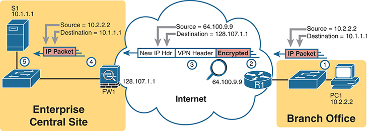

<figcaption>

<aside class="hidden" id="a19fig17">

左边有一个企业中心站点,用一个黄色的盒子来描绘,其中有一个服务器标有S 1 地址为 IP 地址 10.1.1.1 和一个贴有FW标签的防火墙 1 地址为 IP 地址 128.107.1.1 与源头的 I P 包 10.2.2.2 和目的地一 P 10.1.1.1 显示离开中央站点。这个包装有一个新的 I P 头和一个 VPN 头,然后加密,以便在互联网上安全传输。加密包通过互联网运行,用一个带有新源 I P 的云标的互联网表示。 64.100.9.9 和目的地一 P 128.107.1.1 右侧是另一个黄色盒子所描绘的分行办公室,其特点是一个P C标记为P C 1 地址为 IP 地址 10.2.2.2 和标签为 R 的路由器 1 地址为 IP 地址 64.100.9.9 。加密包由路由器 R 解密 1 ,原始的 I P 包与来源 I P 10.2.2.2 和目的地一 P 10.1.1.1 交给PC 1 . 这个插图显示了VPN隧道如何通过互联网安全连接两个远程站点,从而允许中央站点与分站点之间的私人通信.

</aside>

<strong>图19-17</strong> <em>VPN 站点对站点内联网隧道构想 VPN</em>

</figcaption>

</figure>

图中列出了以下步骤,说明总体流量: 1.

<ol class="number">

<li>
右侧的主机PC1 (10.2.2.2) 发送一个指定给网络服务器的包 (10.1.1.1), 和它没有VPN一样.
</li>

<li>
路由器R1加密了数据包,增加了一些VPN头,又增加了另一个IP头(带有公有 IP地址),并转发数据包,如图的上中点所示.
</li>

<li>
即使网络上的攻击者复制了这个包(称为"中层人"攻击),他们也无法在没有被注意的情况下改变这个包. 攻击者也无法读取原始包的内容 。
</li>

<li>
Firewall FW1 接收数据包,确认发送者的真实性,确认数据包没有变化,并解密了原始数据包. FW1然后将原始包转发到网络服务器.
</li>

<li>
服务器 S1 接收未加密的软件包 。
</li>

</ol>

基于互联网的VPN为企业提供了WAN服务器的巨大选择. 高速互联网接入的成本往往低于私人广域网接入链接. 互联网似乎无所不在,使这种解决办法在全世界都可以得到。 如果企业使用VPN技术和协议,通信是安全的.

注意

术语<em>隧道</em>指通过封装在另一包中的包而发送的任何协议包。 术语<em>VPN 地道</em>可能或不会暗示隧道也使用加密.

<section>

<h5 class="h5" id="ch19lev3sec9">使用 IPsec 的站点到站点 VPN</h5>

一个站点对站点的VPN为两个站点的装置提供VPN服务,并配有单个VPN地道. 例如,如果每个站点都有几十个需要在不同站点之间通信的设备,那么各种设备就不必采取行动来创建VPN. 相反,网络工程师配置了路由器和防火墙等设备来创建一个VPN隧道. 地道一直保持上行并运行,因此在最终用户设备发送数据时总是可以使用. 每个站点的所有端点设备都可以使用VPN进行通信,而不知道VPN,无需为自己创建VPN.

<a id="key_257" href="#ref-gloss_182">IPsec 语句</a>定义用于创建安全 VPN 的一套通俗规则。 IPsec是IP网络安全服务的架构或框架. 名称出自定义它的RFC(RFC 4301,"Internet Protocol的安全架构"),更通称IP安全,或IPsec.

IPsec定义了两个设备,两者都连接到互联网上,如何实现本节开头列出的VPN的主要目标:保密,认证,数据完整性和反回放. IPsec不只定义一个执行VPN的方法,而是允许针对每个特性的几个不同的协议选项. IPsec提供了坚实的建筑VPN框架,允许随着时间推移对单个安全功能进行修改和改进.

IPsec加密可能听起来很吓人,但是如果你忽略了数学——而且感激地说,你可以——IPsec的加密并不难理解. IPsec加密使用一对加密算法,本质上是数学公式,以满足一对要求. 首先,两种数学公式是相匹配的组合:

<ul class="sq">

<li>
一个要隐藏( 加密) 数据
</li>

<li>
另一个根据加密数据重新创建( 解密) 原始数据
</li>

</ul>

加密和解密公式的选择有助于挫败攻击者. 例如,如果攻击者截获了加密数据包,但没有秘密密码(称为a)。<em>加密密钥</em>攻击者只能通过巨大的努力来解密包裹。 另外,如果攻击者巧妙地破解了一包, 公式也让他们对如何破解第二包没有洞察力。

IPsec VPN的加密数据程序一般工作如下所示:<a href="#ch19fig18">图19-18</a>。注意:<em>加密密钥</em>也称为<em>会话密钥</em>, <a id="key_270" href="#ref-gloss_306">共享密钥</a>,或<em>共享会话密钥</em>.

<figure class="image-c" id="ch19fig18">

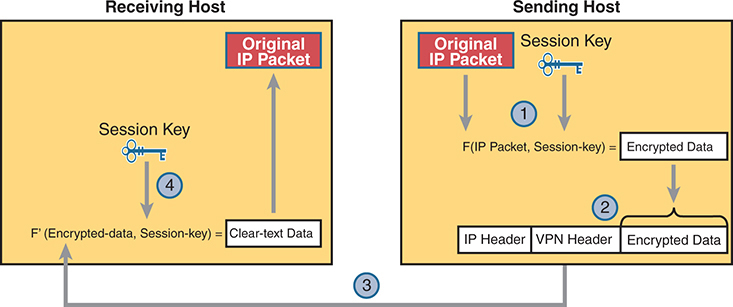

<figcaption>

<aside class="hidden" id="a19fig18">

该图分为两个主要部分:右侧的"发送主机"和左侧的"接收主机". 发送主机:原始 I P 包是用会话密钥准备的,这是加密过程的关键部分. 会话密钥加密了原始的 I P 数据包, 从而生成加密数据 。 由此产生的数据包由I P头,一VPN头和加密数据组成. 加密的包随后通过网络发送到接收主机,由灰色箭头所描绘的标记为3. 接收主机:接收到加密包后,接收主机会使用会话密钥来解密数据. 被加密的包(F( I P Packet, Session- key)) 被转换回清晰的文本数据 。

</aside>

<strong>图19-18</strong> <em>基本 IPsec 加密进程</em>

</figcaption>

</figure>

图中突出的四个步骤如下:

<ol class="number">

<li>
发送 VPN 设备( router R1 in)<a href="#ch19fig17">图19-17</a>)将原始数据包和会话密钥输入加密公式,计算加密数据。
</li>

<li>
发送设备将加密数据封装入一个包中,其中包括新的IP头和VPN头.
</li>

<li>
发送设备将这个新包发送给目的地 VPN 设备( FW1 返回到<a href="#ch19fig17">图19-17</a>).
</li>

<li>
接收 VPN 设备使用加密数据和会话密钥运行相应的解密公式——与发送 VPN 为解密数据所使用的密钥值相同.
</li>

</ol>

虽然<a href="#ch19fig18">图19-18</a>显示基本的加密过程,<a href="#ch19fig19">图19-19</a>显示一个企业IPsec VPN的更广阔的视角. 设备使用一些相關的VPN技术如通用跑道封装(GRE)来创建地道的概念(路由器之间的虚拟连接),图中显示有三条这样的地道. 路由器配置后将IPsec安全特性添加到隧道上流出的数据中. (注意该图显示IPsec和GRE,但IPsec团队也与其他VPN技术相配合. ).

<figure class="image-c" id="ch19fig19">

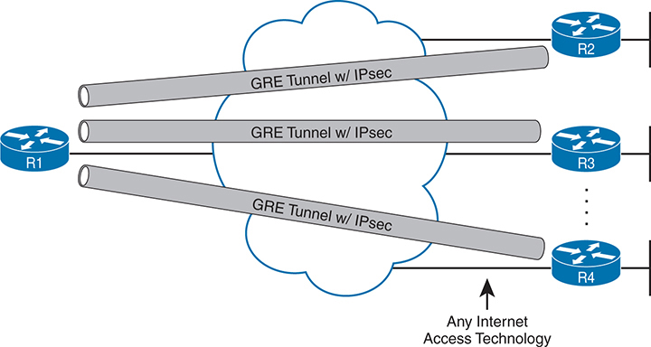

<figcaption>

<aside class="hidden" id="a19fig19">

网络包括四个路由器,标签为R 1 2 3 ,和 R 键 4 ,通过 GRE 隧道与 I P 秒 R 连接 1 :网络左侧的启动路由器,通过GRE地道与其它路由器相接. R. 2 3 4 :网络右侧的目的地路由器,每个路由器连接到R 1 GRE地道通过独立的GRE地道,带有I P sec. GRE地道作为灰色圆柱管代表,I P sec加密提供了额外的安全性. 该图强调使用任何互联网接入技术来建立这些连接,强调VPN设置的灵活性. 中央的云符号代表了互联网,GRE地道通过它建立。该图清楚地显示了R之间的安全通信路径. 1 以及其他路由器,确保数据加密并安全地通过互联网传输。

</aside>

<strong>图19-19</strong> <em>装有 GRE 和 IPsec 的站点对站台 VPN 隧道</em>

</figcaption>

</figure>

</section>

<section>

<h5 class="h5" id="ch19lev3sec10">使用 IPsec 的远程访问 VPN</h5>

存在一个站点对站点VPN,以支持每个站点的多台设备,IT工作人员创建了永久VPN连接,支持所有用户. 相形之下,在永久站点对站点VPN不存在的情况下,用户设备可以动态地启动VPN连接. 这种由最终用户设备终止并启动的VPN连接称为<a id="key_268" href="#ref-gloss_287">远程访问 VPN</a>.

例如,用户可以走入咖啡店,用平板电脑或膝上型电脑连接免费Wi-Fi,但该咖啡店在用户的企业网络中没有站点到站点的VPN. 相反,端点设备上的软件创建了安全VPN连接回企业网络,如以下所示:<a href="#ch19fig20">图19-20</a>.

<figure class="image-c" id="ch19fig20">

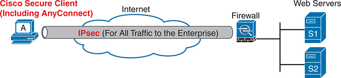

<figcaption>

<aside class="hidden" id="a19fig20">

在左边,一个被标记为A的设备代表客户端使用Cisco Security客户端. 这个客户端连接到互联网,以云为代表. 一个标有 I P sec (For All Traffic to the Enterprise) 的地道从客户端通过互联网延伸至防火墙. 防火墙被连接到两个网络服务器上,标签为S 1和S 2,位于图像的右侧. 这个设置显示从客户端到企业网络的所有流量是如何使用 IP sec进行加密的,通过 VPN 隧道提供安全的通信.

</aside>

<strong>图19-20</strong> <em>IPsec 远程访问 IPse克 VPN</em>

</figcaption>

</figure>

许多公司在图中使用远程接入VPN模型,用于从事远程工作的员工,从家中,酒店或任何场外地点接通. 公司可以选择使用IPsec还是传输层安全<a id="key_272" href="#ref-gloss_343">(TLS) (英语).</a>保证交通安全。

为了支持计算机发送的所有流量,最终用户设备需要VPN客户端软件. 网络工作人员还安装并配置一个作为VPN集聚器的设备,确定是使用TLS还是IPsec. 雇员装置然后连接到VPN集聚器. 虽然路由器可以发挥这一作用,但公司通常使用防火墙产品.

注意

多年来,思科将其VPN客户端软件品牌为"思科AnyConnect安全移动客户端". 思科已经把产品换成了<a id="key_250" href="#ref-gloss_073">Cisco 安全客户端( 包含 AnyConnect)</a>。见<a href="http://www.cisco.com/go/secureclient">www.cisco.com/go/secureclient</a>以获得更多信息。

IPsec在用于远程访问时与站点对站点VPN的作用略有不同.<a id="key_259" href="#ref-gloss_184">IPsec 隧道模式</a>用于站点对站点加密,加密整个原始数据包。<a id="key_258" href="#ref-gloss_183">IPsec 传输模式</a>用于远程访问 VPN , 它加密了 IP 原始数据包的数据—— 即 IP 头后的一切 —— 但IP 头本身不是 。<a href="#ch19fig21">图19-21</a>显示两种模式的可视比较。

<figure class="image-c" id="ch19fig21">

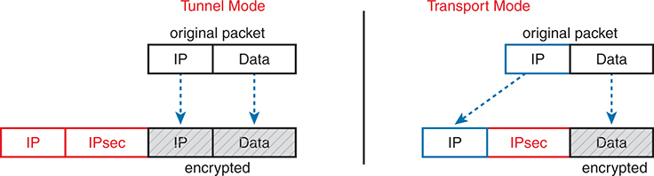

<figcaption>

<aside class="hidden" id="a19fig21">

Tunnel Mode: 在左侧显示一个带有 I P 和 Data 的原始包 。 在隧道模式下,会添加一个新的 I P 头,整个原始包(包括原 I P 标题和数据)都会被加密. 图表显示在新 I P 头和一个 I P 秒头内封装的原始包,原始包以灰色突出显示以表示加密. 传输模式:在右侧显示带有 I P 和 Data 的原始数据包。 在运输模式下,原I P头保持完好无损,只有有效载荷(数据)和原I P部分头被加密. 该图显示了最初的 I P 头,然后是 I P 秒头和数据,只有 I P 分和数据部分用灰色突出显示以表示加密。

</aside>

<strong>图19-21</strong> <em>IPsec 隧道和运输模式——什么是加密的</em>

</figcaption>

</figure>

站点对站点和远程访问IPsec VPN也存在其他差异,因为它们的作用不同.<a href="#ch19tab04">表19-4</a>概述差异,以便于研究。

<figure class="table" id="ch19tab04" tabindex="0">

<figcaption>

<strong>表19-4</strong>站点对站点和远程访问IPsec VPN的比较

</figcaption>

<table class="all">

<tbody>

<tr>

<th class="th">
属性
</th>

<th class="th">
站点对站点IPsec VPN
</th>

<th class="th">
远程访问 IPsec VPN
</th>

</tr>

<tr>

<td class="border">
最终用户设备需要VPN客户端软件吗?.
</td>

<td class="border">
否
</td>

<td class="border">
是
</td>

</tr>

<tr>

<td class="border">
一个 VPN 支持的设备: 一个或多个
</td>

<td class="border">
多个
</td>

<td class="border">
一个
</td>

</tr>

<tr>

<td class="border">
典型的使用:按需或永久使用
</td>

<td class="border">
永久
</td>

<td class="border">
按需
</td>

</tr>

<tr>

<td class="border">
VPN是否使用IPsec地道模式?.
</td>

<td class="border">
是
</td>

<td class="border">
否
</td>

</tr>

<tr>

<td class="border">
VPN是否使用IPsec传输模式?.
</td>

<td class="border">
否
</td>

<td class="border">
是
</td>

</tr>

</tbody>

</table>

</figure>

</section>

<section>

<h5 class="h5" id="ch19lev3sec11">使用 TLS 的远程访问 VPN</h5>

虽然考试题目特指IPsec VPNs,而VPN技术则包括了IPsec以外的许多协议. 这个最后的话题讨论了大多数人每天使用的一个话题:传输层安全,或TLS.

对于今天的大多数网站,当您连接时,您的浏览器使用HTTPS(RFC 9110),它保证了HTTP协议的安全. HTTPS通过使用TLS(RFC 8446)保证了HTTP的安全.

世界已经从HTTP迁移到HTTP. 只要看看您在网页浏览器中看到的大多数URI:它们都从HTTPS开始. 因此,一个浏览器在连接到站点之前,会使用使用TLS的HTTPS完成安全连接.

在打开新网页时,浏览器会创建出与知名端口443(默认)的TCP连接,然后初始化一个TLS会话. TLS加密浏览器和服务器之间发送的数据(应用程序层头和数据-但不包括IP或TCP头),同时认证用户. 然后,HTTPS消息会流过TLS VPN连接.

注意

在过去的几年里,Secure Sockets Layer(SSL)扮演了与TLS相同的角色. SSL已经贬值了(见RFC 7568)并被TLS所取代.

TLS在其最常见的使用中,在一个客户端的网页浏览器和一个网络服务器之间建立了主机对主机的安全连接. 如果您打开了网页浏览器标签并连接到一个网站,您的浏览器会创建与该服务器的 TLS 连接. 打开更多的浏览器标签,而您的浏览器会创建额外的TLS主机对主机连接,全部以TLS安全. TLS也可用于远程访问VPN. 例如,思科安全客户端在连接到防火墙时可以使用TLS,支持由主机发送的所有流量.<a href="#ch19fig22">图19-22</a>显示两个。

<figure class="image-c" id="ch19fig22">

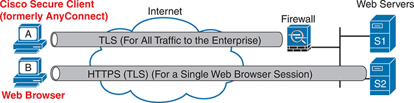

<figcaption>

<aside class="hidden" id="a19fig22">

该图包括两个客户端,标签为A和B,通过互联网和一个防火墙连接到网络服务器(S 1和S 2). A客户端使用Cisco Secure客户端(前身为AnyConnect),该客户端为面向企业网络的所有流量建立了一个TLS隧道. 这个安全的地道确保客户端A和企业之间传输的所有数据都得到加密和保护. 客户端 B使用网页浏览器建立HTTPS会话(也使用TLS),用于单一的网页浏览会话. 这种方法加密了网页浏览器会话特有的数据,为与网页服务器的特定交互提供了安全性. 两个客户都连接到互联网上,互联网引导他们的流量通向企业防火墙. 防火墙控制网络服务器(S 1和S 2)的访问,确保只有经授权的流量才能到达企业网络.

</aside>

<strong>图19-22</strong> <em>远程访问 VPN 选项( TLS)</em>

</figcaption>

</figure>

</section>

</section>

</section>

</section>

<section class="ccna-source ccna-appendix" aria-label="答案解析与术语表">
<section data-epub-type="chapter">

<h2 class="h2" id="ref-appc">附录C</h2>

<h2 class="h2a">对“我早就知道了吗?” 的回答。</h2>

<section>

<h3 class="h3" id="ref-appclev1sec19">第19章</h3>

<strong><a id="ref-ques19_1" href="#quess19_1">1</a>。</strong> B 和 C。城域以太网 E-Tree 服务使用有根的点到多点以太网虚拟连接（EVC）。这意味着连接到该服务的一个站点（根）可以直接与每个远程站点（叶）通信。不过，叶站点之间不能直接发送帧，只能向根站点发送帧。只允许组内部分节点对直接通信的拓扑称为部分网状、中心辐射式拓扑，有时也称为多点或点到多点拓扑。

对于错误选项，<em>全网状</em>指组内每对节点都能直接相互发送数据的拓扑，是 MetroE E-LAN 服务的典型形式。<em>点到点</em>指设计中只有两个节点、且二者可以直接相互发送数据的拓扑，是 MetroE E-Line 服务的典型形式。

<strong><a id="ref-ques19_2" href="#quess19_2">2</a>。</strong> A。城域以太网使用各种类型的以太网接入链路。时分复用（TDM）链路，例如串行链路，乃至 T3 和 E3 等更高速的链路，都不使用以太网协议，因此使用的可能性较低。MPLS 是一种提供三层服务的 WAN 技术。

两个选项涉及可作为城域以太网服务物理接入链路的以太网标准。不过，100BASE-T 只支持最长 100 米的电缆，而 100BASE-LX10 支持 10 km，因此前者用作城域以太网接入链路的可能性较低。

<strong><a id="ref-ques19_3" href="#quess19_3">3</a>。</strong> A 和 D。在 E-LAN 服务中，城域以太网服务使 WAN 表现得像一台以太网交换机，每台设备都可以直接与其他所有设备通信。因此，这些路由器位于同一子网。如果有一台总部路由器和十个远程站点，那么每台路由器都会有十个 OSPF 邻居。

<strong><a id="ref-ques19_4" href="#quess19_4">4</a>。</strong> B 和 C。三层 MPLS VPN 提供 IP 服务，每条接入链路使用不同的子网。一台总部路由器加上 10 个远程站点，共有 11 条接入链路，因此使用 11 个子网。

每台企业（CE）路由器与 MPLS 提供商边缘（PE）路由器建立 OSPF 邻居关系，但 CE 路由器彼此之间没有 OSPF 邻居关系。因此，每台远程站点路由器只会有一个 OSPF 邻居关系。

<strong><a id="ref-ques19_5" href="#quess19_5">5</a>。</strong> D。从架构上看，MPLS 支持多种接入技术，包括 TDM（串行链路）、帧中继、ATM、城域以太网，以及 DSL 和有线电视网络等传统互联网接入技术。

<strong><a id="ref-ques19_6" href="#quess19_6">6</a>。</strong> A 和 B。<em>远程访问 VPN</em>指一端为手机、平板电脑或 PC 等用户设备，另一端为 VPN 集中器（通常是防火墙或路由器）的 VPN。VPN 集中器的配置决定 VPN 客户端应使用的协议，通常为 TLS 或 IPsec。

对于错误选项，站点到站点 VPN 将 GRE 与 IPsec 结合使用。FTPS 指 FTP Secure，它使用 TLS 来保护 FTP 会话。

</section>

</section>

<section id="ref-glossary"><h2 class="h2a">词汇表</h2>
<strong>访问链接</strong>在校园局域网设计中,一个连接一个接入交换机到端点设备和无线接入点的链接.

<strong>Cisco 安全客户端( 包括 AnyConnect)</strong>Cisco软件产品用作用户设备上的客户端软件来创建客户端VPN. 原名为Cisco AnyConnect安全移动客户端,有时也被称为Cisco VPN客户端.

<strong>E-LAN</strong>由MEF定义的特定载体/地铁以太网服务(<a href="http://MEF.net">MEF.net</a>),提供类似于局域网的服务,两个或多个客户站点在全网格中连接到一个电子局域网服务,这样电子局域网中的每个设备都可以直接将以太网帧发送到其他每个设备.

<strong>E-Line</strong>由MEF定义的特定载体/地铁以太网服务(<a href="http://MEF.net">MEF.net</a>)提供两个客户设备之间的点到点地貌,多好象这两个设备是使用以太网交叉电缆连接的.

<strong>以太网广域网</strong>任何使用以太网链接作为客户与服务提供商之间访问链接的WAN服务的一般和非正式术语.

<strong>全网状</strong>从地理学角度来说,任何具有两个或两个以上设备的地理学,每个设备都能够将帧发送到每一个其他设备.

<strong>中枢和讲演</strong>从地理学的角度来看,任何具有能够向所有其他设备(中枢)发送消息的设备的地理学,都有一个或多个只能向中枢发送消息的有声设备. 也叫"点到多点".

<strong>IPsec 语句</strong>指代IP安全协议的术语,是提供加密和认证服务的架构,通常在通过IP网络创建VPN服务时使用.

<strong>IPsec 传输模式</strong>使用 IPsec 时加密原始IP包数据的过程,同时使用原始包的 IP 头,外加 VPN 头来封装被加密的数据. 通常用于远程访问IPsec VPNs.

<strong>IPsec 隧道模式</strong>在使用IPsec时加密整个原始IP包的过程,需要一个新的IP头,外加VPN头来封装加密的原始包. 通常用于站点对站点IPsec VPN.

<strong>城域以太网</strong>最初使用的WAN服务术语是将以太网链接作为客户和服务提供商之间的访问链接.

<strong>MPLS VPN</strong>一个使用MPLS技术的WAN服务,许多客户连接到同一个MPLS网络,但VPN的功能使得每个客户的流量与其他人分开.

<strong>多Protocol BGP( MPBGP) (MPBGP) (英语).</strong>一组特别的BGP扩展允许BGP支持多地址家庭,当用于创建MPLS VPN服务时,给SP提供了在很多客户的IPv4路由上发布广告的方法,同时将这些路由广告逻辑地分开.

<strong>多协议标签交换（MPLS）</strong>一种用于为客户创建基于IP的服务的WAN技术,由服务供应商的内部网络进行基于MPLS标签而不是目的地IP地址的转发.

<strong>部分网状</strong>一个网络地理学中,两个以上的设备可以进行物理通信,但通过选择,只允许连接到网络的一对设备的子集直接通信.

<strong>存在点(PoP)</strong>从服务供应商的角度来说,一个术语是指服务供应商的安装,其目的地相对靠近客户,几个分布在主要城市,因此从每个客户点到服务供应商的其中一个PoP的距离很短。

<strong>点到点</strong>从地理学角度来说,任何具有两个且只有两个设备的地理学都能够直接向对方发送消息.

<strong>提供者边缘( PE)</strong>服务商在MPLS VPN网络中一般也具体使用的一个术语来指代存在点(PoP)中的SP设备,它连接客户网络,因此坐落在SP网络的边缘.

<strong>远程访问 VPN</strong>一个VPN,一个端点是一个用户设备,例如电话,平板电脑或PC,一般是动态创建的,并经常使用TLS. 也叫了一个客户VPN.

<strong>service provider (SP)</strong>一家为多位客户提供服务的公司. 最常用来指代私人广域网服务和互联网服务提供商.<em>另见</em>互联网服务提供商.

<strong>共享密钥</strong>指其价值由发送方和接收方共同知道(共享)的担保钥匙。

<strong>站点对站点VPN</strong>使两个不同站点的所有设备能够安全地通过诸如因特网等不安全的网络进行通信的机制,在每个站点有一个设备进行加密/解密,并转发各站点之间发送的所有数据包。

<strong>传输层安全(TLS)</strong>一个取代了更古老的安全索克特层(SSL)协议的安全标准,在像TCP这样的可靠的命令内数据流上提供认证,保密,消息完整性等功能.

</section>
</section>


<nav class="ccna-chapter-nav" aria-label="章节导航"><a href="v2-18.html">← 上一章</a><a href="v2-20.html">下一章 →</a></nav>
