
<a href="{{ '/subjects/CCNA/' | relative_url }}">← 返回 CCNA 目录</a>

第二卷 · 网络架构

<nav class="ccna-chapter-nav" aria-label="章节导航"><a href="v2-19.html">← 上一章</a><a href="v2-21.html">下一章 →</a></nav>



<section data-epub-type="chapter">

<h2 class="h2" id="ch20">第 20 章</h2>

<h2 class="h2a">云架构</h2>

本章涵盖以下考试主题：

1.0 网络基础

1.1 解释网络组件的作用和功能

1.1.g 服务器

1.2 描述网络拓扑架构的特征

1.2.f 本地部署和云

1.12 解释虚拟化基础（服务器虚拟化、容器和 VRF）

云计算是一种向客户提供 IT 服务的方式。不过，云计算不是某个产品、一组产品、一项协议或任何单一事物。因此，虽然如今对云计算已有公认的描述和定义，但要判断某项 IT 服务是否称得上云计算服务，还需要掌握超出网络领域的广泛 IT 知识。

要将某项 IT 服务归为云计算服务，它应具有这些特征：可以按需请求；可以动态扩展（即具有弹性）；使用资源池；提供多种网络访问方式；能够计量用量，并按实际使用量向用户计费。

云计算依赖自动化数据中心。例如，为了响应请求，云计算系统会创建虚拟服务器实例，即虚拟机（VM），并配置每台 VM 的设置，以提供所请求的服务。

本章让你对云服务和网络架构形成总体认识。为此，本章先讨论服务器虚拟化基础，再介绍云计算的主要概念，最后讨论公有云对企业网络中数据包流动的影响。

<section>

<h3 class="h3" id="ch20lev1sec1">“这些知识我已经掌握了吗？”自测</h3>

如果你希望根据得分决定在本章投入多少时间，可以完成这组自测题（在此作答，或使用 PTP 软件）。各题答案的选项字母列在自测题之后的页面底部。书末和配套网站上的<a href="#ref-appc">附录 C</a>都包含答案及解析。你也可以在 PTP 测试软件中找到答案及解析。

<figure class="table" id="ch20tab01" tabindex="0">

<figcaption>

<strong>表20-1</strong>“我早就知道了吗?”

</figcaption>

<table class="all">

<tbody>

<tr>

<th class="th">
基础知识小节
</th>

<th class="th">
题目
</th>

</tr>

<tr>

<td class="border">
服务器虚拟化
</td>

<td class="border">
1、2
</td>

</tr>

<tr>

<td class="border">
云计算服务
</td>

<td class="border">
3, 4
</td>

</tr>

<tr>

<td class="border">
访问云服务的 WAN 流量路径
</td>

<td class="border">
5, 6
</td>

</tr>

</tbody>

</table>

</figure>

<strong><a id="quess20_1" href="#ques20_1a">1</a>.</strong>三台虚拟机运行在一个物理服务器上. 哪个服务器资源是虚拟化系统通常虚拟化的,所以每个VM都可以使用该资源所需的数量? (选取三正答.

<ol class="lower-alpha">

<li>
NIC
</li>

<li>
RAM
</li>

<li>
电源
</li>

<li>
虚拟机监控器
</li>

<li>
CPU
</li>

</ol>

<strong><a id="quess20_2" href="#ques20_2a">2</a>.</strong>8台虚拟机运行在一个物理服务器上;服务器有两个物理以太网NIC. 哪一个答案描述了允许所有8个VMs通信的方法?

<ol class="lower-alpha">

<li>
VMS必须共享两个IP地址并进行协调来避免重复使用TCP或UDP端口.
</li>

<li>
超显相器作为IP路由器,使用NICs作为路由IP接口.
</li>

<li>
每个VM都使用虚拟的NIC映射到物理的NIC.
</li>

<li>
每个VM使用一个虚拟的NIC,从逻辑上连接到一个虚拟交换机.
</li>

</ol>

<strong><a id="quess20_3" href="#ques20_3a">3</a>.</strong>哪些云服务最有可能用于软件开发?

<ol class="lower-alpha">

<li>
IaaS (美国)
</li>

<li>
帕亚斯
</li>

<li>
萨阿斯
</li>

<li>
SLBAAS 卫星
</li>

</ol>

<strong><a id="quess20_4" href="#ques20_4a">4</a>.</strong>您将使用下列哪一种云服务购买服务, 然后再安装您的软件应用程序 ?

<ol class="lower-alpha">

<li>
IaaS (美国)
</li>

<li>
帕亚斯
</li>

<li>
萨阿斯
</li>

<li>
SLBAAS 卫星
</li>

</ol>

<strong><a id="quess20_5" href="#ques20_5a">5</a>.</strong>企业计划使用公共云服务,并考虑不同的WAN选项. 答案列出了正在审议的四个备选方案。 在从最初的云提供方迁移到另一个提供方时,哪一种选择引起最大的挑战?

<ol class="lower-alpha">

<li>
直接使用私有WAN连接到云端提供者
</li>

<li>
使用没有 VPN 的互联网连接
</li>

<li>
使用云际交换
</li>

<li>
使用与 VPN 的互联网连接
</li>

</ol>

<strong><a id="quess20_6" href="#ques20_6a">6</a>.</strong>企业计划使用公共云服务,并考虑不同的WAN选项. 哪一个答案列出一个WAN选项,它通过保持数据私有性,同时提供良好的QoS服务来提供良好的安全性? (取出二个答.

<ol class="lower-alpha">

<li>
直接使用私有WAN连接到云端提供者
</li>

<li>
使用没有 VPN 的互联网连接
</li>

<li>
使用云际交换
</li>

<li>
使用与 VPN 的互联网连接
</li>

</ol>

“这些知识我已经掌握了吗？”自测答案：

<strong><a id="ques20_1a" href="#ref-ques20_1">1</a></strong> A, B, E

<strong><a id="ques20_2a" href="#ref-ques20_2">2</a></strong> D

<strong><a id="ques20_3a" href="#ref-ques20_3">3</a></strong> B

<strong><a id="ques20_4a" href="#ref-ques20_4">4</a></strong> A

<strong><a id="ques20_5a" href="#ref-ques20_5">5</a></strong> A

<strong><a id="ques20_6a" href="#ref-ques20_6">6</a></strong> A、C

</section>

<section>

<h3 class="h3box" id="ch20lev1sec2">基础主题</h3>

</section>

<section>

<h3 class="h3" id="ch20lev1sec3">服务器虚拟化</h3>

当你想到一个服务器,有什么想法? 是一台具有快速CPU的桌面计算机吗? 一台拥有大量RAM的桌面计算机? 是硬件不会直立地坐到地板上, 但却很容易被锁入数据中心的架子里? 你甚至没有想到硬件,而是想到服务器操作系统(OS)作为虚拟机(VM)在什么地方运行?

所有这些答案从某种角度来说都是准确的,但我们在CCNA认证范围内的几乎所有其他讨论中都忽略了这些细节. 从大多数CCNA讨论的角度来看,服务器是运行应用程序的地方,用户通过网络连接到这些应用程序. 此书代表服务器,其图标外观类似桌面计算机(即服务器的标准Cisco图标). 第一个话题打破了对服务器含义的不同视角,并准备我们讨论云计算.

<section>

<h4 class="h4" id="ch20lev2sec1">Cisco 服务器硬件</h4>

考虑一下服务器的成型因素,即物理服务器的形状和大小。 如果你自己造一个服务器,它会是什么样子? 相去多大,相去多广;相去多高等. 即使你从未见过一个被定性为服务器的设备,也考虑这些关键事实:

<strong>没有 KVM :</strong>对于大多数服务器来说,没有永久用户坐落在服务器附近;所有用户和管理员通过网络连接到服务器. 因此,不需要永久的键盘,视频显示,或鼠标(统称为KVM).

<strong>数据中心的服务器堆积 :</strong>在服务器的早期,一个服务器是任何拥有相对快的CPU,大量RAM等的计算机. 今天,公司将许多服务器放入一个房间——一个数据中心——而目标之一是不要浪费空间。 因此,用一个适合标准架的形态因子来制造服务器可以更有效地利用现有空间——特别是当你不期望人们坐在每个服务器前的时候.

譬如说.<a href="#ch20fig01">图20-1</a>显示来自 Cisco 的服务器硬件照片。 虽然你可能认为Cisco是一家网络公司, 大约2010, Cisco将其产品线扩展到服务器市场 与Cisco<a id="key_290" href="#ref-gloss_348">统一计算系统(UCS)</a>该相片显示UCS B-Series(布莱德系列)可架起底盘,该底盘适合 19-inch - 宽的架子和是 10.5 英寸( 6个支架单位) 高。 它支持 16 服务器:8个可移动服务器叶片每台2个. 底盘底部有4个动力供给.

<figure class="image-c" id="ch20fig01">

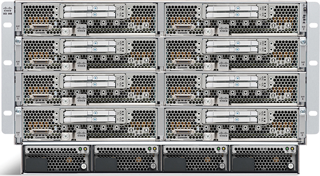

<figcaption>

<aside class="hidden" id="a20fig01">

机架上装有多台叶片服务器,垂直堆放,并采用模块化方式排列. 每个刀片服务器都设有前立面访问面板. 这些服务器配备了多个端口和接口,用于网络连接、电力和管理。

</aside>

<strong>图20-1</strong> <em>Cisco UCS 服务器: B- Series (布莱德)</em>

</figcaption>

</figure>

无论形式因素如何,今天的服务器硬件都提供一些CPU芯片,RAM,存储,和网络接口卡(NICs)的容量. 但是,你还必须对服务器上运行的操作系统有不同的思考,因为一个工具叫做<em>服务器虚拟化</em>.

</section>

<section>

<h4 class="h4" id="ch20lev2sec2">服务器虚拟化与虚拟机基础</h4>

将一个服务器——硬件——当作一台计算机。 它可以是刀片中的服务器之一<a href="#ch20fig01">图20-1</a>一台强大的电脑,你可以在当地的电脑商店买。 传统上,当你想到一个服务器, 一个服务器运行一个OS。 硬件包括一个CPU,RAM,永久存储(类似于磁盘驱动器),以及一个或多个NIC. 而一个OS可以使用服务器内的所有硬件,然后运行一个或多个应用程序.<a href="#ch20fig02">图20-2</a>展示这些主要想法。

<figure class="image-c" id="ch20fig02">

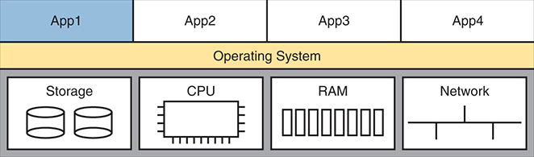

<figcaption>

<aside class="hidden" id="a20fig02">

顶部有4个应用程序被标注为App1,App2,App3和App4. 这些应用程序运行在位于其下方的操作系统层上. 在操作系统下方,物理硬件组件被代表. 这些组件包括存储,CPU(中央处理单位),RAM(Random Access Memory)和Network等. 硬件资源由操作系统直接使用,而操作系统又支持运行中的应用程序.

</aside>

<strong>图20-2</strong> <em>物理服务器模型:物理硬件, One OS, 和应用</em>

</figcaption>

</figure>

以物理服务器模型显示于<a href="#ch20fig02">图20-2</a>,每个物理服务器运行一个OS,而OS则使用该服务器中的所有硬件. 在服务器虚拟化前几天,服务器的情况就是这样。

如今,大多数公司将服务器硬件作为虚拟化数据中心的一部分. 这意味着公司购买服务器硬件,安装在架子上,然后将所有的CPU,RAM等作为数据中心容量处理. 然后,每个OS实例都与硬件脱钩,因此是虚拟的(与物理相对). 我们以前以为是服务器的每个硬件同时运行一个OS的多个实例,每个虚拟OS实例称为一个<a id="key_292" href="#ref-gloss_363">虚拟机</a>,或VM.

单个物理主机(server)的处理功率往往比一个OS需要的要多. 思考处理器,现代服务器CPU在单个CPU芯片中具有多个核心(处理器). 每个核心也可能能够运行多个线程,其特性叫做<em>多线程</em>。因此,当你读取一个具有40个核心和多线程(通常每个核心有两个线程)的特定英特尔处理器时,一个CPU芯片可以同时执行80个程序. 超导器(很快引入)可以将每个可用的线程当作一个<a id="key_291" href="#ref-gloss_361">虚拟 CPU (vCPU)</a>,按需要指定每个VM vCPU.

VM——即与服务器硬件脱钩的OS实例——仍然必须在硬件上执行。 每个 VM 配置它需要的 vCPU 数量,最小RAM 等. 虚拟化系统然后在某个物理服务器上启动每个VM,这样就有足够的物理服务器硬件能力支持该主机上运行的所有VM. 因此,在任何时候,每个VM运行在一个物理服务器上,使用该服务器上的CPU,RAM,存储和NIC的子集.<a href="#ch20fig03">图20-3</a>显示这个概念的图形,四个单独的VM运行在一个物理服务器上.

<figure class="image-c" id="ch20fig03">

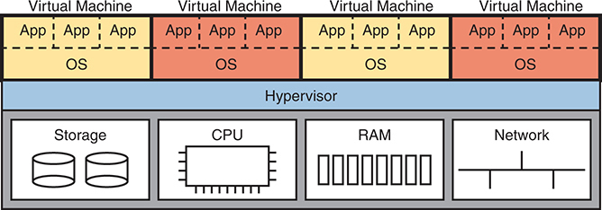

<figcaption>

<aside class="hidden" id="a20fig03">

顶部有四台虚拟机,每台都包含自己的操作系统(O S)和应用. 虚拟机通过Virtual Machine 4被贴上"虚拟机一"的标签,在每个V M内部,都有被贴上App的应用程序在各自的O S上运行. 虚拟机下方显示一个超显相层. 超卫视管理主机的硬件资源,并将其分配给虚拟机. 在超显相器下方,对物理硬件组件进行演示,包括存储、CPU、RAM和Network。 超卫视汇总了这些物理资源,并为每个虚拟机提供了自己的虚拟化资源,使V Ms能够独立运行.

</aside>

<strong>图20-3</strong> <em>在一个主机上运行的4个 VM; Hypervisor 管理硬件</em>

</figcaption>

</figure>

为使服务器虚拟化发挥作用,每个实体服务器(称为a)<a id="key_278" href="#ref-gloss_158">主机</a>在服务器虚拟化世界中)使用 a<a id="key_279" href="#ref-gloss_167">虚拟机监控器</a>。hypervisor根据VM的设置管理并分配每个VM的主机硬件(CPU,RAM等). 每个VM运行时仿佛运行在自成一体的物理服务器上,有特定数量的虚拟CPU和NIC以及设定数量的RAM和存储. 例如,如果一个 VM 定义了需要四个包含 8 GB RAM 的 CPU , 超卫视将这些资源分配给 VM 。

以下是一些与虚拟数据中心有关的销售商和产品姓:

<ul class="sq">

<li>
VMware vCenter 服务器
</li>

<li>
微软超V
</li>

<li>
Citrix Hypervisor( 原为 XenServer)
</li>

<li>
红色帽子 KVM
</li>

</ul>

除了超显像仪之外,公司还出售完整的虚拟化系统. 这些系统允许虚拟化工程师动态地创建VMS,启动它们,将它们(手工和自动)移动到不同的服务器上,并阻止它们. 例如,在为服务器硬件提供电源以进行维护之前,工作人员可以将VMs移动到另一个主机(通常在运行时).

</section>

<section>

<h4 class="h4" id="ch20lev2sec3">虚拟化主机上的虚拟交换机联网</h4>

服务器虚拟化工具为将VMs连接到网络提供了多种选择. 这本书并没有试图讨论所有的问题,但可以帮助在思考更多关于云计算之前把一些基本内容整理下来.

首先,一个物理服务器包含什么用于联网功能? 通常,它有一个或多个NIC,可能慢到1Gbps,常常是10Gbps今天,也可能快到40Gbps.

接下来,想想VM. 通常,一个操作员有一个NIC,也许更多。 每一个越共(至少)有一个NIC,但是对于一个越共来说,它是一个<a id="key_293" href="#ref-gloss_364">虚拟 NIC</a>。(例如,在VMware的虚拟化系统中,VM的虚拟NIC被称为vNIC.

最后,服务器必须把物理NIC和VMs使用的vNIC的想法结合到一个网络中去. 每个服务器都使用内部以太网交换机概念,常被称作(你猜到的)a<a id="key_295" href="#ref-gloss_367">虚拟切换</a>,或vswitch 键. <a href="#ch20fig04">图20-4</a>显示一个实例,有四个VM,每个VM都有一个vNIC. 物理服务器有两个物理的NIC. vNIC和物理NIC在内部连接到虚拟交换机.

<figure class="image-c" id="ch20fig04">

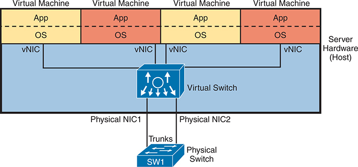

<figcaption>

<aside class="hidden" id="a20fig04">

顶部有四台虚拟机,每台运行自己的应用程序(App)和操作系统(O S. 这些虚拟机被托管在服务器硬件上,称为"主机". 每个虚拟机连接到一个虚拟网络接口卡(v NIC),该卡与图中描绘的中央虚拟交换机相接. 虚拟交换机方便了虚拟机与物理网络之间的交流. 虚拟交换机下方显示有两张贴有物理NIC 1和物理NIC 2标签的物理网络接口卡(N I Cs),将虚拟交换机连接到物理网络基础设施. 这些物理N I Cs使用干线连接连接到图底贴有S W 1标签的物理交换机.

</aside>

<strong>图20-4</strong> <em>虚拟主机中的基本网络化</em>

</figcaption>

</figure>

在今天的多数情况下,超视星等供应商提供vSwitch,但有时不同的供应商(如Cisco)可能提供替代的vSwatch. 例如,Cisco提供Cisco ACI虚拟边缘交换机,支持CisCO ACI联网.

VSwitch 显示于<a href="#ch20fig04">图20-4</a>使用您现在从 CCNA 研究中了解到的相同的网络功能。 特别是:

<ul class="sq">

<li>
<strong>连接到 VM 的端口 :</strong>vSwitch可以配置一个端口,使VM在自己的VLAN中,或者与其他VM共享同一个VLAN,甚至使用VLAN干线到VM本身.
</li>

<li>
<strong>连接到物理 NIC 的端口 :</strong>vSwitch使用服务器硬件中的物理NIC,使交换机与外部物理局域网交换机相邻. vSwitch可以(而且很可能)使用VLAN干线.
</li>

<li>
<strong>自动配置:</strong>配置可以很容易地在控制VMs的同一种虚拟化软件内完成. 这种可编程性允许虚拟化软件在主机(服务器)之间移动VMS并重编vSwitches,这样无论VM运行在何处,VM都有相同的联网能力.
</li>

</ul>

</section>

<section>

<h4 class="h4" id="ch20lev2sec4">软件容器</h4>

软件容器的目标与VMS相同,但使用不同的方法. 与VMs相比,容器的CPU和内存较少,同时初始化和关闭的时间也更短 -- -- 在某些情况下使其更具吸引力。

为了了解这些分歧,请再考虑一下VMs。 磁盘上存在一个单一的VM,等待运行,作为一个大文件——典型的很多千兆字节,因为它持有一个完整的OS. 启动 VM 需要几分钟; 将 VM 初始化时间想成类似于启动您的桌面或笔记本电脑所需的时间 。 另外,VMs还需要做一些工作:操作系统和应用系统都必须安装,而您需要随着时间推移应用软件修正.

某些认为VMs的缺点导致了第二波服务器虚拟化,称为软件容器,或仅仅是容器.

首先,考虑一下这个词<em>容器</em>作为理解基本内容的通称. 你觉得呢? 也许你会想到装满大船的集装箱 或者搭乘拖拉机的卡车 也许你会想到你用来把午餐送到学校的塑料容器. 一般来说,容器有其他东西,通常是多件东西。

软件容器持有一个应用程序,加上它需要工作的所有其他文件——但操作系统除外。 例如,申请的主要可执行文件都在容器中。 容器中包含所有随应用程序而来的相关文件,外加任何库(应用程序经常使用的标准代码)在所指定的版本. 它包括应用程序使用的文件,例如可能包含应用程序设置的文本文件. 容器——一个有定义格式的文件,它收集并包含所有组件文件——控制所有文件。 但由于容器不包括OS,因此通常比VM还小,常以兆字节而不是千兆字节来测量.

注意

根据公约,该术语<a id="key_277" href="#ref-gloss_092">容器图像</a>指的是磁盘上保存所有构成应用程序的文件的文件。 术语<a id="key_276" href="#ref-gloss_091">容器</a>是指一个集装箱一旦启动。 例如,您可能为网络服务器应用程序使用容器图像 。 当你在服务器上开始5次图像时,你有5个容器, 也就是5个网络服务器运行在服务器上的例子。

那么,如果容器不包括操作系统,它是如何执行的? 似乎少了点什么 答案:在架构上,服务器硬件运行了OS的一例——一个支持容器的OS,比如Windows或Linux. 此外,你需要一个<em>集装箱发动机,</em>即可以安装、启动、停止和监测容器的软件。<a href="#ch20fig05">图20-5</a>显示一般的想法。

<figure class="image-c" id="ch20fig05">

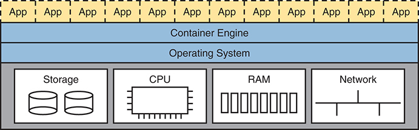

<figcaption>

<aside class="hidden" id="a20fig05">

在顶部显示十二个单独的容器,每个容器运行一个单独的应用程序(App). 容器下方有一层有标签的"集装箱发动机",负责主机操作系统(O S)上方的容器的管理和运行. 操作系统为集装箱发动机的运行提供了必要的环境和资源. 在操作系统下方,对四个硬件组件进行了说明:存储,中央处理单元(CPU),随机访问内存(RAM)和网络. 存储由圆柱形磁盘所代表,CPU由微芯片图标所代表,RAM由一系列垂直条所代表,而网络则由互通行所代表.

</aside>

<strong>图20-5</strong> <em>由集装箱发动机管理的12个集装箱在一个主机上运行</em>

</figcaption>

</figure>

启动容器需要容器引擎,软件能理解容器文件格式和操作. 集装箱引擎提供一种GUI来启动,停放并监控集装箱. 然而,大多数数据中心的业务活动都是远程发生的,所以容器图像包括 shell 命令和API,通过虚拟化软件帮助远程控制和自动化. 此外,在启动容器时,需要典型的启动应用程序的时间(秒或数十秒),而不是启动操作系统所需的分钟。

虽然Linux和Windows包括了对容器的支持,但在2010年代,当一些公司开始提供相关的软件服务时,容器变得很受欢迎. 一些最受欢迎和常见的公司和网站包括:

<ul class="sq">

<li>
嵌入器( R)<a href="http://Docker.com">Docker.com</a>)
</li>

<li>
库伯内特斯( C.<a href="http://k8s.io">k8s.io</a>)
</li>

<li>
Terraform( O) :<a href="http://hashicorp.com">hashicorp.com</a>)
</li>

</ul>

嵌入器( R)<a href="http://www.docker.com">www.docker.com</a>)在普及集装箱方面可能具有最显著的早期影响,其名称是:<em>嵌入器</em>几乎成为容器的同义词。 例如,多克为容器图像的包装创造了规则。 也提供道克发动机作为集装箱发动机.

Docker也通过Docker Hub(<a href="http://hub.docker.com">hub.docker.com</a>),一个提供100,000容器图像的网站. 要开始开发应用程序,开发者可以找到一个包含大部分内容的现有多克容器图像。应用需要。 例如,全世界最受欢迎的网络服务器软件(Apache)的多克容器图像每多克枢纽下载了10多亿次。

注意

Docker长期拥有免费和付费的账户和软件. 您可以免费下载 Docker 在您的计算机上, 从 Docker Hub 下载 Dockers 容器, 并开始运行和使用您的桌面上的容器, 如果您想学习更多的话 。

</section>

<section>

<h4 class="h4" id="ch20lev2sec5">物理数据中心网络</h4>

接下来,考虑虚拟数据中心中的物理网络. 每个主机——物理主机——都需要与网络的物理连接. 再说一遍<a href="#ch20fig04">图20-4</a>,该主机,有两个物理的NIC,需要连接这两个物理的NI C到数据中心的局域网交换机.

<a href="#ch20fig06">图20-6</a>显示一个数据中心局域网的传统电缆。 每个更高的矩形代表一个数据中心内的一个架子,细小的正方形代表NIC端口和线条代表电缆.

<figure class="image-c" id="ch20fig06">

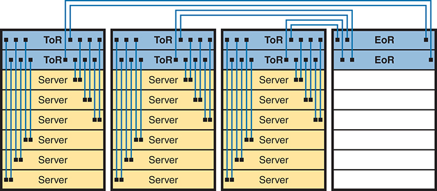

<figcaption>

<aside class="hidden" id="a20fig06">

该图显示了多个被排列成行的服务器架,每个架上都有自己的To R交换机. 通向R Switches:每个机架都包含一个To R交换机,直接连接到同一机架内的服务器. 这些连接由从To R交换机运行到架内每个服务器的垂直行来代表. 服务器:服务器被垂直地堆放在每个架子内,并在各自的架子上与To R交换机相接. E o R Switches:从多个机架起的To R交换机再与位于行尾的E o R开關相接. To R交换机和E o R交换机之间的连接显示为横穿车架上方的横向行.

</aside>

<strong>图20-6</strong> <em>传统数据中心 Rack顶端和Row顶端物理交换机地形学</em>

</figcaption>

</figure>

每个主机往往被电缆到架子上方的两个不同的交换机上,称为"Top of Rack (TOR)交换机",以提供通入局域网的冗余路径. 每个TOR交换机都从设计的角度起到访问层交换机的作用. 每个TOR交换机连接到一个"行尾"(EoR)交换机,这个交换机起到分发交换机的作用并同时连接到网络的其余部分.

设计在<a href="#ch20fig06">图20-6</a>使用传统的数据中心电缆计划。 一些数据中心技术需要不同的地貌,特别是Cisco应用百度基础设施(ACI). ACI将服务器和将硬件切换为架子,但电缆交换机具有不同的地貌——这是ACI织物正常运行所需的地貌.<a href="v2-21.html#ch21">第21章</a>引入ACI概念.

</section>

<section>

<h4 class="h4" id="ch20lev2sec6">虚拟化数据中心的工作流程</h4>

本章第一部分介绍对即将举行的云计算讨论至关重要的背景资料。 服务器虚拟化极大地改善了操作许多数据中心,但仅靠虚拟化并不能创造出云计算环境. 考虑这个通过虚拟化(不是以云为基础的)数据中心的工作流程的例子来查看差异.

一些信息技术工作人员——称为服务器或虚拟化工程师或管理员——订购并安装新的主机(服务器)。 他们收集需求,计划所需容量,购买硬件,订购,并安装硬件. 他们扮演着长期服务器管理员和工程师的角色,但现在他们也与虚拟化工具相配合.

对于该努力的虚拟化部分,虚拟化工程师还安装并自定义了超虚拟化工具以外的虚拟化工具. 例如,一个工具可能会给工程师一个整个数据中心的视图,所有VMs都运行在那里,其想法是,一个数据中心只是运行VMs的很多能力. 服务器/虚拟化工程师在数据中心中添加了新的物理服务器,配置了虚拟化系统来使用新的物理服务器并保证所有功能.

迄今为止,这项工作一直在准备向一些内部客户——一名开发团队成员、业务工作人员等——提供服务。 现在,一个内部客户要求一个“服务器 ” 。 事实上,客户想要许多VMs,每个MM都有对vCPU,RAM等的要求. 客户向虚拟化/服务器工程师提出建立VMs的要求,如下文所示:<a href="#ch20fig07">图20-7</a>.

<figure class="image-c" id="ch20fig07">

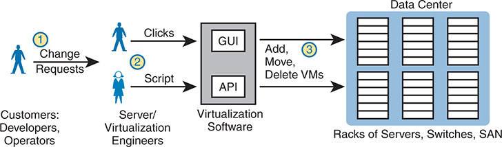

<figcaption>

<aside class="hidden" id="a20fig07">

该图分为几个关键组成部分: 客户:由标签为"客户"的图标代表: 开发者,操作者,他们发起更改请求. 更改请求:这些请求被发送到服务器斜线虚拟化工程师,由标有步骤1的箭头显示. 虚拟化工程师:由另外一组图标代表,他们通过在图形用户接口(GUI)中点击或通过应用程序编程接口(API)来处理更改请求. 这些行动被贴上第2步的标签. 虚拟化软件:虚拟化软件内部的GUI和API接口处理请求,由被标注为"虚拟化软件"的中央框显示. 数据中心:虚拟化软件管理以服务器,交换机,存储域网(S A Ns)等架子为代表的数据中心,并履行添加,移动,或删除虚拟机(V Ms)等任务.

</aside>

<strong>图20-7</strong> <em>传统工作流程:客户(人类)要求虚拟化(人类)服务</em>

</figcaption>

</figure>

该图强调客户提出要求后会发生什么,

台阶.1.IT集团的客户,如开发商或业务工作人员中的一员,需要一些服务,如一套新的VM.

台阶.2.虚拟化/服务器工程师响应客户的要求. 服务器/虚拟化工程师会点击用户接口,或者,如果VMs的数量很大,经常运行一个名为脚本的程序来创建VM.

台阶.3.无论虚拟化工程师是点击还是使用脚本,虚拟化软件都可以再创建出许多新的VM,并在数据中心内部的一些主机上启动.

所显示的过程<a href="#ch20fig07">图20-7</a>工作不错。 然而,提供服务的做法打破了云服务的一些基本标准。 例如,云计算需要自我服务。 自动化软件程序应在步骤2中完成请求,而不是需要一个人类。 想要一些新的VMs 在云中世界? 点击用户接口请求一些新的 VM, 获得一杯咖啡, 您的 VM 将在几分钟内按您的规格设置并启动 。

总结迄今为止制作的虚拟数据中心的一些关键点,该数据中心使云计算成为可能:

<ul class="sq">

<li>
OS与其运行的硬件脱钩,因此OS作为VM/容器,可以在数据中心的任何服务器上运行,拥有足够资源运行VM/集装箱.
</li>

<li>
虚拟化软件可以在数据中心服务器之间自动启动并移动VM/容器.
</li>

<li>
数据中心网络包括每个主机(服务器)内的虚拟交换机和NIC.
</li>

<li>
虚拟化软件可以编程数据中心的网络功能,允许新VM/容器被配置,启动,移动并停止,网络细节会自动改变.
</li>

</ul>

</section>

</section>

<section>

<h3 class="h3" id="ch20lev1sec4">云计算服务</h3>

注意

云服务支持VMs和容器,但本章其余部分主要提及VMs,只是为了避免重复地提及“VMs与容器”。

云计算使用虚拟化的产品和产品是专门为实现云特性而建造的. 然而,云计算不仅仅是一套产品,而是提供信息技术服务的一种方式。 因此,了解云计算是什么——而不是——需要做一点工作;下一节介绍基本情况。

从刚刚完成的关于虚拟化的讨论来看,你已经知道云服务的一个特征:它必须允许消费者提供自助服务. 也就是说,服务的消费者或客户必须能够请求服务并接受服务,而不必拖延等待一个人有时间来工作,考虑请求,做活等.

美国国家标准与技术研究所(NIST)对云计算的定义如下:

<a id="key_283" href="#ref-gloss_236">自助服务</a><strong>:</strong>IT消费者选择何时开始并停止使用该服务,而不与服务供应商进行任何直接互动.

<strong>宽网访问 :</strong>这种服务必须来自许多类型的设备以及许多类型的网络(包括互联网)。

<a id="key_288" href="#ref-gloss_290">资源汇集</a><strong>:</strong>供应商创建了一个资源库(而不是专供特定消费者使用的特定服务器),并动态地从该资源库中为消费者提出的每一项新请求分配资源。

<a id="key_287" href="#ref-gloss_280">快速弹性</a><strong>:</strong>对消费者来说,资源库看起来是无限的(即它迅速扩张,所以叫做:<em>弹性</em>因此,对新服务的要求迅速得到满足。

<strong>计量服务:</strong>供应商可以衡量使用情况,并向消费者报告使用情况,以提高透明度并开具账单。

在完成本章其余部分时,请记住这五条标准清单。 本章后部分参考回放列表.

为了进一步发展这一定义,下几页审视了云宇宙的两个分支——私人云和公云——还进一步解释了NIST定义中的一些要点.

<section>

<h4 class="h4" id="ch20lev2sec7">私有云（本地部署）</h4>

回顾工作流程示例<a href="#ch20fig07">图20-7</a>带有虚拟化数据中心. 现在考虑一下关于云计算的5个NIST标准. 如果你把列表和例子分开<a href="#ch20fig07">图20-7</a>似乎工作流程至少符合这五个NIST云中的某些标准,而且确实如此。 特别是,如本章所描述的,虚拟化数据中心汇集资源,以便进行动态分配。 你可以说一个虚拟化的数据中心是弹性的, 因为资源库会扩张。 但是,这一过程可能不快,因为工作流程需要人力制衡、平衡和时间才能提供新的服务。

私人云在公司内部为内部客户创造了一种服务,符合NIST列表的五项标准. 为了创建出私人云,企业经常会扩展其IT工具(同虚拟化工具一样),改变内部工作流程,增加工具等.

注意

云计算界早就使用这个词了<a id="key_285" href="#ref-gloss_267">私有云</a>和<a id="key_286" href="#ref-gloss_272">公有云</a>。近些年来,你还可能发现一些参考文献,这些参考文献使用不同的术语来表达同样的想法。<em>本地部署</em>含义<em>私有云</em>,以及<em>云</em>含义<em>公有云</em>。注意CCNA200-301考试题目使用较新的一对名词.

作为一些例子,考虑当一个公司的应用程序开发者在开发应用程序时需要VMs时会发生什么. 有私家云,开发者可以请求服务. 相联的VMs在几分钟内自动启动并可供使用,而大多数时间滞后是启动VMs的时间. 如果开发者想要更多的VM,开发者可以假设私有云将拥有足够的容量,同时快速服务新的请求. 所有各方都应知道,信息技术组可以衡量内部计费服务使用情况。

云计算服务通过<a id="key_275" href="#ref-gloss_079">云服务目录</a>。该目录有一个网页,列出通过公司云基础设施提供的所有服务。 有了私人云,信息技术服务的(内部)消费者——开发者、运营商和类似者——可以点击从云服务目录中选择。 如果要求的是一套新的VMs,VMs在几分钟内出现并准备使用,而该步骤没有人类互动,正如步骤2所见。<a href="#ch20fig08">图20-8</a>.

<figure class="image-c" id="ch20fig08">

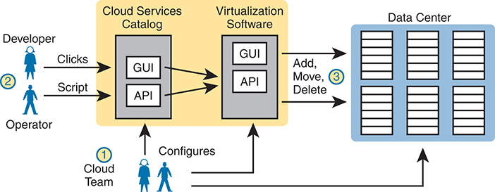

<figcaption>

<aside class="hidden" id="a20fig08">

它涉及该进程的多个组成部分和参与者。 最初,一个云端团队配置了云端服务目录和虚拟化软件. 开发者可以通过点击(使用GUI)或脚本(使用API)与云服务目录交互,类似地,一个操作员可以在虚拟化软件上通过GUI或API执行动作. 虚拟化软件随后会执行在数据中心中添加,移动,或删除虚拟机等操作. 该图显示了云服务目录和虚拟化软件如何沟通和管理V M操作,导致数据中心的变化.

</aside>

<strong>图20-8</strong> <em>创建 One VM 的私人云工作流程</em>

</figcaption>

</figure>

云团队在其虚拟化的数据中心中增加了一些工具和流程来使这个流程发挥作用. 例如,它安装了创建云服务目录的软件,其中既包括用户接口,也包括连接到虚拟化系统API的代码. 服务目录软件可以对消费者的要求作出反应,例如利用虚拟化软件中的API来添加、移动和创建VMs。 此外,由服务器、虚拟化、网络和存储工程师组成的云群侧重于建立资源库、测试和在目录中增加新服务、处理例外情形并观看使用报告,以便他们能够建立随时处理未来请求的能力。

值得注意的是,在云模式下,云团队不再处理关于在此增加10个VMs和50个VM的个别请求,而是处理不同组别提出的更改请求.

总结,以私云为主,由企业拥有并管理云服务. 术语<em>私有云</em>强调使用该服务的公司的所有权。 候补任期<em>本地部署</em>和<em>本地部署的云</em>指公司控制的站点内存在的云服务. 最重要的是,作为云服务而不是内部数据中心,私人云服务符合NIST标准.

</section>

<section>

<h4 class="h4" id="ch20lev2sec8">公有云</h4>

有私相云,云提供商和云消费商是同一家公司的一部分. 在公共云中,情况正好相反:公共云供应商提供服务,向其他公司的消费者出售这些服务。 互联网服务提供商向多家企业出售互联网服务;公有云供应商具有相近的商业模式,将其服务出售给多家企业.

公用云中的工作流程在消费者要求某种服务(如一款新VM)的起步时发生,有点像私用云. 如右侧所示<a href="#ch20fig09">图20-9</a>,第1步,消费者要求从服务目录网页获得新服务. 在第二步,虚拟化工具响应创建服务的请求. 服务一旦启动,就可提供,但运行在一个位于世界其他地方的数据中心,当然不是在企业的数据中心(第3步)。

<figure class="image-c" id="ch20fig09">

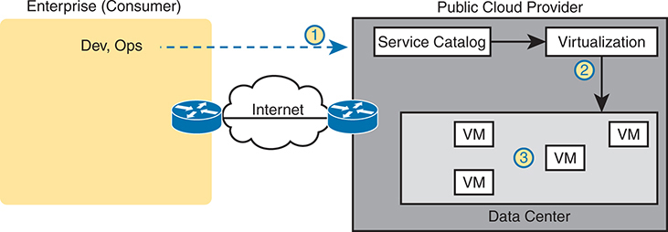

<figcaption>

<aside class="hidden" id="a20fig09">

企业的开发与运营(Dev,Ops)团队通过互联网访问公共云提供商的服务目录. 服务目录接口与虚拟化层相接来管理虚拟机,公共云提供者数据中心中的虚拟化层会创建和管理虚拟机(V Ms).

</aside>

<strong>图20-9</strong> <em>互联网上公共云提供商</em>

</figcaption>

</figure>

公共云服务存在于由云提供者拥有的数据中心中,因此客户需要一定的网络连接到公共云提供者. 云提供商支持多个网络选项. 他们各自连接到互联网,以便消费者网络内的应用程序和用户能够与消费者在云端供应商网络中运行的应用程序进行通信. 然而,广义的网络接入是NIST云计算五项标准之一. 云供应商提供不同的网络选择,包括虚拟私人网络(VPN)和消费者与云之间的私人广域网(WAN)连接.

</section>

<section>

<h4 class="h4" id="ch20lev2sec9">云与“即服务”模型</h4>

那么,你得到什么 与云计算? 到目前为止,本章刚刚展示了一个VM(或容器)作为服务. 在云计算方面,有多种服务,有三种突出表现为当今市场上最常见到的.

在云计算中,服务类别使用以“作为服务”或aS为目的的名称。 云计算提供服务,比物理服务器或软件包更抽象的概念. 因此,该行业在“服务”一词中使用了多种术语。 而每个“aaS”一词都有不同的含义。

这个下个话题解释了最常用的三种云服务:基础设施作为服务,软件作为服务,平台作为服务.

<section>

<h5 class="h5" id="ch20lev3sec1">基础设施即服务</h5>

<a id="key_280" href="#ref-gloss_172">基础设施作为一种服务(Iaas)</a>对大多数人来说,云计算服务可能最简单。 想想看,你什么时候买电脑都行 你考虑过要运行的OS(最新的微软OS,或者Linux,或者macOS,如果购买一个Mac的话). 你根据CPU及其速度来比较价格,计算机拥有多少RAM,磁盘驱动器大小等等.

IaaS提供类似的想法,但消费者得到VM的使用. 您指定要分配给 VM 的硬件性能/ 容量( 虚拟 CPU 数量、 RAM 数量等) , 如<a href="#ch20fig10">图20-10</a>。你甚至可以选择一个OS来使用. 一旦你做出选择, 云提供商就会启动VM, 你甚至可以认为IaaS是一种通用的VM-as-a服务.

注意

在虚拟化和云世界中,开始一个VM经常被称为<em>旋转一个VM</em>或者说<em>正在即兴 VM</em>.

<figure class="image-c" id="ch20fig10">

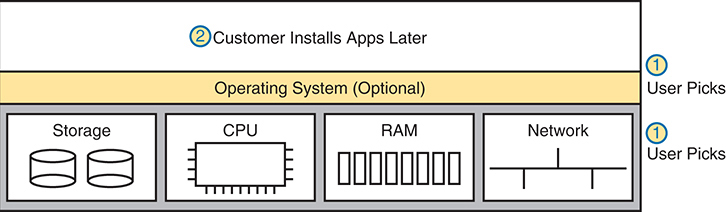

<figcaption>

<aside class="hidden" id="a20fig10">

该图分为多层和多段. 用户首先选择必要的硬件资源,包括存储,CPU,RAM,和Network. 每个组件都由相应的图标来代表. 存储由圆柱符号化存储盘所描绘,CPU由微芯片图标所代表,RAM显示为一系列内存棒,而Network则由网络地貌符号所显示. 在选择硬件资源后,用户可以选择适合其需要的操作系统. 这个层是可选的,表示用户如果偏好,可以带出自己的O S. 最高层表示客户在稍后阶段可以灵活地在选定的基础设施上安装其应用程序,从而可以根据用户要求进行个性化的应用程序设置和部署。

</aside>

<strong>图20-10</strong> <em>IaaS 概念</em>

</figcaption>

</figure>

供应商还向消费者提供VM的细节,这样消费者就可以连接到OS的用户接口,安装更多的软件,并自定义设置. 例如,想象客户想要在服务器上运行一个特定的应用程序. 如果该客户想使用Microsoft Exchange作为电子邮件服务器,客户需要连接到VM并安装Exchanges.

<a href="#ch20fig11">图20-11</a>显示来自 Amazon Web Services(AWS)的网页,这是一个公共云提供商,在此您可以创建一个VM作为其IaaS服务的一部分. 截图显示,用户选择了一个叫“micro”的小型VM。 如果您仔细查看了文本, 您可以读取标题和数字, 可以看到这个特定的VM有 1 vCPU 和 1 GB RAM 。

<figure class="image-c" id="ch20fig11">

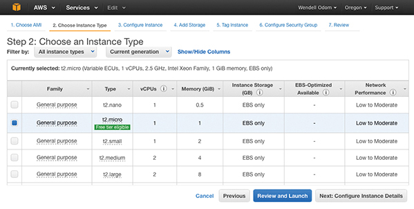

<figcaption>

<aside class="hidden" id="a20fig11">

在"步骤2:选择实例类型"中,截图会捕捉到用户为其V M选择实例类型的步骤. 接口列出了通用家族下的各种实例类型,每个类型都有不同的配置v C P Us(虚拟 C P Us),内存(GiB)和网络性能. 例如t-2点微有1 v CPU,1 GiB内存,EBS只存储,并低到中度的网络性能. t-2点微有1 v CPU,2 GiB内存,而t-2点微有2 v CP Us,4 GiB内存,和t-2点微有2 v CP Us,8GiB内存. 所选实例类型是当代AWS提供品的一部分,确保了最新的性能和特征. 用户可以根据自己的需要过滤和选择实例类型,然后进入下一步:审查和启动V M,配置实例细节,并添加存储.

</aside>

<strong>图20-11</strong> <em>AWS 屏幕截图- 用不同的 CPU/RAM/ OS 设置 VM</em>

</figcaption>

</figure>

</section>

<section>

<h5 class="h5" id="ch20lev3sec2">软件即服务</h5>

使用过<a id="key_289" href="#ref-gloss_321">软件作为服务(SAAS)</a>,消费者可以使用工作软件获得服务. 云提供商可能使用许多VMs和容器来创建服务,但那些却被隐藏在消费者身上. 云提供商许可、安装和支持任何需要软件。 然后由云提供商监测应用程序的性能. 然而,消费者选择使用应用程序,为服务签名,并开始使用应用程序——不需要进一步安装工作。<a href="#ch20fig12">图20-12</a>显示这些主要概念。

<figure class="image-c" id="ch20fig12">

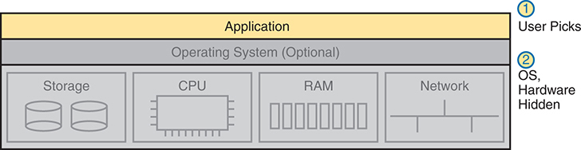

<figcaption>

<aside class="hidden" id="a20fig12">

在这个模型中,应用程序层位于顶端,用户可以直接访问. 操作系统是可选的,一般由服务提供商管理. 在应用程序层下方,代表了基本的物理硬件组件,包括存储器,CPU,RAM,和Network. 这些组件被隐藏在用户身上,用户不直接管理或与硬件或操作系统互动. 图像包括两个被贴上标签的分数,表示用户在不担心基础基础设施的情况下选择和使用应用程序,而操作系统和硬件细节则由服务提供商抽象和管理,为用户提供无缝体验.

</aside>

<strong>图20-12</strong> <em>SaaS概念</em>

</figcaption>

</figure>

你们中许多人可能使用过或至少听说过许多公开的SaaS祭品. 如Apple iCloud,Google Drive,Dropbox,和Box等文件存储服务都是SaaS提供. 大部分在线电子邮件服务在今天可被视为SaaS服务. 另一个例子是,微软提供其Exchange电子邮件服务器软件作为服务,以便您能够获得私人电子邮件服务,但作为服务提供,以及交易所包括的所有其他功能——无需在一些VMs上许可、安装和维护Exchanges软件。

</section>

<section>

<h5 class="h5" id="ch20lev3sec3">（开发）平台即服务</h5>

<a id="key_284" href="#ref-gloss_249">平台作为一个服务(PaaS)</a>是一个开发平台,作为服务预建。 一个PaaS服务在某些方面就像IaaS. 两者都向消费者提供一个或多个VM,配有可配置数量的CPU,RAM等资源.

PaaS和IaaS的关键区别在于,PaaS除了基本的OS外,还包括了更多的软件工具. 在软件开发过程中,这些工具对软件开发者有用。 在生产中运行应用程序的服务器不需要开发工具,因此这些服务器不会使用PaaS服务. 取而代之的是,软件开发者使用PaaS创建系统,在开发时有有用的工具.

" PaaS"的提供包括一套开发工具,每个 " PaaS"的提供有不同的工具组合. PaaS VMs经常包括一个集成开发环境(IDE),一组相关的工具,使开发者能够轻松地写出并测试代码. PaaS VMs包括连续集成工具,允许开发者更新代码并自动测试该代码并将其纳入一个更大的软件项目. 例如Google的App Engine PaaS提供(<a href="https://cloud.google.com/appengine">https://cloud.google.com/appengine</a>), Eclipse 集成开发环境(参见:<a href="http://www.eclipse.org">www.eclipse.org</a>,以及Jenkins连续集成和自动化工具(参见:<a href="https://jenkins.io">https://jenkins.io</a>).

选择一个PaaS服务而不是另一个PaAS服务或一个PaAs解决方案而不是IaaS的主要理由是开发工具的组合. 如果你没有作为开发者的经验,可能很难分辨一个PaaS服务是否更好. 您仍然可以对 PaaS VMs 的大小做出一些选择,类似于 IaaS 设置一些 PaaS 服务时的工具,例如:<a href="#ch20fig13">图20-13</a>,但包含的开发者工具是PaaS服务的关键.

<figure class="image-c" id="ch20fig13">

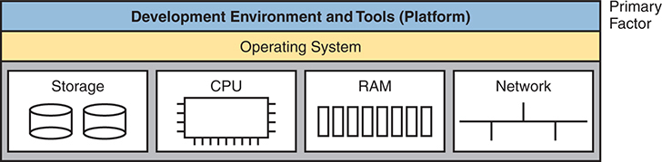

<figcaption>

<aside class="hidden" id="a20fig13">

在这个模型中,开发环境和工具(平台)处于顶端,为开发者提供了构建和部署应用程序的必要工具. 在此下方显示操作系统层,由服务商管理. 在操作系统下方,物理硬件组件被代表,包括存储器,CPU,RAM,和Network. 这些组件也由服务商管理并取自用户. Pa a S的主要重点是为开发者提供强有力的发展环境和工具,使他们能够开发、测试和部署应用程序而无需管理基本的基础设施。

</aside>

<strong>图20-13</strong> <em>PaaS 概念</em>

</figcaption>

</figure>

</section>

</section>

<section>

<h4 class="h4" id="ch20lev2sec10">虚拟路由与转发（VRF）实例</h4>

公共云服务必须同时支持许多客户。 然而,这些不同的客户可能而且经常使用重叠的IP子网。 许多公司内部使用私有 IPv4网络,它们用于私人和公共云VM的子网和容器使用这些子网的地址. 毫不奇怪,这些客户使用重叠的子网和地址。

重叠子网在使用传统常规时会给路由器(或Layer 3 switch)造成问题. 通过一些关键要点开展工作:

<ul class="sq">

<li>
通常情况下,一个路由器有一个IP路由表.
</li>

<li>
通常情况下,路由器只允许一个连接到同一个子网的接口.
</li>

<li>
如果工程师试图将第二个接口连接到同一个子网,路由器将不会使接口向上.
</li>

<li>
数据中心虚拟化软件可以定位并移动VMs并重新编程网络,因此来自多个客户的VMs可以在一个物理服务器上存在——在那个物理服务器内创建了重叠子网的案例.
</li>

</ul>

例如,考虑客户A和B, 其VMs 居住在服务器中。<a href="#ch20fig14">图20-14</a>。顾客使用私人A级网络10.0.0.0,同时使用子网10.1.1.0/24和10.1.2.0/24. 在这个例子中,虚拟交换机只执行图层2切换,没有IP路由. 取而代之的是,它使用四个独立的VLAN,如所显示. 在这一有限范围内,不存在任何问题。

<figure class="image-c" id="ch20fig14">

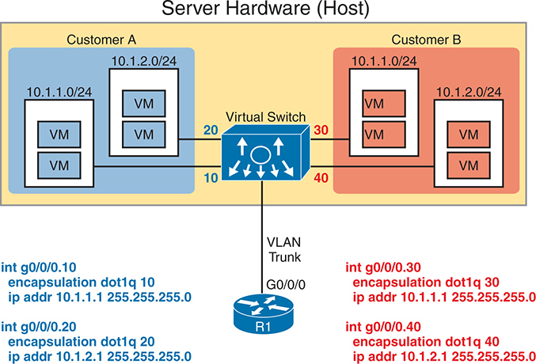

<figcaption>

<aside class="hidden" id="a20fig14">

在左侧,客户A的环境以蓝色为阴影,包含两个子网,10.1.1.0/24和10.1.2.0/24,每个子网托管多个V Ms. 在右侧,客户 B 的环境被用红色遮蔽,也包含子网10.1.1.0/24和10.1.2.0/24,每个子网托管多位V Ms. 两个客户环境都与中央虚拟交换机相接. 虚拟交换机通过VLAN干线接口G0 slash0 slash0连接到被标注为R1的路由器上. VLAN干线对每个子网都有不同的VLANI Ds:为客户A提供10和20;为客户B提供30和40. 路由器接口的配置细节在下方显示,每个VLAN都有特定的I P地址和封装点1q设置. 这个设置说明了来自不同客户的虚拟机在通过VLAN分区维持网络隔离的同时,如何可以在同一物理服务器上并存有相重叠子网.

</aside>

<strong>图20-14</strong> <em>在同一个服务器上与两个客户的VMs重叠子网</em>

</figcaption>

</figure>

接下来,聚焦于主机外的路由器R1. R1需要在图中显示的4个子网中配置接口,以便接收这些VMs的数据;然而相重叠子网混淆了R1. 例如,路由器和虚拟交换机将其链接定义为VLAN中继器. 路由器使用路由器(ROAS)配置,如图所示(见Volume1s).<a href="v2-18.html#ch18">第18章</a>, “<a href="v2-18.html#ch18">局域网中的 IP Routing</a>,”更详细)。 该配置给路由器R1提供了在服务器内显示的所有四个子网中一个IP地址的接口.

然而,一套R1接口将失败。 如果R1要先配置左边的语句,再配置右边的语句的话,IOS就不会在图中右侧提出两个接口,因为该子网暗示了重叠的子网.<strong>ip address</strong>子命令 。

<a id="key_294" href="#ref-gloss_366">虚拟路由和转发(VRF)</a>实例通过扩展路由器内使用的逻辑来解决这个问题。 VRF在单个路由器或Layle 3交换机内创建多个虚拟路由器. 路由器配置将接口和路由协议邻接到VRFs,每VRF有一个单独的路由表. 在这种情况下,路由器R1将创建出两个VRF,每个客户一个. 在ROAS链接上,R1会将VLAN 10和20的接口分配到一个VRF中,将VLAND 30和40的ROAS接口分配到另一个.

通过使用单独的IP路由表/VRF,路由器可以通过将相重叠的子网放入不同的VRF来支持.<a href="#ch20fig15">图20-15</a>扩展<a href="#ch20fig14">图20-14</a>在路由器中添加 VRFs。 它在每个VRF中放入了两个VLAN接口,并显示路由器左右的每VRF路由表. 注意每个路由表中的精确相同的子网,现在使用VRF允许.

你会发现在网络世界中 弗朗索瓦的应用。 例如,MPLS, 详见:<a href="v2-19.html#ch19">第19章</a>, “<a href="v2-19.html#ch19">广域网架构</a>,”使用通用报告格式。 一个MPLS提供商可以支持千名客户使用同一个MPLs网络,甚至那些使用重叠的IP地址,使用VRF. 总结一些关于脆弱区域论坛的要点:

<figure class="image-c" id="ch20fig15">

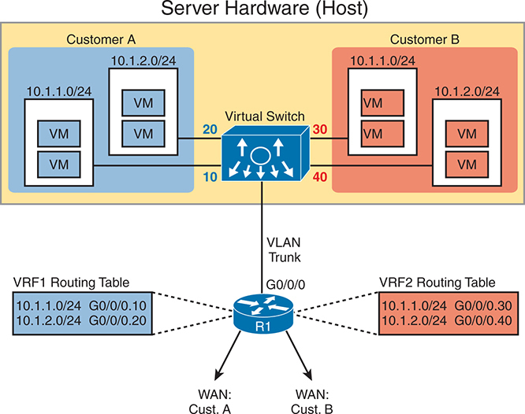

<figcaption>

<aside class="hidden" id="a20fig15">

客户A的环境以蓝色为阴影,包含子网 10.1.1.0/24 和 10.1.2.0/24 带有多相V MS,客户 B 的环境被红色遮蔽,有相同的子网. 两个环境都连接到一个中央虚拟交换机,然后连接到一个路由器,标签为 R 1 通过一个VLAN干线接口G 0 斜线 0 斜线 0 . VLAN干线指定 VLANI Ds 10 和 20 客户A,和 30 和 40 B. 此外,路由器R 1 配置两个单独的 VRF 路由表: VRF 1 A类和VRF类客户 2 为客户 B. 每个VRF路由表列出子网和相应的接口:VRF 1 包括下列路由: 10.1.1.0/24 和 10.1.2.0/24 通过 G 0 斜线 0 斜线 0.10 和G组 0 斜线 0 斜线 0.20 ,而 VRF 则 2 包括同一子网通过G的路由 0 斜线 0 斜线 0.30 和G组 0 斜线 0 斜线 0.40 也描绘了客户A和客户B的WAN连接,显示尽管子网重叠,VRF的设置如何为每个客户提供孤立的路由.

</aside>

<strong>图20-15</strong> <em>在同一个服务器上与两个客户的VMs重叠子网</em>

</figcaption>

</figure>

<ul class="sq">

<li>
VRF必须通过每个执行路由(router或Layle 3 switch)的设备中的配置来创建.
</li>

<li>
每个路由器将为每个VRF有一个单独的IP路由表,每个路由器只持有该VRF的路由.
</li>

<li>
配置将每个接口指定为 VRF , 以便路由器将相关连接的路由放入 VRF的路由表 。
</li>

<li>
每个VRF都有自己的路由协议实例和相关相邻关系. 从这些邻居那里学到的路由在VRF的IP路由表中落地.
</li>

<li>
路由器保留了原来的路由表,叫"环球路由表". 全球路由表持有与任何VRF无关的接口和路由协议邻接相关的路由.
</li>

</ul>

</section>

</section>

<section>

<h3 class="h3" id="ch20lev1sec5">访问云服务的 WAN 流量路径</h3>

本章最后的主要部分侧重于公共云的WAN选项,以及每个选项的利弊. 本节主要忽略了私人云,因为使用私人云——这是企业内部的——比公共云对企业广域网的影响要小得多. 使用公共云服务时,网络工程师必须考虑如何最好地建立网络。

<section>

<h4 class="h4" id="ch20lev2sec11">企业 WAN 到公有云的连接</h4>

利用互联网进行企业与公共云提供商的交流,既方便又方便. 但是,它也有一些负数。 第一节叙述基本情况并指出问题,这导致某些原因,说明为什么可能倾向于使用其他广域网连接。

<section>

<h5 class="h5" id="ch20lev3sec4">通过互联网访问公有云服务</h5>

将内部应用程序移动到公共云后考虑一个通用工作流程,如:<a href="#ch20fig16">图20-16</a>,同时使用互联网进行连通. 云提供商的服务目录可以由企业人员通过互联网获取,如步骤1所显示. 在得到所希望的服务之后——例如,选择了IaS服务的一些VMs,云提供方(步骤2)即时将VMs. 因此,VMS并没有显示为图中的一步,而是被定制来运行原先在企业数据中心运行的应用程序.

<figure class="image-c" id="ch20fig16">

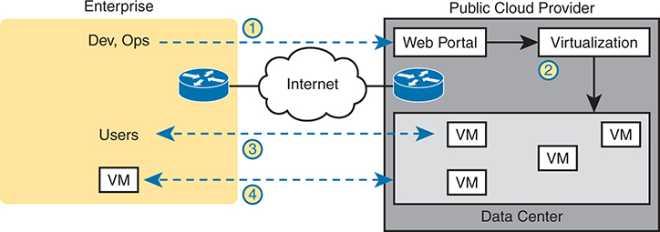

<figcaption>

<aside class="hidden" id="a20fig16">

该图主要分为两部分:左侧为企业号,右侧为公共云提供站,互联网在两者之间. 在企业方面,开发(Dev),业务(Ops),用户向公共云服务发起请求. 企业网络包括连接到互联网的路由器. 在公共云提供方方面,提供了一个管理虚拟机器(V Ms)的网络门户。 网络门户与管理数据中心V Ms的虚拟化基础设施相接. 这一进程涉及若干步骤。 企业Dev,Ops,以及用户通过互联网访问网络门户. 网站门户与虚拟化基础设施互动,管理V M. 企业内的用户通过互联网访问V Ms,数据中心内的V Ms响应用户的要求. 该图使用标准网络符号和方向箭头来描绘企业与公共云提供者之间的数据流动和互动.

</aside>

<strong>图20-16</strong> <em>利用互联网获取公共云服务</em>

</figcaption>

</figure>

随着应用程序在云中运行,企业用户需要访问. 第3步显示用户与应用程序沟通,但与网络流量相通. 此外,许多应用软件向其他应用软件发送数据——其中一些软件可能仍然留在企业(如步骤4所示)。 例如,您可以在内部服务器上使用认证服务 。 因此,在步骤4中,在云中托管的VMs与企业内部托管的V Ms之间的任何应用通信也必须发生.

</section>

<section>

<h5 class="h5" id="ch20lev3sec5">通过互联网连接公有云的优缺点</h5>

利用互联网从企业到公示云的连接有几个优点. 每个企业和公共云提供商已经连接到互联网上. 因此,使用互联网连接极大地加快了向公共云的迁移. 以下列表总结了使用互联网作为公共云服务WAN连接的一些好理由:

<strong>敏捷度 :</strong>企业可以开始使用公用云,而无需等待订购与云供应商的私人WAN连接,因为云供应商支持互联网连接.

<strong>移徙:</strong>企业可以更容易地将其工作量从一个云供应商转移到另一个云供应商,因为云供应商都连接到互联网上。

<strong>远程工作 :</strong>远程工人已经使用互联网,因此访问通过互联网提供的SaaS应用程序效果良好。

虽然使用互联网进行公用云具有一定的优点,但也有一些负面因素,包括以下几点:

<strong>警卫:</strong>互联网不如私人广域网连接安全,因为“中间的人”可以试图读取从公共云中传递的数据内容。

<strong>能力:</strong>将内部应用程序移入公共云会增加网络流量,所以考虑企业的互联网链接是否能够处理额外负荷.

<strong>服务质量:</strong>互联网不提供QoS,而私人广域网可以提供. 使用因特网可能导致用户体验比预期的要差,因为延误(时间长)、抖动和包丢失。

<strong>没有WAN SLA:</strong>ISP一般不会为广域网的性能和网络的所有目的地提供服务级协议(SLA)。 私营广域网服务提供商更有可能提供性能和可用性服务。

这份关注清单并不意味着企业不能使用互联网获取其公共云服务. 这确实意味着,它应该考虑每个广域选择的利弊。

</section>

<section>

<h5 class="h5" id="ch20lev3sec6">通过私有 WAN 和互联网 VPN 访问公有云</h5>

NIST对云计算的定义将广泛的网络访问列为五项主要标准之一. 就公共云而言,这往往意味着支持各种广域网连接,包括最常见的企业广域网技术。 基本上,一个企业可以用本书所讨论到的WAN技术与公共云提供商相接.<a href="#ch20fig17">图20-17</a>分为两大类.

<figure class="image-c" id="ch20fig17">

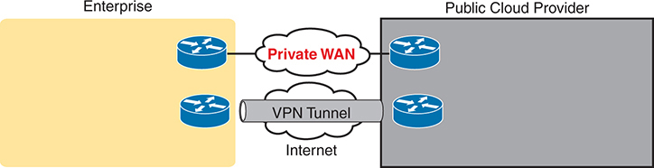

<figcaption>

<aside class="hidden" id="a20fig17">

该图主要分为两部分:左侧的"企业"和右侧的"公共云提供商",两者之间有两类连接. 在企业方面,网络包括路由器,通过互联网连接到私有的WAN和VPN隧道. 在公共云提供方方面,网络还包括连接到私有WAN和VPN隧道的路由器. 贴有专用连接标签的Private WAN为企业和云供应商提供了安全和可靠的通信,确保更好的安全、Q o S、能力和报告。 互联网上的替代连接,使用VPN隧道,可提供安全接入,但可能不会提供与私人广域网相同的服务水平.

</aside>

<strong>图20-17</strong> <em>使用私人广域网到公共云:安全、QoS、能力、报告</em>

</figcaption>

</figure>

要在企业和云提供商之间创建VPN隧道,请使用在其中讨论过的相同的VPN特征.<a href="v2-19.html#ch19">第19章</a>在本卷中。 云提供商可以提供VPN服务,由云提供商执行隧道一端,客户执行另一端. 或者企业可以在云端提供者的网络内使用自己的路由器——一个虚拟路由器作为VM运行——并在该路由器上配置VPN服务. Cisco使"云服务"路由器(CSR)完全做到这一点:成为路由器,但在云服务中作为VM运行的路由器由云消费者所控制,来完成由路由器完成的各种功能,包括终止VPN.

注意

思科引入了Catoryst 8000v Edge Software,或简单的Catority 8000v,作为CSR的替代. 截至出版日期,公司社会责任仍然备有。

要制作一个私人多Protocol标签切换(MPLS)VPN或以太网WAN连接,企业必须与云和WAN供应商合作. 由于云提供商与许多拥有私人WAN连接的客户相接,因此它们经常有一套被公布的指令来遵循. 当一个客户使用 MPLS 连接时, MPLs 提供商在客户和云提供商之间创建了 MPL S VPN. 同样的基本过程发生在以太网WAN服务上,公共WAN和企业之间创建了一个或多个以太网虚拟连接(EVC).

注意

通常,服务器/虚拟化工程师会根据其他因素来决定WAN连接需要支持第2层还是第3层连接.

私人WAN连接也需要一些实际规划. 每个较大的公共云供应商都拥有分布在地球各地的几个大型数据中心,并在主要的广域网服务中预建了连接点来帮助建立私人广域网连接给客户. 企业可以看看云提供商的文件和工作与提供商选择安装私人WAN连接的最佳地点. (这些较大的公共云公司包括亚马逊网络服务公司、谷歌计算云公司、微软Azure公司和Rackspace公司,

</section>

<section>

<h5 class="h5" id="ch20lev3sec7">通过私有 WAN 连接云的优缺点</h5>

私人广域网克服了使用互联网而不使用VPN的一些问题,因此通过这些问题开展工作,考虑一些不同的WAN选项.

首先,考虑到安全问题,所有的私人选择,包括在现有互联网连接中增加一个VPN,大大地改进了安全。 一个网络VPN会加密数据,以保持其隐私. 私人与MPLS和以太网的WAN连接传统上被认为是安全的,没有加密. 尽管如此,公司有时会加密通过私人WAN连接发送的数据,使网络更加安全.

关于QoS,使用Internet VPN解决方案仍然无法提供QoS因为Internet不提供Qo S. MPLS VPN和以太网WANs等WAN服务可以. 私人广域网供应商在通过服务商的网络时,可对流量应用QoS工具.

最后,关于能力问题,存在着对各类广域网规划网络能力的关切。 将一个应用程序从内部数据中心转移到公共云提供商需要额外的思考和规划.

使用私人广域网存在一些负数,如你所想。 安装新的私人WAN连接需要时间,当公司开始云计算时会推迟. 私人广域网的费用通常比使用互联网要高。 如果一家公司使用与一云提供商的WAN连接,迁移到一新云提供商可能需要再进行一轮私人WAN安装,这再次延误了工作项目. 使用互联网(不论有无VPN)将使这种移徙更加容易,但下一节显示出一个强有力的折衷解决办法。

</section>

<section>

<h5 class="h5" id="ch20lev3sec8">云间交换中心</h5>

公共云计算还引入了全新的竞争水平,因为云消费者可以将自己的工作量从一个云提供者转移到另一个云提供者. 由于超出本书范围的原因,转移工作量需要一些努力。 (只需说大多数云提供者在实施服务的方式上有所不同即可. ) 但企业可以将工作量从一个云提供者转移到另一个云提供者,原因很多,包括寻找一个更便宜的云提供者.

现在,再次专注于网络连接。 在云中使用一个私人的WAN会增加设置的时间和费用. 然而,间云交换(或只是间云交换)会缩短您迁移云提供者的时间.

术语<em>云间交换</em>是指任何创建私人网络作为服务的公司. 首先,一个相通云交换连接到一面的多云提供方. 另一边是相通云与云消费者相接.<a href="#ch20fig18">图20-18</a>显示这个想法。

<figure class="image-c" id="ch20fig18">

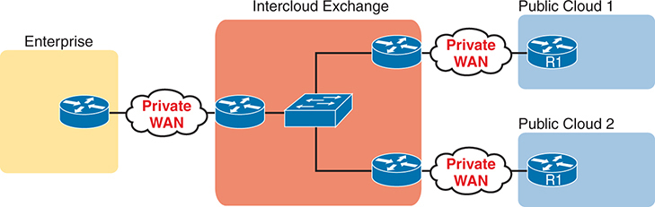

<figcaption>

<aside class="hidden" id="a20fig18">

在左边,一个企业网络通过一个私人的WAN连接到一个Intercloud Exchange,以红色背景描绘在画面的中央. Intercloud Exchange连接了两个公共云,即公共云1和公云2,位于右侧. 企业网络与一款私人WAN云相接,而后者又与Intercloud Exchange相接. Intercloud Exchange显示为连接到各种路由器的交换机,方便了企业与公云的交流. 公共云一号与公共云二号各有各自的路由器,通过私人WAN连接连接到Intercloud Exchange.

</aside>

<strong>图20-18</strong> <em>永久私有WAN 连接到一个相网交换器</em>

</figcaption>

</figure>

通过连接所有云提供商和云客户端的接入链接,云际交换可以配置一个与特定云提供商站点的私人WAN连接. 后来,如果消费者想迁移到使用不同的云提供商,消费者保留着相同的私人WAN链接. 该消费者只需要要求 间云交换 重组 以建立新的私人广域网连接 到新的云提供商。

至于利弊,通过相通云交换,在连接私人WAN连接到公云时获得同样的好处,但附加了方便迁移到新云提供者的通路. 主要的弊端是,使用一团相通的交换会引入了另一家公司.

</section>

<section>

<h5 class="h5" id="ch20lev3sec9">公有云 WAN 连接方案的优缺点小结</h5>

<a href="#ch20tab02">表20-2</a>总结了部分这些用于云计算、研究和参考的公共广域网选项的关键利弊。

<figure class="table" id="ch20tab02" tabindex="0">

<figcaption>

<strong>表20-2</strong>公共云WAN选项比较

</figcaption>

<table class="all">

<tbody>

<tr>

<th class="th">

</th>

<th class="th">
互联网
</th>

<th class="th">
互联网 VPN
</th>

<th class="th">
MPLS VPN
</th>

<th class="th">
以太网广域网
</th>

<th class="th">
云间交换
</th>

</tr>

<tr>

<td class="border">
保护数据私密性
</td>

<td class="border">
否
</td>

<td class="border">
是
</td>

<td class="border">
是
</td>

<td class="border">
是
</td>

<td class="border">
是
</td>

</tr>

<tr>

<td class="border">
支持 QoS
</td>

<td class="border">
否
</td>

<td class="border">
否
</td>

<td class="border">
是
</td>

<td class="border">
是
</td>

<td class="border">
是
</td>

</tr>

<tr>

<td class="border">
需要容量规划
</td>

<td class="border">
是
</td>

<td class="border">
是
</td>

<td class="border">
是
</td>

<td class="border">
是
</td>

<td class="border">
是
</td>

</tr>

<tr>

<td class="border">
方便向新提供者迁移
</td>

<td class="border">
是
</td>

<td class="border">
是
</td>

<td class="border">
否
</td>

<td class="border">
否
</td>

<td class="border">
是
</td>

</tr>

<tr>

<td class="border">
加快初始部署
</td>

<td class="border">
是
</td>

<td class="border">
是
</td>

<td class="border">
否
</td>

<td class="border">
否
</td>

<td class="border">
否
</td>

</tr>

</tbody>

</table>

</figure>

</section>

</section>

</section>

<section>

<h3 class="h3" id="ch20lev1sec6">理解云管理</h3>

<a id="key_274" href="#ref-gloss_078">云管理</a>是管理您基于云或主机的基础设施的通俗方法。 云管理有多种方法. 思科最近将其添加到CCNA蓝图中,本节涵盖了从云面角度管理思科设备时最常用的几种方法. 最常见的方法并不是不熟悉你已经学到的东西,而是利用虚拟设备的操纵器能力登录到CLI,并发布命令,如果设备是物理设备的话。 在这种使用情况下,一个控制台或串口被映射到虚拟设备上,而你只是将telnet或SSH映射到将直接放入CLI的虚拟设备的IP上.从这里起,你只需发布任何 CLI 配置命令来配置以云为基础的设备.

或者,有两种方法需要在超显像器环境中有一些经验,如VMware ESXi,Microsoft Hyper-V,Citrix XenServer,或KVM. 使用<a id="key_273" href="#ref-gloss_069">Cisco 催化器 8000V</a>以路由器为例,当路由器VM首次升起后,默认情况下,您有5秒的时间来选择您想要使用的控制台选项.

注意

Cisco 8000V是Cisco虚拟路由器家族的最新版本. 此前曾有Cisco CSR1000v,其部署方式相近,但现为"倒卖".

一个超透视器选项叫做:<em>虚拟控制台</em>,它使您可以在超视线图形界面中点击虚拟机,并以此方式访问CLI。 这又被称作"超卫视虚拟VGA控制台". 它类似于一个以VM运行的虚拟服务器如何被访问. 默认情况下,这是Cisco 8000V路由器 VM 靴子进入的方法.

Cisco 8000V的另一个超显像器选项叫做:<em>串行控制台</em>。串行控制台选项映射到Cisco 8000V路由器VM上的串行端口. 这使得您可以使用 telnet 访问您在配置序列控制台选项时指定的特定端口号 。 以下为 VM 和 UNIX x Term 终端的 telnet 语法 :

<a href="#code-f0461-01" id="f0461-01a">点击此处查看代码原图</a>

<pre class="pre" tabindex="0"><code>VM: <strong>telnet://</strong><em>host-ipaddress</em>:<em>portnumber</em>

From a UNIX xTerm terminal: <strong>telnet</strong> <em>host-ipaddress portnumber</em></code></pre>

注意

Telnet在使用串行控制台时仅用于初始配置Cisco 8000V路由器VM. 在设备被充分配置后,强烈建议让SSH能够确保增强安全和隐私,因为temnet在其通信中使用了清晰的文本数据.

此外,重要的是要了解云管理相对于一个接一个地管理设备的传统方法的好处。 以下清单突出了使用云管理及其相关定义的一些关键优点:

<ul class="sq">

<li>
<strong>集中管理:</strong>提供对网络设备和服务的集中控制和能见度。 这使得使用多台设备在不同地点管理分布式网络变得更加容易.
</li>

<li>
<strong>无障碍性:</strong>设备可通过互联网连接从世界任何地方访问。 这使网络基础设施具有远程管理能力。 这与远程网络业务工作人员特别相关。
</li>

<li>
<strong>缩放 :</strong>环境可以扩大和缩小规模,从小部署到非常大,并且能够非常快地做到这一点,而不会对存储、计算和带宽等资源造成限制。 这就是“云弹性”所指的。
</li>

<li>
<strong>自动化 :</strong>云管理平台通常包括自动化能力,可以精简配置管理,提供,故障排除等重复性任务. 这减少了网络管理的人工交互,提高了操作效率,并降低了人为出错的风险.
</li>

<li>
<strong>警卫:</strong>云管理平台一般包括内置安全机制来保护网络数据和基础设施免受网络威胁. 基于角色的访问控制、加密和安全监测是最常见的特征之一。
</li>

<li>
<strong>所有权成本降低:</strong>以云为基础的基础设施可以消除对一些基于地皮的硬件和软件的需求,这有可能减少与管理基于地皮网络基础设施有关的资本支出、支持和业务费用。
</li>

</ul>

思科还提供了一种云管理解决方案,叫做<em>玛拉基</em>。梅拉基为现场设备提供了完全以云为基础的管理. 前面提到的云管理的所有主要优点和好处也适用于梅拉基. 管理Meraki设备的基于云的中央门户网站称为<a id="key_281" href="#ref-gloss_207">玛拉基板</a>。Meraki Dashboard提供了您整个Meraki网络的信息和直觉,以及所有管理设备的当前和历史状况。 以下是梅拉基·达什板的一些优点:

<ul class="sq">

<li>
<a id="key_296" href="#ref-gloss_384">零接触部署（ZTP）</a><strong>:</strong>您可以在远程地点创建预定义位置并安装设备,它们会通过下载其适当的软件图像和配置来与梅拉基Dashboard核对并进行即时处理,而不需要现场专家来配置这些设备。 由于旅行费用降低,并降低了设备配置不当的风险,从而节省了大笔费用。
</li>

<li>
<strong>地貌学:</strong>这是网络的活地地貌视图,以及设备如何相互连接. 这是一个非常好的方法 来看待你环境中的连接 以及它是如何表现的。 地理学视图可以被分层刻出来来查看网络的某些方面,更注重你感兴趣的检查设备.
</li>

<li>
<strong>路径可视化 :</strong>允许进行视觉网络流量监测. 这包括设备路径和方向交通流量,可以在仪表板上看到.
</li>

<li>
<strong>单击入设备:</strong>允许您看到性能和管理选项。
</li>

<li>
<strong>颜色编码运行状态 :</strong>简化了监测,可以快速地对网络状态进行查看.
</li>

</ul>

<a href="#ch20fig19">图20-19</a>显示登录 Meraki Dashboard 时的默认客户端页面视图。 可以看到,有大量信息是可以获得的,没有点击或钻入任何其他页面或链接。 从页面上方看,我们可以看到有些平板显示Uplinks,WAN Appliances,Switches,和Access Points的状态. 全都是绿色的,在网上显示。 从这里可以更下看,看看客户端的用法图和派图,这些图和派图表突出带宽的用法和网络内运行的应用程序的细节.

<figure class="image-c" id="ch20fig19">

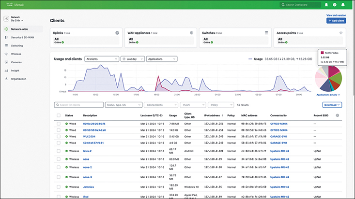

<figcaption>

<aside class="hidden" id="a20fig19">

仪表板上部显示各种网络设备,包括交换机、WAN电器和接入点及其状态。 中间部分以图示方式说明随着时间的推移的网络使用情况,显示客户数量和数据使用情况。 下一节列出有关连通客户的详细信息,包括他们的描述,最后一次看到的时间,操作系统,I P地址,MAC地址,以及使用统计等. 这种观点全面概括了网络的性能,客户端活动,以及设备状况,使网络管理员能够有效地监测和管理他们的梅拉基网络.

</aside>

<strong>图20-19</strong> <em>Meraki Dashboard的默认视图</em>

</figcaption>

</figure>

此视图的有用之处在于, 您可以在图表或派图上徘徊鼠标, 以显示更多信息, 而不会偏离此默认视图 。 例如,您可以看到在最后一天有3.32GB的Netflix-Video流量在网络上运行,同时还有相应的上传和下载统计数据.

移动到屏幕的下方部分,可以看到一些非常有帮助的信息,例如设备状态,描述,当设备在网络上最后一次被看到时,客户端使用,客户端操作系统,IP地址,政策,MAC地址,上行链接信息,以及最新的SSID. 从进入仪表板上可以获取的信息数量非常之多。 此外,还可以通过点击齿轮和选择其他数据点来选择其它许多值来在这个屏幕上查看. 在许多传统网络中,你必须独立登录<a id="key_282" href="#ref-gloss_224">网络管理系统(NMS)</a>或网络中的多设备,以获取您可以在 Meraki Dashboard 内访问的数据量。 这是集中云管理的主要效益之一.

从排除故障的角度来看,"地貌"和"路径可视化"是梅拉基内部一些最便捷的工具. 看看这个样本网络,你可以看到一些有趣的信息,只需点击仪表板内的地形学视图即可. 您也可以看到,当您在设备上徘徊或者与您鼠标的链接时,您可以得到关于每个组件的更详细信息. 实例如下:<a href="#ch20fig20">图20-20</a>,您可以看到,GARAGE-SW1设备存在问题,并且Port 3上存在大量CRC出错. 此示例显示 Letle 2 链接层, 尽管您可以看到 Letle 3 网络信息也可用 。

<figure class="image-c" id="ch20fig20">

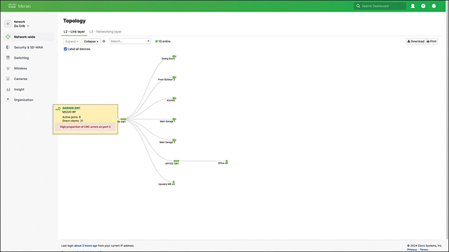

<figcaption>

<aside class="hidden" id="a20fig20">

接口呈现出网络设备及其连接的图形化表现. 中央设备,可能是网络交换机或路由器,在地貌中心显示有各种设备与之相接,每个设备由显示其状态的图标来代表,绿色用于在线. 一个被突出显示的设备显示一个工具提示,其细节包括设备名称,S W 84,它的 I P 地址,192.168.128.7,型号,M S 120破折号8L P,以及连接细节,端口上CRC出错的比例高1. 左手菜单包括全网络,安全及S D switch WAN,Switch,Wireless,Insight,和组织等选项,通过梅拉基Dashboard的不同部分提供导航.

</aside>

<strong>图20-20</strong> <em>梅拉基地盘的地理学视图</em>

</figcaption>

</figure>

使用云管理法相对于传统方法有许多优点,在本章的这一节中都涵盖。<a href="#ch20tab03">表20-3</a>总结和比较了两者之间一些最常见的差异。

<figure class="table" id="ch20tab03" tabindex="0">

<figcaption>

<strong>表20-3</strong>比较云管理和传统管理

</figcaption>

<table class="all">

<thead>

<tr>

<th class="th">
使用场景
</th>

<th class="th">
云管理
</th>

<th class="th">
传统管理
</th>

</tr>

</thead>

<tbody>

<tr>

<td class="border">
集中式设备管理
</td>

<td class="border">
通常,所有设备的单一管理点
</td>

<td class="border">
除非使用第三方NMS或工具,设备通常单独管理
</td>

</tr>

<tr>

<td class="border">
部署规模和速度
</td>

<td class="border">
零接触部署（ZTP）
</td>

<td class="border">
通过脚本或第三方工具进行手工或自动提供
</td>

</tr>

<tr>

<td class="border">
安全策略及实施
</td>

<td class="border">
安保政策可在单一中央仪表板内适用于多个装置
</td>

<td class="border">
除非使用第三方工具或自动化,否则通常必须逐一适用安全政策
</td>

</tr>

<tr>

<td class="border">
故障排查
</td>

<td class="border">
集中管理使解决问题更加有效,因为能够用一个仪表板看到整个网络
</td>

<td class="border">
通常,在逐个装置的基础上进行故障排除比较困难和费时。
</td>

</tr>

<tr>

<td class="border">
监测和报告
</td>

<td class="border">
云管理使您能够集中监视您的网络,查看并报告所有设备的问题
</td>

<td class="border">
传统网络使用第三方工具监测或报告设备,这可能要求您将数据联系起来
</td>

</tr>

</tbody>

</table>

</figure>

</section>

</section>

<section class="ccna-source ccna-appendix" aria-label="答案解析与术语表">
<section data-epub-type="chapter">

<h2 class="h2" id="ref-appc">附录C</h2>

<h2 class="h2a">对“我早就知道了吗?” 的回答。</h2>

<section>

<h3 class="h3" id="ref-appclev1sec20">第20章</h3>

<strong><a id="ref-ques20_1" href="#quess20_1">1</a>。</strong> A、B 和 E。虚拟机监控器会虚拟化每台 VM 的 RAM、CPU、网卡和存储。虚拟机监控器自身并未被虚拟化，而是负责虚拟化其他资源。此外，作为虚拟机，VM 本身不使用电源，因此系统没有虚拟电源这一概念。

<strong><a id="ref-ques20_2" href="#quess20_2">2</a>。</strong> D。虚拟机监控器在 VM 与物理网卡之间创建相当于以太网交换和布线的虚拟连接。VM 使用虚拟网卡（vNIC）。虚拟机监控器使用虚拟交换机（vSwitch），其中包含 vSwitch 端口与每台 VM 的 vNIC 之间的链路。vSwitch 还连接两块物理网卡。交换机配置根据需要创建 VLAN 和中继链路。

<strong><a id="ref-ques20_3" href="#quess20_3">3</a>。</strong> B。平台即服务（PaaS）提供一台或多台虚拟机（VM），其中安装了可运行的操作系统（OS）以及一组预定义的软件开发工具。

对于错误选项，软件即服务（SaaS）提供预定义的软件应用程序，但通常不允许以后安装自己的应用程序。基础设施即服务（IaaS）提供一台或多台可运行的 VM，可以选择是否预装 OS。它可以用于软件开发，但开发者必须自行安装各种开发工具，因此在开发方面不如 PaaS 方便。最后，云服务还提供服务器负载均衡即服务（SLBaaS），但它并非让客户访问 VM 并安装自己应用程序的通用服务。

<strong><a id="ref-ques20_4" href="#quess20_4">4</a>。</strong> A。基础设施即服务（IaaS）提供一台或多台可运行的虚拟机（VM），可以选择预装 OS。用户可以安装自己的应用程序来定制这些系统。

软件即服务（SaaS）提供预定义的软件应用程序，但通常不允许以后安装自己的应用程序。平台即服务（PaaS）确实提供一台或多台 VM，因此允许安装自己的应用程序。不过，PaaS 充当软件开发环境，其 VM 包含多种实用的软件开发工具。最后，云服务还提供服务器负载均衡即服务（SLBaaS），但它并非让客户访问 VM 并安装自己应用程序的通用服务。

<strong><a id="ref-ques20_5" href="#quess20_5">5</a>。</strong> A。两种互联网方案都更便于迁移，因为公有云提供商通常允许通过互联网轻松访问。云间交换是专门构建的 WAN 服务，用于连接企业和多数公有云提供商，使迁移过程更容易管理。

唯一正确的选项，也就是最容易造成迁移困难的方案，是使用连接某一家云提供商的私有 WAN。虽然这种方案有其他优点，但迁移时必须新建一条连接新云提供商的私有 WAN 链路。

<strong><a id="ref-ques20_6" href="#quess20_6">6</a>。</strong> A 和 C。私有 WAN 方案采用以太网 WAN 和 MPLS 等技术，既能保持数据私密性，又包含 QoS 服务。云间交换是一种专门构建的 WAN 服务，使用同类私有 WAN 技术连接企业和多数公有云提供商，因此具有相同的优点。

两个错误选项都使用互联网，因此都无法提供 QoS 服务。其中，互联网 VPN 方案会对数据加密，以保护数据私密性。

</section>

</section>

<section id="ref-glossary"><h2 class="h2a">词汇表</h2>
<strong>思科催化器8000V</strong>一个为云和虚拟化环境而设计的虚拟路由器平台,提供高性能,可伸缩,并具有弹性和敏捷性的安全路由能力.

<strong>云管理</strong>参与管理、监测和优化云资源和服务,以确保整个云环境的高效利用、绩效、安全和合规。

<strong>云服务目录</strong>云计算服务可提供服务列表.

<strong>容器</strong>运行应用程序的一个实例是从容器图像开始的,由服务器上的容器引擎控制。

<strong>容器图像</strong>一个文件持有并嵌入了所有与应用程序相关的文件:所有相关可执行文件,需要的软件库,以及操作环境变量等其它文件. 然后,集装箱虚拟化系统允许将应用程序作为一个单一文件处理,用于集装箱的移动、起动、停放和监测。

<strong>主机( 缩写: DC)</strong>在一个虚拟化的服务器环境中,这个术语用来指一个正在运行超虚拟机以创建多台虚拟机的物理服务器.

<strong>虚拟机监控器</strong>在服务器硬件上运行的软件主要通过将CPU核心/线程,RAM,磁盘等服务器硬件组件分配到服务器运行的VMs来创建虚拟化服务器环境的基础.

<strong>基础设施作为一种服务(laaS)</strong>云服务,服务由定义了计算资源(CPU,RAM,磁盘和网络)的虚拟机所组成,可能提供也可能不提供已安装的OS.

<strong>玛拉基板</strong>一个集中式以云为基础的管理平台,提供对梅拉基网络设备的直观控制和监测,提供精简配置,实时分析,无缝网络管理.

<strong>网络管理系统(NMS)</strong>一个软件平台,能够对网络基础设施和设备进行集中监测、配置和管理,以确保最佳性能、安全和可靠性。

<strong>自助服务</strong>NIST所定义的云计算服务的五个关键属性之一,指服务器的消费者可以请求服务,而服务是在没有任何重大延迟,也不等待人类干预的情况下创建的.

<strong>平台作为一个服务(PaaS)</strong>一个以软件开发者为开发平台的云服务,拥有各种工具,对已经安装的开发者有用,以便开发者可以专注于开发软件,而不是创造出良好的开发环境.

<strong>私有云</strong>云计算服务,公司向同一公司内部客户提供自己的信息技术服务,但采用被定义为云计算的做法。

<strong>公有云</strong>云计算服务中云提供商与云消费商是不同的公司.

<strong>快速弹性</strong>NIST所定义的云计算服务的五个关键属性之一,指云服务对新服务的请求反应迅速,并扩展(有弹性)到看起来是无限资源.

<strong>资源集成</strong>NIST所定义的云计算服务五个关键属性之一,指云提供者将其资源视为一个大组(集合)资源,其云管理系统随后根据客户的自助请求动态地分配.

<strong>软件作为服务(SAAS)</strong>一种云服务,服务包括访问工作软件,不需要担心安装和维护软件或运行于它的服务器的细节.

<strong>统一计算系统(UCS)</strong>其服务器硬件产品的Cisco品牌名.

<strong>虚拟 CPU (vCPU)</strong>在虚拟化的服务器环境中,由超显相器分配给虚拟机(VM)的CPU(处理器)核心或线程.

<strong>虚拟机</strong>操作系统的一个实例,运行在服务器硬件上,使用超显相器将服务器硬件的子集(CPU,RAM,磁盘和网络)分配给了该VM.

<strong>虚拟 NIC (vNIC)</strong>在一个虚拟化的服务器环境中,虚拟机使用的网络接口卡(NIC),然后连接到在同一主机上运行的一些虚拟交换机(vSwitch),这反过来又连接到主机上的一个物理的NIC.

<strong>虚拟路由和转发(VRF)</strong>虚拟路由和转发实例。 路由器和Letle 3交换机的一个特征,它通过指定特定VRF的接口和路由协议邻接,使一个路由器起到多路由器的作用,相关路由会降落在相关的VRF-唯一路由表上.

<strong>虚拟交换机( vSwitch)</strong>在一个主机内部(一个硬件服务器)有一个仅软件的虚拟交换机,为该主机运行的虚拟机提供切换功能.

<strong>零接触部署（ZTP）</strong>一个自动化的部署程序,能够进行远程配置和设置网络设备而无需人工干预,从而能够进行规模的无缝高效的网络部署.

</section>
</section>

<section class="ccna-source ccna-appendix" aria-label="代码原图">
<section data-epub-type="chapter">

<a href="#f0461-01a" id="code-f0461-01">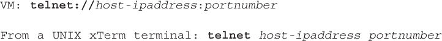</a>

</section>

</section>


<nav class="ccna-chapter-nav" aria-label="章节导航"><a href="v2-19.html">← 上一章</a><a href="v2-21.html">下一章 →</a></nav>
