
<a href="{{ '/subjects/CCNA/' | relative_url }}">← 返回 CCNA 目录</a>

第二卷 · 网络自动化

<nav class="ccna-chapter-nav" aria-label="章节导航"><a href="v2-20.html">← 上一章</a><a href="v2-22.html">下一章 →</a></nav>



<section data-epub-type="chapter">

<h2 class="h2" id="ch21">第 21 章</h2>

<h2 class="h2a">基于控制器的网络简介</h2>

本章涵盖以下考试主题：

1.0 网络基础

1.1 解释网络组件的作用和功能

1.1.f 终端

1.1.g 服务器

1.2 描述网络拓扑架构的特征

1.2.c 脊叶架构

6.0 自动化和可编程性

6.1 解释自动化对网络管理的影响

6.2 比较传统网络和基于控制器的网络

6.3 描述基于控制器的软件定义架构（覆盖网络、底层网络和网络结构）

6.3.a 控制平面与数据平面的分离

6.3.b 北向和南向 API

CCNA 认证侧重于已存在数十年的传统网络运维和控制模型。在这种模型中，你需要理解设备使用的协议，以及用于定制协议行为的命令，然后逐台设备规划和实施分布式配置，构建网络。

2010 年代出现了一种新的网络运维模型：软件定义网络（SDN）。SDN 使用控制器集中执行部分网络功能。控制器也创造了许多以不同方式运行网络的新能力；尤其是借助应用程序编程接口（API），控制器使程序能够自动配置和操作网络。

在传统网络中，网络工程师需要配置各种设备，规划和实施变更通常耗时较长。使用基于控制器的网络和 SDN 后，网络工程师和运维人员可以更快地实施变更，获得更好的一致性，并且通常能采用更好的运维实践。

本章介绍网络可编程性和 SDN 的概念。这个领域非常广泛，本章提供足够的细节，帮助你理解基础知识，并为本部分后续三章做好准备。

本章第一大节介绍数据平面和控制平面的基本概念，以及控制器和相关架构。第二节展示使用控制器实现网络可编程性的不同产品示例，它们通过不同方法实现网络功能。最后一节更贴近考试要求，比较传统网络与基于控制器的网络各自的优点。

<section>

<h3 class="h3" id="ch21lev1sec1">自测</h3>

如果你希望根据得分决定在本章投入多少时间，可以完成这组自测题（在此作答，或使用 PTP 软件）。各题答案的选项字母列在自测题之后的页面底部。书末和配套网站上的<a href="#ref-appc">附录 C</a>都包含答案及解析。你也可以在 PTP 测试软件中找到答案及解析。

<figure class="table" id="ch21tab01" tabindex="0">

<figcaption>

<strong>表21-1</strong> 基础主题小节与题目对应关系

</figcaption>

<table class="all">

<tbody>

<tr>

<th class="th">
基础知识小节
</th>

<th class="th">
题目
</th>

</tr>

<tr>

<td class="border">
SDN和基于控制器的网络
</td>

<td class="border">
1–3
</td>

</tr>

<tr>

<td class="border">
网络可编程性和 SDN 实例
</td>

<td class="border">
4, 5
</td>

</tr>

<tr>

<td class="border">
比较传统控制器网络
</td>

<td class="border">
6
</td>

</tr>

</tbody>

</table>

</figure>

<strong><a id="quess21_1" href="#ques21_1a">1</a>.</strong>一个图层2切换检查一个帧的目的地MAC地址,并选择转发该帧仅出端口G0/1. 这个动作是作为交换机的哪一平面的一部分发生的?

<ol class="lower-alpha">

<li>
数据平面
</li>

<li>
管理平面
</li>

<li>
控制平面
</li>

<li>
表格平面
</li>

</ol>

<strong><a id="quess21_2" href="#ques21_2a">2</a>.</strong>一个路由器使用OSPF来学习路由并添加到IPv4路由表. 这个动作是作为路由器的哪一平面的一部分发生的?

<ol class="lower-alpha">

<li>
数据平面
</li>

<li>
管理平面
</li>

<li>
控制平面
</li>

<li>
表格平面
</li>

</ol>

<strong><a id="quess21_3" href="#ques21_3a">3</a>.</strong>一个网络使用带有交换机和集中控制器的SDN架构. 下列哪一种术语描述预期在交换机上但不能在控制器上找到的函数?

<ol class="lower-alpha">

<li>
一个北行接口
</li>

<li>
南行接口
</li>

<li>
数据平面函数
</li>

<li>
控制平面功能
</li>

</ol>

<strong><a id="quess21_4" href="#ques21_4a">4</a>.</strong>以下哪些控制器(如果有的话)使用多为集中式的控制平面模型?

<ol class="lower-alpha">

<li>
开放日光控制器
</li>

<li>
Cisco 应用政策基础设施控制器(APIC)
</li>

<li>
Cisco催化剂9800系列控制器
</li>

<li>
这些控制器都没有使用多为集中式的控制平面.
</li>

</ol>

<strong><a id="quess21_5" href="#ques21_5a">5</a>.</strong>在典型的单一站点设计中,ACI叶切换器应该连接到哪几种节点? (取出二个答.

<ol class="lower-alpha">

<li>
其他的叶交换机
</li>

<li>
脊椎交换机的一个子集
</li>

<li>
所有的脊椎交换机
</li>

<li>
一些终点
</li>

<li>
无终点
</li>

</ol>

<strong><a id="quess21_6" href="#ques21_6a">6</a>.</strong>哪些答案列出了基于控制器的网络相对于传统网络的优势? (取出二个答.

<ol class="lower-alpha">

<li>
为网络而非每个设备配置特性的能力
</li>

<li>
在每个设备上拥有转发表的能力
</li>

<li>
每个设备可用的程序化 API
</li>

<li>
更加一致的设备配置
</li>

</ol>

自测答案：

<strong><a id="ques21_1a" href="#ref-ques21_1">1</a></strong> A

<strong><a id="ques21_2a" href="#ref-ques21_2">2</a></strong> C

<strong><a id="ques21_3a" href="#ref-ques21_3">3</a></strong> C

<strong><a id="ques21_4a" href="#ref-ques21_4">4</a></strong> A

<strong><a id="ques21_5a" href="#ref-ques21_5">5</a></strong> C, D

<strong><a id="ques21_6a" href="#ref-ques21_6">6</a></strong> A, D

</section>

<section>

<h3 class="h3box" id="ch21lev1sec2">基础主题</h3>

</section>

<section>

<h3 class="h3" id="ch21lev1sec3">SDN 与基于控制器的网络</h3>

网络设备以消息形式转发数据,一般为以太网帧等数据链接帧. 你了解了交换机和路由器如何在为CCNA考试做准备的整个过程中进行转发。

网络可编程性和软件定义网络(SDN)并把这些想法重新组合成新的网络运作方式。 在重排结束时,网络中的设备仍然在转发消息,但变化的方式和原因.

第一个主要部分解释了SDN和网络可编程性最核心的概念. 它首先打破了传统网络设备中存在的部分组件. 然后本节解释一些中央控制器软件,叫作控制器,如何创建一个架构来方便一个网络的程序控制.

<section>

<h4 class="h4" id="ch21lev2sec1">数据平面、控制平面和管理平面</h4>

停下来想想网络设备是做什么的. 路由器会做什么? 交换机是做什么的?

应该想到许多想法。 例如,路由器和交换机通过电缆和无线连接彼此,以建立网络。 它们转发信息:切换向上以太网帧,以及路由器向下传输包. 他们使用许多不同的协议来学习有用的信息,比如学习网络层路由的路由协议.

网络设备所做的一切可以归类为在特定平面中. 本节收录了网络设备如何工作的这些熟悉事实,并描述了最常用于描述网络可编程性如何工作的三架飞机:数据平面,控制平面,以及管理平面.

<section>

<h5 class="h5" id="ch21lev3sec1">数据平面</h5>

术语<a id="key_305" href="#ref-gloss_100">数据平面</a>是指网络设备为转发消息而执行的任务。 换句话说,任何与接收数据、处理数据以及转发同一数据有关的东西——无论是将数据称为帧、数据包,还是更笼统地称为信息——都是数据平面的一部分。

例如,考虑路由器如何转发 IP 包,如<a href="#ch21fig01">图21-1</a>。如果您在一瞬间专注于图层3逻辑,主机会将数据包(Step1)发送到它的默认路由器R1. R1在接收的包上进行一些处理,作出转发(路由)决定,并转发包 (Step 2). R3和R4的路由器也接收、处理并转发数据包(Steps 3和4)。

<figure class="image-c" id="ch21fig01">

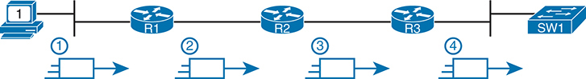

<figcaption>

<aside class="hidden" id="a21fig01">

来源为一台计算机,标注为1,数据流经过3个路由器,R-1,R-2,R-3,每个路由器都以典型的路由器图标为代表,在到达最终目的地前,一个网络交换机,S W-1. 画面突出了四个处理阶段. 阶段1涉及从源代码计算机发送到第一个路由器的初始包,R1. 在2阶段中,包由R1处理并转发到下个路由器R2. 阶段3看到包从R2到第三个路由器,R3. 最后,在4阶段中,包已到达交换机SW1,该交换机指示它前往适当的目的地.

</aside>

<strong>图21-1</strong> <em>路由器数据平面处理:基本情况</em>

</figcaption>

</figure>

现在扩展一下你的思考 试着想想路由器或交换机 在接收、处理和转发消息时可能做的一切 当然,转发决定是逻辑的一部分;事实上,数据平面常被称作:<em>转发平面</em>。但想想别把目的地址匹配到桌子上 从视角看,以下列表详细列出了一个网络设备在数据平面中进行的一些更常见的动作: 1.

<ul class="sq">

<li>
解封并重封数据链接帧中的一包(路由器, 第3层交换机)
</li>

<li>
添加或去除 802.1Q干线头(路由和交换机)
</li>

<li>
将 Ethernet 帧的目的地媒体访问控制地址匹配到 MAC 地址表( Layer 2 交换机)
</li>

<li>
将 IP 包的目标 IP 地址匹配到 IP 路由表( 路由器, 第 3 层交换机)
</li>

<li>
加密数据并添加新的IP头(用于虚拟私人网络[VPN]处理)
</li>

<li>
更改源地址或目的地IP地址(用于网络地址转换[NAT]处理)
</li>

<li>
因过滤器而丢弃信件(访问控制列表[ACLs],端口安全)
</li>

</ul>

列表中的所有项目组成了数据平面,因为数据平面包括了每个消息所完成的所有动作.

</section>

<section>

<h5 class="h5" id="ch21lev3sec2">控制平面</h5>

其次,需要花点时间来思考数据平面事先需要知道的信息种类,以便它能够正常工作。 例如,路由器在数据平面可以转发数据包之前,需要一个路由表中的IP路由. 第2层交换机需要在一个MAC地址表中的条目,然后才能转发以太网帧出一个到达目的地的最佳端口. 交换机必须使用 Spanning Tree 协议(STP)来限制哪些接口可以用于转发,这样数据平面工作良好,不会永远循环帧.

从一个角度看,提供给数据平面的信息控制了数据平面的工作. 例如,一个路由器需要一个匹配一个包的目的地址的路由,以便路由器知道该包的路由(向前). 当路由器的数据平面试图匹配路由表而找不到匹配的路由时,路由器会丢弃包. 是什么控制了路由表的内容? 各种控制平面过程.

术语<a id="key_303" href="#ref-gloss_063">控制平面</a>指控制数据平面的任何动作。 这些行动大多与创建数据平面所使用的表格,IP路由表等表格,IP地址解析协议(ARP)表,交换机MAC地址表等有关. 通过在数据平面使用的表格中添加,去除,并更改条目,控制平面处理控制数据平面的工作. 您已经知道很多控制平面协议, 例如所有IP的路由协议 。

传统的网络同时使用分布式数据平面和分布式控制平面. 换句话说,每个设备都有一个数据平面和一个控制平面,网络将这些函数分配到每个单个设备中,示例如下:<a href="#ch21fig02">图21-2</a>.

<figure class="image-c" id="ch21fig02">

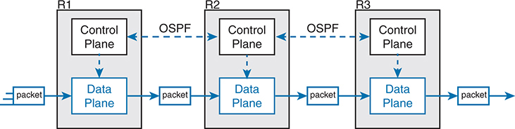

<figcaption>

<aside class="hidden" id="a21fig02">

每个路由器有两个主要部分: Control Plane和 Data Plane. Control Plane负责路由器的决策过程,如路由协议等. 在本图中,路由器的控制平面使用OSPF,Open Bast Path First,协议相通相通,由连接R1,R2和R3等控制平面的虚线来表示. 数据平面负责根据控制平面的决定实际转发数据包. 在图中,包会输入R 1的数据平面,被转发到R-2,再传送到R-3,最终退出了R-3的数据平面.

</aside>

<strong>图21-2</strong> <em>路由器的控制和数据规划——概念</em>

</figcaption>

</figure>

在图中,控制平面协议"最短路径第一"(OSPF)在每个路由器上运行(即在所有路由器中分布). OSPF在每一个路由器上再添加,去除,并更改每个路由器上的IP路由表. 数据平面的 IP 路由表在每一个路由器上安装了有用的路由后, 就可以将收到的数据包从左到右转发到图的下方。 以下列表包括许多更常见的控制平面协议:

<ul class="sq">

<li>
运行协议(OSPF,增强内部网关运行协议[EIGRP],运行信息协议[RIP],边境网关协议[BGP])
</li>

<li>
IPv4 ARP 软件
</li>

<li>
IPv6 邻居发现协议(NDP)
</li>

<li>
切换 MAC 学习
</li>

<li>
STP
</li>

</ul>

没有控制平面的协议和活动,传统网络设备的数据平面将无法正常运行. 路由器大多是没用的 没有路由协议所学的路由 如果不学习MAC表格条目,一个交换机仍然可以通过淹没来转发unicasts,但这样做对于所有帧会比正常的交换机操作在局域网(LAN)上产生更多的负载. 因此数据平面必须依靠控制平面来提供有用的信息.

</section>

<section>

<h5 class="h5" id="ch21lev3sec3">管理平面</h5>

控制平面执行直接影响到数据平面行为的俯冲任务. 密码<a id="key_309" href="#ref-gloss_202">管理平面</a>也执行间接费用工作,但这项工作并不直接影响数据平面。 相反,管理平面包括允许网络工程师管理设备的协议.

Telnet和Secret Shell(SSH)是两个最明显的管理平面协议. 为了强调与控制平面协议的区别,考虑两个路由器:一个是配置到允许Telnet和SSH进入路由器的路由器,另一个是没有. 无论他们是否支持Telnet和SSH,两者都可能仍在运行一个路由协议和路由包.

<a href="#ch21fig03">图21-3</a>扩展示例<a href="#ch21fig02">图21-2</a>现在显示管理平面, 有几个管理平面协议。

<figure class="image-c" id="ch21fig03">

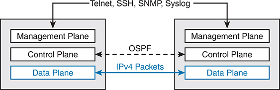

<figcaption>

<aside class="hidden" id="a21fig03">

描绘出两个路由器,每个路由器有三个组成部分:管理平面图,控制平面图和数据平面图. 管理平面板负责路由器的配置和监测. 它使用Telnet,SSH,Secure Shell,SNMP,简易网络管理协议等协议,以及Syslog用于远程管理和记录. 控制平面(Control Plane)管理路由决定,并使用OSPF与其他路由器的控制平面进行通信. 数据计划负责实际数据包的转发。 在此图中, IP v 4 包显示在两个路由器的数据平面之间传输.

</aside>

<strong>图21-3</strong> <em>控制和数据计划配置管理计划</em>

</figcaption>

</figure>

</section>

<section>

<h5 class="h5" id="ch21lev3sec4">Cisco 交换机数据平面内部机制</h5>

为了更好地理解SDN和网络可编程性,它有助于思考交换机的内部. 下一个话题就是这样。

从称为局域网交换机的装置的最初几天起,由于每秒(fps)需要大量的帧,交换机就必须使用专门的硬件来进行前置帧. 要了解帧的量,交换机必须能够向前,考虑以太网帧的最小帧大小,交换机上的端口数量,以及端口的速度;即使是低端交换机也需要每秒能转发上百万帧. 例如,如果一个交换机厂商想了解其数据平面在24个端口的新访问层交换机中需要多快,它可能会通过这个位数来工作:

<ul class="sq">

<li>
交换机有24个端口.
</li>

<li>
每个端口运行在 1 Gbps.
</li>

<li>
对于这个分析,假设长度为125字节的帧(以方便数学,因为每个帧有1000个比特长).
</li>

<li>
对于长度为 1000 比特的帧，以及每秒 1,000,000,000 比特的速率，一个端口每秒可以发送 1,000,000 帧（fps）。
</li>

<li>
在所有的端口上使用全双相机,因此交换机可以期望在所有24个端口上同时接收.
</li>

<li>
结果：每个端口都会以 1,000,000 fps 接收数据，合计为 每秒 2400 万帧，因此交换机的数据平面需要能够处理 每秒 2400 万帧。
</li>

</ul>

虽然2400万个fps看起来可能很多,但这里的目标并不是给一个交换机的数据平面设置一个绝对数字,对于任何特定的切换技术时代来说,这个数据平面需要多快的速度. 相反地,从1990年代中期首次引入市场以来,局域网交换机所需要的数据平面比一般CPU在软件中可以处理的要快. 因此,硬件交换机总是有专门的硬件来进行数据平面处理.

首先,切换逻辑不发生于带软件的CPU中,而是发生在一个<a id="key_300" href="#ref-gloss_039">应用专用集成电路(ASIC)</a>。ASIC是一种为特定目的所建造的芯片,例如用于网络设备中的信息处理.

其次,ASIC需要在MAC地址表中进行表格检索,因此对于快表检索,交换机使用专门的内存类型来存储等同的MAC地址表:<a id="key_317" href="#ref-gloss_339">三重内容可处理内存(TMAM)</a>。TMAM内存不要求ASIC通过一个算法执行回路来搜索表格. 相反,ASIC可以像MAC地址值一样将匹配的字段输入到TMAM中,而TCAM返回匹配的表项,不需要运行搜索算法.

注意一个交换机仍有通用的CPU和RAM,如以下所示:<a href="#ch21fig04">图21-4</a>。IOS在CPU中运行并使用RAM. 大多数控制和管理平面功能都在IOS运行. 数据平面功能(和MAC学习的控制平面功能)发生在ASIC.

<figure class="image-c" id="ch21fig04">

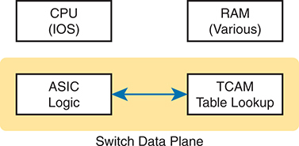

<figcaption>

<aside class="hidden" id="a21fig04">

顶部有两箱被标注为CPU,IOS,和RAM,Mutch,代表运行Internetwork操作系统的中央处理单元IOS,以及交换机中使用的不同类型的随机访问内存. 在这些组件下方,在一个被标记为Switch Data Plane的黄色阴影区内,有两个相通的框. 左箱被标为ASIC Logic,代表负责高速处理数据包的应用程序-特定集成电路. 右框被标注为TMAM Table Lookup,代表特一内容-可处理内存,是用于快速查看路由和切换表格的专用内存. ASC 逻辑和 TMAM 表查询之间的箭头表示信息的双向流动。

</aside>

<strong>图21-4</strong> <em>典型切换中的关键内部处理点</em>

</figcaption>

</figure>

注意,一些路由器也使用硬件来进行数据平面函数,原因与交换机使用硬件的原因相同. (例如,检查 Cisco 量子流处理器(QFP) 在 Cisco路由器中对硬件数据平面转发的有趣读取. ) 路由器中硬件数据平平面的想法与交换机中的类似: 使用一个目的所建的ASIC来进行转发逻辑, TCAM来存储所需的表格来进行快表查询.

</section>

</section>

<section>

<h4 class="h4" id="ch21lev2sec2">控制器与软件定义架构</h4>

2010年代出现了新的联网办法,这些办法改变了某些控制平面功能发生的地方。 许多这些方法将控制平面工作的一部分移入软件中,作为中央应用程序运行,称为<em>控制器</em>。这个下个话题审视控制器的概念,以及位于控制器下方的设备的接口和使用控制器的任何程序的接口.

注意

术语<em><a id="key_313">软件定义网络( SDN)</a></em>成为了2010年代常见的指代后几页所描述的以控制器为基础的网络类型. 今天你更经常看到这样的话<em>软件定义架构</em>或者说<a id="key_304" href="#ref-gloss_094">基于控制器的网络</a>.

<section>

<h5 class="h5" id="ch21lev3sec5">控制器与集中式控制</h5>

大多数传统的控制平面过程使用分布式架构. 例如,每个路由器都会运行自己的OSPF路由协议过程. 为了完成他们的工作,那些分布式控制平面过程使用消息互相交流,比如路由器之间的OSPF协议消息. 因此,据说传统网络使用<a id="key_306" href="#ref-gloss_115">分布式控制平面</a>.

创造今天控制平面概念的人,如STP、OSPF、EIGRP等,可以选择使用<a id="key_301" href="#ref-gloss_063">中央控制平面</a>。也就是说,他们可能把逻辑放在一个地方,运行在一个设备上,或者在服务器上. 然后,集中软件本可以使用协议信息从设备中学习信息,但是在集中位置处理所有信息. 但他们却选择了分布式建筑.

使用分布式和集中式的架构来完成网络中的任何功能,是有利弊的. 许多控制平面功能有着与分布式建筑良好运行的悠久历史. 然而,一个集中的应用程序比分布式应用程序更容易写出,因为集中的应用程序将所收集的所有数据都收集到一个地方. 而这个软件定义架构的新兴世界往往使用集中式建筑,有集中式控制平面,其基础在一种称为控制器的服务中.

A <em>控制器</em>,或<em>SDN 控制器</em>,集中控制网络设备。 控制的程度——以及控制的类型——范围很广。 例如,控制器可以履行所有控制平面功能,取代设备的分布式控制平面。 另外,控制器可以简单地了解设备上分布的数据、控制和管理平面的持续工作,而不会改变这些平面的运作方式。 名单继续列出,有许多不同之处。

为了更好地理解控制器的想法,考虑如下所示的一个具体案例:<a href="#ch21fig05">图21-5</a>,其中一个SDN控制器集中了所有重要的控制平面功能. 首先,控制器坐落在网络中任何具有IP可达性的设备在网络中的任何位置. 每个网络设备仍然有一个数据平面;但请注意,没有一个设备有一个控制平面. 以SDN的变异表示,例如:<a href="#ch21fig05">图21-5</a>,控制器将数据平面条目直接编程到每个设备的表格中。 网络设备不使用传统的分布式控制平面程序填充其转发表。

<figure class="image-c" id="ch21fig05">

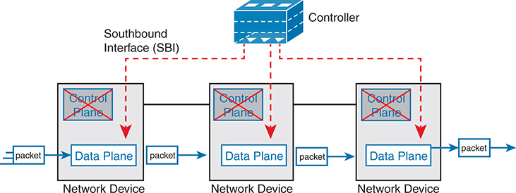

<figcaption>

<aside class="hidden" id="a21fig05">

顶部显示一个被标记为"Controller"的盒子,代表负责管理网络政策和决定的中央控制平面. 控制器通过由虚线红线代表的"Southbound Interface",SBI连接到多个网络设备. 每个网络设备被描绘为一个有两节的框:上一节被标注为Control Plane,下一节被标出为Data Plane. 在每一个网络设备中,控制平面被划出,表示控制功能集中在控制器中,而数据平面仍然活跃并分布在设备上. 被标记为蓝箭包的蓝箭包表示数据包通过网络设备的数据平面从左到右的流动,显示数据平面如何根据从集中控制平面收到的指令处理数据包转发.

</aside>

<strong>图21-5</strong> <em>集中控制计划和分布式数据计划</em>

</figcaption>

</figure>

注意

<a href="#ch21fig05">图21-5</a>显示使用名为“SDN”的行业标准的最初 SDN 执行之一所使用的模式<a id="key_312" href="#ref-gloss_238">OpenFlow</a>.

<a href="#ch21fig05">图21-5</a>显示一个用于网络可编程和SDN的模型,但不是全部。 这一数字确实为我们提供了一个大的背景,可以讨论一些更重要的基本概念,特别是南向接口(SBI)和北向接口(NBI)的想法。

</section>

<section>

<h5 class="h5" id="ch21lev3sec6">南向接口</h5>

在以控制器为基础的网络架构中,控制器需要与网络设备通信. 在大多数网络绘图和架构绘图中,这些网络设备一般坐落在控制器下方,例如:<a href="#ch21fig05">图21-5</a>。控制器和这些设备之间有一个接口,鉴于其位于绘图的下部,该接口被称为<a id="key_315" href="#ref-gloss_295">南行接口(履行机构)</a>,标签在<a href="#ch21fig05">图21-5</a>.

注意

在本章关于SDN的讨论中,<em>interface</em>除非另有说明,否则(包括在履行机构、NBI和API等名称中)是指软件接口。

履行机构有几种不同的备选办法。 总体目标是网络可编程性,因此接口不再仅仅是协议. 履行机构常常包括一项协议,以便控制器和设备能够进行交流,但它往往包括:<a id="key_299" href="#ref-gloss_038">应用程序编程接口( API)</a>。API是一个应用程序(program)与另一个应用程序交换数据的方法. 重排词来描述这个想法,一个API是一个应用程序的接口. 程序处理数据,所以一个API允许两个程序478交换数据. 虽然协议作为文件存在,通常来自一个标准机构,但API往往作为可用的代码-功能,变量和数据结构存在,一个程序可以用来在整个网络的程序中沟通和复制结构化的数据.

所以,回到术语<em>SBI</em>:它是一个程序(控制器)与程序(在网络设备上)之间的接口,让两个程序进行交流,一个目标是让控制器对网络设备的数据平面转发表进行编程.

不足为奇的是,在一个意在实现网络可编程的网络架构中,履行机构及其API的能力告诉我们许多关于该特定架构能够和不能做什么的事情. 例如,有些控制人员可能为了某一特定目的支持一个或几个履行机构,而另一些控制人员则可能支持更多的履行机构,允许选择履行机构。 对履行机构的比较远远超出本章的范围,但它确实有助于思考几个问题;第二个主要部分给出了三个样本结构,恰好显示了三个独立的履行机构,具体而言:

<ul class="sq">

<li>
OpenFlow(来自ONF;<a href="http://www.opennetworking.org">www.opennetworking.org</a>)
</li>

<li>
OpFlex( 来自 Cisco; 与 ACI 同用)
</li>

<li>
CLI(Telnet/SSH)和SNMP,以及NETCONF(用于Cisco软件-定义访问)
</li>

</ul>

</section>

<section>

<h5 class="h5" id="ch21lev3sec7">北向接口</h5>

考虑一下控制器需要的与示例相关的编程<a href="#ch21fig05">图21-5</a>。该图主要关注控制器可以在网络设备的转发表上添加条目;然而,控制器如何知道该添加什么? 它怎么选择的? 您的程序需要收集什么样的信息才能尝试在网络中添加类似MAC表格条目或IP路由等信息? 你可能会想到这些:

<ul class="sq">

<li>
网络中所有设备的列表
</li>

<li>
每个设备的能力
</li>

<li>
每个设备上的接口/端口
</li>

<li>
每个端口的当前状态
</li>

<li>
地貌学 - 该设备连接到哪个, 在哪个接口上
</li>

<li>
设备配置 - IP 地址、 VLAN等设备配置
</li>

</ul>

控制器在集中控制模型中为控制平面做大量需要的工作. 它收集了各种有关网络的有用信息,如前一列表中的项目. 控制器本身可以创建一个集中的存储器,存储所有这些关于网络的有用信息.

控制器<a id="key_311" href="#ref-gloss_231">北行接口( NBI)</a>打开控制器,使其数据和功能可以被其他程序所使用,使网络可以编程,开发速度更快。 程序可以使用控制器的API从控制器中调取信息. NBIs还使程序能够使用控制器的能力来使用控制器的SBI来编程流入设备.

看看NBI的住址,先考虑一下控制器本身. 控制器是软件,运行在一些服务器上,可以是VM或物理服务器. 一个应用程序可以和控制器在同一服务器上运行,并且使用一个NBI,它是一个API,这样两个程序就可以进行通信.

<a href="#ch21fig06">图21-6</a>仅举出这样的例子。 图中的大框代表控制器软件所居住的系统. 这个特定的控制器恰好用Java写出,并且有一个基于Java的本地API. 任何人——与控制器供应商、另一家公司、甚至你相同的供应商——都可以在使用控制器Java API的同一操作系统上写出一个应用软件。 通过使用该API与控制器交换数据,应用程序可以学习网络信息. 应用程序还可以在网络中编程流量——即请控制器在网络设备的转发表中添加特定的匹配/动作逻辑(流程).

<figure class="image-c" id="ch21fig06">

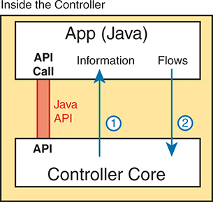

<figcaption>

<aside class="hidden" id="a21fig06">

该图的标题为主计长内部。 在顶部有一个被标记为App,Java的盒子,代表一个Java应用程序. 在此框内,一个API Call以红色表示,标签为Java API,显示应用程序与控制器接口的点. 在此下方,一个更大的被标记为Controller Core的盒子代表了网络控制器的主要功能. 一个被标记为"信息"的箭头从控制器核心到Java应用程序,表示数据从控制器到应用程序的流量. 另一个被标记为Flows的箭头从Java应用程序指向控制器核心,显示应用程序如何向控制器发送信息.

</aside>

<strong>图21-6</strong> <em>Java API: Java 应用程序与控制器通信</em>

</figcaption>

</figure>

注意

北行接口(NBI)从其正常位置获得名称,如控制器上所示——即在地图上的北行位置。

在离开NBI议题之前, 让我们简单解释一下用于控制器的 REST API。 REST (法语:<em>国家转让</em>)描述一种类型的API,允许应用程序坐落在不同的主机上,使用HTTP消息在API上传输数据. 当你看到 SDN 数字像<a href="#ch21fig06">图21-6</a>,随着应用程序运行在和控制器相同的系统上,API不需要通过一个网络发送消息,因为两个程序运行在同一系统上. 但当应用程序运行在网络中除运行控制器之外的其他某个地方时,API需要一种途径将数据通过一个IP网络前后发送,而RESTful APIs满足了这一需要.

<a href="#ch21fig07">图21-7</a>用 REST API 来显示大想法。 应用程序运行在图上方的主机上. 在这种情况下,在步骤1,它发送一个HTTP GET请求到特定的URI. HTTPGET和任何其他HTTPGet一样,甚至像那些用来检索网页的. 然而,URI不是用于网页,而是在控制器上识别一个对象,一般是应用程序需要学习然后处理的数据结构. 例如,URI可以识别一个对象,这个对象是一个特定设备上的物理接口列表,以及每个设备的状态.

<figure class="image-c" id="ch21fig07">

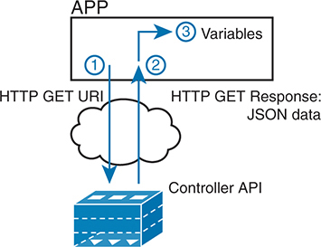

<figcaption>

<aside class="hidden" id="a21fig07">

顶部有被标注为APP的盒子,代表一个应用程序. 在此下方,一个被标记为Controller API的框代表了网络控制器的API. 在这两个盒子之间,一朵云象征着网络通信介质. 过程从一个标记为1的箭头开始,从应用程序指向带有标签HTTPGETURI的控制器API,表示应用程序向控制器发送了GET请求. 下一步由标记为2的箭头代表,从控制器API回向应用程序并带有标签HTTPGET响应:JSON数据,表示控制器用JSON格式化的数据响应了GET请求. 最后一步用一个标注在应用程序框内3指向变量的箭头来表示,它显示应用过程并存储被检索到的数据以变量为单位.

</aside>

<strong>图21-7</strong> <em>使用 REST API 的获取示例</em>

</figcaption>

</figure>

在 2步骤中,控制器会与对象一起发送回一个HTTP GET响应消息. 大部分REST API将要求并接收结构化数据. 也就是说,不是像网页浏览器那样接收网页的数据,而是以一个程序可以轻易使用的格式,将变量名称及其值作为回应。 用于网络可编程的数据常用格式为JavaScript对象注释(JSON)和eXtensible Markup Language(XML),显示为步骤3.

</section>

</section>

<section>

<h4 class="h4" id="ch21lev2sec3">软件定义架构小结</h4>

SDN和网络可编程性引入了构建网络的新方法. 网络设备依然存在并仍然转发数据,但控制平面功能和位置会发生巨大变化. 集中控制器充当了联络点,因此至少部分控制平面功能从分布式模型转移到集中式模型.

然而,网络可编程性和SDN的世界包括了广泛的选择和解决方案. 有些选项将大多数控制平面功能拉入控制器,而其他选项则只将其中一些功能拉入了控制器. 下一节审视了两个不同的选项,每个选项对网络可编程性和集中控制程度采取不同的方法.

</section>

</section>

<section>

<h3 class="h3" id="ch21lev1sec4">网络可编程性与 SDN 示例</h3>

本章三大节中的第二节介绍了思科现有的两个不同的SDN和网络可编程性解决方案. 还有一些人也存在。 选择这两点是因为它们给出了广泛的比较点:

<ul class="sq">

<li>
开放日光控制器
</li>

<li>
Cisco 应用中心基础设施(ACI)
</li>

</ul>

<section>

<h4 class="h4" id="ch21lev2sec4">OpenDaylight 和 OpenFlow</h4>

一种常见的SDN形式出自于开放网络基金会(ONF),并以"开放SDN"为帐单. 国家妇女办公室(ONF)<a href="http://www.opennetworking.org">www.opennetworking.org</a>充当用户(经营者)和供应商联合会,帮助在市场上建立SDN。 这项工作的一部分界定了协议、履行机构、国家调查委员会,以及任何有助于人们实现《战略发展网络》愿景的方面。

SDN的ONF模型具有OpenFlow的特点. OpenFlow在控制器和网络设备之间定义了控制器的概念以及基于IP的SBI. 碞钩重要的是,OpenFlow根据今天交换机常用的ASICs和TMAM,定义了交换机能力的标准概念。 (关于交换机的标准化想法称为:<em>交换机抽象</em>.) OpenFlow交换机可以起到第2层交换机,第3层交换机的作用,或者在传统的第2/3层交换机模式之外,以不同的方式并具有极大的灵活性.

Open SDN模型集中了大多数控制平面功能,由控制器完成对网络的控制并加上任何使用控制器NBI的应用程序. 事实上,<a href="#ch21fig05">图21-5</a>(shown before)显示没有控制平面的网络设备,这代表着这个大部分集中的OpenFlow模型SDN.

在 OpenFlow 模型中,应用程序可以使用控制器平台上支持的任何API(NBI)来指令将什么样的转发表条目放入设备中;然而,它要求OpenFllow作为SBI协议. 此外,网络设备需要成为支持OpenFlow的交换机.

由于ONF的Open SDN模型有这种带有OpenFlow SBI的控制器的共同线程,因此控制器在网络中扮演了很大的角色. 接下来几页提供了两个这样的控制器的简短背景.

<section>

<h5 class="h5" id="ch21lev3sec8">OpenDaylight 控制器</h5>

首先,如果回顾OpenFlow的历史,可以找到支持OpenPlow SDN模型的数十个不同的SDN控制器的信息. 有些研究更注重研究,在发展SDN的几年里,它更是一种实验性的想法。 随着时间的流逝,越来越多的供应商开始建立自己的控制器. 而这些控制器往往具有许多相似的特性,因为他们试图实现许多相同的目标. 正如你可能预期的那样,最终需要进行一些合并。

OpenDaylight开源SDN控制器是比起2010s的整合过程而出现的较为成功的SDN控制器平台之一. OpenDaylight采用了许多与Linux相同的开源原理,其想法是如果足够多的供应商在共同开源控制器上合作,那么所有的人都会受益. 所有这些供应商然后都可以使用开源控制器作为自己产品的基础,每个供应商都侧重于工作的产品区别部分,而不是基本特点。 结果是,回到了 中 -2010s,<em>打开 Daylight SDN 控制器</em> (<a href="http://www.opendaylight.org">www.opendaylight.org</a>)出世为相. OpenDaylight(ODL)开始作为一个单独的项目,但现在作为一个由Linux基金会管理的项目存在.

<a href="#ch21fig08">图21-8</a>显示 ODL 架构的通用版本。 尤其要注意控制框下部列出的各种履行机构:OpenFlow、NetConf、PCEP、BGP-LS和OVSDB;还有更多的机构存在。 ODL项目有足够的参与者,因此它包括了多种选择,包括多个履行机构,而不仅仅是OpenFlow.

<figure class="image-c" id="ch21fig08">

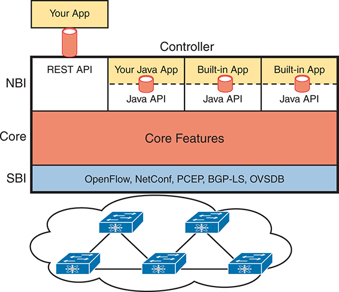

<figcaption>

<aside class="hidden" id="a21fig08">

在顶部,图像中有一个区域标记为"你的App",通过REST应用程序编程接口连接到控制器,API,表示应用程序层与控制器的相互作用. 控制器主要分为三层:NBI,Core和SBI. NBI由RESTAPI和Java API组成,允许外部应用程序,包括用户开发的Java应用程序,以及内置应用程序与控制器交互. 核心部分以橙色和被贴上标签的核心特征来突出显示,表示控制器的中心功能. 以蓝色显示的履行机构列出了各种协议,如OpenFlow,网络配置协议,NetConf,路径计算元素协议,PCEP,边界网关协议链接状态,BGP switch L S,以及Open vSwitch数据库管理协议,OVSDB,这些协议将控制器与网络设备连接. 在图像底部,一个具有互联交换机和路由器的网络的图形化表示由控制器管理的物理网络基础设施。

</aside>

<strong>图21-8</strong> <em>NBI、Controller 内部和履行机构至网络设备的结构</em>

</figcaption>

</figure>

OLDL具有许多特征,有许多SBI,以及许多核心特征. 然后,一个供应商可以服用ODL,使用该供应商有道理的部件,加入其中,并创建一个商业ODL控制器.

</section>

<section>

<h5 class="h5" id="ch21lev3sec9">Cisco Open SDN Controller（OSC）</h5>

早在2010年代,思科就曾提供名为"思科"的OpenDaylight控制器的商业版本.<em>打开 SDN 控制器</em>(OSC) (英语). 该控制器遵循了ODL项目的预期模式:Cisco等人为ODL开源项目贡献了劳动和金钱;一完成新发布,Cisco就拿走了该发布并制造出他们产品的新版本.

Cisco不再生产和销售Cisco OSC,但我决定在本章中保留一个关于OCS的简短章节,原因有几个. 首先,如果你自己做任何一项研究,你会发现提到Cisco OSC;然而,早在本章编写之前,Cisco就已经对使用SDN的不同方法采取了强有力的战略行动。<a id="key_307" href="#ref-gloss_176">基于意图的网络(ISBN)</a>。这一举动让思科远离了基于OpenFlow的SDN. 但是,由于你可能会在网上看到Cisco OSC的参考文献,或者在这本书的前一版中,我想指出这种向Cisco方向的转变。

这本书描述了使用IBN方法进行SDN的两个Cisco提供. 本章的下一个专题审查其中的一个专题:Centric Information(ACI),Cisco的数据中心SDN产品。<a href="v2-22.html#ch22">第22章</a>, “<a href="v2-22.html#ch22">Cisco 软件定义接入（Cisco SD-Access）</a>,”讨论另一个Cisco SDN选项,它使用基于意图的网络:软件定义接入(Cisco sD-Access).

注意

具体产品的例子只用于帮助读者将SDN和以控制器为基础的网络的概念内部化. 这些产品的例子包括Cisco应用百分位基础设施(ACI)和Cisco软件与Cisco Catalyst Center(Cisco SD-Access)的限定存取。

</section>

</section>

<section>

<h4 class="h4" id="ch21lev2sec5">Cisco 以应用为中心的基础设施（ACI）</h4>

有趣的是,许多 SDN 的提供始于研究 抛弃了许多旧的网络范式 试图创造新的和更好的东西。 例如,OpenFlow来自斯坦福大学的 " 清洁板 " 研究项目,该研究项目使研究人员重新构思(除其他之外)设备建筑。 Cisco也走过类似的研究道路,但Cisco的作品恰好来自不同的组别,每个组都专注于网络的不同部分:数据中心,校园和WAN. 这一研究的结果是Cisco公司目前在数据中心提供SCI的SDN服务:企业校园内的软件-定义存取(Cisco SD-Access)和企业WAN中的软件-定义WAN(CisCO SD-WAN)。

ACI的设计者在为数据中心重新构思网络时,主要关注在数据中心运行的应用程序以及他们需要什么. 因此,他们围绕应用架构构建了网络概念. Cisco使网络基础设施成为应用中心,因此Cisco数据中心SDN解决方案的名称:<a id="key_297" href="#ref-gloss_036">Centric基础设施(ACI)应用</a>.

例如,思科从网络之外看数据中心世界,看到了大量的自动化和控制. 如上文所讨论<a href="v2-20.html#ch20">第20章</a>, “<a href="v2-20.html#ch20">云架构</a>,”虚拟化软件经常启动、移动和停止VM。 此外,云软件为客户提供自助服务,以便他们能够使用数据中心中的VM和容器提供高度弹性的服务,并使其失效。 从联网的角度来看,有些脆弱母亲需要交流,但有些则不交流。 而这些VM可以根据虚拟化和云系的需要来移动.

ACI即将建立数据中心网络,在操作模型中具有灵活性和自动化。 在交换机和路由器上有很多物理接口配置的旧数据中心联网模型,只是现代数据中心快速变化和自动化性质的不良模型。 本节审视ACI的一些细节,让大家了解ACI如何创建强大而灵活的网络,支持一个现代数据中心,其中VM和容器的创建,运行,移动,以及作为例行公事被动态地停止.

<section>

<h5 class="h5" id="ch21lev3sec10">ACI 物理设计：Spine 与 Leaf</h5>

Cisco ACI 使用特定的物理交换机地形,称为<a id="key_316" href="#ref-gloss_329">脊椎 脊椎</a>和<a id="key_308" href="#ref-gloss_192">叶子</a>。虽然一个网络的其他部分可能需要允许许多不同的物理地貌,但可以使数据中心具有标准性和一致性。 但什么特定的标准 和一致的地貌? 思科决定了脊椎和叶子设计,也称克洛斯网络是继其创作者之一后而建立的.

借助ACI,物理网络有多个脊椎交换机和多个叶交换机,例如:<a href="#ch21fig09">图21-9</a>。图中显示了交换机之间的链接,这些交换机可以是单链路或多条平行链路. 设计中值得注意的(假设是单站点设计):

<ul class="sq">

<li>
每个叶交换机必须连接到每个脊椎交换机.
</li>

<li>
每个脊椎交换机必须连接每个叶交换机.
</li>

<li>
叶交换机无法连接到对方 。
</li>

<li>
spine 交换机无法连接到对方 。
</li>

<li>
端点只连接到叶交换机.
</li>

</ul>

<figure class="image-c" id="ch21fig09">

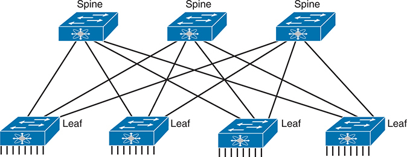

<figcaption>

<aside class="hidden" id="a21fig09">

脊椎-叶片设计一般由脊椎交换机和叶片交换机相接而成,形成高性能可伸缩的网络架构. 这种设计确保了每个叶子交换机连接到每个脊椎交换机,为数据传输提供多条路径,增强冗余,并降低耐久性. 表示方式包括标签和箭头,表示不同网络设备之间的数据流.

</aside>

<strong>图21-9</strong> <em>Spine-Leaf 网络设计</em>

</figcaption>

</figure>

端口只连接到叶交换机,从不连接到脊椎交换机. 为了强调这一点,<a href="#ch21fig10">图21-10</a>显示更详细的版本<a href="#ch21fig09">图21-9</a>,这次与叶交换机相连的端点。 没有一端连接到脊椎交换机;它们只连接到叶交换机. 端点可以是连接到数据中心外的设备,比如左侧的路由器. 按体积计算,大多数端点要么是运行本地OS的物理服务器,要么是运行虚拟化软件的服务器,数字中心显示VM和容器的数量.

<figure class="image-c" id="ch21fig10">

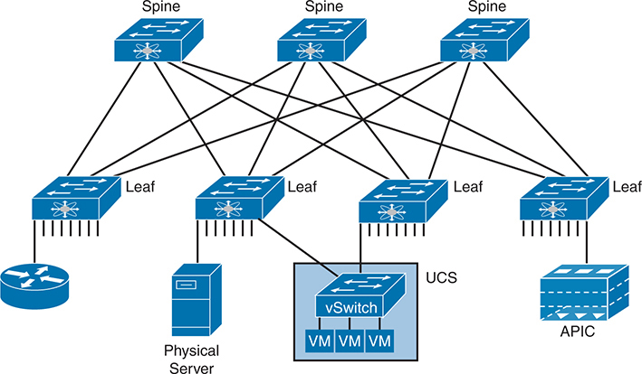

<figcaption>

<aside class="hidden" id="a21fig10">

该图包括斯宾克交换机:顶部有四个脊椎交换机,相互连接并连接到叶交换机. 叶交换机:底部有4个叶交换机,每个交换机连接多根脊椎交换机,形成高带宽,低纬度的织物. 端点:连接到叶交换机上的各种设备和系统,包括一个物理服务器,一个虚拟化的服务器集群被标注为UCS,United Elecomic System,有一个vSwitch和多V Ms,虚拟机,一个APIC,应用程序政策基础设施控制器,以及一个路由器. 这种地貌显示出叶-松树结构,所有端点,服务器,V M,APIC,路由器都与叶交换机相接.

</aside>

<strong>图21-10</strong> <em>仅在叶片交换机上找到的端点</em>

</figcaption>

</figure>

另外,请注意,该图显示了一个典型的设计,有多个叶交换机连接到像Cisco统一计算系统(UCS)服务器这样的单一硬件端点. 根据设计要求,每个UCS都可能连接到至少两个叶交换机,既是为了冗余,也是为了提高支持运行在UCS硬件上的VM和容器的能力. (实际上,在一个带有UCS或类似服务器硬件的小型设计中,每个UCS都可以连接到每一个叶交换机. )

</section>

<section>

<h5 class="h5" id="ch21lev3sec11">ACI 的基于意图的网络运行模型</h5>

Cisco为ACI所定义的模型使用了终点和政策的概念. 密码<em>终端</em>是VM,容器,甚至传统的服务器,其OS直接运行在硬件上. ACI然后使用若干通过以下方式执行的构造:<a id="key_298" href="#ref-gloss_037">应用政策基础设施控制器(APIC)</a>,作为ACI集中控制器的软件.

本节希望给大家一些ACI的深刻见解,而不是触及每一个特征. 要做到这一点,先考虑一下典型企业网络应用的应用架构. 大多数临时观察者认为一个网络应用程序是一个实体,但一个网络app经常作为三个独立的服务器存在:

<ul class="sq">

<li>
<strong>网络服务器 :</strong>数据中心外的用户连接到一个网络服务器,这个服务器向用户发送网页内容.
</li>

<li>
<strong>App(应用)服务器 :</strong>由于大多数网页包含动态内容,应用程序服务器会根据用户的概况以及最新的动作和输入来为该特定用户构建下个网页进行处理.
</li>

<li>
<strong>DB (数据库) 服务器 :</strong>应用程序服务器的许多动作需要数据;DB服务器按照应用程序服务器的要求检索并存储数据.
</li>

</ul>

为了适应这些想法,ACI采用了基于意图的联网模式(ISBN). 有了这一模式,工程师或一些自动化程序就界定了哪些政策和意图应当允许终点通信,哪些不应当通信。 然后,控制器在这个时候决定这个网络意味着什么,这取决于端点现在在哪里.

例如,在为这个应用程序启动 VMs 时,虚拟化软件将(通过APIC)创建几个端点组(EPG),如下文所示:<a href="#ch21fig11">图21-11</a>。控制器也必须被告知访问策略,这些策略界定了哪些电子设备应当能够通信(而哪些不应当),如图中用箭行所暗示的. 例如,连接到数据中心外部的网络的路由器应该能够向所有网络服务器发送数据包,但不能发送到应用服务器或DB服务器.

<figure class="image-c" id="ch21fig11">

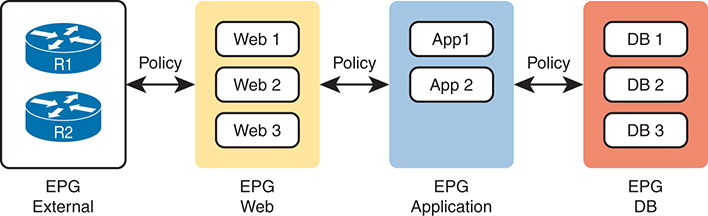

<figcaption>

<aside class="hidden" id="a21fig11">

EPG外部:包含路由器R-1和R-2. 这个组代表了外部的网络连接. EPG Web:包含3个网络服务器,Web1;Web2;Web 3. 政策规范了外部EPG和网络服务器之间的互动. EPG应用程序:包含两个应用程序服务器,App 1,App 2. 政策规范了网络EPG与应用程序EPG之间的沟通. ePGDB:包含3个数据库服务器,D B 1,D B 2,D B →3. 政策控制应用程序EPG和数据库EPG之间的相互作用. 标有"箭头"标签的政策表示管理不同EPG之间交通和安全的规则和配置.

</aside>

<strong>图21-11</strong> <em>最终点组和政策</em>

</figcaption>

</figure>

请注意,上段从未讨论过哪些物理交换机接口应该被指定给哪个VLAN或哪些端口处于以太通道中;讨论转向了对网络中发生的事情的以应用为中心的观点. 一旦所有终点、政策和有关细节被定义,控制器就可以引导网络成为以及VMs开始、停止或移动时更容易的反应。

ACI使用一个名为应用政策基础设施控制器(APIC)的中央控制器来使其全部工作,如下文所示:<a href="#ch21fig12">图21-12</a>。名称在此情况下定义了函数:是控制器为数据中心基础设施创建了应用政策. APIC采取意图(EPGs,政策等),完全改变了操作模式,不再配置VLANs,干线,以太Channels,ACL等功能.

<figure class="image-c" id="ch21fig12">

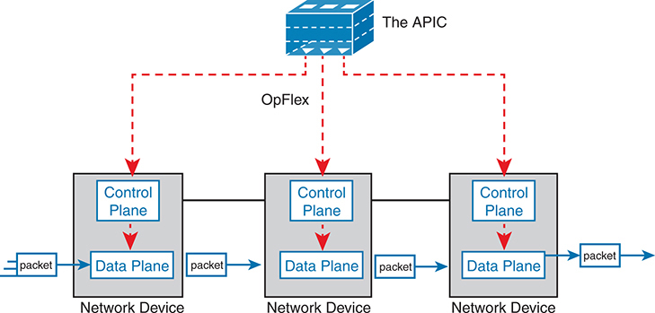

<figcaption>

<aside class="hidden" id="a21fig12">

图表上方显示APIC是管理整个网络的政策和配置的中央控制器. 它使用OpFlex协议与网络设备进行通信,该协议由连接APIC到每个网络设备的红色破折线来代表. 图表中的每个网络设备有两层不同的:控制平面和数据平面. Control Plane负责作出路由决定并处理网络控制功能,而Data Plane则根据ControlPlane的指示管理数据包的实际转发. 数据包通过网络设备的数据平面的流量被用固态箭头来描绘,显示了控制平面如何影响数据包的转发.

</aside>

<strong>图21-12</strong> <em>ACI 的建筑视图, 带有 APIC 推进意图以切换控制平面</em>

</figcaption>

</figure>

APIC当然有方便的GUI,但电源来自软件控制——即网络可编程性. 同样的虚拟化软件,或云或自动化软件,甚至网络工程师所写的脚本,都可以定义端点组,政策等到APIC. 但所有这些玩家都通过Interfacing to the APIC来访问ACI系统,如所描述的那样.<a href="#ch21fig13">图21-13</a>;网络工程师不再需要连接到每个单个交换机并配置CLI命令.

<figure class="image-c" id="ch21fig13">

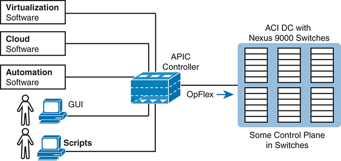

<figcaption>

<aside class="hidden" id="a21fig13">

在图表的中心,APIC控制器充当监督整个网络的核心管理实体. 它通过OpFlex协议与由Nexus 9000交换机组成的ACI数据中心进行通信,确保控制平面功能得到有效管理. 该图还展示了APIC与不同类型的软件的整合:虚拟化软件,云软件和自动化软件. 这些整合使APIC能够管理虚拟化的环境,为基于云的服务提供便利,并支持自动化的网络管理和配置. 用户可以通过图形用户接口,GUI,或通过自动化任务的脚本与APIC互动,为网络的管理和配置提供灵活性.

</aside>

<strong>图21-13</strong> <em>使用 APIC 控制 ACI 数据中心网络</em>

</figcaption>

</figure>

有关 Cisco ACI 的更多信息,请访问<a href="http://www.cisco.com/go/aci">www.cisco.com/go/aci</a>.

</section>

</section>

<section>

<h4 class="h4" id="ch21lev2sec6">SDN 示例小结</h4>

本节所选取的SDN建筑样本是为了学习而提供广泛的多样性. 然而,它们在控制平面工作的集中程度上有一定的不同.<a href="#ch21tab02">表21-2</a>列出从本节中摘取的这些比较点和其他比较点,以便于审查和研究。

<figure class="table" id="ch21tab02" tabindex="0">

<figcaption>

<strong>表21-2</strong>比较点: OpenFlow和ACI

</figcaption>

<table class="all">

<tbody>

<tr>

<th class="th">
条件
</th>

<th class="th">
OpenFlow
</th>

<th class="th">
ACI
</th>

</tr>

<tr>

<td class="border">
改变设备控制平面的工作方式与传统网络
</td>

<td class="border">
是
</td>

<td class="border">
是
</td>

</tr>

<tr>

<td class="border">
创建一个集中点,让人和自动化控制网络
</td>

<td class="border">
是
</td>

<td class="border">
是
</td>

</tr>

<tr>

<td class="border">
架构集中控制平面的程度
</td>

<td class="border">
大部分时间
</td>

<td class="border">
部分为
</td>

</tr>

<tr>

<td class="border">
使用的南向接口
</td>

<td class="border">
OpenFlow
</td>

<td class="border">
OpFlex
</td>

</tr>

<tr>

<td class="border">
本章提到的控制器
</td>

<td class="border">
OpenDaylight
</td>

<td class="border">
APIC
</td>

</tr>

<tr>

<td class="border">
作为主要定义者/所有者的组织
</td>

<td class="border">
ONF
</td>

<td class="border">
Cisco
</td>

</tr>

</tbody>

</table>

</figure>

如果你想更多地了解Cisco解决方案,请考虑同时使用Cisco DevNet(Cisco开发者网络)和dCloud(Demo云). Cisco提供其DevNet网站(<a href="https://developer.cisco.com">https://developer.cisco.com</a>用于任何对网络编程感兴趣的人,以及Demo Cloud网站(英语:<a href="https://dcloud.cisco.com">https://dcloud.cisco.com</a>),任何人都可以体验或演示思科产品. 在这本书去出版的时候,DevNet有许多REST API实验室,而两个站点都有各种ACI的实验室.

</section>

</section>

<section>

<h3 class="h3" id="ch21lev1sec5">比较传统网络与基于控制器的网络</h3>

在完成这一章之前,这个最终话题直接转向了CCNA200-301V1. ——1−考试. CCNA200-301考试课题中有两个在域名6.0,“自动化和可编程性,”要求我们用控制器和自动化将传统网络的某些方面与新的网络进行比较。 这些考试题目包括:

6.1:解释自动化如何影响网络管理.

6.2: 将传统网络与基于控制器的网络进行比较

首先,两个考试题目的措辞可以简化为“比较和对比”。<em>比较</em>。另一个则使用一个较长的短语“解释自动化如何影响......”,它要求我们比较以前的情况与现在在网络上增加了自动化的情况。

网络管理可以分为两个不同的类别:配置管理和业务管理.

配置管理指任何改变设备配置的特性,由自动化配置管理用软件(程序)控制来完成. 例如,Cisco的ACI使用APIC控制器。 您不直接配置设备, 但APIC 将配置推向它基于对工程师配置的策略的解释而建立的 ACI 交换机 。 与ACI一起,配置管理作为整体系统的一部分来进行. 其他配置管理工具可更注重传统配置流程的自动化,如NETCONF/RESTCONF、Ansible和Terraform等工具,详见<a href="v2-23.html#ch23">第23章</a>, “<a href="v2-23.html#ch23">理解 REST 和 JSON</a>,“和<a href="v2-24.html#ch24">第24章</a>, “<a href="v2-24.html#ch24">理解 Ansible 和 Terraform</a>.”

业务网络管理包括监测、收集业务数据、报告和提醒人类注意可能的问题。 比如说,<a id="key_302" href="#ref-gloss_070">思科催化剂中心</a>有能力检查思科设备上的IOS图像,以确保只使用经批准的版本,并且与思科所创建的图像相比,图像没有发生任何变化.

注意

CiscoDNA中心被重新命名为Cisco Catalyst Center;然而,所有特征和功能都保持不变. 请来看望<a href="http://www.cisco.com/go/catalystcenter">www.cisco.com/go/catalystcenter</a>以获取更多信息。 催化剂中心之所以被使用,是因为它是常用的校园控制器的例子.

本节所描述的另一个考试话题(-6.2)侧重于基于控制器的网络而不是网络管理. 该考试题目包括任何以使用控制器为特征的SDN网络。 今天人们可能会使用这个术语或其他这些同义词来描述一些发生在使用控制器上的新网络选项:

<ul class="sq">

<li>
软件定义的联网
</li>

<li>
软件定义架构
</li>

<li>
可编程网络
</li>

<li>
以主计长为基础的网络
</li>

</ul>

<a href="#ch21tab03">表21-3</a>概述与这两个考试题目有关的章节。

<figure class="table" id="ch21tab03" tabindex="0">

<figcaption>

<strong>表21-3</strong>考试题目和最相关的章节

</figcaption>

<table class="all">

<tbody>

<tr>

<th class="th">
考试主题
</th>

<th class="th">
考试主题文本
</th>

<th class="th">
最相关的章节
</th>

</tr>

<tr>

<td class="border">
6.1
</td>

<td class="border">
解释自动化如何影响网络管理
</td>

<td class="border">
21–24
</td>

</tr>

<tr>

<td class="border">
6.2
</td>

<td class="border">
将传统网络与基于控制器的网络进行比较
</td>

<td class="border">
21, 22
</td>

</tr>

</tbody>

</table>

</figure>

<section>

<h4 class="h4" id="ch21lev2sec7">自动化如何影响网络管理</h4>

本章介绍了许多在SDN中实现自动化的功能,但迄今为止并没有对自动化如何影响网络管理发表任何公开声明. 这个下个主题通过几个例子来工作,这些例子表明自动化的力量是通过基于控制器的网络实现的.

首先,集中控制器将网络配置和操作数据的数据模型正规化并定义. 我们人类也许可以 以视觉扫描的输出<strong>show</strong>命令以找到我们需要的信息的位元。 方案需要能够确定具体的事实。 与 APIs 建立基于控制器的网络,所有关于网络的数据需要在数据模型中定义,这样程序就可以通过API调用来使用数据. 在使用控制器之前,自动化脚本往往必须首先处理 a 的文本输出<strong>show</strong>命令,但如果有控制器和API背后的数据模型,可以通过一个程序随时提供给任何自动化脚本或供应商应用程序。<a id="key_310" href="#ref-gloss_230">向北行进的 API</a>.

比如说,<a href="#exa21_1">示例21-1</a>显示交换机上命令的某些输出。 在一个控制器上有一个向北行走的API,以及它提供的数据模型,一个自动化程序可以发布这个命令,然后从解析这个文本开始. 目标:找到配置设置<strong>switchport mode</strong>命令和当前干线状态。

<strong>示例21-1</strong> <em>切换命令的小输出</em>

<a href="#code-f0490-01" id="f0490-01a">点击此处查看代码原图</a>

<pre class="pre-ex" tabindex="0"><code class="highlight">SW1# <strong>show interfaces gigabit 0/1 switchport</strong>
Name: Gi0/1
Switchport: Enabled
Administrative Mode: dynamic auto
Operational Mode: static access
Administrative Trunking Encapsulation: dot1q
Operational Trunking Encapsulation: native
Negotiation of Trunking: On</code></pre>

<a href="#exa21_2">示例21-2</a>使用控制器北行的 API 显示程序起点的简单示例 。 而不是要求文本从一个<strong>show</strong>命令,API调用将导致程序有一系列变量集. 在这种情况下,同一接口的变量会列出干线配置设置和干线运行状态.

<strong>示例21-2</strong> <em>Python 字典, 有需要值的变量设置</em>

<a href="#code-f0490-02" id="f0490-02a">点击此处查看代码原图</a>

<pre class="pre-ex" tabindex="0"><code class="highlight">&gt;&gt;&gt; <strong>interface1</strong>
{'trunk-config': 'dynamic auto', 'trunk-status': 'static access'}
&gt;&gt;&gt;</code></pre>

使用基于控制器的模型,不仅提供API,让我们得到人类能看到的完全相同的数据<strong>show</strong>命令,但它们往往也提供更有用的信息。 控制器从整个网络中收集数据;因此,控制器可以被写入,以便通过API来分析和提供更有用的数据. 因此,使用API的软件——无论是由当地工程师编写的自动化软件还是由供应商编写的应用程序——都可以更快地被写出,而且往往可以创造没有控制器本来会困难得多的特性.

例如,Cisco Catalyst Center提供了一个路径跟踪特征. 应用程序显示一个数据包从源到目的的路径,每个节点都使用转发逻辑.

现在想象一下用这两种方法中的任何一种来写这个应用程序。

<ul class="sq">

<li>
一个API呼叫返回所有设备及其运行配置的列表,其他API呼叫则收集每个设备的MAC地址表和/或他们的IP路由表. 然后,你必须处理数据 找到端到端路径。
</li>

<li>
一个API呼叫,您通过源和目的IP地址和TCP/UDP端口,API返回描述端到端路径的变量,包括设备主机名和接口. 变量说明数据包通过网络所走的道路。
</li>

</ul>

第二个选项完成大部分工作,而第一个选项则将大部分工作留给了您和您的程序. 但是,由于中央控制器,第二个选项成为可能. 如果控制器至少收集了配置和转发表格信息,则该控制器拥有数据. 此外,Cisco控制器分析数据 以提供更有用的数据。 这些类型的API的力量是惊人的,这只是一个例子.

以下清单概述了这一特定考试题目的几个比较点:

<ul class="sq">

<li>
北行的API及其基础数据模型使得功能自动化比传统网络容易得多.
</li>

<li>
控制器所创造的强力数据使得没有控制器就不容易自动化的功能自动化成为可能.
</li>

<li>
新的再设想软件定义了使用新的操作模型来简化操作的网络,自动化导致配置更加一致并减少出错.
</li>

<li>
在控制器集中收集业务数据,可以将现代数据分析应用于联网业务数据,提供与前一种模式可能不明显的可操作的见解。
</li>

<li>
完成项目所需的时间被缩短。
</li>

<li>
新的操作模型使用外部输入,如考虑日出时间,周出时间,和网络负载.
</li>

</ul>

</section>

<section>

<h4 class="h4" id="ch21lev2sec8">传统网络与基于控制器的网络对比</h4>

至于考试话题6.2,这整章开始显示使用以控制器为基础的网络所创造的优势. 然而,本章只是开始描述各种可能性。 通过将一些功能集中到网络中并提供强力API,控制器可以使大量新的操作模式成为可能. 这些模型包括企业中从Cisco最有可能看到的三个模型:Cisco软件定型访问(Cisco SD-Access)、Cisco软件定型WAN(Cisco SD-WAN)和Cisco应用百分位基础设施(Cisco ACI)。<a href="v2-22.html#ch22">第22章</a>介绍Cisco SD-Access. )

这在很多情况下改变了操作范式,控制器决定了许多设备特定的细节:

<ul class="sq">

<li>
网络工程师不需要考虑每个设备上的每一个命令.
</li>

<li>
控制器以一致和精简的设置配置设备。
</li>

<li>
结果:变化更快、更一致,问题较少。
</li>

</ul>

另一个例子是,只考虑本章前面的ACI的例子。 与其将每个端口配置为访问VLAN,或使其成为干线,增加路由协议配置,并可能更新IP ACL,你只需要创建一些端点组(EPG)和政策. 在这种情况下,启动VMs的管弦软件可以自动创建EPG和政策. 通过基于控制器的架构,启用了基于意图的联网的新模式。 然后,控制器的北行API所允许的自动化功能使得第三方应用程序可以自动配置网络,以支持必要的修改.

其中一些优点包括:

<ul class="sq">

<li>
使用新的和改进的业务模式,允许将网络配置成一个系统而不是每个设备配置
</li>

<li>
通过提供可靠方法和模型驱动数据的北行API实现自动化
</li>

<li>
通过配置网络设备<a id="key_314" href="#ref-gloss_326">南向 API</a>,导致设备配置更加一致,出错减少,并且用于排除网络故障的时间减少
</li>

<li>
启用网络 DevOps 方法
</li>

</ul>

<a href="v2-22.html#ch22">第22章</a>将传统的网络与基于控制器的网络进行某种深度的比较,并描述Cisco Software-Defined Access(Cisco SD-Access). 从整个章节来看 Cisco SD -Access 的一些原因和动机 以及使用 Cisco Catalyst Center控制器所实现的特性

</section>

</section>

</section>

<section class="ccna-source ccna-appendix" aria-label="答案解析与术语表">
<section data-epub-type="chapter">

<h2 class="h2" id="ref-appc">附录C</h2>

<h2 class="h2a">对“我早就知道了吗?” 的回答。</h2>

<section>

<h3 class="h3" id="ref-appclev1sec21">第21章</h3>

<strong><a id="ref-ques21_1" href="#quess21_1">1</a>。</strong> A。<em>数据平面</em>包括网络设备接收、处理和转发每条消息的全部操作，题目描述的就是这种情况。网络领域不使用<em>表平面</em>这一术语。<em>管理平面</em>和<em>控制平面</em>不负责逐条消息的转发操作。

<strong><a id="ref-ques21_2" href="#quess21_2">2</a>。</strong> C。<em>控制平面</em>包括网络设备生成信息的全部操作，这些信息供数据平面处理消息时使用。控制平面包含 IP 路由协议和生成树协议（STP）等功能。

网络领域不使用<em>表平面</em>这一术语。<em>管理平面</em>和<em>数据平面</em>不负责收集随后供数据平面使用的信息。

<strong><a id="ref-ques21_3" href="#quess21_3">3</a>。</strong> C。虽然 SDN 架构有许多变体，但通常都使用集中式控制器。控制器可以集中执行部分甚至全部控制平面功能。不过，接收消息、根据首部字段进行匹配、执行操作（例如作出转发决策）以及转发消息等数据平面功能，仍发生在网络元素（交换机）上，而非控制器上。

对于错误选项，控制平面功能可以全部由控制器执行，也可以一部分由控制器执行，另一部分由交换机执行。北向接口和南向接口是控制器上的 API 接口，而非交换机上的接口。

<strong><a id="ref-ques21_4" href="#quess21_4">4</a>。</strong> A。OpenDaylight 控制器采用开放 SDN 模型，使用开放网络基金会（ONF）定义的 OpenFlow 南向接口。ONF 的 SDN 模型集中执行大多数控制平面功能。面向数据中心的 APIC 模型只集中部分控制平面功能。Cisco 9800 系列控制器运行分布式控制平面。

<strong><a id="ref-ques21_5" href="#quess21_5">5</a>。</strong> C 和 D。ACI 使用脊叶拓扑。在单站点拓扑中，叶交换机必须连接所有脊交换机，而且叶交换机之间不能相互连接。此外，每台叶交换机都连接一些终端，终端分布在所有叶交换机的端口上。（某些设计中，两台或更多叶交换机连接同一组终端，以提供冗余和更大容量。）

<strong><a id="ref-ques21_6" href="#quess21_6">6</a>。</strong> A 和 D。基于控制器的网络使用控制器，通过南向接口（一种 API 和协议）与每台网络设备通信。控制器将网络信息汇总到一个中央设备上，从而支持不同的运维模式。这些模式通常使操作者从在网络中启用某项功能的角度思考，而不必关注每台设备及其每条命令的细节。随后，控制器配置具体命令，使设备配置更加一致。

对于错误选项，新旧两种模式都在每台设备上使用转发表。此外，控制器并不增加或删除每台设备上的编程接口（其中有些在控制器出现之前就已存在），而是提供实用且强大的北向 API。

</section>

</section>

<section id="ref-glossary"><h2 class="h2a">词汇表</h2>
<strong>Centric基础设施(ACI)应用</strong>Cisco的数据中心SDN解决方案,即APIC控制器使用OpFlex协议向网络中的交换机下推定义政策的概念,每个交换机中部分分布的控制平面会构建转发表条目,以支持从控制器学到的政策. 它还支持一个GUI,一个CLI,以及API.

<strong>应用政策基础设施控制器(APIC)</strong>发挥控制器作用的软件,控制交换机为定义帧传输地而创建的流量,在一个使用应用百分位基础设施(ACI)方法的Cisco数据中心,交换机,以及软件.

<strong>应用程序编程接口( API)</strong>一个软件机制,使软件组件能够相互交流.

<strong>应用专用集成电路(ASIC)</strong>为特定目的或应用设计的集成电路(计算机芯片),常用于执行网络设备的功能,而不是作为设备OS的一部分运行在通用处理器上运行的软件过程.

<strong>中央控制平面</strong>一种构建网络协议和产品的方法,将控制平面功能放入一个集中的功能,而不是在网络设备之间分配该功能.

<strong>思科催化剂中心</strong>Cisco软件,由Cisco在物理或虚拟设备上交付,它既是网络管理应用程序,也是Cisco软件定型访问(Cisco SD-Access)提供的控制.

<strong>基于控制器的网络</strong>一种构建计算机网络的风格,使用控制器将一些功能集中,并提供应用程序编程接口(API),允许应用程序与控制器(Northbound API)之间以及控制器与网络设备(Southbound API)之间的软件交互.

<strong>数据平面</strong>功能在网络设备中,属于接收消息,处理消息,转发消息的过程的一部分.

<strong>分布式控制平面</strong>一种构建网络协议和产品的方法,将一些控制平面的功能放入了每个网络设备中,而不是将控制平面的功能集中在一个或几个设备中. 例如在每个路由器上使用路由协议,然后这些路由器一起工作,以便每个路由器学习Letle3路由.

<strong>基于意图的网络(ISBN)</strong>一种联网方法,即系统向操作员提供表达业务意图的手段,然后由联网系统确定网络应做些什么,启动适当的配置,并监测(保证)结果。

<strong>叶子</strong>在ACI网络设计中,一个连接到脊椎交换机和端点的交换机,但不能连接到其他叶交换机,这样叶子就可以从端点向脊椎前去,再将相框送到一些其他叶交换机.

<strong>管理平面</strong>网络设备和控制器中的功能可以控制设备本身,但不会像控制平面协议那样影响设备的转发行为.

<strong>向北行进的 API</strong>在SDN领域,指一个控制器支持的API,它让外部程序访问控制器的服务;例如,提供网络信息或程序流入网络. 也叫北行接口.

<strong>北行接口( NBI)</strong>北行API的另一个术语.<em>另见</em> <a href="#ref-gloss_230">向北行进的 API</a>.

<strong>OpenFlow</strong>开放网络基金会(ONF)定义的软件定义网络(SDN)开放标准,定义了OpenFlow协议以及抽象的OpenFlow虚拟交换机的概念.

<strong>SBI</strong> <em>见</em> <a href="#ref-gloss_326">南行 API</a>.

<strong>向南行进的 API</strong>在SDN领域,一个用于从元素中学习信息,并用于编程(控制)元素的转发行为的控制器和网络元素之间的API的参考. 也叫"向南行"接口.

<strong>脊椎 脊椎 脊椎</strong>在单个站点的ACI网络设计中,一个只连接到叶交换机的交换机,目的是从一个叶交换机接收帧,然后将帧转发到其他一些叶交换机.

<strong>三重内容可处理内存(TMAM)</strong>一类物理内存,无论是在单独的集成电路中还是被建入ASIC中,可以存储表格,然后被按键进行搜索,这样搜索时间会很快地发生,不会随着表格大小的增加而增加. TMAM被广泛用于高性能的网络设备,作为以太网交换机和高性能路由器中存储和搜索转发表的手段.

</section>
</section>

<section class="ccna-source ccna-appendix" aria-label="代码原图">
<section data-epub-type="chapter">

<a href="#f0490-01a" id="code-f0490-01">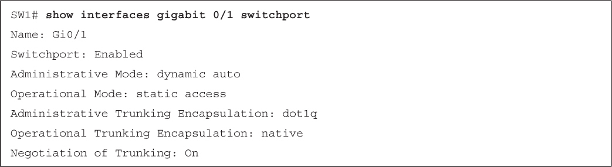</a>

</section>

</section>


<nav class="ccna-chapter-nav" aria-label="章节导航"><a href="v2-20.html">← 上一章</a><a href="v2-22.html">下一章 →</a></nav>
