
<a href="{{ '/subjects/CCNA/' | relative_url }}">← 返回 CCNA 目录</a>

第二卷 · 网络自动化

<nav class="ccna-chapter-nav" aria-label="章节导航"><a href="v2-21.html">← 上一章</a><a href="v2-23.html">下一章 →</a></nav>



<section data-epub-type="chapter">

<h2 class="h2" id="ch22">第 22 章</h2>

<h2 class="h2a">Cisco 软件定义接入（Cisco SD-Access）</h2>

本章涵盖以下考试主题：

1.0 网络基础

1.1 解释网络组件的作用和功能

1.1.e 控制器

6.0 自动化和可编程性

6.1 解释自动化对网络管理的影响

6.2 比较传统网络和基于控制器的网络

6.3 描述基于控制器的软件定义架构（覆盖网络、底层网络和网络结构）

6.3.a 控制平面与数据平面的分离

6.3.b 北向和南向 API

6.4 解释 AI（生成式和预测式）及机器学习在网络运维中的作用

Cisco 软件定义接入（SD-Access）是一种通过软件定义方式构建融合有线和无线园区网络或 LAN 的方法。名称中的<em>接入</em>指包含核心层、汇聚层和接入层的三层网络架构设计。接入层是终端设备连接网络的位置，而<em>软件定义</em>指<a href="v2-21.html#ch21">第21章</a>“<a href="v2-21.html#ch21">基于控制器的网络简介</a>”中讨论的许多软件定义架构特征。这些特征包括名为 Cisco Catalyst Center 的集中式控制器，以及南向和北向协议与 API。与传统网络相比，Cisco SD-Access 还采用完全不同的运维模型。Cisco SD-Access 创建由底层网络和覆盖网络组成的网络结构（fabric）。

注意

Cisco DNA Center 已更名为 Cisco Catalyst Center，但所有特征和功能保持不变。更多信息请访问 <a href="http://www.cisco.com/go/catalystcenter">www.cisco.com/go/catalystcenter</a>。

Cisco SD-Access 是 Cisco 的主要园区网络方案，属于 Cisco 数字网络架构（DNA）。Cisco DNA 为软件定义网络、数字化以及未来 Cisco 网络的运维方式定义整体架构。本章介绍作为 Cisco DNA 一种实现的 Cisco SD-Access。

对 Cisco SD-Access 和 Cisco DNA 的讨论，为介绍 CCNA 大纲中的另外一些主题提供了良好背景：Cisco Catalyst Center 控制器和网络管理。Cisco SD-Access 使用 Cisco Catalyst Center 控制器来配置和操作网络。不过，Cisco Catalyst Center 也是完整的网络管理平台。要理解它，还需要了解传统网络管理，以及使用控制器的新管理模型。

<section>

<h3 class="h3" id="ch22lev1sec1">“这些知识我已经掌握了吗？”自测</h3>

如果你希望根据得分决定在本章投入多少时间，可以完成这组自测题（在此作答，或使用 PTP 软件）。各题答案的选项字母列在自测题之后的页面底部。书末和配套网站上的<a href="#ref-appc">附录 C</a>都包含答案及解析。你也可以在 PTP 测试软件中找到答案及解析。

<figure class="table" id="ch22tab01" tabindex="0">

<figcaption>

<strong>表22-1</strong> “这些知识我已经掌握了吗？”基础主题小节与题目对应关系

</figcaption>

<table class="all">

<tbody>

<tr>

<th class="th">
基础知识小节
</th>

<th class="th">
题目
</th>

</tr>

<tr>

<td class="border">
Cisco SD- Access Fabric, 内置和重叠
</td>

<td class="border">
1–3
</td>

</tr>

<tr>

<td class="border">
Cisco Catalyst Center和Cisco SD-Access操作
</td>

<td class="border">
4, 5
</td>

</tr>

<tr>

<td class="border">
Cisco Catalyst Center作为网络管理平台
</td>

<td class="border">
6
</td>

</tr>

<tr>

<td class="border">
人工智能(AI)、机器学习(ML)和业务管理
</td>

<td class="border">
7
</td>

</tr>

</tbody>

</table>

</figure>

<strong><a id="quess22_1" href="#ques22_1a">1</a>.</strong>在Cisco Software-Defined Access(Cisco SD-Access)中,哪个术语指的是设备与电缆,同时配置让网络设备节点足够IP连接到彼此发送IP包?

<ol class="lower-alpha">

<li>
网络结构
</li>

<li>
覆盖网络
</li>

<li>
底层网络
</li>

<li>
VXLAN
</li>

</ol>

<strong><a id="quess22_2" href="#ques22_2a">2</a>.</strong>在Cisco Software-Defined Access(Cisco SD-Access)中,哪一个术语是指利用入侵和被入侵织物节点之间的隧道在整个网络中发送端点包的功能?

<ol class="lower-alpha">

<li>
网络结构
</li>

<li>
覆盖网络
</li>

<li>
底层网络
</li>

<li>
VXLAN
</li>

</ol>

<strong><a id="quess22_3" href="#ques22_3a">3</a>.</strong>在Software-Defined Access(Cisco SD-Access)中,哪个答案是覆盖数据平面的一部分?

<ol class="lower-alpha">

<li>
LISP
</li>

<li>
GRE
</li>

<li>
OSPF
</li>

<li>
VXLAN
</li>

</ol>

<strong><a id="quess22_4" href="#ques22_4a">4</a>.</strong>使用 Cisco Catalyst Center和 Cisco SD-Access 如何使用可缩放的小组来实施安全, (取出二个答.

<ol class="lower-alpha">

<li>
一个来自 Cisco Catalyst Center GUI 的人类用户
</li>

<li>
使用 NETCONF 的自动化应用程序
</li>

<li>
使用 Cisco SD-Access 织物边缘节点的 CLI 的人类用户
</li>

<li>
使用 REST 的自动化应用程序
</li>

</ol>

<strong><a id="quess22_5" href="#ques22_5a">5</a>.</strong>下列哪些协议或工具可以作为Cisco Catalyst Center南行接口的一部分? (选取三答.

<ol class="lower-alpha">

<li>
Ansible
</li>

<li>
SSH
</li>

<li>
NETCONF
</li>

<li>
SNMP
</li>

<li>
木偶
</li>

</ol>

<strong><a id="quess22_6" href="#ques22_6a">6</a>.</strong>以下哪些是传统网络管理软件以及思科催化中心所执行的网络管理功能? (取出二个答.

<ol class="lower-alpha">

<li>
网络设备的发现
</li>

<li>
软件定义接入配置
</li>

<li>
带有ACL分析的端到端路径发现
</li>

<li>
设备安装(第0天),配置(第1天),以及监测(第N天)操作
</li>

</ol>

<strong><a id="quess22_7" href="#ques22_7a">7</a>.</strong>什么是狭义AI和生成式 AI的区别?

<ol class="lower-alpha">

<li>
狭义AI缺乏广泛的认知能力,而GenerativeAI则在有限范围内蓬勃发展.
</li>

<li>
狭义AI是为特定任务而设计的,而"生成式 AI"则能够学习和决策.
</li>

<li>
狭义AI包括语音识别等应用程序,而Generative AI则专注于ChatGPT等对话平台.
</li>

<li>
狭义AI依赖于明确的编程,而Generative AI则从数据来源学习模式和关系.
</li>

</ol>

“这些知识我已经掌握了吗？”自测答案：

<strong><a id="ques22_1a" href="#ref-ques22_1">1</a></strong> C

<strong><a id="ques22_2a" href="#ref-ques22_2">2</a></strong> B

<strong><a id="ques22_3a" href="#ref-ques22_3">3</a></strong> D

<strong><a id="ques22_4a" href="#ref-ques22_4">4</a></strong> A, D

<strong><a id="ques22_5a" href="#ref-ques22_5">5</a></strong> B, C, D

<strong><a id="ques22_6a" href="#ref-ques22_6">6</a></strong> A, D

<strong><a id="ques22_7a" href="#ref-ques22_7">7</a></strong> B

</section>

<section>

<h3 class="h3box" id="ch22lev1sec2">基础主题</h3>

</section>

<section>

<h3 class="h3" id="ch22lev1sec3">Cisco SD-Access 网络结构、底层网络与覆盖网络</h3>

思科<a id="key_332" href="#ref-gloss_322">软件定义接入</a> (<a id="key_322" href="#ref-gloss_072">Cisco SD-Access) (英语).</a>与本作大多数章节所讨论的传统联网方法相比,创造了一种全新的构建校园局域网的方法. 在2010年代中期,思科开始准备重新构思校园网络,由思科SD-Access由此而来.

Cisco SD-Access 使用在<a href="v2-21.html#ch21">第21章</a>,带有控制器和各种API。 Cisco SD-Access 网络仍然使用收集物理联网设备,如路由器和交换机以及电缆和其他各种端点设备。 网络的顶端是Cisco Catalyst Center控制器,如以下所示:<a href="#ch22fig01">图22-1</a>。Cisco Catalyst Center是用户利用图形用户接口(GUI)进行设计,配置和执行设置的地方,控制器通过利用API提供自动化. 简言之,Cisco Catalyst Center是Cisco SD-Access网络的控制器.

<figure class="image-c" id="ch22fig01">

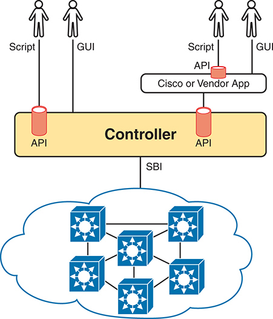

<figcaption>

<aside class="hidden" id="a22fig01">

该图显示了通过不同接口与控制器互动的各种用户. 控制器(Controller):架构的核心部分,被贴上标签的控制器,管理网络. 它与几个应用程序编程接口A P Is相接,方便了与脚本,图形用户接口,G U Is和第三方应用程序的交互. 用户:在左侧,一个用户通过脚本与控制器互动,而GUI通过API互动. 在右侧,另一个用户使用一个脚本,GUI,和一个Cisco或供应商应用程序来与控制器交互. API和SBI:强调了用户与控制器之间的API连接,以及Southbound接口、SBI、控制器与网络设备的连接。 这些接口可以使网络得到有效的管理和自动化。 网络设备:在控制器下方显示由互联互通的网络设备组成的网络织物. 这些设备由控制器管理和控制,以确保无缝网络操作和政策执行.

</aside>

<strong>图22-1</strong> <em>Cisco SD-Access 建筑模型与 Cisco Catalyst Center</em>

</figcaption>

</figure>

在建筑方面,控制器向南侧有布料等构件,底板和上盖等. 通过设计SDN的应用,大多数有趣的新能力都发生在北边,本章下半部分对此进行了考察. 本章上半部分审查了控制器以南的细节——即:下接网、上接网和布料。

<a id="key_333" href="#ref-gloss_347">底层网络</a><strong>:</strong>物理装置和连接,包括有线和无线装置,为校园局域网内所有节点提供IP连接. 骨干网络的主要目标是向所有思科SD-Access设备提供可达性,以支持动态创建Virtual eXtensible Local-Arena网络(<a id="key_334" href="#ref-gloss_373">VXLAN</a>) 覆盖地道.

<a id="key_329" href="#ref-gloss_242">覆盖网络</a><strong>:</strong>收集使用VXLAN地道的设备,这些地道是在Cisco SD-Access的其他设备如交换机和布料辅助接入点之间创建的. 重叠用于从一个端点到另一个端点来运输织物.

<a id="key_323" href="#ref-gloss_140">网络结构</a><strong>:</strong>叠接和嵌入技术的结合,这些技术共同提供了所有特性,可以在整个网络中提供具有所希望的特性和属性的数据。 这个可以是构成织物的所有装置或子集. 这也意味着在思科SD-Access网络中可以存在多层织物.

VXLAN在RFC 7348中被定义为一种用于创建可以跨越不同物理位置或设备的虚拟网络的技术. 它可以使设备之间的交流更加灵活和可扩展. VXLAN将数据封装,将第2层网络延伸至第3层网络,并经常在数据中心和云层环境中被看到. 这种技术可以帮助提高网络效率并满足现代应用日益增长的需要.

在Cisco SD-Access中,一个主要的用途是叫做<em>主机移动性</em>。随着无线成为更通俗的连接方法,用户在一个典型的工作日间从位置移动到位置更为常见. 这些地点可以从用户的办公桌到休息室,也可以从数据中心到呼叫中心。 在许多情况下,用户不再在公司校园环境中坐同位置工作. 这包括被窃听。 用户可以在其他办公桌或会议室移动并插入网络插座.

通过这种情景思考,用最简单的术语来说,意味着一个用户可以从一个有IP地址和一套安全规则的无线网络跳到另一个有不同IP地址和一组安全规则或访问控制列表的VLAN或子网. 通常,这种能力是通过DHCP处理的,希望网络管理员有适当的安全政策,以确保用户从网络的一个区域到另一个区域时适用同样的规则。 在许多网络中,这常常是一个人工过程。 必须采取一些行动,改变从技术和用户经验的角度对待用户的方式。 例如,如果一个用户从大楼的一个区域移动到另一个区域,然后由于缺少访问控制列表条目而突然无法访问对任务至关重要的应用程序,这对试图完成工作的用户造成问题。

在不太正式的意义上,底线作为多层交换机及其连接而存在,与IP连接——但出于特殊目的。 由端点设备所发送的交通通过VXLAN隧道在覆被中通过一个完全不同于传统局域网切换和IP路由的过程来流出.

例如,考虑一下从网络左边的主机发送包的想法,在Cisco SD-Access上发送包到右边的主机. 例如,想象一个包在实体网络左侧的下方进入<a href="#ch22fig02">图22-2</a>最终离开校园 将SW2切换到最右边 这个地底网看起来是更传统的网络绘图,有好几种装置和链接.

<figure class="image-c" id="ch22fig02">

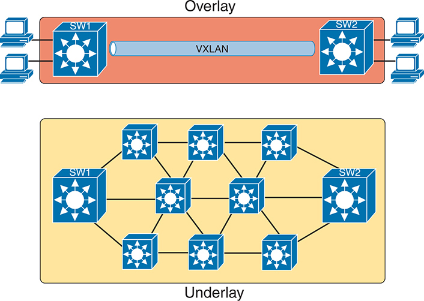

<figcaption>

<aside class="hidden" id="a22fig02">

重叠:图像的上部代表了覆盖网络,它使用VXLAN,Virtual Absoluteble LAN,在物理网络上创建虚拟化的层. 这个层连接了交换机,SW 1和SW 2等设备以及计算机,提供了无缝而灵活的网络体验. 下架:图像的下架部分代表下架网络,由物理网络基础设施所组成. 它包括多个互联互通的网络设备,形成网状地貌,为覆盖网络提供基础连接.

</aside>

<strong>图22-2</strong> <em>包件、底件和重叠概念</em>

</figcaption>

</figure>

<section>

该图上方的上方图上只显示两个交换机,即所谓的织物边缘节点,因为它们恰好位于思科SD-Access织物的边缘,有一个隧道标记为VXLAN连接两者。 这两个概念(内接和外接)共同创建了思科SD-Access织物.

下几页更深入地解释了底部和上覆部分。

<h4 class="h4" id="ch22lev2sec1">Cisco SD-Access 底层网络</h4>

与 Cisco SD-Access 相通,地底存在以提供校园环境中织物边缘节点之间的连通性,目的是支持上覆网中的VXLAN地道. 要做到这一点,底线包括用于创建物理网络的交换机、路由器、电缆和无线链接。 它还包括了底板的配置和操作,以便能支持上覆网的工作.

<section>

<h5 class="h5" id="ch22lev3sec1">使用现有设备构建 Cisco SD-Access 底层网络</h5>

为了建立一个思科SD-Access内幕网络,公司有两种基本选择. 他们可以使用现有校园网络的被支持模型并添加出新的配置来创建一个地底网络,同时仍然通过传统的路由和切换来支持他们现有的生产流量. 另外,公司可以购买一些新的催化交换机并建造Cisco SD-Access网络,而不必担心会损害现有的流量,并随着时间的推移将端点迁移到新的网络织物上.

为了把思科SD-Access建设成一个现有的网络,它帮助人们思考一下一些典型的校园网络设计. 较大的校址可采用二等或三级设计,如上文所讨论。<a href="v2-18.html#ch18">第18章</a>, “<a href="v2-18.html#ch18">局域网架构</a>”它拥有一组无线局域网控制器(WLCs)来支持一些轻量级AP(LWAPs). 工程师配置了VLAN,VLAN干线,IP路由,IP路接协议,ACL等设备. 而局域网连接到WAN路由器.

Cisco SD-Access可以被添加到现有的校园局域网中,但这样做有一定的风险和限制. 首先,在给网络添加新功能的同时,要注意不要打乱当前的网络. 问题包括:

<ul class="sq">

<li>
由于可能损害现有的生产配置,<a id="key_321" href="#ref-gloss_070">思科催化剂中心</a>如果设备目前用于生产,则不应用于配置底板。 (Cisco Catalyst Center将用来配置使用所有新硬件的布置后台. )
</li>

<li>
现有的硬件必须来自Cisco SD-Access兼容列表,根据不同的角色而支持不同的模型(请参见链接 at<a href="http://www.cisco.com/go/sd-access">www.cisco.com/go/sd-access</a>).
</li>

<li>
设备软件级别必须满足要求,基于其作用,详见同一兼容性清单。
</li>

</ul>

例如,一个企业碰巧有一个使用Cisco SD-Access兼容硬件的现有校园网络。 该公司在少数情况下可能需要更新监督办的版本。 此外,工程师们还需要手动配置Cisco SD-Access设备的底部部分,而不是与Cisco Catalyst Center进行配置,因为Cisco假设现有的网络已经支持了生产流量,所以他们希望客户直接参与这些修改.

Cisco SD-Access内置配置要求您思考并选择每个设备所填充的不同角色,然后才能决定使用哪些设备以及每个设备需要的最小软件级别. 如果您要查找链接到的硬件兼容性列表<a href="http://www.cisco.com/go/sd-access">www.cisco.com/go/sd-access</a>,您将会根据角色的不同,看到不同的支持硬件和软件列表. 这些角色包括:

<a id="key_324" href="#ref-gloss_141">Fabric 边缘节点</a><strong>:</strong>连接到端点设备的交换机(类似于传统的接入或叶交换机)

<strong>Fabric 边框节点 :</strong>连接到思科SD-Access控制之外的设备的交换机——例如连接到WAN路由器或ACI数据中心的交换机

<strong>工艺控制-平面节点:</strong>一个为内饰( LISP) 执行特殊控制平面功能的交换机, 需要更多的 CPU 和内存

例如,Cisco的相容性列表包括了许多催化剂9200,9300,9400,9500和9600系列交换机,但也有一些更古老的催化剂3850和3650交换机,作为织物边缘节点. 然而,有些产品并没有将清单列为织物边缘节点。 对于布料控制节点,列表中包括了更高端的催化交换机模型(通常有较多的CPU和RAM),外加多款路由器模型(路由器通常有更多的RAM用于控制平面协议存储——例如用于路由协议).

Cisco SD-Access项目的开始,需要你看看现有的硬件和软件,以便开始决定现有的校区是否是用现有的齿轮来建造织物或者在建造新的校区织物局域网时升级硬件的好人选.

</section>

<section>

<h5 class="h5" id="ch22lev3sec2">使用新设备构建 Cisco SD-Access 底层网络</h5>

当为Cisco SD-Access 织物购买新硬件时, 也就是一种绿地设计时, 你消除了现有的许多挑战 而不是将 Cisco Sd-Accuse 部署在现有的齿轮上。 你可以简单地订购相容的硬件和软件. 一旦它到达,你就可以利用 Cisco Catalyst Center,然后自动配置所有地底特性。

同时,仍需要作出通常的校园局域网设计决定. 企业将Cisco SD-Access作为建设和运营校园网络的更好方式,但它仍然是校园网络. 它需要为各类用户和设备提供接入和连接. 在规划绿地思科SD-Access设计时,计划使用适当的相容硬件,但也考虑这些传统的局域网设计点:

<ul class="sq">

<li>
每个接线柜的交换机所需端口数
</li>

<li>
需要的端口速度
</li>

<li>
每个接线柜都装一个交换机堆栈的好处
</li>

<li>
已经安装的电缆长度和电缆类型
</li>

<li>
电力需求(PoE/PoE+)
</li>

<li>
每个新交换机的电源与 PoE 电源要求
</li>

<li>
交换机之间连接的连通能力(速度和连通次数)
</li>

</ul>

就地貌而言,传统的校园设计确实告诉我们如何连接设备,但是Cisco SD-Access并不需要遵循这些传统规则. 为了审查,传统的校园局域网图层2设计(如前文所述)<a href="v2-18.html#ch18">第18章</a>),告诉我们将每个接入交换机连接到两个不同的汇聚层交换机,但不连接到其他接入层交换机,如以下所示:<a href="#ch22fig03">图22-3</a>。接入层交换机作为-2交换机,VLAN仅限于这3个交换机.

<figure class="image-c" id="ch22fig03">

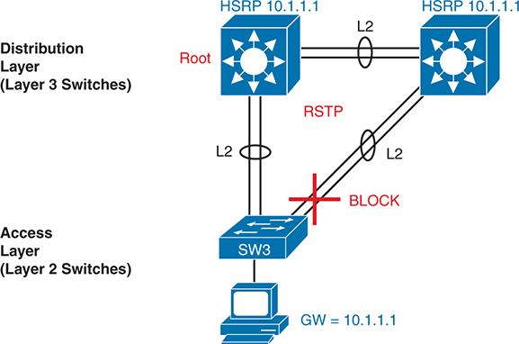

<figcaption>

<aside class="hidden" id="a22fig03">

在顶部显示两个汇聚层交换机,每个交换机都贴有HSRP标签 10.1.1.1 并按图层连接 2 2 ,链接。左交换机被标记为 " 根 " ,表示其在STP地形中的作用。右交换机通过两个L连接到左交换机。 2 链接,其中之一标记为 RSTP 用于快速拓扑树协议。底交换机,标签为 SW 。 3 ,是访问层的一部分,并通过L连接到两个分配层交换机 2 链接。其中一条链接被标记为红色的 BLOCK, 表示它处于被屏蔽状态, 以防止循环, 由 STP 执行 。 此外, 还有一个计算机连接到 S W 。 3 ,有网关,GW,设置到 10.1.1.1 。这一设计显示在传统地层中使用STP管理冗余链接并预防网络循环 2 访问层设置 。

</aside>

<strong>图22-3</strong> <em>传统访问层设计: STP 三三角三个交换机</em>

</figcaption>

</figure>

通过图中显示的一些传统特征来思考. 汇聚层交换机-Layer 3交换机-作为主机使用的默认网关,并通常执行HSRP以更好地提供. 该设计使用超过一个连接到分配层交换机的上行链路,由Lyer 2 EtherChannels进行,除了冗余外还可以进行平衡. STP/RSTP管理校园中少量的第2层冗余,通过阻塞一些端口的交通来防止循环.

相比而言,绿地Cisco SD-Access织物使用<em>路由接入层</em>设计。 路由接入层设计早在Cisco SD-Access之前就已经左右了,但是Cisco的SD-Acess很好地利用了这一设计,它对于地底非常有效,目标是在覆盖网络中支持VXLAN地道. 一个有路由的接通层设计仅仅意味着所有的局域网交换机都是第3层交换机,并启用了路由,所以所有交换机之间的连接都作为第3层连接运行. 这也意味着在被屏蔽的状态下没有链接,并且由于受STP的影响而没有被使用. 这增加了可用带宽和容量,因为所有连接都用于路由交通,而不是一些闲置。

当指定一个绿地 Cisco SD-Access 部署时, 您可以识别您想要 Cisco Catalyst Center配置的齿轮, 它将处理这些设备上底板的配置 。 包括使用<em>路由接入层</em>。因为这是一个绿地部署,思科催化中心知道它可以配置交换机和无线设备,而不用担心对生产网络造成伤害. 思科催化中心将选择最佳地底配置,支持思科SD-Access布料设计.

Cisco Catalyst Center提供的典型地底布局包括了以下特征,但可以根据具体设计要求进行修改: 1.

<ul class="sq">

<li>
所有交换机都起到第3层交换机的作用.
</li>

<li>
交换机使用IS-IS路由协议.
</li>

<li>
所有交换机之间的链接(单链路,以太通道)都是路由第3层链接(不是第2层链接).
</li>

<li>
因此,STP/RSTP并不需要,取而代之的是路由协议根据IP路由表选择使用哪些链接.
</li>

<li>
等同传统接入层交换机——一种织物边缘节点——作为端点设备的默认网关,而不是分配交换机。
</li>

<li>
因此,不再需要高压方案(或任何FHRP)。
</li>

</ul>

<a href="#ch22fig04">图22-4</a>重复与其中相同的物理设计<a href="#ch22fig03">图22-3</a>但显示使用 Cisco Catalyst Center配置的路由访问设计的不同特性。

<figure class="image-c" id="ch22fig04">

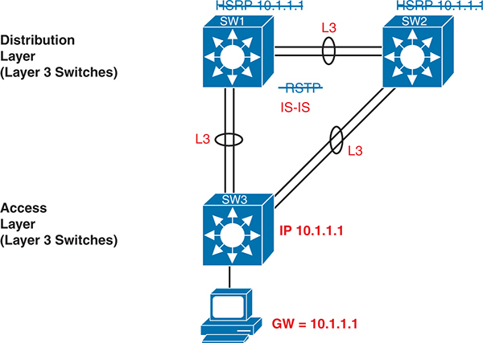

<figcaption>

<aside class="hidden" id="a22fig04">

在顶部,两个被标注为S W-1和S W-2的汇聚层交换机分别连接到一个层-3链接,L-3,与HSRP,热备用路由器协议,I P-10.1.1.1. SW-1+和SW-2+的连接用I S switch I S表示中间系统到中间系统协议,表示在织物内部使用路由协议. 底交换机被标注为S W-3,通过L-3链接连接到两个汇聚层交换机. 连接到SW-3的计算机有它的网关,GW,设定为10.1.1.1,与HSRPIP相同. 该图显示了L-3在S D破碎的接通面料中访问的好处,包括与传统的L-2设计相比,高效的路由和降低复杂性. 这个设置凸显出在现代S D 破碎访问环境中,在访问层使用Letle 3路由实现的网络性能和可扩展性得到了改进.

</aside>

<strong>图22-4</strong> <em>Cisco SD-Access 第3层</em>

</figcaption>

</figure>

注意

Cisco Catalyst Center为一个企业的Cisco SD-Access的每个实例配置了一致的设置。 这项公约简化了业务,因为企业完成向思科SD-Access的迁移。

</section>

</section>

<section>

<h4 class="h4" id="ch22lev2sec2">Cisco SD-Access 覆盖网络</h4>

当你第一次想到 Cisco SD -Access 重叠时, 想想这种序列。 首先,一个端点发出一个帧,它将通过Cisco SD-Access网络传送. 第一个接收帧的布料边缘节点将帧封装在一个新信息中——使用地道规格VXLAN——并将帧推进到布料中. 一旦入侵的织物边缘节点已经封装了VXLAN中的原始帧后,其他织物节点根据VXLan地道细节向外转发了这个帧. 路径中最后一个布料边缘节点去掉了VXLAN的细节,留下了原相框,将原相框向目的地终点前进.

虽然上段Cisco SD-Access中的一些概括步骤可能听起来像很多工作,但所有的工作都发生在每个交换机的ASIC中. 因此,虽然理解起来更为复杂,但交换机执行额外工作与硬件一样没有性能的处罚.

Cisco选择使用VXLAN地道,为一些没有VXLan就不存在的新网络功能开辟了许多可能性. 接下来的话题首先是更仔细地查看上覆层中的VXLAN地道,然后讨论思科SD-Access如何使用Locator/ID分离协议(英语:Locater/ID Selection Protocol).<a id="key_327" href="#ref-gloss_193">LISP</a>用于建立VXLAN地道所需的端点发现和位置信息。

<section>

<h5 class="h5" id="ch22lev3sec3">覆盖网络中的 VXLAN 隧道（数据平面）</h5>

Cisco SD-Access除了简单的消息传送之外,还有许多额外的需要——这些需要可以提供更好的功能。 为此,织物不仅会路由IP包或切换以太网帧;它会将接入的数据链接帧封装在隧道技术中,以通向织物网络的传送. VXLAN 必须在 Cisco SD-Access 织件中坚持以下功能:

<ul class="sq">

<li>
VXLAN地道通(封装和去封装)必须由ASIC在每个交换机上进行,以便没有性能处罚. (这是Cisco SD-Access硬件相容性列表的一个原因:交换机必须有ASIC来进行工作. 这些被称为统一存取数据计划[UADP]ASICs.
</li>

<li>
VXLAN封装必须提供Cisco SD-Access为其特性需要的头字段,因此地道协议应当灵活而可扩展,同时仍由交换机ASICs支持.
</li>

<li>
地道封装需要封装整个数据链接帧,而不要封装IP包. 这使得Cisco SD-Access能够支持第2层转发特性以及第3层转发特性.
</li>

</ul>

为了实现这些目标,在创建Cisco SD-Access时,Cisco选择了VXLAN协议来创建Cisco SD- Access使用的地道. 当一个端点(例如终端用户计算机)将一个数据链接帧发送到织物边缘节点时,入侵织物边缘节点会封装这个帧并穿过一个VXLAN隧道发送到入侵织物边缘节点,如上所示.<a href="#ch22fig05">图22-5</a>.

<figure class="image-c" id="ch22fig05">

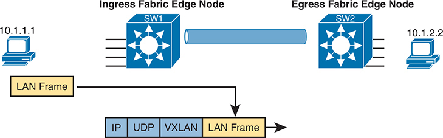

<figcaption>

<aside class="hidden" id="a22fig05">

在左侧,有一台带有IP地址10.1.1.1的计算机,连接到一个被识别为S W1的"入侵平面"(Ingress Fabric Edge Node). ALAN Frame由计算机传输到S W 1,然后用VXLAN来封装帧. 此封装过程在主图下详细列出,显示由VXLAN所包裹的局域网帧,而由UDP(用户数据协议)和IP(互联网协议)头来封装. 封装后的数据再通过被描绘为蓝色圆柱形连接的VXLAN地道传递给被标注为SW-2的"Egress Fabric Edge Node". 在右侧,另一台IP地址为10.1.2.2的计算机在被S W-2所斩后接收了局域网帧.

</aside>

<strong>图22-5</strong> <em>Cisco SD-Access中的 VXLAN 封装基础</em>

</figcaption>

</figure>

为了支持VXLAN封装,与企业的其余部分相比,内饰使用单独的IP地址空间,包括通过Cisco SD-Access网络发送数据的端点设备. 覆盖地道使用企业地址空间的地址. 例如,想象企业使用这些地址空格:

<ul class="sq">

<li>
10.0.0.0/8: 全部企业
</li>

<li>
172.16.0.0/16: Cisco SD-Access 底盘
</li>

</ul>

为了做到这一点,首先将使用172.16.0.0/16 IPv4地址空间来建立主线,所有链接都使用该地址空间的地址。 举例来说,<a href="#ch22fig06">图22-6</a> 显示一个小的 Cisco SD-Access 设计,有四个交换机,每个交换机都显示一个内置IP地址(来自172.16.0.0/16地址空间).

<figure class="image-c" id="ch22fig06">

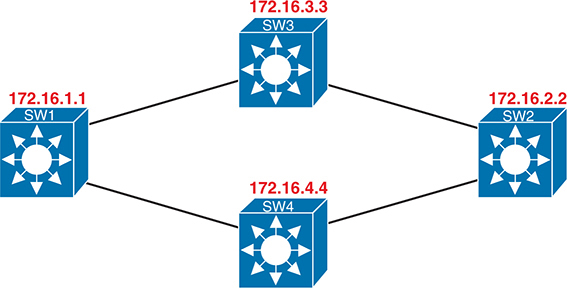

<figcaption>

<aside class="hidden" id="a22fig06">

它展示了一个简单的网络地貌,四个互联互通的交换机标有:S W +1,S W +2,S W →3,以及S W →4,每个交换机都指定了在 +172.16 dot x dot x 子网范围内的 I P 地址. SW-1有IP地址172.16.1.1,SW-2为172.16.2.2,SW-3为172.16.3.3,SW-4为172.16.4.4. 交换机通过代表网络链接的行相接,形成网状结构. 这个下架网络为上架网络提供了物理和路由基础设施,便利了Cisco S D slight Access架构内有效的数据包传输和网络分解.

</aside>

<strong>图22-6</strong> <em>使用172.16.0.0的 Cisco SD- Access 底板</em>

</figcaption>

</figure>

覆接地道在覆接地道IP地址空间中创建出两个织物边缘节点之间的路径,它位于企业中所有端点所使用的同一地址空间.<a href="#ch22fig07">图22-7</a>以显示左右端点(PC)来强调这一点,其中IP地址为10.0.0.0/8网络,VXLAN覆盖地道显示地址同样来自10.0.0.0/8.

<figure class="image-c" id="ch22fig07">

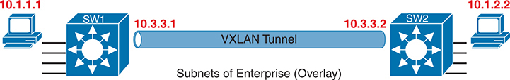

<figcaption>

<aside class="hidden" id="a22fig07">

在左侧,一个带有 I P 地址10.1.1.1的装置被连接到一个被标记为 S W-1的交换机上,它有一个 I P 地址是10.3.3.1. 这个交换机通过一个VXLAN地道连接到右边的另一个被标注为S W 的交换机2,它有一个IP地址为 10.3.3.2. S W 2 连接到一个设备,I P地址为 10.1.2.1 . VXLAN地道被描绘为S W-1和S W-2的蓝色连接,使得两个子网(-10.1.1.0/24和-10.1.2.0/24)能够通过上覆网通信,尽管有可能被物理分离.

</aside>

<strong>图22-7</strong> <em>VXLAN 有 IPv4 地址的隧道和终点在相同的 IPv 空间</em>

</figcaption>

</figure>

</section>

<section>

<h5 class="h5" id="ch22lev3sec4">使用 LISP 进行覆盖网络发现与定位（控制平面）</h5>

暂时忽略 Cisco SD-Access, 想想传统的 第2层切换和 第3层的路由 。 他们的控制飞机如何运作? 换句话说,这些设备是如何在网络中发现可能的目的地,存储这些目的地的,这样数据平面就拥有了在作出转发决定时所需的全部数据? 总结如下:

<ul class="sq">

<li>
传统的第2层交换机通过检查输入帧的源MAC地址来学习可能的目的地,并将这些MAC地址存储在交换机的MAC地址表中,作为未来可能的目的地. 当新的帧到达时,Layle 2切换数据平面,然后试图将以太网帧的目的地MAC地址与其MAC地址表中的条目相匹配.
</li>

<li>
传统地层3路由器使用路由协议来学习目的地IP子网,将路由存储到其路由表中的每个子网. 当新包到来时, 第3层数据平面试图将IP包的目的地IP地址与IP路由表的某些条目相匹配.
</li>

</ul>

Cisco SD-Access 网络中的节点<em>没有</em>做这些相同的控制平面动作 支持端点流量。 为CCNA的目的提供过程的一览,考虑一下这个序列,它描述了一种情景:

<ul class="sq">

<li>
Fabric边缘节点——连接到织物边缘的Cisco SD-Access节点——根据它们的MAC地址,单个IP地址,通过子网,用端点标识符(EID)识别出每个端点的位置,使用传统手段学习可能的端点位置.
</li>

<li>
织物边缘节点将节点可以到达给定的端点(EID)注册成一个名为LISP映射服务器的数据库.
</li>

<li>
LISP映射服务器保留了端点标识符列表(EID)和匹配的路由定位器(RLOCs)(它识别出可以到达EID的织物边缘节点).
</li>

<li>
未来,当布料数据平面需要转发消息时,它将在LISP地图服务器的数据库中寻找并找到目的地.
</li>

</ul>

例如,交换机SW3和SW4<a href="#ch22fig08">图22-8</a>每个人刚刚得知 不同的子网 外部的思科SD -Access织物。 如图中步骤1所指出,交换机SW3向LISP映射服务器发送了一条消息,注册了子网10.1.3.0/24(一个EID)的信息,其RLOC设置可以表明自己是能够到达该子网的节点. 步骤2显示一个相当的注册过程,这次是SW4,其中EID为10.1.4.0/24,R4的RLOC为172.16.4.4. 请注意,该图下方的表格代表LISP映射服务器所持有的数据.

<figure class="image-c" id="ch22fig08">

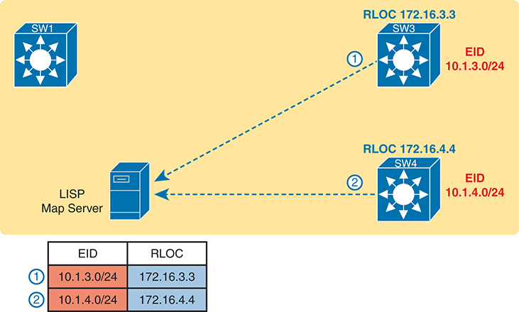

<figcaption>

<aside class="hidden" id="a22fig08">

在这个设置中,有两个交换机,即S W-3和S W-4,各自的RLOC(跑道定位器)地址分别是:172.16.3.3和172.16.4.4. 与 EID 相關的 S W 3同 EID 10.1.3.0/24同 LISP 映射伺服器登记其前缀. 同样,与 EID 相關的 S W 4同为 EID 10.1.4.0/24也向LISP 映射服务器注册了它的前缀. LISP映射服务器为将E I Ds映射到RLO Cs提供方便,使得网络内部能够高效地进行路由. 图像下方包含一个表格,汇总了E I Ds及其相应的RLO Cs,为网络流量管理提供了清晰的映射.

</aside>

<strong>图22-8</strong> <em>边缘节点注册 IPv4 前缀( Endpoint ID) 与 LISP 映射服务器</em>

</figcaption>

</figure>

当新进入的帧到来时,入侵隧道路由器(ITR)——从织物外接新帧的Cisco SD-Access 织物边缘节点——需要一些帮助.由于 Cisco SD-Access 总是在一些 VXLAN 隧道上向布料中转发帧, ITR 在转发帧时应该使用何种地道 ? 对于发送到目的地的第一个帧, ITR 必须遵循以下步骤这样的进程 。 3 ,作为<a href="#ch22fig08">图22-8</a>,在<a href="#ch22fig09">图22-9</a>:

<ol class="number" start="3">

<li>
通往新目的地的以太网帧会到达入侵的织物边缘节点SW1(左上方),而交换机不知道向何处转发帧.
</li>

<li>
入侵节点向LISP地图服务器发送了信息,询问LISP服务器是否知道如何到达IP地址10.1.3.1.
</li>

<li>
LISP 映射服务器在其数据库中查看,并在上一个图中找到它在 1步骤上创建的条目,列出 SW3 的 RLOC 为 172.16.3.3.
</li>

<li>
LISP 映射服务器联系 SW3 —— 作为 RLOC 列出的节点—— 以确认该条目正确 。
</li>

<li>
SW3完成向入侵的织物边缘节点(SW1)通报10.1.3.1可以通过SW3.
</li>

</ol>

<figure class="image-c" id="ch22fig09">

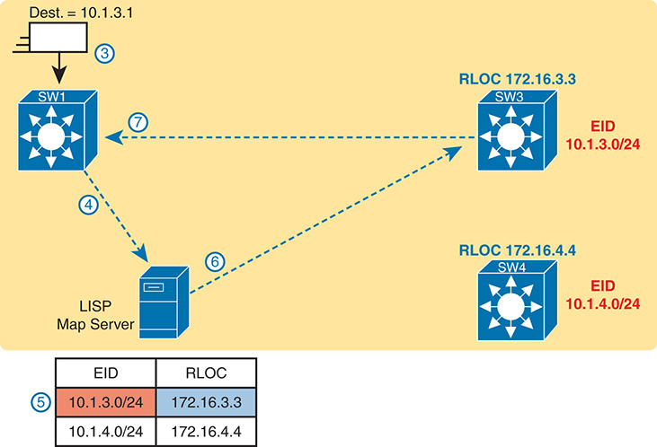

<figcaption>

<aside class="hidden" id="a22fig09">

此场景从目的地址为 10.1.3.1 的数据包到达 SW1 开始。SW1 查询 LISP 映射服务器，将目的终端标识符（EID）解析为路由定位符（RLOC）。图中的 LISP 映射服务器保存一张 EID 到 RLOC 的映射表。对于目的 EID 10.1.3.0/24，映射服务器返回 RLOC 172.16.3.3，对应 SW3。随后，SW1 使用得到的 RLOC 将数据包转发至 SW3。图中包含编号步骤和指示处理方向的箭头，逐步展示如何根据 LISP 映射将数据包送达正确目的地。

</aside>

<strong>图22-9</strong> <em>入侵隧道路由器 SW1 发现入侵隧道路道 SW3 使用 LISP</em>

</figcaption>

</figure>

为了完成这个故事,现在入侵节点SW1知道它可以将发送到末点10.1.3.1到以RLOC172.16.3.3(即SW3)的织物边缘节点(SW1封装了原始以太网帧,如所显示)的.<a href="#ch22fig09">图22-9</a>,且原目的地IP地址为10.1.3.1. 它添加了 IP , UDP 和 VXLAN 头条, 这样它就可以通过 Cisco SD- Access 网络发送消息, 而外部 IP 头条则列出目标 IPRLOC IP地址的地址,以便信息通过SW3的 Cisco SD-Access 织件到达。<a href="#ch22fig10">图22-10</a>.

<figure class="image-c" id="ch22fig10">

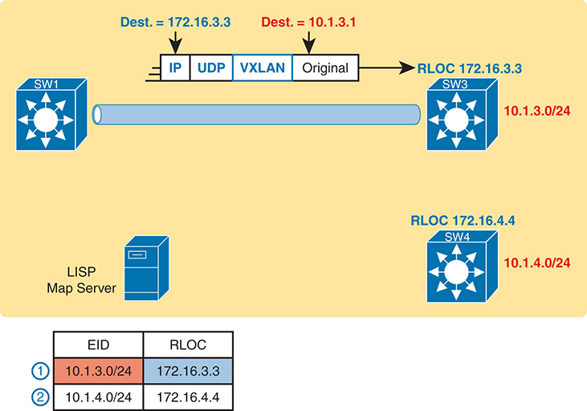

<figcaption>

<aside class="hidden" id="a22fig10">

在左上方,S W 1被用连接到一VXLAN地道来描绘,表示将原始包包包裹在VXLAN,UDP(用户数据协议)和I P(互联网协议)头的封装过程. 封装的包装包括SW-3的目的地址为172.16.3.3,而内目的地址为10.1.3.1. VXLAN地道显示通向S W-3,该地道有一条路由定位器,RLOC为172.16.3.3,是10.1.3.0/24网络的一部分. 在此下方,S W 4以 172.16.4.4的RLOC显示,为10.1.4.0/24网络的一部分. SW-3和SW-4均显示在网络内提供LISP地图和路由包的背景。

</aside>

<strong>图22-10</strong> <em>入侵隧道路由器(ITR) SW1 前进基于 LISP 映射到 SW3</em>

</figcaption>

</figure>

现在大家可以大致了解织物如何工作, VXLAN 封装是如何用来允许在织物边缘节点之间进行硬件的线速率转换的, 以及LISP如何在织物边节点之间移动时绘制终点图, 让我们回到Cisco SD-Access 的宿主移动使用例。

考虑以下情况:

当一个主机从网络的一个区域移动到另一个区域时,控制平面节点(LISP映射服务器)会跟踪该用户的EID或身份,并在从位置移动到位置时更新另一个布料边缘节点. 想想这就像邮局的邮件发送。 如果您从家中搬去另一所房屋,而未通知邮局您已搬去并提供您的新地址,您的邮件会被错误地送到您原来的房屋,变得无用. 但是,如果您使用变更地址表将您的新地址通知邮局,您的邮件将不间断地送到您的新家. 这就是宿主移动在思科SD-Access校园结构内的工作方式.

由于织物知道用户或主机的身份,因此依赖IP地址作为识别用户或主機的手段不再像曾经那样重要了. 在涉及诸如安全政策等问题时,这大大简化了问题。 举例来说,因为网络可以知道当您从位置或布料边缘移动到布料边缘时,它可以根据您的身份相对于您的IP地址执行安全政策. 这意味着无论您在哪个子网, VLAN, 您的IP地址, 无论是静态还是 DHCP, 您的安全政策都跟随用户 。 这简化了许多东西,例如必须不断加以审查的访问控制列表,以确保这些清单涵盖你可能进出的每一个子网范围,以及所有你想要允许或拒绝访问的协议或应用程序。 因为网络知道用户的身份,所以政策可以跟随他们,提供更大的安全性,并减少一个访问控制列表因用户移动到另一个子网而遗漏一个条目的人为出错的风险.

此时,你应该对思科SD-Access织物如何运作有一个基本的理解. 底线包括所有交换机和连接,以及IP连接,作为整个结构传输数据的基础. 重叠增加了不同层次的逻辑,端点流量会从VXLAN地道流出. 本章并未提及思科SD-Access可能想要使用这些地道的任何原因,但在章节结尾处你会看到一个例子. 只要说用灵活的VXLAN地道,Cisco SD-Access可以编码头字段,让CiscoSD-Acess创建出新的网络功能,都不受性能处罚,因为所有的VXLan处理都发生在UADP ASIC中.

本章下一节重点介绍思科催化中心及其在管理和控制思科SD-Access织物方面的作用.

</section>

</section>

</section>

<section>

<h3 class="h3" id="ch22lev1sec4">Cisco Catalyst Center 与 Cisco SD-Access 的运行</h3>

思科催化中心(Cisco Catalyst Center)<a href="http://www.cisco.com/go/catalystcenter">www.cisco.com/go/catalystcenter</a>有两个显著的作用:

<ul class="sq">

<li>
作为使用 Cisco SD- Access 的网络中的控制器
</li>

<li>
作为传统(非Cisco SD-Access)网络设备的网络管理平台
</li>

</ul>

作为Cisco SD-Access网络控制器的第一个角色获得了大部分的注意,是本章三大节中的第二个章节中讨论的主题. Cisco SD-Access和Cisco Catalyst Center一起走,密切配合,任何认真使用Cisco Sd-Accuse都需要使用Ciso催化中心. 然而与此同时,思科催化中心可以管理传统的网络设备;该章的最后一主要部分通过一些比较来工作.

<section>

<h4 class="h4" id="ch22lev2sec3">Cisco Catalyst Center</h4>

Cisco Catalyst Center作为软件应用程序存在,Cisco在Cisco Catalyst Center的电器上提供预先安装的软件,或者作为虚拟的电器,可以在超显像环境下运行. 该软件遵循了上述所述相同的一般控制器架构概念。<a href="v2-21.html#ch21">第21章</a>. <a href="#ch22fig11">图22-11</a>显示一般的想法。

<figure class="image-c" id="ch22fig11">

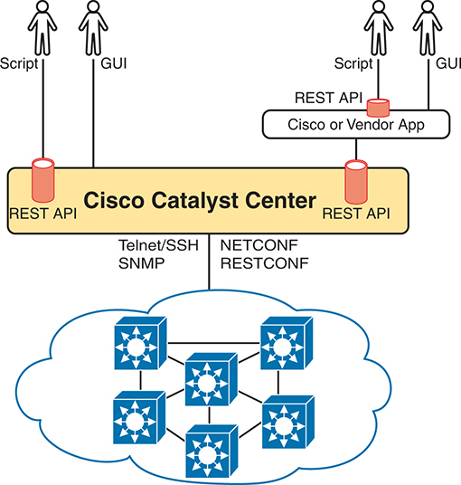

<figcaption>

<aside class="hidden" id="a22fig11">

在顶端,各种用户通过不同的方法与Cisco Catalyst Center互动:有些使用脚本,而有些则使用图形用户接口G U Is. 这些相互作用是通过RESTAP Is发生的. 此外,Cisco或供应商的应用程序也可以通过RESTAP Is与催化中心互动. 思科催化中心充当管理网络的集中控制器,它利用Telnet slash SSH,SNMP,NETCONF等南行接口与基础网络设备进行通信. 控制器下方的网络织物由互联设备所组成,由思科催化中心形成一个有管理和可控的环境,以确保高效和自动化的网络操作.

</aside>

<strong>图22-11</strong> <em>Cisco Catalyst Center,设有北行和南行接口</em>

</figcaption>

</figure>

Cisco Catalyst Center包括一个坚固的北行REST API以及一系列南行API. 对我们大多数人来说,北行的API最为重要,因为作为Cisco SD-Access网络的用户,你使用Cisco Catalyst Center北行的REST API或GUI接口与CiscoSD-Acccess互动.<a href="v2-23.html#ch23">第23章</a>, “<a href="v2-23.html#ch23">理解 REST 和 JSON</a>,”更详细地讨论REST APIs背后的概念.)

Cisco Catalyst Center支持几个向南行走的API,这样控制器就可以与它所管理的设备通信. 你可以把这分为两类:

<ul class="sq">

<li>
支持传统网络设备/软件版本的协议:Telnet、SSH、SNMP
</li>

<li>
支持较近期的联网设备/软件版本的协议:NETCONF、RESTCONF
</li>

</ul>

Cisco Catoryst Center需要更古老的协议才能支持大量更古老的Cisco设备和OS版本. 随着时间的推移,思科一直在为NETCONF和RESTCONF的更现时的硬件和软件增加支持.

</section>

<section>

<h4 class="h4" id="ch22lev2sec4">Cisco Catalyst Center 与可扩展组</h4>

Cisco SD-Access创造了许多有趣的新的和强大的特征,超越了传统校园网络的运作方式. Cisco Catalyst Center不仅能够更方便地配置和操作这些特性,而且可以彻底地改变操作模式. 虽然CCNA的范围不允许我们探索思科的所有特征SD-Access和Cisco Catalyst Center,这个下个话题将一个特征看成一个实例:可扩展组.

<section>

<h5 class="h5" id="ch22lev3sec5">传统基于 IP 的安全方式存在的问题</h5>

想象企业中一个传统IP ACL的生活. 出现了一些要求,一位工程师建造了具有三个访问控制项的ACL第一版——即:<strong>access-list</strong>命令 - 带有<strong>permit any</strong>在列表的末尾。 数月后,工程师在ACL上又增加了两行,因此ACL的ACE数量以C.<a href="#ch22fig12">图22-12</a>。图中标明了为一和二项请求所加的行数,并在图中标明了环形编号。

<figure class="image-c" id="ch22fig12">

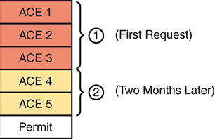

<figcaption>

<aside class="hidden" id="a22fig12">

该图被分成两节,以说明随着时间的推移所作的改变。 最初,ACL包含条目ACE 1,ACE 2和ACE 3(以红色突出). 两个月后又新增了两个条目:ACE 4和ACE 5(以黄色为主). ACL的最终条目是许可规则. 这个图有效地说明了A C Es如何随着时间推移被添加到ACL中,第一个请求涉及最初的3个A C E和随后的请求,两个月后又提出了两个A C E,从而显示了ACL配置内的演变和更新.

</aside>

<strong>图22-12</strong> <em>ACL 中的行在两个变化后</em>

</figcaption>

</figure>

如前所述,在另外四项要求导致ACL改变之后,再考虑一下同样的ACL。<a href="#ch22fig13">图22-13</a>。一些运动包括:

<ul class="sq">

<li>
要求2的ACE现在位于ACL的下方.
</li>

<li>
一些ACE,同ACE 5一样,适用于已执行的多项要求.
</li>

<li>
一些要求,如第五项要求,要求ACE与其他多项要求相重叠.
</li>

</ul>

<figure class="image-c" id="ch22fig13">

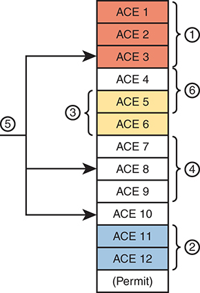

<figcaption>

<aside class="hidden" id="a22fig13">

该图显示一个A C Es的垂直堆栈,每个被标注在 ACE 从 1到 ACE 12. 条目为色码:ACE1,ACE-2,ACE-3为红色;ACE-4,ACE-5,而ACE-6为黄色;ACE-7,ACE-8,ACE-9,和ACE-10为白色;ACE-11和ACE-12为蓝色;与ACE-12相邻的注(Permit)为蓝色. 箭头指变化的插入点: 在1,2,3,4,5,和6. 它证明了ACL配置的动态性质,其中可以添加,修改,或去除条目来完善适用于网络流量的访问控制政策.

</aside>

<strong>图22-13</strong> <em>ACL 中的行( ACEs)</em>

</figcaption>

</figure>

现在想象你的下一个工作是增加 ACE 对于下一个要求(7)。 然而,你的上司也叫你缩短ACL的长度,把ACE从去年8月所做的一次更改中移除——你还记得吧? 此类任务充其量是有问题的。

假设情况为<a href="#ch22fig13">图22-13</a>,任何工程师都无法从ACL中分辨出是否可以安全取出ACL中的任何一行. 你永远不知道ACE对一项要求有用还是对多项要求有用. 如果取消了一个要求,你甚至被告知哪个旧项目产生了原来的要求,这样你就可以查看你的笔记,那么你就不会知道删除ACE是否会损害到其他要求. 大多数时候,ACL管理层会遇到这样的问题:

<ul class="sq">

<li>
ACE不能从ACL中去除,因为对于过去的某些其他要求来说,有可能导致逻辑的失败.
</li>

<li>
由于ACL的长度,新的变化变得越来越有挑战性.
</li>

<li>
解决ACLs作为一个系统的问题——确定一个包是否会从头到尾交付——成为更大的挑战。
</li>

</ul>

</section>

<section>

<h5 class="h5" id="ch22lev3sec6">基于用户组的 Cisco SD-Access 安全机制</h5>

想象一下,你可以不考虑IP地址范围 和ACLs就强制实施安全。 Cisco SD-Access就是这样做的,有简单的配置,并且能够随意地添加和去除安全政策.

首先,为大思想. 想象一下,随着时间的推移,使用Cisco SD-Access,发生了6个不同的安全要求. 对于每个项目,工程师会用Cisco Catalyst Center,用GUI或API来确定政策. 然后,根据需要,思科催化中心将配置织物中的设备,以强制执行安全性,这体现在:<a href="#ch22fig14">图22-14</a>.

<figure class="image-c" id="ch22fig14">

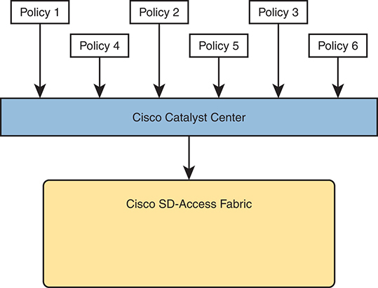

<figcaption>

<aside class="hidden" id="a22fig14">

在顶部,有6个政策(政策1至政策6)以箭指向下显示,表明它们输入了被描绘为蓝色水平块的思科催化中心. 在思科催化中心下方,又一箭指向了思科S D分机Access Fabric,显示为黄色长方形块. 该图突出显示思科催化中心在集中和管理安全政策方面的作用,然后在整个S D分机Access Fabric上执行这些政策,以确保安全和精简的网络运作。 视觉强调等级结构以及政策信息从管理层流向网络织物.

</aside>

<strong>图22-14</strong> <em>Cisco Catalyst Center IP 安全政策(北行)简化操作</em>

</figcaption>

</figure>

注意

模型在<a href="#ch22fig14">图22-14</a>帮助展示基于意图的网络的概念(ISBN). 工程师对网络所希望的意向或结果进行配置——在这种情况下,是一套安全政策。 控制器与网络中的设备进行通信,这些设备确定实现这些预期政策所需的确切配置和行为.

Cisco SD-Access政策模式解决了传统ACL的配置和操作挑战. 事实上,管理每个设备的IP ACL的所有真正问题已不再是Cisco SD-Access集团安全模型的问题。 举例来说:

<ul class="sq">

<li>
工程师可以单独考虑每一项新的安全要求,而不分析现有的(可能很长的)ACL.
</li>

<li>
可以考虑每个新的要求,而不在端点与分析每一个ACL之间的可能路径中搜索所有ACL.
</li>

<li>
Cisco Catalyst Center(和相關軟體)将政策分开,有空间来保存有关政策原因的注释.
</li>

<li>
每项政策都可以取消,而不必担心影响其他政策的逻辑。
</li>

</ul>

Cisco SD-Access和Cisco Catalyst Center通过将安全带给用户群,称为可缩放组,每个组分配一个,从而实现这一特殊特性。<a id="key_331" href="#ref-gloss_296">可缩放组标签( SGT)</a>。然后工程师配置一个网格,识别SGT可以发送到哪些其他SGT的包. 例如,电网可能包括雇员团体的SGT、互联网(用于企业通向互联网的WAN路由器)、伙伴雇员和来宾,其电网类似于<a href="#ch22tab02">表22-2</a>.

<figure class="table" id="ch22tab02" tabindex="0">

<figcaption>

<strong>表22-2</strong>Cisco SD- Access 可缩放分组访问的访问表

</figcaption>

<table class="all">

<tbody>

<tr>

<th class="th1a">
<strong>源\目的</strong>
</th>

<th class="th1">
雇员
</th>

<th class="th1">
互联网
</th>

<th class="th1">
合作伙伴
</th>

<th class="th1">
来宾
</th>

</tr>

<tr>

<td class="border-l">
雇员
</td>

<td class="border">
N/A
</td>

<td class="border-g">
许可
</td>

<td class="border-g">
许可
</td>

<td class="border">
拒绝
</td>

</tr>

<tr>

<td class="border-l">
互联网
</td>

<td class="border-g">
许可
</td>

<td class="border">
N/A
</td>

<td class="border-g">
许可
</td>

<td class="border-g">
许可
</td>

</tr>

<tr>

<td class="border-l">
合作伙伴
</td>

<td class="border-g">
许可
</td>

<td class="border-g">
许可
</td>

<td class="border">
N/A
</td>

<td class="border">
拒绝
</td>

</tr>

<tr>

<td class="border-l">
来宾
</td>

<td class="border">
拒绝
</td>

<td class="border-g">
许可
</td>

<td class="border">
拒绝
</td>

<td class="border">
N/A
</td>

</tr>

</tbody>

</table>

</figure>

要将这个安全特性链接到包转发, 请考虑当新端点试图将第一个包发送到新目的地时 。 入侵 Cisco SD-Access 织物边缘节点通过向 Cisco Catalyst Center发送消息开始一个进程. Cisco Catalyst Center随后与网络中的安全工具相配合,如Cisco的"身份服务引擎"(ISE),以识别用户,并随后与各自的SGT相匹配. Cisco Catalyst Center然后检查类似逻辑<a href="#ch22tab02">表22-2</a>。如果思科催化中心在SGT的源/目的地对之间看到许可动作,则思科催化中心指示边缘节点来创建VXLAN地道,如上所示.<a href="#ch22fig15">图22-15</a>。如果安全政策规定不应允许两个SGT通信,那么思科催化中心不会引导织物来创建地道,而包子也不会流出.

<figure class="image-c" id="ch22fig15">

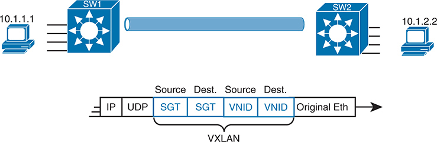

<figcaption>

<aside class="hidden" id="a22fig15">

该图显示了两个端点:一个有 I P 地址10.1.1.1连接到左侧的交换机S W1;一个有 I P 地址10.1.2.2连接到右侧的交换机S W-2. 这些交换机通过VXLAN隧道连接,由S W 1和S W 2之间的一条蓝线所代表,使得两个子网之间能够通过一个覆盖网络进行通信. 在这个设置下方,VXLAN头结构是详细的. 标题包括以下字段: I P:标准 I P 标题. UDP:用户数据报协议头. 来源 SGT:来源的安全组标签. 目标 SGT: 目标的安全组标记 。 来源 VNID:来源的虚拟网络识别器. 目的地 VNID: 目的地的虚拟网络识别符. 原以太网帧:原以太网帧由VXLAN封装.

</aside>

<strong>图22-15</strong> <em>VXLAN 有源和目的的 SGT 和 VNID 标题</em>

</figcaption>

</figure>

注意

该图对思科SD-Access为何要为它的数据平面使用VXLAN封装,而不是进行传统的第2层切换或第3层的路由,给出了简短的见解. VXLAN头有极大的灵活性——在这种情况下,用于定义源和目的地的SGT,与Cisco SD-Access的理想逻辑相匹配,即允许CiscoSD-Acccess织物中一个源/去向的子集SGT.

具有可缩放组的业务模式大大简化了安保配置和持续维持安保政策,同时侧重于真正的目标:如上节所述,根据用户控制访问。<a href="#ch22lev3sec4">重叠发现和位置的LISP(控制计划)</a>”从控制器的角度来看,思科催化中心的作用远不止于管理平台,而是作为网络中活动的控制者,这就产生了一套更强大的特征和能力.

</section>

</section>

</section>

<section>

<h3 class="h3" id="ch22lev1sec5">作为网络管理平台的 Cisco Catalyst Center</h3>

通常情况下,企业的网络管理系统(NMS)将包含许多有用的功能来帮助简化您的网络的日常运行. 虽然每个平台或供应商的具体特点会有所不同,但是在典型的国家监测系统中可以找到许多(如果不是大多数的话)以下的特征:

<ul class="sq">

<li>
<strong>单层玻璃:</strong>提供一个用于启动所有功能和特性的图形用户界面
</li>

<li>
<strong>发现、库存和地貌:</strong>发现网络设备,建立目录,并在地形图中加以安排
</li>

<li>
<strong>整个企业:</strong>为传统企业局域网、广域网和数据中心管理职能提供支持
</li>

<li>
<strong>方法和协议:</strong>使用SNMP、SSH和Telnet以及CDP和LLDP来发现和了解网络中设备的信息
</li>

<li>
<strong>生命周期管理:</strong>支持安装新设备的不同任务( 第0天) 配置用于生产工作( 第1天), 并进行持续监测和更改( 第1 天)<em>n</em>)
</li>

<li>
<strong>应用程序可见度 :</strong>简化每个设备的 QoS 配置部署
</li>

<li>
<strong>连线和无线:</strong>使您能够管理同一管理平台的有线和无线局域网
</li>

<li>
<strong>软件图像管理( SWIM) :</strong>管理网络设备上的软件图像并自动更新
</li>

<li>
<strong>插件与插件 :</strong>在实际安装新设备、连接网络电缆和供电之后,执行新网络设备的初始安装任务
</li>

</ul>

思科在大部分职业认证中倾向于回避具体的产品细节,因此有助于一般地思考网络管理产品. 它还有助于思考具体产品——但通过注重更突出的特征和主要功能来缓解这种影响。

<section>

<h4 class="h4" id="ch22lev2sec5">Cisco Catalyst Center 与传统管理的相似之处</h4>

如果您阅读了Cisco Catalyst Center的用户指南并查看了所有特性,您会发现其中一些特性在性质上与本节开头列出的传统管理特性相似. 例如,Cisco Catalyst Center不仅可以像其他网络管理系统一样发现网络设备,还可以创建你网络的活地地地貌地图视图. 人类操作员(而不是自动化过程)往往从地貌图入手,期望在一闪一闪的灯光下,红色的颜色来表示网络中的问题. 此外,大多数网络管理系统通过电子邮件或短信提供事件和阈值提醒. 举例来说,<a href="#ch22fig16">图22-16</a>显示来自 Cisco Catalyst Center的地貌图。

<figure class="image-c" id="ch22fig16">

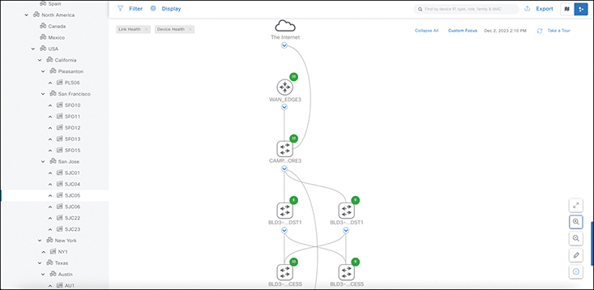

<figcaption>

<aside class="hidden" id="a22fig16">

左侧边栏列出分级结构中的各种地理位置和装置,包括北美,EMEA,亚太和南美洲. 北美被进一步划分为加拿大,墨西哥和美国,具体州和城市有加利福尼亚州(帕萨迪纳,旧金山,洛杉矶),德克萨斯州,纽约州,弗吉尼亚州,新泽西州和科罗拉多州等. 主部分显示一张网络地貌图,以图示形式表示网络设备及其连接. 在顶部,一个被标注为"互联网"的图标被连接到一个被标注为"WAN"(OCS 1)的设备上,并带有绿色状态指示器. 在WAN(OCS 1)下,多个互联设备以分级结构显示. Core-AGG 2也带有绿色状态指标,与 BLD 3-FLR1-DIST1和 BLD 3-FLR2-DIST2相接,均显示绿色指标. BLD3-FLR-1-DIST-1连接BLD3-FLR-2-DIST-2和BLD3-FLR-3-DIST-3;而BLD3-FLR-2-DIST-2-连接BLD3-FLR-3-DIST-3和BLD-3-FLR-4-DIST----4. BLD3-FLR-3-DIST-3与BLD3-FLR-4-DIST-4-连接,所有设备均显示绿色状态指标. 上行包括过滤和显示设备的选项,按照不同标准过滤设备的搜索网络栏,以及过滤、显示、导出(导出地形视图)、扩展视图(扩展地图)和帮助的按钮。 在右下角,有用于缩放入出、全缩放模式和刷新的按钮。

</aside>

<strong>图22-16</strong> <em>Cisco Catalyst Center地形图</em>

</figcaption>

</figure>

GUI机制相对直观,能够点击到更多或更少的细节.<a href="#ch22fig17">图22-17</a>显示更多细节, 并点击地形中的一个节点。<a href="#ch22fig16">图22-16</a>,在许多管理产品中典型的行动和结果.

<figure class="image-c" id="ch22fig17">

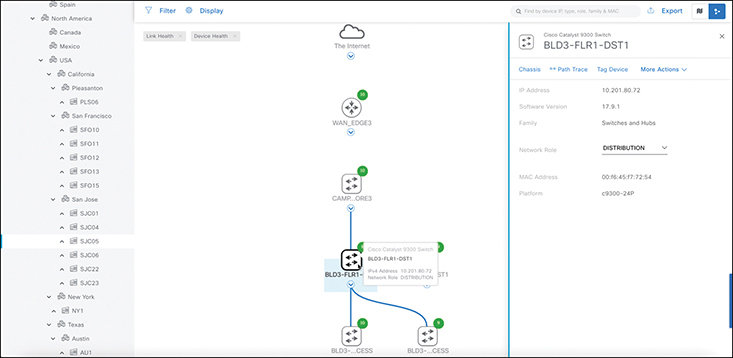

<figcaption>

<aside class="hidden" id="a22fig17">

左侧栏保持不变,列出地点和装置。 主部分再次显示具有相同等级结构的网络地貌图. 用户在标有 BLD 3-FLR 1-DIST 1 的设备上徘徊或点击了该设备,揭示了一个工具提示,详细信息包括:设备名称(BLD 3/FLR 1-DIST 1),模型(Cisco Catalyst 9300),MAC地址,平台(CisCO IOS-X E)和角色(Distription). 出现一个新的右侧边栏,提供所选设备的详细信息. 它包括诸如名称(BLD 3-FLR 1-DIST 1),家庭(交换机和枢纽),角色(DISTRIBUTION),I P地址,MAC地址等设备细节,以及平台(Cisco IOS-X E). 更多信息的分页包括检查(显示健康检查和状况)、P和P任务(检查前和检查后的任务)和查看行动(可以在设备上执行的额外行动)。 一个徘徊的交互显示一个包含设备信息的详细工具提示,在不偏离主要地貌视图的情况下提供对特定数据的便捷访问. 上行保留了第一个图像中描述的过滤,显示,导出,扩展视图,访问帮助的相同选项.

</aside>

<strong>图22-17</strong> <em>来自思科催化中心的一个单一 Cisco催化器9300交换机</em>

</figcaption>

</figure>

我鼓励你们花点时间使用和观看一些关于思科催化中心的视频。<a data-original-href="vol2_ch22.xhtml#ch22lev1sec7" data-unavailable="true" title="此内容不在当前提取范围内；请参阅原始 EPUB：vol2_ch22.xhtml#ch22lev1sec7">章次回顾</a>”这一章节在同伴网站上列出了一些好视频链接。 还有,从...<a href="https://developer.cisco.com">https://developer.cisco.com</a>找Cisco Catalyst Center沙盒实验室 找个地方和Cisco Catalyst Center做实验

</section>

<section>

<h4 class="h4" id="ch22lev2sec6">Cisco Catalyst Center 与传统管理的区别</h4>

广义上,思科催化中心与传统网络管理平台存在多处根本差异. 最大的区别是: Cisco Catalyst Center支持 Cisco SD-Access,而其他管理应用则不支持. 因此,将网络管理系统视为类似于传统设备管理. 思科催化中心有许多相近的功能,但也有更先进的功能,专注于思科SD-Access支持等较新的技术解决方案.

在意图和战略方面,思科将其开发思科催化中心的特点集中于简化企业的工作,从而降低成本并更快地进行变革。 Cisco Cactoryst Center 的特性有助于使初始安装更加容易,简化了执行传统上具有挑战性配置的特性的工作,并使用工具来帮助你更快地注意到问题. 思科催化中心独有的一些特征包括:

<ul class="sq">

<li>
<strong>应用策略 :</strong>部署QoS,是手动配置最复杂的功能之一,只有思科催化中心的一些简单选择
</li>

<li>
<strong>加密交通分析(ETA):</strong>允许 Cisco DNA 使用算法识别安全威胁,甚至在加密流量中也是如此
</li>

<li>
<strong>设备360和客户端360:</strong>综合(360-degree)设备健康状况
</li>

<li>
<strong>网络时间旅行 :</strong>在比较当前行为的时间表中显示过去客户端的性能
</li>

<li>
<strong>路径跟踪 :</strong>发现根据当前转发表从源头到目的地的实际路径包
</li>

</ul>

Cisco Catalyst Center的路径追踪功能远远超出了传统的管理应用。 一个典型的网络管理app可能会显示一个网络的映射,并让你点击以在每个设备上找到配置,包括ACLs. 路径跟踪特征走得更远. Cisco Catalyst Center用户(来自GUI或API)指定了源主机和目的地主机以及可选的运输协议和端口. 然后路径跟踪特征显示通过网络路径的地图并显示ACLs在路径中的位置,以及它们是否允许或否定数据包.

Cisco的所有数字网络架构都旨在帮助客户实现一些大目标:降低成本、降低风险、更好的安全和合规性、通过自动化和简化程序更快地部署服务,以及继续列出清单。 Cisco Catalyst Center发挥关键作用,通过其强大的北行API提供所有功能,并采用基于意图的Cisco SD-Access联网方法。 Cisco Catalyst Center代表了Cisco企业的网络管理的未来.

</section>

</section>

<section>

<h3 class="h3" id="ch22lev1sec6">人工智能（AI）、机器学习（ML）与运维管理</h3>

Cisco在CCNA200-301版本1.1蓝图中包含一个考试话题,其中提到人工智能(AI):

6.4 解释 AI（生成式和预测式）及机器学习在网络运维中的作用

人工智能和机器学习领域出现了大量的工业热潮。 一些早期的收养者在运行网络时寻求好处来缓解他们日常运作的一些压力. 在我们能够理解AI和ML的一些好处之前,我们必须首先理解它们的定义.

<a id="key_319" href="#ref-gloss_041">人工智能</a>被定义为能够完成通常需要人类思维的任务的计算机或系统,如学习,解决问题,以及理解各种语言等. AI主要有两种类型:

<ul class="sq">

<li>
<a id="key_328" href="#ref-gloss_220">狭义AI</a>是一种AI类型,旨在执行特定任务或一组密切相关的任务. 狭义AI在定义明确,范围有限的情况下蓬勃发展. 然而,狭义AI缺乏人类智能的广泛认知能力. Narrow AI的一些常见例子包括语音识别系统或应用程序,图像识别软件,以及亚马逊·亚历克萨,Apple Siri等虚拟个人助理和谷歌助理. 这些助手经常被用来做一些典型的任务,比如演奏音乐,展示你的日历,或者在做饭时回忆出一种配方.
</li>

<li>
<a id="key_325" href="#ref-gloss_152">生成式 AI</a>它可以学习、学习,并可能作出考虑到与人类相似的事实和经验的决定,这是大赦国际的另一种形式。
</li>

</ul>

AI还包括机器学习(ML)等技术. 从医疗保健到网络操作和安全等许多领域都使用ML. ML是AI的一个分支,主要专注于算法和复杂数据模型的开发. 这些模型使计算机能够从各种数据来源学习,不仅作出预测,而且还在没有明确编程的情况下作出自己的决定. 机器学习的目标是创建系统,在输入更多数据或信息时能够持续地和自动地改进.

在传统的计算机编程中,人类会写出明确的指令来完成一项任务. 然而,在机器学习中,存在分化. 电脑可以从不同的数据来源学习具体的模式和关系,这使得电脑或“AI”可以在它还没有看到的新数据集上作出预测。 这就是定义<a id="key_330" data-original-href="vol2_ch22.xhtml#key_330a" data-unavailable="true" title="此内容不在当前提取范围内；请参阅原始 EPUB：vol2_ch22.xhtml#key_330a">预测式 AI</a>能够以最小的提示或用户的输入来猜测您想要达到的目标 。

让我们考虑一下不同形式的AI的一些好处, 从一个"狭义AI"的常见例子开始,我们很容易看到拥有虚拟个人助手的价值. 一个不那么明显的使用案例是能够运行家庭自动化工作流程并将其与各种时间表挂钩。 这就产生了“智能建筑”的概念。 连接和控制照明、自动调温器、车库门和电子等各种“东西”通常为用户带来某种形式的内在价值,特别是在利用自动化时。

一个非常常见的优点是创造了一个常规或自动化,可以关闭室内灯光,关闭车库门,并在你离开家白天自动将温度设置为更低的设定. 所有这些领域的费用可以大大地节省。 特别是如果你在一年中推断出来 灯光、热能或车库门经常被放上或打开。 现在有一种方法可以保证不会发生这种情况。 此外,为了进一步举出这个例子,你可以自动打开你的家用安全系统或警报器,作为这个常规的一部分. 使用与自动化技术相联的狭义AI虚拟个人助手, 如何提供真实世界的使用案例,

生成式 AI是这些日子大部分注意力似乎所在的地方,也是有极大原因的. 生成式 AI作为下一件大事而爆炸了,同时也是大多数行业对技术持谨慎态度的东西. 让我们以微软的ChatGPT为例。

ChatGPT是一个对话的人工智能平台. 因此,该术语<em>聊天</em>。用户可以使用基于文本的聊天方式询问 ChatGPT 无穷无尽的问题或者业界所说的<em>提示</em>。这种形式的生成式 AI可以被喂入信息来学习,并且可以被教导和进化. 使用生成式 AI的利弊有很多争论。 一个例子是使用生成式 AI来创作音乐和歌曲. 有人认为这把艺术家的创作过程从音乐创作过程取出. 但是对于一些想迅速得到一些音乐的制作和发行的艺术家来说,这可以成为快速而广泛地创造出数字艺术的一种机制. 尤其如果他们没有写歌技巧, 让我们看看ChatGPT在创作一首歌曲时会做什么。<a href="#ch22fig18">图22-18</a>演示如何促使 ChatGPT 从初始聊天窗口创建歌词到一首关于CCNA学习习惯的歌曲.

<figure class="image-c" id="ch22fig18">

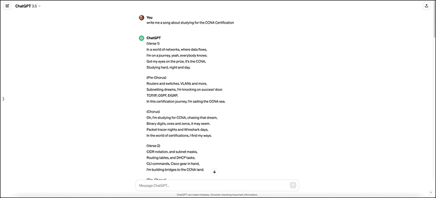

<figcaption>

<aside class="hidden" id="a22fig18">

屏幕显示的Chat GPT接口有白色背景和绿色口音,是Chat GPT设计的典型. 用户留言:为CCNA认证写一首关于学习的歌曲. Chat GPT 3.5 : Sure!. 这是为你们CCNA之行而作的一首歌: 在网络世界中,数据流出,有一条路可以证明,大家都知道. 这是通向CCNA的路径,旅程开始了,跑步和切换,让我们完成这个任务. 前Chorus:路由器和交换机,VLANS等,研究协议,下至核心. 访问控制列表,NAT,和子网掩码,继续推进,你完成任务. 相声:这是去CCNA的旅程,追逐梦想,构思网络,比看起来还要多. 每一个命令线,你都在铺路, 为了认证,这是你的CCNA日。 桥:OSPF,EIGRP,和RIP,编码静态路由,和PPP链接. 运行表,包,和I P计划, 做二进制的改变, 它比它看起来更多。 Outro:继续前进,继续学习,你快到了,CCNA等着,在网络领域。 路由器和交换机,协议,还有I P, 研究弥合差距 与你的CCNA梦想。

</aside>

<strong>图22-18</strong> <em>ChatGPT 3.5 CCNA 歌曲提示</em>

</figcaption>

</figure>

以下是由以下提示所创建的ChatGPT歌曲的完整歌词:

<em>“给我写一首关于为CCNA认证学习的歌曲”。</em>

(维也纳) 1

在数据流动的网络世界中,

我在旅行,是的,每个人都知道。

我看着奖品,这是CCNA,

勤于修习,昼夜相接.

(Chorus前传).

路由器和交换机,VLAN等等,

我敲了成功之门,

TCP/IP, OSPF, EIGRP,

我将前往CCNA海域航行,

(克若斯语).

哦,我在为CCNA学习,追求那个梦想,

二进制数字,一和零, 它可能看起来。

包裹追踪器夜 和线莎克的日子,

在认证的世界中,我找到我的方法。

(版本2)

CIDR标记 和子网掩码,

运行表和 DHCP 任务 。

CLI命令,Cisco装备手头,

我在建通往CCNA地的桥梁。

(Chorus前传).

像树上的树枝一样,

交换机会眨眼 像星星一样 指引我

NAT、ACLs和警卫,

我将封锁知识,

(克若斯语).

哦,我在为CCNA学习,追求那个梦想,

二进制数字,一和零, 它可能看起来。

包裹追踪器夜 和线莎克的日子,

在认证的世界中,我找到我的方法。

(布里奇语).

深夜的实验室 在月亮的柔软光芒下

模拟,配置,让我的知识增长.

IP地址,子网计划,

我将自己的命运写在CCNA梦中。

(版本3)

BGP, MPLS, 和QoS, (英语).

在这个联网的旅程中,我并不面临损失。

像架子上的电缆一样 连在一起的概念

我将征服共和军,

(Chorus前传).

VTP和HSRP,

在这个路由器领域,我自由出航。

穿过OSI地层 就像爬上楼梯一样

我会到达顶峰,呼吸CCNA的空气。

(克若斯语).

哦,我在为CCNA学习,追求那个梦想,

二进制数字,一和零, 它可能看起来。

包裹追踪器夜 和线莎克的日子,

在认证的世界中,我找到我的方法。

(外语)

在考试室,我会站起高个子

答如瀑布相流而来.

CCNA,我准备显示,

在网络世界里,我会让我的知识发光。

ChatGPT是一个非常有创意的工具,可以构建出歌曲或配置或者任何你能想到的来要求它. 周转时间是数秒之内,它可以创造出任何你促使它创造的东西。 ChatGPT有类似本章使用的免费版本. 也有一个付费的版本,为您提供更多功能,并访问最新的信息数据库和API访问. 这些数据存储的样式叫做<a id="key_326" href="#ref-gloss_191">大语言模型（LLM）</a>。该行业看到需要私有化的LLM,客户开始建立自己的私人数据或知识库。 LLMs使用大量的内存,CPU,和GPU资源来查取和剖析这些数据源. 然而,就组织的适当价值而言,它很容易被视为对企业的投资.

现在让我们为ChatGPT选择一个关于学习和自我教育的各种CCNA主题的应用案例。 数据来源的验证总是最好的, 因为您可以找到很多关于特定主题的信息, 您可能正在尝试学习, 但这些信息并不总是准确的。 例如,让我们使用 ChatGPT 为以下子网创建一个简要访问控制列表 :

192.168.10.0/24

192.168.16.0/24

192.168.53.0/24

192.168.64.0/24

注意

记得验证你从生成式 AI平台得到的任何东西,特别是如果你计划将任何数据用于生产目的的话. 许多问题都是通过使用生成式 AI平台的代码或配置,而不是在部署前首先检查代码或配置的有效性而创建的.

<a href="#ch22fig19">图22-19</a>显示使用 ChatGPT 来总结前面提到的子网,以便使用一个匹配所有四个子网的访问控制列表。

<figure class="image-c" id="ch22fig19">

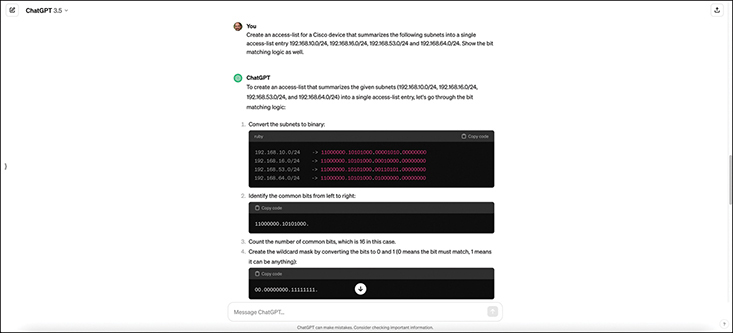

<figcaption>

<aside class="hidden" id="a22fig19">

左侧边栏列出分级结构中的各种地理位置和装置,包括北美,再被划分为加拿大,墨西哥和美国,具体州和城市有加利福尼亚州(帕萨迪纳,旧金山,洛杉矶),德克萨斯州,纽约州,弗吉尼亚州,新泽西州和科罗拉多州等,以及其他地区有EMEA,亚太和南美等. 主部分显示一个网络地貌图,其设备以分级结构相接. 地图上方有被标注为"互联网"的图标,与被标注在WAN(OCS 1)上并带有绿色状态指示器的设备相接. 在WAN下方(OCS 1),显示多个互联设备,Core-AGG 2具有绿色状态指标,与BLD 3-FLR 1-DIST 1和 BLD 3(FLR 二-DIST 2)相接,两者同时显示绿色指标. BLD 3-FLR 1-DIST 1与BLD 3/FLR 2-DIST 2和BLD 三-FLLR 3-DIST 3相接;而BLD 二-FLW 2-DIST 2则与BLN 3- FLR 克-DIST 3和 BLD 三一-FLIST 4相接,所有设备都显示绿色状态指标. 当在标有 BLD 3-FLR 1-DIST 1 的设备上徘徊或点击时,会出现一个工具提示,显示具体细节:设备名称 BLD 三-FLL 1-DIS 1, MAC地址,平台(Cisco IOS-X E)和角色 (Distribution). 右侧的新侧边栏提供所选设备的详细信息,包括名称(BLD 3-FLR 1-DIST 1),家族(Switches and Hubs),角色(Distribution),I P地址,MAC地址和平台(Cisco IOS-X E)等. 额外资料的分页包括检查(显示健康检查和状况)、P和P任务(检查前和检查后的任务)和查看行动(可以在设备上进行的额外行动)。 上行包含过滤和显示设备的选项,并设有搜索栏标签为"搜索网络". 过滤和显示按钮允许定制视图,而导出按钮则允许导出地形视图。 扩展视图选项可扩展地图, 帮助按钮可提供帮助 。 在右下角有各种动作的按钮,包括用于调整视图的"缩放入出"(Zoom In/Out),用于将地图扩展至整个屏幕的"Full-Screen Mode",以及用于更新地形视图的"刷新"按钮.

</aside>

<strong>图22-19</strong> <em>ChatGPT 3.5 访问控制列表摘要提示</em>

</figcaption>

</figure>

我们从最初的即时反应中可以看到我们作为例子使用的4个子网. 我们还可以看到,ChatGPT提供了基于附加快取的比特比特逻辑来决定使用摘要<em>也显示比特匹配逻辑</em>我们喂了它。 四个子网及其比特边界在此列出:

192.168.10.0/24 = 11000000.10101000.00001010.00000000

192.168.16.0/24 = 11000000.10101000.00010000.00000000

192.168.53.0/24 = 11000000.10101000.00110101.00000000

192.168.64.0/24 = 11000000.10101000.01000000.00000000

基于这个输出,我们可以看到第一个 17比特完全吻合. 然而,ChatGPT选择使用 /16-bit掩码对/17-bit掩码. 看着<a href="#ch22fig20">图22-20</a>,我们可以看到聊天回复的其余部分,并证实它已经选择了192.168.0.0/16作为摘要地址,与适当的命令一起用于配置Cisco设备上的访问控制列表.

<figure class="image-c" id="ch22fig20">

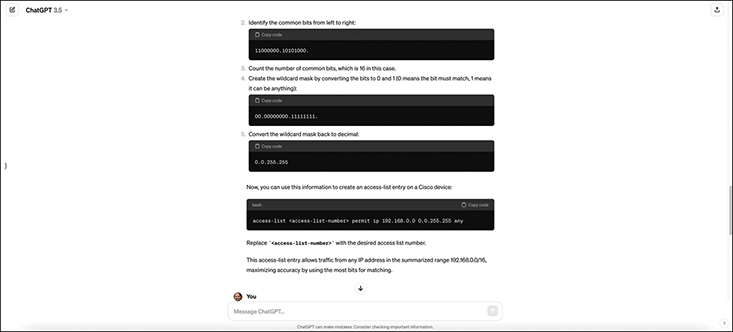

<figcaption>

<aside class="hidden" id="a22fig20">

用户最初要求创建一条访问控制列表条目，使用通配符掩码将子网 192.168.10.0/24、192.168.11.0/24、192.168.12.0/24 和 192.168.13.0/24 汇总为一个访问条目，并展示完整计算过程。ChatGPT 3.5 给出了详细步骤。首先，将子网转换为二进制：192.168.10.0/24 为 11000000.10101000.00001010.00000000，192.168.11.0/24 为 11000000.10101000.00001011.00000000，192.168.12.0/24 为 11000000.10101000.00001100.00000000，192.168.13.0/24 为 11000000.10101000.00001101.00000000。然后，从左到右查找共同位，得出共同位为 11000000.10101000.00001，共 21 位。接着，将不固定的位设为 1（主机位），固定的位设为 0（网络位），得到通配符掩码 00000000.00000000.00000111.11111111，其十进制形式为 0.0.7.255。网络地址为 192.168.8.0，通配符掩码为 0.0.7.255。最后，ChatGPT 给出适用于所有设备的访问控制列表条目：access-list 10 permit 192.168.8.0 0.0.7.255。该条目允许来自汇总范围 192.168.8.0/21 内所有设备的流量，涵盖了需要匹配的原始子网。这段详细交互展示了 ChatGPT 3.5 如何采用逐步推导的逻辑来指导用户为网络设备创建访问控制列表，使用户理解过程中的每个步骤。

</aside>

<strong>图22-20</strong> <em>ChatGPT 3.5 访问控制列表摘要快取, 继续</em>

</figcaption>

</figure>

虽然这是完全可以接受的解决方案, 即时访问控制列表的提示, 我们提供了 ChatGPT, 但人们可以认为, 这不是最有效的访问控制列表条目 。 更准确的进入清单是使用下列表格:<a href="#ch22fig21">图22-21</a>:

<a href="#code-f0522-01" id="f0522-01a">点击此处查看代码原图</a>

<pre class="pre" tabindex="0"><code><strong>access-list</strong> <em>access-list-number</em> <strong>permit ip 192.168.0.0 0.0.127.255 any</strong></code></pre>

<figure class="image-c" id="ch22fig21">

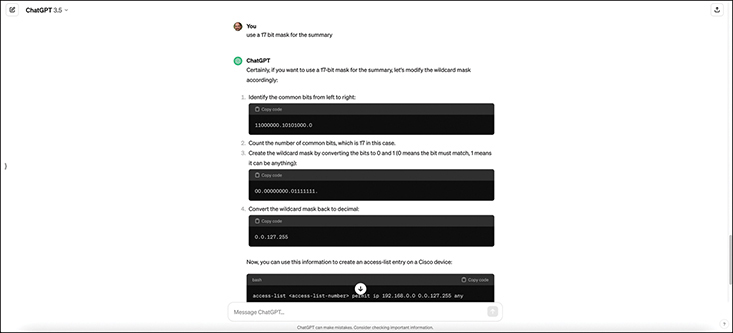

<figcaption>

<aside class="hidden" id="a22fig21">

回答分为四个清晰步骤。首先，通过比较子网的二进制表示，从左到右识别共同位：172.16.0.0（10101100.00010000.00000000.00000000）和 172.16.3.0（10101100.00010000.00000011.00000000）。然后统计连续共同位的数量，本例为 17。接着，说明如何将通配符掩码转换为十进制形式。二进制通配符掩码为 11111111.11111111.11100000.00000000，转换为十进制得到 255.255.224.0。最后，展示如何使用这些信息创建访问控制列表条目：access-list 1 permit 172.16.0.0 0.0.31.255。在这些步骤下方，示例演示如何汇总访问控制列表条目。给出两条具体条目：第 1 行为 access-list 10 permit 10.1.0.0 0.0.255.255；第 2 行为 access-list 10 permit 10.2.0.0 0.0.255.255。随后将它们汇总为一条：access-list 10 permit 10.0.0.0 0.1.255.255。

</aside>

<strong>图22-21</strong> <em>ChatGPT 3.5 访问控制列表摘要提示, 有 17-bit 面罩</em>

</figcaption>

</figure>

注意到ChatGPT在最初的快取中表示前16位是常见的,即使你数到它们,前17位也是常见的. 这是我们提到的理由之一 来验证你得到的一切 作为任何生成式 AI工具的反应。 它可以是一个令人难以置信的时间节省。 但正如一位智者曾经提到的那样 : “ 你可以像自动化成功一样快地自动失败。 ”

注意

本作编写过程中使用的ChatGPT版本可能与您使用的版本或目前可用的版本不同. 自这本书出版以来,特征和反应质量可能有所改变。

使用人工智能建立网络有许多办法。 最常见的方法之一是名为人工智能用于IT操作(英语:Antificial Intelligence for IT Operation)的方法.<a id="key_318" href="#ref-gloss_032">AIOps</a>) AI Ops利用AI和ML优化和自动化IT操作的各个方面. AI Ops的首要目标是提高与IT相关的系统的效率,可靠性和性能,同时减少手动交互. 这反过来又会减少人为错误,因为AI Ops利用用户指定为有益于操作过程的经过验证和预先测试的工作流程或配置. 以下列表是AI Ops的一些最常用的案例:

<ul class="sq">

<li>
<strong>自动化 :</strong>利用自动化程序承担日常任务并减少人类干预
</li>

<li>
<strong>监测和数据分析:</strong>利用先进工具查明规律和异常,提供数据的持续分析
</li>

<li>
<strong>预测性分析:</strong>通过分析历史数据和模式,利用机器学习积极主动地预测问题
</li>

<li>
<strong>协作与沟通:</strong>促进整个信息技术业务的信息共享和解决问题技术
</li>

<li>
<strong>根因子分析 :</strong>通过深入了解信息技术环境的各个领域,确定问题的根本原因
</li>

</ul>

自动化一般是AI Ops中低悬挂的果实. 许多组织将受益于更自动化的工作流程和程序。 大多数企业一般都有一些章程可以转向更自动化的操作程序。 自动化是AI Ops最常用的开始方式之一.

然而,为了了解信息技术环境中发生的情况,第一步是能够“看到”整个环境。 监测网络和相关应用是确定网络基线的最佳途径。<em>基线</em>另一种方法是描述网络如何正常地与平均流量、平均用户数量和平均数据交易一起运作。 透过了解网络的基线, 以这个例子为例:网络在基线上运行,突然有数百个工作室的数据被抽取到另一个国家。 这可能表明数据泄露或恶意行为需要调查。 如果不有一个基线来比较这种行为,就可能难以确定问题或其合法性。

拥有做预测性分析的能力在当今时代是至关重要的. 从前,有带宽问题,互联网链接被连接到100%的利用率。 有了适当的监测和分析工具,就确定了这一问题。 其根源在于国际足联世界杯锦标赛,许多用户正在其内部工作站上流出比赛. 这影响了正常运行的合法商业交易,因为联系如此饱和。 这种洞察力使信息技术业务工作人员能够预测在这样的重大事件期间会发生什么,以及如何通过政策防止再次发生。

当有一个问题影响到网络时,许多组织跳入“所有手放在甲板上”或在“战争室”相会,把信息技术小组的各个领域聚集在一起。 这样做是为了加强相互之间的沟通,并尽量减少这一问题对企业的影响. AI Ops通常可以用来帮助这种协作方式. 例如,人们经常看到在客户环境中使用协作工具进行交流。 这就是“......”一词的含义。<a id="key_320" href="#ref-gloss_066">聊天操作</a>“来自......。 能够利用一个工具的Chat功能与各个团队进行交流,并有视频聊天来讨论网络现状或被识别出的问题,可以大大简化解析路径. 这些技术通常导致企业不同领域之间更快地进行补救并开放通信。

最后,AI Ops可以帮助带领IT操作工作人员通过确定最初出错的原因来进行"根因子分析"(RCA)或"根因失败"(RCF). 这样的工具到位后,获得决议的过程就成为一种有文件记载的、可重复的程序,以便在将来出现停用或失败的情况时采用。

</section>

</section>

<section class="ccna-source ccna-appendix" aria-label="答案解析与术语表">
<section data-epub-type="chapter">

<h2 class="h2" id="ref-appc">附录C</h2>

<h2 class="h2a">对“我早就知道了吗?” 的回答。</h2>

<section>

<h3 class="h3" id="ref-appclev1sec22">第22章</h3>

<strong><a id="ref-ques22_1" href="#quess22_1">1</a>。</strong> C。Cisco SD-Access 的底层网络由网络设备、连接，以及使 Cisco SD-Access 节点之间具备 IP 连通性的配置组成，用于支持覆盖网络的 VXLAN 隧道。网络结构（fabric）同时包含底层网络和覆盖网络，而 VXLAN 是用于创建覆盖网络隧道的协议。

<strong><a id="ref-ques22_2" href="#quess22_2">2</a>。</strong> B。覆盖网络包含控制平面和数据平面功能，用于定位终端、确定 VXLAN 隧道应连接哪个 fabric 节点、将帧送入隧道，以及执行 VXLAN 隧道的封装和解封装。Cisco SD-Access 的底层网络由网络设备、链路和独立的 IP 网络组成，为节点之间提供连通性，以支持 VXLAN 隧道。

网络结构（fabric）同时包含底层网络和覆盖网络，而 VXLAN 是用于创建覆盖网络隧道的协议。

<strong><a id="ref-ques22_3" href="#quess22_3">3</a>。</strong> D。Cisco SD-Access 覆盖网络在 fabric 边缘节点之间创建 VXLAN 隧道。边缘节点通过 VXLAN 隧道转发终端发送的帧，由此构成数据平面。LISP 在覆盖网络中充当控制平面，学习每个终端的标识符，将终端与能够获知该终端的 fabric 节点对应起来，使覆盖网络知道应在何处创建 VXLAN 隧道。

对于其他错误选项，虽然 GRE 是一种隧道协议，但 Cisco SD-Access 使用 VXLAN 建立隧道，而不使用 GRE。最后，OSPF 是控制平面的路由协议，并非 Cisco SD-Access 的数据平面协议。

<strong><a id="ref-ques22_4" href="#quess22_4">4</a>。</strong> A 和 D。与所有 Cisco SD-Access 功能一样，其配置方式是在 Cisco Catalyst Center 中配置所需功能，再由 Cisco Catalyst Center 通过南向 API 将意图传达给设备。可以使用 Cisco Catalyst Center 的 GUI，也可以使用其基于 REST 的北向 API 来配置功能。

对于错误选项，通常不会直接配置任何 Cisco SD-Access 设备。此外，Cisco Catalyst Center 可以使用 NETCONF 作为南向协议与 Cisco SD-Access fabric 节点通信，但不会使用 NETCONF 作为配置功能的北向 API。

<strong><a id="ref-ques22_5" href="#quess22_5">5</a>。</strong> B、C 和 D。Cisco Catalyst Center 使用 Telnet、SSH 和 SNMP 等传统协议管理传统网络设备。如果设备支持，也可以使用 NETCONF 和 RESTCONF。注意，虽然 Ansible 和 Puppet 是实用工具，但 Cisco Catalyst Center 不使用它们。

<strong><a id="ref-ques22_6" href="#quess22_6">6</a>。</strong> A 和 D。传统网络管理平台可以执行大量与管理传统网络和网络设备有关的功能，包括两个正确选项列出的功能。不过，如果以 Cisco Prime Infrastructure 作为传统网络管理平台来比较，它不支持 Cisco SD-Access 配置，也不能查找两个终端之间的端到端路径并分析路径上的 ACL。注意，两个错误选项提到的是 Cisco Catalyst Center 提供的功能。

<strong><a id="ref-ques22_7" href="#quess22_7">7</a>。</strong> B。狭义 AI 为特定任务而设计，而生成式 AI 能够学习、作出决策，并可能通过经验模仿人类认知。

</section>

</section>

<section id="ref-glossary"><h2 class="h2a">词汇表</h2>
<strong>AIOps</strong>人工智能用于IT操作. 指应用人工智能和机器学习技术实现信息技术业务的自动化并增强各个方面,包括监测、故障排除和事件管理,以提高管理复杂信息技术环境的效率和可靠性。

<strong>人工智能(AI)</strong>指能够完成通常需要人类智力的任务的计算机系统或软件,如从数据中学习,决策,解决问题等.

<strong>聊天操作</strong>协作模式,将聊天工具与自动工作流程和工具相融合,让团队直接在聊天接口内管理和执行任务,增强沟通,能见度,提高业务和开发工作流程的效率.

<strong>思科催化剂中心</strong>Cisco软件,由Cisco在物理或虚拟设备上交付,它既是网络管理应用程序,也是Cisco软件定型访问(Cisco SD-Access)提供的控制.

<strong>Cisco SD 访问</strong>Cisco基于意图的网络(IBN)为企业网络提供.

<strong>网络结构</strong>在SDA中,将叠加和下加结合起来,可以提供所有特性,在整个网络中提供具有所希望的特性和属性的数据。

<strong>织物边缘节点</strong>在SDA中,一个连接到端点设备的交换机.

<strong>生成式 AI</strong>也具有强大的人工智能;包括能够学习、推理和作出与人类认知相类似的决定的人工智能系统,往往有能力在其初始培训数据之外创造出新的内容、想法或解决方案。

<strong>大语言模型( LLM)</strong>先进的人工智能系统,能够在大量文字数据的广泛培训基础上,理解并生成人文文字.

<strong>LISP</strong>定位器/ID分离协议。 由RFC 6830所定义的协议,将用于识别端点的概念和数字(端点标识符)与识别端点位置(路由定位符)区分开来.

<strong>狭义AI</strong>还有弱小的AI. 指为特定任务或范围有限的活动而设计并训练的人工智能,在其预定范围以外缺乏广泛的认知能力和适应能力.

<strong>覆盖网络</strong>在SDA中,织物边缘节点之间的VXLAN地道的组合,作为转发帧的数据平面,加上用于发现和注册端点识别器的控制平面的LISP.

<strong>可缩放组标签( SGT)</strong>在SDA中,一个指定给同一安全组中的用户的值.

<strong>软件定义接入</strong>Cisco基于意图的网络(IBN)为企业网络提供.

<strong>底层网络</strong>在SDA中,创建基本IP连接的网络装置和链接支持为覆接而创建VXLAN地道.

<strong>VXLAN</strong>虚拟可扩展局域网. 用于创建隧道(覆盖)的灵活封装协议.

</section>
</section>

<section class="ccna-source ccna-appendix" aria-label="代码原图">
<section data-epub-type="chapter">

</section>

</section>


<nav class="ccna-chapter-nav" aria-label="章节导航"><a href="v2-21.html">← 上一章</a><a href="v2-23.html">下一章 →</a></nav>
