
<a href="{{ '/subjects/CCNA/' | relative_url }}">← 返回 CCNA 目录</a>

第二卷 · 网络自动化

<nav class="ccna-chapter-nav" aria-label="章节导航"><a href="v2-22.html">← 上一章</a><a href="v2-24.html">下一章 →</a></nav>



<section data-epub-type="chapter">

<h2 class="h2" id="ch23">第 23 章</h2>

<h2 class="h2a">理解 REST 和 JSON</h2>

本章涵盖以下考试主题：

6.0 自动化和可编程性

6.5 描述基于 REST 的 API 的特征（CRUD、HTTP 动词和数据编码）

6.7 识别 JSON 编码数据的组成部分

为了实现网络自动化和可编程性，自动化软件会执行多项任务：分析以变量形式表示的数据，根据分析结果作出决策，然后可能采取行动，修改网络设备配置，或报告网络状态信息。

不同的自动化功能位于不同设备上，包括网络工程师的设备、服务器、控制器，以及各种网络设备本身。要让这些相关的自动化过程良好协作，所有软件组件都需要实用且定义清晰的约定，使软件组件之间能够轻松通信。

本章重点介绍使自动化软件能够通信的两种约定。第一大节讨论应用程序编程接口（API），特别是遵循表述性状态转移（REST）风格的 API。所有类型的 API 都为软件应用之间的通信提供途径，而 RESTful API（采用 REST 约定的 API）遵循一组特定的软件规则。如今，网络自动化中使用的许多 API 都基于 REST。

本章后半部分讨论通过 API 交换的数据变量的约定和标准，重点介绍 JavaScript 对象表示法（JSON）。如果说 REST 为两个自动化程序如何通过网络通信提供了一种标准方法，那么 JSON 就定义了如何传递程序使用的变量，包括变量名称、值，以及这些变量的数据结构。

<section>

<h3 class="h3" id="ch23lev1sec1">自测</h3>

如果你希望根据得分决定在本章投入多少时间，可以完成这组自测题（在此作答，或使用 PTP 软件）。各题答案的选项字母列在自测题之后的页面底部。书末和配套网站上的<a href="#ref-appc">附录 C</a>都包含答案及解析。你也可以在 PTP 测试软件中找到答案及解析。

<figure class="table" id="ch23tab01" tabindex="0">

<figcaption>

<strong>表23-1</strong> 基础主题与问题对应关系

</figcaption>

<table class="all">

<tbody>

<tr>

<th class="th">
基础知识小节
</th>

<th class="th">
题目
</th>

</tr>

<tr>

<td class="border">
基于 REST 的 API
</td>

<td class="border">
1–3
</td>

</tr>

<tr>

<td class="border">
数据序列化和JSON
</td>

<td class="border">
4–6
</td>

</tr>

</tbody>

</table>

</figure>

<strong><a id="quess23_1" href="#ques23_1a">1</a>.</strong>基于 REST 的 API 需要以下哪些属性 ? (取出二个答.

<ol class="lower-alpha">

<li>
使用 HTTP
</li>

<li>
是否可被缓存的标注对象
</li>

<li>
国家行动
</li>

<li>
客户端/服务器架构
</li>

</ol>

<strong><a id="quess23_2" href="#ques23_2a">2</a>.</strong>哪个答案列出一个匹配的软件开发 CRUD 动作到一个执行此动作的 HTTP 动词 ? (取出二个答.

<ol class="lower-alpha">

<li>
CROUD 创建和 HTTP PATCH
</li>

<li>
CROUD 更新和 HTTP PATCH
</li>

<li>
CRUD 删除和 HTTP PUT
</li>

<li>
CRUD 读取和 HTTP GET
</li>

</ol>

<strong><a id="quess23_3" href="#ques23_3a">3</a>.</strong>检查以下与Cisco DNA控制器合作的URI:

<a href="#code-f0527-01" id="f0527-01a">点击此处查看代码原图</a>

<pre class="pre-q" tabindex="0"><code>https://dnac.example.com/dna/intent/api/v1/

network-device?managementIPAddress=10.10.22.74</code></pre>

根据 API 文档, URI 的哪一部分被认为可以识别资源而不是任何参数?

<ol class="lower-alpha">

<li>
https://
</li>

<li>
<a href="http://dna.example.com">dna.example.com</a>
</li>

<li>
dna/intent/api/v1/network-device
</li>

<li>
managementIPAddress=10.10.22.74
</li>

</ol>

<strong><a id="quess23_4" href="#ques23_4a">4</a>.</strong>下列哪些数据序列化和数据建模语言最有可能用于基于REST的服务器API用于网络应用的响应? (取出二个答.

<ol class="lower-alpha">

<li>
JSON
</li>

<li>
YAML
</li>

<li>
Java 脚本
</li>

<li>
XML
</li>

</ol>

<strong><a id="quess23_5" href="#ques23_5a">5</a>.</strong>下面哪些答案正确描述 JSON 文本的格式 ? (取出二个答.

<pre class="pre-q" tabindex="0"><code>{ "myvariable":[1,2,3] }</code></pre>

<ol class="lower-alpha">

<li>
一个有一键的 JSON 对象:值对
</li>

<li>
一个有三把钥匙的 JSON 对象:值对
</li>

<li>
一个值为第二个 JSON 对象
</li>

<li>
值为 JSON 数组的 JSON 项目
</li>

</ol>

<strong><a id="quess23_6" href="#ques23_6a">6</a>.</strong>在JSON样本数据中找到的JSON值是指哪些答案,而不是JSON键? (取出二个答.

<a href="#code-f0528-01" id="f0528-01a">点击此处查看代码原图</a>

<pre class="pre-q" tabindex="0"><code>{

    "response": {

        "type": "Cisco Catalyst 9300 Switch",

        "family": "Switches and Hubs",

        "role": "ACCESS",

        "managementIpAddress": "10.10.22.66"

    }

}</code></pre>

<ol class="lower-alpha">

<li>
“答复”
</li>

<li>
“类型”
</li>

<li>
“ACESS” (签名)
</li>

<li>
“10.10.22.66”
</li>

</ol>

自测答案：

<strong><a id="ques23_1a" href="#ref-ques23_1">1</a></strong> B, D

<strong><a id="ques23_2a" href="#ref-ques23_2">2</a></strong> B、D

<strong><a id="ques23_3a" href="#ref-ques23_3">3</a></strong> C

<strong><a id="ques23_4a" href="#ref-ques23_4">4</a></strong> A, D

<strong><a id="ques23_5a" href="#ref-ques23_5">5</a></strong> A, D

<strong><a id="ques23_6a" href="#ref-ques23_6">6</a></strong> C, D

</section>

<section>

<h3 class="h3box" id="ch23lev1sec2">基础主题</h3>

</section>

<section>

<h3 class="h3" id="ch23lev1sec3">基于 REST 的 API</h3>

应用程序的使用<em>应用程序编程接口( API)</em>来交流。 为此,一个程序可以学习另一个程序使用的变量和数据结构,根据这些值进行逻辑选择,改变这些变量的值,创建新的变量,并删除变量. API允许在不同计算机上运行的程序合作工作,交换数据来达到某些目标.

在一个API软件世界中,一些应用程序创建了API,其他许多应用程序使用(消耗)API. 软件开发者将API添加到他们的软件中,这样其他应用软件就可以利用第一个应用的功能.

编写应用程序时,开发者会写出一些代码,但通常开发者可能会通过寻找能够提供数据和功能的API来做很多工作,减少必须写出的新代码的数量. 因此,许多现代软件开发中心都以了解和学习新的API为中心,还有现有的库(预先建造的软件可以用来完成任务而不是从零写出等同的东西).

现有几种类型的API,每一种都有一套不同的公约来满足不同的需要。 CCNA蓝图提到了一种API——<a id="key_344" href="#ref-gloss_289">国家转让(REST)</a>——因其在网络自动化应用中作为API类型而受欢迎. 这一章的第一主要章节更仔细地研究了基于REST的API.

<section>

<h4 class="h4" id="ch23lev2sec1">基于 REST 的（RESTful）API</h4>

<a id="key_345" href="#ref-gloss_292">REST API</a>遵循一套关于什么是REST API和什么是非的基础规则. 首先,从字面上看,REST APIs包括了几十年前由它的创造者罗伊·菲尔丁所定义的六个属性. (您可以在下列地点找到一个很好的摘要:<a href="https://restfulapi.net">https://restfulapi.net</a>) 这六个属性是:

<ul class="sq">

<li>
客户端/服务器架构
</li>

<li>
无国籍操作
</li>

<li>
可缓存/不可取的清晰语句
</li>

<li>
统一接口
</li>

<li>
已分层
</li>

<li>
随叫随到
</li>

</ul>

这些属性的前三个得到一个REST API如何工作的核心. 您可以比较容易地看到这些前三个功能在与 REST API 网络工作时,所以接下来的几个段落进一步解释了前三个要点.

<section>

<h5 class="h5" id="ch23lev3sec1">客户端／服务器架构</h5>

和许多应用一样,REST应用也使用客户端/服务器的建筑模型. 首先,一个应用程序开发者创建了REST API,该应用程序在执行时起到REST服务器的作用. 任何其他应用程序都可以通过执行一些导致请求从客户端流到服务器的代码来进行REST API呼叫(REST客户端). 例如,在<a href="#ch23fig01">图23-1</a>:

<ol class="number">

<li>
左侧的REST客户端执行一个REST API呼叫,生成发送到REST服务器的信息.
</li>

<li>
右侧的REST服务器有API代码来考虑请求,并决定如何回答.
</li>

<li>
REST服务器以适当的数据变量发送回回复消息.
</li>

</ol>

<figure class="image-c" id="ch23fig01">

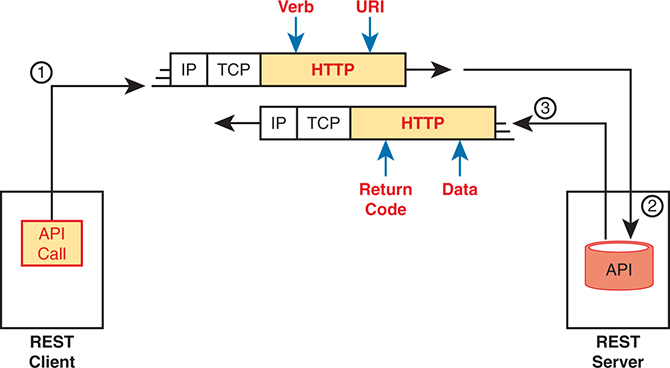

<figcaption>

<aside class="hidden" id="a23fig01">

这一过程从REST客户端进行API呼叫开始,由一个被标注为API Call的盒子来代表. 这个呼叫通过网络发送,经过了几个协议层:I P(互联网协议),TCP(传输控制协议)和HTTP(Hyper文本传输协议). 这些地层以顺序显示,HTTP地层用Verb和URI来注释,以指示请求中使用的方法和端点. REST服务器接收请求,使用其API处理,并发送回回复. 服务器的API被一个被标注为API的盒子所描绘. 响应通过相同的协议层(HTTP,TCP,IP)回溯到客户端,并附有说明表示返回代码和数据来代表响应状态和返回到客户端的数据.

</aside>

<strong>图23-1</strong> <em>使用 REST 的客户端/服务器操作</em>

</figcaption>

</figure>

注意

<a href="#ch23fig01">图23-1</a>显示 HTTP 的使用。 虽然许多REST API使用HTTP,但HTTP的使用并不是将API视为RESTful的要求.

</section>

<section>

<h5 class="h5" id="ch23lev3sec2">无状态运行</h5>

降温器<a id="key_346" href="#ref-gloss_335">无国籍人</a>操作特性规定,REST服务器不保存任何先前REST请求或REST客户端的数据(状态信息). 使用REST,服务器不会保存一个响应(状态信息)中的信息,用于后期的请求和响应. 相反,REST客户端保留所有来自先前请求的状态数据,以选择未来REST需要做什么才能实现应用的目标.

例如,想象一个维护产品数据库的REST服务器. 如果得到API的支持,REST客户端可以使用一个单项请求,列出一份重量低于5磅的产品清单. REST服务器不会记得客户端提出的第一个REST请求,或者在早先的请求中返回的数据. 因此,当客户端随后发出API呼叫时,它不能要求服务器根据先前请求的数据来进行这些未来回复. 相反,客户端必须在以后的每一个请求中提供任何数据,这样每个REST请求都是自成一体的,不需要服务器的状态信息.

</section>

<section>

<h5 class="h5" id="ch23lev3sec3">可缓存（或不可缓存）</h5>

欣赏什么<a id="key_335" href="#ref-gloss_057">可缓存</a>意味着,考虑浏览网站时会发生什么. 当您的浏览器加载到一个新的网页时,该页面本身包含各种对象(文本,图像,视频,音频). 有些对象很少改变,因此最好一次下载对象而不再下载;在这种情况下,服务器会标记该对象为可缓存. 例如,一个网站的许多页上显示的标志或其他图像几乎永远不会改变,很可能是可缓存的。 然而,在您最近搜索网站时返回的产品列表将不会被缓存,因为服务器每次请求页面时都会想更新并提供新的列表.

REST APIs要求通过API调用请求的任何资源必须有明确的方法标记资源是否可缓存. 目标保持不变:通过减少资源回收次数(可兑现)来提高业绩。 注意可缓存资源被标记为时间段,以便客户端知道何时再次要求获得新的资源副本.

</section>

</section>

<section>

<h4 class="h4" id="ch23lev2sec2">背景知识：数据与变量</h4>

为了欣赏即将到来的几个主题,它有助于对编程语言如何使用变量有一个基本的想法. 任何做过哪怕是少量编程的人都应该有足够的背景,但是对于那些之前没有写过程序的人来说,这个下个话题会给你足够的关于程序内部的数据和变量的背景来理解下一个话题.

如果你有一些编程经验 并且已经知道一些简单的变量<a id="key_343" href="#ref-gloss_194">列表变量</a>,以及<a id="key_338" href="#ref-gloss_112">字典变量</a>,然后可以随意跳到前面的一节“<a href="#ch23lev2sec3">REST APIs 和 HTTP 软件</a>.”

<section>

<h5 class="h5" id="ch23lev3sec4">简单变量</h5>

应用所有具有相同一般动作的处理数据,从某种输入开始. 程序需要数据来处理,所以输入过程会读取文件,向数据库服务器发送数据库查询,或者让API呼叫从另一个应用程序的API取回数据. 目标:收集程序工作需要处理的数据.

程序然后通过比较,决策,创建新的变量,以及执行分析数据的数学公式来处理数据. 所有的逻辑都使用变量。 例如,一个程序可以按以下逻辑处理数据:

如果路由器的 G0/ 0 接口的配置设置为

<strong>switchport mode dynamic auto</strong>

然后收集更多的数据,以确保接口目前作为干线而非接入端口运行.

在编程中,变量是具有被指定值的名称或标签. 要获得对编程变量的一般感,你可以想到很多变量,就像从代数方程中回到学校的变量一样.<a href="#exa23_1">示例23-1</a>在 Python 程序中显示一些不同类型变量的样本( Python 语言是今天写网络自动化应用程序最受欢迎的语言). 这个程序从一个注释开始(前三行有三重单引号),然后创造出四个变量,将它们分配到不同的值,并打印出一行输出 : “ 产品是 — —12— 。 ”

<strong>示例23-1</strong> <em>显示产品的简单 Python 程序</em>

<a href="#code-f0531-01" id="f0531-01a">点击此处查看代码原图</a>

<pre class="pre-ex" tabindex="0"><code>'''

Sample program to multiply two numbers and display the result

'''

x = 3

y = -4

z = 1.247

heading = "The product is "

print(heading,x*y)</code></pre>

变量在<a href="#exa23_1">示例23-1</a>可调用<em>简单变量</em>因为每个变量名称都有一个与之相关的单一值. 简单变量有一个变量名称和一个相关值,因此它们的结构简单.

简单变量的值可以有多种格式,如:<a href="#exa23_1">示例23-1</a>。实例包括含有下列内容的变量:

<ul class="sq">

<li>
无符号整数 (x)
</li>

<li>
已签名整数(y)
</li>

<li>
浮点数(z)
</li>

<li>
文本(标题)
</li>

</ul>

</section>

<section>

<h5 class="h5" id="ch23lev3sec5">列表与字典变量</h5>

虽然简单的变量有许多大用途,但程序需要更复杂的变量<em>数据结构</em>。在编程中,一个数据结构定义了一组相关的变量和值. 例如,Python使用列表变量,这样一个变量名称就可以被分配到一个值列表而不是一个值. 您可以想象一个网络自动化程序可能想要有列表,例如正在管理的设备列表,设备上的接口列表,或者接口上的配置设置列表.

首先,考虑名为列表1的变量<a href="#exa23_2">示例23-2</a>;注意从 #开始的行是注释行.

<strong>示例23-2</strong> <em>Python 样本列表和字典变量</em>

<a href="#code-f0532-01" id="f0532-01a">点击此处查看代码原图</a>

<pre class="pre-ex" tabindex="0"><code># Variable list1 is a list in Python (called an array in Java)

list1 = ["g0/0", "g0/1", "g0/2"]

# Variable dict1 is a dictionary (called an associative array in Java)

dict1 = {"config_speed":'auto', "config_duplex":"auto", "config_ip":"10.1.1.1"}</code></pre>

即使你以前从未见过Python代码,你也可以猜测列表1变量的一些含义. 代码将可变列表1指定为本身是三个文本字符串列表的值. 注意,列表可以包括文本,未签名的整数,已签名的整分数等.

<a href="#ch23fig02">图23-2</a>显示变量列表1后面的数据结构<a href="#exa23_2">示例23-2</a>。变量被分配到列表中,列表中有3个列表元素.

<figure class="image-c" id="ch23fig02">

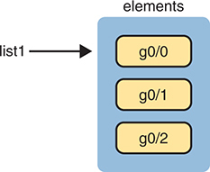

<figcaption>

<aside class="hidden" id="a23fig02">

列表为标签列表1并包含3个元素: G0斜线-0; G0斜线-1; G0斜线-2. 这些元件在被标注的容器中以堆放箱的形式显示。 每个元素都用黄色突出出,显示它们在列表中的顺序.

</aside>

<strong>图23-2</strong> <em>Python 中的列表数据结构</em>

</figcaption>

</figure>

Python 支持类似的数据结构,称为 a<em>字典</em>。如果你想到英语字典的内容,该字典列出了一系列的对称项目:名词和匹配的定义. Python等编程语言,字典数据结构也列出了配对项目:<em>键</em>(类似术语)和<em>值</em>(类似定义).<a href="#ch23fig03">图23-3</a>显示与 dict1 变量相匹配的字典结构<a href="#exa23_2">示例23-2</a>。注意每个键及其价值称为 a<a id="key_342" href="#ref-gloss_190">键: 值对</a>.

<figure class="image-c" id="ch23fig03">

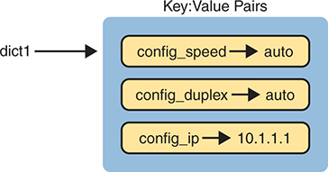

<figcaption>

<aside class="hidden" id="a23fig03">

左侧有被标记为"{1}"的箭头指向右侧的蓝色盒子,表示"{1}}"是"字典对象". 蓝盒内部有3个键值对,每对都以黄色矩形表示,左侧有键,而右侧有对应的相值. 第一个键-值对是配置与值自动的下划线速度,第二个是配置与值自动的下分线双解,第三个是配置与值为10.1.1.1的下划线I P. 这些对子用右向箭头将键连接到各自的值来显示,在字典中显示关联. 蓝盒上方被标为"键对"(Key Pairs),强调字典结构为"键值对"的集合,是用于高效存储和检索数据的Python字典的一个基本方面. 键和值在圆形长方形框内显示,其中键被前缀为配置下划线来表示配置参数,而所遵循的值则表示各自的设置.

</aside>

<strong>图23-3</strong> <em>Python 中的字典数据结构</em>

</figcaption>

</figure>

数据结构可以变得更为复杂. 此外,数据结构还可以被嵌入. 例如,一个变量的值可以是列表,每个列表元素都是字典,一些关键词中的值:值对是其他列表等. 目前要注意的是,程序使用简单的变量,但也使用列表和字典变量来方便执行不同种类的逻辑.

</section>

</section>

<section>

<h4 class="h4" id="ch23lev2sec3">REST API 与 HTTP</h4>

API的存在允许两个程序交换数据. 一些API可能被设计为运行在同一台计算机上的程序之间的接口,因此程序之间的通信发生在一个单一的操作系统内. 许多API需要提供给运行在其他计算机上的程序,因此API必须定义由API支持的网络协议类型——许多基于REST的API使用HTTP协议.

基于REST的API的创建者经常选择HTTP,因为HTTP的逻辑与一些为REST API更一般地定义的概念相匹配. HTTP使用与REST相同的原理:它使用客户端/服务器模型运行;它使用无国籍的操作模型;它包括了明确将对象标记为可缓存或不可缓存的首部. 它还包括动词——指对一对HTTP请求和响应消息的所期望的行动的用词——它与应用程序喜欢的工作方式相匹配.

本节将一些编程术语的基本内容,该词如何与HTTP动词相匹配,以及REST API如何使用统一资源识别符(URIs)来指定从RESTful API调用中想要的数据.

<section>

<h5 class="h5" id="ch23lev3sec6">软件 CRUD 操作与 HTTP 动词</h5>

软件行业使用一个令人难忘的缩写——<a id="key_336" href="#ref-gloss_099">CRUD</a>申请的四项主要行动。 这些行动是:

<strong>创建 :</strong>允许客户端在服务器上创建一些变量和数据结构的新实例并初始化其保存在服务器上的值

<strong>读取:</strong>允许客户端检索(读取)服务器上存在的变量的当前值,在客户端存储变量、结构和值的副本

<strong>更新 :</strong>允许客户端更改( 更新) 服务器上存在的变量值

<strong>删除:</strong>允许客户端从服务器上删除不同的数据变量实例

例如,如果使用思科DNA中心或催化中心控制器的北行REST API,如本文所述。<a href="v2-22.html#ch22">第22章</a>, “<a href="v2-22.html#ch22">Cisco 软件定义接入（Cisco SD-Access）</a>,”你也许想创造一些新的东西,比如新的安全政策。 从编程的角度来看,安全政策作为控制器上相关的一组配置设置存在,内部以变量为代表. 要做到这一点,用户会利用兼容的REST API客户端应用程序,如Postman. 一旦用户建立了客户端应用程序,并采用了与催化中心控制器进行通信所需的适当HTTP方法,便会发出RESTful API呼叫,以便在控制器上"创建"一个代表前述安全政策的新变量. 使用 CRUD 缩略语的 Creat 函数执行控制器上构建的可变或安全政策。

注意

思科使用思科DNA中心控制器产品名称多年. 2023年,思科将产品重新命名为"思科催化剂中心"控制器. 然而,鉴于大量文件提到旧名并缩写为DNA和DNAC,本章继续将控制器指为DNA中心控制器.

CRUD行动的其他例子包括检查新配置的状况(读取动作),修改新配置中某些特定设置的更新(更新动作),或者完全去除安全政策定义的行动(删除动作).

HTTP使用与 CROUD 动作相映射的动词. HTTP定义了HTTP请求和响应的概念,由客户端发送请求,由服务器以响应回答. 每个请求/回复在HTTP请求头中列出一个动作动词,它定义了HTTP动作. HTTP消息还包括一个URI,它识别了被操纵用于此请求的资源. 一如既往,HTTP 消息以 IP 和 TCP 方式传输,并带有首部和数据,如<a href="#ch23fig04">图23-4</a>.

<figure class="image-c" id="ch23fig04">

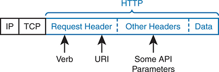

<figcaption>

<aside class="hidden" id="a23fig04">

图表显示一个分为多节的包. 在左边,包从IP和TCP头开始,这是网络通信的基础. 在这些首部之后,会描绘出HTTP部分,从以蓝色标注的请求首部开始. 在请求头中,有3个关键组件被标记为:Verb,URI,和Some API参数. 动词代表了HTTP方法(如GET,POST等),URI(Uniform Resources Identifer)指定了所请求的资源,API参数为请求提供了补充信息. Verb被标记为向下指向箭头,表明其在请求头中的位置. 同样地,URI和一些API参数被标记为箭头向下指向. 在请求头旁边,其他头部分包括请求所需的任何额外的头. 最后,如果适用,数据部分载有请求正文。

</aside>

<strong>图23-4</strong> <em>HTTP 请求首部中的 HTTPVerb 和 URI</em>

</figcaption>

</figure>

为了从一些角度了解HTTP,暂时忽略了REST. 当您打开网页浏览器并点击链接时,您的浏览器会生成类似 HTTP 的请求信件<a href="#ch23fig04">图23-4</a>在结构。 消息包括一个带有GET动词和URI的HTTP头. 在回复中返回的资源是网页的组件,如文本文件,图像文件,和视频文件.

HTTP与REST合作良好,部分原因是由于HTTP有能与CRUD范式中常见的程序动作相匹配的动词.<a href="#ch23tab02">表23-2</a>列出 HTTP 动词和 CRUD 术语,以便于参考和研究。

<figure class="table" id="ch23tab02" tabindex="0">

<figcaption>

<strong>表23-2</strong>将 CRUD 动作比对 REST 单词

</figcaption>

<table class="all">

<tbody>

<tr>

<th class="th">
行动
</th>

<th class="th">
CRUD 术语
</th>

<th class="th">
REST（HTTP）动词
</th>

</tr>

<tr>

<td class="border">
创建新的数据结构和变量
</td>

<td class="border">
创建
</td>

<td class="border">
POST
</td>

</tr>

<tr>

<td class="border">
读取(获取)变量名称、结构和值
</td>

<td class="border">
读取
</td>

<td class="border">
GET
</td>

</tr>

<tr>

<td class="border">
更新或替换一些变量的值
</td>

<td class="border">
更新
</td>

<td class="border">
PATCH, PUT
</td>

</tr>

<tr>

<td class="border">
删除一些变量和数据结构
</td>

<td class="border">
删除
</td>

<td class="border">
DELETE
</td>

</tr>

</tbody>

</table>

</figure>

注意

虽然<a href="#ch23tab02">表23-2</a>将 HTTP POST 列为创建动作,将 HTP PATCH 和 PUT 列为 CRUD 更新动作,所有这三种HTTP 动词都可能同时用于创建和在某些情况下的更新动作.

</section>

<section>

<h5 class="h5" id="ch23lev3sec7">在 HTTP 中使用 URI 指定资源</h5>

除了使用HTTP动词来为一个应用程序执行CRUD函数外,REST还使用URI来识别HTTP请求在什么资源上的行为. 对于REST API,资源可以是API定义的许多资源中的任何一种. 每个资源包含一组相关的变量,由API定义并被URI所识别.

例如,想象一个用户创建基于REST的API. 在这样做时,用户会创建一套资源,通过API提供,并且也会为每个资源分配一个独特的URI. 换句话说,API创建者创建了一个URI和一个匹配的变量集,并定义了可以针对这些变量执行的动作(读取,更新等).

API创建者还创建了API文档,其中列出了资源,并且除了其他细节外,还创建了识别了每个资源的URI. REST 客户端应用程序的程序员可以读取API文档,构建 REST API 请求,并请求特定资源,示例如下:<a href="#ch23fig05">图23-5</a>.

<figure class="image-c" id="ch23fig05">

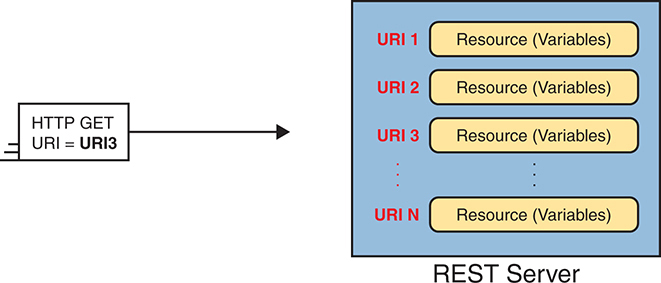

<figcaption>

<aside class="hidden" id="a23fig05">

左边有一个框标为 HTTP GET URI 等同 URI 3,表示 GET 对 URI 3确认的资源的请求. 一个箭头从这个框向右指出,导致一个更大的被标记为REST Server的蓝盒. 在 REST 服务器框内,多个黄色矩形代表不同的资源或变量. 每个资源都与一个独特的URI相联,列在每个矩形的左侧. U R Is被相继地标为"URI 1","URI 2","URI 3",上至"URIN",表示服务器上可用的多个截然不同的端点. 每个URI都指向可以通过API访问或被操纵的特定资源或一组变量. 这个设置说明了RES Tful原则,即使用U R Is来唯一识别资源,允许客户端通过GET,POST,PUT,和DELET等标准HTTP方法在这些资源上进行操作.

</aside>

<strong>图23-5</strong> <em>每个 API 资源 - 概念视图 1 URI</em>

</figcaption>

</figure>

<a href="#ch23fig05">图23-5</a>显示通用的URI值;然而,今天的网络工程师需要能够读取API文档,在文档中看到URI,并理解URI每个部分的含义.<a href="#ch23fig06">图23-6</a>显示一个与CiscoDNA Center 北行的 REST API 所特有的 URI ,作为 URI 的一些组件的例子.

<figure class="image-c" id="ch23fig06">

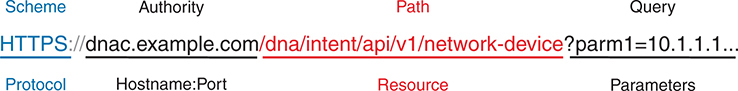

<figcaption>

<aside class="hidden" id="a23fig06">

显示的完整的URI是 HTTPS 冒号 slash d n a c dot example dot com slash d n 斜号意图 slash a p I slash v 1 slash 网络连字符设备问题标记 parm 等于 10.1.1.1. URI分为不同的部分,并有相应的标签:Scheme或协议为HTTPS,以蓝色显示;管理局为d n a c dot example dot com,代表主机名和端口,以黑色显示;路径为/d n slash intim slash a p I slash v 1 slash 网络连字符设备,代表资源路径,以红色显示;查询为?parm等于10.1.1.1,包含参数,以黑色显示. 图像下方的标签指定: 协议对应 HTTPS; 主机名连字符端口对应 dn a c dot 示例 dot com; 资源对应 /d n slash 意图 slash a p i slash v 1 slash 网络连字符设备; 参数对应 ?parm 等于 10.1.1.1. 这一细分提供了对URI每个部分的全面理解,强调如何正确构建RES Tful API请求.

</aside>

<strong>图23-6</strong> <em>REST 获取请求的 URI 结构</em>

</figcaption>

</figure>

URI有一个定义格式,详见RFC 3986. 顶端是<a href="#ch23fig06">图23-6</a>列出来自RFC的正式术语。 它还列出了一些REST API文档和工具中用于这些领域的更常见术语.

<ul class="sq">

<li>
<strong>方案(协议):</strong>HTTPS 字母在 p 之前识别所使用的方案或协议——在此情况下是 HTTP Security(使用 HTTP 有 SSL 加密).
</li>

<li>
<strong>权威( 港: 港):</strong>此值位于 // 和 第 / 之间, 表示权威, 大多数人称它为主机 。 权威字段可以列出主机名或IP地址,并可选择列出运输端口号. (如果使用主机名,REST客户端必须执行名称解析来学习REST服务器的IP地址.
</li>

<li>
<a id="key_347" href="#ref-gloss_355">路径( 资源)</a><strong>:</strong>此值会位于第一个 / 之后, 并在 URI 结束时或任何附加字段( 如查询字段) 之前完成 。 字段唯一识别资源由 API 定义。 对于 REST,您可以将这个字段视为数据,从客户端传递到服务器,以识别请求中引用的数据.
</li>

<li>
<a id="key_348" href="#ref-gloss_356">查询( 平面)</a><strong>:</strong>此值位于路径的后端 。 在 ? 之后, 查询字段允许指定变量名称的值, 这样 URI 就可以通过数据 。
</li>

</ul>

对基于 REST 的 API 文档进行巡视,可以揭示路径和查询字段的目的和含义。 比如说,<a href="#ch23fig07">图23-7</a>显示 Cisco Catalyst Center API 文档中的一个 doc 页面。 (亲眼看看,去<a href="https://developer.cisco.com">https://developer.cisco.com</a>并搜索“Cisco Catalyst CenterAPI文件。 ”

<figure class="image-c" id="ch23fig07">

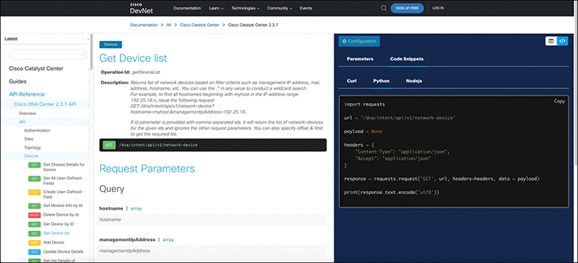

<figcaption>

<aside class="hidden" id="a23fig07">

屏幕分为两个主要部分:左通航面板和主内容区. 左向导航面板包括标题Cisco Catalyst Center,一个带有占位符搜索的搜索栏,区头指南和API Reference,以及APIReference下的各种链接,包括Overview,Authority,和Network Devicember,其中网络设备部分被扩展为显示Get Devicement列表等选项. 主要内容领域有标题"Get Devicement"列表和子标题"Operation I D:Get Network Devicember",提供API呼叫的细节,以获得由思科DNA中心管理的网络设备列表. 查询参数部分详细介绍了具体参数,如主机名和管理 I P地址等. 一个实例请求部分显示一个 Python 代码片段,显示如何制作 API 请求,包括必要的头和 GET 请求 URL 。 本页面为开发者提供所有必要的细节,以了解并使用API来列出网络设备,包括一个如何执行API调用的实际例子.

</aside>

<strong>图23-7</strong> <em>Cisco Catalyst Center API Doc 页面用于网络设备( 列表) 资源</em>

</figcaption>

</figure>

API文档确定了在URI中用于请求特定信息的路径(资源). 例如,一个 APIGET 请求,使用位于顶端的路径<a href="#ch23fig07">图23-7</a>,请 Cisco Catalyst Center提供所有已知设备的列表,Cisco Catalyst Center返回每个设备的值字典。

同一份 API 文档还列出了查询参数，以进一步细化 REST 请求。例如，你可能只需要某一台设备的值字典，而不是所有网络设备的列表。<a href="#ch23fig07">图23-7</a> 的左下部分列出此次 API 调用可用的一些查询参数。在 URI 末尾追加以下内容，就能实现这种筛选：

<a href="#code-f0537-01" id="f0537-01a">点击此处查看代码原图</a>

<pre class="pre" tabindex="0"><code>?managementIPAddress=10.10.22.66&amp;macAddress=f8:7b:20:67:62:80</code></pre>

</section>

</section>

<section>

<h4 class="h4" id="ch23lev2sec4">调用 Cisco Catalyst Center REST API 的示例</h4>

为了将一些REST API概念拉到一起,接下来的几页通过几个样本API调用一个名为API开发环境工具的软件应用程序.

对于一点开发视角,在努力实现你网络操作任务的某些部分自动化时,你最终会使用一个让API调用的程序. 然而,在开发应用程序的初期,你可能首先关注API提供的数据,并首先忽略所有编程细节. API 开发环境允许您关注API的呼叫。 后来,同一种工具一般可以生成正确的代码,可以复制到您的程序中,让API调用.

本节中的例子使用名为Postman的应用程序. Postman可免费下载( Postman) 。<a href="http://www.postman.co">www.postman.co</a>)并按本节所示使用。 注意Cisco DevNet在其众多实验室和实例中广泛使用Postman.

在利用API与任何软件平台,应用程序或控制器进行通信时,重要的是要思考你正在试图实现什么——例如,如果你想使用API呼叫Cisco Catalyst Center来拉出控制器内设备的盘点.

考虑给目标应用程序或控制器做任何 API 呼叫,就像连接到您网络环境中的任何其他设备一样. 要访问软件应用程序或控制器,必须采取一个重要步骤,即认证。 与这些平台在程序上的互动 与您登录到 CLI 的路由器并在您的证书中输入没有区别 。 这意味着您必须首先通过 API 认证您想要连接的设备 。 但是,这一规则也有例外;如果软件没有担保,在被操纵之前可能不需要认证。 这是非常罕见的,而且通常在任何能够改变你网络环境的东西上都看不到.

API有许多不同的认证方法,如API密钥,JSON Web Token(JWT),TLS/SSL客户端证书,基本认证,Java会话ID或cookie等. 以思科催化中心为例, 让我们看看认证文件或标志性API,

注意

本节只注重基本认证,因为它是Cisco Catalyst Center目前使用的认证方法.

<a href="#ch23fig08">图23-8</a>显示 Cisco Catalyst Center API 的参考文献<a href="http://developer.cisco.com">developer.cisco.com</a>。注意屏幕左侧列表中可用的首个API呼叫是认证API. 这样做的方法是,一旦你使用HTTP POST请求方法成功认证到Cisco Catalyst Center发送登录证书,你就会收到一个令牌,这是用户名和密码的Base64编码字符串. 注意上面写着:

“说明:API获取出入证,有效期为1小时。 使用此 API 获得的令牌需要设定为 X- Auth- Token HTTP 头值, 用于所有 API 到 Cisco DNA 中心 的调用 。”

<figure class="image-c" id="ch23fig08">

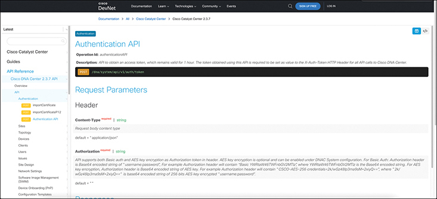

<figcaption>

<aside class="hidden" id="a23fig08">

屏幕同样被分为两个主要部分:左通航面板和主内容区. 左向导航面板包括标题 Cisco Catalyst Center,一个带有占位符搜索的搜索栏,区头指南和API Reference,以及API Record下的各种链接,包括Overview,Authoration,和Network Devicember,并选择了认证部分. 主要内容领域有标题认证API和子标题Operation I D:post Auth Token,提供获取认证令牌的细节,用于进行后续API的调用. 请求参数一节详细要求标题,如内容连字符类型和授权等. 参数包括内容连字符类型(Type: string, required: true;ext:应用程序 slash json)和授权(Tyope:strring, request: true,ext: Basic &lt;credititis&gt;). 一个实例请求部分显示一个 Python 代码片段,以演示如何获得认证符. 这个API参考页提供了详细指示,说明如何认证并获得安全API呼叫所需的令牌,确保开发者拥有访问Cisco Cactoryst Center服务所需的信息.

</aside>

<strong>图23-8</strong> <em>Cisco Catalyst Center API 参考文献<a href="http://developer.cisco.com">developer.cisco.com</a></em>

</figcaption>

</figure>

这说明此API用于认证给控制器,在您认证并收到该令牌后,需要将一个叫X-Auth-Token的功能传递给所有后续API的呼叫控制器.

这意味着,一旦你认证并收到Cisco Catalyst Center发出的信使,你就必须将该信使作为X-Auth-Token发回Cisco Catalyst Center,供您在初始认证后的所有API电话使用。 例如,使用HTTP GET请求从Cisco Catalyst Center提取数据或库存。

现在你知道在哪里找到API文档了, 让我们来回顾一下你必须认证到思科催化中心并取回信物的步骤。

首先,您必须使用认证 API 登录到 Cisco Catalyst Center并收到一个符号,然后才能发出任何后续的 API电话,例如从控制器中提取设备目录 。 让我们看看如何用Postman来认证。<a href="#ch23fig09">图23-9</a>说明Postman向思科催化中心认证的适当设置. 设立邮政局时使用以下资料: 邮政局.

<ul class="sq">

<li>
认证 API 的 URI :<a href="https://sandboxdnac2.cisco.com/dna/system/api/v1/auth/token">https://sandboxdnac2.cisco.com/dna/system/api/v1/auth/token</a>
</li>

<li>
HTTP POST 请求方法
</li>

<li>
基本授权
</li>

<li>
用户名和密码:devnetuser / Cisco123!
</li>

</ul>

<figure class="image-c" id="ch23fig09">

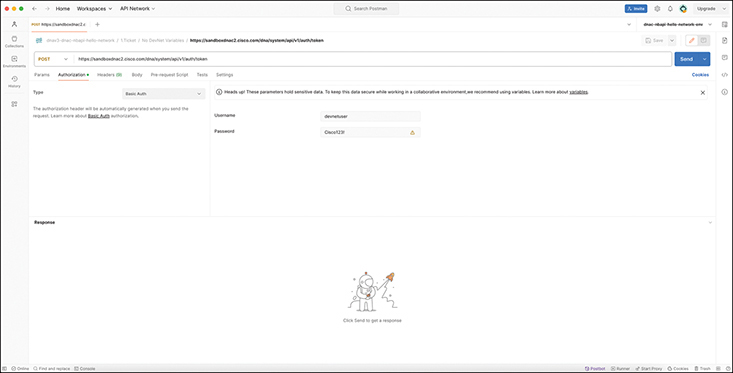

<figcaption>

<aside class="hidden" id="a23fig09">

在顶端,浏览器窗口显示标准菜单选项,如文件,编辑,查看和帮助,在URL栏输入的URLHTTPS结号斜沙盒dn c2 dot cisco dot slish dn slish系统 slish a p I slish v1slish aut slish sirc. URL栏下方,活动请求方法被设定为POST并用橙色突出显示. 焦点中的当前标签是授权标签,用橙色下划线表示,上面有绿色点和文字授权后有灰色点和文字标题(9). 授权类型设定为 Basic Auth, 如类型下拉菜单所示 。 此菜单下方有一个信息框, 声明, 当您发送请求时, 授权头会自动生成 。 了解更多关于 Basic Auth 的授权 。 信息框下有两个输入字段:用户名和密码,分别由devnetuser和Cisco123!. 在密码字段右侧,一个带有感叹标记的小黄色三角形表示对输入密码的警告. 在右上角有用于保存(灰色)和发送(蓝色)的按钮,其中的发送按钮意在执行API请求. 在请求配置区域下方,响应部分目前是空的,如文本"点击发送"(Click Send)所显示的,以获得一个在插图下关于机器人手持一面有火箭的旗帜的响应. 左侧有各种导航选项,包括收藏,环境,和历史等,部分可见. 浏览器的地址栏和窗口控制按钮在最上方可见,与Postman应用程序名并列,接口还包括右上方的"邀请"和"升级"按钮.

</aside>

<strong>图23-9</strong> <em>Cisco Catalyst Center认证 API 的 Postman 设置</em>

</figcaption>

</figure>

现在Postman被设置为认证,点击"发送"按钮,向Cisco Cactoryst Center发出API呼叫.<a href="#ch23fig10">图23-10</a>显示来自 Cisco Catalyst Center的响应,同时显示标志和一个200 OK的 HTTP 状态代码,表明认证成功。

<figure class="image-c" id="ch23fig10">

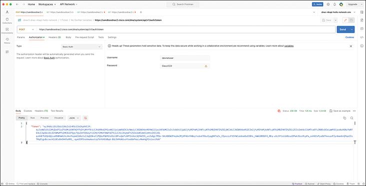

<figcaption>

<aside class="hidden" id="a23fig10">

在顶端,浏览器窗口显示标准菜单选项,如文件,编辑,查看和帮助,在URL栏输入的URLHTTPS结号斜斜沙盒dn c-2 dot cisco dot slash dn slash系统 slash a pi slash v-1slash aut slash slash sorder. 请求方法设定为POST并用橙色突出显示. 如橙色下划线所示,活动标签为授权,在类型下拉菜单中选择 Basic Auth 。 在此菜单下方, 一个信息框表示, 当您发送请求时, 授权头会自动生成 。 了解更多关于 Basic Auth 的授权 。 信息框下有两个输入字段:用户名和密码,分别由devnetuser和Cisco123!,密码字段旁边有一个黄色三角形警告图标. 在右上角有用于保存(灰色)和发送(蓝色)的按钮,其中的发送按钮意在执行API请求. 在请求配置区域下方显示响应部分,显示正在运行的正文标签和设定的响应格式到 Pretty和JSON. JSON响应包含一个单键Token,长字符串值代表认证符. 右下方的响应细节表示状态为200确定,所花时间为126毫秒,响应大小为1.24千字节. 有一些选项可以保存为例,还有一个用于设置的小齿轮图标. 一个机器人手持一面旗帜的插图仍保留在屏幕下方,表明该响应已经成功得到. 左侧有各种导航选项,包括部分可见的"收藏","环境"和"历史"等. 浏览器的地址栏和窗口控制按钮位于顶端,与Postman应用程序名并列,接口包括右上方的"邀请"和"升级"按钮.

</aside>

<strong>图23-10</strong> <em>执行 Cisco Catalyst Center认证 API in Postman</em>

</figcaption>

</figure>

你用收到的信使 传递到思科催化中心 通过API调取设备库存。 回顾API文档,可以看到一个叫做Network-Device的API. 这是从Cisco Catalyst Center控制器中提取设备库存的API.<a href="#ch23fig11">图23-11</a>从DevNet网站上的文档中突出显示如何使用网络-DEVice API的具体内容. 然而,通知说,对于随后的API调用和用于认证API的用法来说,URI是不同的. 比较以下两个URI:

<ul class="sq">

<li>
<strong>认证 URI :</strong> <a href="https://sandboxdnac2.cisco.com/dna/system/api/v1/auth/token">https://sandboxdnac2.cisco.com/dna/system/api/v1/auth/token</a>
</li>

<li>
<strong>网络- Device URI :</strong> <a href="https://sandboxdnac2.cisco.com/dna/intent/api/v1/network-device">https://sandboxdnac2.cisco.com/dna/intent/api/v1/network-device</a>
</li>

</ul>

<figure class="image-c" id="ch23fig11">

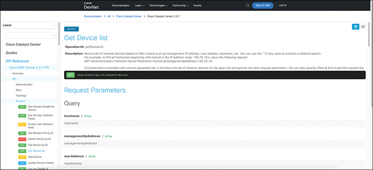

<figcaption>

<aside class="hidden" id="a23fig11">

截图包括以下内容: 在上方,有一个黑色的通航条,有文件,学习,技术,社区和事件等选项. 导航栏右侧还有一个Sign Up Free按钮和一个Log In按钮. 在导航栏下方有一个面包屑导航道,读取的文献大于所有比Cisco Catalyst Center还多的文献大于Cisco Catalyst Center2.3.7. 屏幕左侧有一个侧边栏,名为Cisco Catalyst Center,有可扩展部分。 API参考部分被扩展,显示包括Overview,API,认证,站点,地形学,以及设备等子类. 在"设备"区段内,多个API端点以不同的HTTP方法列出,如GET,POST,DELETE,和PUT等. 目前选中的终点是 Get Device 列表, 以蓝色突出显示 。 主要内容区域有标题"Get Devicement"列表后有操作细节. 操作ID是获得设备列表. 描述称,这个端点返回基于过滤标准的网络设备列表,如管理 I P 地址, MAC 地址,以及主机名等. 提供了一个例子 GET 请求 : Get slash d n a slash intime slash a pi slash v1 slash 网络连字符设备问号主机名等于 myhost dot,管理 I P地址等于192.25.18 dot. 如果ID参数提供逗号分隔的IDs,它将返回给定的IDs的网络设备列表并忽略其他请求参数. 用户还可以指定抵消和限制以获得所需的列表. 绿色代码块包含实例 GET 请求: Get slash d n a slash意图 slash a p I slash v 1 slash 网络连字符设备. 在主要描述之下,有一个题为“请求参数”的章节详细列出了这个API端点可用的查询参数。 所列出的参数包括主机名(阵列),管理 I P 地址(阵列),和mac 地址(阵列),每个都有一个简短的描述.

</aside>

<strong>图23-11</strong> <em>Cisco Catalyst Center网络-Device API的文档</em>

</figcaption>

</figure>

现在,你知道如何通过审查文档来使用API, 让我们来演示一下Postman是如何做到的。<a href="#ch23fig12">图23-12</a>显示适当的步骤,以使用通过先前完成的认证 API 收到的现有令牌。 此外,该图还显示如何简单地将"X-Auth-Token"字输入到标题分页下的关键字段,然后将符号信息粘入值字段,并确保网络-Device API调用的适当URI正在被使用. 一旦所有这一切都得到确认, 你可以发布 GET API 呼叫 Cisco Catalyst Center 并拉下设备库存。

<figure class="image-c" id="ch23fig12">

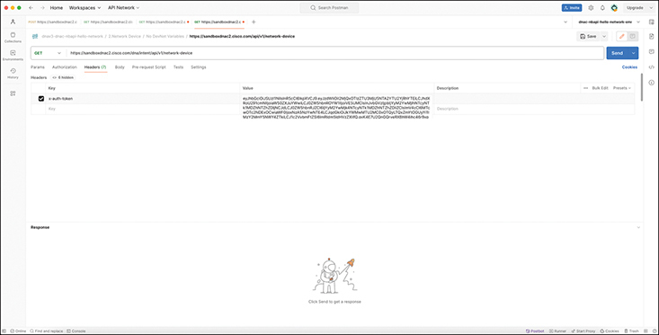

<figcaption>

<aside class="hidden" id="a23fig12">

在顶部,Postman应用程序接口可看到有多个导航标签,如Home,Workspaces和API Network等. URL字段被 HTTPS 冒号斜线沙盒 d n a c2 dot cisco dot com slash a p I slash v 1 slash 网络连字符设备并设定了HTTP方法来获取. 在 URL 字段下方,有标签标记为 Params 的标签,授权页,首部,正文,预请求脚本,测试和设置. 选择了首部标签,显示一个以长符号字符串为值的以首部键 x 连字符 uth 连字符符号的条目。 响应部分的正文是空的,以卡通宇航员手持一面旗帜并留言"点击发送以获得响应"的占位图像来表示.

</aside>

<strong>图23-12</strong> <em>Cisco Catalyst Center网络-Device API的Postman设置</em>

</figcaption>

</figure>

遵循与认证API相同的程序,点击"发送"按钮,并向Cisco Catalyst Center发布API呼叫. 单位<a href="#ch23fig13">图23-13</a>,您可以看到存货通过API成功拉下. 也可以在Postman的响应部分看到网络设备列表. 也注意到再次出现200 OK的HTTP状态代码. URI的资源部分显示的是前面列出的相同资源<a href="#ch23fig06">图23-6</a>,询问设备列表。

<figure class="image-c" id="ch23fig13">

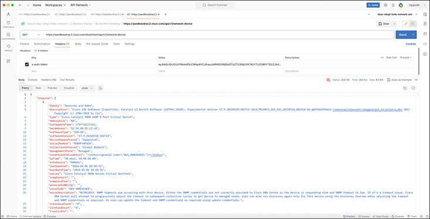

<figcaption>

<aside class="hidden" id="a23fig13">

接口上方可见多个分页,包括Home,Workspaces和API Network. 在这些分页下方,URL栏中包含端点 HTTPS 结号斜线沙盒 d n a c 2 dot Cisco dot com slash a p I slash v 1 slash 网络连字符设备,带有所选择的GET方法,表示这是获取网络设备信息的GET请求. 在 URL 栏的右侧,有保存请求,发送请求的选项,以及诸如预请求脚本和测试等其他动作. 首部标签打开, 揭示了六个隐藏首部, 并显示一个名为 x 连字符 uth 连字符的密钥 。 在接口的主要部分中,Body标签是打开的,以 Pretty JSON格式显示响应. JSON响应包含一个带有响应阵列的详细对象. 阵列包括一个具有各种属性的对象,如家族(Switches and Hubs),描述(提供详细的软件信息),类型(Cisco Catalyst 9000UAP8Port Virtual Switch),和内存大小(N A)等. 其他属性包括上个更新时间(时间戳),mac地址(52冒号54冒号00冒号81冒号2冒号00),软件类型(IOS连字符X E),软件版本(17.9.20220318冒号182713),以及设备支持级别(支持). 其它字段包括序列号(9S9BYF4A20J),收藏Interval(全球默认),管理状态(管理状态),以及库存状态详情(表示设备状态代码)等. 设备的起动时间被列出为30天,10克口号05克口号18.00,角色来源被标记为MANAUAL. 还包括最后一次更新的日期和通知,以及系列信息(Cisco Catalyst 9000系列虚拟交换机)和SNMP的细节。 与SNMP超时相关的出错会被注意,其中包含DEV连字符UNREACHED的错误代码和详细的出错描述. 在身体部分的下方,可看到Cookies,headers等额外的分页和测试结果. 首部标签包括了16个项目,提供了回复HTTP首部的详细信息. 反应的状态显示为200OK,时间为404毫秒,大小为9.4千字节. 接口还包括了左侧边栏的导航选项,如Collections,Environments,History等,使用户能够管理和组织他们的API请求和响应.

</aside>

<strong>图23-13</strong> <em>执行 Cisco DNA Center 网络-Device API in Postman</em>

</figcaption>

</figure>

注意

<a href="http://sandboxdnac2.cisco.com">sandboxdnac2.cisco.com</a>这是Cisco DevNet网站上的CiscoDNA中心实例。 使用这一资源没有费用。

花点时间看看Postman窗口底部的数据<a href="#ch23fig13">图23-13</a>。文字沿用了名为"JavaScript Object Notation"(JSON)的数据建模格式,是该章其余部分的主要话题之一. 然而,只要有路由器的知识,你就可以找到一些看起来熟悉的事实. 为了帮助你看到文本,<a href="#exa23_3">示例23-3</a>在窗口中显示一些 JSON 输出的已编辑( 缩短以缩短长度) 视图, 仅此即可看到格式和数据返回到这个 API 调用中 。

<strong>示例23-3</strong> <em>JSON 来自 REST API 呼叫</em>

<a href="#code-f0541-01" id="f0541-01a">点击此处查看代码原图</a>

<pre class="pre-ex" tabindex="0"><code>{

    "response": {

         "family": "Switches and Hubs",

        "type": "Cisco Catalyst 9000 UADP 8 Port Virtual Switch",

        "macAddress": "52:54:00:01:c2:c0",

        "softwareType": "IOS-XE",

        "softwareVersion": "17.9.20220318:182713",

        "serialNumber": "9SB9FYAFA2O",

        "upTime": "30 days, 10:05:18.00",

        "series": "Cisco Catalyst 9000 Series Virtual Switches",

        "hostname": "sw1.ciscotest.com",

        "managementIpAddress": "10.10.20.175",

        "platformId": "C9KV-UADP-8P",

        "role": "CORE"

    }

}</code></pre>

Postman等API开发工具帮助您解决每个API调用的细节,保存细节,并与其他工程师和开发者共享. 最终,你将准备好从一个程序发出API呼叫. 使用 Postman UI 的简单点击, Postman 将代码提供复制/粘贴到您的程序, 以便返回窗口中/下方显示的所有输出, 作为您的程序的变量 。

现在,你对REST API的力学有很好的基础知识. 通过学习一些技能,以及使用任何 REST API 的 API 文件,你现在可以进行实验,并尝试让 REST API 呼吁. 对于其中的很多,数据会以文本的形式回归到你们身上,常常是JSON格式,因此后半部分检查了该文本的含义.

</section>

</section>

<section>

<h3 class="h3" id="ch23lev1sec4">数据序列化与 JSON</h3>

在你成为拥有网络自动化技能的现代网络工程师的旅程中,你会学会理解几个<a id="key_337" href="#ref-gloss_101">数据序列化语言</a>。每个数据序列化语言都提供了使用文本描述变量的方法,目的是能够发送在网络上保存文本, 或者在文件中保存文本 。 数据序列化语言给了我们一种用文字来表示变量的方法,而不是任何特定编程语言所使用的内部表示.

每个数据序列化语言都使API服务器能够返回数据,使API客户端可以复制API服务器上发现的同一种变量名称和数据结构. 为了描述数据结构,数据序列化语言包括特别的字符和常规来交流关于列表变量,字典变量以及其他更复杂的数据结构的想法.

本章的第二大节审查了数据序列化语言的概念,重点是目前CCNA蓝图中提到的一种数据建模语言:<a id="key_339" href="#ref-gloss_187">JavaScript 对象标记( JSON)</a>.

<section>

<h4 class="h4" id="ch23lev2sec5">API 为何需要数据模型</h4>

本节展示了如何将服务器上的程序中的变量移动到客户端程序的一些想法. 首先,<a href="#ch23fig14">图23-14</a>和周围的文本显示一个不起作用的例子,以此来识别一些挑战,将可变值从一个设备复制到另一个设备。 后来,<a href="#ch23fig15">图23-15</a>及其相关文本显示如何使用数据序列化语言来解决周围显示的问题<a href="#ch23fig14">图23-14</a>.

<figure class="image-c" id="ch23fig14">

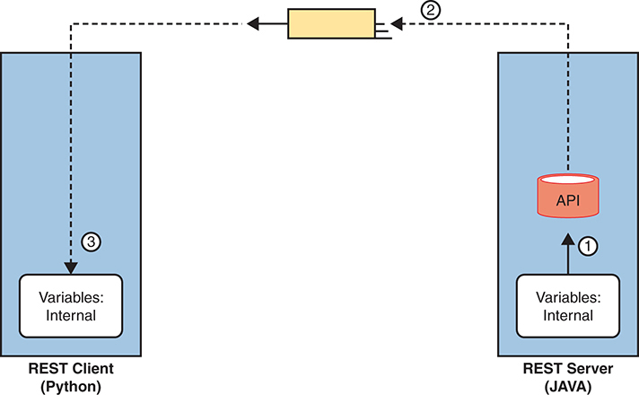

<figcaption>

<aside class="hidden" id="a23fig14">

在左侧,有一个蓝色长方形盒子被标注为REST客户端(Python),其中包含一个较小的白色盒子,并有文本可变:内部. 一个标有倒数3分的点形箭头,向下指向这个白盒子. 在右侧,还有一个被标注为"REST Server"(JAVA)的蓝色长方形盒子,里面有一个带有"文字可变因素:内部"的相类似的白色盒子. 在这个白色盒子上方,有一个红色的圆柱被标记为API. 标有1分的箭头从白盒子向上向API. 在两个蓝盒子之间,有一个黄色的矩形,上面标有标记为2的箭头指向左右,表示数据交换. 这里所描绘的破碎概念涉及客户端和服务器之间直接交换内部可变表示,在RESTful架构中一般不推荐.

</aside>

<strong>图23-14</strong> <em>破碎的概念:交换变量的内部代表</em>

</figcaption>

</figure>

首先,对于不起作用的例子,考虑流量和编号步骤。<a href="#ch23fig14">图23-14</a>。一个REST客户端坐在左边. REST客户端请求资源,服务器需要回复. 在REST中,一个资源是API定义的一组变量,因此REST服务器需要将一组变量还给左侧的REST客户端. 图中的步骤如下:

<ol class="number">

<li>
REST服务器(一个JAVA应用程序)根据REST请求,取回存储在RAM(第1步)中的变量副本.
</li>

<li>
REST API代码创建了REST响应并发送到网络上,将REST服务器在RAM中拥有的精确复制,以代表该资源中的变量.
</li>

<li>
REST客户端(一个Python应用程序)接收REST响应消息,将精确的同位素和字节存储到它的RAM中,以试图在服务器上拥有一个变量,数据和数据结构的副本.
</li>

</ol>

所显示的过程<a href="#ch23fig14">图23-14</a>没有工作(也没有尝试),因为 REST 客户端程序可能不会以同样的方式存储变量。 首先,用不同语言编写的程序使用不同的常规在内部存储其变量,因为没有跨语言内部可变存储的标准. 事实上,用同一种语言编写但该语言有不同版本的程序可能不会将其所有变量都存储在相同的内部公约上.

为了克服这些问题,应用程序需要一种标准方法来表示程序外那些变量的传输和存储的变量.<em>数据序列化语言</em>提供这一功能。

<a href="#ch23fig15">图23-15</a>显示正确的进程流程与<a href="#ch23fig14">图23-14</a>数据序列化过程包括:

<ol class="number">

<li>
服务器收集内部代表的数据,并提供给API代码.
</li>

<li>
API将内部表示转换为代表这些变量的数据模型(图中为JSON).
</li>

<li>
服务器通过整个网络的信息以JSON格式发送数据模型.
</li>

<li>
REST客户端接收所接收的数据,并以客户端应用程序的原生格式将JSON格式化的数据转换为变量.
</li>

</ol>

<figure class="image-c" id="ch23fig15">

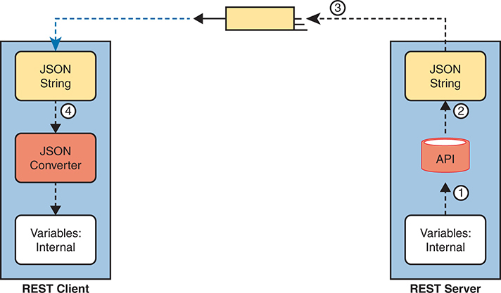

<figcaption>

<aside class="hidden" id="a23fig15">

在图像的左侧,标签为REST客户端,有一个蓝色的垂直矩形被分出三个部分. 顶部部分包含一个被标注为"JSON String"的黄盒. 在此下方有一个橙色盒子被标注为"JSON转换器"(JSON Conversioner)并有向下箭头指向下部部分,其中包含一个白色盒子被标出"可变因素:内部". 在图像的右侧被贴上标签的REST Server上,有一个类似的蓝色垂直矩形也分为了三个部分. 顶部部分包含一个被标注为"JSON String"的黄盒. 在此下方有一个被标记为API的红盒,上面一箭指向下部部分,其中包含一个被标记为可变物:内部的白盒. REST客户端和REST服务器之间的通信过程被用编号步骤和箭头来描绘. 第1步从"可变"开始:REST服务器中的"内部框",表示正在内部准备的数据. 步骤2显示数据被发送到API框后被转换为JSON String. 第3步由一行有箭头的虚线表示,表示JSON字符串从REST服务器传输到REST客户端. 最后,第4步描绘了由REST客户端接收并被JSON转换器转换回内部变量的JSON字符串.

</aside>

<strong>图23-15</strong> <em>正确的概念:交换变量的内部代表</em>

</figcaption>

</figure>

在进程结束时,REST客户端应用程序现在拥有与其在API呼叫中向服务器请求的等同变量. 请注意,最后一步——从数据序列化语言转换为本土格式——可以像单一一行代码一样少!

最后需要注意的是,虽然JSON这样的数据序列化语言使得应用程序能够在一个网络上交换变量,但应用程序也可以以JSON格式存储数据.

</section>

<section>

<h4 class="h4" id="ch23lev2sec6">数据序列化语言</h4>

你将听到并最终使用几种数据序列化和数据建模语言,越多地了解网络自动化. 虽然目前的CCNA蓝图只提及了JSON,但了解一些关于一些替代品的事实可以有助于为您对JSON的新知识增加一点上下文. 存在这些不同的数据序列化语言,以满足这些年来产生的不同需要. 下一节简短地强调了四种这种语言。

注意

术语<em>数据序列化语言</em>和<em>数据建模语言</em>就本节而言,应视为等同。

<section>

<h5 class="h5" id="ch23lev3sec8">JSON</h5>

JavaScript Object Notation试图在人和机器的可读性之间达成平衡. 携带了少数JSON规则,大多数人类可以读取JSON数据,移动过去只是猜测它的含义,并自信地诠释由JSON所定义的数据结构. 与此同时,JSON数据使得程序很容易地将JSON文本转换为变量,这使得使用API的应用程序之间的数据交换变得非常有用.

您可以在 IETF RFC 8259 中找到 JSON 的细节,并在一些通过互联网搜索发现的网站中找到,包括:<a href="http://www.json.org">www.json.org</a>.

</section>

<section>

<h5 class="h5" id="ch23lev3sec9">XML</h5>

早在20世纪90年代,当网页浏览器和万维网(WWW)首次创建时,网页主要使用Hypertext Markup Language(HTML)来定义网页. 作为标记语言,HTML定义了如何在文件中添加文本或网页,然后添加"标记"-附加文本来表示应当显示的文本的格式细节. 例如,标记包括标题、字体类型、大小、颜色、超链接等的代码。

密码<a id="key_349" href="#ref-gloss_382">eXtensible 标记语言( XML)</a>后来来为早期的加分语言做一些改进. 特别是随着时间的推移,网页变得越来越有活力,为了让网页充满活力,需要存储其值可以随时间变化并被网络服务器所取代的变量的文件. 为了确定可被替换成网页的变量,世界需要一种可以定义数据变量的标记语言。 XML定义了一种标记语言,它具有许多特性来定义变量,值和数据结构.

随着时间的推移,XML已经发展出超越了它作为标记语言的原始使用. XML的特性也使它成为有用的一般数据序列化语言,它今天被这样使用.

在牢记人类可读性的同时,XML的创造者选择较少强调人类可读性(与JSON相比),以获得更好的计算机处理功能. 例如,与 HTML 一样, XML 对每个变量使用起始和结尾标记, 如<a href="#exa23_4">示例23-4</a>。在示例中突出显示的行中,"macAddress"和"/macAddress"标记表示一个变量名称,值位于标记之间.

<strong>示例23-4</strong> <em>XML 来自 REST API 呼叫的输出</em>

<a href="#code-f0545-01" id="f0545-01a">点击此处查看代码原图</a>

<pre class="pre-ex" tabindex="0"><code>&lt;?xml version="1.0" encoding="UTF-8"?&gt;

&lt;root&gt;

   &lt;response&gt;

      &lt;family&gt;Switches and Hubs&lt;/family&gt;

      &lt;hostname&gt;cat_9k_1&lt;/hostname&gt;

      &lt;interfaceCount&gt;41&lt;/interfaceCount&gt;

      &lt;lineCardCount&gt;2&lt;/lineCardCount&gt;

      &lt;macAddress&gt;f8:7b:20:67:62:80&lt;/macAddress&gt;

      &lt;managementIpAddress&gt;10.10.22.66&lt;/managementIpAddress&gt;

      &lt;role&gt;ACCESS&lt;/role&gt;

      &lt;serialNumber&gt;FCW2136L0AK&lt;/serialNumber&gt;

      &lt;series&gt;Cisco Catalyst 9300 Series Switches&lt;/series&gt;

      &lt;softwareType&gt;IOS-XE&lt;/softwareType&gt;

      &lt;softwareVersion&gt;16.6.1&lt;/softwareVersion&gt;

      &lt;type&gt;Cisco Catalyst 9300 Switch&lt;/type&gt;

      &lt;upTime&gt;17 days, 22:51:04.26&lt;/upTime&gt;

   &lt;/response&gt;

&lt;/root&gt;</code></pre>

</section>

<section>

<h5 class="h5" id="ch23lev3sec10">YAML</h5>

<a id="key_350" href="#ref-gloss_383">YAML Ain't Markup 语言 (YAML)</a>有个很聪明的递归性名字 但这个名字确实告诉我们一些事情 YAML 不试图定义标记细节( 而 XML 是) 。 取而代之的是YAML专注于数据模型(结构)细节. YAML还努力做到清洁而简单:在此处列出的数据序列化/模型化语言中,YAML很容易被任何新到数据模型的人所读取.

Ansible),是该词中的主题之一.<a href="v2-24.html#ch24">第24章</a>, “<a href="v2-24.html#ch24">理解 Ansible 和 Terraform</a>,”广泛使用YAML文件。<a href="#exa23_5">示例23-5</a>显示一个简短的样本。 并且为了说明可读性,即使你不知道Ansible做什么,你也可以猜测一些功能只是读取文件而已. (注意YAML用双花括号表示变量: QQ.

<strong>示例23-5</strong> <em>Ansible 使用的 YAML 文件</em>

<a href="#code-f0545-02" id="f0545-02a">点击此处查看代码原图</a>

<pre class="pre-ex" tabindex="0"><code>---

# This comment line is a place to document this Playbook

- name: Get IOS Facts

  hosts: mylab

  vars:

    cli:

      host: "{{ ansible_host }}"

      username: "{{ username }}"

      password: "{{ password }}"

  tasks:

    - ios_facts:

        gather_subset: all

        provider: "{{ cli }}"</code></pre>

</section>

<section>

<h5 class="h5" id="ch23lev3sec11">数据序列化小结</h5>

简而言之,<a href="#ch23tab03">表23-3</a>概述本节所提及数据序列化语言以及一些关键事实。

<figure class="table" id="ch23tab03" tabindex="0">

<figcaption>

<strong>表23-3</strong>比较数据模型语言

</figcaption>

<table class="all">

<tbody>

<tr>

<th class="th">
缩略语
</th>

<th class="th">
名称
</th>

<th class="th">
来源/定义
</th>

<th class="th">
主要目的
</th>

<th class="th">
常见用途
</th>

</tr>

<tr>

<td class="border">
JSON
</td>

<td class="border">
JavaScript 对象表示法
</td>

<td class="border">
JavaScript (JS) 语言; RFC 8259
</td>

<td class="border">
通用数据建模和序列化
</td>

<td class="border">
REST API
</td>

</tr>

<tr>

<td class="border">
XML
</td>

<td class="border">
可扩展标记语言
</td>

<td class="border">
万维网联盟（<a href="http://W3C.org">W3C.org</a>）
</td>

<td class="border">
允许数据建模的以数据为重点的文字标记
</td>

<td class="border">
REST API、网页
</td>

</tr>

<tr>

<td class="border">
YAML
</td>

<td class="border">
YAML 不是标记语言
</td>

<td class="border">
<a href="http://YAML.org">YAML.org</a>
</td>

<td class="border">
通用数据建模
</td>

<td class="border">
Ansible
</td>

</tr>

</tbody>

</table>

</figure>

</section>

</section>

<section>

<h4 class="h4" id="ch23lev2sec7">识别 JSON 的组成部分</h4>

Cisco在提到JSON的CCNA 200-301版本1.1蓝图中包含一个考试话题:

6.7 识别 JSON 编码数据的组件

你可以想出这种技巧和任务 与两个主要分支。 首先,即使忽略了语法和特殊字符,任何知道这个话题的人都有可能对很多键:值对子的意义作出有智慧的猜测. 例如,在不了解JSON语法的情况下,你也许可以从你先前对Cisco路由器和切换器的了解中确定JSON在<a href="#exa23_6">示例23-6</a>列出两个设备(可能是其主机名)和每个设备上的接口列表。

<strong>示例23-6</strong> <em>列出路由器接口的简单 JSON</em>

<a href="#code-f0546-01" id="f0546-01a">点击此处查看代码原图</a>

<pre class="pre-ex" tabindex="0"><code>{

    "R1": ["GigabitEthernet0/0", "GigabitEthernet0/1", "GigabitEthernet0/2/0"],

    "R2": ["GigabitEthernet1/0", "GigabitEthernet1/1", "GigabitEthernet0/3/0"]

}</code></pre>

老实说,你可能已经知道 一切需要做这种聪明的猜测。 然而,要完成第二类任务,即分析JSON数据以找到数据结构,包括对象、列表和按键:值对,你需要知道一点更多关于JSON语法. 该章中这个最后的话题为您提供了基本规则,并就如何分解出JSON数据给出了一些建议.

<section>

<h5 class="h5" id="ch23lev3sec12">解读 JSON 键值对</h5>

首先,考虑JSON中关于键:值对的规则,你可以把它看作是单个变量名称及其值:

<ul class="sq">

<li>
<strong>密钥: 值对等 :</strong>每个冒号都识别出一个键:值对,在冒号前有键,在冒口后有值.
</li>

<li>
<strong>键 :</strong>文本 在双引号内,在冒号前,作为引用一个值的名称.
</li>

<li>
<strong>数值 :</strong>代表密钥值的冒号后的项目,可以是

<ul class="sq-i">

<li>
<strong>文本 :</strong>以双引出为上.
</li>

<li>
<strong>数字 :</strong>所列而无引相.
</li>

<li>
<strong>矩阵 :</strong>一个特殊值(更多细节稍后).
</li>

<li>
<strong>对象 :</strong>一个特殊值(更多细节稍后).
</li>

</ul></li>

<li>
<strong>多个对等 :</strong>在列出多键:值对时,将每对的末端有逗号的对相分离出(最后一对除外).
</li>

</ul>

为了执行其中一些规则,考虑:<a href="#exa23_7">示例23-7</a>JSON的数据,专注于三把钥匙:值对. 示例后的案文提供了分析.

<strong>示例23-7</strong> <em>1 JSON 对象( 字典) 有 三键: 等价对等</em>

<pre class="pre-ex" tabindex="0"><code>{

    "1stbest": "Messi",

    "2ndbest": "Ronaldo",

    "3rdbest": "Maradona"

}</code></pre>

作为一个方法,只要找到每个冒号, 并寻找引用的字符串 就在每个冒号之前。 这些是“最佳”、“最佳”、“最佳”和“最佳3”键。 )然后看每个分号找到相配值的权利。 您可以知道所有三个值都是文本值,因为 JSON 在双引号中列出了这些值.

至于其他特殊字符,请注意逗号和卷括号. 前两个键: 值对以逗号结尾,意思是另一个键:值对应该跟随. 开始和结束JSON数据的花括号表示一个单独的JSON对象(一对花括号,所以一个对象). 通过一个API交换的JSON文件和JSON数据首先作为JSON对象存在,并显示一个开口(左)和收尾(右)曲括号.

</section>

<section>

<h5 class="h5" id="ch23lev3sec13">解读 JSON 对象与数组</h5>

要将数据结构传播到一个键之外: 值对和一个简单的值, JSON 使用<a id="key_341" href="#ref-gloss_189">JSON 对象</a>和<a id="key_340" href="#ref-gloss_188">JSON 数组</a>。对象可以有一定的灵活性,但在大多数用途中,它们表现得像字典. 阵列列出一系列的值.

注意

Python是网络自动化最常用的语言,将JSON对象转换为Python字典,而JSON 数组则转换为Phython列表. 对于一般对话,许多人将JSON结构称为字典和列表,而不是对象和阵列.

首先, 考虑这组规则如何解释 JSON 对象和数组的语法 :

<ul class="sq">

<li>
<strong>{ 目标 :</strong>一系列密钥:用相匹配的一对花括号内嵌入相匹配的值对,并有开口的左花括号及其相匹配的右花括号.
</li>

<li>
<strong>[ ]——箭头:</strong>将一系列值(不是按键:值对)放在一对相配的方括号内,并有一个开口的左平方括号及其相配的右平方括号.
</li>

<li>
<strong>密钥: 对象内值对 :</strong>所有键:对象内部的值对都符合之前的键:值对的规则.
</li>

<li>
<strong>数组中的值 :</strong>所有值都符合之前格式化值的规则(例如,双引出围绕文本,不引出围绕数字).
</li>

</ul>

<a href="#exa23_8">示例23-8</a>以 JSON 格式显示单个数组。 注意 JSON 数据从一个[然后列出三个文本值(这些值可能是数值的组合)开始. 然后以a]结束.

<strong>示例23-8</strong> <em>一个 JSON 片段显示单个 JSON 数组(列表)</em>

<pre class="pre-ex" tabindex="0"><code>[

     "Messi",

     "De Bruyne",

     "Pedri"

]</code></pre>

虽然<a href="#exa23_8">示例23-8</a>仅显示数组本身, JSON 数组可以用作任意密钥中的值: 值对 。<a href="#ch23fig16">图23-16</a>,在图形中显示,以便更容易地突出显示数组和对象。 在图中的JSON文本包括两个数组(lists)作为值(每个在冒号后发现,表示它们是值).

现在考虑一下JSON数据的全部结构<a href="#ch23fig16">图23-16</a>。它有一对相匹配的花括号来开始并结束文本,封装一个对象. 该对象包含两个冒号,因此在对象内部有两种键:值对. 当你考虑广义的结构时,如:<a href="#ch23fig17">图23-17</a>,这个JSON文件有一个JSON对象,它本身带有两个键:值对. (注意:<a href="#ch23fig17">图23-17</a>不为列表显示正确的 JSON 语法; 而是要保证您看到一个对象的结构及其两个键: 值对 。

<figure class="image-c" id="ch23fig16">

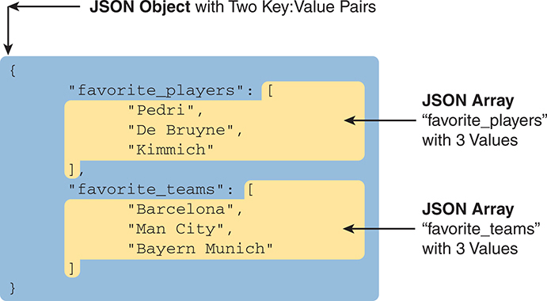

<figcaption>

<aside class="hidden" id="a23fig16">

该图以蓝色为背景为JSON对象,黄色为背景为 JSON 阵列. JSON对象被标注为有"两键对等"的JSON对象. 在JSON对象内部,有两个键:最爱的下划线球员和最爱的上划线球队. 每个密钥都与一个JSON阵列相关. 第一个键,最受欢迎的下划线玩家,后面是包含三个字符串值的阵列:Pedri,De Bruyne,和Kimmich. 此阵列被标记为 JSON 阵列“ 最喜欢的下划线玩家 ” , 有 3 个值, 并有一个指向阵列的箭头 。 第二个键,最受欢迎的下划线球队,后面是包含三个弦值的阵列:巴塞罗那,芒市和拜仁慕尼黑. 这个阵列被标记为 JSON 阵列“ 最喜欢的下划线团队” 有 3 个值, 另有一箭头指向阵列 。

</aside>

<strong>图23-16</strong> <em>精确/完成带有一个对象、两个密钥、两个 JSON 列表值的 JSON数据</em>

</figcaption>

</figure>

<figure class="image-c" id="ch23fig17">

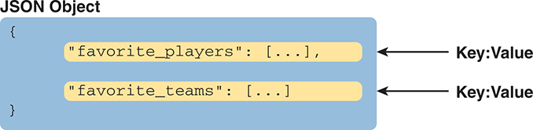

<figcaption>

<aside class="hidden" id="a23fig17">

主要JSON对象被描绘为蓝色长方形并有卷曲的支架QQ来表示对象边界. 在这个矩形内部,有两个键值对垂直排列. 第一个密钥值对由黄色的长方形标记为最受欢迎的下划线玩家所代表,后面是结号:和椭圆形[.]表示一个阵列. 箭头从这个矩形指向右边的标签键,解释结构. 第二个密钥值对同样由另一个被标记为最受欢迎的黄色矩形下划线队所代表,后面是克号:和椭圆数[......]表示出另一个阵列. 另一箭头从这个矩形指向右边的第二个密钥标签.

</aside>

<strong>图23-17</strong> <em>结构代表性<a href="#ch23fig16">图23-16</a>其主要对象和两个键: 等价对等</em>

</figcaption>

</figure>

要将如何找到 JSON 对象的想法驱动回家, 请考虑以下示例 :<a href="#ch23fig18">图23-18</a>。这一数字显示了正确的JSON语法. 其内容如下:

<ul class="sq">

<li>
整个集有一个对象,因为它以花括号开始并结束.
</li>

<li>
外物体有两把密钥(Wendells_favoriites和接口-config).
</li>

<li>
每个键的值:值对是另一个对象(每个对象有卷括号和三个键:值对).
</li>

</ul>

JSON 实例<a href="#ch23fig18">图23-18</a>显示 JSON 如何将对象和阵列嵌入; 也就是说, JSON 把一个对象或阵列放入另一个物体或阵列中。 在你越来越了解网络自动化时,你将会看到大部分的JSON输出将包含带有嵌入式阵列和对象的JSon数据.

<figure class="image-c" id="ch23fig18">

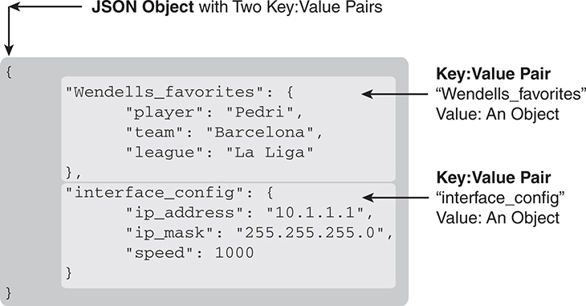

<figcaption>

<aside class="hidden" id="a23fig18">

JSON 对象在视觉上以花括号在左侧表示,表示对象的起步。 第一个密钥值对被标记为 Wendells 以下划线标出最爱对象, Wendells 以下划线标出最爱对象。 这个嵌入对象包含三个密钥值对: 玩家有Pedri值, 团队有巴塞罗那值, 联盟有La Liga值。 一个箭头指向这个嵌入对象, 在主 JSON 对象中强调其结构。 在此下, 第二个密钥值对被标记为接口标出配置, 关键接口也标出一个对象的配置。 这个嵌入对象包含三个密钥值对 : I P 以值标出它的结构 。 10.1.1.1 ,我用这个值强调掩码 255.255.255.0 ,并用该值加速 1000 ,另一个箭头指向了这个被嵌入对象,说明它包含在主的 JSON 对象中. 整个 JSON 对象被封闭在一个灰色的阴影区域,上面有描述性的标签和箭头来澄清 JSON 对象及其被嵌入对象的结构和组件.

</aside>

<strong>图23-18</strong> <em>一个 JSON 对象,带有两个键: 等价对等, 每个值 另一个对象</em>

</figcaption>

</figure>

</section>

<section>

<h5 class="h5" id="ch23lev3sec14">压缩格式与美化格式的 JSON</h5>

到目前为止,所有JSON的例子都显示了大量的空地. JSON根据您的需要允许白空间,或不允许白空间. 对于人类来说,用有空间和对齐的文字来读取JSON可以容易得多. 例如,把相匹配的开口和收尾括号放在同一个左下方就更容易找到哪个括号。

当存储在文件中或发送到网络中时,JSON不使用白空间. 例如,本节早些时候,<a href="#exa23_7">示例23-7</a>显示一个 JSON 对象,有三把钥匙:值对,有白空间,取出五行. 然而,存储在一个文件中,或者通过一个网络发送,JSON会看起来像如下:

<a href="#code-f0550-01" id="f0550-01a">点击此处查看代码原图</a>

<pre class="pre" tabindex="0"><code>{"1stbest": "Messi", "2ndbest": "Ronaldo", "3rdbest": "Maradona"}</code></pre>

在与 JSON 合作时, 你可能使用的大多数工具都会让您从一个漂亮的格式( 对人类好) 切换到原始格式( 计算机好) 。 你可能会看到美丽的版本 字面上叫<em>美化</em>或者说<em>美化后的</em>或者说<em>带空白间隔的</em>,而没有额外空白的版本可能会被调用<em>最简化的</em>或者说<em>原始</em>.

</section>

</section>

</section>

</section>

<section class="ccna-source ccna-appendix" aria-label="答案解析与术语表">
<section data-epub-type="chapter">

<h2 class="h2" id="ref-appc">附录C</h2>

<h2 class="h2a">对“我早就知道了吗?” 的回答。</h2>

<section>

<h3 class="h3" id="ref-appclev1sec23">第23章</h3>

<strong><a id="ref-ques23_1" href="#quess23_1">1</a>。</strong> B 和 D。基于 REST 的 API 的六项主要必需特征中，有三项出现在选项里：客户端/服务器架构、无状态运行，以及标明每个对象是否可缓存。这三项 REST 属性中的两项是本题正确选项。对于错误选项，有状态运行与基于 REST 的 API 的无状态特征相反。另一个错误选项涉及 HTTP：虽然许多基于 REST 的 API 使用 HTTP，但 REST API 并非必须使用 HTTP。

<strong><a id="ref-ques23_2" href="#quess23_2">2</a>。</strong> B 和 D。在软件开发缩写 CRUD 中，各术语（创建、读取、更新、删除）对应一个或多个 HTTP 动词。虽然某些 HTTP 动词有时可用于多种 CRUD 操作，但一般规则是：HTTP POST 用于创建；HTTP GET 用于读取；HTTP PATCH、PUT（有时也包括 POST）用于更新；HTTP DELETE 用于删除。

<strong><a id="ref-ques23_3" href="#quess23_3">3</a>。</strong> C。REST API 调用的 URI 格式为 protocol://hostname/resource?parameters。API 文档详细说明 URI 的资源部分及可选参数。例如，本例的资源部分为 /dna/intent/api/v1/network-device。此外，该资源的 API 文档还说明了 URI 中 ? 之后的查询字段所列出的可选参数。

<strong><a id="ref-ques23_4" href="#quess23_4">4</a>。</strong> A 和 D。四个选项中，JSON 和 XML 最常用于格式化和序列化 REST API 返回的数据。对于错误选项，JavaScript 是一种编程语言，最早将 JSON 定义为数据序列化语言。YAML 是一种数据序列化/建模语言，最常见于 Ansible 等配置管理工具。

<strong><a id="ref-ques23_5" href="#quess23_5">5</a>。</strong> A 和 D。JSON 将变量定义为 key:value 对，键位于冒号（:）左侧且始终用双引号括起，值位于右侧。值可以是简单值，也可以是结构更复杂的对象或数组。对象数量由成对的花括号（{ 和 }）的数量决定，因此本例只有一个 JSON 对象。

这里显示的一个 JSON 对象包含一个键和一个冒号，因此只有一个 key:value 对（使一个选项正确）。该 key:value 对的值本身是 JSON 数组（相当于 Python 中的列表），其中列出数字 1、2 和 3。用方括号括起列表这一点表明它是 JSON 数组。

<strong><a id="ref-ques23_6" href="#quess23_6">6</a>。</strong> C 和 D。解读这些 JSON 数据时，首先查找最内层成对的花括号 { }（表示一个对象）或方括号 [ ]（表示一个数组）。本例中，内层一对花括号 { } 中的内容表示一个 JSON 对象。

该对象内部有四个 key:value 对，每个冒号前是键，冒号后是值。这意味着“type”是键，而“ACCESS”和“10.10.22.66”是值。

如果观察位于 JSON 数据开头和结尾的最外层一对花括号，它们也定义了一个对象。该对象有一个键“response”（因此对应选项不正确）。“response”键的值就是整个内层对象。

</section>

</section>

<section id="ref-glossary"><h2 class="h2a">词汇表</h2>
<strong>可缓存</strong>对于在一段时间内可能反复请求的资源,这个属性意味着请求的主机可以存储(cache)一份特定时间范围内的资源副本.

<strong>CRUD</strong>在软件开发中,一个缩略语,指一个程序采取的最常见的四个动作:创建,读取,更新和删除.

<strong>数据序列化语言</strong>一种包括语法和规则在内的语言,为以文本格式描述应用程序内部的变量提供了一种手段,目的是通过网络在应用程序之间发送该文本,或者将数据模型存储在文件中.

<strong>字典变量</strong>在应用中,一个单变量,其值为有值的其他变量列表,被称作"键:值对".

<strong>JSON( JavaScript 对象标记)</strong>一种通俗的数据序列化语言,最初与JavaScript编程语言相通,后被通俗地与REST API相通.

<strong>JSON 数组</strong>一组 JSON 文本的一部分,以一组相匹配的方括号开头并结尾,其中包含一个数值列表.

<strong>JSON 对象</strong>一组JSON文本的一部分,以一组相匹配的圆括号开始并结束,其中包含一组密钥:值对.

<strong>密钥: 值对</strong>在软件中,一个变量名称(key)及其值,由一些语言和数据序列化语言的克号相隔.

<strong>list variable</strong>在应用中,一个单个变量的值是一个值列表,而不是一个简单的值.

<strong>代表国家移交(REST)</strong>一类API允许两个居住在单独计算机上的程序进行通信,一组由六个初级API属性组成,由它的创建者罗伊·菲尔丁在本世纪早期定义. 属性包括客户端/服务器架构,无国籍操作,可切换性,统一接口,分层,并按需要编码.

<strong>REST API</strong>任何使用代表国家转让规则的API。

<strong>无国籍人</strong>不使用以前交易所储存的信息执行当前交易的协议或进程.

<strong>URI 路径( 资源)</strong>在URI中,在第一个 / 之后的部分,直到查询字段(从一个?开始),该字段在服务器上下文中识别资源.

<strong>URI 查询( 参数)</strong>在 URI 中, 后面的部分 . , 它提供了一个将变量名称和值列表为参数的地方 。

<strong>XML (eXtensible 标记语言)</strong>一个能帮助实现动态网页的标记语言;也作为数据序列化语言有用.

<strong>YAML (YAML Ain't Markup Language) 语言</strong>一种数据序列化语言,可以方便地被人类读取;被Ansible所使用.

</section>
</section>

<section class="ccna-source ccna-appendix" aria-label="代码原图">
<section data-epub-type="chapter">

<a href="#f0527-01a" id="code-f0527-01">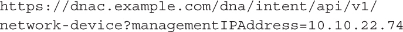</a>

<a href="#f0528-01a" id="code-f0528-01">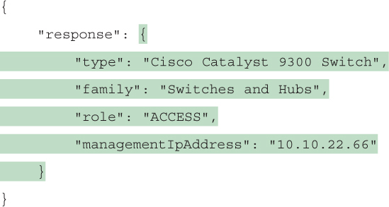</a>

<a href="#f0531-01a" id="code-f0531-01">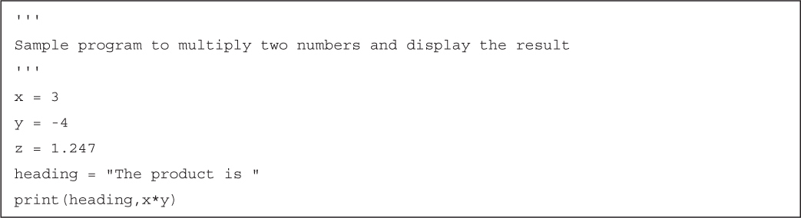</a>

<a href="#f0532-01a" id="code-f0532-01">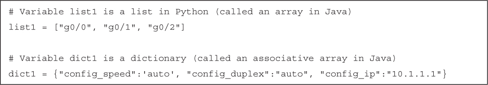</a>

<a href="#f0541-01a" id="code-f0541-01">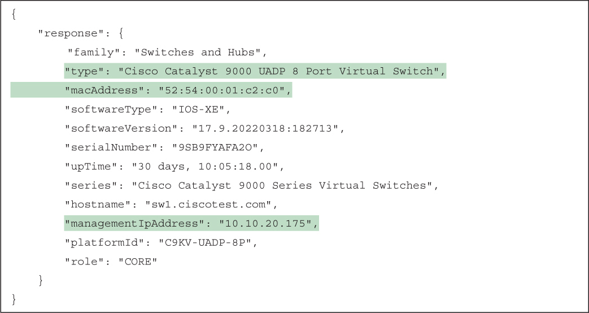</a>

<a href="#f0545-01a" id="code-f0545-01">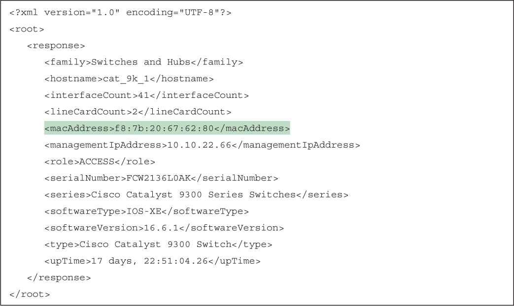</a>

<a href="#f0545-02a" id="code-f0545-02">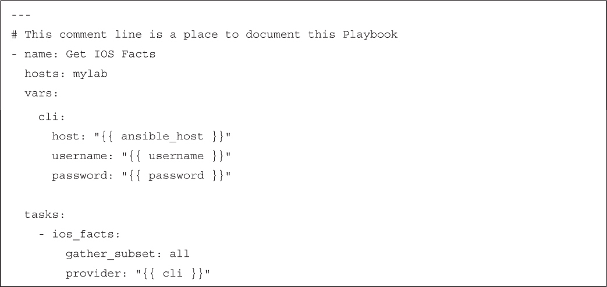</a>

<a href="#f0546-01a" id="code-f0546-01">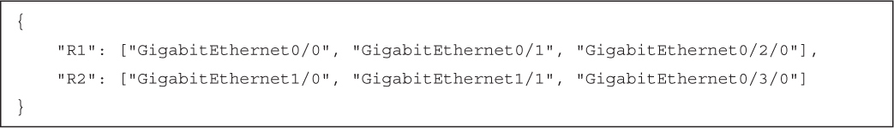</a>

<a href="#f0550-01a" id="code-f0550-01">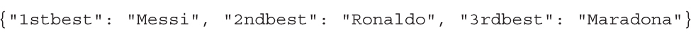</a>

</section>

</section>


<nav class="ccna-chapter-nav" aria-label="章节导航"><a href="v2-22.html">← 上一章</a><a href="v2-24.html">下一章 →</a></nav>
